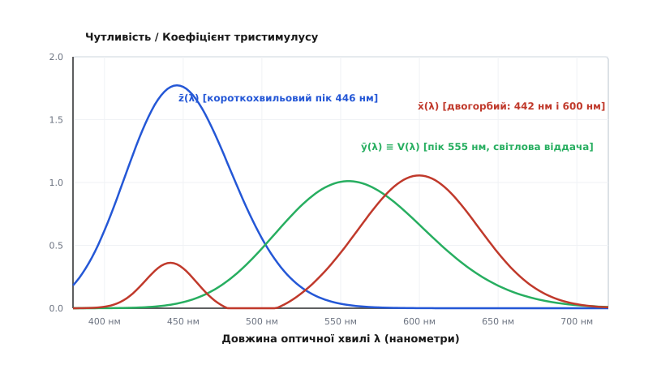
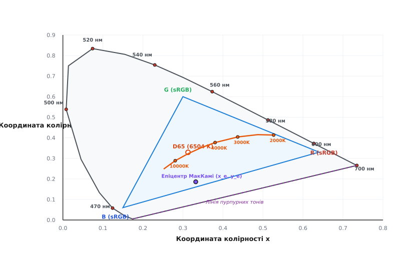
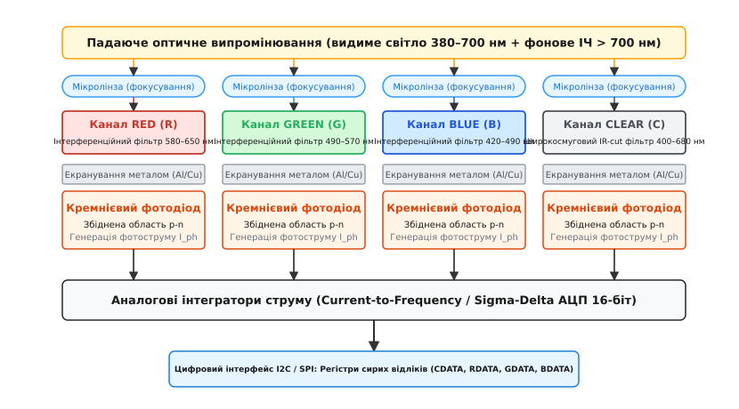
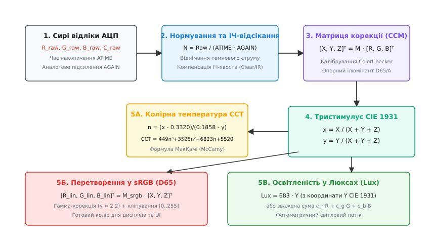

# Колір як вимірювання

<preknowlist>
- [Фотодавачі](root:hw-sensing/photo-sensors) — перетворення світлового потоку на фотострум у кремнієвому p-n переході та спектральна чутливість фотодіода.
- [Фізика напівпровідникового фотоприймача](root:hw-sensing/photodetector-physics) — квантова ефективність, генерація пар електрон-дірка та поглинання фотонів різної довжини хвилі.
- [Темновий струм і теплові шуми](root:hw-sensing/dark-current) — струм витоку збідненої області та температурний дрейф нуля оптичного давача.
- [Компенсація перехресної чутливості](root:hw-sensing/cross-sensitivity-compensation) — лінійна алгебра та калібрувальні матриці для розділення змішаних сигналів мультисенсорних систем.
</preknowlist>

Кремнієвий фотодіод площею 1 мм² під червоним лазерним променем (довжина хвилі 650 нм) оптичною потужністю 1.0 мВт згенерує фотострум приблизно 0.45 мА. Якщо замінити лазер на зелений (532 нм) тієї самої потужності, фотострум становитиме близько 0.35 мА. Простий аналоговий давач освітленості не бачить різниці між зміною кольору випромінювання та банальним коливанням яскравості: стрибок струму з 0.35 мА до 0.45 мА для нього означає лише те, що світла побільшало на 28%. Людина ж бачить принципову зміну оптичного стану — зміну барви.

Фізично світло є електромагнітною хвилею, яка характеризується неперервним спектральним розподілом густини енергії (англ. *Spectral Power Distribution*, SPD). Колір як вимірювальна величина не існує у вакуумі чи на поверхні напівпровідникового кристала: це результат психофізичної реакції людської зорової системи на оптичний спектр. Щоб мікроконтролер міг автоматично відкалібрувати температуру підсвітки монітора, виявити ступінь дозрівання плоду на сортувальному конвеєрі або оцінити якість освітлення в приміщенні, вимірювальний прилад мусить розкласти оптичний спектр на окремі спектральні смуги та виконати матричне перетворення у стандартизовані колориметричні координати.


*Спектральні криві колірного узгодження CIE 1931 x̄(λ), ȳ(λ), z̄(λ). Крива ȳ(λ) з піком на 555 нм точно повторює фотометричну світлову ефективність людського ока V(λ), а крива x̄(λ) має два розділені піки на 442 нм і 600 нм.*

## 1. Трихроматична модель зору та координати CIE 1931

Сітківка людського ока містить три типи фоторецепторних клітин — колбочок (від лат. *fovea*, колбочковий апарат денного зору). Кожен тип клітин містить специфічний зоровий пігмент білкової природи (опсин), який визначає спектральну смугу поглинання:
- **L-колбочки** (*Long-wavelength sensitive*): мають пік чутливості в жовто-червоній ділянці біля 564 нм;
- **M-колбочки** (*Medium-wavelength sensitive*): мають пік у зеленій ділянці біля 534 нм;
- **S-колбочки** (*Short-wavelength sensitive*): мають пік у фіолетово-синій ділянці біля 420 нм.

Коли на око падає світло зі спектральним розподілом потужності `S(λ)`, кожен тип колбочок генерує нервовий імпульс, пропорційний інтегралу перекриття спектра джерела та кривої чутливості рецептора:

```
L = ∫ S(λ) · s_L(λ) dλ
M = ∫ S(λ) · s_M(λ) dλ
S = ∫ S(λ) · s_S(λ) dλ
```

Цей механізм згортає нескінченновимірний вектор фізичного оптичного спектра у тривимірний простір сигналів `(L, M, S)`. Оскільки різні фізичні спектри `S₁(λ) ≠ S₂(λ)` після інтегрування можуть дати абсолютно однакові трійки чисел `(L, M, S)`, вони сприйматимуться оком як один і той самий колір. Це явище зветься **метамеризмом** (від грец. *meta* — переміна та *meros* — частка).

Згідно з законами адитивного змішування Грассмана (Герман Грассман, 1853), трихроматичний зір підпорядковується лінійним алгебраїчним правилам:
1. Будь-який колір однозначно описується трьома лінійно незалежними стимулами.
2. Суміш двох випромінювань викликає збудження, рівне векторній сумі збуджень від кожного випромінювання окремо: `L(S₁ + S₂) = L(S₁) + L(S₂)`.
3. Зміна інтенсивності джерела в `k` разів пропорційно змінює всі три координати в `k` разів.

### Математичний простір тристимулусу CIE 1931 XYZ

Для стандартизації промислових колориметричних вимірювань Міжнародна комісія з освітлення (CIE, фр. *Commission Internationale de l'Éclairage*) у 1931 році ввела систему координат тристимулусу **CIE 1931 XYZ**, спираючись на класичні [досліди з колірного зрівнювання](root:hw-sensing/color-sensor/hist-cie-1931.md) Райта та Гілда.

Простір спирається на три стандартні функції колірного узгодження (англ. *color matching functions*) `x̄(λ)`, `ȳ(λ)`, `z̄(λ)`, визначені в діапазоні довжин хвиль від 380 до 780 нм для поля зору 2° (центральна ямка сітківки). Координати тристимулусу `X, Y, Z` обчислюються шляхом зваженого інтегрування:

```
X = k · ∫ S(λ) · x̄(λ) dλ
Y = k · ∫ S(λ) · ȳ(λ) dλ
Z = k · ∫ S(λ) · z̄(λ) dλ
```

де нормувальний множник `k = 683 лм/Вт` переводить спектральну густину потужності (Вт/нм) у фотометричні одиниці.

Три координати мають суворе фізичне призначення:
1. **Координата `Y`** вимірює фотометричну яскравість (кд/м²) або освітленість (люкс), оскільки функція `ȳ(λ)` була штучно обрана рівною кривій денної світлової ефективності `V(λ)`.
2. **Координати `X` та `Z`** несуть суто хроматичну інформацію: `Z` корелює з короткохвильовим (синім) збудженням, а `X` — зі змішаним червоно-фіолетовим відгуком.

У 1964 році CIE додатково стандартизувала функції для додаткового спостерігача з полем зору 10° (`x̄₁₀(λ)`, `ȳ₁₀(λ)`, `z̄₁₀(λ)`), які використовують для оцінки великих однорідних поверхонь (текстиль, лакофарбові покриття), де в зір включаються палички периферії сітківки. Для точкових колірних сенсорів стандартом де-факто лишається модель 1931 року (2°).

### Нормовані координати колірності (x, y)

Щоб відокремити форму спектра (відтінок і насиченість) від абсолютної інтенсивності світлового потоку, простір тристимулусу проектують на двовимірну площину одиничної суми `X + Y + Z = 1`:

```
x = X / (X + Y + Z)
y = Y / (X + Y + Z)
z = Z / (X + Y + Z) = 1 - x - y
```

Пара чисел `(x, y)` зветься **координатами колірності** (англ. *chromaticity coordinates*). Оскільки `x + y + z = 1`, третя координата `z` є лінійно залежною і окремо не зберігається. Повне однозначне колориметричне представлення оптичного сигналу утворює трійка `(x, y, Y)`, де `(x, y)` задають колірність, а `Y` — фотометричну яскравість.


*Діаграма колірності CIE 1931 на площині (x, y). Спектральний локус утворює зовнішню підковоподібну межу видимих монохроматичних випромінювань (від 380 до 700 нм). Всередині показано трикутник колірного охоплення стандарту sRGB, точку білого D65 та дугу колірних температур Планка.*

Будь-який колір на площині `(x, y)` можна охарактеризувати двома геометричними величинами відносно точки білого `W(x_w, y_w)`:
1. **Домінівна довжина хвилі `λ_dom`:** точка перетину променя, проведеного з точки білого через точку кольору, зі спектральним локусом. Вона визначає фізичний колірний відтінок (наприклад, 580 нм — чистий жовтий).
2. **Чистота збудження `p_e` (колориметрична насиченість):** відношення відстані від білої точки до кольору до повної відстані від білої точки до спектрального локусу:
   ```
   p_e = (x - x_w) / (x_locus - x_w)
   ```
   Для монохроматичного випромінювання `p_e = 1.0` (100% насиченість), для білого світла `p_e = 0.0`.

> 🔧 **Навіщо це.** Розділення на `(x, y)` та `Y` дає змогу вимірювальній системі порівнювати зразки незалежно від відстані до лампи. Якщо червона деталь віддалиться від світильника, абсолютний потік фотонів впаде у 4 рази (координата `Y` зменшиться), але співвідношення `x` та `y` залишиться незмінним. Це фундаментальна основа комп'ютерного розпізнавання матеріалів.

---

## 2. Оптична архітектура кремнієвого колірного сенсора

Кремнієвий p-n перехід як фізичний напівпровідник поглинає фотони з енергією, більшою за ширину забороненої зони кремнію `E_g ≈ 1.12 еВ` при 300 K. Це означає, що кремній має власну фоточутливість у широкому діапазоні від ультрафіолету (300 нм) до ближнього інфрачервоного діапазону (1100 нм), причому пік квантової ефективності чистого кремнію припадає на невидиму оку зону 800–900 нм.

Глибина проникнення світла в товщу кремнію строго підпорядковується закону Бугера-Ламберта:

```
I(z) = I₀ · exp(-α(λ) · z)
```

де `α(λ)` — коефіцієнт оптичного поглинання кремнію. Для коротких хвиль (синє світло 400 нм) `α ≈ 10⁵ см⁻¹`, тому фотони повністю поглинаються в тонкому приповерхневому шарі товщиною менше 0.2–0.5 мкм. Для червоного світла (700 нм) `α ≈ 2·10³ см⁻¹`, і глибина поглинання зростає до 5–10 мкм. Ближнє інфрачервоне світло (900 нм) має `α ≈ 3·10² см⁻¹` і проникає на глибину понад 30–50 мкм, генеруючи носії глибоко в підкладці.

Без спеціальних оптичних фільтрів будь-яке теплове випромінювання сонячного світла чи лампи розжарювання генерує в кремнії гігантський струм носіїв із глибини підкладки, який повністю маскує корисний сигнал видимого світла.


*Поперечний переріз кристала колірного сенсора RGBC. Над чотирма незалежними кремнієвими фотодіодами нанесено діелектричні багатошарові фільтри Фабрі-Перо та фокусувальні мікролінзи. Канал Clear має блокування ІЧ-діапазону.*

### Органічні барвники проти тонкоплівкових інтерференційних фільтрів

У ранніх оптичних сенсорах та дешевих матрицях камер використовували пігментні органічні фільтри (матриці Баєра на основі желатинових полімерів). Органічні барвники мають два важкі недоліки для вимірювальної техніки:
1. **Деградація від ультрафіолету та температури:** під дією сонця або нагріву паяння барвник блякне, зміщуючи спектр пропускання на 5–15 нм за рік експлуатації.
2. **Паразитне інфрачервоне пропускання:** органічні червоні, зелені та сині пігменти стають практично прозорими для хвиль довше 700 нм. Без додаткового зовнішнього інфрачервоного скла будь-яке тепло ламп розжарювання або сонячного світла повністю засвічує всі три канали однаковим паразиційним фотострумом.

Сучасні прецизійні колориметричні мікросхеми (серії TCS34725, TCS3430, AS7341) використовують **діелектричні інтерференційні фільтри** (фільтри Фабрі-Перо, англ. *Fabry-Pérot thin-film interference filters*).

На поверхню кремнію методом вакуумного осадження наносять черговані шари діелектриків із різними показниками заломлення (діоксид кремнію `SiO₂` з `n ≈ 1.46` та діоксид титану `TiO₂` з `n ≈ 2.4` або нітрид кремнію `Si₃N₄`). Товщина кожного шару строго дорівнює чверті довжини хвилі `d = λ / (4·n)`. Внаслідок багатопроменевої інтерференції хвилі небажаного діапазону взаємно гасяться у відбитті, а потрібна смуга проходить до фотодіода з крутими фронтами зрізу (до 90% пропускання у смузі та менше 0.1% поза смугою). Інтерференційні структури монолітно інтегровані в кристал, не старіють від нагріву й витримують промислові температури до +105 °C без дрейфу спектра.

### Конфігурація каналів RGBC (Red, Green, Blue, Clear)

Типова архітектура інтегрального вимірювача кольору містить чотири канали:
- **Червоний канал (R):** інтерференційний смуговий фільтр 580–650 нм (пік ~615 нм);
- **Зелений канал (G):** інтерференційний смуговий фільтр 490–570 нм (пік ~525 нм);
- **Синій канал (B):** інтерференційний смуговий фільтр 420–490 нм (пік ~465 нм);
- **Прозорий канал (Clear, C):** фотодіод без кольорового фільтра, перекритий лише загальним інфрачервоним відсікачем (IR-blocking filter 400–680 нм).

Канал Clear виконує три критичні метрологічні функції:
1. **Динамічне автопідсилення та запобігання переповненню:** канал Clear накопичує найбільший струм (сумарний потік усього видимого діапазону). Прошивка мікроконтролера контролює саме відлік `C_raw`: якщо він перевищує 90% від максимуму розрядності АЦП, час інтеграції або аналогове підсилення негайно зменшують.
2. **Розрахунок абсолютної освітленості (Lux):** відлік Clear з високою точністю корелює з повним світловим потоком.
3. **Детекція та компенсація паразитного ІЧ-випромінювання:** порівняння суми `(R + G + B)` із каналом `C` дає змогу оцінити спектральний склад і компенсувати залишковий витік інфрачервоного спектра.

Щоб усунути просторовий паралакс (коли під косим променем тінь падає на сусідній піксель), 16 або 64 субпікселі на кристалі розводять не великими блоками, а у шаховому або концентричному порядку (шахова сітка `2×2` або `4×4`), об'єднуючи однойменні фотодіоди паралельно металізацією верхнього шару.

### Мультиспектральні аналізатори (8–11 каналів)

Для задач прецизійної спектрорадіометрії чотирьох каналів RGBC недостатньо: спектри з гострими провалами (люмінесцентні та розрядні лампи) дають колориметричну похибку. Для таких застосувань використовують багатоканальні сенсори, такі як ams AS7341.

Кристал AS7341 містить 16 фотодіодів, згрупованих у 11 каналів:
- 8 оптичних каналів видимого світла `F1..F8` із центральними смугами 415, 445, 480, 515, 555, 590, 630, 680 нм і напівшириною FWHM 30–50 нм;
- Широкосмуговий канал `Clear`;
- Канал ближнього інфрачервоного світла `NIR` (910 нм) для оцінки теплового фону;
- Апаратний канал детекції мерехтіння `Flicker` (аналоговий смуговий фільтр для виявлення мерехтіння світильників на частотах 50/60/100/120/1000 Гц).

Повний програмний драйвер та математичний розбір такого приладу наведено у вставці про [мультиспектральний спектрорадіометр AS7341](root:hw-sensing/color-sensor/proj-as7341-spectral.md).

---

## 3. Алгоритм колірного перетворення та матриця CCM 3×3

Фізичні спектри пропускання інтерференційних фільтрів `R(λ), G(λ), B(λ)` кремнієвого сенсора ніколи не збігаються ідеально зі стандартизованими кривими колірного узгодження людського ока `x̄(λ), ȳ(λ), z̄(λ)`.

У колориметрії ця проблема відома як **умова Лютера-Івеса** (англ. *Luther-Ives condition*): для того, щоб триканальний приймач вимірював координати CIE XYZ безпомилково для будь-якого довільного спектра, його спектральна чутливість мусить бути точною лінійною комбінацією функцій `x̄(λ), ȳ(λ), z̄(λ)`. Оскільки жоден реальний оптичний фільтр не повторює, наприклад, складний двогорбий профіль кривої `x̄(λ)` (яка має пік на 600 нм і вторинний підйом на 442 нм), сирі відліки давача `(R_raw, G_raw, B_raw)` вимагають математичної матричної корекції.


*Конвеєр колориметричної обробки: від сирих відліків АЦП до нормалізованих координат CIE 1931 XYZ, температури CCT за МакКамі та колірного простору sRGB.*

### Попереднє нормування відліків

Перед застосуванням матриць сирі 16-бітні коди АЦП приводять до лінійної шкали, незалежної від поточного часу інтеграції `t_int` та аналогового коефіцієнта підсилення `Gain`:

```
R_norm = (R_raw - R_dark) / (t_int · Gain)
G_norm = (G_raw - G_dark) / (t_int · Gain)
B_norm = (B_raw - B_dark) / (t_int · Gain)
C_norm = (C_raw - C_dark) / (t_int · Gain)
```

де `R_dark, G_dark, B_dark, C_dark` — відліки [темнового струму](root:hw-sensing/dark-current) фотодіодів при закритій апертурі сенсора.

### Матриця колірної корекції (Color Correction Matrix, CCM)

Перехід від нормованого апаратного простору `(R_norm, G_norm, B_norm)` до координат тристимулусу `(X, Y, Z)` виконується за допомогою калібрувальної матриці розмірністю 3×3 (або 3×4 із залученням каналу Clear):

```
[ X ]   [ m₁₁  m₁₂  m₁₃ ]   [ R_norm ]
[ Y ] = [ m₂₁  m₂₂  m₂₃ ] · [ G_norm ]
[ Z ]   [ m₃₁  m₃₂  m₃₃ ]   [ B_norm ]
```

Коефіцієнти матриці `M_CCM` визначають експериментально на калібрувальному стенді за допомогою методу найменших квадратів. Для цього сенсор засвічують відбитками 24 стандартних колірних полів калібрувальної мішені (Macbeth ColorChecker) під еталонним освітленням (наприклад, стандартне денне світло CIE D65 або галогенне світло Illuminant A).

Позначимо матрицю виміряних нормованих відліків 24 полів як `R_data` розміром `24×3`, а матрицю їхніх теоретичних координат тристимулусу як `X_ref` розміром `24×3`. Оптимальна матриця колірної корекції знаходиться за формулою псевдообернення Мура-Пенроуза:

```
M_CCM = (R_dataᵀ · R_data)⁻¹ · R_dataᵀ · X_ref
```

Якщо матриця `R_dataᵀ · R_data` погано обумовлена (високе число обумовленості `cond(M) > 50`), матричне перетворення різко посилює шум АЦП у насичених синіх та червоних кольорах. У такому разі застосовують регуляризацію Тихонова (Ridge Regression):

```
M_CCM = (R_dataᵀ · R_data + λ_reg · I)⁻¹ · R_dataᵀ · X_ref
```

Типова калібрувальна матриця для сенсора TCS34725 під джерелом D65 має вигляд:

```
[ X ]   [  0.0829   0.1983  -0.0381 ]   [ R_norm ]
[ Y ] = [  0.0321   0.2452  -0.0210 ] · [ G_norm ]
[ Z ]   [ -0.0512  -0.0821   0.3891 ]   [ B_norm ]
```

Діагональні елементи мають найбільші додатні значення (основний внесок відповідного каналу), а недіагональні від'ємні коефіцієнти компенсують взаємне перекриття оптичних фільтрів ([перехресну чутливість](root:hw-sensing/cross-sensitivity-compensation)).

### Перетворення з CIE 1931 XYZ у стандартний колірний простір sRGB

Щоб відобразити виміряний колір на екрані чи передати в графічний інтерфейс, координати `X, Y, Z` необхідно перевести у міжнародний стандартний колірний простір **sRGB** (IEC 61966-2-1) з опорною білою точкою D65 (`x_w = 0.3127, y_w = 0.3290`).

Перетворення складається з двох послідовних етапів.

**Етап 1: Лінійна матрична трансформація (XYZ → Linear RGB):**

```
[ R_lin ]   [  3.2404542  -1.5371385  -0.4985314 ]   [ X ]
[ G_lin ] = [ -0.9692660   1.8760108   0.0415560 ] · [ Y ]
[ B_lin ]   [  0.0556434  -0.2040259   1.0572252 ]   [ Z ]
```

Отримані лінійні компоненти обмежують знизу нулем (кліпування від'ємних значень поза колірним охопленням дисплея):

```
R_lin = max(0.0, R_lin)
G_lin = max(0.0, G_lin)
B_lin = max(0.0, B_lin)
```

**Етап 2: Нелінійна гамма-компенсація (Transfer Function):**

Екрани та людський зір сприймають яскравість нелінійно (логарифмічно). Стандарт sRGB використовує кускову гамма-функцію для кожної компоненти `C_lin ∈ {R_lin, G_lin, B_lin}`:

```
Якщо C_lin ≤ 0.0031308:
    C_srgb = 12.92 · C_lin

Якщо C_lin > 0.0031308:
    C_srgb = 1.055 · (C_lin)^(1 / 2.4) - 0.055
```

Для переводу в 8-бітний діапазон `[0..255]` значення множать на 255 із насиченням:

```
R_8bit = min(255, max(0, round(255.0 · R_srgb)))
G_8bit = min(255, max(0, round(255.0 · G_srgb)))
B_8bit = min(255, max(0, round(255.0 · B_srgb)))
```

---

## 4. Розрахунок колірної температури (CCT), Duv та освітленості (Lux)

Корельована колірна температура (CCT, від англ. *Correlated Color Temperature*) кількісно описує тепловий відтінок білого світла:
- Тепле світло (лампи розжарювання, захід сонця): `2200–3000 K` (переважає червоно-жовтий спектр);
- Нейтральне біле світло (офісні люмінесцентні/LED світильники): `4000–4500 K`;
- Холодне денне світло (хмарне небо, розсіяне сонце): `5500–6500 K`;
- Глибоке синє північне небо: `8000–12000 K`.

### Формула МакКамі (McCamy's Approximation)

Суворе визначення CCT вимагає пошуку найкоротшої евклідової відстані на нелінійній рівноконтрастній діаграмі CIE 1960 `(u, v)`, що є обчислювально важким для 8- та 32-бітних мікроконтролерів.

У 1992 році К. С. МакКамі запропонував надзвичайно швидку емпіричну формулу, яка розраховує CCT безпосередньо з нормалізованих координат колірності `(x, y)`:

```
n = (x - 0.3320) / (0.1858 - y)
CCT = 449.0 · n³ + 3525.0 · n² + 6823.3 · n + 5520.33
```

де точка `(x_e = 0.3320, y_e = 0.1858)` є геометричним епіцентром перетину всіх ліній постійної колірної температури на діаграмі CIE 1931. Детальне математичне обґрунтування, геометричний зміст та оцінка похибок наведені у вставці про [виведення формули МакКамі](root:hw-sensing/color-sensor/math-mccamy-cct.md).

### Параметр відхилення від чорного тіла (Duv)

Одне лише число CCT не дає повної інформації про якість білого світла: два світильники можуть мати однаковий `CCT = 4000 K`, але один випромінюватиме приємне біле світло, а другий матиме неприємний болотний зелений або рожевий відтінок.

Для кількісної оцінки цього зміщення використовують метрику **Duv** — відстань зі знаком від точки джерела світла до найближчої точки планковського локусу в рівноконтрастному просторі CIE 1960 UCS `(u, v)`:
- `Duv > 0` (додатне значення): спектр зміщений вище лінії чорного тіла у зелено-жовту зону (типова вада дешевих LED-матриць);
- `Duv < 0` (від'ємне значення): спектр зміщений нижче лінії чорного тіла у пурпурно-рожеву зону;
- `|Duv| ≤ 0.003` (нейтральний баланс): світло сприймається оком як ідеальне природне біле світло (вимога стандарту ANSI C78.377).

### Фотометрична освітленість (Lux)

Освітленість вимірює поверхневу густину світлового потоку в люксах (лк, лм/м²). Оскільки координата `Y` простору CIE 1931 зважена за кривою денного зору `V(λ)`, освітленість обчислюється як:

```
Освітленість = 683.002 · Y
```

Якщо калібрувальна матриця CCM не використовується, для сенсорів RGBC застосовують емпіричну лінійну згортку каналів із поправкою на ІЧ-засвітку:

```
Lux = (c_r · R_norm + c_g · G_norm + c_b · B_norm) / IR_correction
```

де для типового кремнієвого сенсора коефіцієнти становлять `c_r = -0.32466, c_g = 1.57837, c_b = -0.73191`. Від'ємний червоний коефіцієнт компенсує те, що кремнієвий фотодіод у червоній зоні має значно ширшу паразитну смугу чутливості, ніж людське око.

### Межі 3-канальних сенсорів та індекс передачі кольору (CRI)

Індекс передачі кольору (Color Rendering Index, CRI Ra) оцінює, наскільки природно виглядають кольори предметів під штучним світлом у порівнянні з еталонним чорнотільним випромінювачем.

Звичайний 3-канальний RGB-сенсор принципово не здатен виміряти CRI: через три широкі смуги він не «бачить» вузьких провалів у спектрі між піками світлодіодів. Якщо джерело світла має сильний провал у зоні 660–680 нм (дефіцит глибокого червоного кольору, індекс R9), RGB-давач покаже нормальний CCT і правильний колірний тон, але людська шкіра під таким світлом виглядатиме блідою та мертвотно-сірою. Для повноцінного вимірювання CRI необхідний багатоканальний аналіз на спектральних сенсорах рівня AS7341.

---

## 5. Повний драйвер колірного сенсора на C та C++

Нижче наведено промисловий код драйвера колірного сенсора для вбудованих систем. Драйвер містить повний конвеєр: налаштування регістрів інтегрування та аналогового підсилення, обробку переповнення АЦП, калібрувальне множення на матрицю CCM 3×3, розрахунок координат `(x, y)`, обчислення CCT за поліномом МакКамі та формування кінцевого 8-бітного коду `sRGB [0..255]` із гамма-корекцією.

:::tabs
:::code color-sensor-d/c/main.c
:::code color-sensor-d/cpp/main.cpp
:::

---

## 6. Апаратні пастки, кутові ефекти та дизайн оптомеханіки

Колориметричний сенсор є гібридним оптико-електронним приладом, тому його вимірювальна точність залежить не лише від коду прошивки, а й від фізичної конструкції світловоду, лінз та термодинаміки корпусу.

### Кутовий зсув інтерференційних фільтрів (Blue Shift)

Інтерференційні фільтри Фабрі-Перо базуються на різниці оптичного ходу променів у тонких діелектричних плівках. Якщо світло падає не строго по нормалі до кристала, а під кутом `θ` (косі промені), центральна довжина хвилі пропускання `λ_θ` зміщується у бік коротших хвиль (так званий блакитний зсув, англ. *blue shift*):

```
λ_θ = λ₀ · √[ 1 - (sin² θ) / n_eff² ]
```

де `n_eff ≈ 1.8–2.1` — ефективний показник заломлення багатошарового пакету.

При куті падіння `θ = 45°` центральна довжина хвилі зеленого фільтра (525 нм) зміщується вниз майже на 35–40 нм (у зону синьо-зеленого світла ~488 нм). Це призводить до критичного спотворення координат `(x, y)` при вимірюванні розсіяного світла.

**Інженерне рішення:** сенсор мусить встановлюватися в оптичний коліматорний тунель або перекриватися молочним матовим розсіювачем (дифузором із тефлону або полікарбонату), який нормалізує кутову діаграму спрямованості до ламбертівського профілю.

### Вплив частоти мерехтіння освітлення (Flicker)

Більшість світлодіодних драйверів та люмінесцентних баластів використовують широтно-імпульсну модуляцію (ШІМ) або пульсують на подвійній частоті мережі живлення: 100 Гц (у Європі/Україні при 50 Гц) або 120 Гц (у США при 60 Гц).

Якщо час інтеграції АЦП сенсора обрано випадковим чином (наприклад, 15 мс), відлік залежатиме від того, на яку фазу пульсації світильника припало відкриття затвора АЦП: послідовні вимірювання кольору будуть хаотично коливатися на 10–25%.

**Інженерне рішення:** час інтеграції АЦП `t_int` завжди встановлюють строго кратним найменшому спільному кратному періодів 100 Гц (10 мс) та 120 Гц (8.33 мс):
- Оптимальний крок інтеграції: `t_int = 50 мс` (вміщує рівно 5 періодів 100 Гц та 6 періодів 120 Гц);
- Або `t_int = 100 мс` (10 періодів 100 Гц / 12 періодів 120 Гц).

Це повністю пригнічує стробоскопічні биття від штучного освітлення.

### Температурний дрейф темнового струму

Темновий струм напівпровідникового кремнієвого переходу подвоюється на кожні +8...+10 °C зростання температури кристала:

```
I_dark(T) ≈ I_dark(T₀) · 2^((T - T₀) / 8.5)
```

Якщо прилад працює поруч із гарячим процесором чи силовим стабілізатором живлення, за температури кристала +65 °C темновий струм зростає у 30–40 разів відносно кімнатної температури (+25 °C). Без періодичного віднімання темнових кодів (автонуляції) сенсор інтерпретуватиме тепловий витік як «червоно-інфрачервоне світло», що катастрофічно спотворює розрахунок колірної температури CCT у бік низьких значень (фальшиве «почервоніння»). Прецизійні системи періодично закривають механічну шторку або віднімають відліки спеціального замаскованого металом чорного фотодіода (англ. *dark reference photodiode*), розміщеного на тому самому кристалі.
