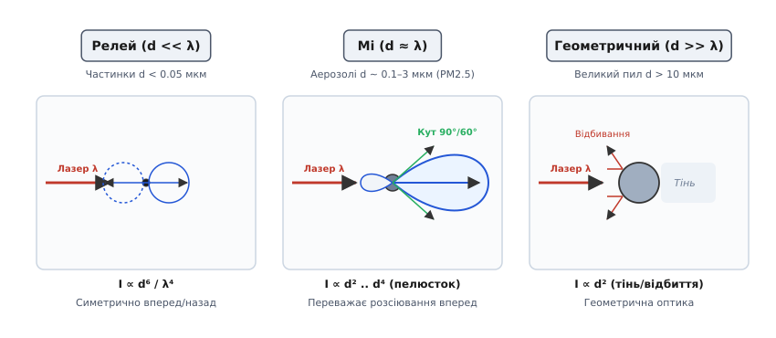
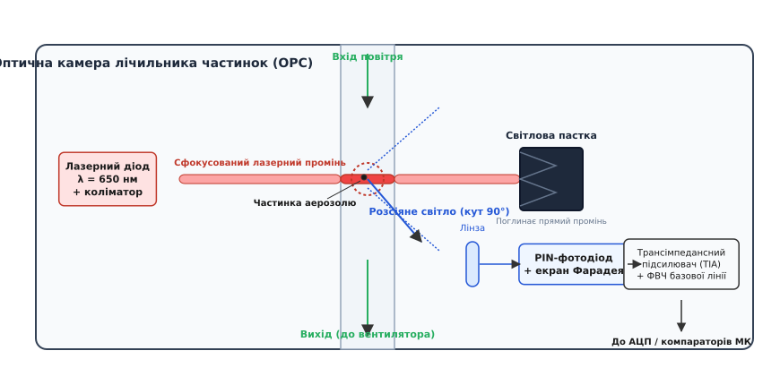
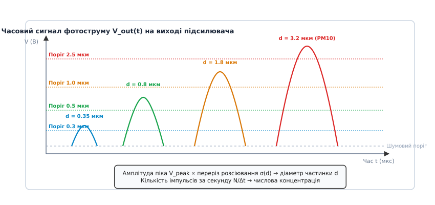
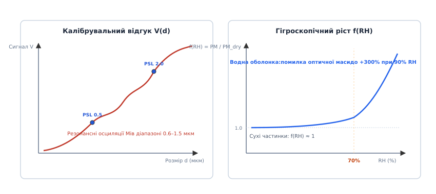

# Пил PM2.5: оптичні вимірювачі дрібнодисперсних аерозолів

<preknowlist>
- [Фізика фотоприймачів](root:hw-sensing/photodetector-physics) — перетворення світлового потоку у фотострум, квантова ефективність, PIN-структура.
- [Темновий струм](root:hw-sensing/dark-current) — джерела термоемісійного струму витоку, дробовий шум та динамічний діапазон.
- [Асинхронний послідовний порт UART](root:com-devices/uart) — кадри, швидкість передачі, стартові та стопові біти.
- [Давачі оточення](root:hw-sensing/environment-sensors) — класи первинних перетворювачів, передавальні характеристики та умови експлуатації.
</preknowlist>

Людське око не здатне розрізнити окремі частинки, розмір яких менший за сорок мікрометрів. Водночас найбільш небезпечна для здоров'я фракція атмосферного аерозолю — дрібнодисперсний пил PM2.5 із діаметром часток менш як два з половиною мікрометри — вільно долає фільтри верхніх дихальних шляхів, проникає в альвеоли легень і потрапляє безпосередньо у кровотік. Контроль такої невидимої загрози вимагає вимірювання мікрограмових концентрацій речовини у кожному кубічному метрі повітря безпосередньо в режимі реального часу.

Спроба виміряти концентрацію аерозолю традиційним методом прямого фотометричного пропускання — вимірюванням затінення світлового променя, як це роблять у димомірах вихлопних газів — повністю провалюється за типових атмосферних умов. За типової концентрації PM2.5 на рівні двадцяти мікрограмів на кубічний метр у промені завдовжки один сантиметр загальне геометричне перекриття світлового потоку частинками становить менше однієї мільйонної частки вхідної інтенсивності. Таке мізерне ослаблення безслідно тоне у власному тепловому дрейфі потужності лазера, шумах фотоприймача та змінах напруги живлення.

Вирішенням проблеми став перехід від світлопоглинання до темнопільних оптичних лічильників частинок (англ. *Optical Particle Counter*, OPC). У темній ізольованій камері з поглинальною світловою пасткою прямий лазерний промінь взагалі не потрапляє на чутливий фотодіод. Коли ж окрема мікроскопічна частинка перетинає сфокусовану лазерну перетяжку, вона розсіює світло на всі боки, створюючи спалах фотонів на нульовому фоні. Амплітуда та частота таких коротких імпульсів струму дозволяють одночасно визначити розмір і кількість часток.

### Фізика розсіювання світла Мі

Характер взаємодії світлової хвилі з матеріальною частинкою визначається співвідношенням її геометричного діаметра `d` та довжини хвилі випромінювання `λ`. У сучасних лазерних сенсорах пилу джерелом когерентного світла виступає червоний напівпровідниковий лазер із довжиною хвилі `λ = 650` нм. Безрозмірний параметр розміру `x = (π · d) / λ` задає границю між трьома принципово різними фізичними режимами розсіювання.

Коли розмір частинки значно менший за довжину хвилі (`d << λ`, параметр `x < 0.2`, частинки менші за 0.05 мкм), реалізується релеївське розсіювання (англ. *Rayleigh scattering*). Світлова хвиля поляризує молекулу або наночастинку як єдиний точковий диполь. Інтенсивність розсіяного світла у цьому режимі надзвичайно різко спадає зі зменшенням розміру — пропорційно шостому степеню діаметра (`I ∝ d⁶ / λ⁴`), а діаграма спрямованості є майже симетричною між передньою та задньою півсферами. Через настільки слабкий сигнал напівпровідниковий оптичний лічильник принципово не здатний детектувати частинки, менші за 0.2–0.3 мкм.


*Оптичні режими розсіювання світла залежно від співвідношення розміру частинки d та довжини хвилі лазера λ. У зоні Мі спостерігається сильна асиметрія з переважанням розсіювання вперед.*

Коли розмір частинки наближається до довжини хвилі випромінювання (`d ≈ λ`, параметр `x` лежить у межах від 0.5 до 15, діаметри від 0.1 до 3 мкм), спостерігається розсіювання Мі (англ. *Mie scattering*, описане німецьким фізиком Густавом Мі у 1908 році). У цьому режимі хвиля збуджує всередині діелектричної краплі або порошинки багатополюсні коливання зарядів. Вторинні хвилі, випромінювані різними точками частинки, інтерферують між собою. 

Головна властивість розсіювання Мі — сильна просторова асиметрія: переважна частка розсіяної енергії спрямовується вперед за напрямком лазерного пучка (формується так званий передній пелюсток). Зростання інтенсивності з діаметром сповільнюється до степеневої залежності `I ∝ d² .. d⁴`, а на кутовій діаграмі з'являються характерні інтерференційні пелюстки, що детально розраховуються через [математичний апарат розсіювання Мі](root:hw-sensing/dust-aerosol-sensor/math-mie-scattering.md).

Для великих частинок пилу (`d >> λ`, `x > 30`, `d > 10` мкм) інтерференція усереднюється, і настає геометричний режим. Тут інтенсивність розсіяного світла стає просто пропорційною геометричній площі перерізу частинки `I ∝ d²` за рахунок поверхневого відбиття, заломлення та дифракції на контурі тіні.

> 🔧 **Навіщо це.** Стрибок залежності інтенсивності від `d⁶` у релеївській зоні до `d²` у геометричній означає, що динамічний діапазон оптичного сигналу для частинок від 0.3 до 10 мкм сягає чотирьох-п'яти порядків (від кількох піковатів до сотень нановатів). Вхідний тракт підсилювача сенсора повинен опрацьовувати як ледь помітні спалахи від субмікронного пилу, так і потужні імпульси від великих піщинок без насичення.

### Конструкція оптичної вимірювальної камери

Сенсор пилу — це прецизійний оптоелектронний прилад, поміщений у компактний пластиковий або металевий екран розміром із сірникову коробку. Всередині корпусу виділено два ізольовані об'єми: електронний відсік із мікроконтролером та оптичну вимірювальну камеру, крізь яку прокачується досліджуване повітря.

Оптична система камери побудована за безвідблисковою темнопільною схемою і складається з п'яти ключових вузлів: лазерного випромінювача, повітряного тракту, зони вимірювання, світлової пастки та блоку фотоприймача.


*Будова оптичної вимірювальної камери сенсора пилу: лазер формує плоский промінь, вентилятор прокачує пробу повітря через зону розсіювання, прямий промінь гаситься у світловій пастці, а фотодіод під кутом 90° фіксує імпульси розсіяного світла.*

Лазерний діод випромінює пучок червоного світла потужністю від 3 до 7 мВт. Перед лазером встановлено асферичну коліматорну лінзу та щілинну діафрагму. Вони формують пласку оптичну перетяжку завтовшки близько 100–200 мкм і завширшки 1–2 мм. Лазер живиться від стабілізатора струму зі схемою автоматичного регулювання потужності (англ. *Automatic Power Control*, APC), що використовує внутрішній моніторний фотодіод для компенсації температурного дрейфу випромінювання кристала.

Повітряний потік створюється мініатюрним відцентровим вентилятором або безколекторною турбіною, розташованою на виході з камери. Вентилятор працює на всмоктування: він протягує повітря через вхідний забірний канал, проводить його крізь зону лазерного променя та викидає назовні. Постійність об'ємної витрати повітря `Q` (типово близько 0.1 л/хв) є критично важливою, оскільки саме вона визначає часовий масштаб прольоту частинок. Щоб уникнути завихрень та осідання пилу на оптиці, геометрія вхідного сопла оптимізується для створення стабільного ламінарного потоку. У дорожчих сенсорах застосовують аеродинамічну сорочку чистого повітря (англ. *sheath flow*), яка відтискає запилений потік до центру каналу.

Зона вимірювання (англ. *scattering volume*) утворюється на перетині повітряного струменя та лазерного пучка. Її об'єм становить менше 0.5 мм³. Завдяки такому малому об'єму частинки за помірної запиленості перетинають світловий промінь строго поодинці.

Прямий лазерний промінь, пройшовши через повітряний потік, потрапляє у світлову пастку (англ. *beam dump*). Це замкнена порожнина з клиноподібними поглинальними ребрами, виготовлена з чорного матового пластику або оксидованого алюмінію. Завдяки багаторазовому відбиттю світло всередині пастки поглинається більш ніж на 99.9%. Якби прямий промінь відбився назад у камеру, фонове розсіяне світло засліпило б фотоприймач.

Під прямим кутом (90°) або під кутом 60° до лазерного променя розташовано блок фотоприймача. Кут 90° обирають через найменшу чутливість до поляризації світла та геометричну зручність екранування від прямого лазерного пучка. Вхідна збиральна лінза фокусує розсіяні фотони на світлочутливу площадку кремнієвого PIN-фотодіода. Сам фотодіод та його перший підсилювальний каскад закривають мідним або латунним екраном Фарадея, який захищає тракт від електромагнітних завад з боку двигуна вентилятора та радіомодулів.

### Аналіз імпульсів фотоструму та схемотехніка підсилювача

Коли аерозольна частинка пролітає крізь лазерний промінь зі швидкістю повітряного потоку `v`, фотодіод генерує короткий імпульс фотоструму. Тривалість цього імпульсу визначається часом прольоту через товщину лазерної перетяжки:

```
Δt_pulse = w_beam / v_flow
```

За типової товщини променя `w_beam = 150` мкм і швидкості повітряного струменя `v_flow = 5` м/с тривалість імпульсу становить від 20 до 40 мікросекунд. Амплітуда імпульсу фотоструму коливається від кількох десятків пікоамперів для субмікронних часток до сотень наноамперів для великого пилу.

Перетворення такого слабкого та швидкісного струмового сигналу вимагає ретельно спроєктованого аналогового тракту:

1. **Трансімпедансний підсилювач (TIA):** первинне перетворення струму фотодіода в напругу виконує малошумний операційний підсилювач із польовими транзисторами на вході (JFET або CMOS), де вхідний струм зміщення не перевищує 1 пА. Вибір опору зворотного зв'язку `R_f` (типово від 1 до 10 МОм) є компромісом між коефіцієнтом підсилення та смугою пропускання. Для запобігання самозбудженню підсилювача через бар'єрну ємність фотодіода `C_d` (зазвичай 5–20 пФ) паралельно резистору `R_f` підключають коригувальний конденсатор `C_f ≈ 0.5 .. 2` пФ.
2. **Динамічне відновлення базової лінії (Baseline Restorer):** на фотодіод постійно діє паразитна фонова засвітка від неідеальностей світлової пастки та [темновий струм](root:hw-sensing/dark-current), що експоненційно зростає з температурою. Щоб цей повільний постійний зсув не перевантажував наступні каскади, сигнал пропускають через активний фільтр високих частот другого порядку з частотою зрізу близько 1 кГц.
3. **Піковий детектор та багатопорогова дискретизація:** відфільтрований імпульс потрапляє на швидкодіючий піковий детектор або банк апаратних компараторів із прецизійними опорними напругами. Кожен поріг компаратора відповідає каліброваному еквівалентному оптичному діаметру частинки.


*Часова розгортка імпульсів фотоструму на виході підсилювача: амплітуда піка відповідає оптичному діаметру частинки, а частота проходження імпульсів задає рахункову концентрацію.*

Оскільки амплітуда імпульсу однозначно пов'язана з оптичним перерізом розсіювання, мікроконтролер сенсора класифікує кожен зареєстрований імпульс за розмірними інтервалами — **бінами** (англ. *bins*). Типова калібрувальна сітка містить шість бінів:
- `N_0.3` — частки з еквівалентним діаметром понад 0.3 мкм;
- `N_0.5` — частки понад 0.5 мкм;
- `N_1.0` — частки понад 1.0 мкм;
- `N_2.5` — частки понад 2.5 мкм;
- `N_5.0` — частки понад 5.0 мкм;
- `N_10` — частки понад 10.0 мкм.

Кількість імпульсів, підрахованих у кожному біні за фіксований час накопичення (типово 100–500 мс), визначає **рахункову концентрацію** частинок у штуках на літр або штуках на 0.1 літра повітря.

#### Похибка збігу та накладання імпульсів

Коли концентрація пилу стає дуже високою (понад 500–1000 мкг/м³ під час сильного задимлення), виникає явище збігу (англ. *coincidence error*). У зону розсіювання одночасно потрапляють дві або більше частинок. Фотодіод сприймає їх як один злитий спалах подвоєної яскравості. 

Це призводить до подвійного спотворення: сенсор занижує загальну кількість часток (рахункову концентрацію), але водночас помилково класифікує сумарний сплеск як одну гігантську частинку, що спричиняє сильне завищення розрахункової маси. Прошивка сенсора компенсує цей ефект за допомогою статистичних моделей мертвого часу (англ. *dead time correction*), проте за екстремальних рівнів диму оптичні лічильники втрачають лінійність.

### Масовий перерахунок концентрації у мкг/м³

Споживачеві та санітарним нормам потрібна не абстрактна кількість імпульсів, а масова концентрація аерозолю — маса пилу в одиниці об'єму повітря, що вимірюється у мікрограмах на кубічний метр (мкг/м³).

Перехід від лічильних імпульсів до маси здійснюється за кілька етапів:

1. **Розрахунок диференціальної кількості частинок у кожному розмірному діапазоні:**
   ```
   ΔN_1 = N_0.3 - N_0.5   [кількість часток у діапазоні 0.3–0.5 мкм]
   ΔN_2 = N_0.5 - N_1.0   [кількість часток у діапазоні 0.5–1.0 мкм]
   ΔN_3 = N_1.0 - N_2.5   [кількість часток у діапазоні 1.0–2.5 мкм]
   ΔN_4 = N_2.5 - N_10.0  [кількість часток у діапазоні 2.5–10.0 мкм]
   ```

2. **Оцінка сумарного геометричного об'єму частинок:**
   Припускаючи, що частинки мають кулясту форму, об'єм однієї частинки розраховують за характеристичним діаметром біна `d_i`:
   ```
   V_i = (π / 6) · d_i³
   V_total = ∑ (ΔN_i · V_i)
   ```

3. **Множення на ефективну густину аерозолю:**
   Маса частинок визначається добутком об'єму на густину матеріалу `ρ`:
   ```
   PM = ρ_eff · V_total
   ```

Для заводського калібрування сенсорів (зокрема Plantower) як еталон використовують стандартизований мінеральний пил Аризони (англ. *Arizona Test Dust*, ISO 12103-1 A1 Ultrafine) із фіксованою густиною `ρ ≈ 1.65` г/см³ (`1650` кг/м³, або `1.65 · 10¹²` мкг/м³). 

У вихідних даних сенсора формуються два масиви значень:
- **Standard Particle (CF=1):** сирий результат масового перерахунку для заводського тестового аерозолю високої густини.
- **Atmospheric Environment:** скоригований емпіричний результат для типового міського повітря, де аерозоль містить легші органічні сполуки та сульфати з меншою середньою густиною.


*Оптична калібрувальна крива з осциляціями Мі та експоненційне зростання похибки вимірювання маси через гігроскопічне набрякання аерозолю за високої відносної вологості.*

#### Вплив відносної вологості та гігроскопічне набрякання

Найбільшим джерелом похибки всіх лазерних сенсорів пилу на відкритому повітрі є вологість. Багато компонентів атмосферного аерозолю (зокрема солі амонію, нітрати та сульфати) є гігроскопічними. Коли відносна вологість перевищує точку деліквесценції (`RH > 70%`), частинки починають конденсувати на собі водяну пару та набрякати.

Збільшення радіуса частинки усього на 25% через набрякання водою призводить до подвоєння її об'єму (`1.25³ ≈ 1.95`), а при `RH = 90%` оптично виміряна маса пилу може перевищувати реальну суху масу в 3–4 рази. Професійні станції моніторингу підігрівають вхідне повітря перед вимірювальною камерою за допомогою осушувальної трубки (дегідратора), щоб знизити RH нижче 50%. 

У компактних приладах без підігріву для корекції показань використовують формулу Хенеля (англ. *Hänel growth equation*), спираючись на дані сусіднього [давача вологості](root:hw-sensing/environment-sensors):

```
PM_corrected = PM_raw / ( 1 + a · [ (RH / 100) / (1 - RH / 100) ]^b )
```

де `a ≈ 0.25`, `b ≈ 1.0` — емпіричні коефіцієнти для змішаного континентального аерозолю.

### Порівняння оптичних архітектур та еталонні методи

У сфері вимірювання якості повітря застосовують три різні класи приладів, які принципово відрізняються фізикою та точністю:

1. **Недорогі світлодіодні фотометри (наприклад, Sharp GP2Y1010AU0F, Shinyei PPD42NS):** використовують інфрачервоний світлодіод замість лазера та резистивний нагрівач для конвекційного протягування повітря без вентилятора. Через низьку когерентність світлодіода та відсутність сфокусованого променя такий сенсор не бачить окремих частинок, а вимірює лише сумарну каламутність (англ. *nephelometry*). Вони не здатні розрізняти фракції PM1.0, PM2.5 та PM10 і схильні до величезного температурного дрейфу.
2. **Лазерні лічильники частинок з вентилятором (Plantower PMS5003, Sensirion SPS30, Alphasense OPC-N3):** реєструють кожну частинку окремо методом розсіювання Мі, забезпечують вибірку за бінами та розрахунок фракцій PM. Вони є стандартом для побутових станцій моніторингу та очищувачів повітря.
3. **Гравіметричний еталон (EN 12341):** повітря прокачують через тефлоновий мембранний фільтр протягом 24 годин із фіксованою швидкістю, після чого фільтр зважують на мікровагах в умовах строго контрольованої вологості. Це абсолютний метрологічний еталон, за яким калібрують усі оптичні датчики.

### Практична інтеграція та драйвер сенсора

Більшість доступних лазерних сенсорів (Plantower PMS5003/PMS7003, Nova Fitness SDS011) використовують асинхронний інтерфейс UART зі швидкістю 9600 біт/с. Сенсор Plantower PMS5003 передає 32-байтні пакети даних, детально описані в [довідці протоколу PMS5003](root:hw-sensing/dust-aerosol-sensor/api-pms5003-protocol.md).

Парсер потоку UART у прошивці мікроконтролера повинен реалізовувати стійкий скінченний автомат (FSM), здатний синхронізуватися з початком кадру (`0x42 0x4D`), контролювати довжину та валідувати 16-бітну контрольну суму без блокування основного циклу програми.

Нижче наведено повну реалізацію драйвера на мовах C та C++.

:::tabs
:::code dust-aerosol-sensor-d/c/main.c
:::code dust-aerosol-sensor-d/cpp/main.cpp
:::

### Правила схемотехніки та механічного монтажу

Надійність та довговічність оптичних вимірювачів аерозолю залежать від умов монтажу не менше, ніж від алгоритмів фільтрації:

1. **Орієнтація у просторі:** сенсор слід встановлювати так, щоб вісь повітряного каналу розташовувалася строго горизонтально, а забірний отвір дивився вбік або вниз. Вертикальне розташування соплом догори перетворює вимірювальну камеру на пилозбірник: важкі піщинки під дією сили тяжіння осідають на коліматорній лінзі лазера, безповоротно засліплюючи датчик за кілька місяців.
2. **Фільтрація живлення:** імпульсне споживання вбудованого двигуна вентилятора створює пульсації струму амплітудою до 50 мА на частоті комутації обмоток. Для лінії живлення 5 В обов'язковим є встановлення електролітичного або танталового конденсатора ємністю не менше 47–100 мкФ у парі з керамічним блокувальним конденсатором на 0.1 мкФ безпосередньо біля роз'єму сенсора.
3. **Температурна ізоляція:** модуль не можна розміщувати поруч із джерелами тепла (лінійними стабілізаторами, процесорами, модулями Wi-Fi/LTE). Нагрівання корпусу сенсора викликає паразитні внутрішні конвекційні потоки, які спотворюють стабільність прокачування повітря та змінюють відносну вологість всередині камери.
4. **Управління ресурсом (Sleep Mode):** напівпровідниковий лазерний діод має обмежений ресурс безперервної роботи (близько 8000–15000 годин). Для автономних приладів рекомендується переводити сенсор у сплячий режим (через пін `SET` або команду `0xE4`), прокидаючись раз на 5–10 хвилин. Після ввімкнення обов'язково витримують паузу в 30 секунд для розгону турбіни та виходу повітряного тракту на усталений ламінарний режим перед фіксацією показань.
