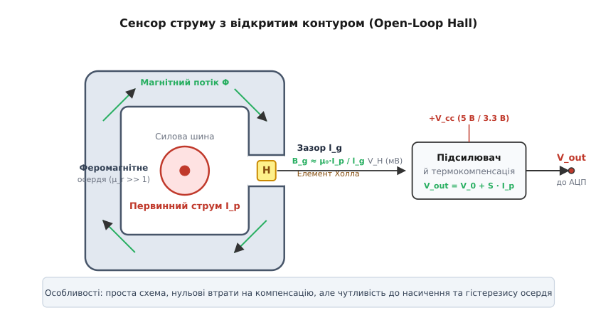
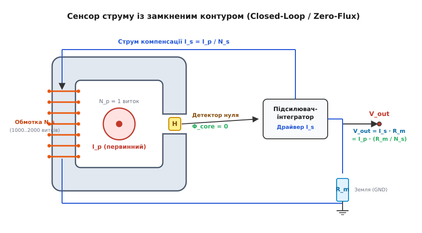
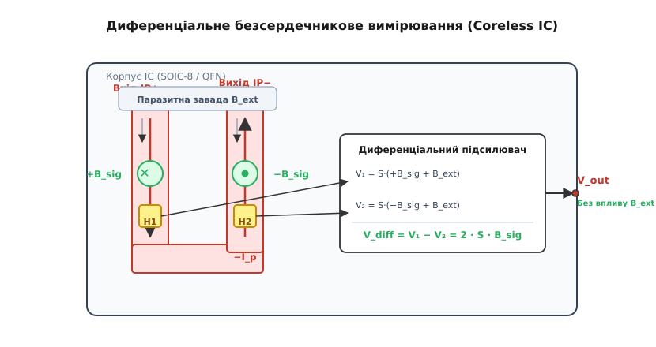
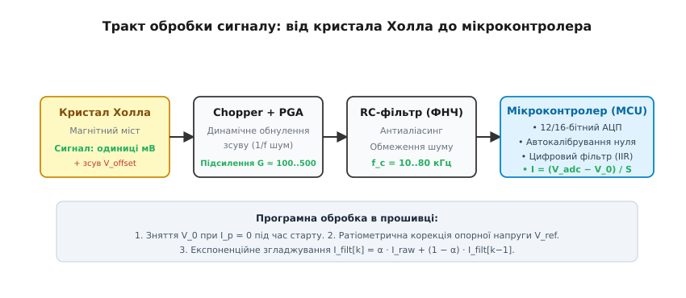

# 🧲 Струм без розриву кола

<preknowlist>
- [Закон Біо–Савара–Лапласа](root:ph-electromagnetism/biot-savart-law) — зв'язок між електричним струмом у провіднику та породженим ним просторовим магнітним полем.
- [Ефект Холла](root:hw-sensing/hall-sensor) — виникнення поперечної різниці потенціалів під дією сили Лоренца на рухомі носії заряду в напівпровіднику.
- [Магнітний опір та магнітні кола](root:ph-electromagnetism/magnetic-reluctance) — закон Гопкінсона, магніторушійна сила та розподіл магнітного опору між осердям і зазором.
- [Гальванічна розв'язка](root:hw-components/galvanic-isolation) — принципи електричного розділення високовольтних силових кіл і низьковольтної вимірювальної логіки.
</preknowlist>

У силовій електроніці високої потужності — тягових інверторах електромобілів на 400–800 В, промислових частотних перетворювачах і сонячних електростанціях — вимірювання фазного струму силою 300 А за допомогою контактного резистивного шунта спричиняє комплекс важких інженерних проблем. Навіть мініатюрний шунт з опором 1 мОм при такому струмі безперервно розсіює у вигляді тепла `P = I² · R = 300² · 0.001 = 90` Вт енергії, вимагаючи встановлення масивних радіаторів охолодження та знижуючи загальний ККД установки. Крім того, контактний шунт руйнує гальванічну ізоляцію між високовольтною шиною і чутливим входом мікроконтролера, а розрив силової мідної шини збільшує паразитну індуктивність монтажу, породжуючи руйнівні викиди напруги `V = L · (di/dt)` під час комутації швидких транзисторів зі швидкістю понад 1000 А/мкс.

Магнітне поле, що нерозривно оточує будь-який провідник зі струмом, не створює омічних втрат енергії, не потребує механічного розриву силових шин і вільно долає діелектричні бар'єри. Давачі струму на основі [ефекту Холла](root:ph-condensed/hall-effect) (англ. *Hall effect current sensors*) використовують це поле для безконтактного, гальванічно ізольованого вимірювання як постійного (DC), так і високочастотного змінного (AC) струму в діапазоні від часток ампера до кількох тисяч амперів.

---

### Фізичний механізм: від струму до локальної магнітної індукції

Згідно із [законом Біо–Савара–Лапласа](root:ph-electromagnetism/biot-savart-law) та [законом повного струму](root:ph-electromagnetism/ampere-circuital-law), навколо нескінченно довгого прямолінійного провідника зі струмом `I` виникає вихрове магнітне поле. На відстані `r` від осі провідника магнітна індукція `B` становить:

```text
B(r) = (μ₀ · I) / (2 · π · r)      [поле прямого нескінченного провідника]
```

де `μ₀ = 4π · 10⁻⁷` Гн/м — фундаментальна магнітна стала (магнітна проникність вакууму).

Погляньмо на реальні фізичні порядки величин: якщо по провіднику тече струм 10 А, то на відстані `r = 5` мм від його поверхні магнітна індукція дорівнює:

```text
B = (4π · 10⁻⁷ · 10) / (2 · π · 0.005)      [підстановка значень: I = 10 А, r = 5 мм]
= (4 · 10⁻⁶) / 0.01                         [скорочення π та множення в чисельнику]
= 4 · 10⁻⁴ Тл = 400 мкТл = 0.4 мТл          [переведення одиниць у мілітесли]
```

Величина 0.4 мТл є вкрай малою: природне магнітне поле Землі складає від 30 до 60 мкТл, а струми у сусідніх дротах чи феромагнітні деталі шафи легко створюють поля в одиниці мілітесла. Виміряти таке пряме поле голим напівпровідниковим кристалом без спотворень зовнішніми завадами практично неможливо.

Щоб подолати цей бар'єр, первинний провідник охоплюють кільцевим або С-подібним осердям із матеріалу з високою магнітною проникністю (силовий ферит MnZn або електротехнічна кремнієва сталь з `μ_r ≈ 2000..100000`). Осердя концентрує практично весь магнітний потік у своєму об'ємі та спрямовує його у вузький повітряний зазор шириною `l_g` (зазвичай 1–3 мм), де й розміщується чутливий напівпровідниковий елемент Холла.


*Конструкція сенсора струму з відкритим контуром: феромагнітне осердя концентрує магнітний потік первинного струму I_p у повітряному зазорі l_g. Кристал Холла реєструє локальну індукцію B_g, а вбудований підсилювач формує вихідну напругу V_out.*

Застосувавши [закон Гопкінсона](root:ph-electromagnetism/magnetic-reluctance) (аналог закону Ома для магнітного кола) до осердя довжиною `l_c` із площею перерізу `S` та зазором `l_g`, отримуємо вираз для повного магнітного потоку `Φ`:

```text
F_m = N_p · I_p = I_p                       [магніторушійна сила первинного витка]
R_m,core = l_c / (μ₀ · μ_r · S)             [магнітний опір феромагнітного осердя]
R_m,gap  = l_g / (μ₀ · S)                   [магнітний опір повітряного зазору]
Φ = F_m / (R_m,core + R_m,gap)              [закон Гопкінсона для повного кола]
```

Оскільки відносна проникність феромагнетика дуже велика (`μ_r >> 1`), магнітний опір самого осердя становить менше 1–2% від опору зазору (`R_m,core << R_m,gap`). Тоді магнітна індукція безпосередньо в зазорі спрощується до вигляду:

```text
B_g = Φ / S                                 [визначення індукції через потік]
≈ I_p / (R_m,gap · S)                       [знехтування малим опором осердя R_m,core]
= (μ₀ · I_p) / l_g                          [індукція в зазорі концентратора]
```

Якщо зазор `l_g = 2` мм, то струм 10 А створює в ньому індукцію:

```text
B_g = (4π · 10⁻⁷ · 10) / 0.002              [підстановка параметрів: I_p = 10 А, l_g = 2 мм]
= (1.2566 · 10⁻⁵) / 0.002                   [обчислення магнітної константи з точністю]
= 6.28 · 10⁻³ Тл = 6.28 мТл                 [переведення одиниць у мілітесли]
```

Осердя підвищило корисну магнітну індукцію в зоні вимірювання майже в 16 разів порівняно з відкритим простором, водночас екрануючи кристал від зовнішніх паразитних полів. Детальний математичний розрахунок із врахуванням крайового розсіювання потоку на торцях зазору наведено у [математичному розрахунку магнітного кола осердя](root:hw-sensing/hall-current-sensor/math-core-gap.md).

> 🔧 **Навіщо це.** Завдяки концентратору індукція `B_g` залежить майже виключно від струму `I_p` і геометричної ширини зазору `l_g`, стаючи незалежною від магнітної проникності `μ_r` осердя. Це робить вимірювальний тракт стійким до коливань температури осердя, якщо тільки воно не наближається до точки магнітного насичення.

---

### Топологія з відкритим контуром (Open-Loop Hall Sensor)

Сенсор струму з відкритим контуром (англ. *Open-Loop current sensor*) — це пристрій прямого перетворення. Магнітний потік первинного струму проходить крізь осердя, збуджує в зазорі індукцію `B_g`, яка згідно з фізикою сили Лоренца породжує на контактах напівпровідникового кристала мікровольтову напругу Холла `V_H = (R_H / t) · I_bias · B_g`. Вбудований інструментальний підсилювач збільшує цей сигнал до рівнів 0–5 В або 0–3.3 В.

Вихідна напруга сенсора описується рівнянням прямої лінії:

```text
V_out = V_ref + S_N · I_p      [рівняння перетворення сенсора струму]
```

де:
* `V_ref` — напруга спокою (зміщення нуля) за відсутності первинного струму (`I_p = 0`), яка для двополярних сенсорів із однополярним живленням 5 В зазвичай становить `V_cc / 2 = 2.5` В;
* `S_N` — номінальна чутливість перетворювача (англ. *sensitivity*), що вимірюється в мВ/А або В/А;
* `I_p` — миттєвий первинний струм.

#### Переваги та обмеження відкритого контуру

Головні переваги архітектури Open-Loop — конструктивна простота, мінімальна кількість компонентів, низька собівартість, компактні габарити та практично нульове власне енергоспоживання (сенсор живить лише малопотужну схему підсилювача, споживаючи типово 10–20 мА).

Проте відкритий контур має низку принципових фізичних обмежень, які не дозволяють використовувати його у високопрецизійних вимірювальних приладах:

1. **Магнітне насичення осердя (Saturation).** При великих струмах індукція в осерді досягає величини насичення матеріалу (`B_sat ≈ 0.35..0.45` Тл для силових феритів). Диференціальна магнітна проникність `μ_r` падає до одиниці, магнітний опір осердя різко зростає, і вихідний сигнал сенсора перестає зростати разом зі струмом.
2. **Залишкова намагніченість та гістерезис (Hysteresis / Remanence).** Феромагнітні матеріали мають петлю гістерезису. Якщо крізь сенсор пройде короткочасний потужний імпульс струму (наприклад, пусковий кидок мотора або струм короткого замикання), в осерді залишається залишковий магнітний потік `B_rem`. Це зміщує напругу нуля `V_ref` на еквівалент від 0.5% до 2% номінального струму навіть після повного зняття навантаження.
3. **Температурний дрейф чутливості та нуля.** Коефіцієнт Холла напівпровідника суттєво залежить від температури через температурну зміну концентрації та рухливості вільних носіїв заряду (дрейф чутливості TCG становить типово від −0.05%/°C до −0.2%/°C). Навіть із застосуванням вбудованих ланцюгів аналогової термокомпенсації сумарна температурна похибка сенсорів Open-Loop у діапазоні від −40 °C до +105 °C досягає 1.5–3.5%.
4. **Обмежена смуга пропускання (Bandwidth).** Через вихрові струми (англ. *eddy currents*) та магнітні втрати в осерді сенсори з відкритим контуром рідко мають робочу смугу пропускання вище 25–50 кГц, а час їхньої реакції на ступінчастий стрибок струму складає 3–7 мкс.

---

### Топологія із замкненим контуром (Closed-Loop / Zero-Flux Transducer)

Щоб повністю усунути недоліки феромагнітного осердя — нелінійність, насичення, температурний дрейф і залишковий гістерезис, — у прецизійній силовій електроніці використовують принцип магнітної компенсації, відомий як **замкнений контур** або **давач нульового магнітного потоку** (англ. *Closed-Loop / Zero-Flux current transducer*).


*Сенсор струму із замкненим контуром (Zero-Flux): кристал Холла працює як нуль-індикатор. Підсилювач зворотного зв'язку жене вторинний струм I_s крізь багатовиткову обмотку N_s, точно компенсуючи первинний потік до нуля. Вихідний сигнал знімається з вимірювального резистора R_m.*

У цій топології елемент Холла більше не вимірює абсолютне значення магнітного поля. Він виконує роль високочутливого **детектора нуля** (нуль-органа).

#### Принцип магнітного балансу

На феромагнітне осердя намотують додаткову вторинну компенсаційну обмотку з великою кількістю витків `N_s` (зазвичай від 1000 до 5000 витків найтоншого мідного дроту).

Щойно первинний провідник із струмом `I_p` створює в осерді магнітний потік `Φ_p`, у зазорі з'являється поле, і кристал Холла генерує сигнал розбалансу. Цей сигнал надходить на вхід інтегруючого підсилювача та потужного двотактного вихідного каскаду (драйвера струму). Драйвер миттєво формує у вторинній обмотці такий компенсаційний струм `I_s`, магнітний потік якого `Φ_s` спрямований суворо назустріч первинному потоку.

Схема перебуває в стані динамічної рівноваги лише тоді, коли результуючий магнітний потік усередині осердя дорівнює нулю:

```text
Φ_total = Φ_p - Φ_s = 0                     [умова повного взаємного знищення потоків]
N_p · I_p - N_s · I_s = 0                   [баланс магніторушійних сил ампер-витків]
```

Оскільки первинний провідник робить рівно один прохід крізь вікно (`N_p = 1`), компенсаційний вторинний струм суворо дорівнює:

```text
I_s = I_p · (N_p / N_s) = I_p / N_s         [рівняння компенсаційного вторинного струму]
```

Цей струм пропускають крізь прецизійний термостабільний вимірювальний резистор `R_m` (англ. *burden resistor*), падіння напруги на якому подається на вихід сенсора або безпосередньо на вхід диференційного підсилювача:

```text
V_out = I_s · R_m                           [закон Ома для вимірювального резистора]
= I_p · (R_m / N_s)                         [підстановка вторинного струму I_s = I_p / N_s]
```

#### Чому Zero-Flux кардинально перевершує Open-Loop

1. **Повна лінійність та відсутність насичення.** Оскільки в стаціонарному режимі результуючий магнітний потік у сердечнику підтримується рівним нулю (`B ≈ 0`), матеріал осердя ніколи не виходить на нелінійну ділянку і не входить у насичення. Лінійність такого перетворювача сягає 0.05–0.1%.
2. **Відсутність залишкового гістерезису.** Оскільки осердя не перемагнічується по повній петлі гістерезису, похибка залишкового зміщення нуля після перевантажень струмом практично зникає.
3. **Виключення температурного дрейфу напівпровідника.** Чутливість усього приладу визначається лише відношенням витків `N_s` (яке є абсолютно сталим геометричним числом) та температурним коефіцієнтом опору резистора `R_m` (який легко обрати на рівні менше 10–25 ppm/°C). Температурний дрейф коефіцієнта Холла напівпровідника повністю компенсується замкненим контуром регулювання!
4. **Гібридний ефект трансформатора струму.** На високих частотах (від кількох сотень герц до 200–500 кГц) пристрій автоматично починає працювати як класичний [трансформатор струму](root:ph-electromagnetism/electromagnetic-induction): швидка зміна первинного струму індукує ЕРС вторинної обмотки безпосередньо через взаємну індукцію, оминаючи затримки електронного підсилювача Холла. Завдяки цьому сенсори Closed-Loop мають смугу пропускання до 500 кГц, швидкість наростання `di/dt > 100` А/мкс і час відгуку менше 0.5–1 мкс.

#### Динаміка та стійкість вторинного контуру

Компенсаційна обмотка `N_s` володіє власною індуктивністю `L_s` та міжутковою розподіленою ємністю `C_s`. Разом із вихідним опором драйвера та вимірювальним резистором `R_m` вона утворює коливальний контур другого порядку.

Щоб замкнений контур регулювання не втратив стійкість і не перейшов у режим автоколивань на частотах 100–300 кГц, операційний підсилювач охоплюють ланками випереджально-запізнілої корекції (lead-lag compensation), а паралельно вимірювальному резистору `R_m` часто встановлюють демпфувальний RC-ланцюг `R_d - C_d`, який пригнічує високочастотний резонансний пік амплітудно-частотної характеристики.

#### Фізична плата за точність

За бездоганну точність та швидкість доводиться платити високим власним енергоспоживанням. Щоб зрівноважити первинний струм 200 А в сенсорі з `N_s = 1000`, внутрішній підсилювач змушений безперервно прокачувати крізь вторинну обмотку струм `I_s = 200 / 1000 = 0.2` А (200 мА). При опорі вторинної обмотки та навантаження `R_total = 40` Ом потужність розсіювання всередині самого сенсора становить:

```text
P_internal = I_s² · R_total = 0.2² · 40 = 0.04 · 40 = 1.6 Вт      [внутрішнє тепловиділення]
```

Для трьох фаз інвертора це понад 4.8 Вт додаткових втрат у системі живлення давачів. Крім того, вихідний драйвер потребує потужного двополярного джерела живлення (типово ±15 В або ±12 В), а самі модулі мають значну масу та вищу вартість через наявність прецизійної обмотки з тисяч витків.

---

### Безсердечникові інтегральні сенсори (Coreless ICs) та диференціальне вимірювання

Сучасні компактні перетворювачі енергії вимагають монтажу компонентів безпосередньо на друковану плату автоматичними лініями SMD-пайки. Масивні металеві та феритові кільця не поміщаються у стандартні корпуси мікросхем (SOIC-8, TSSOP-16, QFN). Це зумовило створення безсердечникових інтегральних сенсорів струму (англ. *Coreless Current Sensor ICs*, приклади: Texas Instruments TMCS1100, Allegro ACS712/ACS724/ACS730, Melexis MLX91220).


*Безсердечниковий інтегральний сенсор (Coreless IC): струм тече крізь внутрішній U-подібний провідник (leadframe), створюючи магнітні поля протилежного напрямку +B_sig та -B_sig над двома кристалами Холла H1 та H2. Диференціальний віднімач повністю скорочує однорідну зовнішню заваду B_ext.*

#### Внутрішня будова та гальванічна ізоляція

Усередині пластикового корпусу мікросхеми розміщено силовий мідний вивідний каркас (leadframe), що має низький внутрішній активний опір (близько 0.5–1.2 мОм) і здатний пропускати безперервний струм до 20–50 А (та піковий до 100–200 А).

Безпосередньо над цим провідником, відокремлений тонким шаром високонадійного кремнійорганічного або поліімідного діелектрика товщиною в десятки мікрометрів, розташований кристал кремнієвої інтегральної схеми. Така монолітна конструкція забезпечує електричну міцність ізоляції від 2.5 до 5 кВ RMS між силовими клемами (`IP+`, `IP-`) та низьковольтними виводами керування (`VCC`, `GND`, `VOUT`).

#### Диференціальне придушення зовнішніх завад

Головний недолік відсутності феромагнітного осердя — абсолютна відкритість до зовнішніх паразитичних магнітних полів (полів розсіювання сусідніх індуктивностей, силових доріжок плати та магнітів двигуна).

Для вирішення цієї проблеми первинний струмовий провідник усередині корпусу вигинають у формі літери U. Струм втікає по лівій доріжці та витікає по правій у протилежному напрямку. Над кожною з доріжок на фіксованій відстані `d` розташовують окремий чутливий елемент Холла — `H1` та `H2`:

* Струм `+I_p` у лівій доріжці створює над елементом `H1` вертикальну складову магнітної індукції `+B_sig`;
* Зворотний струм `-I_p` у правій доріжці створює над елементом `H2` індукцію протилежного знаку `-B_sig`.

Будь-яка зовнішня паразитна завада `B_ext`, джерело якої розташоване далі ніж кілька міліметрів від мікросхеми, діє на обидва чутливі елементи практично з однаковою силою та в одному напрямку:

```text
B_total,1 = +B_sig + B_ext                  [індукція на першому елементі Холла]
B_total,2 = -B_sig + B_ext                  [індукція на другому елементі Холла]
```

Елементи генерують пропорційні напруги: `V₁ = S · B_total,1` та `V₂ = S · B_total,2`. Сигнали надходять на внутрішній [диференціальний підсилювач](root:hw-analog/instrumentation-amp), який віднімає їх один від одного:

```text
V_diff = V₁ - V₂                            [різниця вихідних напруг елементів]
= S · (+B_sig + B_ext) - S · (-B_sig + B_ext) [підстановка повних полів з урахуванням завади]
= S · (+B_sig + B_ext + B_sig - B_ext)      [розкриття дужок у виразі]
= 2 · S · B_sig                             [повне скорочення синфазної завади B_ext]
```

Однорідне поле завади `B_ext` ідеально скорочується при відніманні, а корисний сигнал подвоюється! Завдяки цьому коефіцієнт послаблення зовнішнього магнітного поля (англ. *stray field immunity*) в сучасних інтегральних сенсорах досягає 40–60 дБ.

#### Захист від ємнісних завад комутації (CMTI та екранування Фарадея)

У силових інверторах на карбід-кремнієвих (SiC) або нітрид-галієвих (GaN) транзисторах швидкість наростання напруги комутації сягає `dV/dt = 50..100` В/нс.

Між силовим мідним каркасом leadframe та напівпровідниковим кристалом завжди існує паразитна прохідна ємність `C_iso ≈ 0.5..2` пФ. Під час швидкого перемикання крізь цю ємність протікає струм зміщення:

```text
i_disp = C_iso · (dV/dt)                    [струм зміщення крізь бар'єр ізоляції]
= 1.0 · 10⁻¹² · 50 · 10⁹ = 0.050 А = 50 мА   [підстановка: C_iso = 1 пФ, dV/dt = 50 В/нс]
```

Якщо струм силою 50 мА проникне в чутливі вузли кристала або сигнальну землю підсилювача, він викличе хибні сплески напруги на виході амплітудою в сотні мілівольтів. Щоб цього уникнути, сучасні інтегральні сенсори містять внутрішній електростатичний екран Фарадея (тонкий заземлений металевий шар між leadframe та кремнієвим кристалом). Екран безпечно відводить струм зміщення на силову землю, гарантуючи стійкість до синфазних перехідних процесів (англ. *Common-Mode Transient Immunity*, CMTI) на рівні понад 100 кВ/мкс.

#### Динамічне усунення зсуву (Chopper / Spinning Current)

Напівпровідникові пластини Холла страждають від власного технологічного зміщення нуля (offset voltage), зумовленого нерівномірністю легування, геометричною асиметрією контактів та механічними напруженнями кристала при термоциклуванні корпусу.

Для боротьби з цим явищем застосовують технологію динамічного обертання струму живлення моста (англ. *spinning current technique* / *chopper stabilization*). Спеціальна матриця КМОН-ключів із частотою 1–4 МГц циклічно перемикає напрямок протікання струму живлення крізь пластину Холла на 90°. При кожному перемиканні фаза корисного магнітного сигналу змінюється на протилежну, тоді як паразитна асиметрія кристала лишається незмінною. Подальша демодуляція та фільтрація повністю видаляють напругу зміщення та низькочастотний флікер-шум `1/f`, гарантуючи стабільність нуля в діапазоні мілівольтів.

---

### Порівняльний інженерний аналіз та критерії вибору

Вибір між Open-Loop, Closed-Loop та Coreless диктується технічними компромісами між точністю, втратами та габаритами.

| Параметр | Open-Loop (Відкритий) | Closed-Loop (Замкнений) | Coreless IC (Безсердечниковий) |
| :--- | :--- | :--- | :--- |
| **Діапазон струмів** | 50 .. 3000 А | 10 .. 2000 А | 1 .. 100 А (пік до 200 А) |
| **Похибка лінійності** | 0.5% .. 1.5% | 0.05% .. 0.1% | 0.5% .. 1.0% |
| **Смуга частот (−3 дБ)** | DC .. 25–50 кГц | DC .. 200–500 кГц | DC .. 80–1000 кГц |
| **Час реакції на стрибок**| 3 .. 7 мкс | < 0.5 .. 1 мкс | 1 .. 4 мкс |
| **Власне споживання** | 10 .. 25 мА | `I_p / N_s` + 25 мА (до 300 мА) | 5 .. 15 мА |
| **Вимоги до живлення** | Однополярне 3.3 В / 5 В | Двополярне ±12 В .. ±15 В | Однополярне 3.3 В / 5 В |
| **Маса і габарити** | Середні (осердя) | Великі та важкі | Мініатюрні (SMD SOIC-8) |
| **Вартість** | Помірна | Висока (×3..×6) | Низька |

#### Швидкий апаратний захист від надструмів (Fast OCD / Fault Trip)

Під час аварійних ситуацій в інверторі (наскрізний пробій стійки або міжфазне коротке замикання мотора) струм наростає зі швидкістю `di/dt = V_bus / L_stray > 1000` А/мкс. Щоб врятувати силові транзистори від теплового руйнування, захист повинен вимкнути драйвери затворів швидше ніж за 2–3 мкс.

Опитування АЦП мікроконтролером через переривання є занадто повільним (затримка вибірки, фільтрації та обробки складає 5–20 мкс). Тому сучасні сенсори Холла (TMCS1108, ACS724) містять окремий вбудований аналоговий компаратор із виходом відкритого стоку `FAULT / OCD`. Компаратор спрацьовує за час менше 1.0–1.5 мкс при перевищенні програмованого порогу струму (150–250% від номіналу) і безпосередньо апаратно блокує виходи драйверів затворів.

Детальні інженерні сценарії вибору, розрахунок вимірювальних резисторів `R_m` та правила трасування плат описано у [порівняльному аналізі топологій сенсорів Холла](root:hw-sensing/hall-current-sensor/comp-hall-topologies.md).

---

### Тракт формування та цифрової обробки сигналу

Щоб перетворити напругу з виходу сенсора Холла на достовірні дані про струм у пам'яті мікроконтролера, сигнал проходить багатоланковий тракт аналогової та цифрової обробки.


*Повний тракт вимірювання струму: від чутливого моста Холла з чоперним обнуленням зміщення, крізь інструментальний підсилювач і антиаліасинговий фільтр, до АЦП мікроконтролера з програмним калібруванням і цифровою фільтрацією.*

#### Ратіометричний інтерфейс проти фіксованого джерела опорної напруги

Більшість сенсорів струму мають **ратіометричний вихід** (англ. *ratiometric output*): їхня напруга зміщення нуля `V_0` та крутизна чутливості `S` суворо пропорційні напрузі живлення `V_cc`:

```text
V_0 = 0.5 · V_cc                            [напруга спокою пропорційна живленню]
S(V_cc) = S_nom · (V_cc / V_cc,nom)         [масштабування чутливості]
V_out = (0.5 · V_cc) + S_nom · (V_cc / 5.0) · I_p [ратіометрична напруга на виході]
```

Якщо АЦП мікроконтролера живиться від того самого джерела `V_cc` і використовує його як опорну напругу `V_ref`, то будь-які нестабільності живлення повністю скорочуються під час квантування!

Нехай `V_cc` просіла на 5% (з 5.00 В до 4.75 В). Вихідна напруга сенсора зменшиться на 5%, але й вага одного біта АЦП `V_LSB = V_ref / (2^N - 1)` зменшиться рівно на ті самі 5%. Кількість злічених АЦП кодів `ADC_raw = V_out / V_LSB` залишиться абсолютно незмінною.

#### Цифрове калібрування нуля та експоненційна фільтрація

У реальній вбудованій системі навіть після чоперної стабілізації залишається невеликий початковий зсув нуля `V_offset` через напруження плати після пайки. Для отримання максимальної точності прошивка повинна виконувати:

1. **Калібрування нуля при старті (Zero-current calibration):** під час увімкнення пристрою, коли силове реле або ШІМ інвертора ще вимкнені (`I_p = 0`), мікроконтролер робить вибірку з 256–1024 відліків АЦП, обчислює середнє арифметичне і зберігає його як індивідуальну константу нуля `ADC_zero` в енергонезалежній пам'яті або оперативній пам'яті.
2. **Двоточкова корекція крутизни (Gain calibration):** під час заводського тестування подається калібрований струм `I_calib`, за яким коригується коефіцієнт чутливості `S_calib = (V_adc,calib - V_zero) / I_calib`.
3. **Цифрове згладжування шумів (EMA / IIR Filter):** низькочастотний фільтр із нескінченною імпульсною характеристикою першого порядку (англ. *Exponential Moving Average*, EMA):

```text
I_filtered[k] = α · I_raw[k] + (1 - α) · I_filtered[k-1]      [рівняння EMA фільтра]
```

де `α ∈ (0, 1]` — коефіцієнт згладжування, пов'язаний із частотою зрізу `f_c` та періодом дискретизації `T_s` співвідношенням `α ≈ 2π · f_c · T_s`.

---

### Повний модуль драйвера сенсора струму на C та C++

Нижче наведено промисловий модуль драйвера для ратіометричного давача струму Холла (наприклад, TMCS1100 або ACS712). Драйвер підтримує динамічне калібрування зміщення нуля, захист від аномальних викидів, ратіометричний перерахунок у міліампери та експоненційне згладжування.

:::tabs
:::code hall-current-sensor-d/c/main.c
:::code hall-current-sensor-d/cpp/main.cpp
:::

---

### Підсумковий вибір вимірювального рішення

Безконтактне вимірювання струму на ефекті Холла усуває компроміс між енергетичними втратами та гальванічною безпекою. 

Для компактних плат із струмами до 50 А оптимальним вибором є **безсердечникові мікросхеми (Coreless IC)** з диференціальним придушенням завад і чоперним обнуленням зміщення. Для вимірювання струмів у сотні й тисячі амперів у тягових приводах електромобілів та відновлюваній енергетиці домінують **сенсори з відкритим контуром (Open-Loop)** завдяки мінімальній вартості та нульовим втратам енергії на компенсацію. У прецизійній сервотехніці, високодинамічних роботах та лабораторних вимірювальних приладах безальтернативним стандартом залишаються **давачі із замкненим контуром (Closed-Loop / Zero-Flux)**, де нульовий магнітний потік усуває нелінійність матеріалу і відкриває смугу частот до сотень кілогерців.
