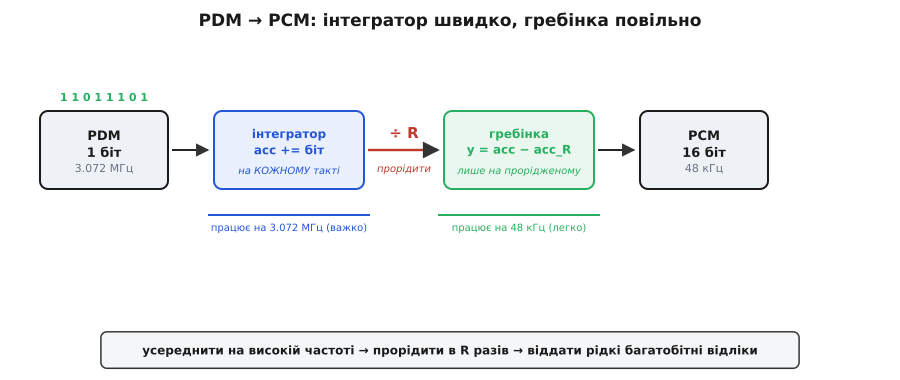
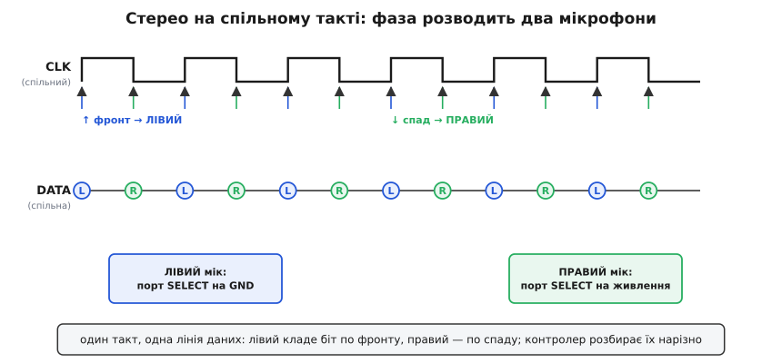

# ⚙️ Один біт на швидкості: як зробити з PDM-потоку звичайний звук

Цифровий MEMS-мікрофон віддає не готові відліки звуку, а дивну на перший погляд річ: **один-єдиний біт**, який лопотить на дуже високій частоті — кілька мільйонів разів на секунду. Ані регістру на 16 біт, ані числа «гучність = 12345» — тільки нескінченна стрічка нулів і одиниць. Гучніше стало — одиниці йдуть щільніше; тихіше — рідше. Це формат **PDM** (*Pulse-Density Modulation*, модуляція щільністю імпульсів), і саме так спілкується з процесором мікрофон, усередині якого сидить [сигма-дельта-модулятор](root:hw-analog/sigma-delta-adc).

Проблема практична й негайна: жоден аудіокодек, жоден WAV-файл, жодна бібліотека оброблення звуку не розуміє однобітну стрічку на 3 мегагерци. Їм треба **звичні багатобітні відліки** — числа на 16 біт, що йдуть 48 000 разів на секунду (формат PCM, *Pulse-Code Modulation*). Отже, десь між мікрофоном і файлом мусить стояти перетворювач: він з'їдає швидкий однобіт і виплюскує повільні багатобіти. Цей перетворювач — **фільтр-дециматор**, і написати його можна кількома рядками C, які крутяться прямо в перериванні контролера. Розберімо, чому це працює й де тут пастки, на яких спотикаються найчастіше.

> 🔧 **Навіщо це.** Якщо ви завели цифровий мікрофон на I2S- чи PDM-периферію контролера й отримали в буфері «якесь сміття» замість звуку — майже напевно ви взяли сирий PDM-потік як готовий PCM. Він таким не є ніколи. Між сирим потоком і відлями звуку **завжди** стоїть децимація; частина контролерів (STM32 з DFSDM, nRF52 з PDM-блоком) робить її апаратно, і тоді ви отримуєте вже готовий PCM, а частина — ні, і тоді фільтр пишете ви. Ця вставка — про те, як він улаштований усередині, щоб ви розуміли навіть готовий апаратний блок, а не лише вбитий у код магічний коефіцієнт.

## Задача: чому один біт, і що з ним не так

Спершу — звідки взагалі береться однобіт, бо без цього незрозуміло, що ми виправляємо. Сигма-дельта-модулятор у мікрофоні не міряє тиск числом. Він робить хитріше: на кожному такті ставить **одне** запитання — «зараз сигнал вищий чи нижчий за те, що я вже видав?» — і відповідає одним бітом, 1 або 0. Помилку цього грубого одноразового рішення він **запам'ятовує й додає до наступного** такту, тож у середньому потік бітів вистежує сигнал напрочуд точно. Ключове слово — **в середньому**: миттєвий біт майже нічого не каже, а от щільність одиниць на довшому проміжку точно повторює гучність.

Звідси й формат. Уявіть тихий рівний тон. У потоці він виглядатиме приблизно так:

```
… 1 0 1 0 1 0 1 0 1 0 …    ← середина шкали: одиниць і нулів порівну
… 1 1 1 0 1 1 1 0 1 1 …    ← голосніше вгору: одиниць більшість
… 1 0 0 0 1 0 0 0 0 0 …    ← голосніше вниз: одиниць мало
```

Гучність тут — не рівень окремого біта (він завжди або 0, або 1), а **частка одиниць** серед сусідніх бітів. Тобто щоб відновити число, треба порахувати, скільки одиниць припало на якийсь відрізок потоку. Порахувати одиниці — це і є **усереднення**. Ось перша половина розв'язку, вона проста: щоб дістати гучність, усередни біти на короткому вікні.

Але одразу постає масштаб проблеми. Мікрофон тактується, скажімо, на **3.072 МГц** — це три мільйони бітів за секунду. А звук нам потрібен на **48 кГц** — сорок вісім тисяч відліків. Різниця — рівно в **64 рази**. Значить, на кожен один потрібний відлік звуку припадає 64 сирих біти. Це і є **коефіцієнт передискретизації** (*Oversampling Ratio*, OSR), він же коефіцієнт децимації R:

```
R = f_такту / f_звуку = 3 072 000 / 48 000 = 64
```

> 📎 **Звідки саме 64.** 3.072 МГц і 48 кГц — не випадкові числа. 48 кГц — стандартна студійна частота звуку (кратна їй 44.1 кГц дісталася нам від CD). Помножити 48 кГц на 64 дає рівно 3.072 МГц — «канонічний» такт PDM-мікрофонів, який рекомендують більшість виробників. Але жорсткого стандарту немає: типовий робочий діапазон такту в реальних мікрофонів — приблизно від 1 до 3.6 МГц (у деяких — від 0.9 до 3.6 МГц; в економному режимі опускають і до 0.7–0.8 МГц ціною шуму). OSR теж не завжди 64 — трапляється й 48, і 128. *Доказовий статус: усталена інженерна практика, підтверджена документацією виробників (Analog Devices ADMP521/522, TDK InvenSense, Nordic) і оглядами (Audio Precision).*

Отже, задача цілком: узяти потік по 3 072 000 однобітних значень за секунду й перетворити його на 48 000 багатобітних, усереднивши кожні 64 біти в одне число. Наївно це звучить як «склади 64 біти, поділи, повтори». І справді — найпростіший робочий дециматор саме такий. Але в ньому ховаються дрібниці, які й відрізняють кашу від чистого звуку. Почнімо з наївного, а тоді доведемо його до розумного.

## Ідея-мінімум: ковзне середнє з прорідженням

Найпряміший переклад «усередни й прорідь» на код — **блокове усереднення**: назбирати R бітів, скласти, поділити на R, віддати одне число, і почати нову пачку. Оскільки біт — це 0 або 1, «скласти» означає просто порахувати одиниці.

Тонкість номер один вилазить одразу: біти приходять не поодинці, а **пачками по вісім** — байтами. Периферія контролера (SPI, I2S, спеціальний PDM-блок) складає біти в байти й віддає вам байт за байтом. Тож усередині усереднення треба вміти **порахувати одиниці в байті** — це операція popcount (*population count*). Її або дає інструкція процесора (`__builtin_popcount` на GCC, `__RBIT`+`__CLZ` на Cortex-M без апаратного popcount), або маленька таблиця на 256 записів.

Ось найпростіший робочий дециматор — блокове середнє з прорідженням. R = 64 біти = 8 байтів на один відлік:

:::tabs
:::code proj-pdm-decimation/c/ideia-minimum-kovzne.c
:::code proj-pdm-decimation/py/ideia-minimum-kovzne.py
:::

Це **працює** — заведіть у нього потік, і на виході буде впізнаваний звук. Але воно грубе одразу з трьох причин, і кожна варта уваги, бо кожну ви почуєте вухом.

Перша: масштаб `× 1000` узятий зі стелі. Розмах `centered` — усього ±32, тобто 6 «чесних» біт (2⁶ = 64 рівні). Помножити на 1000 — це просто розтягти ці 64 рівні на діапазон int16, не додавши жодного нового рівня. Звук буде тихий і ступінчастий. Щоб дістати справжні 12–16 біт, самого блокового середнього по 64 біти замало — треба або більший R, або **каскад** усереднень, до якого ми дійдемо.

Друга: **різкий край вікна**. Блокове середнє однаково важить усі 64 біти всередині пачки й нуль — за її межами. Такий прямокутний край у частотній картині — кепський фільтр: він погано глушить високочастотний шум, що його сигма-дельта навмисне зіпхнув угору (*noise shaping*, [формування шуму](root:hw-analog/sigma-delta-adc/math-noise-shaping.md)). Частина того шуму просочиться назад у звук через **накладання** (*aliasing*) — те саме, від чого застерігає [теорема дискретизації](root:com-signal/nyquist-aliasing): усе, що вище за половину нової частоти, після проріджування «складеться» вниз і сяде в чутну смугу як шипіння. Дециматор — це насамперед фільтр **проти накладання**; прямокутне вікно з цією роллю справляється ледь-ледь.

Третя: **постійне зміщення**. Ми відняли 32 «на око». Але справжня середина потоку в конкретного мікрофона може бути не рівно 32 — сигма-дельта має власне невелике зміщення, тож у цілковитій тиші одиниць може виходити, скажімо, 32.7. Ту сталу похибку ми щойно зашили в звук як **постійну складову** (DC), і вона гуляє далі по тракту. До неї повернемось окремо — це найпідступніша з трьох, бо вухом її не чути, а обробку вона псує.

Отже, наївний дециматор дав звук, але тихий, шумнуватий і зі зміщенням. Полагодимо все це одним розумним прийомом.

## Робочий код: CIC-дециматор (гребінка + інтегратор)

Прямокутне вікно нам не подобається, але й воно має один величезний плюс, який шкода втрачати: **дешевину**. Жодного множення, жодних коефіцієнтів фільтра — тільки додавання. Хочеться зберегти цю дешевину, але зробити фільтр гострішим і дати більше біт. Саме це робить **CIC-фільтр** (*Cascaded Integrator-Comb*, каскадна гребінка з інтегратором) — його 1981 року вивів Юджин Гоґенауер (Eugene B. Hogenauer) у статті «An Economical Class of Digital Filters for Decimation and Interpolation» (IEEE Trans. ASSP-29, 1981); звідси й друга назва — фільтр Гоґенауера. *Доказовий статус: усталений факт, першоджерело — названа стаття.*

Ідея CIC виростає з простого спостереження про ковзне середнє. Порахувати суму останніх R бітів **щоразу заново** — марнотратство: сусідні вікна майже однакові. Розумніше вести **біжучу суму** (інтеграл): на кожному новому біті додати його, а «найстаріший» біт, що випав із вікна, — відняти. Це рекурентне ковзне середнє:

```
y(n) = y(n−1) + x(n) − x(n−R)
```

Тепер алгебраїчний трюк, у якому вся суть CIC. Розчепимо цю формулу на дві половини й рознесемо їх у часі:

```
інтегратор (біжить на КОЖНОМУ біті, швидко):   acc = acc + x(n)
гребінка   (біжить лише на прорідженому, повільно): y = acc − acc_затримане_на_1_відлік
```

**Інтегратор** просто нескінченно накопичує суму всіх бітів — це та частина `+ x(n)`. **Гребінка** (*comb*) бере накопичену суму й віднімає її ж, але яку вона мала R бітів тому, — це частина `− x(n−R)`. Різниця двох значень інтегратора, розділених R бітами, і є сума саме останніх R бітів. Магія в тому, **де** ці дві операції виконуються:

- інтегратор мусить бачити кожен біт, тож біжить на повній частоті такту (3 МГц) — але це одне-єдине додавання, наймана робота;
- гребінка бере значення інтегратора **лише в моменти проріджування**, тобто раз на R бітів — на частоті звуку (48 кГц). Вона працює у 64 рази рідше.

Ось чому CIC такий дешевий: важку роботу на високій частоті зведено до одного `+=`, а все складніше винесено на повільний бік, де часу вдосталь.


*Тракт одноступеневого CIC. Однобітний PDM заходить на **3.072 МГц**. Інтегратор додає кожен біт до біжучої суми — це вся його робота на високій частоті. Посередині потік **проріджують у R = 64 рази**. Гребінка на повільному боці бере різницю двох значень суми, рознесених на один вихідний відлік, — і це рівно сума останніх 64 бітів. На виході — рідкі багатобітні відліки на **48 кГц**. Синім позначено те, що змушене бігти швидко; зеленим — те, що працює на легкій, звуковій частоті.*

На практиці біти приходять байтами, тож інтегратор зручно годувати popcount-ом байта, а не бітом за бітом — результат той самий, лише швидший. Ось повний одноступеневий CIC-дециматор, готовий крутитися в перериванні по приході блоку PDM-байтів:

:::tabs
:::code proj-pdm-decimation/c/robochyi-kod-cic.c
:::code proj-pdm-decimation/py/robochyi-kod-cic.py
:::

Зверніть увагу на дві навмисні речі. Інтегратор `integ` **навмисно** дають переповнюватися — і це правильно. Оскільки гребінка бере **різницю** двох значень `now − comb_prev`, різниця лишається чесною навіть тоді, коли обидва значення «перекотилися» через край 32-бітного лічильника, — бо арифметика по модулю 2³² зберігає різницю малих чисел. Тобто переповнення інтегратора не баг, а закладена в CIC особливість: головне, щоб тип `integ` і `comb_prev` був **однаковий і достатньо широкий**, аби різниця ніколи не перевищила його місткість. Для одного ступеня й R = 64 різниця не більша за 64, тож 32 біти — з колосальним запасом.

Другий момент — **більше біт задарма**. Одноступеневий CIC над R = 64 дає розмах суми 0…64, тобто ті самі 6 біт, що й наївне середнє. Щоб дістати справжні 16 біт звуку, CIC **каскадують**: ставлять N інтеграторів поспіль до проріджування й N гребінок після. Кожен зайвий ступінь і гострить фільтр (краще глушить накладання), і додає біти. Для аудіо типово беруть N = 4–5 ступенів. Ось як росте розрядність: коефіцієнт підсилення CIC дорівнює

```
підсилення = (R · M)^N
```

де M — затримка гребінки (майже завжди M = 1), N — число ступенів. Для R = 64, M = 1, N = 4 підсилення = 64⁴ ≈ 16.7 млн ≈ 2²⁴, тобто вихід росте на 24 біти — саме звідси беруться повноцінні багатобітні відліки. Ось чотириступеневий CIC — усе ще жодного множення, лише додавання й віднімання:

:::tabs
:::code proj-pdm-decimation/c/robochyi-kod-cic-2.c
:::code proj-pdm-decimation/py/robochyi-kod-cic-2.py
:::

Тонке місце тут — **порядок ступенів усередині одного виклику**. Інтегратори треба проганяти в напрямку `integ[0] → integ[1] → …`, і кожен ступінь на кожному такті додає до себе **поточне** значення попереднього. Гребінки, навпаки, працюють ланцюжком на прорідженому боці: вихід першої гребінки йде на вхід другої й так далі. Переплутати напрямок — дістати фільтр із зовсім іншою (часто нестійкою на вигляд) поведінкою. І ще: усі лічильники — **зі знаком** (`int64_t`), бо гребінки віднімають і проміжні різниці бувають від'ємні; беззнаковий тип тут дасть химерні стрибки на переходах через нуль.

> 🔧 **Навіщо це.** Практична причина любити саме CIC над PDM — він **не має жодного множення й жодної таблиці коефіцієнтів**, лише додавання по цілих. Це означає, що він крутиться навіть на найдешевшому Cortex-M0 без FPU, вкладається в переривання по DMA-блоку й не з'їдає флеш під коефіцієнти. Розплата — легкий завал верху звукової смуги (*passband droop*): CIC трохи приглушує найвищі чутні частоти. У більшості голосових задач це неважливо; де важливо (музика, широка смуга) — після CIC ставлять коротенький компенсаційний FIR-фільтр, що вирівнює завал. Для дрона, домофона, голосового запуску — досить самого CIC.

## Складність і пастки: де воно ламається насправді

Код вище працює, але між «працює на столі» й «працює в приладі» лежать чотири пастки, кожну з яких добре знати заздалегідь, бо всі вони проявляються не помилкою компіляції, а поганим звуком.

**Пастка 1: вибір такту й коефіцієнта — це компроміс, а не вільний параметр.** Спокуса взяти такт вищим (більше OSR — більше біт, гостріший фільтр) упирається у два ліміти. Знизу такт тисне звукова смуга: щоб чути до 20 кГц, після децимації частота відліків мусить бути щонайменше вдвічі більша (за [Найквістом](root:com-signal/nyquist-aliasing) — 40 кГц, звідси й 48 кГц з запасом). Зверху такт тисне сам мікрофон: у нього є **паспортний діапазон такту** (типово 1–3.6 МГц), поза яким сигма-дельта всередині або не встигає, або йде в економний режим із гіршим шумом. Тобто такт вибирають так: узяти потрібну частоту звуку (48 кГц), помножити на зручний OSR (64), перевірити, що добуток (3.072 МГц) лежить у паспортному вікні мікрофона, — і лише тоді це робочий такт. Якщо мікрофон дозволяє лише до 2.4 МГц, ваш максимальний OSR при 48 кГц — 50, а не 64, і CIC доведеться перерахувати під R = 48 чи взяти нижчу частоту звуку.

**Пастка 2: постійне зміщення (DC) — і чому його треба прибирати ОКРЕМО.** Ми центрували відлік, віднявши R/2. Але справжня «тиша» конкретного мікрофона майже ніколи не рівно R/2 — сигма-дельта має власне невелике зміщення, температура його ще й посуває. Лишок сідає у звук як **постійна складова**: рівний зсув усієї хвилі вгору чи вниз від нуля. Вухом ви його не почуєте, а от біди він робить тихо: з'їдає запас гучності (хвиля впирається в один край раніше), збиває детектори рівня й будь-яку обробку, що припускає центрованість. Прибирають його **фільтром постійної складової** (*DC blocker*) — цифровим аналогом [RC-фільтра високих частот](root:hw-analog/rc-high-pass): він пропускає звук і зрізає лише повільний зсув. Однополюсний DC-blocker — це два рядки на вихідних відлях:

:::tabs
:::code proj-pdm-decimation/c/skladnist-i-pastky-de-vono.c
:::code proj-pdm-decimation/py/skladnist-i-pastky-de-vono.py
:::

Чому окремо, а не «просто відняти зміряну середню»? Бо зміщення **повзе** з температурою й напругою — стала, яку ви відняли на старті, за годину стане неправильною. DC-blocker підлаштовується сам: він гасить будь-який зсув, хоч звідки той узявся. Арифметику тут навмисне тримають у цілих із фіксованою комою ([чому в перериванні уникають float](root:hw-arch/fixed-point)) — щоб фільтр крутився швидко й однаково на будь-якому контролері.

**Пастка 3: фаза при двох мікрофонах на спільному такті.** Стерео чи масив часто роблять так: два мікрофони отримують **один спільний такт** і віддають дані на **одну спільну лінію**. Як контролер розрізнить, де чий біт? Через **фазу вибірки**. У PDM-мікрофона є вхід вибору каналу (позначають L/R, SELECT або просто вивід на GND чи живлення). Мікрофон, у якого цей вивід на землі, виставляє свій біт **по фронту** такту (наростання); мікрофон із виводом на живлення — **по спаду** (спадання). Обидва висять на тій самій лінії даних, але «говорять» у різні півтакти, тож не стикаються.


*Стерео на двох лініях. **CLK** — спільний такт на обидва мікрофони. Лівий (вивід SELECT на GND) кладе свій біт по **фронту** такту, правий (SELECT на живлення) — по **спаду**. На спільній лінії **DATA** біти L і R чергуються, не заважаючи один одному. Контролер (чи периферія) читає лінію по обох краях і **розкладає** потік на два канали — далі кожен децимують окремо своїм CIC.*

Пастка тут подвійна. По-перше, якщо **обидва** мікрофони налаштувати на один край (обидва виводи на GND) — вони заговорять одночасно, зіткнуться на лінії, і ви дістанете суміш, яку вже не розділити. По-друге, розбираючи потік у коді, легко переплутати, який півтакт чий, — і канали поміняються місцями або, гірше, переплутаються побітно. Тому парність важлива: читаючи спільний потік, **парні біти — один канал, непарні — другий** (конкретний порядок залежить від того, який мікрофон на якому краю). Помилка на один біт зсуву перетворить стерео на шум. Практична порада: спочатку заведіть **один** мікрофон, доведіть звук до чистого, і лише тоді додавайте другий — інакше не зрозумієте, де саме поломка.

**Пастка 4: переповнення й розрядність лічильників.** Ми взяли `int64_t` для каскаду не з примхи. Підсилення CIC росте як (R·M)^N — для чотирьох ступенів це 2²⁴, і проміжні значення інтеграторів **біжать до величезних чисел** ще до того, як гребінки їх приборкають. Якщо взяти `int32_t` для чотириступеневого CIC при R = 64, старші ступені переповняться, і замість звуку буде тріск на гучних місцях. Правило просте: розрядність лічильника мусить умістити **повне підсилення плюс розрядність вхідних даних**. Для PDM вхід — 1 біт, підсилення 2²⁴, отже треба ≥ 25 біт; `int32_t` формально вистачило б для трьох ступенів, але запас до `int64_t` коштує копійки пам'яті й рятує від найгидкіших, рідкісних, залежних від гучності багів. На восьмибітних і зовсім тісних контролерах, де 64-бітна арифметика дорога, зменшують **або** число ступенів, **або** R, свідомо міняючи якість на розрядність.

> 🔧 **Навіщо це.** Зведімо чотири пастки в один чек-лист налагодження, коли «звук є, але поганий»: **тихий і ступінчастий** — замало ступенів CIC або замалий OSR, додайте ступінь чи підніміть такт; **шипить/дзвенить** — прямокутний фільтр пропускає накладання, потрібен CIC із більшим N; **хвиля зсунута від нуля, кліпить з одного боку** — немає DC-blocker'а, поставте його після CIC; **тріск лише на гучному** — переповнення лічильників, розширте тип до 64 біт; **стерео перетворилося на кашу** — переплутана фаза або парність каналів, розберіть по одному мікрофону. Майже всі «непрацюючі PDM-мікрофони» — це один із цих п'яти симптомів, а не мертве залізо.

## Разом: одна стрічка бітів, п'ять рядків розуму

Ланцюжок від однобіта до звуку виявився коротким і майже без арифметики. Сигма-дельта віддає **щільність одиниць** замість рівня — тож щоб дістати гучність, біти треба **усереднити**; а щоб повернутися з мегагерцового такту на звукові 48 кГц — **прорідити в R разів**. Обидві дії разом і є децимація. Наївне блокове середнє це вже робить, але грубо; **CIC-фільтр** робить те саме дешево й гостро, розчепивши усереднення на швидкий інтегратор (одне додавання на біт) і повільну гребінку (одне віднімання на відлік), а каскад із кількох ступенів додає повноцінні багатобітні відліки задарма — самими цілочисловими додаваннями.

Уся хитрість, отже, не в математиці фільтра, а в **дрібницях реалізації**: узгодити такт із паспортом мікрофона й потрібним OSR, прибрати повзуче зміщення окремим DC-фільтром, розвести два мікрофони по фронту й спаду спільного такту, і дати лічильникам досить біт, щоб підсилення 2²⁴ не переповнило їх. Проґавите будь-яку — дістанете звук, але зіпсований по-своєму впізнаваному. Витримаєте всі — і кілька рядків цілочислового C перетворять дику стрічку однобіта на чистий потік відліків, готовий у файл чи в розпізнавання голосу.
