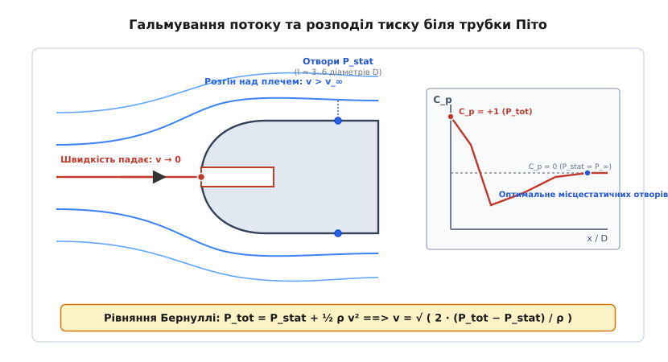
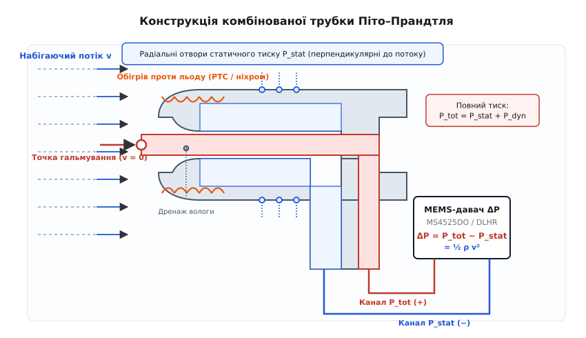
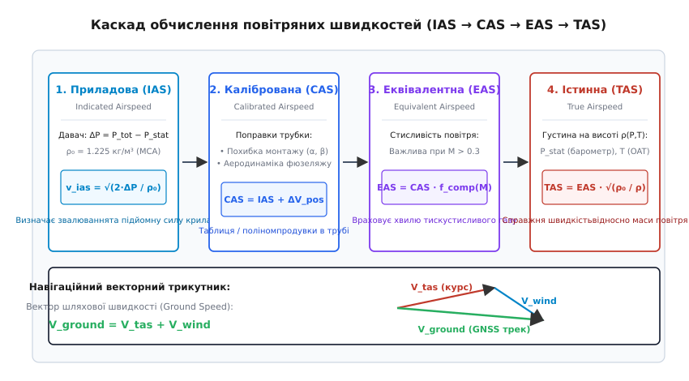
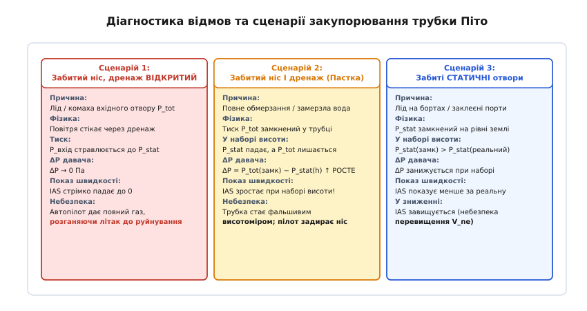

# Трубка Піто–Прандтля: вимірювання швидкості потоку

<preknowlist>
- [Динамічний тиск](root:ph-mechanics/dynamic-pressure) — надлишковий тиск гальмування рухомого потоку; на ньому стоїть вимірювання швидкості.
- [Атмосферний тиск](root:ph-mechanics/atmospheric-pressure) — статичний тиск навколишнього повітря, від якого відраховується різниця.
- [Густина](root:ph-mechanics/density) — маса одиниці об'єму повітря, що змінюється з висотою і температурою.
- [MEMS](root:hw-sensing/mems) — кремнієва мікромеханіка п'єзорезистивних мембран, що перетворює перепад тиску на електричний сигнал.
- [Міст Вітстона](root:hw-sensing/wheatstone-bridge) — чотири резистори на вигині кремнію, що виділяють крихітний сигнал деформації.
- [Шина I2C](root:com-devices/i2c-bus) — цифровий інтерфейс обміну даними між мікроконтролером і давачем тиску.
</preknowlist>

Літак масою дві тонни звалюється в штопор не тоді, коли супутниковий приймач показує малу шляхову швидкість відносно землі, а тоді, коли повітря обтікає його крило надто повільно для створення підйомної сили. При зустрічному вітрі 50 км/год апарат із нульовою швидкістю над землею впевнено тримається в повітрі, тоді як при попутному вітрі 50 км/год і шляховій швидкості 60 км/год він миттєво втрачає керованість, бо дійсна швидкість набігаючого потоку становить лише 10 км/год. Аеродинамічні сили — підйомна сила крила, опір фюзеляжу та ефективність рулів — підпорядковані виключно швидкості відносно навколишньої повітряної маси. Єдиний спосіб виміряти цю швидкість безпосередньо — перетворити кінетичну енергію набігаючого струменя на механічний тиск за допомогою трубки Піто–Прандтля та оцифрувати виділений швидкісний напір диференціальним давачем.

### Кінетична енергія перетворюється на тиск гальмування

Будь-який нерухомий об'єкт в атмосфері відчуває тиск навколишнього повітря, зумовлений хаотичним тепловим рухом молекул та вагою вищих шарів атмосфери. Цей тиск діє однаково в усіх напрямках і зветься **статичним тиском** `P_stat` (на рівні моря за стандартних умов він становить близько 101325 Па). Коли ж об'єкт рухається крізь повітря або повітря обтікає нерухому перешкоду зі швидкістю `v`, до статичного тиску додається спрямований силовий напір рухомих часток газу.

Якщо назустріч потоку виставити тонку трубку з відкритим торцем, повітряні маси безпосередньо перед її отвором змушені зупинитися. Лінія течії, яка впирається точно в центр отвору, гальмує до нульової відносної швидкості (`v = 0`). Ця точка зветься **точкою повного гальмування** (*stagnation point*). За законом збереження енергії, уся кінетична енергія спрямованого руху одиниці об'єму газу переходить у потенціальну енергію пружного стиснення, підвищуючи локальний тиск усередині трубки.


*Гальмування потоку в точці зупинки. Центральна лінія течії впирається в носик трубки, де швидкість падає до нуля, а тиск сягає максимуму P_tot (коефіцієнт тиску C_p = +1). На бічній поверхні потік спочатку розганяється над скругленням (тиск падає, C_p < 0), а потім на відстані 3..6 діаметрів стабілізується до незбуреного статичного тиску P_stat (C_p = 0), де й розташовують радіальні статичні отвори.*

Тиск, що встановлюється в точці повної зупинки потоку, зветься **повним тиском** `P_tot` (або тиском гальмування, *total pressure* / *pitot pressure*). Для нестисливого середовища (повітря на швидкостях до 100 м/с, де зміна густини не перевищує кількох відсотків) закон Бернуллі для горизонтальної лінії течії записується як:

```
P_tot = P_stat + P_dyn                       [повний тиск дорівнює сумі статичного та динамічного]
P_dyn = (1/2) · ρ · v^2                      [динамічний тиск через густину повітря та швидкість]
P_tot = P_stat + (1/2) · ρ · v^2             [розгорнуте рівняння Бернуллі]
```

Звідси шукана швидкість руху відносно повітря виражається через різницю між повним і статичним тиском:

```
P_tot - P_stat = (1/2) · ρ · v^2             [виділення динамічного перепаду тиску]
v^2 = (2 · (P_tot - P_stat)) / ρ             [множення на 2 та ділення на густину]
v = √( (2 · (P_tot - P_stat)) / ρ )          [формула швидкості нестисливого потоку]
```

Перепад `ΔP = P_tot - P_stat` являє собою **динамічний тиск** `P_dyn` (швидкісний напір, *impact pressure*). При швидкості 10 м/с (36 км/год) при густині повітря `ρ = 1.225 кг/м³` швидкісний напір становить усього `0.5 · 1.225 · 100 = 61.25 Па`. На швидкості 50 м/с (180 км/год) він зростає квадротично до `1531 Па` (приблизно 0.015 атмосфери). Для вимірювання швидкості потрібно відокремити ці десятки й сотні Паскалів на тлі велетенського статичного атмосферного тиску в 100 000 Па.

Коли швидкість руху перевищує 100 м/с (число Маха M > 0.3), набігаюче повітря перед носиком трубки починає помітно стискатися, і класичне рівняння Бернуллі завищує розраховану швидкість. У такому разі застосовують термодинамічне рівняння Сен-Венана — Ванцеля для ізоентропійного гальмування газу, виведення якого та розклад у ряд за числами Маха наведено в окремому матеріалі про [стисливість та розрахунок швидкостей](root:hw-sensing/pitot-tube/math-compressible-airspeed.md).

### Анатомія комбінованої трубки Піто–Прандтля

Сама по собі класична відкрита трубка Анрі Піто (запропонована ним у 1732 році для вимірювання швидкості течії річки Сени) вимірює лише повний тиск `P_tot`. Щоб дістати динамічний перепад `ΔP`, виміряний тиск треба відняти від статичного тиску `P_stat`. Людвіг Прандтль об'єднав обидва канали в один монолітний прилад коаксіальної конструкції — **трубку Піто–Прандтля** (*pitot-static tube*).


*Анатомія комбінованої трубки Піто–Прандтля. Центральний канал приймає набігаючий потік і створює повний тиск P_tot у точці гальмування. Зовнішня сорочка через кільце радіальних бічних отворів сприймає статичний тиск P_stat. Обидва канали через гнучкі трубки подаються на штуцери диференціального MEMS-давача, який вимірює перепад ΔP = ½ ρ v².*

Конструкція складається з двох концентричних металевих трубок, вкладених одна в одну:
1. **Внутрішня трубка (канал повного тиску)**: має круглий отвір у центрі скругленого або конічного носового обтічника. Цей отвір дивиться строго вперед проти вектору набігаючого потоку і вловлює тиск гальмування `P_tot`.
2. **Зовнішня сорочка (канал статичного тиску)**: оточує внутрішню трубку з повітряним зазором між ними. На бічній циліндричній поверхні сорочки просвердлено кільце з 4–8 мікроскопічних радіальних отворів. Оскільки ці отвори розташовані паралельно до ліній течії, набігаючий потік проноситься повз них, не чинячи лобового тиску, що дає змогу виміряти чистий статичний тиск `P_stat`.

Місце розташування радіальних отворів на бічній поверхні вибирають за суворими аеродинамічними правилами. Коли потік огинає носове скруглення трубки, він локально прискорюється над вигином (`v > v_∞`), через що тиск на передньому плечі трубки падає нижче атмосферного (`C_p < 0`). Далі потік сповільнюється, наближаючись до стійки кріплення, яка створює зону підпору тиску перед собою. Отвори статичного тиску свердлять на відстані від 3 до 6 зовнішніх діаметрів трубки `D` від носика — саме в тій нейтральній точці, де локальне розрідження від носового обтічника точно компенсується підпором від монтажної ніжки, і тиск на стінці строго дорівнює незбуреному статичному тиску вільної атмосфери.

Обидві порожнини закінчуються штуцерами на хвостовику трубки. Від них за допомогою еластичних силіконових або фторопластових шлангів тиск передається на порти диференціального давача:
- Шланг **повного тиску** під'єднують до порту високого тиску (*Port 1 / High Pressure / Positive*).
- Шланг **статичного тиску** під'єднують до порту низького тиску (*Port 2 / Low Pressure / Negative*).

Кремнієва мембрана всередині давача зазнає дії двох тисків одночасно з протилежних боків: на її зовнішню грань тисне `P_tot`, а на внутрішню — `P_stat`. У результаті пружний прогин мембрани прямо пропорційний шуканому динамічному перепаду `ΔP = P_tot - P_stat`, а велетенський статичний тиск 100 кПа взаємно анулюється без ризику перевантаження чутливого елемента.

### Каскад повітряних швидкостей: IAS, CAS, EAS, TAS

В авіації та робототехніці поняття «швидкість» розпадається на чотири різні фізичні величини, кожна з яких має своє математичне визначення та призначення в контурі керування.


*Конвеєр обчислення швидкостей. Сирий перепад ΔP давача за стандартної густини ρ₀ дає приладову швидкість IAS (відповідає за підйомну силу). Внесення аеродинамічних поправок дає CAS, врахування стисливості газу на великих швидкостях — EAS, а температурно-барометрична поправка на дійсну густину ρ(P,T) визначає істинну швидкість TAS відносно повітряної маси. Синтез TAS із вектором вітру дає шляхову швидкість Ground Speed.*

#### 1. Приладова швидкість (Indicated Airspeed — IAS)
Це первинне значення швидкості, яке вираховується за формулою нестисливого потоку з фіксованим припущенням, що густина повітря дорівнює стандартній густині на рівні моря за Міжнародною стандартною атмосферою (ISA sea-level): `ρ_0 = 1.2250 кг/м³` (при тиску 1013.25 гПа і температурі +15 °C):

```
v_ias = √( (2 · ΔP) / ρ_0 )                   [приладова швидкість за формулою нестисливого потоку]
```

Значення IAS критично важливе для пілота чи польотного контролера, оскільки аеродинамічна підйомна сила крила `Y = (1/2) · C_y · ρ · v^2 · S` пропорційна добутку `ρ · v^2`, тобто саме виміряному динамічному тиску `ΔP`. Літак звалюється в штопор при одному й тому самому значенні IAS незалежно від висоти польоту: чи то на рівні моря при температурі +30 °C, чи на висоті 4000 м при −20 °C. Тому всі експлуатаційні обмеження в керівництві польотів (швидкість звалювання `V_s`, швидкість випуску закрилків `V_fe`, максимальна швидкість без руйнування `V_ne`) вказуються виключно в одиницях **IAS**.

#### 2. Калібрована швидкість (Calibrated Airspeed — CAS)
Трубка Піто, встановлена на крилі або носовій частині фюзеляжу, потрапляє у скошений потік і викривлене поле тисків апарата. Під час зміни кута атаки `α` чи ковзання `β` кут набігання потоку на носик трубки відхиляється від нуля, викликаючи аеродинамічну похибку положення (*position error*). Калібрована швидкість — це приладова швидкість, виправлена за допомогою таблиці калібрування чи полінома аеродинамічного продування:

```
v_cas = v_ias + Δv_pos(α, β, конфігурація)    [поправка на аеродинаміку літака та кути обдування]
```

#### 3. Еквівалентна швидкість (Equivalent Airspeed — EAS)
При високих швидкостях (M > 0.3) повітря стискається, створюючи додатковий напір гальмування. Еквівалентна швидкість — це швидкість польоту, скоригована на стисливість повітря на поточній висоті. Вона чисельно дорівнює швидкості, з якою апарат мав би летіти в нестисливому повітрі на рівні моря, щоб відчувати такий самий динамічний напір.

#### 4. Істинна швидкість (True Airspeed — TAS)
Це фактична фізична швидкість літального апарата відносно навколишньої повітряної маси. З підняттям на висоту атмосферний тиск падає, а повітря стає розрідженим. Наприклад, на висоті 3000 м густина повітря падає приблизно до `ρ ≈ 0.909 кг/м³` (проти 1.225 на рівні моря). Для створення того самого динамічного напору `ΔP` літаку потрібно рухатися крізь розріджене повітря значно швидше.

Істинна швидкість розраховується через відношення стандартної густини `ρ_0` до дійсної густини повітря `ρ_act` на висоті польоту:

```
v_tas = v_eas · √( ρ_0 / ρ_act )              [зв'язок істинної та еквівалентної швидкостей]
v_tas ≈ v_ias · √( ρ_0 / ρ_act )              [дозвукове наближення на малих числах Маха]
```

Дійсна густина повітря `ρ_act` розраховується з рівняння стану ідеального газу Менделєєва — Клапейрона за показами бортового [барометричного давача](root:embedded/barometric-altimeter) статичного тиску `P_stat` та давача зовнішньої температури повітря (OAT — *Outside Air Temperature*):

```
ρ_act = P_stat / (R_air · T_kelvin)           [рівняння стану повітря]
T_kelvin = T_celsius + 273.15                 [переведення температури в Кельвіни]
R_air = 287.058 Дж / (кг · К)                 [питома газова стала сухого повітря]
```

Якщо приладова швидкість на висоті 3000 м становить `v_ias = 100 км/год`, то істинна швидкість сягає `v_tas = 100 · √(1.225 / 0.909) ≈ 116 км/год`. Значення TAS необхідне для навігаційного числення шляху: саме додавання вектора `V_tas` та вектора вітру `V_wind` дає шляхову швидкість `V_ground`, яку фіксує супутниковий приймач GNSS.

### Захист від обмерзання та вологи: Pitot Heat і дренаж

Трубка Піто безпосередньо контактує з набігаючим повітряним потоком, зазнаючи впливу дощу, туману, вологи та переохолоджених крапель води в хмарах. Без спеціальних конструктивних заходів трубка швидко виходить із ладу, що становить смертельну загрозу для польоту.


*Діагностика типових несправностей трубки Піто. При забитому носику й відкритому дренажі тиск стравлюється до статичного, і IAS падає до нуля. При одночасному замерзанні носика й дренажу трубка замикає повний тиск усередині й перетворюється на фальшивий висотомір (швидкість помилково росте під час набору висоти). Замерзання статичних портів призводить до заниження швидкості у наборі й завищення під час зниження.*

#### Дренажні отвори для видалення вологи
Під час польоту в дощ краплі води потрапляють у відкритий центральний отвір повного тиску. Якщо вода заповнить внутрішній трубопровід, вона утворить рідинний затвор або потрапить у MEMS-давач, вивівши його з ладу. Для запобігання цьому в нижній частині внутрішнього каналу трубки свердлять калібрований **дренажний отвір** (*drain / weep hole*) діаметром 0.5–0.8 мм.

Повітря, що входить у трубку, рухається з великою швидкістю, тоді як усередині трубки воно майже нерухоме. Краплі води під дією інерції та сили тяжіння осідають на стінках і безперервно витікають назовні крізь дренажний отвір. Оскільки діаметр дренажного отвору в десятки разів менший за площу вхідного отвору трубки, витік повітря через нього мізерний і створює спад динамічного тиску менше 0.5%, що легко враховується в загальному калібруванні.

#### Електрообігрів (Pitot Heat)
Політ у хмарах при температурах від +2 °C до −20 °C супроводжується миттєвим намерзанням льоду на металевому носику трубки. Лід за лічені секунди повністю перекриває вхідний отвір. Для боротьби з цим в авіаційні трубки інтегрують потужний нагрівальний елемент із ніхромової спіралі або кераміки PTC (позитивний температурний коефіцієнт), який живиться напругою 12 В, 24 В або 115 В.

Споживана потужність обігріву для невеликого БПЛА становить 20–40 Вт, а для магістрального літака сягає 200–500 Вт, що забезпечує розігрів корпусу трубки до +80..+120 °C, запобігаючи утворенню криги навіть у щільній переохолодженій хмарності. Стан справності обігріву обов'язково контролюється бортовою електронікою шляхом вимірювання струму через [вимірювальний шунт](root:hw-sensing/kelvin-shunt): якщо струм падає нижче порогу при ввімкненому реле обігріву, система видає критичну аварію «Pitot Heat Fail».

#### Механізм аномалій при закупорюванні трубки

Аналіз відмов показує три характерні сценарії, які повинен розпізнавати автопілот:

1. **Забитий вхідний отвір повного тиску, але дренаж ВІДКРИТИЙ**:
   Набігаючий потік перестає нагнітати повітря в трубку. Повітря, що залишалося всередині каналу, стікає крізь відкритий дренажний отвір у навколишній простір, і тиск усередині трубки зрівнюється зі статичним (`P_tot → P_stat`).
   - Різниця тисків падає до нуля: `ΔP → 0 Па`.
   - Приладова швидкість на приладах стрімко падає до `0 км/год` навіть на максимальній тязі двигунів.
   - **Небезпека**: Автопілот, намагаючись підтримати задану крейсерську швидкість, збільшує тягу двигунів і переводить апарат у круте пікірування, що призводить до перевищення гранично допустимої швидкості конструкції `V_ne` та руйнування планера в повітрі.

2. **Забитий вхідний отвір І забитий дренажний отвір (Повне замерзання / Льодовий затвор)**:
   Повний тиск, який існував у момент замерзання `P_tot(h_0)`, виявляється герметично замкненим усередині трубки.
   - Під час подальшого набору висоти навколишній статичний тиск `P_stat(h)` за барометричним законом падає.
   - Диференціальний давач вимірює різницю `ΔP = P_tot(h_0) - P_stat(h)`. Оскільки `P_stat(h)` зменшується, різниця `ΔP` **зростає**!
   - Приладова швидкість на екрані починає **зростати зі збільшенням висоти**, навіть якщо літак фактично сповільнюється.
   - **Трубка перетворюється на фальшивий висотомір**. Пілот чи автопілот бачить небезпечне зростання швидкості, прибирає газ і задирає ніс літака для гальмування, що призводить до втрати підйомної сили та зриву в штопор на великій висоті (катастрофа рейсу Air France 447 над Атлантикою у 2009 році сталася саме за цим сценарієм через замерзання трьох трубок Піто).

3. **Забиті радіальні отвори статичного тиску**:
   Статичний тиск виявляється замкненим на рівні висоти замерзання. Під час набору висоти виміряний `ΔP` занижується, а під час зниження — небезпечно завищується.

Сучасні автопілоти (PX4, ArduPilot) виявляють такі аномалії за допомогою фільтра розширеного фільтра Калмана (EKF), перехресно зіставляючи прискорення від [акселерометра](root:hw-sensing/accelerometer), тягу двигунів, зміну барометричної висоти та супутникову швидкість GNSS. Якщо повітряна швидкість за трубкою Піто суперечить іншим давачам, система бракує покази трубки й переходить у режим synthetic airspeed (синтетичної оцінки швидкості за моделлю вітру).

### Цифровий диференціальний давач MS4525DO

Для перетворення механічного тиску в цифровий код у сучасних бортових системах застосовують спеціалізовані інтегральні мікросхеми, найпоширенішою з яких є **MS4525DO** від компанії TE Connectivity.

В основі давача лежить монолітна кремнієва діафрагма, виготовлена методом глибокого реактивного іонного травлення ([MEMS](root:hw-sensing/mems)). На деформованій поверхні мембрани сформовано чотири п'єзорезистори, увімкнені за схемою повного [моста Вітстона](root:hw-sensing/wheatstone-bridge). При виникненні різниці тисків між штуцерами мембрана прогинається, викликаючи розбаланс моста, який підсилюється малошумним інструментальним підсилювачем і оцифровується 14-розрядним сигма-дельта АЦП.

Вбудована ASIC-мікросхема компенсує температурний дрейф нуля та зміну чутливості за індивідуальними калібрувальними коефіцієнтами, зашитими в EEPROM на заводі, та видає готовий результат шиною [I2C](root:com-devices/i2c-bus). Детальний опис бітової структури пакета та статусних регістрів наведено у [специфікації інтерфейсу MS4525DO](root:hw-sensing/pitot-tube/api-ms4525do.md).

Зчитування виміру відбувається 4-байтним I2C-пакетом:
- Старші два біти першого байта містять **статус** (`00` — норма, `10` — застарілі дані *stale data*, `11` — апаратна аварія ASIC).
- 14 бітів несуть сирий код тиску `Count_press` (від `0` до `16383`).
- 11 бітів несуть сирий код температури кристала `Count_temp` (від `0` до `2047`).

Для диференціального давача з діапазоном `±1 psi` (близько `±6894.76 Па`, типова модель MS4525DO-DS5AI001DP з вихідною характеристикою Type A 10%..90%):

```
Count_min = 1638                               [10% від 16383, відповідає -1.0 psi]
Count_max = 14745                              [90% від 16383, відповідає +1.0 psi]
Count_zero = 8192                              [середина шкали, відповідає ΔP = 0 Па]
P_psi = ((Count_raw - 1638) · (1.0 - (-1.0)) / (14745 - 1638)) - 1.0 [тиск у psi]
P_pa = P_psi · 6894.757                        [переведення з psi у Паскалі]
```

### В'язкісні ефекти, число Рейнольдса та кутова чутливість

У класичному виведенні закону Бернуллі повітря вважається ідеальною нестисливою рідиною без внутрішнього тертя. Проте в реальному потоці навколо металевого носика трубки завжди формується в'язкісний прикордонний шар, товщина якого залежить від числа Рейнольдса, розрахованого за зовнішнім діаметром трубки `D`:

```
Re_D = (ρ · v · D) / μ                       [число Рейнольдса для трубки Піто]
μ = 1.81 · 10^(-5) Па · с                     [динамічна в'язкість повітря при 15 °C]
```

Для трубки діаметром `D = 4 мм` на швидкості польоту `v = 20 м/с` число Рейнольдса становить `Re_D ≈ 5400`, що відповідає ламінарному обтіканню носика, де в'язкісні поправки не перевищують 0.1%. Однак на малих швидкостях (менше 3 м/с, типових для зависання дронів чи старту планера) число Рейнольдса падає нижче `Re_D < 500`. При таких значеннях в'язкісні сили починають гальмувати прилеглі шари повітря ще до їхнього входу в отвір (так званий **ефект Баркера**). Гальмування в'язкого газу створює додатковий дифузійний перепад тиску, через що трубка на ультрамалих швидкостях завищує виміряний динамічний напір на 2–5%.

Іншим критичним фактором є просторова орієнтація трубки відносно набігаючого повітря. При маневрах літака кут набігання потоку (кут атаки `α` та кут ковзання `β`) відхиляється від осі трубки:
- **Канал повного тиску**: завдяки скругленій напівсферичній формі носової частини центральний отвір зберігає високу точність (похибка менше 1%) у широкому конусі кутів обдування до `±12°..14°`. При відхиленнях понад `15°` тиск гальмування починає різко спадати пропорційно `cos²(α)`.
- **Канал статичного тиску**: радіальні отвори набагато чутливіші до скосу потоку. Уже при куті атаки `5°..7°` на навітряному боці трубки виникає зона підвищеного тиску, а на підвітряному — зона вихрового зриву та розрідження. Кільце з кількох радіальних отворів, з'єднаних спільною внутрішньою камерою, частково вирівнює цей перепад, однак при великих кутах статичний канал починає відчутно спотворювати покази.

### Багатоточкові зонди: вимірювання швидкості, кута атаки та ковзання

У випробувальній авіації та високоефективних безпілотних комплексах застосовують комбіновані **п'ятиточкові** (5-hole) та **семиточкові** (7-hole) напівсферичні зонди. Замість одного центрального отвору на скругленому носику виготовляють матрицю каліброваних портів:
1. Центральний порт `P_1` (дивиться строго вперед уздовж поздовжньої осі).
2. Пара вертикальних портів `P_2` (верхній) та `P_3` (нижній).
3. Пара горизонтальних портів `P_4` (лівий) та `P_5` (правий).

Коли потік набігає під кутом атаки `α`, верхній порт опиняється під меншим тиском, ніж нижній (`P_2 < P_3`). Нормована різниця тисків `(P_3 - P_2) / (P_1 - P_stat)` виявляється строго пропорційною куту атаки `α`, а горизонтальна різниця `(P_5 - P_4) / (P_1 - P_stat)` визначає кут ковзання `β`. Такий зонд дозволяє бортовому комп'ютеру за показами одного компактного приладу одночасно обчислювати повний тривимірний вектор повітряної швидкості, приладову швидкість IAS, статичний тиск, кут атаки та кут ковзання без використання рухомих механічних флюгерів (AOA vanes).

### Динаміка пневматичної магістралі: затримка сигналу та резонанси

Між металевою трубкою на крилі та MEMS-давачем тиску всередині фюзеляжу прокладають еластичні шланги. Газ усередині цих шлангів утворює розподілену коливальну систему з власною масою (інерція повітряного стовпа), пружністю (стисливість об'єму повітря всередині шлангів і камери давача) та в'язкісним тертям об внутрішні стінки.

Час проходження хвилі тиску від носика трубки до кристала давача визначається швидкістю звуку `c ≈ 340 м/с` та довжиною магістралі `L`:

```
t_prop = L / c                               [акустична затримка поширення хвилі тиску]
```

Для магістралі довжиною `L = 1.0 м` чиста акустична затримка становить близько 3 мс. Проте значно більшу затримку створює пневматичний опір вузького внутрішнього просвіту трубки (в'язкісний потік Пуазейля) у поєднанні з паразитним об'ємом камери давача. Ця пара утворює пневматичний фільтр низьких частот першого порядку з постійною часу:

```
τ_pneuma = (8 · π · μ · L · V_cavity) / (A_tube^2) [постійна часу пневматичного кола]
```

Якщо внутрішній діаметр шланга становить лише 1 мм, а довжина сягає 1.5 м, фазовий зсув сигналу тиску на частотах поривів вітру (2–5 Гц) може досягати 40–90 градусів. У контурі автоматичного утримання швидкості (автомат тяги / Autothrottle) запізнення сигналу швидкості призводить до розгойдування обертів двигуна та автоколивань швидкості польоту. Для запобігання цьому шланги роблять якомога коротшими (до 20–30 см), використовують жорсткі поліуретанові або тефлонові трубки замість м'якого тонкостінного силікону, а сам давач розміщують безпосередньо в консолі крила поруч із вузлом кріплення трубки Піто.

### Реалізація драйвера швидкості потоку

Нижче наведено завершений виробничий драйвер вимірювання повітряної швидкості для вбудованих систем. Драйвер виконує:
1. Зчитування 4-байтного пакета I2C з апаратною валідацією статусних бітів (відкидання Stale Data та детекція Fault).
2. Перерахунок відліків у фізичний перепад тиску в Паскалях.
3. Програмне калібрування нульового зсуву на землі в нерухомому стані (*Zero-offset tracking*).
4. Захист від від'ємного тиску при обдуванні трубки під кутом або шумі АЦП.
5. Фільтрацію динамічного тиску низькочастотним фільтром першого порядку (EMA).
6. Обчислення швидкостей IAS і TAS з урахуванням барометричного тиску та температури.

:::tabs
:::code pitot-tube-d/c/airspeed_ms4525do.h
:::code pitot-tube-d/cpp/AirspeedMS4525.hpp
:::

### Інженерний чекліст та передпольотний регламент

Перед кожним вильотом безпілотного або пілотованого апарата технічний персонал та оператор зобов'язані виконати процедуру передпольотної перевірки системи повітряних сигналів (Pitot Pre-flight Checklist):

1. **Зняття захисного чохла (Remove Before Flight)**:
   Під час стоянки на землі на трубку обов'язково надягають яскраво-червоний чохол, що захищає отвори від пилу, комах і бруду. Зняття чохла виконують безпосередньо перед передпольотним калібруванням.

2. **Візуальний контроль отворів**:
   Переконатися у відсутності піщинок та павутиння у вхідному отворі повного тиску, дренажному отворі знизу та кільці бічних статичних отворів.

3. **Заборона штучного продування ротом**:
   Категорично забороняється дмухати безпосередньо в носик трубки для «перевірки стрілки». Тиск видиху людини легко перевищує 20 кПа, що викликає необоротний розрив кремнієвої мембрани давача на 1 psi (6.89 кПа). Для перевірки реакції давача долонею плавно створюють потік повітря перед носиком на відстані 10–15 см, спостерігаючи сплеск швидкості 3..5 м/с на наземній станції керування (GCS).

4. **Тест обігріву (Pitot Heat Check)**:
   Увімкнути тумблер обігріву, перевірити за амперметром споживання номінального струму (наприклад, 2.5 А при 12 В для нагрівача 30 Вт) і дотиком переконатися у швидкому наростанні температури металевого носика трубки, після чого вимкнути обігрів до запуску двигунів.

5. **Калібрування нульового тиску в затінку**:
   Захистити носик трубки від прямого вітру (прикрити рукою без тиску), дочекатися стабілізації температури електроніки (10–15 секунд після ввімкнення) та активувати процедуру калібрування нуля. Переконатися, що зафіксований зсув нуля не перевищує допустимого порогу виробника (±15 Па).
