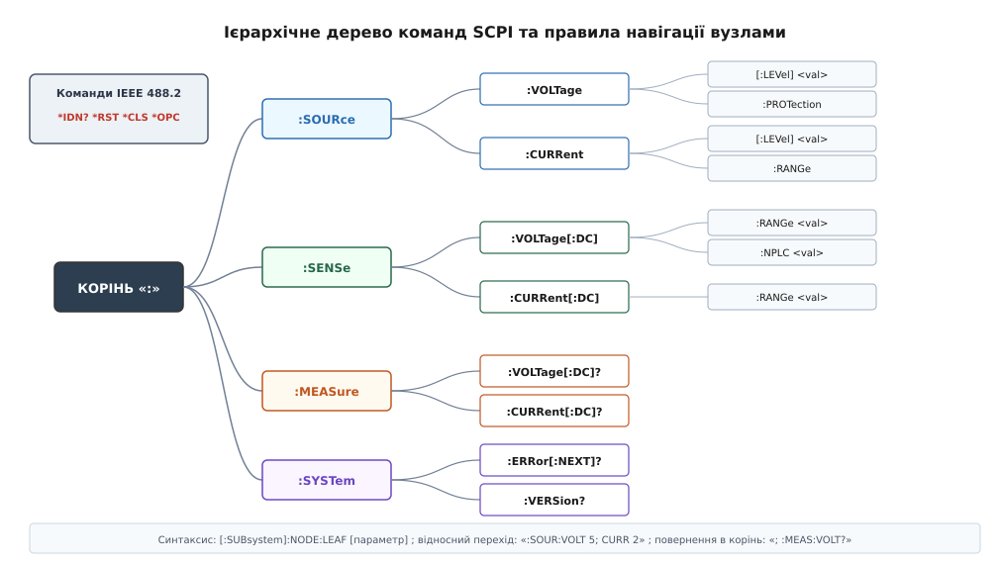
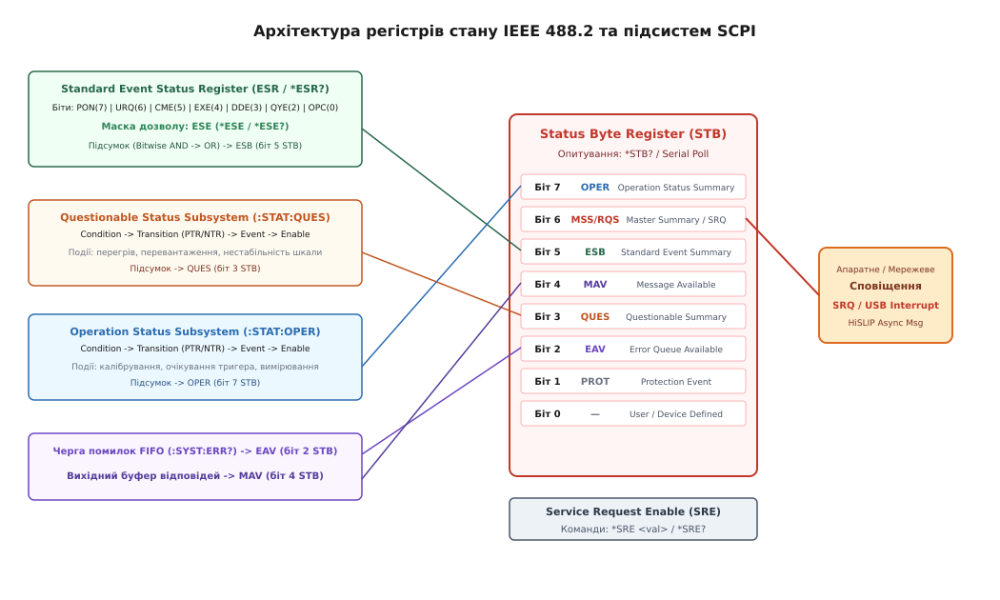

# Протокол SCPI для керування приладами

<preknowlist>
- [Мультиметр](root:hw-sensing/multimeter) — аналого-цифрове перетворення, інтегрувальні АЦП подвійного інтегрування та вибір діапазонів вимірювання.
- [Осцилограф](root:hw-sensing/oscilloscope) — часові розгортки, системи синхронізації (Triggering) та вибірка сигналів у внутрішню пам'ять.
- [Лабораторний блок живлення](root:hw-sensing/lab-power-supply) — режими стабілізації напруги (CV) та струму (CC), захисні обмеження та вихідні реле.
- [Електронне навантаження](root:hw-sensing/electronic-load) — режими постійного струму (CC), постійної напруги (CV) та динамічного імпульсного навантаження.
- [Життєвий цикл TCP-з'єднання](root:com-transport/tcp-connection-lifecycle) — сокети, встановлення сесії тристороннім рукостисканням та тайм-аути передачі.
- [Фреймування повідомлень у TCP](root:com-protocol/tcp-message-framing) — межі пакетів у неперервному байтовому потоці та символьні розділювачі.
</preknowlist>

Автоматизований випробувальний стенд (*Automated Test Equipment, ATE*) об'єднує в єдиний вимірювальний контур прилади різних виробників і поколінь: багатоканальне джерело живлення, прецизійний цифровий мультиметр класу 6.5 розрядів, кероване електронне навантаження та цифровий осцилограф. Під час зняття перехідної характеристики імпульсного перетворювача напруги керувальний комп'ютер мусить за мілісекунди змінити вихідну напругу джерела, задати стрибок струму навантаження, затримати запуск осцилографа до моменту стабілізації перехідного процесу й вичитати масив оцифрованих відліків без переповнення апаратних буферів. Якщо кожен прилад використовує власний закритий бінарний або довільний текстовий протокол із нестандартизованими одиницями вимірювання та неузгодженими форматами помилок, програмний стек стенда вироджується в монолітний набір крихких адаптерів, де найменша зміна апаратної ревізії вимагає повного переписування коду автоматизації.

Головна проблема розподілених вимірювальних систем полягає не лише в передачі текстових рядків, а в гарантованій часовій синхронізації операцій. Якщо надіслати команду вимірювання напруги одразу після зміни діапазону вхідного підсилювача мультиметра, аналоговий тракт приладу перебуває у стані заряду комутаційних ємностей, а реле ще не завершили механічний брязкіт контактів. Спроба вичитати результат до завершення апаратного інтегрування повертає або застаріле значення з попереднього циклу, або аварійний код переповнення шини. Спроби компенсувати цю асинхронність штучними програмними затримками на боці хоста (`sleep(500 ms)`) катастрофічно знижують темп тестування на виробничій лінії та створюють невидимі стани гонитви (*race conditions*).

Стандарт SCPI (*Standard Commands for Programmable Instruments*), розроблений консорціумом провідних виробників вимірювальної техніки на фундаменті стандарту синтаксису та структури повідомлень IEEE 488.2, вирішує цю проблему на двох рівнях: він створює універсальне семантичне дерево команд із суворою типізацією параметрів та реалізує апаратну багаторівневу модель регістрів стану, черги повідомлень і механізмів синхронізації перекритих (*overlapped*) операцій.

---

### Історична еволюція: від GPIB (IEEE 488.1) до SCPI

У 1960-х роках компанія Hewlett-Packard розробила паралельну шину HP-IB (*Hewlett-Packard Interface Bus*) для з'єднання комп'ютерів із програмованими приладами. У 1975 році цей інтерфейс було стандартизовано як **IEEE 488** (пізніше перейменований на **IEEE 488.1** / **IEC 60625-1**).

Стандарт IEEE 488.1 регламентував виключно фізичний та канальний рівні:
- 24-контактний рознім і паралельну 8-бітну двонаправлену шину даних `DIO1..DIO8`.
- Електричні рівні TTL із відкритим колектором або тристабільними буферами.
- Асинхронне трипровідне апаратне квитування (*Three-Wire Handshake*): `DAV` (*Data Valid*), `NRFD` (*Not Ready For Data*), `NDAC` (*Not Data Accepted*).
- Лінії керування інтерфейсом: `ATN` (*Attention*), `SRQ` (*Service Request*), `EOI` (*End or Identify*), `IFC` (*Interface Clear*), `REN` (*Remote Enable*).

```
Передавач (Talker)                              Приймачі (Listeners)
       |                                                 |
       |--- Встановлення стабільних даних на DIO1..DIO8 -|
       |                                                 |
       |<-- NRFD стає високим (усі готові) --------------|
       |                                                 |
       |--- DAV у низький стан (дані дійсні) ----------->|
       |                                                 |
       |<-- NRFD у низький (приймачі зайняті обробкою) --|
       |<-- NDAC стає високим (усі зафіксували байт) ----|
       |                                                 |
       |--- DAV у високий стан (завершення передачі) --->|
       |<-- NDAC у низький стан (підготовка до нового) --|
```

Проте стандарт IEEE 488.1 не визначав змісту передаваних байтів. Кожен виробник і навіть окремі підрозділи однієї компанії розробляли власні синтаксичні формати. Мультиметр одного виробника вимагав команду `F1R2T3X` (де `F1` означало режим DCV, `R2` — діапазон 10 В, `T3` — однократний запуск тригера, а `X` — запуск виконання), генератор іншого виробника використовував `VOLT 10.0`, а джерело живлення третього вимагало бінарний пакет із контрольною сумою. Програміст тестового стенда був змушений вивчати індивідуальні системи команд для кожного приладу й будувати десятки несумісних перетворювачів.

У 1987 році інститут IEEE випустив стандарт **IEEE 488.2** (*Standard Codes, Formats, Protocols, and Common Commands*). Він увів формальну граматику синтаксису ASCII-повідомлень, типізацію параметрів (цілі числа, числа з рухомою комою, рядки, двійкові масиви), обов'язковий набір спільних системних команд із префіксом `*` (`*IDN?`, `*RST`, `*CLS`, `*OPC`) та уніфіковану модель статусних регістрів (STB, SRE, ESR, ESE).

У 1990 році консорціум SCPI (*SCPI Consortium*, куди увійшли Hewlett-Packard, Tektronix, Keithley, Fluke, Wavetek, Racal-Dana, Rohde & Schwarz та інші) випустив специфікацію **SCPI-1990** (доповнену версіями 1991–1999 років). SCPI створив універсальне семантичне дерево команд, придатне для приладів будь-яких фізичних архітектур, від вольтметрів до спектроаналізаторів.

---

### Фундамент IEEE 488.2: синтаксичні правила та обов'язкові команди

Стандарт IEEE 488.2 визначає структуру повідомлень, правила роботи парсера та мінімальний набір інструментальних команд, які зобов'язаний підтримувати кожен сумісний прилад.

#### Синтаксис повідомлень і термінатори

Повідомлення від контролера до приладу (*Program Message*) складається з одного або кількох командних елементів, розділених крапкою з комою (`;`). Повідомлення завершується термінатором (*Program Message Terminator*):
1. Символ переведення рядка `\n` (ASCII `0x0A`, `Line Feed / LF`).
2. Апаратний сигнал `EOI`, що виставляється одночасно з останнім переданим байтом.
3. Комбінація `\r\n` (ASCII `0x0D 0x0A`, `CR/LF`), де символ `\r` ігнорується парсером.

Синтаксис суворо розділяє команди дії та запити інформації. Запит завжди ідентифікується знаком питання `?` наприкінці заголовка:

```
:SOURce:VOLTage 12.5       [команда дії: налаштовує ЦАП, відповіді не генерує]
:SOURce:VOLTage?           [запит стану: вимагає формування відповіді у вихідному буфері]
```

Пробіл (ASCII `0x20`) слугує обов'язковим розділювачем між мнемонікою команди та списком параметрів. Пробіл перед знаком питання (`:VOLT ?`) є грубою синтаксичною помилкою і викликає генерацію події `Command Error` (-100).

#### Обов'язкові спільні команди IEEE 488.2

Спільні команди позначаються префіксом зірочки `*` і виконуються парсером приладу на системному рівні незалежно від поточної позиції в дереві SCPI:

1. `*IDN?` (*Identification Query*):
   Повертає рядок із чотирьох обов'язкових полів, розділених комами:
   ```
   <Виробник>,<Модель>,<Серійний_номер>,<Версія_прошивки>
   Приклад: Keithley Instruments Inc.,Model DMM6500,04412345,1.7.12b
   ```

2. `*RST` (*Reset Command*):
   Скидає апаратний тракт приладу у визначений безпечний стан за замовчуванням (*Known Safe State*). Вимикає високовольтні виходи, скасовує активні тригери, скидає режими очікування. При цьому `*RST` **не очищає** чергу помилок і не змінює маски дозволу регістрів стану (ESE, SRE).

3. `*CLS` (*Clear Status Command*):
   Очищає всі регістри подій (ESR, Questionable Event, Operation Event) та скидає чергу системних помилок. Скидає біт Master Summary Status (MSS) у `0`.

4. `*TST?` (*Self-Test Query*):
   Запускає процедуру внутрішнього апаратного тестування. Повертає `0` у разі повної справності або ненульовий числовий код виявленого дефекту.

5. Синхронізаційне тріо: `*OPC`, `*OPC?`, `*WAI`:
   - `*OPC` (*Operation Complete Command*): налаштовує логіку приладу на встановлення біта 0 (OPC) у стандартному регістрі подій (ESR) у момент, коли всі поточні перекриті операції будуть фізично завершені.
   - `*OPC?` (*Operation Complete Query*): призупиняє обробку запитів і записує символ ASCII `'1'` у вихідний буфер приладу лише після повного завершення всіх активних процесів. Контролер, виконуючи читання відповіді, гарантовано блокується до повної готовності схеми.
   - `*WAI` (*Wait-to-Continue Command*): змушує прилад призупинити виконання будь-яких наступних команд із вхідного буфера до моменту завершення всіх поточних апаратних дій.

6. Збереження та відновлення стану в енергонезалежній пам'яті (`*SAV`, `*RCL`):
   Команди `*SAV <n>` та `*RCL <n>` записують і вичитують повні апаратні профілі налаштувань у захищену енергонезалежну пам'ять (FRAM / EEPROM / Flash) приладу за номером профілю `n` (0..9). Це дозволяє миттєво перемикати режим роботи стенда між різними серіями тестів однією командою без передачі сотень рядків конфігурації.

```
*SAV 1                     [зберегти поточну конфігурацію в комірку 1]
*RCL 1                     [відновити всі аналогові та тригерні налаштування з комірки 1]
```

---

### Ієрархічне дерево підсистем SCPI

Специфікація SCPI організовує простір команд у вигляді строгого ієрархічного дерева. Кореневим розділювачем та індикатором переходу на наступний рівень вкладеності слугує символ двокрапки (`:`).


*Ієрархічне дерево підсистем команд SCPI: маршрутизація від кореня до функціональних вузлів і листків, правила скорочення мнемонік та збереження контексту шляху при розділенні команд крапкою з комою.*

#### Правила скорочення мнемонік (Short Form vs Long Form)

Кожна мнемоніка описується комбінацією великих і малих літер (наприклад, `:MEASure`, `:VOLTage`, `:CURRent`). Парсер приладу є повністю **нечутливим до регістру літер** (`:measure:voltage` еквівалентно `:MEASURE:VOLTAGE` та `:MeAsUrE:VoLtAgE`).

Великі літери вказують на обов'язкову **коротку форму** (*Short Form*), а повне слово — на **довгу форму** (*Long Form*):
- Якщо слово містить 4 або менше літер, коротка форма збігається з повною (`:TRIG` -> `:TRIG`, `:READ` -> `:READ`).
- Якщо слово містить понад 4 літери, а четверта літера є приголосною, коротка форма складається з перших 4 літер (`:MEASure` -> `:MEAS`, `:SOURce` -> `:SOUR`, `:SENSe` -> `:SENS`).
- Якщо четверта літера голосна, коротка форма скорочується до перших 3 літер (`:AUTO` -> `:AUTO`).
- Будь-яка проміжна форма (наприклад, `:MEASU` або `:SOURCEE`) є неприпустимою і викликає помилку синтаксису `Command Error` (-100).

#### Навігація вузлами та збереження контексту

Парсер SCPI підтримує покажчик поточного вузла (*Current Path Pointer*):

1. **Провідна двокрапка (`:`)** повертає покажчик у корінь дерева:
   ```
   :SENSe:VOLTage:DC:RANGe 10.0
   ```
2. **Крапка з комою (`;`)** розділяє окремі команди всередині одного повідомлення, **зберігаючи поточний рівень ієрархії**:
   ```
   :SOURce:VOLTage 5.0; CURRent 1.5
   ```
   Після виконання `:SOURce:VOLTage 5.0` парсер залишається у вузлі `:SOURce`. Тому наступне слово `CURRent 1.5` інтерпретується як `:SOURce:CURRent 1.5`.
3. Якщо після крапки з комою необхідно звернутися до іншої підсистеми, команду обов'язково починають із двокрапки, що скидає покажчик у корінь:
   ```
   :SOURce:VOLTage 5.0; :MEASure:CURRent?
   ```
   Якщо пропустити двокрапку (`:SOURce:VOLTage 5.0; MEASure:CURRent?`), парсер шукатиме гілку `:SOURce:MEASure:CURRent?`, якої не існує в дереві, що призведе до помилки `Undefined header` (-113).

4. **Необов'язкові вузли за замовчуванням (*Default Nodes*)**:
   Вузли, позначені в специфікації квадратними дужками `[...]`, можна опускати:
   ```
   :SENSe:VOLTage[:DC]:RANGe 10.0  ==>  :SENS:VOLT:RANG 10.0
   :MEASure[:VOLTage[:DC]]?        ==>  :MEAS?
   ```

#### Базові стандартні підсистеми SCPI

Специфікація стандартизує функціональне призначення підсистем верхнього рівня для вимірювальних приладів і джерел сигналів:

| Підсистема | Призначення | Типові команди |
|---|---|---|
| `:MEASure` | Високорівнева атомарна операція: налаштувати, озброїти тригер, виміряти й повернути результат | `:MEAS:VOLT:DC?`, `:MEAS:CURR:AC?` |
| `:CONFigure` | Змінити конфігурацію вимірювального тракту без запуску тригера | `:CONF:VOLT:DC 10, 0.001` |
| `:READ?` | Перервати поточні дії, озброїти тригер, виконати вимірювання й вичитати буфер | `:READ?` |
| `:INITiate` | Перевести вимірювальний контур зі стану спокою (*Idle*) у стан очікування тригера | `:INIT:IMMediate`, `:INIT:CONTinuous ON` |
| `:FETCh?` | Вичитати останні отримані результати з внутрішньої пам'яті без перезапуску тригера | `:FETC?` |
| `:SENSe` | Детальне низькорівневе налаштування фізичного тракту сенсора/вимірювача | `:SENS:VOLT:NPLC 10`, `:SENS:AVER:COUN 16` |
| `:SOURce` | Керування параметрами генерації (напруга, струм, частота, форма сигналу) | `:SOUR:VOLT 12.0`, `:SOUR:CURR:PROT 0.5` |
| `:OUTPut` | Керування фізичним станом вихідних терміналів (силові реле, імпеданс) | `:OUTP ON`, `:OUTP:PROT:CLE` |
| `:TRIGger` | Конфігурація системи синхронізації та джерел подій запуску | `:TRIG:SOUR EXT`, `:TRIG:DEL 0.05` |
| `:SYSTem` | Керування системними ресурсами, діагностика, черга помилок | `:SYST:ERR?`, `:SYST:VERS?` |
| `:STATus` | Доступ до підсистем регістрів стану Questionable та Operation | `:STAT:OPER:EVEN?`, `:STAT:QUES:ENAB` |
| `:CALibration` | Калібрувальні коефіцієнти, процедури підстроювання, парольний захист пам'яті | `:CAL:VAL 10.0000`, `:CAL:SEC:STAT 0` |
| `:TRACe` | Керування масивами сирих відліків у пам'яті, буферизація та математична обробка | `:TRAC:POIN 10000`, `:TRAC:DATA? "buf1"` |
| `:ROUTe` | Керування комутаційними реле, матрицями та скануванням каналів | `:ROUT:CLOS (@101)`, `:ROUT:SCAN (@101:110)` |
| `:CALCulate` | Математична обробка на боці приладу: ліміти допускового контролю, статистика, dBm | `:CALC:LIM:LOW 4.95`, `:CALC:STAT?` |
| `:MMEMory` | Робота з файловою системою приладу: експорт звітів CSV, профілів та скріншотів | `:MMEM:STOR:DATA "buf", "USB0:\D.CSV"` |
| `:DISPlay` | Керування графічним екраном приладу, текстовими повідомленнями та підсвіткою | `:DISP:ENAB OFF`, `:DISP:TEXT "TESTING"` |

---

### Глибокий розбір підсистем вимірювання та генерації

Архітектура SCPI чітко розмежовує високорівневі макрокоманди та низькорівневе пряме керування регістрами аналогового тракту.

```
                      +-----------------------------+
                      |         :MEASure?           |
                      | (Макрокоманда "все в одному")|
                      +-----------------------------+
                                     |
             +-----------------------+-----------------------+
             |                                               |
             v                                               v
    +------------------+                           +--------------------+
    |   :CONFigure     |                           |      :SENSe        |
    | (Задати функцію) |                           | (Тонкі параметри:  |
    +------------------+                           |  NPLC, фільтри)    |
             |                                     +--------------------+
             v                                               |
    +------------------+                                     |
    |   :INITiate      | <-----------------------------------+
    | (Озброїти тригер)|
    +------------------+
             |
             v
    +------------------+
    |   :TRIGger       | ----> [ Фізичне вимірювання АЦП ]
    | (Апаратна подія) |                     |
    +------------------+                     v
                                   +--------------------+
                                   |      :FETCh?       |
                                   | (Вичитати відліки) |
                                   +--------------------+
```

#### 1. Тріада вимірювання: `:CONFigure`, `:READ?`, `:FETCh?`

Високорівнева команда `:MEASure:VOLTage:DC?` виконує повний цикл: переналаштовує вхідний комутатор, скидає незавершені вимірювання, запускає тригер, очікує завершення інтегрування АЦП і повертає дані. Проте під час швидкісних автоматизованих вимірювань такий підхід неефективний, оскільки кожна команда `:MEASure?` перезавантажує всі аналогові параметри за замовчуванням.

Для конвеєрного збору даних використовують трирівневу модель:
1. **Одноразове налаштування (`:CONFigure` / `:SENSe`):** задає тип вимірювання, діапазон і роздільну здатність без запуску тригера:
   ```
   :CONF:VOLT:DC 10.0, 0.00001
   :SENS:VOLT:DC:NPLC 1
   ```
2. **Озброєння тригера (`:INITiate`):** переводить вимірювач зі стану спокою *Idle* у стан очікування події запуску:
   ```
   :INIT:IMM
   ```
3. **Вичитування даних (`:FETCh?`):** витягує оцифровані відліки з внутрішнього кільцевого буфера пам'яті без перезапуску аналогового тракту:
   ```
   :FETC?
   ```

Команда `:READ?` об'єднує в собі виклики `:ABORT`, `:INITiate` та `:FETCh?`.

#### 2. Тонке налаштування аналогового тракту: підсистема `:SENSe`

Підсистема `:SENSe` надає повний контроль над фізичним трактом приладу:
- **Інтегрування та придушення завад (NPLC - Number of Power Line Cycles):**
  АЦП інтегрувального типу придушують завади мережі живлення 50 Гц (період 20 мс) або 60 Гц (період 16.67 мс), якщо час вибірки кратно дорівнює цілій кількості періодів мережі:
  ```
  :SENS:VOLT:DC:NPLC 10      [10 циклів мережі = 200 мс інтегрування для надвисокої точності]
  :SENS:VOLT:DC:NPLC 0.02    [0.02 циклу = 400 мкс для швидкісного профілювання]
  ```
- **Автоматичне обнулення зміщення (*Auto-Zero*):**
  Механізм періодичного фізичного відключення вхідного сигналу комутатором і вимірювання внутрішнього теплового зміщення нульового рівня підсилювача:
  ```
  :SENS:ZERO:AUTO ON         [обнулення перед кожним відліком: висока точність, зменшення темпу вдвічі]
  :SENS:ZERO:AUTO ONCE       [однократне калібрування нуля під час виконання команди]
  :SENS:ZERO:AUTO OFF        [вимкнено для максимальної швидкості]
  ```
- **Цифрова фільтрація (*Digital Averaging*):**
  ```
  :SENS:AVER:TCON MOV        [ковзне середнє, Moving Average]
  :SENS:AVER:TCON REP        [блокове накопичення, Repeat Filter]
  :SENS:AVER:COUN 16         [усереднення по 16 відліках]
  :SENS:AVER:STAT ON         [увімкнути фільтрацію]
  ```
- **Опорний тактовий генератор (`:SENSe:ROSCillator`):**
  У багатоприладових ВЧ-комплексах виникає фазовий дрейф між гетеродинами генераторів та АЦП аналізаторів спектра через неідеальність кварцових резонаторів. Підсистема `:SENSe:ROSCillator` дозволяє синхронізувати всі прилади від єдиного 10 МГц джерела опорної частоти:
  ```
  :SENS:ROSC:SOUR EXT        [перемкнутися на зовнішній опорний сигнал 10 МГц з задньої панелі]
  :SENS:ROSC:STAT?           [перевірити стан захоплення петлі ФАПЧ / PLL]
  ```
- **Чотирипровідна схема вимірювання опору (Kelvin Sensing):**
  Компенсація спаду напруги на вимірювальних дротах за допомогою виділених ліній Sense:
  ```
  :SENS:RES:MODE FRES        [перемкнутися в 4-провідний режим Four-Wire Resistance]
  ```

#### 3. Модель тригерної системи SCPI

Синхронізація вимірювальних операцій у SCPI будується на стандартній кінцевій автоматній моделі тригера (*SCPI Trigger Model*):

```
       +-------------------------------------------------------+
       |                     Стан IDLE                         |
       +-------------------------------------------------------+
                                  |
                                  | :INITiate[:IMMediate]
                                  v
       +-------------------------------------------------------+
       |             Очікування тригера (Wait-for-Trigger)     |
       +-------------------------------------------------------+
                                  |
                                  | Подія тригера (:TRIG:SOUR EXT / BUS / IMM)
                                  v
       +-------------------------------------------------------+
       |             Затримка тригера (:TRIGger:DELay)         |
       +-------------------------------------------------------+
                                  |
                                  v
       +-------------------------------------------------------+
       |             Виконання вимірювання / Дія               |
       +-------------------------------------------------------+
                                  |
                                  v
       +-------------------------------------------------------+
       |             Підрахунок вибірок (:ARM:COUNt)           |
       +-------------------------------------------------------+
                                  |
                                  +---> Повернення в стан IDLE
```

Джерела подій тригера (`:TRIGger:SOURce`):
- `IMMediate`: тригер спрацьовує автоматично та без затримки після входу в стан очікування.
- `EXTernal`: апаратний імпульс TTL на рознімі BNC задньої панелі.
- `BUS`: програмний тригер за командою `*TRG` або повідомленням шини GPIB `Group Execute Trigger (GET)`.
- `TIMer`: внутрішній прецизійний апаратний генератор інтервалів.
- `INTernal`: запуск за перевищенням рівня вхідного вимірюваного сигналу (аналоговий компаратор).

#### 4. Адресація каналів у багатоканальних приладах (Channel Lists)

У комутаційних матрицях, багатоканальних джерелах живлення та системах збору даних (*Data Acquisition, DAQ*) одна команда повинна адресувати групу фізичних каналів або реле. Стандарт SCPI стандартизує синтаксис списків каналів (*Channel List*), що передаються в круглих дужках із префіксом `@`:

- Окремі канали через кому: `(@1, 3, 5)` — канали 1, 3 та 5.
- Діапазон каналів через двокрапку: `(@101:120)` — з 1-го по 20-й канал першого слота комутатора.
- Двовимірна матриця перехресної комутації: `(@1!01:1!08)` — перетин рядка 1 зі стовпчиками 1..8.

```
:ROUTe:CLOSe (@101, 102, 105)     [замкнути вхідні реле 101, 102 та 105]
:ROUTe:OPEN (@101:120)            [розімкнути всі канали з 101 по 120]
:MEASure:VOLTage:DC? (@101:104)   [опитати напругу на чотирьох каналах одночасно]
:ROUTe:CLOSe:COUNt? (@101)        [зчитати лічильник спрацьовувань реле для предиктивного ТО]
```

Для багатоканальних джерел живлення підтримується або пряма індексація підсистеми (`:SOURce1:VOLTage 5.0; :SOURce2:VOLTage 12.0`), або механізм вибору активного логічного каналу:
```
:INSTrument:SELect OUTPut1        [обрати перший силовий канал]
:VOLTage 3.3                      [встановити напругу 3.3 В на обраному каналі]
:INSTrument:NSELect 2             [перемкнутися на канал 2 за номером]
:VOLTage 12.0                     [встановити 12.0 В на каналі 2]
```

#### 5. Джерела-вимірювачі (Source-Measure Units, SMU) та чотириквадрантна робота

Прецизійні прилади класу SMU одночасно генерують напругу/струм і вимірюють відгук тестованого напівпровідникового компонента у 4 квадрантах потужності (джерело або поглинач енергії). У SCPI це конфігурується сполученням підсистем `:SOURce` та `:SENSe`:

```
:SOURce:FUNCtion VOLTage           [генерація напруги]
:SOURce:VOLTage 3.300000           [цільова уставка 3.3 В]
:SENSe:FUNCtion "CURRent"          [вимірювання струму]
:SENSe:CURRent:PROTection 0.050    [апаратне обмеження струму (Compliance Limit): 50 мА]
```

Якщо опір навантаження падає і струм досягає 50 мА, SMU миттєво переходить із режиму джерела напруги (CV) у режим генератора струму (CC), що негайно фіксується бітом у регістрі `QUEStionable Status`.

#### 6. Генератори сигналів довільної форми (`:SOURce:ARBitrary`)

Для генерації складних перехідних процесів чи імітації імпульсних завад у SCPI передбачено завантаження точкових масивів форми сигналу у внутрішню пам'ять ЦАП:

```
:DATA:ARBitrary "SINE_PULSE", #42048<2048 байтів бінарних відліків>
:SOURce:FUNCtion:ARBitrary "SINE_PULSE"
:SOURce:BURSt:MODE TRIGgered      [пакетний запуск за апаратним тригером]
:SOURce:BURSt:NCYCles 1           [генерація рівно одного періоду за імпульс]
```

---

### Апаратний розподіл тригерів та часовий джитер

У високошвидкісних автоматизованих лініях програмний запуск тригера через відправку SCPI-команди `*TRG` у сокет вносить непередбачувану затримку від 500 мкс до кількох мілісекунд через квантування черг операційної системи та мережеві буфери.

Для субмікросекундної синхронізації застосовують виділені апаратні шини тригерів:
- **Апаратні лінії BNC Trigger In / Out:** передають імпульс TTL/CMOS тривалістю 1–10 мкс із затримкою поширення в коаксіальному кабелі менше 5 нс на метр.
- **Шина Trigger Link (8-контактний рознім micro-DIN):** апаратний протокол квитування «запуск-підтвердження» між генератором та вимірювачем без участі керувального комп'ютера стенда.
- **Апаратна тригерна шина LXI WTB:** диференціальні лінії M-LVDS із синхронізацією фронтів менше 10 нс.

Порівняння затримок та часового джитера:

| Метод синхронізації тригера | Середня затримка запуску | Часовий джитер (Нестабільність) |
|---|---|---|
| Програмна команда `*TRG` через Raw Socket TCP | 800 мкс – 3 мс | ± 500 мкс |
| Програмне повідомлення GPIB Group Execute Trigger (GET) | 15–40 мкс | ± 5 мкс |
| Протокол LXI / HiSLIP через гігабітний Ethernet | 30–80 мкс | ± 10 мкс |
| Апаратний TTL-імпульс на рознімі BNC задньої панелі | 20–50 нс | ± 2 нс (квант внутрішньої тактової частоти FPGA) |
| Апаратна шина LXI Wired Trigger Bus (WTB) | 15–35 нс | ± 1 нс |

---

### Системна діагностика та моніторинг середовища (`:SYSTem`)

Під час цілодобового тестування на надійність (*Burn-in Testing*) у термокамерах критично важливо контролювати не лише вимірювальні тракти, а й фізичний стан самого обладнання стенда:

```
:SYSTem:TEMPerature?               [повертає температуру внутрішніх радіаторів приладу]
:SYSTem:FAN:SPEEd?                 [повертає швидкість обертання охолоджувальних вентиляторів в RPM]
:SYSTem:COMMunicate:LAN:IPADdress? [зчитує активну мережеву конфігурацію приладу]
```

Опитування температури та діагностичних статусів підсистеми `:SYSTem` дозволяє запобігти перегріву випробувального стенда та аварійно знеструмити тестовані зразки задовго до спрацьовування апаратного термозахисту. На виробничих конвеєрах ці телеметричні параметри періодично агрегуються системою диспетчеризації через протоколи SNMP або Syslog.

---

### Підсистема керування файлами та енергонезалежними носіями (`:MMEMory`)

Для збереження великих масивів осцилограм або протоколів випробувань безпосередньо на накопичувач приладу (внутрішній SSD або зовнішній USB-накопичувач) стандарт SCPI визначає підсистему `:MMEMory` (*Mass Memory*):

```
:MMEMory:CATalog? "USB0:\"         [вичитати перелік файлів і залишок вільного місця]
:MMEMory:STORe:DATA "Buffer1", "USB0:\TEST_LOG.CSV", CSV [експортувати масив відліків у файл]
:MMEMory:LOAD:STATe 1, "C:\SETUPS\PRODUCTION.STA"        [завантажити профіль налаштувань]
```

Використання прямих команд збереження `:MMEMory` дозволяє приладу вести автономний високошвидкісний лог на твердотільний накопичувач навіть у разі тимчасового обриву мережевого з'єднання з головним комп'ютером стенда.

---

### Підсистема апаратної математики та допускового контролю (`:CALCulate`)

Перенесення математичної обробки та контролю допусків (*Limit Testing*) на апаратні засоби приладу дозволяє розвантажити керувальний комп'ютер і скоротити трафік шини:

```
:CALCulate:LIMit:LOWer 4.950000    [задати нижню межу допуску: 4.95 В]
:CALCulate:LIMit:UPPer 5.050000    [задати верхню межу допуску: 5.05 В]
:CALCulate:LIMit:STATe ON          [активувати апаратне порівняння]
:CALCulate:LIMit:FAIL?             [повертає 0 (Pass) або 1 (Fail)]
```

Підсистема `:CALCulate:AVERage` обчислює ковзну статистику в реальному часі:
- `:CALC:AVER:MIN?` — мінімальне значення вибірки.
- `:CALC:AVER:MAX?` — максимальне значення вибірки.
- `:CALC:AVER:AVER?` — середнє арифметичне.
- `:CALC:AVER:SDEV?` — стандартне відхилення (середньоквадратичне відхилення σ).

---

### Підсистема буферизації та масивів відліків (`:TRACe` / `:DATA`)

Для задач високошвидкісного профілювання струмів споживання вбудованих систем прилад не може передавати кожен відлік окремим рядком. Підсистема `:TRACe` керує внутрішніми буферами в оперативній пам'яті приладу (SRAM / DRAM):

```
:TRACe:POINts 50000, "Buffer1"     [виділити пам'ять під 50 000 відліків]
:TRACe:FEED:CONTrol NEXT, "Buffer1" [заповнити буфер до кінця й зупинитися]
:TRACe:DATA? 1, 1000, "Buffer1"    [вичитати перші 1000 відліків із буфера]
```

Підсистема дисплея `:DISPlay` дозволяє додатково оптимізувати темп вимірювань:
```
:DISPlay:ENABle OFF                [вимкнути оновлення РК-екрана: звільняє процесорні цикли для АЦП]
```
Вимкнення оновлення графічного інтерфейсу перед тривалою серією вимірювань збільшує продуктивність обробки відліків на 25–40%.

---

### Підсистема калібрування та безпеки пам'яті (`:CALibration`)

Прецизійні вимірювальні прилади вимагають періодичного підстроювання коефіцієнтів підсилення, зсуву нуля та лінеаризації аналогового тракту. Стандарт SCPI визначає виділену підсистему `:CALibration`, яка стандартизує процедуру юстування без розбирання корпусу приладу:

```
:CALibration:COUNt?                [повертає загальну кількість виконаних калібрувань]
:CALibration:DATE?                 [повертає дату останнього метрологічного калібрування]
:CALibration:SECure:STATe ON, "PWD123"  [блокує запис у калібрувальну Flash-пам'ять]
:CALibration:VALue 10.000000       [повідомляє приладу еталонне значення поданої напруги]
```

Математична модель корекції сигналу в АЦП базується на поліноміальному перетворенні:

```
V_corrected
= k_gain · (V_raw - V_offset) + k_lin · (V_raw - V_offset)^2   [метрологічна корекція відліку]
```

Усі обчислені коефіцієнти `k_gain`, `V_offset` та `k_lin` зберігаються в захищеній області EEPROM. Парольний захист `:CAL:SEC:STAT` запобігає випадковому або несанкціонованому спотворенню метрологічних констант під час виконання звичайних скриптів тестування.

---

### Типи даних, числовий аналіз та двійкові формати

Параметри команд передаються у строго типізованих форматах:

1. **Числові дані програми (*Numeric Program Data*)**:
   - `<NR1>` — цілі десяткові числа зі знаком: `10`, `-5`, `+120`.
   - `<NR2>` — числа з фіксованою комою: `12.5`, `-0.004`, `.75`.
   - `<NR3>` — числа в експоненційній формі (рухома кома): `1.25E+3`, `-5.0e-6`, `1E2`.
   - `<NRf>` — гнучкий числовий формат (*Flexible Numeric*), що дозволяє надсилати будь-який із форматів NR1, NR2 або NR3.
   - Недесяткові цілі: `#H` (шістнадцяткові `#H1F`), `#Q` (вісімкові `#Q37`), `#B` (двійкові `#B10110011`).

   Суфікси одиниць вимірювання та масштабувальні множники:
   ```
   :SOUR:VOLT 250MV    [250 мілівольт = 0.25 В]
   :SOUR:CURR 2.5MA    [2.5 міліампера = 0.0025 А]
   :SENS:FREQ 100KHZ   [100 кілогерців = 100000 Гц]
   :SENS:RES 10KOHM    [10 кілоом = 10000 Ом]
   ```

   Спеціальні текстові числові константи:
   - `MINimum` — мінімально можливе апаратне значення діапазону.
   - `MAXimum` — максимально можливе апаратне значення діапазону.
   - `DEFault` — заводське значення параметра за замовчуванням.
   - `INFinity` — нескінченність.
   - `NAN` — не число (*Not a Number*).

2. **Символьні дані (*Character Program Data*)**:
   Дискретні текстові переліки:
   ```
   :TRIGger:SOURce EXTernal   [вибір джерела: INTernal, EXTernal, BUS]
   ```

3. **Булеві дані (*Boolean Program Data*)**:
   Приймають значення `ON`, `OFF`, `1` або `0`. При читанні через запит прилад завжди повертає числову відповідь `1` або `0`:
   ```
   :OUTPut:STATe ON           [увімкнути силовий вихід]
   :OUTPut:STATe?             [прилад повертає "1\n"]
   ```

4. **Рядкові дані (*String Program Data*)**:
   Текстові рядки в одинарних або подвійних лапках:
   ```
   :DISPlay:TEXT "TEST RUN #42"
   ```

5. **Двійкові блоки довільної довжини (*Arbitrary Block Program Data*)**:
   Формат для швидкісної передачі масивів відліків без конвертації в ASCII:
   ```
   #<кількість_символів_довжини><довжина_в_байтах><сирі_бінарні_дані>
   Приклад: #41024<1024 байти даних>
   ```

#### Формати передачі даних і порядок байтів (Endianness)

Під час передачі великих масивів осцилограм стандарт SCPI дозволяє налаштувати тип даних і порядок байтів у пам'яті:
- `:FORMat:DATA ASCii` — повільний текстовий формат (числа розділені комами).
- `:FORMat:DATA REAL,32` — одинарна точність IEEE 754 (4 байти на відлік).
- `:FORMat:DATA REAL,64` — подвійна точність IEEE 754 (8 байтів на відлік).
- `:FORMat:BORDer NORMal` — Big-Endian (мережевий порядок байтів, Motorola format).
- `:FORMat:BORDer SWAPped` — Little-Endian (порядок байтів процесорів x86/ARM).

#### Математична реконструкція осцилограм за преамбулою

Цифровий осцилограф передає сирі відліки як цілі 8-бітні чи 16-бітні кванти АЦП. Для відновлення точних фізичних значень напруги та часу хост попередньо зчитує преамбулу форми сигналу:
```
:WAVeform:PREamble?
```
Преамбула повертає набір коефіцієнтів:
- `X_INCR` — крок дискретизації за часом Δt (наприклад, 11.0×10⁻⁹ с).
- `X_ORIG` — абсолютний часовий зсув точки тригера t_0.
- `X_REF` — індекс опорної точки часу.
- `Y_INCR` — ціна одного кванта АЦП за напругою ΔV (наприклад, 0.002 В/квант).
- `Y_ORIG` — абсолютне зміщення напруги нульового рівня V_V_offset.
- `Y_REF` — рівень квантування, що відповідає нульовому зміщенню (зазвичай 128 для 8-бітного АЦП).

Розрахунок фізичної напруги V(i) та часової мітки t(i) для кожного i-го оцифрованого байта виконується за формулами:

```
V(i)
= (Raw_ADC_Sample[i] - Y_REF) · Y_INCR + Y_ORIG   [відновлення напруги у вольтах]

t(i)
= (i - X_REF) · X_INCR + X_ORIG                   [відновлення часової мітки в секундах]
```

---

### Архітектура регістрів стану IEEE 488.2 та SCPI

Для реалізації апаратного контролю за подіями без постійного блокувального опитування шини стандарт IEEE 488.2 впроваджує уніфіковану багаторівневу ієрархію регістрів стану.


*Архітектура та взаємозв'язок регістрів стану IEEE 488.2: згортання подій із підсистем Operation, Questionable, Standard Event та черги помилок через маски дозволу в байти стану STB і генерація апаратного переривання SRQ.*

#### Структура регістра байта стану (Status Byte Register, STB)

Вершиною ієрархії є 8-бітний регістр байта стану **STB**. Стан цього регістра можна зчитати двома способами:
1. Програмним запитом `*STB?` (повертає десяткове число від 0 до 255).
2. Апаратним послідовним опитуванням (*Serial Poll*) на фізичній шині GPIB чи через контрольний запит USBTMC без порушення черги повідомлень.

Розподіл бітів у регістрі STB:

| Біт | Назва | Опис біта |
|---|---|---|
| 0 | — | Зарезервовано або визначено виробником приладу |
| 1 | PROT | Подія захисту (*Protection Event*, спрацював захист OVP/OCP/OTP) |
| 2 | EAV | Черга помилок доступна (*Error Available* — у черзі помилок є щонайменше один запис) |
| 3 | QUES | Підсумок підсистеми Questionable (*Questionable Status Summary*) |
| 4 | MAV | Повідомлення доступне (*Message Available* — у вихідному буфері є дані для зчитування) |
| 5 | ESB | Підсумок стандартних подій (*Event Status Bit* — активний біт у регістрі ESR) |
| 6 | MSS / RQS | Головний підсумковий статус (*Master Summary Status* при `*STB?`) / Запит на обслуговування (*Request Service* при Serial Poll) |
| 7 | OPER | Підсумок підсистеми Operation (*Operation Status Summary*) |

#### Регістр маски дозволу запиту на обслуговування (Service Request Enable, SRE)

Кожен біт STB (крім біта 6) маскується відповідним бітом регістра **SRE**. Якщо біт у регістрі SRE встановлено в `1`, поява `1` у відповідному біті STB призводить до встановлення біта 6 (MSS/RQS) та генерації фізичного переривання **SRQ** (*Service Request*) на шині зв'язку:

```
MSS
= (STB & SRE) != 0    [побітове множення байта стану на маску дозволу SRE]
```

Команди керування:
- `*SRE <значення>` — записати маску дозволу (наприклад, `*SRE 32` дозволяє генерацію SRQ при встановленні біта 5 ESB).
- `*SRE?` — зчитати поточну маску дозволу.

#### Стандартний регістр стану подій (Standard Event Status Register, ESR)

Регістр **ESR** фіксує помилки виконання команд, проблеми синтаксису та завершення тривалих операцій. На відміну від STB, ESR є регістром подій типу *Clear-on-Read*: зчитування його вмісту командою `*ESR?` повертає поточне значення та **автоматично обнуляє всі його біти**.

Призначення бітів ESR:
- **Біт 0 (OPC - Operation Complete):** встановлюється в `1` після завершення всіх перекритих операцій, якщо перед цим було надіслано команду `*OPC`.
- **Біт 1 (RQC - Request Control):** запит на керування шиною (для систем із кількома контролерами).
- **Біт 2 (QYE - Query Error):** помилка запиту. Виникає у двох випадках:
  1. *Query UNTERMINATED:* контролер намагається вичитати дані з вихідного буфера приладу, коли прилад не отримував жодного запиту `?` або буфер порожній.
  2. *Query INTERRUPTED:* контролер надіслав новий запит або команду до того, як повністю вичитав відповідь на попередній запит (стара незчитана відповідь знищується).
- **Біт 3 (DDE - Device-Dependent Error):** специфічна апаратна помилка приладу (збій самокалібрування, перегрів внутрішнього радіатора, збій PLL-синтезатора).
- **Біт 4 (EXE - Execution Error):** помилка виконання. Команда синтаксично правильна, але параметр виходить за межі допустимого діапазону (наприклад, спроба встановити `:SOUR:VOLT 1000` на блоці живлення з максимальною напругою 30 В).
- **Біт 5 (CME - Command Error):** синтаксична помилка. Парсер зустрів невідому мнемоніку, пропущений розділювач, зайвий пробіл або некоректний суфікс одиниці вимірювання.
- **Біт 6 (URQ - User Request):** натискання кнопки на передній панелі приладу оператором.
- **Біт 7 (PON - Power On):** фіксація факту вимкнення та повторного ввімкнення живлення приладу.

Зв'язок між ESR та бітом ESB у регістрі STB визначається регістром маски дозволу **ESE** (*Event Status Enable*):
```
ESB
= (ESR & ESE) != 0    [встановлення біта 5 STB при збігу події та маски]
```
Команди керування:
- `*ESE 60` — дозволити генерацію біта ESB при помилках CME (32), EXE (16), DDE (8) та QYE (4).
- `*ESE?` — вичитати маску ESE.

#### Підсистеми регістрів OPERation та QUEStionable

Для моніторингу складних апаратних процесів стандарт SCPI вводить дві додаткові 16-бітні підсистеми регістрів:
1. **OPERation Status:** відображає нормальні поточні стани приладу (виконання вимірювання, очікування тригера, процес розігріву термостата кварцового генератора).
2. **QUEStionable Status:** сигналізує про умови, за яких виміряні або згенеровані дані можуть бути неточними чи недостовірними (вихід за межі шкали АЦП, розсинхронізація опорної частоти, робота джерела в режимі обмеження струму CC замість напруги CV).

Кожна з цих підсистем реалізує строгу 5-регістрову архітектуру:
1. **Condition Register (`:STAT:OPER:COND?`):** безперервно відстежує стан апаратних вузлів у реальному часі. Біти змінюються слідом за апаратурою і не фіксуються.
2. **Positive Transition Filter (PTR, `:STAT:OPER:PTR <val>`):** маска переходу 0 в 1. Якщо біт увімкнено, перехід сигналу з низького рівня у високий записує подію в Event Register.
3. **Negative Transition Filter (NTR, `:STAT:OPER:NTR <val>`):** маска переходу 1 в 0. Фіксує подію при скиданні апаратного прапорця.
4. **Event Register (`:STAT:OPER:EVEN?`):** защіпка (*latch*) подій. Зберігає факт виникнення переходу до моменту зчитування (Clear-on-Read).
5. **Enable Register (`:STAT:OPER:ENAB <val>`):** маска дозволу передачі подій на збірну лінію підсумку в STB (біт 7 OPER або біт 3 QUES).

---

### Черга системних помилок (Error Queue FIFO)

Будь-яка синтаксична, апаратна чи виконавча помилка супроводжується записом у системний кільцевий буфер помилок FIFO (*First-In, First-Out*). Одночасно з появою запису в черзі встановлюється біт 2 (EAV) у регістрі STB.

Вичитування помилок здійснюється запитом:
```
:SYSTem:ERRor[:NEXT]?
```

Прилад повертає кортеж із числового коду помилки та текстового опису:
```
-102,"Syntax error"
-222,"Data out of range"
0,"No error"
```

Стандарт класифікує діапазони числових кодів помилок:
- **-100 .. -199:** `Command Error` (помилки синтаксису, невідомі заголовки, зайві параметри).
- **-200 .. -299:** `Execution Error` (некоректні параметри, конфлікт режимів, вихід за апаратні межі).
- **-300 .. -399:** `Device-Specific Error` (апаратні збої, перегрів, помилки самодіагностики).
- **-400 .. -499:** `Query Error` (переривання або відсутність запиту).
- **> 0:** Специфічні коди помилок, визначені конкретним виробником.

> **Золоте правило автоматизатора:** після кожної послідовності конфігураційних команд необхідно опитувати чергу помилок у циклі до отримання відповіді `0,"No error"`. Залишені в черзі незчитані помилки призводять до переповнення буфера (помилка `-350,"Queue overflow"`, за якої найстаріші помилки безповоротно втрачаються).

---

### Фізичні та мережеві транспорти SCPI

Синтаксис SCPI абстрагований від фізичного рівня передачі даних. Проте специфіка кожного транспорту диктує особливості керування сесіями, тайм-аутами та механізмами сигналізації переривань.

```
+-------------------------------------------------------------------------+
|                  Рівень команд: SCPI-99 / IEEE 488.2                    |
+-------------------------------------------------------------------------+
|  GPIB (IEEE 488.1) |   USBTMC / USB488  |   HiSLIP   |  VXI-11 | Raw Socket |
|  Паралельна шина   |   USB Bulk + Intr  |  TCP 4880  | ONC RPC |  TCP 5025  |
+-------------------------------------------------------------------------+
```

#### 1. GPIB (IEEE 488.1 / IEC 60625)

Історично перша паралельна шина розробки Hewlett-Packard (*HP-IB*).
- **Фізичний рівень та імпеданс:** 24-контактний рознім із хвильовим опором кабелю близько 105105 Ом. Загальна довжина кабельної мережі не повинна перевищувати 20 метрів (або 2 метри на один підключений прилад). Для запобігання паразитним відбиттям сигналів не менше двох третин підключених приладів повинні бути під напругою, підтримуючи вбудовану узгоджувальну матрицю резисторів (3 кОм до +5 В та 6.2 кОм до GND).
- **Шина даних:** 8 паралельних ліній `DIO1..DIO8` передають по 1 байту за цикл.
- **Апаратний трипровідний асинхронний протокол квитування (*Three-Wire Handshake*):**
  1. `DAV` (*Data Valid*): керується передавачем, вказує на стабільність даних на шині `DIO`.
  2. `NRFD` (*Not Ready For Data*): керується приймачами за схемою монтажного «АБО». Лінія стає пасивно високою лише тоді, коли **найповільніший** прилад на шині готовий прийняти байт.
  3. `NDAC` (*Not Data Accepted*): керується приймачами. Переходить у високий стан лише після того, як останній прилад зафіксував байт у своєму вхідному регістрі.
  Асинхронний механізм квитування гарантує, що швидкісний контролер ніколи не переповнить буфер повільного вимірювального приладу на шині, оскільки швидкість передачі кожного байта автоматично підлаштовується під найдовшу апаратну реакцію в ланцюгу.
- **Керувальні лінії:**
  - `ATN` (*Attention*): перемикає інтерпретацію шини `DIO` між адресними командами інтерфейсу (вибір активного передавача *Talker* та слухачів *Listeners*) та даними повідомлення.
  - `SRQ` (*Service Request*): лінія апаратного переривання. Прилад притягує її до землі, коли потребує уваги контролера.
  - `EOI` (*End or Identify*): маркує останній байт повідомлення або використовується разом з `ATN` для паралельного опитування (*Parallel Poll*).

#### 2. USBTMC (USB Test & Measurement Class)

Специфікація USB-IF, що інкапсулює протокол IEEE 488.2 у пакети шини USB 2.0 / USB 3.0.
- **Кінцеві точки (*Endpoints*):**
  - `Bulk-OUT`: передача командних повідомлень від хоста до приладу.
  - `Bulk-IN`: передача відповідей на запити від приладу до хоста.
  - `Interrupt-IN`: асинхронна доставка статусних пакетів байта стану (STB) без опитування Bulk-каналів.
- **Заголовок повідомлення USBTMC (12 байтів):**
  Кожен переказ через Bulk-канал починається з обов'язкового заголовка:
  - `MsgID` (1 байт): тип повідомлення (`0x01` — `DEV_DEP_MSG_OUT`, передача даних приладу; `0x02` — `REQUEST_DEV_DEP_MSG_IN`, запит на отримання відповіді; `0x80` — `VENDOR_SPECIFIC_OUT`).
  - `bTag` (1 байт): послідовний номер транзакції (від 1 до 255).
  - `bTagInverse` (1 байт): побітова інверсія `~bTag` для верифікації цілісності заголовка.
  - `TransferSize` (4 байти, Little-Endian): точний розмір корисного навантаження в байтах.
  - `bmTransferAttributes` (1 байт): прапорець `EOM` (*End of Message*), що вказує, чи містить цей USB-пакет завершення SCPI-повідомлення.

Підклас **USBTMC-USB488** стандартизує апаратні керувальні запити через Control Endpoint (Endpoint 0), зокрема `READ_STATUS_BYTE`, `TRIGGER` та `CLEAR`.

#### 3. VXI-11

Стандарт консорціуму VXIbus для зв'язку з приладами через стек TCP/IP за допомогою механізму віддаленого виклику процедур **ONC RPC** (*Open Network Computing Remote Procedure Call*).
- **Архітектура каналів:** використовує механізм RPC portmapper (порт 111) для динамічного виділення трьох незалежних TCP-сокетів:
  1. `device_core`: основний канал передачі команд і читання відповідей (`device_write`, `device_read`).
  2. `device_abort`: асинхронне переривання поточної завислої операції на приладі (`device_abort`).
  3. `device_intr`: передача подій SRQ від приладу до контролера.
- **Недоліки:** високі накладні витрати на серіалізацію XDR, затримки на встановлення множинних RPC-сесій і складність проходження крізь міжмережеві екрани (*firewalls*).

#### 4. HiSLIP (High-Speed LAN Instrument Protocol)

Сучасний високоефективний протокол консорціуму **IVI Foundation**, розроблений для повної заміни VXI-11 у гігабітних мережах.
- **Транспорт:** працює через фіксований TCP-порт **4880**.
- **Двоканальна модель:**
  - `Synchronous Channel`: швидкісний потік передачі сирих даних і команд.
  - `Asynchronous Channel`: паралельний легкодосяжний канал для негайного надсилання команд апаратного скидання (`Device Clear`), читання байта стану (`*STB`) та переривань (`SRQ`) без блокування основним масивом даних.
- **Бінарний заголовок пакета HiSLIP (16 байтів):**
  - `Prologue` (2 байти): константа `'HS'` (`0x48 0x53`).
  - `Type` (1 байт): тип повідомлення (`0x00` — `Initialize`, `0x01` — `InitializeResponse`, `0x02` — `Data`, `0x03` — `DataEnd`, `0x08` — `AsyncStatusQuery`).
  - `ControlCode` (1 байт): керувальні прапорці (наприклад, `RMT` — дистанційне керування).
  - `MessageParameter` (4 байти): номер транзакції або статус.
  - `PayloadLength` (8 байтів, Big-Endian): 64-бітний точний розмір корисного навантаження.
- **Переваги:** мінімальний оверхед обробки в ядрі ОС, нульове копіювання буферів, підтримка передачі гігабайтних масивів відліків цифрових осцилографів на швидкостях понад 110 МБ/с.

#### 5. Raw Sockets (Telnet / Port 5025)

Найпростіший мережевий транспорт: безпосереднє відкриття TCP-з'єднання на порт `5025` (загальноприйнятий порт для SCPI Raw Socket).
- Команди надсилаються як звичайні ASCII-рядки, розділені символом `\n`.
- Відповіді читаються прямо з сокета до отримання символу `\n`.
- **Обмеження:** відсутність окремого каналу для передачі апаратного `Device Clear` та подій `SRQ` (для опитування статусу доводиться надсилати `*STB?\n` у загальний потік). Проте завдяки відсутності проміжних протокольних шарів цей транспорт забезпечує максимальну простоту реалізації на мікроконтролерах.

---

### Модель синхронізації та запобігання стану гонитви

Найпоширеніша помилка під час написання тестів — наївна модель послідовного виконання без урахування асинхронної природи приладів.

Розглянемо дві категорії команд SCPI:
1. **Послідовні команди (*Sequential Commands*):** прилад блокує внутрішній парсер до моменту, поки дія не буде фізично завершена. Наприклад, зміна внутрішнього логічного регістра в пам'яті процесора.
2. **Перекриті команди (*Overlapped Commands*):** прилад приймає команду, запускає апаратний процес у фоновому режимі й **негайно** повертає керування синтаксичному аналізатору для прийому наступних команд. Приклади: запуск розгортки осцилографа (`:INIT:IMM`), заряд вихідних ємностей блока живлення до нової напруги, перемикання реле матричного комутатора, внутрішнє автокалібрування.

```
Контролер        Прилад (Парсер SCPI)        Прилад (Апаратна частина)
   |                       |                              |
   |--- :SOUR:VOLT 50.0 -->|                              |
   |                       |--- Запуск ЦАП / силовика --->| (Початок заряду C_out)
   |<-- (миттєве поверн) --|                              |         |
   |                       |                              |         | (Швидкість наростання
   |--- :MEAS:VOLT? ------>|                              |         |  dV/dt = 10 В/мс)
   |                       |--- Запуск вибірки АЦП ------>|         |
   |                       |                              |<- АЦП виміряв 12.4 В! (ПОМИЛКА)
   |<-- 12.4000000 --------|                              |         |
   |                       |                              |         v
   |                       |                              | (Напруга досягла 50 В)
```

Якщо після команди `:SOUR:VOLT 50.0` одразу надіслати запит `:MEAS:VOLT?`, вимірювання розпочнеться до того, як вихідна напруга досягне цільового значення. Мультиметр зафіксує проміжне значення перехідного процесу (12.4 В замість 50.0 В), що призведе до помилкового бракування тестованого виробу.

#### Розрахунок часового бюджету та синхронізація через переривання

Повний час перехідного процесу T_T_settle складається з апаратних затримок кожного компонента вимірювального тракту:

```
T_settle
= t_comm + t_dac_slew + t_relay_bounce + t_azero + t_nplc   [сумарний бюджет часу синхронізації]
```
де:
- `t_comm` — затримка передачі пакета через транспортний рівень (0.1–2 мс).
- `t_dac_slew` — час наростання напруги джерела живлення під навантаженням `t = C_load · ΔV / I_max`.
- `t_relay_bounce` — час механічного перемикання та заспокоєння контактів реле діапазонів (3–15 мс).
- `t_azero` — тривалість такту вимірювання зміщення нуля (10–20 мс).
- `t_nplc` — час апаратного інтегрування сигналу АЦП (20 мс при 1 NPLC).

Для надійної синхронізації без блокувальних циклів опитування використовують модель переривань на основі регістрів ESE, SRE та команди `*OPC`:

```
1. *CLS                  ; Скинути старі події та очистити чергу помилок
2. *ESE 1                ; Дозволити подію OPC (біт 0) у регістрі ESR
3. *SRE 32               ; Дозволити біт ESB (біт 5) генерувати подію переривання SRQ у STB
4. :SOURce:VOLTage 50.0  ; Запустити встановлення напруги (перекрита дія)
5. *OPC                  ; Сказати приладу: "встанови біт 0 ESR, коли напруга встановиться"
6. [Контролер спить, очікуючи на подію SRQ від сокета / драйвера VISA]
7. [Прилад завершив стабілізацію -> ESR:0=1 -> STB:5=1 -> STB:6=1 -> генерація SRQ]
8. :MEASure:VOLTage?     ; Тепер вимірювання гарантовано точне й безпечне
```

---

### Діагностична матриця типових проблем і помилок SCPI

Під час інтеграції випробувальних комплексів інженери стикаються з типовими помилками протокольного рівня. Нижче наведено зведену матрицю діагностики та шляхи їх усунення:

| Симптом / Код помилки | Першопричина дефекту | Стан регістрів | Інженерне рішення |
|---|---|---|---|
| `-100, "Command error"` | Пропущено розділювач, зайвий пробіл перед `?`, некоректний регістр мнемоніки | `ESR:5 (CME) = 1` | Перевірити правильність короткої форми (4 літери) та прибрати пробіли перед знаками питання |
| `-222, "Data out of range"` | Значення напруги/струму перевищує встановлені межі діапазону | `ESR:4 (EXE) = 1` | Попередньо зчитати границі `:SOUR:VOLT? MAX` перед надсиланням нового уставки |
| `-410, "Query INTERRUPTED"` | Надіслано нову команду до повного вичитування відповіді на попередній запит | `ESR:2 (QYE) = 1` | Завжди вичитувати буфер до кінцевого символу `\n` перед відправкою наступного повідомлення |
| `-420, "Query UNTERMINATED"` | Хост викликає `read()` сокета, коли прилад не отримував жодного запиту `?` | `ESR:2 (QYE) = 1` | Виключити виклики читання без попереднього запиту зі знаком `?` |
| Затримка 200 мс на команду | Увімкнено алгоритм Нейгла (Nagle's Algorithm) у стеку TCP сокета | Помилок немає | Встановити прапорець `TCP_NODELAY` на клієнтському сокеті хоста |
| Зависання на `*OPC?` | Перекрита операція вимагає тригера, який не було подано | `OPER:COND:5 = 1` | Перевірити джерело тригера `:TRIG:SOUR` та надіслати `*TRG` |

---

### Інженерна реалізація клієнта SCPI: C99 та C++20

Нижче наведено повну інженерну реалізацію надійного клієнта керування приладами через Raw Socket (TCP порт 5025). Реалізація включає встановлення з'єднання, безпечну відправку команд, парсинг відповідей, контроль байта стану за тайм-аутом та вичитування черги помилок.

:::tabs
@tab C99
```c
#include <stdio.h>
#include <stdlib.h>
#include <string.h>
#include <stdbool.h>
#include <stdint.h>
#include <errno.h>

#ifdef _WIN32
    #include <winsock2.h>
    #include <ws2tcpip.h>
    typedef SOCKET socket_t;
    #define CLOSE_SOCKET(s) closesocket(s)
#else
    #include <unistd.h>
    #include <sys/types.h>
    #include <sys/socket.h>
    #include <netinet/in.h>
    #include <netinet/tcp.h>
    #include <arpa/inet.h>
    #include <netdb.h>
    #include <sys/time.h>
    typedef int socket_t;
    #define INVALID_SOCKET (-1)
    #define SOCKET_ERROR   (-1)
    #define CLOSE_SOCKET(s) close(s)
#endif

typedef struct {
    socket_t sock;
    char     ip_address[64];
    uint16_t port;
    uint32_t timeout_ms;
} scpi_client_t;

typedef enum {
    SCPI_SUCCESS = 0,
    SCPI_ERR_CONNECT = -1,
    SCPI_ERR_SEND = -2,
    SCPI_ERR_TIMEOUT = -3,
    SCPI_ERR_RESPONSE = -4,
    SCPI_ERR_INSTRUMENT = -5
} scpi_status_t;

static bool init_network_subsystem(void) {
#ifdef _WIN32
    WSADATA wsa;
    return (WSAStartup(MAKEWORD(2, 2), &wsa) == 0);
#else
    return true;
#endif
}

static void cleanup_network_subsystem(void) {
#ifdef _WIN32
    WSACleanup();
#endif
}

scpi_status_t scpi_connect(scpi_client_t *client, const char *ip, uint16_t port, uint32_t timeout_ms) {
    if (!client || !ip) return SCPI_ERR_CONNECT;
    
    strncpy(client->ip_address, ip, sizeof(client->ip_address) - 1);
    client->port = port;
    client->timeout_ms = timeout_ms;
    client->sock = INVALID_SOCKET;

    client->sock = socket(AF_INET, SOCK_STREAM, IPPROTO_TCP);
    if (client->sock == INVALID_SOCKET) {
        return SCPI_ERR_CONNECT;
    }

    // Вимкнення алгоритму Нейгла для усунення затримок 200 мс
    int flag = 1;
    setsockopt(client->sock, IPPROTO_TCP, TCP_NODELAY, (char *)&flag, sizeof(int));

#ifdef _WIN32
    DWORD tv = timeout_ms;
    setsockopt(client->sock, SOL_SOCKET, SO_RCVTIMEO, (const char*)&tv, sizeof(tv));
    setsockopt(client->sock, SOL_SOCKET, SO_SNDTIMEO, (const char*)&tv, sizeof(tv));
#else
    struct timeval tv;
    tv.tv_sec = timeout_ms / 1000;
    tv.tv_usec = (timeout_ms % 1000) * 1000;
    setsockopt(client->sock, SOL_SOCKET, SO_RCVTIMEO, &tv, sizeof(tv));
    setsockopt(client->sock, SOL_SOCKET, SO_SNDTIMEO, &tv, sizeof(tv));
#endif

    struct sockaddr_in serv_addr;
    memset(&serv_addr, 0, sizeof(serv_addr));
    serv_addr.sin_family = AF_INET;
    serv_addr.sin_port = htons(port);
    
    if (inet_pton(AF_INET, ip, &serv_addr.sin_addr) <= 0) {
        CLOSE_SOCKET(client->sock);
        client->sock = INVALID_SOCKET;
        return SCPI_ERR_CONNECT;
    }

    if (connect(client->sock, (struct sockaddr*)&serv_addr, sizeof(serv_addr)) < 0) {
        CLOSE_SOCKET(client->sock);
        client->sock = INVALID_SOCKET;
        return SCPI_ERR_CONNECT;
    }

    return SCPI_SUCCESS;
}

void scpi_disconnect(scpi_client_t *client) {
    if (client && client->sock != INVALID_SOCKET) {
        CLOSE_SOCKET(client->sock);
        client->sock = INVALID_SOCKET;
    }
}

scpi_status_t scpi_send_command(scpi_client_t *client, const char *cmd) {
    if (!client || client->sock == INVALID_SOCKET || !cmd) return SCPI_ERR_SEND;

    size_t cmd_len = strlen(cmd);
    char buffer[1024];
    
    if (cmd_len + 2 >= sizeof(buffer)) return SCPI_ERR_SEND;
    memcpy(buffer, cmd, cmd_len);
    
    if (buffer[cmd_len - 1] != '\n') {
        buffer[cmd_len] = '\n';
        cmd_len++;
    }

    size_t total_sent = 0;
    while (total_sent < cmd_len) {
        int sent = send(client->sock, buffer + total_sent, (int)(cmd_len - total_sent), 0);
        if (sent <= 0) {
            return SCPI_ERR_SEND;
        }
        total_sent += (size_t)sent;
    }

    return SCPI_SUCCESS;
}

scpi_status_t scpi_read_response(scpi_client_t *client, char *out_buf, size_t max_len) {
    if (!client || client->sock == INVALID_SOCKET || !out_buf || max_len == 0) {
        return SCPI_ERR_RESPONSE;
    }

    size_t total_read = 0;
    while (total_read < max_len - 1) {
        char ch;
        int received = recv(client->sock, &ch, 1, 0);
        if (received <= 0) {
            if (total_read > 0) break;
            return SCPI_ERR_TIMEOUT;
        }
        if (ch == '\r') continue;
        if (ch == '\n') break;
        
        out_buf[total_read++] = ch;
    }

    out_buf[total_read] = '\0';
    return SCPI_SUCCESS;
}

scpi_status_t scpi_query(scpi_client_t *client, const char *query, char *out_buf, size_t max_len) {
    scpi_status_t status = scpi_send_command(client, query);
    if (status != SCPI_SUCCESS) return status;
    return scpi_read_response(client, out_buf, max_len);
}

scpi_status_t scpi_check_errors(scpi_client_t *client) {
    char resp[256];
    while (1) {
        scpi_status_t st = scpi_query(client, ":SYSTem:ERRor?", resp, sizeof(resp));
        if (st != SCPI_SUCCESS) return st;

        int error_code = 0;
        char error_msg[200] = {0};
        if (sscanf(resp, "%d,\"%199[^\"]\"", &error_code, error_msg) < 1) {
            sscanf(resp, "%d", &error_code);
        }

        if (error_code == 0) {
            break;
        }

        fprintf(stderr, "[SCPI ERROR %s:%u] Код %d: %s\n", 
                client->ip_address, client->port, error_code, error_msg);
        return SCPI_ERR_INSTRUMENT;
    }
    return SCPI_SUCCESS;
}

int main(void) {
    init_network_subsystem();

    scpi_client_t dmm;
    printf("Підключення до мультиметра 192.168.1.105:5025...\n");
    if (scpi_connect(&dmm, "192.168.1.105", 5025, 2000) != SCPI_SUCCESS) {
        fprintf(stderr, "Помилка підключення до приладу!\n");
        cleanup_network_subsystem();
        return EXIT_FAILURE;
    }

    char idn[256];
    if (scpi_query(&dmm, "*IDN?", idn, sizeof(idn)) == SCPI_SUCCESS) {
        printf("Ідентифікатор: %s\n", idn);
    }

    scpi_send_command(&dmm, "*RST");
    scpi_send_command(&dmm, "*CLS");
    scpi_send_command(&dmm, ":SENSe:VOLTage:DC:RANGe 10.0");
    scpi_send_command(&dmm, ":SENSe:VOLTage:DC:NPLC 10");

    if (scpi_check_errors(&dmm) == SCPI_SUCCESS) {
        char val_str[64];
        if (scpi_query(&dmm, ":MEASure:VOLTage:DC?", val_str, sizeof(val_str)) == SCPI_SUCCESS) {
            double voltage = strtod(val_str, NULL);
            printf("Виміряна напруга: %.7f В\n", voltage);
        }
    }

    scpi_disconnect(&dmm);
    cleanup_network_subsystem();
    return EXIT_SUCCESS;
}
```
@tab C++20
```cpp
#include <iostream>
#include <string>
#include <string_view>
#include <vector>
#include <array>
#include <span>
#include <expected>
#include <optional>
#include <chrono>
#include <format>
#include <charconv>
#include <system_error>

#ifdef _WIN32
    #include <winsock2.h>
    #include <ws2tcpip.h>
    #pragma comment(lib, "ws2_32.lib")
    using socket_handle_t = SOCKET;
    constexpr socket_handle_t kInvalidSocket = INVALID_SOCKET;
    inline void close_socket(socket_handle_t s) noexcept { closesocket(s); }
#else
    #include <unistd.h>
    #include <sys/types.h>
    #include <sys/socket.h>
    #include <netinet/in.h>
    #include <netinet/tcp.h>
    #include <arpa/inet.h>
    #include <sys/time.h>
    using socket_handle_t = int;
    constexpr socket_handle_t kInvalidSocket = -1;
    inline void close_socket(socket_handle_t s) noexcept { close(s); }
#endif

namespace bench::scpi {

enum class ErrorCode {
    NetworkInitFailed,
    ConnectionFailed,
    SendFailed,
    ReceiveTimeout,
    InvalidResponse,
    DeviceError
};

struct DeviceErrorInfo {
    int code{0};
    std::string message;
};

class NetworkRuntime {
public:
    NetworkRuntime() {
#ifdef _WIN32
        WSADATA wsa;
        valid_ = (WSAStartup(MAKEWORD(2, 2), &wsa) == 0);
#else
        valid_ = true;
#endif
    }
    ~NetworkRuntime() {
#ifdef _WIN32
        if (valid_) WSACleanup();
#endif
    }
    [[nodiscard]] bool is_valid() const noexcept { return valid_; }
private:
    bool valid_{false};
};

class InstrumentSession {
public:
    InstrumentSession() = default;
    ~InstrumentSession() { disconnect(); }

    InstrumentSession(const InstrumentSession&) = delete;
    InstrumentSession& operator=(const InstrumentSession&) = delete;

    InstrumentSession(InstrumentSession&& other) noexcept 
        : sock_(other.sock_), ip_(std::move(other.ip_)), port_(other.port_) {
        other.sock_ = kInvalidSocket;
    }

    InstrumentSession& operator=(InstrumentSession&& other) noexcept {
        if (this != &other) {
            disconnect();
            sock_ = other.sock_;
            ip_ = std::move(other.ip_);
            port_ = other.port_;
            other.sock_ = kInvalidSocket;
        }
        return *this;
    }

    [[nodiscard]] std::expected<void, ErrorCode> connect(
        std::string_view ip, uint16_t port, std::chrono::milliseconds timeout = std::chrono::seconds(2)) {
        
        disconnect();
        ip_ = ip;
        port_ = port;

        sock_ = ::socket(AF_INET, SOCK_STREAM, IPPROTO_TCP);
        if (sock_ == kInvalidSocket) {
            return std::unexpected(ErrorCode::ConnectionFailed);
        }

        int nodelay = 1;
        setsockopt(sock_, IPPROTO_TCP, TCP_NODELAY, reinterpret_cast<const char*>(&nodelay), sizeof(int));

#ifdef _WIN32
        DWORD tv = static_cast<DWORD>(timeout.count());
        setsockopt(sock_, SOL_SOCKET, SO_RCVTIMEO, reinterpret_cast<const char*>(&tv), sizeof(tv));
        setsockopt(sock_, SOL_SOCKET, SO_SNDTIMEO, reinterpret_cast<const char*>(&tv), sizeof(tv));
#else
        struct timeval tv;
        tv.tv_sec = timeout.count() / 1000;
        tv.tv_usec = (timeout.count() % 1000) * 1000;
        setsockopt(sock_, SOL_SOCKET, SO_RCVTIMEO, &tv, sizeof(tv));
        setsockopt(sock_, SOL_SOCKET, SO_SNDTIMEO, &tv, sizeof(tv));
#endif

        sockaddr_in addr{};
        addr.sin_family = AF_INET;
        addr.sin_port = htons(port);
        if (inet_pton(AF_INET, ip_.c_str(), &addr.sin_addr) <= 0) {
            disconnect();
            return std::unexpected(ErrorCode::ConnectionFailed);
        }

        if (::connect(sock_, reinterpret_cast<sockaddr*>(&addr), sizeof(addr)) < 0) {
            disconnect();
            return std::unexpected(ErrorCode::ConnectionFailed);
        }

        return {};
    }

    void disconnect() noexcept {
        if (sock_ != kInvalidSocket) {
            close_socket(sock_);
            sock_ = kInvalidSocket;
        }
    }

    [[nodiscard]] std::expected<void, ErrorCode> send(std::string_view command) const {
        if (sock_ == kInvalidSocket) return std::unexpected(ErrorCode::SendFailed);

        std::string formatted{command};
        if (!formatted.ends_with('\n')) {
            formatted.push_back('\n');
        }

        size_t total_sent = 0;
        while (total_sent < formatted.size()) {
            auto sent = ::send(sock_, formatted.data() + total_sent, 
                               static_cast<int>(formatted.size() - total_sent), 0);
            if (sent <= 0) return std::unexpected(ErrorCode::SendFailed);
            total_sent += static_cast<size_t>(sent);
        }
        return {};
    }

    [[nodiscard]] std::expected<std::string, ErrorCode> receive_line() const {
        if (sock_ == kInvalidSocket) return std::unexpected(ErrorCode::ReceiveTimeout);

        std::string response;
        response.reserve(128);
        char ch = 0;

        while (true) {
            int rec = ::recv(sock_, &ch, 1, 0);
            if (rec <= 0) {
                if (!response.empty()) break;
                return std::unexpected(ErrorCode::ReceiveTimeout);
            }
            if (ch == '\r') continue;
            if (ch == '\n') break;
            response.push_back(ch);
        }
        return response;
    }

    [[nodiscard]] std::expected<std::string, ErrorCode> query(std::string_view req) const {
        if (auto res = send(req); !res) return std::unexpected(res.error());
        return receive_line();
    }

    [[nodiscard]] std::expected<double, ErrorCode> query_double(std::string_view req) const {
        auto str_res = query(req);
        if (!str_res) return std::unexpected(str_res.error());

        double val = 0.0;
        auto [ptr, ec] = std::from_chars(str_res->data(), str_res->data() + str_res->size(), val);
        if (ec != std::errc()) {
            return std::unexpected(ErrorCode::InvalidResponse);
        }
        return val;
    }

    [[nodiscard]] std::expected<std::vector<DeviceErrorInfo>, ErrorCode> drain_error_queue() const {
        std::vector<DeviceErrorInfo> errors;
        while (true) {
            auto res = query(":SYSTem:ERRor?");
            if (!res) return std::unexpected(res.error());

            int code = 0;
            std::string msg;
            
            auto comma_pos = res->find(',');
            if (comma_pos != std::string::npos) {
                std::from_chars(res->data(), res->data() + comma_pos, code);
                msg = res->substr(comma_pos + 1);
                if (msg.starts_with('"') && msg.ends_with('"')) {
                    msg = msg.substr(1, msg.size() - 2);
                }
            } else {
                std::from_chars(res->data(), res->data() + res->size(), code);
            }

            if (code == 0) break;
            errors.push_back(DeviceErrorInfo{code, std::move(msg)});
        }
        return errors;
    }

private:
    socket_handle_t sock_{kInvalidSocket};
    std::string     ip_;
    uint16_t        port_{5025};
};

} // namespace bench::scpi

int main() {
    bench::scpi::NetworkRuntime runtime;
    if (!runtime.is_valid()) {
        std::cerr << "Збій мережевої підсистеми!\n";
        return 1;
    }

    bench::scpi::InstrumentSession psu;
    std::cout << "Підключення до джерела живлення 192.168.1.110:5025...\n";
    
    if (auto res = psu.connect("192.168.1.110", 5025); !res) {
        std::cerr << "Не вдалося з'єднатися з приладом!\n";
        return 1;
    }

    if (auto idn = psu.query("*IDN?"); idn) {
        std::cout << std::format("Прилад: {}\n", *idn);
    }

    // Безпечна ініціалізація
    (void)psu.send("*RST");
    (void)psu.send("*CLS");
    (void)psu.send(":SOURce:VOLTage 12.000");
    (void)psu.send(":SOURce:CURRent:PROTection 1.500");
    (void)psu.send(":OUTPut:STATe ON");

    // Перевірка помилок
    if (auto errs = psu.drain_error_queue(); errs && !errs->empty()) {
        for (const auto& err : *errs) {
            std::cerr << std::format("Помилка приладу [{}]: {}\n", err.code, err.message);
        }
    } else {
        std::cout << "Параметри успішно встановлено, вихід увімкнено.\n";
        if (auto meas = psu.query_double(":MEASure:VOLTage:DC?"); meas) {
            std::cout << std::format("Фактична напруга: {:.4f} В\n", *meas);
        }
    }

    return 0;
}
```
:::

---

### Архітектура програмного забезпечення ATE та інтеграція драйверів

У промислових автоматизованих стендах прямого керування сокетами часто недостатньо через необхідність одночасного вимірювання за кількома фізичними шинами (наприклад, поєднання старих генераторів на шині GPIB з новими осцилографами на інтерфейсі HiSLIP). Для таких задач розроблено багаторівневу піраміду стандартизації драйверів:

```
+-------------------------------------------------------------------------+
|     Прикладне ПЗ: Сценарії випробувань (Python, C++, LabVIEW, Rust)      |
+-------------------------------------------------------------------------+
|                  Рівень IVI (Interchangeable Virtual Instruments)       |
|       (Класи IVI-DMM, IVI-PowerSupply, IVI-Scope, єдиний C/C++ API)     |
+-------------------------------------------------------------------------+
|                  Рівень VISA (Virtual Instrument Software Architecture) |
|           (Уніфікований доступ: GPIB::1::INSTR, TCPIP0::...::INSTR)     |
+-------------------------------------------------------------------------+
|       Драйвери шин та ОС: Linux usbtmc.ko, Windows VISA, LXI, Raw TCP   |
+-------------------------------------------------------------------------+
```

1. **Рівень VISA (*Virtual Instrument Software Architecture*):**
   Стандарт консорціуму VXIplug&play, що уніфікує адресацію та базові операції введення-виведення (`viOpen`, `viWrite`, `viRead`, `viEnableEvent`, `viClose`) незалежно від фізичного транспорту:
   - GPIB: `GPIB0::14::INSTR`
   - USBTMC: `USB0::0x0957::0x0607::MY50001234::INSTR`
   - VXI-11 / TCPIP: `TCPIP0::192.168.1.105::inst0::INSTR`
   - HiSLIP: `TCPIP0::192.168.1.105::hislip0::INSTR`
   - Raw Socket: `TCPIP0::192.168.1.105::5025::SOCKET`

2. **Рівень IVI (*Interchangeable Virtual Instruments*):**
   Стандартизовані класи інтерфейсів для взаємозамінності приладів. Програма тестування викликає універсальні методи `IviDmm_ConfigureMeasurement(DMM_VAL_DC_VOLTS, 10.0, 0.001)`, а драйвер IVI самостійно транслює виклик у відповідний діалект SCPI конкретного виробника (Keysight, Rohde & Schwarz або Keithley).

3. **Мережевий стандарт LXI (*LAN eXtensions for Instrumentation*):**
   Сучасне розширення стандарту Ethernet для контрольно-вимірювальної техніки.
   - Базується на гігабітному Ethernet та протоколі HiSLIP.
   - Інтегрує протокол точної синхронізації часу **IEEE 1588 PTP** (*Precision Time Protocol*), що дозволяє синхронізувати внутрішні тактові генератори десятків просторово розподілених приладів із похибкою менше 10 наносекунд через стандартну кручену пару.
   - Визначає апаратну тригерну шину **LXI WTB** (*Wired Trigger Bus*) на базі диференціальних ліній M-LVDS із рознімами RJ-45 для надшвидкої апаратної передачі імпульсів запуску між приладами без затримок мережевого стека.

---

### Наскрізний інженерний сценарій: зняття карти ККД DC-DC перетворювача

Розглянемо практичний приклад автоматизованого тестування імпульсного понижувального перетворювача напруги (вхід 24–48 В, вихід 5 В, струм до 10 А). Стенд містить:
- Програмоване джерело живлення (`PSU`, адреса `192.168.1.110`).
- Прецизійний мультиметр входу (`DMM_IN`, адреса `192.168.1.105`).
- Прецизійний мультиметр виходу (`DMM_OUT`, адреса `192.168.1.106`).
- Електронне навантаження (`LOAD`, адреса `192.168.1.120`).

```
[ Хост-контролер ]
   |
   |==== 1. Початкова ініціалізація стенда ======================================
   |
   |--> PSU:      *RST; *CLS; :SOUR:VOLT 24.0; :SOUR:CURR:PROT 3.0; :OUTP ON
   |--> LOAD:     *RST; *CLS; :SOUR:FUNC CURR; :SOUR:CURR 0.0; :OUTP ON
   |--> DMM_IN:   *RST; *CLS; :CONF:VOLT:DC 100.0, 0.0001; :SENS:VOLT:DC:NPLC 1
   |--> DMM_OUT:  *RST; *CLS; :CONF:VOLT:DC 10.0, 0.00001; :SENS:VOLT:DC:NPLC 1
   |
   |==== 2. Ітераційний цикл по точках навантаження (Струм від 0.5 А до 10 А) ====
   |
   |--> LOAD:     :SOUR:CURR 5.0
   |--> LOAD:     *OPC?
   |<-- LOAD:     "1\n"                 [струм навантаження фізично стабілізувався]
   |
   |--> DMM_IN:   :INIT:IMM
   |--> DMM_OUT:  :INIT:IMM             [одночасний запуск інтегрування на обох АЦП]
   |
   |--> DMM_IN:   *OPC?
   |<-- DMM_IN:   "1\n"
   |--> DMM_IN:   :FETC?
   |<-- DMM_IN:   "23.984120\n"         [V_in = 23.9841 В]
   |
   |--> DMM_OUT:  :FETC?
   |<-- DMM_OUT:  "5.001240\n"          [V_out = 5.00124 В]
   |
   |--> PSU:      :MEAS:CURR?
   |<-- PSU:      "1.094200\n"          [I_in = 1.0942 А]
   |
   |--> LOAD:     :MEAS:CURR?
   |<-- LOAD:     "4.999800\n"          [I_out = 4.9998 А]
   |
   |==== 3. Обчислення коефіцієнта корисної дії на хості =========================
```

Розрахунок миттєвої вхідної та вихідної потужності та ККД перетворювача:

```
P_in
= V_in · I_in
= 23.98412 В · 1.09420 А
= 26.2434 Вт                           [споживана електрична потужність]

P_out
= V_out · I_out
= 5.00124 В · 4.99980 А
= 25.0052 Вт                           [корисна вихідна потужність]

Efficiency
= (P_out / P_in) · 100%
= (25.0052 / 26.2434) · 100%
= 95.28%                               [коефіцієнт корисної дії перетворювача]
```

Завдяки суворій синхронізації через `*OPC?` та використанню конвеєра `:INIT` / `:FETC?` зняття повної матриці з 200 робочих точок (варіація вхідної напруги 24..48 В із кроком 2 В та струму 0..10 А із кроком 0.5 А) триває менше 12 секунд без жодного збою синхронізації шини чи помилки переповнення буферів.

---

### Практична реалізація: ядро парсера для вимірювальних приладів

Для створення власних лабораторних приладів на мікроконтролерах STM32/ESP32 чи стендових платформ збору даних потрібен високоефективний детермінований інтерпретатор SCPI, що працює без динамічного виділення пам'яті (`malloc`). Повний інженерний розбір архітектури префіксного дерева вузлів, неблокувального розбору чисел і буферів відповідей наведено у практичній вставці [Вбудоване ядро синтаксичного аналізатора та диспетчера SCPI](root:hw-sensing/scpi-protocol/proj-scpi-parser-core.md).
