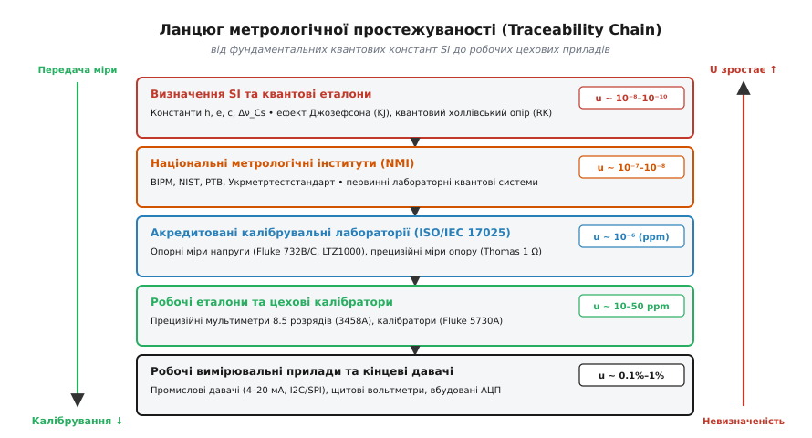
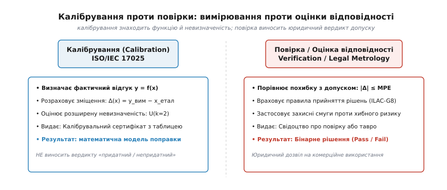
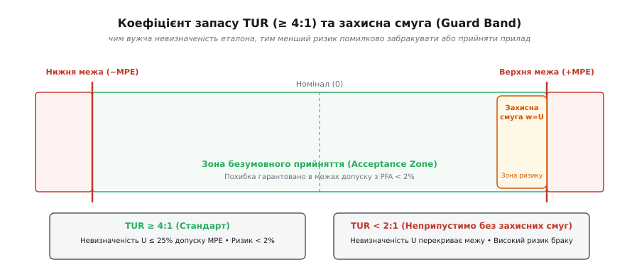
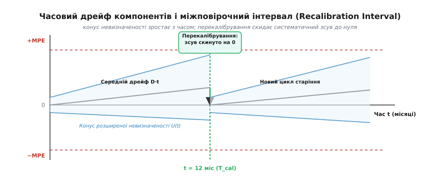

# Простежуваність і повірка за еталоном

<preknowlist>
- [Калібрування](root:hw-sensing/calibration) — перетворення вихідного сигналу у фізичну величину, прямий і зворотний хід.
- [Похибки вимірювань](root:hw-sensing/measurement-errors) — систематична і випадкова похибки, адитивні й мультиплікативні складові.
- [Бюджет невизначеності](root:hw-sensing/uncertainty-budget) — об'єднання стандартних невизначеностей за типом A і B та розширений інтервал довіри.
- [Редефініція SI 2019](root:hw-sensing/si-2019-redefinition) — прив'язка базових одиниць до фіксованих числових значень фундаментальних констант.
</preknowlist>

Прецизійний стендовий вольтметр на конвеєрній лінії показує 5.0002 В на виході стабілізатора. Інший прилад у заводській лабораторії контролю якості показує 5.0028 В на тій самій контрольній точці, а вхідний контроль замовника на іншому континенті фіксує 4.9981 В і бракує всю партію пристроїв. Жодне з цих трьох чисел не має переваги над іншими, доки за ними не стоїть документальний доказ фізичного зв'язку з єдиним джерелом істини. Без такого зв'язку будь-який відлік залишається лише локальною гіпотезою кремнієвого кристала, спотвореною старінням опорного стабілітрона, дрейфом резистивної матриці та градієнтами температури в корпусі приладу.

Здатність пов'язати результат конкретного вимірювання із загальноприйнятим визначенням фізичної одиниці зветься **метрологічною простежуваністю** (від англ. *metrological traceability*). Це не абстрактна формальність і не бюрократична вимога сертифікації: це фізична й математична дисципліна, яка перетворює приватні покази ізольованого давача на об'єктивне наукове число, що має однакову вагу в будь-якій точці планети.

---

### Ланцюг простежуваності: від констант Всесвіту до цехового щита

За визначенням міжнародного метрологічного словника (VIM, JCGM 200), простежуваність — це властивість результату вимірювання, завдяки якій він може бути пов'язаний з основою для порівняння через задокументований нерозривний ланцюг калібрувань, кожне з яких робить свій внесок у сумарну невизначеність.

Основою для порівняння в сучасній системі одиниць SI є не штучні матеріальні предмети, а фіксовані фундаментальні фізичні сталі (редефініція SI 2019 року). До 2019 року еталон маси існував у вигляді платиново-іридієвого циліндра в Севрі під Парижем, чия маса повільно дрейфувала через сорбцію газів із повітря. Сучасна метрологія повністю відмовилася від матеріальних артефактів на користь квантових явищ, де розмір одиниці визначається незмінними константами природи:

1. **Постійна Планка** `h = 6.626 070 15 × 10⁻³⁴ Дж·с` (фіксує кілограм через ваги Кіббла);
2. **Елементарний електричний заряд** `e = 1.602 176 634 × 10⁻¹⁹ Кл` (фіксує ампер разом із секундою);
3. **Швидкість світла у вакуумі** `c = 299 792 458 м/с` (фіксує метр через час поширення світла);
4. **Частота надтонкого розщеплення атома цезію-133** `Δν_Cs = 9 192 631 770 Гц` (фіксує секунду).


*Ланцюг метрологічної простежуваності. Передача розміру одиниці спускається згори вниз від квантових констант SI через національні інститути та акредитовані лабораторії до робочих приладів. На кожному ступені додається випадковий і систематичний внесок, тому невизначеність U накопичується знизу вгору.*

Передача розміру одиниці від цих констант до реального електронного пристрою будується як сувора п'ятирівнева ієрархія:

* **Рівень 1. Квантові первинні еталони (Primary Standards).** Напруга відтворюється за допомогою **ефекту Джозефсона**: масив надпровідних переходів опромінюється мікрохвильовою частотою `f`. На квантових переходах виникає строго дискретна напруга `V = n · f / K_J`, де стала Джозефсона `K_J = 2·e / h ≈ 483 597.8484... ГГц/В` є точною константою. Опір відтворюється за допомогою **квантового ефекту Холла**: у двовимірному електронному газі при гелієвих температурах і сильному магнітному полі холлівський опір квантується як `R_H = R_K / i = (h / e²) / i`, де стала фон Клітцинга `R_K ≈ 25 812.807 459... Ом`. Обидві системи спираються лише на квантові сталі та частоту цезієвого атомного годинника. Відносна невизначеність відтворення лежить у діапазоні від `10⁻¹⁰` до `10⁻⁸`.
* **Рівень 2. Первинні еталони національних метрологічних інститутів (NMI).** Національні лабораторії (NIST у США, PTB у Німеччині, NPL у Великій Британії, Укрметртестстандарт в Україні, BIPM на міжнародному рівні) утримують та звіряють квантові системи між собою шляхом ключових міжнародних порівнянь (*BIPM Key Comparisons*).
* **Рівень 3. Вторинні та опорні еталони акредитованих лабораторій (ISO/IEC 17025).** Оскільки утримувати квантову кріогенну установку на кожному підприємстві неможливо, акредитовані повірочні центри використовують високостабільні твердотільні міри: наприклад, термостатовані стабілітрони прихованого шару (*Buried Zener*, чіпи типу LTZ1000 або прилади Fluke 732B/C з річним дрейфом менше `0.1 ppm`), а також герметичні міри опору з манганіну чи еванорма (типу Thomas 1-Ohm або Fluke 742A). Лабораторія регулярно перевозить свої опорні міри до NMI для калібрування.
* **Рівень 4. Робочі еталони та лабораторні калібратори.** Багатофункціональні прецизійні калібратори (Fluke 5730A) та мультиметри найвищого класу точності на 8.5 десяткових розрядів (Keysight 3458A, Keithley 2002). Їх калібрують за опорними мірами лабораторії (зазвичай за методом артефактного калібрування, *Artifact Calibration*, де внутрішній опорний дільник калібрується за зовнішніми мірами 10 В і 10 кОм). Невизначеність тут становить `5–50 ppm`.
* **Рівень 5. Робочі прилади, цехові давачі та вбудовані АЦП.** Ручні мультиметри, осцилографи, давачі тиску 4–20 мА, плати збору даних та мікроконтролерні вимірювальні тракти. Їхня похибка становить від `0.05%` до `2%`.

Головний закон піраміди простежуваності — **незворотне зростання невизначеності вниз за ланцюгом**. На кожному переході від вищого ступеня до нижчого сумарна стандартна невизначеність `u_total` зростає через додавання похибки передачі, температурної нестабільності, шуму компаратора та контактних термоелектрорушійних сил:

```
u_total = √(u_std² + u_transfer² + u_env² + u_res²)   [квадратичне сумування некорельованих внесків]
```

Жоден робочий прилад у принципі не може мати похибку меншу, ніж еталон, за яким його калібрували. Калібрування передає розмір одиниці зверху вниз, але водночас розширює довірчий інтервал невизначеності.

> 🔧 **Навіщо це.** Якщо у вас на виробництві виник суперечливий вимір на 0.05%, перший крок аудиту — перевірити сертифікати калібрування всього вимірювального ланцюга. Сертифікат без посилання на національний еталон (NIST/PTB/Державний еталон) робить вимір юридично й технічно нікчемним: у разі судового розгляду бракованої партії продукції сертифікат без простежуваності не приймається експертизою.

---

### Калібрування проти повірки: вимірювання дійсності проти вердикту допуску

В інженерній практиці три терміни — «калібрування», «повірка» та «юстування» — постійно плутають, вживаючи їх як взаємозамінні синоніми. Проте за міжнародними стандартами (ISO/IEC 17025 та настановами OIML) це три абсолютно різні операції з різними цілями та наслідками.

**Калібрування (*Calibration*)** (від араб. *qālib* / фр. *calibre* — шаблон, міра) — це суто дослідницька процедура. Її мета — встановити точне співвідношення між значенням величини, яке задає еталон, та показом приладу, що перевіряється, а також оцінити повну невизначеність цього співвідношення.

Калібрування **не змінює внутрішніх налаштувань приладу** і **не дає вердикту «придатний / непридатний»**. Результатом калібрування є числовий масив даних або аналітична функція поправок `Δ(x) = y_вим − x_етал` разом із розширеною невизначеністю `U`. Калібрувальна лабораторія видає **Сертифікат калібрування** (*Calibration Certificate*), де зафіксовано: «при подачі з еталона напруги 10.00000 В прилад показав 10.00120 В; розширена невизначеність вимірювання становить U = 0.00015 В при k = 2». Що робити з цим зміщенням +1.2 мВ — врахувати в коді чи залишити як є — вирішує користувач.

**Повірка або оцінка відповідності (*Verification / Conformity Assessment*)** (від лат. *verificatio* — підтвердження істини) — це контрольна регламентна процедура законодавчої або виробничої метрології. Її мета — експериментально перевірити, чи вкладається похибка приладу в законодавчо встановлені або паспортні межі максимально допустимої похибки (Maximum Permissible Error, MPE):

```
|y_вим − x_етал| ≤ MPE   [критерій відповідності встановленому допуску]
```

Результатом повірки є виключно **бінарне рішення**: «Придатний» (*Pass*) або «Брак» (*Fail*). У разі успішної повірки видається **Свідоцтво про повірку** або ставиться метрологічне тавро (пломба), що дає юридичне право застосовувати прилад у сфері комерційного обліку (електролічильники, медична апаратура, торгові ваги, комерційний облік газу).


*Калібрування проти повірки. Калібрування вимірює дійсну характеристику й приписує їй невизначеність без винесення вироку. Повірка порівнює похибку з максимально допустимою границею MPE і видає бінарне юридичне рішення про допуск до експлуатації.*

**Юстування (*Adjustment*)** (від нім. *justieren* — підганяти, вирівнювати) — це операція механічного або цифрового втручання в прилад із метою зменшення його систематичної похибки. Наприклад: підкручування підрядкового резистора, переписування калібрувальних коефіцієнтів у внутрішній flash/EEPROM мікроконтролера або зміна зміщення в ЦАП автонуляції.

На практиці ці операції об'єднуються в повний метрологічний цикл:
1. **Калібрування у стані поставки (*As-Found Calibration*)**: прилад приходить на стіл лабораторії, і його похибка міряється «як є», щоб зрозуміти, чи не вийшов він за межі допуску за час експлуатації;
2. **Юстування (*Adjustment*)**: якщо похибка змістилася, оператор запускає процедуру підстроювання коефіцієнтів;
3. **Калібрування після юстування (*As-Left Calibration*)**: фіксація нової реальної похибки та невизначеності приладу перед поверненням на виробничу лінію.

---

### Коефіцієнт запасу TUR (≥ 4:1) та захисні смуги (Guard Banding)

Коли ми повіряємо прилад із допуском `MPE = ±1.0%`, наскільки точним має бути калібратор? Якщо взяти калібратор із похибкою також `±1.0%`, виникає метрологічний глухий кут: якщо прилад показує відхилення +0.9%, а калібратор сам має невизначеність ±1.0%, ми не знаємо, чи прилад ідеальний, чи він насправді вийшов за межі допуску до +1.9%.

Співвідношення між допуском тестованого пристрою (Unit Under Test, UUT) та невизначеністю еталона описується коефіцієнтом запасу невизначеності — **TUR (Test Uncertainty Ratio)**:

```
TUR = Tolerance(UUT) / Expanded_Uncertainty(Calibrator)  [визначення відношення допусків]
    = (2 · MPE_UUT) / (2 · U_cal)                        [двосторонній симетричний допуск]
    = MPE_UUT / U_cal                                    [скорочення спільного множника 2]
```

де `MPE_UUT` — паспортна границя допустимої похибки приладу, а `U_cal` — розширена невизначеність калібратора (зазвичай при рівні довіри 95%, коефіцієнт охоплення `k = 2`).


*Захисні смуги та коефіцієнт TUR. Захисна смуга w звужує допустиму зону прийняття на величину невизначеності калібратора, відсікаючи хвости розподілу й гарантуючи, що ймовірність хибного прийняття бракованого приладу PFA не перевищить 2%.*

У метрології загальноприйнятим золотим стандартом є правило: **`TUR ≥ 4:1`** (у прецизійних оборонних та аерокосмічних застосуваннях — `TUR ≥ 10:1`). Чому саме 4:1? Відповідь полягає в статистичній природі ймовірності помилкового рішення.

При проведенні повірки існують два взаємні ризики:
1. **Ризик споживача (Consumer's Risk, β або PFA — Probability of False Acceptance)**: ймовірність того, що прилад, який насправді має похибку більшу за допуск MPE, через похибку еталона буде визнано «придатним» і відправлено замовнику;
2. **Ризик виробника (Producer's Risk, α або PFR — Probability of False Reject)**: ймовірність того, що абсолютно справний прилад буде помилково забраковано через випадковий викид або зсув еталона.

Якщо `TUR = 1:1`, то для показу, розташованого точно на границі допуску MPE, ймовірність того, що реальне значення вийшло за допуск, становить рівно **50%**. Якщо ж `TUR ≥ 4:1`, невизначеність еталона становить не більше 25% від поля допуску. У такому разі максимальна ймовірність хибного прийняття браку (PFA) навіть на самому краї діапазону не перевищує 2% (за стандартом ANSI/NCSL Z540.3 та директивою ILAC-G8).

Якщо ж знайти еталон із запасом 4:1 неможливо (наприклад, калібрується прилад найвищого класу точності, де доступний калібратор забезпечує лише `TUR = 2:1` або `1.5:1`), стандарт вимагає застосування **захисних смуг (Guard Banding)**.

При захисному смугуванні поле допуску штучно звужується на величину захисної смуги `w`:

```
w = U_cal            [жорстке обмеження: 100% захисна смуга]
w = 0.5 · U_cal      [помірне обмеження: ILAC-G8 для PFA < 2%]

Зона прийняття: [ -MPE + w,  +MPE − w ]
```

**Числовий приклад розрахунку TUR та захисної смуги.** Калібрується 16-розрядний модуль збору даних на діапазоні 10.000 В.
* Паспортний допуск модуля: `MPE = ±0.05% від шкали = ±5.0 мВ`.
* Калібратор №1 (Fluke 5730A): розширена невизначеність на точці 10 В дорівнює `U_cal1 = ±1.0 мВ` (k = 2).
* Калібратор №2 (лабораторний мультиметр 6.5 розрядів): розширена невизначеність `U_cal2 = ±2.5 мВ` (k = 2).

Розраховуємо коефіцієнт TUR для обох варіантів:

```
Для калібратора №1:
TUR = 5.0 мВ / 1.0 мВ
    = 5.0:1                                              [TUR ≥ 4:1: просте прийняття дозволено]
Зона прийняття: [ −5.0 мВ, +5.0 мВ ]

Для калібратора №2:
TUR = 5.0 мВ / 2.5 мВ
    = 2.0:1                                              [TUR < 4:1: просте прийняття заборонено]
Захисна смуга: w = U_cal2 = 2.5 мВ                       [розрахунок захисної смуги за U]
Звужена зона прийняття = [ −5.0 + 2.5, +5.0 − 2.5 ]
                       = [ −2.5 мВ, +2.5 мВ ]            [обчислення звуженого інтервалу]
```

При використанні менш точного калібратора №2 прилад, який показав відхилення +3.0 мВ, буде **забраковано**, хоча формально він укладається в паспорний допуск 5.0 мВ. Це ціна, яку виробник платить ризиком хибного бракування за використання недостатньо точного калібрувального обладнання.

---

### Часовий дрейф компонентів та міжповірочні інтервали

Жодне калібрування не є вічним. Одразу після від'єднання від еталона внутрішні компоненти приладу починають незворотно змінювати свої фізичні властивості. Цей процес зветься **часовим старінням або дрейфом** (*aging drift*).

Фізичні механізми старіння всередині вимірювальних пристроїв зумовлені кількома факторами:

1. **Релаксація механічних напружень у кристалах стабілітронів.** Інтегральні опорні джерела напруги (типу дискретних мікросхем опорної напруги) зазнають постійного тиску з боку пластикового або метало-керамічного корпусу та шару компаунду. З часом напруження в кремнії релаксують, змінюючи ширину забороненої зони та напругу лавинного пробою. Типовий дрейф напівпровідникового джерела опорної напруги становить від 5 до 20 ppm на рік для стандартних мікросхем і 0.5–2 ppm на рік для прецизійних термостатованих стабілітронів.
2. **Окислення та структурна перебудова резистивних плівок.** Тонкоплівкові резистори у вхідних дільниках напруги повільно окислюються киснем, що дифундує крізь захисний лак, а в їхній кристалічній решітці зменшується кількість дислокацій, що призводить до повільної зміни опору на 2–10 ppm на рік.
3. **Діелектрична релаксація та витік конденсаторів інтеграторів АЦП.**


*Конус розширеної невизначеності в часі. Через неминуче старіння компонентів невизначеність зростає, доки не наблизиться до границь MPE. Процедура перекалібрування визначає новий систематичний зсув, скидаючи похибку до базового рівня еталона.*

Швидкість старіння зазвичай є найвищою в перші 500–1000 годин роботи приладу («припрацювання»), після чого виходить на відносно стабільну логарифмічну або лінійну залежність:

```
Δ_дрейф(t) = D_рік · t            [консервативна лінійна модель старіння]
Δ_дрейф(t) = D_0 · √(t / t_0)     [дифузійна модель релаксації механічних напружень]
```

Окрім часового дрейфу, на прилад впливають коливання температури довкілля через **температурний коефіцієнт** (Temperature Coefficient, TC, вимірюється в `ppm/°C` або `мкВ/°C`). Якщо калібрування виконувалося при `T_cal = 23 °C`, а прилад працює в цеху при `T = 35 °C`, температурна похибка становить:

```
Δ_temp = TC · (T − T_cal)         [температурний коефіцієнт на різницю температур]
```

Повна розширена невизначеність показу приладу як функція часу `t` від моменту останнього калібрування записується формулою розширення конуса невизначеності:

```
U(t) = k · √( u_cal² + (D_рік · t)² + (TC · ΔT_max / √3)² + u_шум² )  [бюджет нестабільності у часі]
```

де ділення на `√3` виникає через прямокутний розподіл можливих коливань робочої температури в межах діапазону `ΔT_max`.

**Міжповірочний інтервал (`T_cal`)** — це проміжок часу, протягом якого розширена невизначеність приладу разом із систематичним дрейфом із гарантованою ймовірністю (зазвичай 95%) не перевищить паспорної границі допустимої похибки MPE:

```
U(T_cal) + |Δ_дрейф(T_cal)| ≤ MPE  [умова збереження метрологічної придатності]
```

Стандартні інтервали повірки (6 місяців, 1 рік або 2 роки) визначаються виробником на основі статистичних випробувань старіння. Відповідно до настанови OIML D10, підприємства можуть динамічно оптимізувати міжповірочні інтервали методом «сходів» (*staircase method*): якщо прилад три повірки поспіль повертається з відхиленням менше 50% від MPE, інтервал подовжують на 20–30%; якщо ж прилад хоча б раз вийшов за межі — інтервал негайно скорочують удвічі.

---

### Програмна таблиця калібрування та розрахунок динамічної невизначеності на C і C++

Сучасний вимірювальний прилад не обмежується одноразовим переписуванням констант. Високонадійні системи (бортова телеметрія, медичні контролери, системи обліку енергії) зберігають у енергонезалежній пам'яті (EEPROM/FRAM) повний метрологічний паспорт калібрування та на кожному відліку розраховують не лише виправлене фізичне значення, а й його поточну розширену невизначеність з урахуванням часу та температури.

Структура метрологічного блоку в EEPROM обов'язково містить:
1. Магічне число (Magic Word) та версію структури;
2. UNIX-час проведення калібрування `t_cal` та термін дії `validity_seconds`;
3. Температуру калібрування `T_cal`;
4. Коефіцієнти лінійної або поліноміальної функції: нахил `gain` і зсув `offset`;
5. Базову невизначеність еталона `u_std` (у вольтах або відліках);
6. Температурний коефіцієнт `TC` (ppm/°C) та річну швидкість старіння `drift_ppm_year`;
7. Контрольну суму CRC32 для запобігання використанню пошкоджених коефіцієнтів.

Нижче наведено повністю робочу реалізацію модуля метрологічної корекції з обчисленням розширеної невизначеності двома мовами: на чистому ANSI C та ідіоматичному сучасному C++.

:::tabs
:::code traceability-d/c/main.c
:::code traceability-d/cpp/main.cpp
:::

---

### Практичні пастки простежуваності та метрологічна гігієна

Навіть якщо прилад має бездоганний сертифікат калібрування з найвищою точністю, неправильне фізичне підключення до еталона може звести всю простежуваність нанівець. Нижче наведено чотири головні джерела прихованих похибок у калібрувальних схемах:

1. **Паразитні термоелектрорушійні сили (ефект Зеєбека).** При з'єднанні мідного провідника щупа з латунною клемою або олов'яно-свинцевим припоєм на платі утворюється біметалічна термопара. При градієнті температури між клемами всього `1 °C` паразитна напруга становить від 3 до 40 мкВ. При калібруванні мікровольтових сигналів це створює колосальну похибку. Для захисту застосовують спеціальні клеми з телуристої міді (*Tellurium Copper*), екранують контакти від конвекційних потоків повітря та проводять вимірювання за методом комутації полярності (*reversal measurement*): вимірюють пряму напругу `+V` та інвертовану `−V`, після чого різницю ділять на 2, повністю виключаючи постійну термоЕРС.
2. **Похибка навантаження джерел напруги.** Вхідний опір більшості вольтметрів становить `10 МОм`. Якщо калібрується вихід прецизійного дільника з вихідним опором `100 кОм`, паралельне підключення вольтметра зменшує еквівалентний опір плеча, спричиняючи систематичне заниження показу на `1%` (10 000 ppm!). Метрологічні калібратори вимагають використання вольтметрів із вхідним опором понад `10 ГОм` у діапазоні до 10 В (електрометричний вхідний каскад на польових транзисторах).
3. **Витік струму через ізоляцію та трібоелектричний ефект.** При вимірюванні опорів понад 1 МОм або струмів менше 1 мкА звичайні кабелі з ПВХ-ізоляцією спотворюють покази через поверхневі струми витоку. Слід застосовувати триаксіальні кабелі (*triaxial cables*) з активним екрануванням (*Driven Guard*), де внутрішній екран утримується під тим самим потенціалом, що й вимірювальна жила, повністю зводячи різницю напруг і струм витоку до нуля.
4. **Контроль кліматичних параметрів приміщення.** Густина сухого повітря та вологість змінюють діелектричну проникність повітряних конденсаторів, виштовхувальну силу Архімеда при зважуванні маси та поверхневий опір резисторів. Будь-який сертифікат калібрування вимагає обов'язкової фіксації температури (наприклад, `23.0 ± 1.0 °C`), відносної вологості (`45 ± 10%`) та атмосферного тиску.

Метрологічна простежуваність діє лише тоді, коли всі ланки — від квантових констант до роз'єму на платі — враховують фізичні обмеження вимірювального середовища. Лише тоді виміряне число стає надійним базисом для інженерних та наукових рішень.
