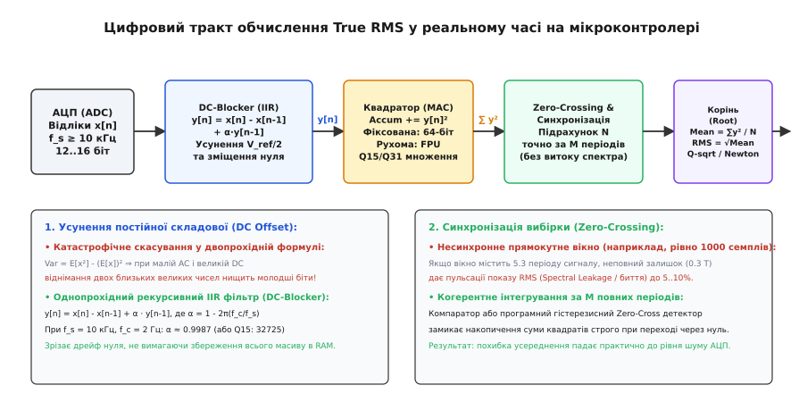

# ⚙️ Алгоритми дискретного True RMS на мікроконтролері

Реалізація вимірювання середньоквадратичного значення на мікроконтролері (ARM Cortex-M, ESP32, RISC-V) усуває потребу в дорогих аналогових мікросхемах True RMS. Проте пряме перенесення шкільної формули в код стикається з трьома критичними метрологічними пастками: **катастрофічним чисельним скасуванням** при відніманні зміщення нуля, **пульсаціями від несинхронного вікна вибірки** (витоком спектра) та **переповненням цілочисельних регістрів**. Нижче наведено математично обґрунтовану архітектуру DSP-тракту та готові високопродуктивні реалізації для фіксованої (Q15/Q31) та рухомої (float) коми з парними вкладками C та C++.

---

### Математична основа та архітектура тракту

Нехай АЦП здійснює дискретизацію неперервного сигналу `v(t)` з періодом дискретизації `T_s = 1 / f_s`. Згідно з теоремою Найквіста — Котельникова — Шеннона, щоб коректно врахувати внесок вищих гармонік у загальну теплову енергію сигналу, частота дискретизації `f_s` повинна щонайменше вдвічі перевищувати частоту найвищої значущої гармоніки `k_max · f₀`:

```
f_s ≥ 2 · k_max · f₀
```

Для сигналу промислової частоти `f₀ = 50 Гц` із гармонійним спектром до 50-ї гармоніки (`2.5 кГц`, що типово для імпульсних навантажень) мінімальна частота становить `f_s ≥ 5 кГц`. У реальних вимірювальних трактах обирають `f_s = 10..50 кГц` для зменшення похибки апроксимації інтеграла скінченною сумою Рімана.

За час вимірювального вікна, що містить `M` повних періодів сигналу, надходить `N` відліків `x[0], x[1], ..., x[N-1]`.


*Повний цифровий тракт True RMS: аналого-цифрове перетворення, однопрохідна рекурсивна фільтрація DC-складової, когерентне накопичення квадратів та обчислення кореня.*

---

### Пастка 1: Усунення зміщення нуля (DC Offset Removal)

Вбудовані АЦП мікроконтролерів є однополярними (вхідний діапазон від `0` до `V_ref`). Тому змінний двополярний сигнал штучно підтягують до середини шкали `V_ref / 2` за допомогою резистивного дільника або операційного підсилювача. Крім того, напруга зміщення дрейфує від температури та старіння компонентів.

#### Чому класична формула дисперсії є чисельно нестійкою

У підручниках зі статистики діюче змінне значення часто записують через різницю середнього квадрата та квадрата середнього (двопрохідний метод):

```
V_AC_RMS² = (1 / N) · ∑_{i=0}^{N-1} x²[i] - ( (1 / N) · ∑_{i=0}^{N-1} x[i] )²
```

У скінченній розрядності (особливо при 32-бітному float із 24-бітною мантисою або 32-бітних цілих числах) ця формула призводить до **катастрофічної втрати точності** (англ. *catastrophic cancellation*).

*Чисельний приклад:* нехай 12-бітний АЦП має штучне зміщення `V_ref / 2 ≈ 2048 LSB`. Змінний сигнал малий — амплітуда `10 LSB` (напруга кілька мілівольт).
- Сума квадратів `E[x²]` має порядок `2048² + 10²/2 ≈ 4 194 304 + 50 = 4 194 354`.
- Квадрат середнього `(E[x])²` становить `2048² = 4 194 304`.
- Різниця дорівнює лише `50`.

У форматі `float32` (де мантиса зберігає близько 7 значущих десяткових цифр) різниця двох велетенських чисел повністю втрачає молодші розряди. Випадкові похибки округлення мантиси виявляються більшими за корисний сигнал.

#### Рішення: Однопрохідний рекурсивний фільтр верхніх частот (IIR DC-Blocker)

Фільтр першого порядку усуває постійну складову потоково в кожному такті переривання АЦП без збереження масиву відліків у пам'яті:

```
y[n] = x[n] - x[n-1] + α · y[n-1]
```

Передатна функція фільтра в Z-площині має вигляд:

```
H(z) = (1 - z⁻¹) / (1 - α · z⁻¹)
```

Нуль передатної функції розташований строго в точці `z = 1` (нульова частота `ω = 0`, постійний струм), що гарантує абсолютне пригнічення постійної складової `H(1) = 0`. Полюс знаходиться в точці `z = α` всередині одиничного кола, забезпечуючи стійкість фільтра.

Коефіцієнт зворотного зв'язку `α` визначає частоту зрізу `f_c` (на рівні −3 дБ):

```
α = 1 - (2π · f_c / f_s)
```

Для частоти дискретизації `f_s = 10 кГц` та частоти зрізу `f_c = 1.5 Гц`:
`α = 1 - (2π · 1.5 / 10000) ≈ 0.999057`.

У фіксованій комірці Q15 коефіцієнт записується як ціле число: `α_q15 = round(0.999057 · 32768) = 32737`.

---

### Пастка 2: Когерентне вікно та перетин нуля (Zero-Crossing)

Якщо накопичувати суму квадратів `∑ y[n]²` за фіксовану кількість відліків (наприклад, рівно `1000 семплів`), розмір вікна майже ніколи не буде кратним точному періоду сигналу `T = 20 мс` (для `50 Гц`).

Якщо вікно захоплює `5.3` періоду коливання, неповний шматок `0.3 T` дає періодичні пульсації розрахованого RMS (витік спектральної енергії), що досягають 5–10% похибки.

**Когерентне накопичення:** вікно вимірювання замикається строго в момент переходу відфільтрованого сигналу через нуль у додатному напрямку (`y[n-1] < 0` та `y[n] ≥ 0`). Щоб шум не викликав хибних спрацьовувань навколо нуля, детектор використовує програмний гістерезис `V_hyst`.

---

### Пастка 3: Динамічний діапазон та розрядність квантування АЦП

Шум квантування ідеального `B`-бітного АЦП визначає теоретичну межу відношення сигнал/шум:

```
SNR = 6.02 · B + 1.76 дБ
```

Для 12-бітного АЦП теоретичний динамічний діапазон становить `~74 дБ`, а реальний ефективний показник (ENOB) вбудованих АЦП мікроконтролерів рідко перевищує `9.5..10.5 біт` через шуми шин живлення та ядра.

Коли сигнал підноситься до квадрата `y²[n]`, динамічний діапазон у бітах подвоюється: добуток двох 16-бітних чисел дає 32-бітне значення. Якщо сумувати `N = 1000` таких відліків у 32-бітний акумулятор, відбудеться катастрофічне переповнення:
`1000 · (32768)² ≈ 1.07 · 10¹² > 2³² - 1 ≈ 4.29 · 10⁹`.

Тому акумулятор суми квадратів у цілочисельному тракті **зобов'язаний бути 64-бітним** (`uint64_t` або регістрова пара `R0:R1` / інструкція `SMLAL` у системі команд ARM).

---

### Оптимізована реалізація для мікроконтролерів

Нижче наведено два закінчені модулі:
1. **Fixed-Point Q15/64-bit Accumulator (цілочисельний):** ідеально підходить для ядер ARM Cortex-M0/M0+/M3 та процесорів RISC-V RV32I без апаратного модуля рухомої коми (FPU).
2. **Floating-Point FPU / SIMD (рухома кома):** оптимізований під Cortex-M4F/M7/ESP32, із розгортанням циклів та векторизацією обчислень.

---

#### 1. Модуль True RMS із фіксованою комою (Fixed-Point Q15)

:::tabs
:::code proj-dsp-true-rms/c/1-modul-true-rms-iz.c
:::code proj-dsp-true-rms/cpp/1-modul-true-rms-iz.cpp
:::

---

#### 2. Блочний векторний розрахунок із плаваючою комою (Float FPU / SIMD)

Коли буфер відліків збирається через DMA (наприклад, 1024 або 2048 значень напівперіоду), обчислення виконують блочно. Для прискорення цикл розгортають на 4 паралельні потоки акумуляції, що дозволяє конвеєру FPU задіяти векторні команди без зупинок (pipeline stalls).

:::tabs
:::code proj-dsp-true-rms/c/2-blochnyi-vektornyi.c
:::code proj-dsp-true-rms/cpp/2-blochnyi-vektornyi.cpp
:::

---

### Порівняння обчислювальної складності

| Архітектура алгоритму | Такти на 1 відлік (Cortex-M4F @ 168 МГц) | Використання RAM | Чутливість до дрейфу DC |
|---|---|---|---|
| **Fixed-Point Q15 (IIR + ZC)** | ~18 тактів (потоковий розрахунок) | `28 байтів` (стан структури) | **Нульова** (IIR зрізає дрейф) |
| **Float Block FPU (2-прохідний)** | ~4 такти на відлік (розгорнутий цикл) | `4 × N байтів` (буфер DMA) | **Низька** (DC віднімається в явному вигляді) |
| **Аналоговий AD8436 + 12-біт АЦП** | 1 такт зчитування АЦП постійної напруги | `0 байтів` (все в залізі) | Визначається `C_AV` та зміщенням ОП |
