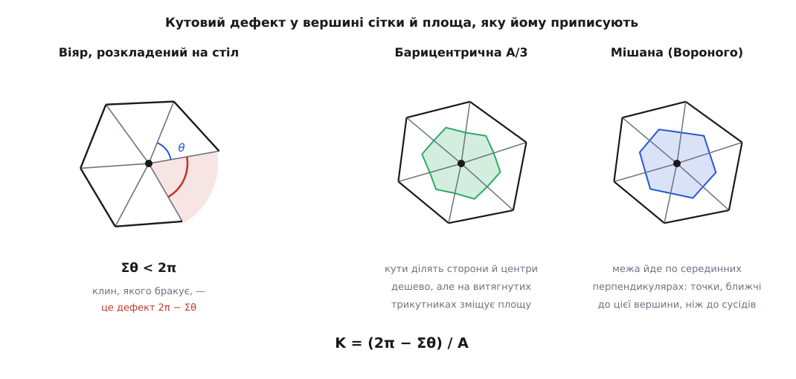

# ⚙️ Кривина трикутної сітки: кутовий дефект у коді

Сканер, скульптурний редактор і симулятор тканини віддають поверхню однаково — масивом вершин і масивом трикутників. Формули поверхні немає: ні параметризації, ні похідних, ні нормалі, яку можна ще раз продиференціювати. А гаусова кривина в кожній вершині потрібна щодня: за нею ловлять гострі ребра для ремешування, зважують згладжування, кладуть шви розгортки, шукають місця, де поверхня вивернулася. Нижче — як дістати її з самих лише координат і трьох індексів на трикутник, і як однією сумою перевірити, що реалізація не бреше.

## Уся кривина многогранника сидить у вершинах

Візьми одну вершину й розклади прилеглі до неї трикутники на стіл: розріж віяр по одному ребру, а решту повертай навколо спільних ребер, доки все не ляже в площину. Кожен трикутник ляже без найменшого спотворення — він і так плаский. А от віяр зімкнутися не мусить. Якщо сума кутів при вершині менша за 2π, лишиться незакритий клин; якщо більша — сусіди налізуть один на одного.

Це вся кривина, яка в многогранника є. Усередині грані поверхня плоска. Уздовж ребра вона зігнута — але зігнута як папір: розігнувши двогранний кут, ми не змінимо жодної довжини, зміряної по поверхні, а гаусова кривина від такого згину не залежить. Лишаються вершини, і в кожній зібрано рівно стільки кривини, скільки бракує кутам до повного оберту:

```text
кутовий дефект   Δᵢ = 2π − Σⱼ θᵢⱼ

θᵢⱼ — кут j-го прилеглого трикутника при вершині i, у радіанах
```

Δᵢ — не наближення й не оцінка. Візьми одиничні нормалі всіх граней, що сходяться у вершині, і познач їхні кінці на одиничній сфері: вони окреслять сферичний многокутник, площа якого дорівнює Δᵢ точно. На вершині куба, наприклад, сходяться три грані, дефект дорівнює 2π − 3·(π/2) = π/2, а три взаємно перпендикулярні нормалі дають на сфері трикутник із трьома прямими кутами й площею (3π/2) − π = π/2. Дефект — це повна кривина, стягнута у вершину. Для опуклого многогранника сума всіх дефектів дорівнює 4π; довів це Рене Декарт у рукописі *Progymnasmata de solidorum elementis*, якого за життя не друкував. Оригінал загубився, дійшла копія, зроблена Ляйбніцом 1676 року в Парижі, — і аж 1860-го її знайшли серед незакаталогізованих Ляйбніцових паперів у Ганноверській королівській бібліотеці.

> 🔧 **Навіщо це.** Кривина многогранника не потребує ні похідних, ні підгонки поверхні, ні згладжування — тільки додавання кутів. Тому вона рахується за один прохід по масиву трикутників, лягає в кеш і паралелиться тривіально, а на сітці в мільйон граней коштує менше, ніж одна ітерація будь-якого методу з підгонкою локальної квадрики.

Дефект — величина сумарна й безрозмірна, а кривина — густина, з одиницями 1/м². Щоб порівняти вершину з вершиною або з відомим 1/R², дефект треба поділити на площу, приписану вершині:

```text
Kᵢ = (2π − Σⱼ θᵢⱼ) / Aᵢ
```

## Скільки площі належить вершині

Найдешевша відповідь: віддати вершині третину кожного прилеглого трикутника. Сітка ділиться без залишку — сума всіх Aᵢ дорівнює повній площі, — і на майже рівносторонніх трикутниках це чесно. На витягнутих уже ні: вершина при гострому кінці голки дістає третину трикутника, більшість якого лежить далеко від неї.

Чесніша відповідь — клітина Вороного: точки, ближчі до цієї вершини, ніж до будь-якої сусідньої. Її межа йде серединними перпендикулярами до ребер, а кути припадають на центри описаних кіл. Для гострокутного трикутника PQR частина клітини P всередині нього виражається через [котангенси](root:math-geometry/tangent-cotangent) двох інших кутів:

```text
A_вор(P) = ( |PQ|²·ctg∠R + |PR|²·ctg∠Q ) / 8

перевірка на рівносторонньому зі стороною a:
ctg 60° = 1/√3
A_вор = ( a²/√3 + a²/√3 ) / 8 = a²/(4√3) = (1/3)·(√3/4·a²) = площа/3   ✓
```

Пастка чекає на тупокутних трикутниках: центр описаного кола падає назовні, клітина вилазить за межі трикутника, а формула видає від'ємний доданок. Марк Меєр, Матьє Дебрен, Петер Шрьодер і Алан Барр (*Discrete Differential-Geometry Operators for Triangulated 2-Manifolds*, у збірнику «Visualization and Mathematics III», Springer, 2003) запропонували латку, яка й досі стандарт: у тупокутному трикутнику вершині при тупому куті дають половину його площі, двом іншим — по чверті. Суміш двох правил і звуть **мішаною площею**.


*Дефект — це клин, якого бракує до повного оберту. Щоб перетворити його на густину, потрібна площа: барицентрична ділить трикутник центроїдом, Вороного — серединними перпендикулярами.*

## Код

Один прохід по трикутниках накопичує кути й площі у вершини; топологію рахуємо тим самим проходом, щоб потім відрізнити край від нутра. C++17.

:::code proj-mesh-curvature/cpp/main.cpp

## Дві перевірки, які варто мати завжди

Перша — сфера. Тріангулюй кулю радіуса R і подивись, чи збігаються значення до 1/R². На ікосфері одиничного радіуса виходить так:

```text
поділів  вершин   мішана площа        барицентрична A/3
   0        12    1.3125              1.3125
   1        42    1.0699 … 1.0798     1.0451 … 1.1795
   2       162    1.0170 … 1.0203     1.0082 … 1.1538
   3       642    1.0042 … 1.0055     1.0001 … 1.1479
   4      2562    1.0011 … 1.0014     0.9981 … 1.1464
```

Похибка падає вчетверо на кожен поділ — це другий порядок за розміром трикутника. Найгрубіший рядок, 1.3125 на ікосаедрі, має точне пояснення: сума дефектів там уже рівно 4π, а площа ікосаедра, вписаного в одиничну сферу, дорівнює 9.5745 проти 4π = 12.5664. Відношення 12.5664/9.5745 = 1.3125 — уся похибка сидить у браку площі, і ні в чому більше.

Друга перевірка — дискретна теорема Гауса — Бонне. Для замкненої сітки без краю сума всіх дефектів залежить тільки від того, скільки в поверхні дірок:

```text
Σᵢ Δᵢ = 2π·χ,     χ = V − E + F      (сфера χ = 2, тор χ = 0)

тетраедр: 4 вершини × (2π − 3·60°) = 4π = 2π·2   ✓
```

У коді це рядок:

```cpp
#include <cassert>

const Result r   = gaussian_curvature(m);
const double chi = double(m.pos.size()) - double(r.edges) + double(m.tri.size());
assert(r.skipped == 0);
assert(std::abs(r.total_defect - 2.0 * PI * chi) < 1e-9 * (1.0 + std::abs(chi)));
```

Розкрий суму — і стане видно, чому цей тест такий чутливий. Σ Δᵢ = 2π·V − (усі кути всіх трикутників) = 2π·V − π·F, а в замкненій сітці кожне ребро ділять два трикутники, тож 3F = 2E і χ = V − F/2. Обидві частини рівності — той самий вираз 2π·V − π·F. Отже, тотожність не залежить від координат узагалі: вона тримається на тому, що кути кожного трикутника дають у сумі π, і на тому, що кожен трикутник порахований рівно раз. Тому перевірка не судить про якість сітки — вона судить про код, і ловить саме те, на чому ламаються реалізації: переплутану формулу кута, зсунуту індексацію, накопичення не в ту вершину, подвоєні трикутники. У тому числі тихо пропущені вироджені: кожен із них забирає з суми кутів рівно π, тож розбіжність вийде π помножити на `skipped`.

## Складність і пастки

Час — O(F) на один прохід плюс хеш-мапа на 3F ребер; пам'ять — O(V). Ребра можна не збирати взагалі, якщо край відомий заздалегідь, і тоді цикл ідеально розпаралелюється за окремими накопичувачами на потік.

**acos.** Очевидний спосіб — `acos(dot(u,v)/(len(u)*len(v)))` — це міна. Заокруглення легко виносить аргумент за одиницю (1.0000000000000002), і замість нуля виходить NaN, який отруює спочатку вершину, потім суму, потім перевірку — а зневаджувати доведеться за сотні рядків від місця, де він народився. Затискати аргумент у [−1, 1] обов'язково, а `atan2(|u×v|, u·v)` знімає питання разом із діленням; [чому саме так поводиться дійсне число](root:hw-arch/floating-point) — окрема історія.

**Скорочення значущих цифр.** Дефект — це різниця двох майже однакових чисел: чим дрібніша сітка, тим ближче Σθ до 2π. На float32 з густої сітки виходить самий шум; double тут не примха, а мінімум.

**Голки й вироджені.** Трикутник нульової площі кутів не має, і його треба пропускати — але не мовчки: лічильник `skipped` потрібен, щоб перевірка Гауса — Бонне не збила з пантелику. Голкоподібний трикутник формулі Вороного не страшний (у гострокутному випадку всі доданки додатні, велика ctg множиться на малий квадрат сторони), але межа «гострий/тупий» проходить точно на 90°, і на дрижанні коло неї площа стрибком міняється між A/4 і A/2.

**Край.** Для крайової вершини 2π не має жодних підстав: віяр там не замкнений. Величина π − Σθ, яку іноді пишуть замість дефекту, — це поворот межової лінії, тобто крайовий доданок теореми [Гауса — Бонне](root:math-geometry/gauss-bonnet), а не гаусова кривина. Розумний типовий вибір — позначити такі вершини й не рахувати; інакше вздовж усього краю з'явиться фальшива смуга величезних значень.

**Не многовид.** Ребро, яке ділять три й більше трикутників, ловиться лічильником. Гірший випадок — «метелик»: вершина, віяр навколо якої розпадається на два окремі кільця. Ребра там усі парні, сітка на вигляд замкнена, а кути додаються з обох кілець і дають фальшивий від'ємний дефект. Ловиться це лише обходом віяра: прилеглі до вершини трикутники мусять складатися в один цикл, а не в кілька.

**Залежність від сітки.** Найважливіше й найнеприємніше. Точкова збіжність не гарантована: Венсан Бореллі, Фредерік Казаль і Жан-Марі Морван (*Computer Aided Geometric Design*, т. 20, 2003, с. 319–341) показали, що кутовий дефект дає саме гаусову кривину лише у вершинах з чотирма й шістьма сусідами, а в решті випадків загалом не збігається. У таблиці вище це видно голим оком: із барицентричною площею дванадцять п'ятивалентних вершин ікосфери сідають на 1.1464 замість 1 і на 1.1464 лишаються, скільки не дрібни — чотирнадцять відсотків похибки, яких згущення не бере. Мішана площа цю конкретну ваду прибирає, але загальної теореми з того не виходить: для довільної сітки жоден вибір Aᵢ збіжності не забезпечує. Для пошуку ознак і зважування згладжування цього досить із запасом; якщо ж число піде у звіт як виміряна кривина, рахувати треба інакше — підганяти квадрику до кільця найближчих сусідів і брати кривину вже з неї.

Клітина Вороного тут не випадкова гостя: це той самий поділ простору за близькістю, що його 1908 року загальним чином описав Георгій Вороний, український математик родом із Журавки на Полтавщині. Побудова, придумана для теорії чисел і квадратичних форм, виявилася природною мірою «скільки поверхні належить цій точці» — і саме в цій ролі [діаграма Вороного](root:sf-algorithms/voronoi-diagram) живе в обробці сіток донині.
