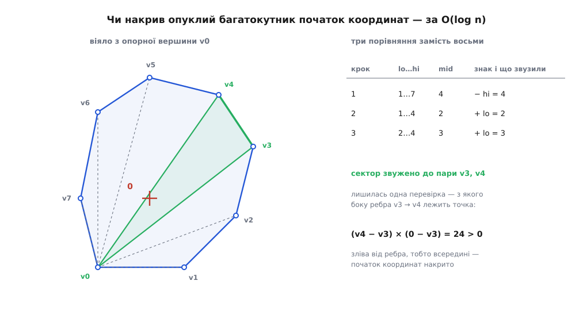

# ⚙️ Сума опуклих багатокутників і перевірка зіткнення: робочий код

Нижче — повна реалізація, яку не соромно покласти в гарячий цикл фізичного рушія: злиття двох опуклих багатокутників за O(m + n), відповідь «чи перетинаються ці двоє» через належність однієї точки одній фігурі, і опорна функція, з якої починається GJK. Уся арифметика ціла — і, як стане видно, це рішення не про швидкість, а про правильність.

### Одне рішення в циклі

Злиття ухвалює на кожному кроці одне-єдине рішення: чиє поточне ребро йде за напрямом раніше — A чи B? Спокуса тут — порахувати кути через `atan2` і порівняти числа. Це і повільно (тригонометрія на кожному кроці), і крихко: кути виходять наближеними, а порівнюємо ми їх на точну рівність.

Правильний інструмент — [векторний добуток](root:math-algebra/cross-product), точніше його z-складова `a.x·b.y − a.y·b.x`. Знак відповідає на питання прямо: додатний — b повернутий від a проти годинникової стрілки, від'ємний — за нею, нуль — напрями колінеарні. Два множення й одне віднімання, жодного кута.

Нуль тут не виняток, а робочий випадок: він означає, що ребра однаково напрямлені й складаються в одне довше. Саме через нього в сумі трикутника з квадратом виходить п'ять вершин, а не сім. А отже нуль треба вміти впізнавати **точно**.

Ось де ламаються [числа з рухомою комою](root:hw-arch/floating-point): добутки `a.x·b.y` і `a.y·b.x` округляються кожен по-своєму, і різниця двох майже рівних чисел дає не 0, а щось на кшталт 10⁻¹⁶. Два колінеарні ребра розповзаються на два різні напрями, цикл дописує зайву вершину, контур не замикається — і виявиться це через тисячу кадрів, коли рушій пропустить зіткнення. Тому координати тримаємо цілими: або пікселі, або фіксована кома (координата в 1/1024 одиниці — те саме ціле число, лише з домовленістю про масштаб).

> 🔧 **Навіщо це.** Ціла арифметика тут — рішення про правильність, а не про швидкість. Усе, що алгоритм питає в геометрії, — це знак одного виразу; поки знак точний, результат точний до останньої вершини, і підбирати «епсилони» не доводиться взагалі. Щойно координати стають дробовими, доводиться вигадувати поріг колінеарності — а він завжди або злипає різні напрями, або розводить однакові, залежно від масштабу сцени.

### Нормалізація входу

Злиття вимагає від обох багатокутників трьох речей, і кожна має причину.

**Обхід проти годинникової стрілки.** Тільки за такого обходу напрями ребер зростають; за годинниковою вони спадають, і всі порівняння перевернуться. Орієнтацію дає знак подвоєної орієнтованої площі ([формула шнурівки](root:sf-algorithms/shoelace-area)): від'ємний — список треба розвернути. Нуль означає вироджений вхід, точку або відрізок, і його не чіпаємо — розвертати там нічого.

**Жодних повторів і вершин посеред ребра.** Три точки на одній прямій дають усередині одного багатокутника два ребра з однаковим напрямом, а весь порядок побудований на тому, що напрями зростають **строго**. Одне таке ребро-двійник псує лічбу вершин у результаті.

**Старт із найнижчої, а серед рівних — найлівішої вершини.** Це найцікавіше з трьох, бо виглядає як довільна домовленість, а насправді вибір єдино можливий. Найнижча-найлівіша вершина — це найдальша точка фігури в напрямі, ледь-ледь відхиленому від «прямо вниз»: спершу мінімізуємо y, а рівність розв'язуємо на користь меншого x. Найдальші ж точки складаються: найдальша точка суми в будь-якому напрямі є сумою найдальших точок доданків. Отже стартова вершина результату дорівнює сумі стартових вершин — і обхід можна вести прямо звідти, не шукаючи потім, з чого починати.

Друге, що дає цей старт: виписаний із неї список ребер відсортований за напрямом у межах [0°, 360°). Перше ребро дивиться вгору-праворуч (його кут менший за 180°, бо всі інші вершини не нижчі за стартову), останнє — вниз-ліворуч (кут не менший за 180°). Обидва списки починаються й закінчуються в одному й тому самому діапазоні — саме те, чого потребує злиття.

:::tabs

:::code proj-convex-minkowski/cpp/normalizatsiia-vkhodu.cpp

:::code proj-convex-minkowski/rust/normalizatsiia-vkhodu.rs

:::

### Злиття двох списків ребер

:::tabs

:::code proj-convex-minkowski/cpp/zlyttia-dvokh-spyskiv.cpp

:::code proj-convex-minkowski/rust/zlyttia-dvokh-spyskiv.rs

:::

Цикл дописує суму поточних вершин і просуває індекс того багатокутника, чиє ребро йде за напрямом не пізніше. Три деталі варті пояснення.

**Чому при нулі просуваються обидва індекси.** Нуль означає збіг напрямів: два ребра стають одним, тож і вершину треба пропустити один раз, а не двічі. Саме тут із трьох плюс чотирьох виходить п'ять.

**Чому нуль не може означати «протилежні напрями».** Векторний добуток дорівнює нулю і для збігу, і для розвороту на 180°, а другий випадок зіпсував би все: просунути обидва індекси там було б грубою помилкою. Такий стан недосяжний. На старті обидва поточні кути лежать у [0°, 180°), тож різняться менш ніж на 180°. Далі кожен крок цю властивість зберігає: поворот на кожній вершині опуклого багатокутника менший за 180°, тож просунутий індекс переносить кут у той самий піввідкритий проміжок завширшки 180°, де вже стоїть другий. А коли різниця кутів за модулем менша за 180°, нуль векторного добутку означає рівно нульову різницю — той самий напрям.

**Чому цикл не зависає.** Коли один список вичерпано, ребро для нього береться по колу — знову перше, найменше за кутом. Здавалося б, знак може заклинити обидва індекси. Але сума зовнішніх кутів опуклого багатокутника дорівнює 360°, тож від першого його ребра до останнього набігає **більш ніж** 180°; а всі невитрачені ребра другого списку стоять за останнім ребром першого. Різниця виходить більша за 180°, знак вимагає просунути саме другий індекс — і той доходить до кінця. Перевірки `i < n` та `j < m` у гілках потрібні рівно для цього: без них індекс вилетів би за хвіст.

### Зіткнення: одна точка замість двох фігур

Дві опуклі фігури перетинаються тоді й лише тоді, коли множина їхніх різниць A ⊕ (−B) накриває початок координат. Будує її той самий `minkowski` — лише другий доданок треба спершу віддзеркалити.

Дзеркалення варте окремого слова, бо ховає дві помилки. Перша — просто забути мінус: код тоді рахує A ⊕ B, це теж коректна опукла фігура, вона теж будується без збоїв, і відповідь «перетинаються» приходить зовсім не тоді, коли треба. Друга тонша: у площині заміна p → −p **не** міняє напряму обходу, бо це поворот на 180°, а не відбиття від прямої. Список лишається проти годинникової стрілки — але найнижчою стає інша вершина, тому нормалізацію після дзеркалення пропускати не можна. У коді нижче її робить сам `minkowski`.

Лишається спитати, чи лежить початок координат усередині опуклого багатокутника. Обходити всі n ребер не треба: з опорної вершини фігура ділиться на сектори, промені яких ідуть за зростанням кута, тож потрібний сектор знаходиться [двійковим пошуком](root:sf-algorithms/binary-search) за O(log n). Дві перевірки відсікають усе поза крайніми променями, пошук звужує сектор до пари сусідніх вершин, і одне останнє порівняння каже, з якого боку ребра між ними лежить точка.


*Промені віяла впорядковані за кутом, тому по них можна бігти двійковим пошуком: три порівняння замість восьми, а вирішує все знак на останньому ребрі.*

:::tabs

:::code proj-convex-minkowski/cpp/zitknennia-odna-tochka.cpp

:::code proj-convex-minkowski/rust/zitknennia-odna-tochka.rs

:::

### Опорна функція: коли множину різниць будувати не треба

Заради однієї відповіді «так чи ні» будувати всю множину різниць марнотратно: ми породжуємо m + n вершин, а користуємось однією точкою. Дешевша дорога спирається на те саме правило про найдальші точки — щоб дізнатися, як далеко множина різниць сягає в напрямі u, досить відняти найдальшу точку B у напрямі −u від найдальшої точки A в напрямі u:

```
support(u) = far(A, u) − far(B, −u)
```

Це і є вхідна точка [алгоритму GJK](root:sf-algorithms/gjk-collision), опублікованого 1988 року Елмером Ґілбертом, Деніелом Джонсоном і С. Сатією Кіртхі в IEEE Journal of Robotics and Automation: він будує всередині множини різниць послідовність дрібних симплексів, підтягуючи їх до початку координат, і за кілька викликів опорної функції або накриває його, або доводить, що не накриє. Самої множини різниць GJK не будує ніколи — вона існує лише як ця функція.

Одна вимога до `far`, про яку легко забути: коли напрям u перпендикулярний до ребра, найдальших вершин дві, і вибір між ними мусить бути **сталим**. Інакше два виклики з тим самим u повернуть різні точки, і цикл GJK зациклиться, ганяючи ту саму пару. Строге порівняння `>` дає цю сталість задарма: за рівності лишається перша знайдена вершина.

:::tabs

:::code proj-convex-minkowski/cpp/oporna-funktsiia-koly.cpp

:::code proj-convex-minkowski/rust/oporna-funktsiia-koly.rs

:::

### Складність і пастки

Побудова суми — O(m + n) після нормалізації, і це оптимально: у результаті буває до m + n вершин, менше рівно на кількість збігів напрямів. Нормалізація коштує стільки ж, але її роблять раз при завантаженні форми, а не в кожному кадрі. Перевірка належності — O(log n). Опорна функція в написаному вигляді — O(n) на виклик; для дрібних багатокутників (а в рушіях вони дрібні) лінійний прохід зазвичай швидший за двійковий пошук по вершинах: він передбачуваний для процесора й лягає у векторні інструкції.

**Розрядність.** Головна пастка цілої арифметики. Хай координати не перевищують C за модулем. У сумі вони подвоюються до 2C; у `pointInConvex` ми беремо різниці вершин суми — уже до 4C; а векторний добуток дві такі величини перемножує й віднімає, тобто сягає 32·C². У 64-бітному цілому вміщується 9.22·10¹⁸, звідси

```
32·C² ≤ 9.22·10¹⁸   →   C ≤ 5.4·10⁸
```

Тримайте вхідні координати нижче за 5·10⁸ — і жоден проміжний добуток не переповниться. Із фіксованою комою в 1/1024 одиниці це лишає запас у ±5·10⁵ цілих одиниць, чого вистачає будь-якій сцені. Перевищите — і [переповнення](root:sf-lang/overflow-wraparound) мовчки переверне знак векторного добутку, тобто збреше саме в тому єдиному рішенні, на якому все стоїть. Той самий рахунок треба зробити й для `far`: там множаться координата на складову напряму, тож напрям краще тримати коротким, а не масштабувати його разом зі сценою.

**Вироджені входи.** Точка й відрізок проходять через `minkowski` без окремої гілки: у точки ребро нульове, а нульовий вектор дає в добутку нуль, тож індекс просувається саме тоді, коли треба. А от `pointInConvex` без гілок для n = 1 і n = 2 просто впаде — віяла там немає. Ці випадки виникають самі: щойно одна з фігур виродилася в точку, вироджується й уся сума.

**Точка відліку.** Результат `minkowski` — не «фігура взагалі», а конкретний набір координат, і він залежить від того, де стоять доданки: зсунули A на вектор — рівно так само зсунулася сума. Для перевірки зіткнення це саме те, що треба (взаємне положення фігур і є питанням), а от кешувати роздуту форму між кадрами можна лише разом із її точкою відліку — інакше повторне використання тихо зсуне всю геометрію.

### Перевірка на прикладі

Трикутник із вершинами (0,0), (4,0), (0,3) і одиничний квадрат дають на виході:

```
(0,0) (5,0) (5,1) (1,4) (0,4)
1 0
```

Той самий п'ятикутник, що виходить, якщо розписати злиття ребер на папері: напрями 0° і 270° збіглися в обох доданках, тож вершин п'ять, а не сім. Другий рядок — дві перевірки зіткнення: трикутник із квадратом перетинаються, а той самий трикутник із власною копією, зсунутою на (10, 0), — ні.
