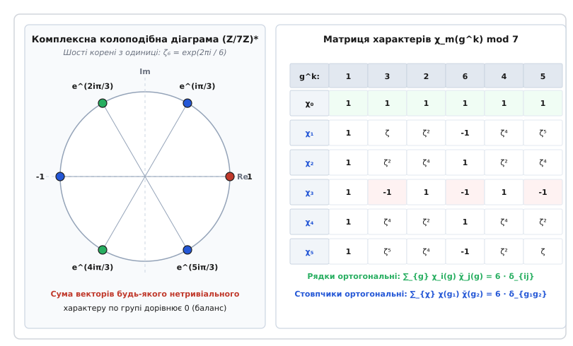
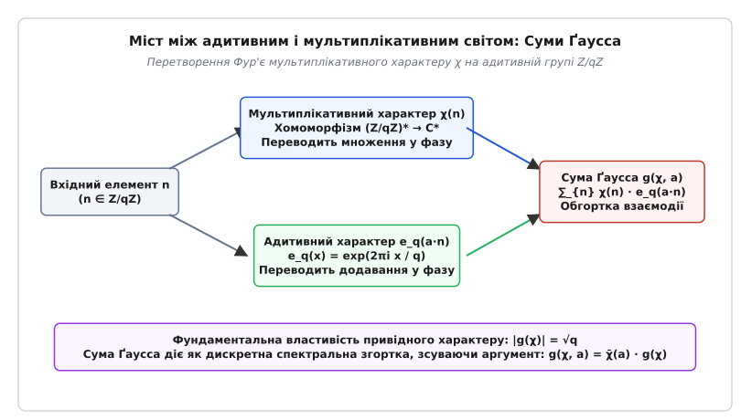
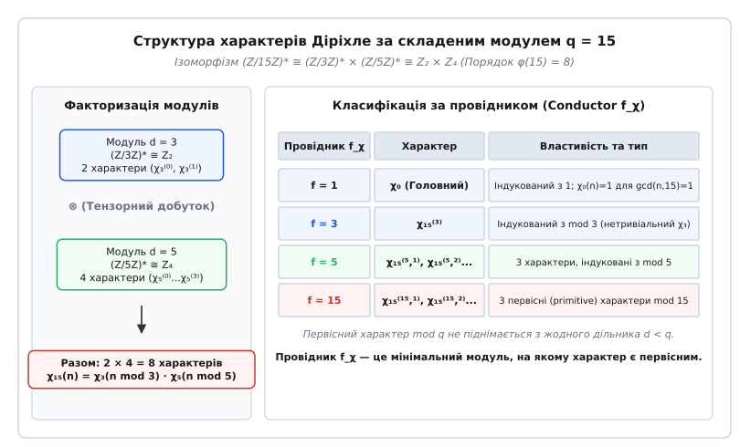

# Мультиплікативні й адитивні характери

<preknowlist>
- [Теорія груп та гомоморфізми](root:math-algebra/group-theory) — поняття груп, підгруп, ядра та гомоморфізмів.
- [Група оборотних елементів кільця лишків](root:math-number-theory/multiplicative-group-zn) — структура `Z/nZ` та `(Z/nZ)*`, функція Ейлера `φ(n)`.
- [Первісні корені](root:math-number-theory/primitive-root) — генератори циклічної групи `(Z/pZ)*`.
- [Символ Лежандра та квадратичні залишки](root:math-number-theory/quadratic-residues) — окремий випадок квадратичного мультиплікативного характеру.
- [Комплексні числа та корені з одиниці](root:math-analysis/complex-numbers) — формула Ейлера `e^(iθ)` та група коренів з одиниці `U_n`.
</preknowlist>

> 🔧 **Навіщо це.**
> Мультиплікативні й адитивні характери є фундаментальним містком між двома взаємно чужими алгебраїчними операціями — додаванням і множенням у скінченних кільцях лишків та полях. Вони дозволяють перетворити розклад чисел та нелінійні діофантові рівняння на спектральний аналіз комплексних фаз на одиничному колі. Без характерів неможливо довести теорему Діріхле про нескінченність простих чисел в арифметичних прогресіях, обчислити кількість точок на еліптичних кривих і многовидах над скінченними полями, побудувати криптографічні протоколи на основі дискретного перетворення Фур'є чи довести закономірності квадратичного закону взаємності.

## 1. Проблема розділення арифметичних сигналів

При обчисленні кількості цілочисельних розв'язків нелінійних діофантових рівнянь над скінченними полями або при дослідженні розподілу простих чисел у конкретній арифметичній прогресії прямий комбінаторний перебір вимагає `O(p²)` обчислень і руйнує мультиплікативні зв'язки. Якщо спробувати виділити прості числа вигляду `n ≡ a (mod q)` за допомогою звичайної індикаторної функції `f(n) = 1` при `n ≡ a mod q` та `f(n) = 0` в інших випадках, розклад Ейлерового добутку для дзета-функції `ζ(s) = ∏ (1 - p⁻ˢ)⁻¹` миттєво розпадається, оскільки індикаторний фільтр не зберігає множення чисел (`f(m·n) ≠ f(m)·f(n)`).

Щоб зберегти розклад на прості множники і водночас отримати можливість розділяти арифметичні прогресії, виникла потреба в особливому математичному апараті — базисі числових функцій, які одночасно є періодичними та мультиплікативними. Такими функціями і є **характери**.

З алгебраїчної точки зору, нехай `G` — скінченна абелева група (наприклад, адитивна група лишків `(Z/qZ, +)` або мультиплікативна група оборотних лишків `((Z/qZ)*, ·)`). **Характером групи G** називається будь-який гомоморфізм `χ` з групи `G` у мультиплікативну групу ненульових комплексних чисел `C*`:

```
χ: G → C*   такий, що   χ(g₁ · g₂) = χ(g₁) · χ(g₂)
```

Оскільки група `G` є скінченною порядку `N = |G|`, для кожного елемента `g ∈ G` виконується рівність `g^N = e` (де `e` — нейтральний елемент групи). За властивістю гомоморфізму:

```
(χ(g))^N = χ(g^N) = χ(e) = 1
```

Це означає, що значення будь-якого характеру `χ(g)` не можуть бути довільними комплексними числами: вони строго належать множині `N`-их коренів з одиниці і лежать на комплексному одиничному колі `S¹ = {z ∈ C | |z| = 1}`. Зокрема, абсолютна величина значень завжди дорівнює одиниці: `|χ(g)| = 1`, а комплексно-спряжене значення дорівнює оберненому елементу:

```
χ̄(g) = (χ(g))⁻¹ = χ(g⁻¹)
```

Множина всіх характерів групи `G` сама утворює абелеву групу щодо точкового множення функцій `(χ₁ · χ₂)(g) = χ₁(g) · χ₂(g)`. Ця група називається **дуальною групою** (або групою характерів) і позначається `Ĝ = Hom(G, C*)`. Порядок дуальної групи завжди строго дорівнює порядку початкової групи: `|Ĝ| = |G|`.

### Двоїстість Понтрягіна та гармонічний аналіз на скінченних абелевих групах

За фундаментальною теоремою про структуру скінченних абелевих груп, будь-яка скінченна абелева група `G` розкладається у прямий добуток циклічних підгруп:

```
G ≅ (Z / d₁Z) × (Z / d₂Z) × ... × (Z / d_k Z)
```

Для кожної циклічної групи `Z / d_j Z` характер повністю задається вибором значення на генераторі, яке має бути коренем з одиниці степеня `d_j`. Тому дуальна група циклічної групи також ізоморфна `Z / d_j Z`, звідки випливає неізоморфний вибір базису `G ≅ Ĝ`. Хоча цей ізоморфізм не є канонічним (він залежить від вибору генераторів), ізоморфізм між групою `G` та її **подвійною дуальною групою** `(Ĝ)̂ = Hom(Ĝ, C*)` є абсолютно природним і канонічним.

**Теорема двоїстості Понтрягіна (для скінченних груп):** Відображення обчислення значення `ev: G → (Ĝ)̂`, задане правилом:

```
ev_g(χ) = χ(g)   для всіх χ ∈ Ĝ
```

є канонічним ізоморфізмом між групою `G` та її другою дуальною групою `(Ĝ)̂`. Елементи початкової групи `G` самі поводяться як характери на дуальній групі `Ĝ`.

У просторі комплексних функцій `C^G = {f: G → C}` визначимо стандартний ермітів скалярний добуток:

```
⟨f₁, f₂⟩ = (1 / |G|) · ∑_{g ∈ G} f₁(g) · f̄₂(g)
```

Характери групи `Ĝ` утворюють повний ортонормований базис у цьому просторі: `⟨χ_i, χ_j⟩ = δ_{ij}`. Тому будь-яка функція `f: G → C` єдиним чином розкладається у дискретний ряд Фур'є за базисом характерів:

```
f(g) = ∑_{χ ∈ Ĝ} f̂(χ) · χ(g)
```

де коефіцієнти Фур'є (спектральні амплітуди) `f̂(χ)` обчислюються як проекції на базисні характери:

```
f̂(χ) = ⟨f, χ⟩ = (1 / |G|) · ∑_{g ∈ G} f(g) · χ̄(g)
```

Для цього перетворення виконується тотожність Планшереля (рівність Парсеваля), яка стверджує збереження енергії сигналу при переході у спектральну область:

```
∑_{g ∈ G} |f(g)|² = |G| · ∑_{χ ∈ Ĝ} |f̂(χ)|²
```

Якщо на групі визначено згортку двох сигналів `f₁` та `f₂`:

```
(f₁ * f₂)(g) = ∑_{x ∈ G} f₁(x) · f₂(g · x⁻¹)
```

то перетворення Фур'є переводить згортку у звичайне точкове множення спектрів: `\widehat{f₁ * f₂}(χ) = |G| · f̂₁(χ) · f̂₂(χ)`. Ця властивість лежить в основі швидких алгоритмів обробки сигналів та розв'язання нелінійних рівнянь на групах.

## 2. Адитивні характери: дискретні частоти та слід у скінченних полях

Розглянемо спочатку адитивну групу цілих чисел за модулем `q`: `G = (Z/qZ, +)`. Елементами цієї групи є класи лишків `{0, 1, 2, ..., q - 1}`, а груповою операцією є додавання за модулем `q`.

Умова гомоморфізму для **адитивного характеру** `ψ` вимагає перетворення додавання елементів у множення комплексних фаз:

```
ψ(x + y mod q) = ψ(x) · ψ(y)
```

Оскільки елемент `1` є генератором адитивної групи `(Z/qZ, +)`, значення характеру на будь-якому елементі `x` повністю визначається його значенням на одиниці `ψ(1)`. Позначивши `ψ(1) = exp(2·π·i · k / q)` для деякого цілого індексу `k ∈ {0, 1, ..., q - 1}`, ми отримуємо повну родину з `q` адитивних характерів `ψ_k`:

```
ψ_k(x) = exp( 2·π·i · k · x / q )
```

Канонічним (або базовим) адитивним характером називають характер при `k = 1`:

```
e_q(x) = exp( 2·π·i · x / q )
```

Тоді довільний адитивний характер виражається як `ψ_k(x) = e_q(k · x)`. Якщо `k = 0`, характер `ψ₀(x) = 1` для всіх `x` називається **тривіальним (або головним) адитивним характером**.

### Співвідношення ортогональності адитивних характерів

Адитивні характери утворюють ортонормований базис у просторі комплексних функцій на `Z/qZ`. Сума значень адитивного характеру за всіма елементами групи задовольняє співвідношення:

```
∑_{x=0}^{q-1} exp( 2·π·i · k · x / q )
= q  [якщо k ≡ 0 (mod q)]
= 0  [якщо k ≢ 0 (mod q)]
```

З інженерної точки зору, адитивні характери `ψ_k(x)` є базисними гармоніками дискретного перетворення Фур'є (DFT — Discrete Fourier Transform) на інтервалі `Z/qZ`. Індекс `k` відповідає дискретній частоті, а змінна `x` — дискретному часу або просторовій координаті.

### Адитивні характери на довільних скінченних полях F_q

Якщо ми розглядаємо скінченне поле `F_q`, де `q = p^r` є степенем простого числа `p`, елементи поля вже не зводяться до простих лишків `Z/qZ`. Для побудови адитивних характерів на векторному просторі `F_q` над простим підполем `F_p = Z/pZ` застосовують **абсолютний слід поля (trace)**:

```
Tr_{F_q / F_p}(x) = x + x^p + x^{p²} + ... + x^{p^{r-1}}
```

Функція сліду має фундаментальні властивості:
1. Вона відображає будь-який елемент розширеного поля `x ∈ F_q` у базове просте поле `F_p`: `Tr(x) ∈ F_p`.
2. Вона є `F_p`-лінійною: `Tr(x + y) = Tr(x) + Tr(y)` та `Tr(c · x) = c · Tr(x)` для всіх `c ∈ F_p`.
3. Вона є ненульовим відображенням: існують елементи `x ∈ F_q`, для яких `Tr(x) ≠ 0`.

Завдяки цьому **канонічний адитивний характер** поля `F_q` визначається через композицію сліду зі стандартною експонентою простого підполя:

```
ψ(x) = exp( 2·π·i · Tr_{F_q / F_p}(x) / p )
```

Усі `q` різних адитивних характерів поля `F_q` задаються параметром `a ∈ F_q`:

```
ψ_a(x) = ψ(a · x) = exp( 2·π·i · Tr(a · x) / p )
```

Ортогональність на полі `F_q` набуває вигляду:

```
∑_{x ∈ F_q} ψ(a · x)
= q  [якщо a = 0]
= 0  [якщо a ≠ 0]
```

## 3. Мультиплікативні характери та характери Діріхле

Тепер розглянемо мультиплікативну групу оборотних лишків за модулем `q`: `G = ((Z/qZ)*, ·)`. Елементами цієї групи є класи лишків `x mod q`, які є взаємно простими з модулем `gcd(x, q) = 1`. Порядок цієї групи дорівнює функції Ейлера `|G| = φ(q)`.

У випадку скінченного поля `F_q` мультиплікативна група `F_q* = F_q \ {0}` є циклічною групою порядку `q - 1`.

**Мультиплікативним характером** називається гомоморфізм з мультиплікативної групи у комплексну одиничну окружність:

```
χ: (Z/qZ)* → C*   такий, що   χ(a · b mod q) = χ(a) · χ(b)
```

Щоб перетворити такий характер на інструмент аналізу на всій множині цілих чисел `Z`, Петер Ґустав Лежен-Діріхле розширив область визначення характеру з групи `(Z/qZ)*` на всі цілі числа `Z`, створивши поняття **характеру Діріхле**.

### Означення характеру Діріхле

Числова функція `χ: Z → C` називається характером Діріхле за модулем `q`, якщо виконуються три умови:

1. **Періодичність:** `χ(n + q) = χ(n)` для всіх `n ∈ Z`.
2. **Повна мультиплікативність:** `χ(m · n) = χ(m) · χ(n)` для всіх `m, n ∈ Z`.
3. **Арифметична підтримка:** `χ(n) ≠ 0` тоді і тільки тоді, коли `gcd(n, q) = 1`. Якщо `gcd(n, q) > 1`, то за визначенням `χ(n) = 0`.

Характер `χ₀`, який набуває значення `1` для всіх чисел `n`, взаємно простих з `q`, і `0` для чисел `gcd(n, q) > 1`, називається **головним (тривіальним) характером Діріхле**.

### Конструктивна побудова для простого модуля p

Якщо модуль `q = p` є простим числом, група `(Z/pZ)*` є циклічною порядку `p - 1`. Нехай `g` — первісний корінь за модулем `p`. Тоді для кожного `n ≢ 0 (mod p)` існує єдиний дискретний логарифм `k = ind_g(n) ∈ {0, 1, ..., p - 2}` такий, що `n ≡ g^k (mod p)`.

Усі `p - 1` різних характерів Діріхле за модулем `p` конструктивно задаються формулою:

```
χ_m(n) = exp( 2·π·i · m · ind_g(n) / (p - 1) )
```

де `m ∈ {0, 1, ..., p - 2}` — індекс характеру.

Порядок характеру `d = ord(χ_m)` — це найменше натуральне число `d`, для якого `χ^d = χ₀`. Порядок характеру завжди є дільником порядку групи: `d | (p - 1)`.

### Характери спеціальних порядків

1. **Квадратичний характер (порядок 2):** При `m = (p - 1) / 2` (для непарного `p`) значення характеру можуть дорівнювати лише `±1`. Це знаменитий **символ Лежандра**:

```
χ_{ (p-1)/2 } (n) = (n / p)
= +1  [якщо n є квадратичним залишком mod p]
= -1  [якщо n є квадратичним незалишком mod p]
```

За критерієм Ейлера, `(n / p) ≡ n^{(p-1)/2} (mod p)`.

2. **Кубічні характери (порядок 3):** Існують тоді і тільки тоді, коли `3 | (p - 1)`, тобто `p ≡ 1 (mod 3)`. Значеннями кубічного характеру є кубічні корені з одиниці `1, ω, ω²`, де `ω = exp(2·π·i / 3) = -1/2 + i·√3/2`. Вони лежать в основі кубічного закону взаємності в кільці цілих чисел Ейзенштейна `Z[ω]`.

3. **Біквадратичні характери (порядок 4):** Існують тоді і тільки тоді, коли `4 | (p - 1)`, тобто `p ≡ 1 (mod 4)`. Значеннями є четверті корені з одиниці `±1, ±i`. Вони керують біквадратичним законом взаємності в кільці ґауссових чисел `Z[i]`.

### Парність характерів Діріхле

Оскільки `(-1)² = 1 mod q`, значення характеру на мінус одиниці може дорівнювати лише `+1` або `-1`:

```
χ(-1) = ±1
```

- Якщо `χ(-1) = +1`, характер називається **парним** (even character).
- Якщо `χ(-1) = -1`, характер називається **непарним** (odd character).

Детальний аналіз еволюції цього поняття від квадратичних форм Ґаусса до абстрактної алгебри Дедекінда та Фробеніуса викладено у вставці [📜 Історія виникнення характерів](root:math-number-theory/additive-multiplicative-characters-gauss-sums/hist-character-genesis.md).

## 4. Подвійна ортогональність та аналіз Фур'є на скінченних групах

Фундаментальною властивістю характерів, яка перетворює їх на інструмент спектрального аналізу, є подвійна ортогональність. Вона виражається двома симетричними теоремами.

### Перше співвідношення ортогональності (сума за елементами групи)

Якщо підсумувати значення конкретного характеру `χ` за всіма елементами мультиплікативної групи `(Z/qZ)*`, результат дорівнює порядку групи для головного характеру і строго дорівнює нулю для будь-якого нетривіального характеру:

```
∑_{a ∈ (Z/qZ)*} χ(a)
= φ(q)  [якщо χ = χ₀]
= 0     [якщо χ ≠ χ₀]
```

**Доведення:** Якщо `χ = χ₀`, то `χ₀(a) = 1` для всіх `a ∈ (Z/qZ)*`, тому сума дорівнює кількості доданків `φ(q)`. Якщо `χ ≠ χ₀`, існує такий елемент `b ∈ (Z/qZ)*`, для якого `χ(b) ≠ 1`. Оскільки множення на `b` є бієкцією групи `(Z/qZ)*` на себе:

```
S
= ∑_{a ∈ (Z/qZ)*} χ(a)       [початкова сума за групою]
= ∑_{a ∈ (Z/qZ)*} χ(b · a)   [бієкція множення на елемент b]
= χ(b) · ∑_{a ∈ (Z/qZ)*} χ(a) [мультиплікативність характеру]
= χ(b) · S                   [підстановка вихідної суми S]
```

Звідси `(1 - χ(b)) · S = 0`. Оскільки `χ(b) ≠ 1`, єдиним розв'язком є `S = 0`.

### Друге співвідношення ортогональності (сума за групою характерів)

Якщо зафіксувати елемент групи `a ∈ (Z/qZ)*` і підсумувати значення всіх `φ(q)` характерів на цьому елементі, сума дорівнює порядку групи, якщо `a ≡ 1 (mod q)`, і нулю в протилежному випадку:

```
∑_{χ ∈ Ĝ} χ(a)
= φ(q)  [якщо a ≡ 1 (mod q)]
= 0     [якщо a ≢ 1 (mod q)]
```

**Доведення:** За теоремою двоїстості Понтрягіна, елемент `a` визначає характер `ev_a` на дуальній групі `Ĝ` правилом `ev_a(χ) = χ(a)`. Якщо `a ≡ 1 (mod q)`, то `χ(1) = 1` для всіх `χ`, і сума дорівнює `|Ĝ| = φ(q)`. Якщо `a ≢ 1 (mod q)`, то характер `ev_a` не є тривіальним на `Ĝ`, і його сума за групою `Ĝ` дорівнює нулю за першим співвідношенням ортогональності, застосованим до групи `Ĝ`.

### Дельта-функція та індикаторний фільтр лишків

Об'єднуючи перше і друге співвідношення ортогональності, ми отримуємо точну формулу для **індикаторної дельта-функції** конкретного класу лишків `n ≡ a (mod q)`:

```
δ_{a}(n)
= (1 / φ(q)) · ∑_{χ ∈ Ĝ} χ̄(a) · χ(n)
= 1  [якщо n ≡ a (mod q)]
= 0  [якщо n ≢ a (mod q)]
```

Ця формула є серцем аналітичної теорії чисел. Вона дозволяє розкласти розривний індикатор «чи належить число `n` арифметичній прогресії `a + k·q`» у лінійну комбінацію гладких мультиплікативних функцій `χ(n)`.


*Візуалізація матриці характерів за модулем 7 та колоподібної діаграми коренів з одиниці.*

На наведеній вище схемі ліворуч показано корені з одиниці на комплексній площині для `(Z/7Z)*` (порядок `φ(7) = 6`). Векторна сума цих шести точок для будь-якого нетривіального характеру утворює замкнений правильний багатокутник з нульовим центром мас. Праворуч наведено матрицю характерів `6 × 6`, скалярний добуток будь-яких двох різних рядків або стовпчиків якої строго дорівнює нулю.

## 5. Суми Ґаусса: міст між адитивним і мультиплікативним світом

Адитивні характери `e_q(a·n)` діють на групі `(Z/qZ, +)`, а мультиплікативні характери `χ(n)` діють на групі `((Z/qZ)*, ·)`. Як об'єднати ці два світи у єдину алгебраїчну конструкцію? Відповіддю є **суми Ґаусса**.

**Означення:** Для мультиплікативного характеру `χ` та адитивного характеру `ψ` на скінченному полі `F_q` (або кільці `Z/qZ`) **сумою Ґаусса** `g(χ, ψ)` називається комплексна згортка:

```
g(χ, ψ) = ∑_{x ∈ F_q} χ(x) · ψ(x)
```

Для простого кільця лишків `Z/qZ` зі стандартним адитивним характером `e_q(a · x) = exp(2·π·i · a · x / q)` суму Ґаусса записують як:

```
g(χ, a) = ∑_{x=0}^{q-1} χ(x) · exp( 2·π·i · a · x / q )
```

Якщо `a = 1`, суму називають стандартною (базисною) сумою Ґаусса і позначають просто `g(χ)`.


*Операторна схема спектрального поєднання адитивних і мультиплікативних фаз у сумі Ґаусса.*

### Сума Ґаусса як дискретний аналог гамма-функції Ейлера

У класичному математичному аналізі **гамма-функція Ейлера** визначається інтегралом:

```
Γ(s) = ∫_{0}^{∞} x^s · exp(-x) · (dx / x)
```

Цей інтеграл є інтегральним перетворенням Мелліна, яке пов'язує мультиплікативний характер дійсної прямої `x ↦ x^s` з адитивним характером дійсної осі `x ↦ exp(-x)` щодо інваріантної міри Хаара `dx / x` на мультиплікативній групі `R₊*`.

Сума Ґаусса є **точним скінченнопольовим аналогом гамма-функції**:
- Мультиплікативний характер `χ(x)` є дискретним аналогом степеневої функції `x^s`.
- Адитивний характер `ψ(x) = exp(2·π·i·x / p)` є дискретним аналогом експоненти `exp(-x)`.
- Сума за мультиплікативною групою `F_q*` є дискретним інтегруванням за мірою Хаара.

Як ми побачимо далі, усі класичні функціональні рівняння та зв'язки гамма-функції (формула доповнення Ейлера, зв'язок з бета-функцією, теорема множення Ґаусса) мають точні алгебраїчні дзеркала у світі сум Ґаусса.

### Трансформація адитивного зсуву

Якщо `gcd(a, q) = 1`, адитивний індекс `a` можна винести за знак суми у вигляді спряженого мультиплікативного множника:

```
g(χ, a)
= ∑_{x=1}^{q-1} χ(x) · exp(2·π·i · a·x / q)       [за визначенням суми Ґаусса]
= ∑_{y=1}^{q-1} χ(a⁻¹ · y) · exp(2·π·i · y / q)    [заміна змінної: y ≡ a·x mod q, x ≡ a⁻¹·y mod q]
= χ(a⁻¹) · ∑_{y=1}^{q-1} χ(y) · exp(2·π·i · y / q)  [мультиплікативність характеру: χ(a⁻¹·y) = χ(a⁻¹)·χ(y)]
= χ̄(a) · g(χ)                                   [властивість унітарності: χ(a⁻¹) = χ̄(a)]
```

Якщо `χ ≠ χ₀`, а `a ≡ 0 (mod q)`, то `g(χ, 0) = ∑_{x=1}^{q-1} χ(x) = 0` за ортогональністю.

### Теорема про модуль привідної суми Ґаусса

Для будь-якого нетривіального характеру `χ` за простим модулем `p` абсолютне значення суми Ґаусса строго дорівнює квадратному кореню з модуля поля:

```
|g(χ)|² = p   ⇒   |g(χ)| = √p
```

**Строге покрокове виведення:**

Скористаємося фундаментальним визначенням квадрата модуля комплексного числа `|z|² = z · z̄`:

```
|g(χ)|²
= g(χ) · ḡ(χ)                                              [визначення модуля комплексного числа]
= ( ∑_{x=1}^{p-1} χ(x) · e_p(x) ) · ( ∑_{y=1}^{p-1} χ̄(y) · e_p(-y) )  [комплексне спряження адитивної фази]
= ∑_{x=1}^{p-1} ∑_{y=1}^{p-1} χ(x) · χ̄(y) · e_p(x - y)      [об'єднання сум у подвійну суму за всіма парами x, y]
```

Здійснюємо мультиплікативну заміну змінної у групі `(Z/pZ)*`: покладаємо `x ≡ t · y (mod p)`, де `t` пробігає `{1, 2, ..., p - 1}` при фіксованому `y`:

```
|g(χ)|²
= ∑_{t=1}^{p-1} ∑_{y=1}^{p-1} χ(t·y) · χ̄(y) · e_p(t·y - y)  [заміна x ≡ t·y mod p]
= ∑_{t=1}^{p-1} ∑_{y=1}^{p-1} χ(t) · χ(y) · χ̄(y) · e_p(y · (t - 1)) [використання повної мультиплікативності]
= ∑_{t=1}^{p-1} χ(t) · ( ∑_{y=1}^{p-1} e_p(y · (t - 1)) )   [оскільки χ(y)·χ̄(y) = |χ(y)|² = 1]
```

Розглянемо внутрішню суму за `y`:
1. Якщо `t = 1`, аргумент експоненти `t - 1 = 0`, тому `e_p(0) = 1`, і сума дорівнює:

```
∑_{y=1}^{p-1} 1 = p - 1
```

2. Якщо `t ≠ 1` (тобто `t - 1 ≢ 0 mod p`), повна сума за всіма `y ∈ Z/pZ` дорівнює нулю за ортогональністю адитивних характерів:

```
∑_{y=0}^{p-1} e_p(y · (t - 1)) = 0  ⇒  ∑_{y=1}^{p-1} e_p(y · (t - 1)) = 0 - e_p(0) = -1
```

Підставляємо ці два результати у зовнішню суму:

```
|g(χ)|²
= χ(1) · (p - 1) + ∑_{t=2}^{p-1} χ(t) · (-1)                  [розділення на доданок t = 1 та суму за t ≠ 1]
= 1 · (p - 1) - ∑_{t=2}^{p-1} χ(t)                            [оскільки значення в одиниці χ(1) = 1]
= (p - 1) - ( ∑_{t=1}^{p-1} χ(t) - χ(1) )                      [доповнення суми до повної групи]
= (p - 1) - ( 0 - 1 )                                         [за ортогональністю нетривіального характеру ∑ χ(t) = 0]
= (p - 1) + 1                                                 [розкриття дужок мінус на мінус]
= p                                                           [завершення строгого доведення]
```

Цей результат означає, що спектральна густина енергії суми Ґаусса розподілена абсолютно рівномірно за всіма частотами.

### Точне значення квадратичної суми Ґаусса

Для квадратичного характеру (символу Лежандра `χ_leg(n) = (n / p)`) квадрат суми Ґаусса дорівнює:

```
g(χ_leg)² = (-1)^{(p-1)/2} · p
```

Звідси випливає, що `g(χ_leg) = ±√p` при `p ≡ 1 (mod 4)` та `g(χ_leg) = ±i·√p` при `p ≡ 3 (mod 4)`.

Визначення правильного арифметичного знака (`+` чи `-`) виявилося однією з найважчих задач теорії чисел ХІХ століття. Ґаусс сформулював гіпотезу про знак у 1801 році, проте зміг строго довести її лише у 1805 році:

```
g(χ_leg)
= +√p      [якщо p ≡ 1 (mod 4)]
= +i · √p  [якщо p ≡ 3 (mod 4)]
```

## 6. Суми Якобі, тотожність зв'язку та бета-функція

Якщо суми Ґаусса зв'язують мультиплікативний характер з адитивним, то **суми Якобі** описують нелінійну адитивну згортку двох різних мультиплікативних характерів.

**Означення:** Для двох мультиплікативних характерів `χ₁` та `χ₂` на скінченному полі `F_q` **сумою Якобі** `J(χ₁, χ₂)` називається сума:

```
J(χ₁, χ₂) = ∑_{x ∈ F_q} χ₁(x) · χ₂(1 - x)
```

де за домовленістю `χ(0) = 0` для нетривіальних характерів.

### Аналогія з бета-функцією Ейлера

У класичному аналізі **бета-функція Ейлера** задається інтегралом:

```
B(a, b) = ∫_{0}^{1} x^{a-1} · (1 - x)^{b-1} · dx
```

і пов'язана з гамма-функціями знаменитою тотожністю:

```
B(a, b) = ( Γ(a) · Γ(b) ) / Γ(a + b)
```

Сума Якобі є точним дискретним аналогом бета-функції, де інтегрування за відрізком `[0, 1]` замінено на підсумовування за всіма елементами скінченного поля `x + y = 1`.

### Теорема про зв'язок сум Ґаусса та Якобі

Якщо характери `χ₁`, `χ₂` та їхній добуток `χ₁ · χ₂` є нетривіальними на полі `F_q`, то сума Якобі точно виражається через відношення сум Ґаусса:

```
J(χ₁, χ₂) = ( g(χ₁) · g(χ₂) ) / g(χ₁ · χ₂)
```

**Строге покрокове виведення:**

Розглянемо добуток двох незалежних сум Ґаусса `g(χ₁)` та `g(χ₂)`:

```
g(χ₁) · g(χ₂)
= ( ∑_{u ∈ F_q} χ₁(u) · ψ(u) ) · ( ∑_{v ∈ F_q} χ₂(v) · ψ(v) )   [за визначенням сум Ґаусса для χ₁ та χ₂]
= ∑_{u ∈ F_q} ∑_{v ∈ F_q} χ₁(u) · χ₂(v) · ψ(u + v)             [об'єднання сум у подвійну суму]
```

Згрупуємо доданки за фіксованою сумою `s = u + v`:

```
g(χ₁) · g(χ₂) = ∑_{s ∈ F_q} ( ∑_{u + v = s} χ₁(u) · χ₂(v) ) · ψ(s)
```

Розберемо окремо два випадки для суми `s`:

1. **Випадок `s = 0`:**
   Якщо `u + v = 0`, то `v = -u`. Внутрішня сума перетворюється на:

```
∑_{u ∈ F_q} χ₁(u) · χ₂(-u) = χ₂(-1) · ∑_{u ∈ F_q} (χ₁ · χ₂)(u) = 0
```

оскільки за умовою теореми добуток характерів `χ₁ · χ₂` є нетривіальним, і його сума за всією групою дорівнює нулю за ортогональністю.

2. **Випадок `s ≠ 0`:**
   Оскільки `s ≠ 0`, ми можемо ввести нову змінну `x ∈ F_q` таку, що `u = s · x`. Тоді `v = s - u = s · (1 - x)`. Підставляючи це у внутрішню суму:

```
∑_{u + v = s} χ₁(u) · χ₂(v)
= ∑_{x ∈ F_q} χ₁(s · x) · χ₂(s · (1 - x))        [заміна змінних u = s·x та v = s·(1-x)]
= ∑_{x ∈ F_q} χ₁(s) · χ₁(x) · χ₂(s) · χ₂(1 - x) [мультиплікативність характерів]
= (χ₁ · χ₂)(s) · ∑_{x ∈ F_q} χ₁(x) · χ₂(1 - x)   [винесення спільного множника (χ₁·χ₂)(s)]
= (χ₁ · χ₂)(s) · J(χ₁, χ₂)                      [за визначенням суми Якобі]
```

Підставляємо знайдений вираз у загальний добуток:

```
g(χ₁) · g(χ₂)
= ∑_{s ≠ 0} (χ₁ · χ₂)(s) · J(χ₁, χ₂) · ψ(s)            [підстановка внутрішньої суми для s ≠ 0]
= J(χ₁, χ₂) · ( ∑_{s ∈ F_q} (χ₁ · χ₂)(s) · ψ(s) )     [винесення множника суми Якобі]
= J(χ₁, χ₂) · g(χ₁ · χ₂)                              [за визначенням суми Ґаусса для χ₁·χ₂]
```

Оскільки `χ₁ · χ₂ ≠ χ₀`, модуль `|g(χ₁ · χ₂)| = √q ≠ 0`, тому ми можемо поділити обидві частини рівності на `g(χ₁ · χ₂)`:

```
J(χ₁, χ₂) = ( g(χ₁) · g(χ₂) ) / g(χ₁ · χ₂)
```

Звідси безпосередньо випливає точний модуль суми Якобі для нетривіальних характерів:

```
|J(χ₁, χ₂)| = ( |g(χ₁)| · |g(χ₂)| ) / |g(χ₁ · χ₂)| = ( √q · √q ) / √q = √q
```

### Узагальнені суми Якобі багатьох змінних

Для набору з `k` характерів `χ₁, χ₂, ..., χ_k` сума Якобі визначається як:

```
J(χ₁, χ₂, ..., χ_k) = ∑_{x₁ + x₂ + ... + x_k = 1} χ₁(x₁) · χ₂(x₂) · ... · χ_k(x_k)
```

Якщо добуток `χ₁ · χ₂ · ... · χ_k ≠ χ₀`, виконується узагальнена формула факторизації:

```
J(χ₁, χ₂, ..., χ_k) = ( g(χ₁) · g(χ₂) · ... · g(χ_k) ) / g(χ₁ · χ₂ · ... · χ_k)
```

Ці суми є ключовим інструментом для дослідження багатовимірних алгебраїчних многовидів.

Повні алгебраїчні виведення властивостей сум Ґаусса та Якобі наведено у вставці [🧮 Алгебраїчні властивості та виведення сум Ґаусса й Якобі](root:math-number-theory/additive-multiplicative-characters-gauss-sums/math-gauss-jacobi-sums.md).

## 7. Підрахунок точок на алгебраїчних кривих та гіпотези Вейля

Одним із найбільш вражаючих застосувань характерів та сум Якобі є точний підрахунок кількості розв'язків нелінійних поліноміальних рівнянь над скінченними полями без перебору варіантів.

### Спектральний індикатор степеня

Нехай `d` — натуральне число, що ділить `q - 1`. Скільки розв'язків має рівняння `x^d = u` у полі `F_q`?
- Якщо `u = 0`, розв'язок єдиний: `x = 0`.
- Якщо `u ≠ 0`, розв'язків або `d` (якщо `u` є `d`-им степенем), або `0`.

За допомогою групи мультиплікативних характерів порядку, що ділить `d` (позначимо цю підгрупу `X_d`), кількість розв'язків записується точним формульним індикатором:

```
N(x^d = u) = ∑_{χ ∈ X_d} χ(u) = 1 + ∑_{χ ∈ X_d, χ ≠ χ₀} χ(u)
```

### Діагональні рівняння та криві типу Ферма

Розглянемо діагональне рівняння від `n` змінних над полем `F_q`:

```
a₁ · x₁^{d₁} + a₂ · x₂^{d₂} + ... + a_n · x_n^{d_n} = c
```

Кількість розв'язків `N` цього рівняння виражається через суму добутків кількостей розв'язків для кожної змінної:

```
N = ∑_{u₁ + u₂ + ... + u_n = c} N(a₁ x₁^{d₁} = u₁) · ... · N(a_n x_n^{d_n} = u_n)
```

Підставляючи індикатори через характери `χ_j ∈ X_{d_j}`, отримуємо розклад кількості точок на головний член `q^{n-1}` та суму поправок, які є сумами Якобі:

```
N = q^{n-1} + ∑_{χ₁, ..., χ_n} χ̄₁(a₁) · ... · χ̄_n(a_n) · (χ₁ · ... · χ_n)(c) · J₀(χ₁, ..., χ_n)
```

де сума береться за всіма нетривіальними характерами `χ_j` порядків `d_j`.

### Числовий приклад 1: Коло над F_p

Обчислимо кількість точок на колі `x² + y² ≡ 1 (mod p)`:

```
N(x² + y² = 1 mod p)
= ∑_{u + v = 1} (1 + χ_leg(u)) · (1 + χ_leg(v))                                        [підстановка індикаторів через символ Лежандра]
= ∑_{u+v=1} 1 + ∑_{u+v=1} χ_leg(u) + ∑_{u+v=1} χ_leg(v) + ∑_{u+v=1} χ_leg(u) · χ_leg(v) [розкриття дужок у подвійній сумі]
= p + 0 + 0 + J(χ_leg, χ_leg)                                                          [ортогональність та визначення суми Якобі]
```

Оскільки `J(χ_leg, χ_leg) = g(χ_leg)² / g(χ₀) = ( (-1)^{(p-1)/2} · p ) / (-1) = - (-1)^{(p-1)/2}`, отримуємо точну формулу:

```
N(x² + y² ≡ 1 mod p) = p - (-1)^{(p-1)/2}
```

- Якщо `p ≡ 1 (mod 4)`, то `N = p - 1`.
- Якщо `p ≡ 3 (mod 4)`, то `N = p + 1`.

Для `p = 7` (де `7 ≡ 3 mod 4`) формула дає `N = 7 + 1 = 8` точок. Перевірка розв'язків у `F_7`: `(0, 1), (0, 6), (1, 0), (6, 0), (2, 2), (2, 5), (5, 2), (5, 5)` — рівно 8 пар.

### Числовий приклад 2: Кубічна крива Ферма над F_p

Розглянемо криву `x³ + y³ ≡ 1 (mod p)` для простих чисел `p ≡ 1 (mod 3)`. У цьому випадку існують два нетривіальні кубічні характери `χ₃` та `χ₃² = χ̄₃`.

Кількість точок на кривій точно виражається через суми Якобі:

```
N(x³ + y³ = 1 mod p) = p - 2 + J(χ₃, χ₃) + J(χ̄₃, χ̄₃) = p - 2 + 2 · Re( J(χ₃, χ₃) )
```

Оскільки модуль `|J(χ₃, χ₃)| = √p`, величина дійсної частини обмежена: `|2 · Re(J(χ₃, χ₃))| ≤ 2·√p`. Звідси випливає фундаментальна оцінка:

```
|N - (p - 2)| ≤ 2 · √p
```

### Зв'язок із гіпотезами Вейля

У 1949 році Андре Вейль сформулював фундаментальні гіпотези про дзета-функції алгебраїчних многовидів над скінченними полями. Для проективної кривої `C` роду `g` над полем `F_q` локальна дзета-функція визначається як формальний степеневий ряд:

```
Z(C / F_q, T) = exp( ∑_{m=1}^∞ N_m · T^m / m )
```

де `N_m` — кількість точок кривої над розширенням поля `F_{q^m}`.

Вейль довів, що для діагональних кривих та многовидів дзета-функція є раціональною дробовою функцією:

```
Z(C / F_q, T) = P(T) / ( (1 - T) · (1 - q·T) )
```

де многочлен `P(T)` степеня `2g` розкладається на лінійні множники:

```
P(T) = ∏_{j=1}^{2g} (1 - α_j · T)
```

Вейль відкрив, що корені `α_j` є в точності **сумами Якобі `J(χ₁, ..., χ_n)`**!

Оскільки модуль кожної суми Якобі строго дорівнює `|α_j| = √q`, звідси негайно випливає **аналог гіпотези Рімана для скінченних полів**: усі нулі локальної дзета-функції лежать на критичній прямій `Re(s) = 1/2`.

З цього випливає знаменита **нерівність Хассе-Вейля** для кількості точок на будь-якій еліптичній або алгебраїчній кривій роду `g`:

```
|N - (q + 1)| ≤ 2 · g · √q
```

Саме точні оцінки сум Ґаусса та Якобі стали тим наріжним каменем, який дозволив Вейлю, а згодом П'єру Деліню побудувати сучасну арифметичну алгебраїчну геометрію.

## 8. Складені модулі, провідник та первісність

Коли модуль `q` є складеним числом `q = p₁^{e₁} · p₂^{e₂} · ... · p_k^{e_k}`, структура мультиплікативної групи за Китайською теоремою про остачі (CRT — Chinese Remainder Theorem) розкладається у прямий добуток груп:

```
(Z/qZ)* ≅ (Z/p₁^{e₁}Z)* × (Z/p₂^{e₂}Z)* × ... × (Z/p_k^{e_k}Z)*
```

Відповідно, група характерів складеного модуля `Ĝ` ізоморфна тензорному добутку груп характерів своїх примарних факторів. Будь-який характер `χ mod q` єдиним чином подається у вигляді добутку фактор-характерів:

```
χ(n) = χ₁(n mod p₁^{e₁}) · χ₂(n mod p₂^{e₂}) · ... · χ_k(n mod p_k^{e_k})
```


*Класифікація характерів за модулем 15 за провідником та їхній зв'язок з факторідеалами.*

### Поняття провідника (Conductor) та первісного характеру

Деякі характери за складеним модулем `q` є «фіктивними»: вони фактично виникають підняттям характерів з меншого модуля `d`, який ділить `q` (`d | q`).

- Характер `χ mod q` називається **індукованим** з модуля `d` (де `d | q` та `d < q`), якщо існує характер `χ' mod d` такий, що `χ(n) = χ'(n)` для всіх `n` з `gcd(n, q) = 1`.
- Характер `χ mod q` називається **первісним (primitive character)**, якщо він не індукується з жодного меншого модуля `d < q`.
- Найменший дільник `f_χ | q`, з якого індукується характер `χ`, називається **провідником характеру (conductor of χ)**.

Якщо характер `χ mod q` є первісним, для нього зберігається точна теорема про модуль суми Ґаусса `|g(χ)| = √q`. Якщо ж характер не є первісним (тобто його провідник `f_χ < q`), його сума Ґаусса розкладається на добуток суми Ґаусса первісного характеру та функції Мебіуса або сум Рамануджана, і її модуль вже не дорівнює `√q`.

## 9. Застосування у теорії чисел, аналізі та криптографії

Мультиплікативні й адитивні характери є робочим інструментом сучасної математики та інформатики.

### 1. L-функції Діріхле та прості числа

Замінивши у дзета-функції Ейлера чисельник на характер Діріхле `χ(n)`, виділяють **L-функцію Діріхле**:

```
L(s, χ) = ∑_{n=1}^∞ χ(n) / n^s = ∏_{p} (1 - χ(p) / p^s)⁻¹
```

Оскільки `L(1, χ) ≠ 0` для всіх нетривіальних характерів, підсумовування за всіма `χ ∈ Ĝ` з використанням індикаторного фільтра `δ_a(n)` дає точне доведення того, що сума `∑_{p ≡ a mod q} 1/p` розбігається як `(1 / φ(q)) · ln(ln X)`. Це доводить нескінченність та рівномірний щільнісний розподіл простих чисел у всіх доступних арифметичних прогресіях.

### 2. Закон квадратичної взаємності

За допомогою квадратичної суми Ґаусса `g(χ_leg)` можна дати елегантне доведення квадратичного закону взаємності:

```
(p / q) · (q / p) = (-1)^{ ((p-1)/2) · ((q-1)/2) }
```

Застосовуючи автоморфізм Фробеніуса `σ_q(α) ≡ α^q (mod q)` до квадратичної суми Ґаусса в кільці кругових цілих `Z[ζ_p]`:

```
g(χ_leg)^q ≡ g(χ_leg, q) ≡ (q / p) · g(χ_leg) (mod q)
```

З іншого боку:

```
g(χ_leg)^q
= g(χ_leg) · (g(χ_leg)²)^{(q-1)/2}                                       [розклад непарного степеня]
= g(χ_leg) · ( (-1)^{(p-1)/2} · p )^{(q-1)/2}                            [підстановка квадрата суми Ґаусса]
≡ g(χ_leg) · (-1)^{((p-1)/2) · ((q-1)/2)} · p^{(q-1)/2} (mod q)          [розподіл показника степеня]
≡ g(χ_leg) · (-1)^{((p-1)/2) · ((q-1)/2)} · (p / q) (mod q)              [за критерієм Ейлера для (p / q)]
```

Скорочуючи на `g(χ_leg)`, ми миттєво отримуємо квадратичний закон взаємності без довгих геометричних підрахунків леми Ґаусса.

### 3. Суми Клоостермана та нелінійний гармонічний аналіз

У сучасній аналітичній теорії чисел та теорії модулярних форм фундаментальну роль відіграють **суми Клоостермана** `K(a, b; q)`:

```
K(a, b; q) = ∑_{x ∈ (Z/qZ)*} exp( 2·π·i · (a·x + b·x⁻¹) / q )
```

Вони поєднують адитивні фази елемента `x` та його мультиплікативно оберненого `x⁻¹`. Оцінка Вейля для сум Клоостермана:

```
|K(a, b; p)| ≤ 2 · √p · gcd(a, b, p)^{1/2}
```

доводиться за допомогою редукції до сум Ґаусса над розширеннями полів та геометрії кривих Артіна-Шраєра.

### 4. Криптографія та алгоритми на еліптичних кривих

У криптографії на еліптичних кривих (ECC) безпека протоколів вимагає вибору кривих з простим порядком групи `N = #E(F_q)`. Обчислення порядку групи через алгоритми Шуфа-Елкіса-Аткіна (SEA) або для кривих з комплексним множенням (CM) безпосередньо спирається на суми Ґаусса та розклад простих чисел у кільцях `Z[i]` та `Z[ω]`.

Практичну реалізацію цих алгоритмів мовами C та C++ з вихідним кодом та розбором обчислювальних пасток наведено у вставці [⚙️ Обчислення характерів та сум Ґаусса в C та C++](root:math-number-theory/additive-multiplicative-characters-gauss-sums/proj-character-computation.md).
