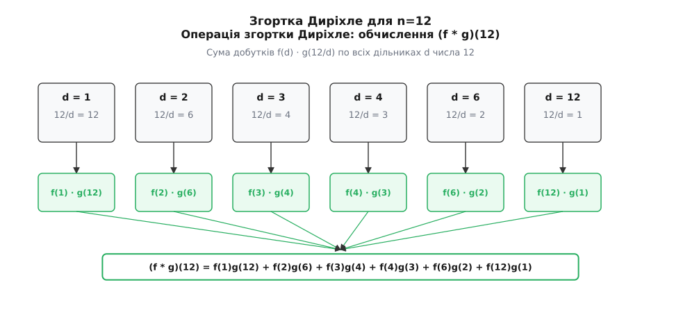
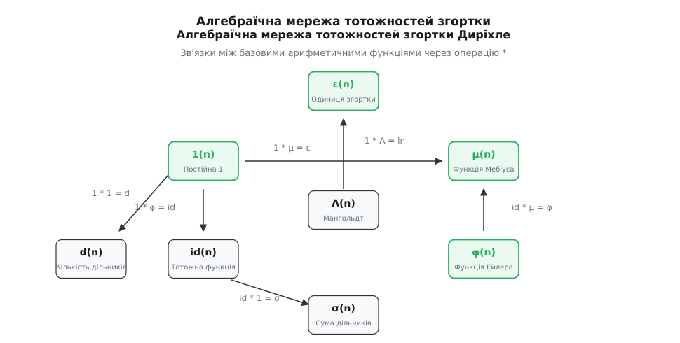
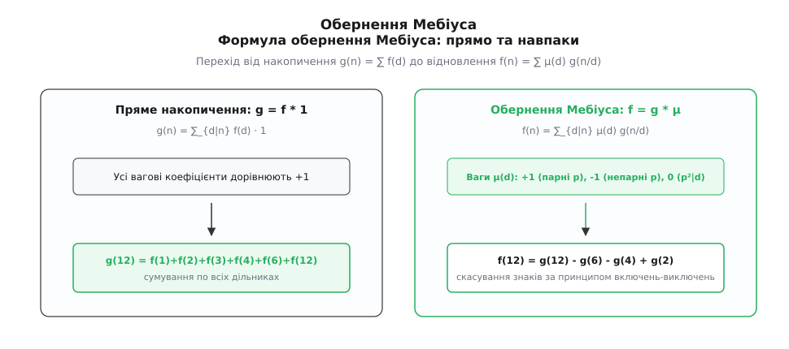

# Арифметичні функції

<preknowlist>
- [Подільність і прості числа](root:math-number-theory/prime-numbers) — фундаментальна теорема арифметики, розклад цілого числа на прості множники.
- [НСД та алгоритм Евкліда](root:math-number-theory/gcd-euclidean) — найбільший спільний дільник і співвідношення взаємної простоти (НСД = 1).
- [Функція Ейлера](root:math-number-theory/euler-totient) — кількість взаємно простих чисел, не більших за n, та її мультиплікативність.
- [Модульна арифметика](root:math-number-theory/modular-arithmetic) — порівняння за модулем та класи лишків.
- [Китайська теорема про залишки](root:math-number-theory/chinese-remainder-theorem) — розклад арифметичних структур за взаємно простими модулями.
</preknowlist>

Якщо обчислити значення [функції Ейлера](root:math-number-theory/euler-totient) `φ(d)` для кожного дільника `d` числа `12` та просумувати їх, виникає несподівана закономірність. Дільниками числа `12` є числа `1, 2, 3, 4, 6, 12`. Відповідні значення `φ(d)` дорівнюють `φ(1) = 1`, `φ(2) = 1`, `φ(3) = 2`, `φ(4) = 2`, `φ(6) = 2` та `φ(12) = 4`. Додавши їх разом, отримуємо `1 + 1 + 2 + 2 + 2 + 4 = 12` — точне значення самого вихідного числа. Візьмемо інше число, наприклад `30`. Його дільники — `1, 2, 3, 5, 6, 10, 15, 30`, а значення `φ(d)` дорівнюють `1, 1, 2, 4, 2, 4, 4, 8`. Рівність знову справджується бездоганно: `1 + 1 + 2 + 4 + 2 + 4 + 4 + 8 = 30`.

Цей збіг не є випадковістю. Розглянемо всі `12` звичайних дробів із знаменником `12`: `1/12, 2/12, 3/12, 4/12, 5/12, 6/12, 7/12, 8/12, 9/12, 10/12, 11/12, 12/12`. Скоротимо кожен із них до нескоротного вигляду `k/d`:
- Дріб `1/12` вже нескоротний (знаменник `12`).
- Дріб `2/12` скорочується до `1/6` (знаменник `6`).
- Дріб `3/12` скорочується до `1/4` (знаменник `4`).
- Дріб `4/12` скорочується до `1/3` (знаменник `3`).
- Дріб `5/12` вже нескоротний (знаменник `12`).
- Дріб `6/12` скорочується до `1/2` (знаменник `2`).
- Дріб `7/12` вже нескоротний (знаменник `12`).
- Дріб `8/12` скорочується до `2/3` (знаменник `3`).
- Дріб `9/12` скорочується до `3/4` (знаменник `4`).
- Дріб `10/12` скорочується до `5/6` (знаменник `6`).
- Дріб `11/12` вже нескоротний (знаменник `12`).
- Дріб `12/12` скорочується до `1/1` (знаменник `1`).

Згрупуємо отримані нескоротні дроби за їхніми знаменниками `d`:
- Знаменник `d = 1`: дріб `1/1` (усього `1` дріб, що дорівнює `φ(1) = 1`).
- Знаменник `d = 2`: дріб `1/2` (усього `1` дріб, що дорівнює `φ(2) = 1`).
- Знаменник `d = 3`: дроби `1/3, 2/3` (усього `2` дроби, що дорівнює `φ(3) = 2`).
- Знаменник `d = 4`: дроби `1/4, 3/4` (усього `2` дроби, що дорівнює `φ(4) = 2`).
- Знаменник `d = 6`: дроби `1/6, 5/6` (усього `2` дроби, що дорівнює `φ(6) = 2`).
- Знаменник `d = 12`: дроби `1/12, 5/12, 7/12, 11/12` (усього `4` дроби, що дорівнює `φ(12) = 4`).

Оскільки кожен початковий дріб після скорочення потрапляє у клясу з певним знаменником `d`, який обов'язково ділить `12`, а чисельник `k` є числом від `1` до `d` і взаємно простим із `d`, кількість дробів зі знаменником `d` за означенням дорівнює `φ(d)`. Підсумовування `φ(d)` по всіх дільниках `d` розбиває множину з `n` початкових дробів на неперетинні класи, що й доводить загальну тотожність `∑_{d|n} φ(d) = n` для будь-якого натурального числа.

Описаний приклад показує фундаментальний факт теорії чисел: функції, визначені на множині цілих чисел, живуть не як окремі розрізнені алгоритми. Вони пов'язані між собою через решітку дільників цілісною алгебраїчною системою.

Математично **арифметичною функцією** називається будь-яке відображення `f: ℤ⁺ → ℂ`, яке зіставляє кожному додатному цілому числу `n ∈ {1, 2, 3, ...}` певне комплексне (або дійсне) число `f(n)`. Множина всіх арифметичних функцій утворює векторний простір над полем комплексних чисел, а також комутативне кільце відносно операцій додавання та згортки.

## Мультиплікативність: як розклад на прості керує функцією

Загальні арифметичні функції можуть мати довільні значення на кожному цілому числі. Проте фундаментальна теорема арифметики стверджує, що кожне натуральне число `n > 1` однозначно розкладається у добуток простих множників з відповідними показниками степенів:

```
n = p₁^{k₁} · p₂^{k₂} · … · p_r^{k_r}
```

Ця фундаментальна факторизаційна симетрія дозволяє розбити всю множину арифметичних функцій на класи за їхньою поведінкою відносно добутку аргументів.

**Мультиплікативна функція** — це арифметична функція `f`, яка не дорівнює тотожно нулю та задовольняє умову `f(a · b) = f(a) · f(b)` для всіх таких пар натуральних чисел `a` та `b`, які є взаємно простими, тобто `gcd(a, b) = 1`.

**Абсолютно (повністю) мультиплікативна функція** — це арифметична функція `f`, для якої співвідношення `f(a · b) = f(a) · f(b)` виконується для **будь-яких** натуральних чисел `a` та `b`, незалежно від того, чи мають вони спільні прості множники.

Крім того, у теорії чисел велику роль відіграють **адитивні функції**, які перетворюють добуток аргументів на суму значень: `f(a · b) = f(a) + f(b)` при `gcd(a, b) = 1`. Прикладом адитивної функції є `ω(n)` — кількість різних простих множників числа `n`. Якщо ж умова `f(a · b) = f(a) + f(b)` виконується для всіх `a` та `b`, функція називається абсолютно адитивною (прикладом є `Ω(n)` — загальна кількість простих множників із урахуванням їхніх кратностей, а також натуральний логарифм `ln n`).

З означення мультиплікативності негайно випливає обов'язкове значення функції в одиниці. Нехай `f` — ненульова мультиплікативна функція. Оскільки `f` не є тотожним нулем, знайдеться таке натуральне число `m`, що `f(m) ≠ 0`. Враховуючи, що `gcd(m, 1) = 1`, запишемо ланцюжок рівностей:

```
f(m) = f(m · 1)
= f(m) · f(1)                        [мультиплікативність при gcd(m, 1) = 1]
f(m) · (1 - f(1)) = 0                [перенесення в ліву частину]
f(1) = 1                             [ділення на f(m) ≠ 0]
```

Отже, для будь-якої ненульової мультиплікативної функції завжди виконується рівність **`f(1) = 1`**. Якщо ж функція задовольняла б умову `f(a · b) = f(a) f(b)` і при цьому `f(1) = 0`, то `f(n) = f(n · 1) = f(n) · 0 = 0` для всіх `n`, тобто вона була б тривіальним нулем.

Чому звичайні мультиплікативні функції вимагають саме взаємної простоти аргументів `gcd(a, b) = 1` і ламаються на спільних дільниках? Розглянемо поведінку базових числових функцій, коли `a = 2` та `b = 2` (де `gcd(2, 2) = 2 > 1`):
- Для кількості дільників `d(n)`: `d(2) = 2`, проте `d(2 · 2) = d(4) = 3`, тоді як добуток значень `d(2) · d(2) = 2 · 2 = 4 ≠ 3`.
- Для суми дільників `σ(n)`: `σ(2) = 1 + 2 = 3`, проте `σ(4) = 1 + 2 + 4 = 7`, тоді як добуток `σ(2) · σ(2) = 3 · 3 = 9 ≠ 7`.
- Для функції Ейлера `φ(n)`: `φ(2) = 1`, проте `φ(4) = 2`, тоді як добуток `φ(2) · φ(2) = 1 · 1 = 1 ≠ 2`.

Причина криється у взаємодії простих степенів: коли `gcd(a, b) > 1`, однаковий простий множник `p` входить і в `a`, і в `b`. При перемноженні показники степенів додаються `p^k · p^m = p^{k+m}`, що змінює комбінаторику дільників. Лише абсолютно мультиплікативні функції (такі як `id_k(n) = n^k` або функція Ліувілля `λ(n)`) зберігають мультиплікативність без жодних обмежень на спільні дільники.

Головна практична перевага мультиплікативних функцій полягає у тому, що для обчислення `f(n)` на довільному великому числі `n` не потрібно аналізувати число в цілому. Достатньо розкласти `n` на прості множники й застосувати формулу обчислення функції на окремих простих степенях `f(p^k)`:

```
f(n) = f(p₁^{k₁}) · f(p₂^{k₂}) · … · f(p_r^{k_r})
```

### Алгебраїчне доведення мультиплікативності через китайську теорему про залишки

Мультиплікативність багатьох класичних функцій випливає безпосередньо з ізоморфізму кілець [Китайської теореми про залишки](root:math-number-theory/chinese-remainder-theorem).

Нехай `m` та `n` — взаємно прості натуральні числа (`gcd(m, n) = 1`). За Китайською теоремою про залишки факторгалузь лишків `ℤ / (m n) ℤ` ізоморфна прямому добутку кілець:

```
ℤ / (m n) ℤ ≅ (ℤ / m ℤ) × (ℤ / n ℤ)
```

Цей кільцевий ізоморфізм індукує прямий ізоморфізм мультиплікативних груп оборотних елементів:

```
(ℤ / (m n) ℤ)* ≅ (ℤ / m ℤ)* × (ℤ / n ℤ)*
```

Потужність групи `(ℤ / k ℤ)*` за означенням дорівнює функції Ейлера `φ(k)`. Оскільки потужність прямого добутку двох скінченних множин дорівнює добутку їхніх потужностей, ми негайно отримуємо:

```
φ(m n) = |(ℤ / (m n) ℤ)*| = |(ℤ / m ℤ)*| · |(ℤ / n ℤ)*| = φ(m) · φ(n)
```

Аналогічно, решітка дільників числа `m n` при `gcd(m, n) = 1` є прямим декартовим добутком решіток дільників числа `m` та числа `n`. Кожен дільник `d | m n` однозначно записується як `d = d₁ · d₂`, де `d₁ | m` та `d₂ | n`. Звідси кількість дільників задовольняє рівність `d(m n) = d(m) · d(n)`, а сума дільників `σ(m n) = ∑_{d₁|m} ∑_{d₂|n} d₁ d₂ = (∑_{d₁|m} d₁) (∑_{d₂|n} d₂) = σ(m) σ(n)`.

## Галерея класичних арифметичних функцій

Розглянемо ключові арифметичні функції, які формують каркас теорії чисел, їхні аналітичні формули на простих степенях та механізми дії.

### 1. Кількість дільників `d(n)` (або `τ(n)`)

Функція `d(n)` підраховує загальну кількість усіх додатних дільників числа `n`. Для простого степеня `p^k` дільниками є лише числа `1, p, p², ..., p^k`, яких рівно `k + 1`. Оскільки функція є мультиплікативною, для канонічного розкладу маємо формулу:

```
d(n) = ∏_{i=1}^r (k_i + 1)
```

Функція `d(n)` є мультиплікативною, але не абсолютно мультиплікативною.

### 2. Сума степенів дільників `σ_k(n)` та сума дільників `σ(n)`

Функція `σ_k(n) = ∑_{d|n} d^k` знаходить суму `k`-тих степенів усіх дільників числа `n`. При `k = 1` отримуємо класичну суму дільників `σ(n) = σ_1(n)`. При `k = 0` маємо кількість дільників `σ_0(n) = d(n)`. Для простого степеня `p^m` дільники утворюють скінченну геометричну прогресію:

```
σ_k(p^m) = 1 + p^k + p^{2k} + … + p^{m k} = (p^{k(m+1)} - 1) / (p^k - 1)
```

Зокрема при `k = 1`:

```
σ(p^m) = 1 + p + p² + … + p^m = (p^{m+1} - 1) / (p - 1)
```

Завдяки мультиплікативності загальна формула для довільного числа `n` набуває вигляду:

```
σ(n) = ∏_{i=1}^r ( (p_i^{k_i + 1} - 1) / (p_i - 1) )
```

При `k = 2` функція `σ_2(n) = ∑_{d|n} d²` знаходить суму квадратів дільників, яка виникає при дослідженні тета-рядів та представлень чисел у вигляді сум квадратів.

### 3. Функція Ейлера `φ(n)`

Функція Ейлера підраховує кількість натуральних чисел у відрізку `[1, n]`, які є взаємно простими з `n`. На простому степені `p^k` не взаємно простими з `p^k` є лише ті числа, що кратні `p`. Їх рівно `p^k / p = p^{k-1}` штук: `p, 2p, 3p, ..., p^{k-1}p`. Віднімаючи їх від загальної кількості `p^k`, маємо:

```
φ(p^k) = p^k - p^{k-1} = p^{k-1} (p - 1) = p^k · (1 - 1/p)
```

За мультиплікативністю отримуємо загальну формулу добутку Ейлера:

```
φ(n) = n · ∏_{p|n} (1 - 1/p)
```

### 4. Функція Мебіуса `μ(n)`

Функція Мебіуса виступає універсальним ваговим множником обернення та принципу включень-виключень. Вона визначається так:
- `μ(1) = 1`;
- `μ(n) = (-1)^r`, якщо число `n` вільне від квадратів і розкладається у добуток `r` попарно різних простих множників;
- `μ(n) = 0`, якщо число `n` ділиться на квадрат будь-якого простого числа (`p² | n`).

На простих степенях `μ(p) = -1`, а `μ(p^k) = 0` при всіх `k ≥ 2`. Функція Мебіуса є мультиплікативною.

### 5. Функція Ліувілля `λ(n)`

Функція Ліувілля враховує парність повної кількості простих множників числа:

```
λ(n) = (-1)^{Ω(n)}
```

де `Ω(n)` — загальна кількість простих множників з урахуванням їхніх кратностей.

На відміну від функції Мебіуса, функція Ліувілля є **абсолютно мультиплікативною**. Справді, оскільки операція факторизації додає загальну кількість множників `Ω(a · b) = Ω(a) + Ω(b)` для будь-яких чисел `a` та `b`, маємо:

```
λ(a · b)
= (-1)^{Ω(a · b)}                    [означення функції Ліувілля]
= (-1)^{Ω(a) + Ω(b)}                [абсолютна адитивність Ω(n)]
= (-1)^{Ω(a)} · (-1)^{Ω(b)}          [властивість степеня]
= λ(a) · λ(b)                        [висновок: абсолютна мультиплікативність]
```

На простих степенях `λ(p^k) = (-1)^k`. Сума функції Ліувілля по всіх дільниках числа має дивовижну властивість: вона є індикатором повних квадратів:

```
∑_{d|n} λ(d) = 1, якщо n = m² є повним квадратом, та 0 інакше
```

Ця тотожність легко виводиться на простому степені: `∑_{i=0}^k λ(p^i) = 1 - 1 + 1 - 1 + ... + (-1)^k`. Якщо показник `k` парний, сума дорівнює `1`; якщо непарний — `0`. За мультиплікативністю добуток таких сум по всіх простих множниках дорівнює `1` тоді й лише тоді, коли всі показники `k_i` є парними, тобто коли `n` є точним квадратом.

### 6. Тотієнти Жордана `J_k(n)`

Тотієнт Жордана `J_k(n)` узагальнює функцію Ейлера `φ(n) = J_1(n)`. Він підраховує кількість `k`-наборів цілих чисел `(a₁, a₂, ..., a_k)` у діапазоні від `1` до `n`, для яких спільний дільник `gcd(a₁, a₂, ..., a_k, n) = 1`.

На канонічному розкладі функція Жордана обчислюється формулою:

```
J_k(n) = n^k · ∏_{p|n} (1 - 1 / p^k)
```

На простих степенях `J_k(p^m) = p^{m k} - p^{(m-1)k} = p^{(m-1)k} (p^k - 1)`. Тотієнти Жордана задовольняють фундаментальну тотожність згортки `J_k * 1 = id_k`, звідки за оберненням Мебіуса маємо `J_k = id_k * μ`.

### 7. Псі-функція Дедекінда `ψ_D(n)`

Псі-функція Дедекінда визначається для кожного натурального числа `n` формулою:

```
ψ_D(n) = n · ∏_{p|n} (1 + 1 / p)
```

На простому степені `ψ_D(p^k) = p^{k-1} (p + 1)`. Ця функція виникає в теорії модулярних форм та геометрії фуксових груп, виражаючи індекс конгруенц-підгрупи `Γ₀(n)` у модульній групі `SL(2, ℤ)`. Через операцію згортки псі-функція Дедекінда виражається як `ψ_D = id * μ²`, де `μ²(n) = |μ(n)| = [n \text{ вільне від квадратів}]`.

### 8. Суми Рамануджана `c_q(n)`

Сума Рамануджана `c_q(n)` зіставляє парі натуральних чисел `q` та `n` суму тригонометричних експонентів за всіма приведеними лишками за модулем `q`:

```
c_q(n) = ∑_{1 ≤ a ≤ q, gcd(a, q) = 1} exp(2πi · a · n / q)
```

Рамануджан відкрив, що ця комплексна тригонометрична сума є строго цілим числом і виражається через згортку та функцію Мебіуса:

```
c_q(n) = ∑_{d | gcd(q, n)} d · μ(q / d)
```

Для фіксованого `n` функція `q ↦ c_q(n)` є мультиплікативною арифметичною функцією від аргументу `q`. Зокрема, при `n = 0` маємо `c_q(0) = φ(q)`, а при `gcd(q, n) = 1` отримуємо `c_q(n) = μ(q)`.

### 9. Функція Кармайкла `λ(n)` проти функції Ейлера `φ(n)`

[Функція Кармайкла](root:math-number-theory/carmichael-function) `λ(n)` визначає універсальний показник мультиплікативної групи `(ℤ/nℤ)*` — найменше додатне ціле число `m`, для якого порівняння `a^m ≡ 1 (mod n)` виконується для кожного `a`, взаємно простого з `n`.

На простих степенях функція Кармайкла збігається з функцією Ейлера для непарних простих: `λ(p^k) = φ(p^k) = p^{k-1}(p - 1)`. Для степенів двійки ситуація відрізняється через нециклічність групи `(ℤ/2^k ℤ)*` при `k ≥ 3`:
- `λ(2) = 1`, `λ(4) = 2`;
- `λ(2^k) = 2^{k-2} = (1/2) φ(2^k)` при `k ≥ 3`.

Для складеного числа `n = p₁^{k₁} ... p_r^{k_r}` функція Кармайкла обчислюється не як добуток, а як найменше спільне кратне (НСК):

```
λ(n) = lcm( λ(p₁^{k₁}), λ(p₂^{k₂}), …, λ(p_r^{k_r}) )
```

Наприклад, для `n = 360 = 2³ · 3² · 5¹`:
- `φ(360) = 4 · 6 · 4 = 96`.
- `λ(360) = lcm(λ(8), λ(9), λ(5)) = lcm(2, 6, 4) = 12`.

Це означає, що будь-яке число, взаємно просте з `360`, у 12-му степені дає остачу 1 за модулем 360, хоча порядок групи дорівнює 96. Це суттєво оптимізує криптографічні схеми на кшталт RSA.

### 10. Функція ман Гольдта `Λ(n)`

Функція ман Гольдта є фундаментальним оператором для виявлення простих чисел та їхніх степенів:

```
Λ(n) = ln p, якщо n = p^k для простого p та k ≥ 1, та 0 інакше
```

Функція ман Гольдта **не є мультиплікативною**. По-перше, `Λ(1) = 0 ≠ 1`. По-друге, для складених чисел із різними простими дільниками вона зануляється: `Λ(6) = 0`, тоді як `Λ(2) · Λ(3) = ln 2 · ln 3 ≠ 0`.

Проте функція ман Гольдта задовольняє фундаментальну сумаційну рівність:

```
∑_{d|n} Λ(d) = ln n
```

Перевіримо цю рівність. Нехай `n = p₁^{k₁} · … · p_r^{k_r}`. Дільниками `d`, для яких `Λ(d) ≠ 0`, є лише степені простих `p_i^j` для `1 ≤ j ≤ k_i`. Кожен такий степінь додає у суму `ln p_i`. Просумувавши по всіх `j` від `1` до `k_i`, отримуємо внесок `k_i ln p_i`. Підсумкова сума дорівнює `∑_{i=1}^r k_i ln p_i = ln(∏ p_i^{k_i}) = ln n`.

### 11. Омега-функції простих множників `ω(n)` та `Ω(n)`

- `ω(n) = ∑_{p|n} 1` рахує кількість **різних** простих дільників числа `n`. Вона є адитивною: `ω(a · b) = ω(a) + ω(b)` при `gcd(a, b) = 1`. На простих степенях `ω(p^k) = 1`.
- `Ω(n) = ∑_{p^k || n} k` рахує **загальну кількість** простих множників з урахуванням кратності. Вона є абсолютно адитивною: `Ω(a · b) = Ω(a) + Ω(b)` для будь-яких `a, b`. На простих степенях `Ω(p^k) = k`.

### Розібраний приклад: обчислення для числа `n = 360`

Розкладемо число `360` на прості множники: `360 = 2³ · 3² · 5¹`. Обчислимо покроково значення всіх наведених функцій:

1. **Кількість дільників `d(360)`:**
   ```
   d(360) = d(2³) · d(3²) · d(5¹)
   = (3 + 1) · (2 + 1) · (1 + 1)        [підстановка k_i + 1]
   = 4 · 3 · 2 = 24                     [усього 24 дільники]
   ```

2. **Сума дільників `σ(360)`:**
   ```
   σ(360) = σ(2³) · σ(3²) · σ(5¹)
   = ( (2⁴ - 1)/(2 - 1) ) · ( (3³ - 1)/(3 - 1) ) · ( (5² - 1)/(5 - 1) ) [сума геометричних прогресій]
   = (15 / 1) · (26 / 2) · (24 / 4)
   = 15 · 13 · 6 = 1170                 [підсумкова сума всіх 24 дільників]
   ```

3. **Функція Ейлера `φ(360)`:**
   ```
   φ(360) = φ(2³) · φ(3²) · φ(5¹)
   = (2² · (2 - 1)) · (3¹ · (3 - 1)) · (5⁰ · (5 - 1)) [формула p^{k-1}(p - 1)]
   = (4 · 1) · (3 · 2) · (1 · 4)
   = 4 · 6 · 4 = 96                     [96 чисел у [1, 360] взаємно прості з 360]
   ```

4. **Функція Мебіуса `μ(360)`:**
   Оскільки `360` ділиться на `2² = 4` (та `3² = 9`), воно не є вільним від квадратів: `μ(360) = 0`.

5. **Функція Ліувілля `λ(360)`:**
   Загальна кількість простих множників `Ω(360) = 3 + 2 + 1 = 6` (парне число):
   ```
   λ(360) = (-1)^6 = 1
   ```

6. **Тотієнт Жордана `J_2(360)`:**
   ```
   J_2(360) = 360² · (1 - 1/4) · (1 - 1/9) · (1 - 1/25)
   = 129600 · (3/4) · (8/9) · (24/25)
   = 129600 · (576 / 900)
   = 144 · 576 = 82944
   ```

7. **Псі-функція Дедекінда `ψ_D(360)`:**
   ```
   ψ_D(360) = 360 · (1 + 1/2) · (1 + 1/3) · (1 + 1/5)
   = 360 · (3/2) · (4/3) · (6/5)
   = 360 · (72 / 30) = 360 · 2.4 = 864
   ```

8. **Функція Кармайкла `λ(360)`:**
   ```
   λ(360) = lcm(λ(8), λ(9), λ(5)) = lcm(2, 6, 4) = 12
   ```

9. **Функція ман Гольдта `Λ(360)`:**
   Оскільки `360` має більше одного простого дільника (`2, 3, 5`), воно не є степенем одного простого числа: `Λ(360) = 0`.

10. **Омега-функції:**
    - `ω(360) = 3` (три різні прості дільники: `2, 3, 5`).
    - `Ω(360) = 3 + 2 + 1 = 6` (шість простих множників з урахуванням кратностей).

## Згортка Діріхле: операція, яка робить із функцій групу

Якщо ми маємо дві арифметичні функції `f` та `g`, виникає питання: як побудувати їхній природний алгебраїчний добуток по решітці дільників?

Звичайне точкове множення `(f · g)(n) = f(n) · g(n)` не враховує арифметичної структури подільності цілих чисел. Справжнім внутрішнім множенням для числових функцій є операція згортки.

**Згорткою Діріхле** (або добутком Діріхле) двох арифметичних функцій `f` та `g` називається нова арифметична функція `f * g`, значення якої в точці `n` дорівнює сумі добутків `f(a) · g(b)` по всіх парах натуральних чисел `(a, b)`, добуток яких дорівнює `n`:

```
(f * g)(n) = ∑_{d|n} f(d) g(n/d) = ∑_{a·b = n} f(a) g(b)
```

Обчислимо для наочності значення згортки двох функцій `f = 1` (постійна одиниця `1(n) = 1`) та `g = μ` (функція Мебіуса) для числа `n = 12`. Дільниками числа `12` є такі 6 пар чисел `(d, 12/d)`: `(1, 12)`, `(2, 6)`, `(3, 4)`, `(4, 3)`, `(6, 2)` та `(12, 1)`.

```
(1 * μ)(12)
= 1(1)μ(12) + 1(2)μ(6) + 1(3)μ(4) + 1(4)μ(3) + 1(6)μ(2) + 1(12)μ(1) [розгортка за всіма дільниками 12]
= 1·(0) + 1·(1) + 1·(0) + 1·(-1) + 1·(-1) + 1·(1)                   [підстановка значень μ]
= 0 + 1 + 0 - 1 - 1 + 1                                             [спрощення доданків]
= 0                                                                 [підсумкова сума]
```


*Схема обчислення згортки (f * g)(12): кожна пара дільників (d, 12/d) дає свій внесок у підсумкову суму центрального вузла.*

### Алгебраїчні властивості та аксіоми кільця

Нехай `A = {f: ℤ⁺ → ℂ}` — множина всіх арифметичних функцій. Відносно звичайного точкового додавання `(f + g)(n) = f(n) + g(n)` та згортки Діріхле `f * g` множина `A` утворює комутативне кільце з одиницею та область цілісності (цілісний домен):

1. **Комутативність:** `f * g = g * f`. Випливає із симетрії розкладу `a · b = n` у полі комплексних чисел:
   ```
   (f * g)(n) = ∑_{a·b = n} f(a) g(b) = ∑_{b·a = n} g(b) f(a) = (g * f)(n)
   ```

2. **Асоціативність:** `(f * g) * h = f * (g * h)`. Потрійна згортка розгортається у суму по всіх впорядкованих трійках `(a, b, c)` таких, що `a · b · c = n`:
   ```
   ((f * g) * h)(n)
   = ∑_{d·c = n} (f * g)(d) h(c)                      [згортка (f * g) з h]
   = ∑_{d·c = n} ( ∑_{a·b = d} f(a) g(b) ) h(c)        [розгортка внутрішньої згортки]
   = ∑_{a·b·c = n} f(a) g(b) h(c)                      [сума по всіх трійках a·b·c = n]
   = ∑_{a·e = n} f(a) ( ∑_{b·c = e} g(b) h(c) )        [перегрупування при e = b·c]
   = (f * (g * h))(n)                                  [згортка f з (g * h)]
   ```

3. **Дистрибутивність відносно додавання:** `f * (g + h) = f * g + f * h`.

4. **Нейтральний (одиничний) елемент `ε(n)`:** функція, що дорівнює `ε(1) = 1` та `ε(n) = 0` при `n > 1` (символ Кронекера `ε(n) = [n = 1]`). Для будь-якої арифметичної функції:
   ```
   (f * ε)(n) = ∑_{d|n} f(d) ε(n/d) = f(n) · ε(1) = f(n) · 1 = f(n)
   ```

5. **Відсутність дільників нуля:** Якщо `f * g = 0` і `f ≠ 0`, то `g = 0`. Якщо взяти найменші індекси `n₁` та `n₂`, де `f(n₁) ≠ 0` та `g(n₂) ≠ 0`, то в точці `n = n₁ n₂` перший ненульовий доданок дорівнюватиме `f(n₁) g(n₂) ≠ 0`, що унеможливлює тотожний нуль.

### Критерій оборотності та алгоритм побудови оберненої функції

Арифметична функція `f` називається оборотною відносно згортки Діріхле, якщо існує така функція `f⁻¹`, що `f * f⁻¹ = ε`.

**Теорема.** Функція `f` має обернену відносно згортки функцію `f⁻¹` тоді й лише тоді, коли **`f(1) ≠ 0`**. При цьому обернена функція є єдиною.

Побудуємо значення `f⁻¹(n)` покроково за допомогою індукції:

**База індукції (`n = 1`):**
```
(f * f⁻¹)(1) = ε(1)
f(1) · f⁻¹(1) = 1
f⁻¹(1) = 1 / f(1)                    [можливо тоді й лише тоді, коли f(1) ≠ 0]
```

**Крок індукції (`n > 1`):**
Для `n > 1` значення `ε(n) = 0`. Розпишемо згортку:
```
(f * f⁻¹)(n) = ∑_{d|n} f(d) f⁻¹(n/d) = 0
f(1) f⁻¹(n) + ∑_{d|n, d > 1} f(d) f⁻¹(n/d) = 0
```

Оскільки при `d > 1` частка `n/d < n`, усі значення `f⁻¹(n/d)` вже обчислені на попередніх кроках. Переносячи суму та ділячи на `f(1) ≠ 0`, отримуємо рекурентну формулу для оберненої функції:

```
f⁻¹(n) = − (1 / f(1)) · ∑_{d|n, d > 1} f(d) f⁻¹(n/d)
```

Застосуємо цю рекурентну формулу для знаходження оберненої функції до постійної одиниці `1(n) = 1` (шукаємо `1⁻¹ = μ`):
- `μ(1) = 1 / 1(1) = 1/1 = 1`.
- `μ(2) = - (1/1) · (1(2) μ(1)) = - (1 · 1) = -1`.
- `μ(3) = - (1/1) · (1(3) μ(1)) = - (1 · 1) = -1`.
- `μ(4) = - (1/1) · (1(2) μ(2) + 1(4) μ(1)) = - (1·(-1) + 1·1) = - (-1 + 1) = 0`.
- `μ(6) = - (1/1) · (1(2) μ(3) + 1(3) μ(2) + 1(6) μ(1)) = - (1·(-1) + 1·(-1) + 1·1) = - (-1 - 1 + 1) = 1`.
- `μ(12) = - (1/1) · (1(2)μ(6) + 1(3)μ(4) + 1(4)μ(3) + 1(6)μ(2) + 1(12)μ(1)) = - (1·1 + 1·0 + 1·(-1) + 1·(-1) + 1·1) = - (1 + 0 - 1 - 1 + 1) = 0`.

Ми щойно суто алгебраїчно вивели точні значення функції Мебіуса `μ(n)`!

### Збереження мультиплікативності

**Теорема.** Якщо `f` та `g` — мультиплікативні функції, то їхня згортка `h = f * g` також є мультиплікативною функцією.

**Доведення:** Нехай `gcd(m, n) = 1`. Будь-який дільник `d | (m · n)` однозначно факторизується у вигляд `d = d₁ · d₂`, де `d₁ | m`, `d₂ | n` та `gcd(d₁, d₂) = 1`. Тоді:
```
h(m · n)
= ∑_{d | m·n} f(d) g((m·n)/d)                       [означення згортки (f * g)]
= ∑_{d₁ | m} ∑_{d₂ | n} f(d₁ d₂) g((m/d₁) · (n/d₂)) [факторизація d = d₁ d₂]
= ∑_{d₁ | m} ∑_{d₂ | n} f(d₁) f(d₂) g(m/d₁) g(n/d₂) [мультиплікативність f та g]
= ( ∑_{d₁ | m} f(d₁) g(m/d₁) ) · ( ∑_{d₂ | n} f(d₂) g(n/d₂) ) [розділення незалежних сум]
= h(m) · h(n)                                       [добуток значень згортки]
```

Крім того, якщо `f` мультиплікативна, то її обернена функція `f⁻¹` також мультиплікативна. Отже, **множина всіх мультиплікативних функцій утворює абелеву підгрупу** у групі оборотних арифметичних функцій відносно згортки Діріхле.

Якщо функція `f` є **абсолютно мультиплікативною**, її обернена набуває особливо простого вигляду:

```
f⁻¹(n) = μ(n) · f(n)
```

Перевіримо це: `(f * (μ · f))(n) = ∑_{d|n} f(d) μ(n/d) f(n/d) = f(n) ∑_{d|n} μ(n/d) = f(n) ε(n) = ε(n)`.

### Диференціювання в кільці арифметичних функцій

Визначимо оператор арифметичної похідної `f'` (або `D(f)`) на кільці арифметичних функцій формулою:

```
f'(n) = f(n) · ln n
```

Цей оператор задовольняє класичне правило Лейбніца для згортки:

```
(f * g)' = f' * g + f * g'
```

Перевіримо це диференціальне правило:

```
(f * g)'(n)
= ( ∑_{d|n} f(d) g(n/d) ) · ln n                     [означення арифметичної похідної]
= ∑_{d|n} f(d) g(n/d) · (ln d + ln(n/d))             [властивість ln n = ln d + ln(n/d)]
= ∑_{d|n} (f(d) ln d) g(n/d) + ∑_{d|n} f(d) (g(n/d) ln(n/d)) [розбиття на дві суми]
= (f' * g)(n) + (f * g')(n)                          [означення згорток f'*g та f*g']
```

Зокрема, похідна постійної функції `1` дорівнює `1'(n) = 1(n) · ln n = ln n`. Тоді похідна одиничного елемента `ε' = (1 * μ)' = 1' * μ + 1 * μ' = ln * μ + 1 * μ' = 0`. Звідси отримуємо логарифмічну тотожність для функції ман Гольдта: `Λ = 1' * μ = ln * μ`.

Повний огляд [історії виникнення згортки та внеску Діріхле](root:math-number-theory/arithmetic-functions/hist-dirichlet-convolution.md) та строге [математичне виведення алгебраїчних властивостей і рядів Белла](root:math-number-theory/arithmetic-functions/math-dirichlet-algebra.md) розкрито в окремих матеріалах.

## Функція Мебіуса, формула обернення та узагальнення на посети

Оскільки постійна одинична функція `1(n) = 1` має `1(1) = 1 ≠ 0`, вона є оборотною. Її обернена функція за означенням задовольняє рівняння `1 * μ = ε` і є функцією Мебіуса `μ(n)`.

Завдяки наявності оберненого елемента виконується знаменита **теорема про обернення Мебіуса**:

```
g(n) = ∑_{d|n} f(d)   ⇔   f(n) = ∑_{d|n} μ(d) g(n/d)
```

В алгебраїчних позначеннях згортки Діріхле пряме та обернене твердження доводяться в один рядок:
```
g = f * 1  ⇒  g * μ = (f * 1) * μ = f * (1 * μ) = f * ε = f
f = g * μ  ⇒  f * 1 = (g * μ) * 1 = g * (μ * 1) = g * ε = g
```

Також застосовується суматорна (неперервна) форма обернення Мебіуса для функцій дійсного аргументу:

```
G(x) = ∑_{n ≤ x} F(x / n)   ⇔   F(x) = ∑_{n ≤ x} μ(n) G(x / n)
```

### Застосування обернення Мебіуса

1. **Формула для тотієнта Ейлера:**
   Рівність `∑_{d|n} φ(d) = n` записується як `φ * 1 = id`. Множачи на `μ`, маємо `φ = id * μ`:
   ```
   φ(n) = ∑_{d|n} μ(d) · (n / d) = n · ∑_{d|n} (μ(d) / d) = n · ∏_{p|n} (1 - 1/p)
   ```

2. **Формула для функції ман Гольдта:**
   Рівність `∑_{d|n} Λ(d) = ln n` записується як `Λ * 1 = ln`. Множачи на `μ`, маємо `Λ = ln * μ`:
   ```
   Λ(n) = ∑_{d|n} μ(d) ln(n / d) = - ∑_{d|n} μ(d) ln d
   ```

3. **Формула для кругових многочленів (циклотомічних поліномів):**
   Многочлен `x^n - 1 = ∏_{d|n} Φ_d(x)` розкладається у добуток незвідних кругових многочленів `Φ_d(x)`. Логарифмуючи та застосовуючи мультиплікативне обернення Мебіуса, отримуємо явну формулу для кругового многочлена:
   ```
   Φ_n(x) = ∏_{d|n} (x^d - 1)^{μ(n/d)}
   ```
   Наприклад, для `n = 6`:
   ```
   Φ_6(x) = (x^6 - 1)^{μ(1)} · (x^3 - 1)^{μ(2)} · (x^2 - 1)^{μ(3)} · (x^1 - 1)^{μ(6)}
   = (x^6 - 1)^1 · (x^3 - 1)^{-1} · (x^2 - 1)^{-1} · (x - 1)^1
   = ( (x^3 - 1)(x^3 + 1)(x - 1) ) / ( (x^3 - 1)(x^2 - 1) )
   = ( (x^3 + 1)(x - 1) ) / ( (x - 1)(x + 1) )
   = (x^3 + 1) / (x + 1) = x² - x + 1
   ```


*Мережа тотожностей згортки Диріхле: множення на постійну функцію 1(n) здійснює накопичення дільників, а згортка з функцією Мебіуса μ(n) відновлює початкову функцію.*


*Пряме накопичення сумує значення по всіх дільниках із вагами +1, тоді як обернення Мебіуса відновлює початкові значення через вагові коефіцієнти μ(d).*

Детальні тотожності та формули для інших класичних функцій зібрано в [довіднику стандартних арифметичних функцій та тотожностей згортки](root:math-number-theory/arithmetic-functions/api-common-functions.md).

### Узагальнення на частково впорядковані множини (посети) та алгебру інцидентності

У 1964 році математик Джан-Карло Рота усвідомив, що обернення Мебіуса не прив'язане виключно до подільності чисел. Воно є універсальним принципом комбінаторного відновлення на будь-якій частково впорядкованій множині.

Нехай `(P, ≤)` — локально скінченна частково впорядкована множина (посет, від англ. *partially ordered set*), у якій кожен інтервал `[x, y] = {z ∈ P | x ≤ z ≤ y}` містить скінченну кількість елементів.

Визначимо **алгебру інцидентності** `I(P)` як множину функцій двох змінних `f(x, y)`, визначених для всіх пар `x ≤ y`. Операція згортки в алгебрі інцидентності задається формулою:

```
(f * g)(x, y) = ∑_{x ≤ z ≤ y} f(x, z) g(z, y)
```

Нейтральним елементом цієї згортки є дельта-функція Кронекера `δ(x, y) = [x = y]`.

Визначимо **дзета-функцію пори року/посету** `ζ(x, y) = 1` для всіх `x ≤ y`. Функцією Мебіуса посету `μ(x, y)` називається обернена до `ζ` функція в алгебрі інцидентності: `μ * ζ = ζ * μ = δ`. Вона задається рекурентно:
- `μ(x, x) = 1` для всіх `x ∈ P`;
- `μ(x, y) = - ∑_{x ≤ z < y} μ(x, z)` для всіх `x < y`.

**Загальна теорема обернення Мебіуса на посети:**
```
g(x) = ∑_{y ≤ x} f(y)   ⇔   f(x) = ∑_{y ≤ x} g(y) μ(y, x)
```

Ця єдина абстрактна формула об'єднує три фундаментальні математичні конструкції:

1. **Булева решітка підмножин `(P(S), ⊆)` скінченної множини `S`:**
   Тут функція Мебіуса інтервалу `[A, B]` залежить лише від різниці потужностей: `μ(A, B) = (-1)^{|B \ A|}`. Застосування загального обернення Мебіуса до булевої решітки дає класичний **принцип включень-виключень**!

2. **Решітка подільності натуральних чисел `(ℤ⁺, |)`:**
   Порядок `a ≤ b` означає `a | b`. Інтервал `[a, b]` ізоморфний решітці дільників числа `b / a`. Функція Мебіуса посету дорівнює `μ(a, b) = μ(b / a)`. Це повертає нас до класичного теоретико-числового обернення Мебіуса.

3. **Звичайний лінійний порядок на цілих числах `(ℕ, ≤)`:**
   Для лінійного ланцюга `1 < 2 < 3 < ...` функція Мебіуса дорівнює `μ(n, n) = 1`, `μ(n, n+1) = -1` та `μ(n, m) = 0` при `m ≥ n + 2`. Обернення Мебіуса на цьому посеті набуває вигляду:
   ```
   g(n) = ∑_{k=1}^n f(k)   ⇔   f(n) = g(n) - g(n-1)
   ```
   Це не що інше, як оператор скінченних різниць (фундаментальна теорема дискретного числення).

4. **Решітка розбиттів множини та хроматичні многочлени графів:**
   Для простого графа `G = (V, E)` кількість правильних `k`-розмальовок вершин виражається через хроматичний многочлен `P_G(k)`. Застосовуючи формулу обернення Мебіуса до решітки підграфів, хроматичний многочлен розгортається у суму Вітні:
   ```
   P_G(k) = ∑_{A ⊆ E} (-1)^{|A|} k^{c(A)}
   ```
   де `c(A)` — кількість зв'язних компонент підграфа `(V, A)`.

Таким чином, дискретна похідна, принцип включень-виключень, фарбування графів та обернення дільників — це одна й та сама теорема Мебіуса на різних посетах.

## Генеруючі ряди Діріхле: місток між арифметикою та аналізом

Найпотужнішим зв'язковим містком між дискретною теорією чисел та неперервним комплексним аналізом є **ряди Діріхле**. Для будь-якої арифметичної функції `f(n)` її рядом Діріхле називається функціональний ряд від комплексної змінної `s`:

```
L(f, s) = ∑_{n=1}^∞ f(n) / n^s
```

Фундаментальне відкриття Діріхле полягає в тому, що звичайне множення двох рядів Діріхле точно відповідає згортці їхніх коефіцієнтів:

```
L(f, s) · L(g, s)
= ( ∑_{n=1}^∞ f(n) / n^s ) · ( ∑_{m=1}^∞ g(m) / m^s )   [підстановка рядів Діріхле]
= ∑_{n=1}^∞ ∑_{m=1}^∞ f(n) g(m) / (n · m)^s            [перемноження двох сум]
= ∑_{k=1}^∞ ( ∑_{d|k} f(d) g(k/d) ) / k^s               [групування коефіцієнтів при k = n·m]
= L(f * g, s)                                            [означення згортки (f * g)]
```

Це дозволяє перетворювати арифметичні співвідношення на тотожності між відомими аналітичними функціями:
- Дзета-функція Рімана: `L(1, s) = ∑_{n=1}^∞ 1 / n^s = ζ(s)`.
- Для функції Мебіуса: `L(μ, s) = 1 / ζ(s)`, бо `1 * μ = ε ⇒ ζ(s) · L(μ, s) = 1`.
- Для кількості дільників `d = 1 * 1`: `L(d, s) = ζ(s)²`.
- Для суми дільників `σ = id * 1`: `L(σ, s) = ζ(s) ζ(s - 1)`.
- Для функції Ейлера `φ = id * μ`: `L(φ, s) = ζ(s - 1) / ζ(s)`.
- Для функції Ліувілля `λ`: `L(λ, s) = ζ(2s) / ζ(s)`.
- Для функції ман Гольдта `Λ`: `L(Λ, s) = -ζ'(s) / ζ(s)`.
- Для тотієнтів Жордана `J_k = id_k * μ`: `L(J_k, s) = ζ(s - k) / ζ(s)`.

Крім того, для будь-якої мультиплікативної функції ряд Діріхле розкладається у нескінченний **добуток Ейлера**:

```
L(f, s) = ∏_p ( 1 + f(p)/p^s + f(p²)/p^{2s} + f(p³)/p^{3s} + … )
```

А для абсолютно мультиплікативної функції цей добуток набуває компактної форми `L(f, s) = ∏_p (1 - f(p)/p^s)⁻¹`. Детальніше аналітичні властивості рядів розкрито у матеріалі про [L-функції Діріхле](root:math-number-theory/dirichlet-l-functions) та [формулу добутку Ейлера](root:math-number-theory/euler-product-formula).

## Зв'язок із рядами Ейзенштейна та модулярними формами

Арифметичні функції дільників `σ_k(n)` природно виникають у теорії модулярних форм як коефіцієнти ряду Фур'є для рядів Ейзенштейна.

Для комплексної змінної `τ` у верхній півплощині (`Im(τ) > 0`) та цілого числа `k ≥ 2` ряд Ейзенштейна `G_{2k}(τ)` визначається як подвійний ряд по ґратці:

```
G_{2k}(τ) = ∑_{(m, n) ≠ (0, 0)} 1 / (m + n τ)^{2k}
```

Нормований ряд Ейзенштейна `E_{2k}(τ) = G_{2k}(τ) / (2 ζ(2k))` має ряд Фур'є за степенями параметру `q = exp(2πi τ)`:

```
E_{2k}(τ) = 1 - (4k / B_{2k}) · ∑_{n=1}^∞ σ_{2k-1}(n) · q^n
```

де `B_{2k}` — числа Бернуллі. Зокрема:
- При `k = 2` (`B₄ = -1/30`):
  ```
  E₄(τ) = 1 + 240 · ∑_{n=1}^∞ σ₃(n) · q^n
  ```
- При `k = 3` (`B₆ = 1/42`):
  ```
  E₆(τ) = 1 - 504 · ∑_{n=1}^∞ σ₅(n) · q^n
  ```

Ці тотожності встановлюють глибокий міст між геометрією еліптичних кривих та елементарними сумами степенів дільників цілих чисел.

## Середній порядок зростання та асимптотичний аналіз

Значення арифметичних функцій здійснюють сильні коливання від одного цілого числа до сусіднього. Наприклад, кількість дільників `d(p) = 2` для будь-якого простого числа, проте на степенях двійки `d(2^k) = k + 1` зростає логарифмічно, а для добутків перших простих чисел (прайморіалів) зростає ще швидше. Функція Ейлера `φ(p) = p - 1` сягає майже самого числа `p`, але на прайморіалах різко падає.

Для розуміння глобальної поведінки таких функцій досліджують **середній порядок зростання** — асимптотичну поведінку суматорної функції:

```
S_f(x) = ∑_{n ≤ x} f(n)
```

### Проблема дільників Діріхле та метод гіперболи

Розглянемо суму значень кількості дільників `∑_{n ≤ x} d(n)`. Оскільки `d(n) = ∑_{a·b = n} 1`, ця сума геометрично дорівнює кількості цілочисельних точок `(a, b)` у першому квадранті площини під гіперболою `a · b ≤ x`.

Наївний підрахунок дає `∑_{a ≤ x} ⌊x / a⌋ = x ln x + O(x)`. Діріхле запропонував значно точніший **метод гіперболи**: розбити область під гіперболою на дві симетричні частини відносно прямої `a = b` (де `a = √x`) та відняти перетин — квадрат `[1, √x] × [1, √x]`.

```
∑_{n ≤ x} d(n) = 2 ∑_{a ≤ √x} ⌊x / a⌋ − ⌊√x⌋²
```

Використовуючи подання цілої частини `⌊y⌋ = y - {y}` та асимптотику гармонічного ряду `∑_{a ≤ K} 1/a = ln K + γ + O(1/K)` (де `γ ≈ 0.577215` — стала Ейлера-Маскероні), проведемо покрокове обчислення:

```
2 ∑_{a ≤ √x} (x / a)
= 2x · ( ln(√x) + γ + O(1/√x) )     [розклад гармонічного числа]
= 2x · ( (1/2) ln x + γ ) + O(√x)   [властивість ln(√x) = (1/2) ln x]
= x ln x + 2γ x + O(√x)             [розкриття дужок]
```

Оцінимо дробові частини та віднімемо площу квадрата:
- Дробові частини: `2 ∑_{a ≤ √x} {x / a} = O(√x)`.
- Квадрат: `⌊√x⌋² = (√x + O(1))² = x + O(√x)`.

Зібравши всі доданки разом:

```
∑_{n ≤ x} d(n)
= ( x ln x + 2γ x + O(√x) ) − ( x + O(√x) )         [віднімання площі квадрата]
= x ln x + (2γ - 1) x + O(√x)                       [зведення подібних доданків]
```

Це означає, що «в середньому» число `n` має `ln n + 2γ - 1` дільників.

Числовий приклад для `x = 100`:
- Точна сума дільників `∑_{n ≤ 100} d(n) = 482`.
- За методом гіперболи: `2 · ∑_{a=1}^{10} ⌊100/a⌋ - 10² = 2 · (100 + 50 + 33 + 25 + 20 + 16 + 14 + 12 + 11 + 10) - 100 = 2 · 291 - 100 = 582 - 100 = 482` (точний збіг!).
- Асимптотична формула: `100 · ln(100) + (2 · 0.577215 - 1) · 100 = 100 · 4.60517 + 0.15443 · 100 ≈ 460.52 + 15.44 = 475.96`.
- Різниця між точною сумою 482 та головним членом 475.96 складає лише `6.04`, що суттєво менше за похибку `√100 = 10`.

Залишковий член `Δ(x) = ∑_{n ≤ x} d(n) - (x ln x + (2γ - 1) x)` є предметом знаменитої **проблеми дільників Діріхле**. Мета полягає у знаходженні мінімального показника `θ`, для якого `Δ(x) = O(x^θ)`:
- Діріхле (1849): `θ ≤ 1/2 = 0.5000`.
- Вороний (1903): `θ ≤ 1/3 ≈ 0.3333`.
- Хакслі (2003): `θ ≤ 131/416 ≈ 0.3149`.
- Гіпотеза: точна нижня грань дорівнює `θ = 1/4 + ε` для будь-якого `ε > 0`.

### Асимптотика суматорної функції Ейлера

Виведемо середній порядок для функції Ейлера за допомогою згортки `φ = id * μ`:

```
∑_{n ≤ x} φ(n)
= ∑_{n ≤ x} ∑_{d|n} μ(d) · (n / d)   [розклад через згортку id * μ]
= ∑_{d ≤ x} μ(d) ∑_{k ≤ x/d} k       [зміна порядку підсумовування при n = d·k]
```

Внутрішня сума є сумою арифметичної прогресії: `∑_{k ≤ y} k = y(y+1)/2 = y²/2 + O(y)`. Підставляючи `y = x/d`:

```
∑_{n ≤ x} φ(n)
= ∑_{d ≤ x} μ(d) · ( (x/d)² / 2 + O(x/d) )
= (x² / 2) · ∑_{d ≤ x} (μ(d) / d²) + O( x ∑_{d ≤ x} 1/d )
= (x² / 2) · ( ∑_{d=1}^∞ μ(d)/d² − ∑_{d > x} μ(d)/d² ) + O(x ln x)
= (x² / 2) · ( 1 / ζ(2) + O(1/x) ) + O(x ln x)
= (x² / 2) · ( 6 / π² ) + O(x ln x)  [бо ζ(2) = π²/6]
= (3 / π²) · x² + O(x ln x)
```

Звідси випливає фундаментальний ймовірнісний висновок. Кількість пар чисел `(a, b)` у квадраті `[1, N] × [1, N]`, які є взаємно простими (`gcd(a, b) = 1`), дорівнює `2 ∑_{n ≤ N} φ(n) - 1 ≈ 2 · (3/π²) N² = (6/π²) N²`. Поділивши на загальну кількість пар `N²`, отримуємо:

```
P(gcd(a, b) = 1) = 6 / π² ≈ 60.79%
```

Ймовірність того, що два навмання обрані натуральні числа взаємно прості, дорівнює `6 / π²`.

### Суматорна функція суми дільників `σ(n)`

Виведемо середній порядок зростання для суми дільників `σ(n) = ∑_{d|n} d`:

```
∑_{n ≤ x} σ(n)
= ∑_{n ≤ x} ∑_{d|n} d                               [означення σ(n)]
= ∑_{d ≤ x} d · ⌊x / d⌋                             [зміна порядку підсумовування]
= ∑_{d ≤ x} d · (x / d - {x / d})                   [розклад цілої частини]
```

Групуючи за часткою `k = ⌊x/d⌋`:

```
∑_{n ≤ x} σ(n)
= ∑_{k ≤ x} ∑_{d ≤ x/k} d                           [групування за часткою k]
= ∑_{k ≤ x} ( (x/k)² / 2 + O(x/k) )                 [сума перших x/k цілих чисел]
= (x² / 2) · ∑_{k ≤ x} (1 / k²) + O(x ln x)         [винесення спільного множника]
= (x² / 2) · ( ζ(2) − ∑_{k > x} 1/k² ) + O(x ln x)  [ряд для дзета-функції ζ(2)]
= (x² / 2) · ( π² / 6 + O(1/x) ) + O(x ln x)        [підстановка ζ(2) = π²/6]
= (π² / 12) · x² + O(x ln x)                        [підсумкова асимптотична формула]
```

Таким чином, середнє значення суми дільників числа `n` становить приблизно `(π² / 6) n ≈ 1.64493 n`.

### Розподіл омега-функцій (теорема Гарді-Рамануджана)

Значення функцій `ω(n)` (кількість різних простих множників) та `Ω(n)` (повна кількість простих множників) для окремих чисел можуть сильно коливатися: для простого `p` маємо `ω(p) = 1`, а для `n = 2^k` маємо `Ω(n) = k`.

Проте видатні математики Ґодфрі Гарольд Гарді та Срініваса Рамануджан у 1917 році довели, що для переважної більшості натуральних чисел `n` значення `ω(n)` та `Ω(n)` є надзвичайно близькими до повільно зростаючої величини `ln ln n`.

Суматорні середні значення мають асимптотику:

```
∑_{n ≤ x} ω(n) = x ln ln x + B₁ x + O(x / ln x)
∑_{n ≤ x} Ω(n) = x ln ln x + B₂ x + O(x / ln x)
```

де `B₁ ≈ 0.261497` — константа Мертенса.

Пал Туран у 1934 році дав елегантне доведення дисперсії (нерівність Турана-Кубілюса):

```
∑_{n ≤ x} (ω(n) - ln ln x)² ≤ C · x ln ln x
```

Звідси за нерівністю Чебишова випливає, що частка чисел `n ≤ x`, для яких `|ω(n) - ln ln x| > (ln ln x)^{1/2 + ε}`, прямує до нуля при `x → ∞`. А теорема Ердьоша-Каца стверджує, що розподіл `(ω(n) - ln ln n) / √(ln ln n)` прямує до стандартного нормального розподілу Гауса.

### Функція Мертенса та зв'язок із гіпотезою Рімана

Суматорна функція для функції Мебіуса називається **функцією Мертенса**:

```
M(x) = ∑_{n ≤ x} μ(n)
```

Оцінка швидкості зростання `M(x)` тісно пов'язана з нулями дзета-функції Рімана. Твердження про те, що для будь-якого `ε > 0` виконується асимптотична оцінка `M(x) = O(x^{1/2 + ε})`, є строго **еквівалентним [гіпотезі Рімана](root:math-number-theory/riemann-hypothesis)** про нетривіальні нулі дзета-функції на критичній прямій `Re(s) = 1/2`.

### Екстремальні порядки зростання: теореми Ґронволла, Вігертса та Ландау

Поряд із середнім порядком зростання аналітична теорія чисел вивчає екстремальні коливання арифметичних функцій — їхні точні верхні та нижні межі на нескінченності.

1. **Максимальне зростання кількості дільників `d(n)` (теорема Вігертса, 1907):**
   Функція `d(n)` досягає локальних максимумів на високоскладених числах та прайморіалах `N_k = 2 · 3 · 5 · … · p_k`. Вігерт довів точну верхню асимптотичну межу:
   ```
   limsup_{n → ∞} (ln d(n) · ln ln n) / ln n = ln 2 ≈ 0.69315
   ```
   Звідси випливає, що для будь-якого `ε > 0` виконується точкова оцінка `d(n) < 2^{(1 + ε) ln n / ln ln n} = n^{(1 + ε) ln 2 / ln ln n}`. Хоча для будь-якого фіксованого степеня `d(n) = O(n^ε)`, локальні сплески перевершують будь-який поліном від `ln n`.

2. **Максимальне зростання суми дільників `σ(n)` (теорема Ґронволла, 1913):**
   Для суми дільників точна верхня асимптотична межа визначається сталою Ейлера-Маскероні `γ`:
   ```
   limsup_{n → ∞} σ(n) / (n ln ln n) = e^γ ≈ 1.78107
   ```
   Гіпотеза Рімана за критерієм Робіна (1984) еквівалентна твердженню, що строга нерівність `σ(n) < e^γ n ln ln n` виконується для всіх цілих чисел `n > 5040`.

3. **Мінімальне падіння функції Ейлера `φ(n)` (теорема Ландау):**
   Функція тотієнта досягає свого мінімуму відносно `n` на прайморіалах:
   ```
   liminf_{n → ∞} (φ(n) ln ln n) / n = e^{-γ} ≈ 0.56146
   ```

### Характери Діріхле та квадратичні символи

Абсолютно мультиплікативні функції не обмежуються степеневими функціями `id_k(n)`. Ключовим класом повністю мультиплікативних функцій є **характери Діріхле** `χ(n)`.

Характер Діріхле за модулем `q` — це періодична з періодом `q` функція `χ: ℤ⁺ → ℂ`, яка задовольняє умови:
- `χ(a · b) = χ(a) · χ(b)` для всіх натуральних `a, b` (абсолютна мультиплікативність);
- `χ(n) = 0`, якщо `gcd(n, q) > 1`;
- `χ(n + q) = χ(n)`.

Найважливішим прикладом дійсного характеру є символ Лежандра `(n / p)` для непарного простого модуля `p`: він дорівнює `+1`, якщо `n` є квадратичним лишком за модулем `p`, `-1`, якщо `n` є квадратичним нелишком, та `0`, якщо `p | n`. Його повна мультиплікативність `(a b / p) = (a / p) · (b / p)` виражає фундаментальний факт: добуток двох нелишків завжди є квадратичним лишком.

Символ Якобі `(n / k)` узагальнює символ Лежандра на будь-які непарні додатні цілі числа `k = p₁ ... p_m`, визначаючись як добуток відповідних символів Лежандра `∏ (n / p_i)`. Він також є абсолютно мультиплікативною функцією за обома аргументами, що дозволяє швидко перевіряти квадратичну подільність за допомогою алгоритму, подібного до алгоритму Евкліда, без факторизації числа на прості множники.

Характери Діріхле задовольняють фундаментальні співвідношення ортогональності. Для фіксованого модуля `q` сума значень будь-якого нетривіального характеру `χ ≠ χ₀` за повним періодом дорівнює нулю:
```
∑_{n=1}^q χ(n) = 0
```
А сума по всіх `φ(q)` різних характерах за модулем `q` для фіксованого числа `a` дає індикатор лишків:
```
∑_{χ \pmod q} χ(a) = φ(q), якщо a ≡ 1 (mod q), та 0 інакше
```
Ця ортогональність лежить в основі аналітичного доведення теореми Діріхле про нескінченність простих чисел в арифметичних прогресіях.

## Практична обчислювальна складність та алгоритми

При алгоритмічній реалізації на комп'ютері обчислення значень арифметичних функцій виконують спеціалізованими решетами.

Для обчислення значень мультиплікативної функції на діапазоні `1 ≤ n ≤ N` використовують **лінійне решето**, яке працює за час `O(N)` та пам'ять `O(N)`, гарантуючи, що кожне складене число відвідується рівно один раз через свій найменший простий множник.

Якщо ж потрібно обчислити лише префіксну суму `S_f(X) = ∑_{n ≤ X} f(n)` для величезних `X ≤ 10¹¹`, застосовують сублінійний **алгоритм Дю (Du Sieve)**, який обчислює підсумкову суму за час `O(X^(2/3))` без створення масиву в пам'яті. Детальний [практичний алгоритм обчислення згортки та префіксних сум](root:math-number-theory/arithmetic-functions/proj-fast-convolution.md) із робочим кодом винесено в окремий практичний модуль.

> 🔧 **Навіщо це в реальній розробці та криптографії.**
> Арифметичні функції та згортка Діріхле є фундаментом сучасної криптографії з відкритим ключем. У криптосистемі RSA та алгоритмах на еліптичних кривих (ECC) для генерації ключів та вибору модулів обчислюється функція Ейлера `φ(N) = (p-1)(q-1)` та [функція Кармайкла](root:math-number-theory/carmichael-function) `λ(N)`, які визначають період мультиплікативної групи. В алгоритмічному аналізі та комбінаториці обернення Мебіуса використовується для розв'язання задач включень-виключень, обчислення хроматичних многочленів графів та генерації комбінаторних об'єктів без повторів.
