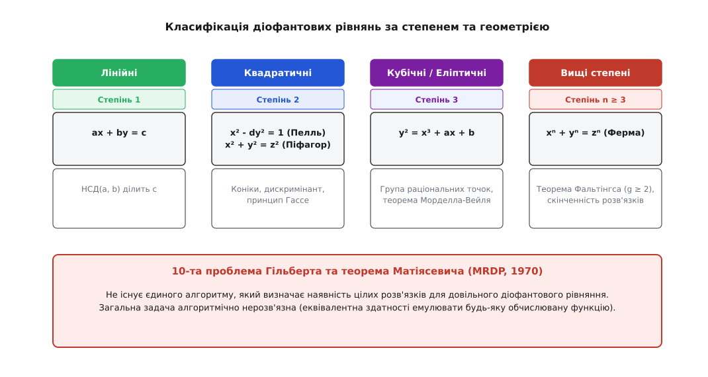
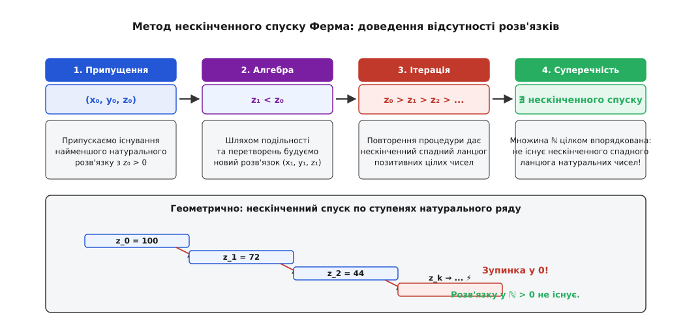
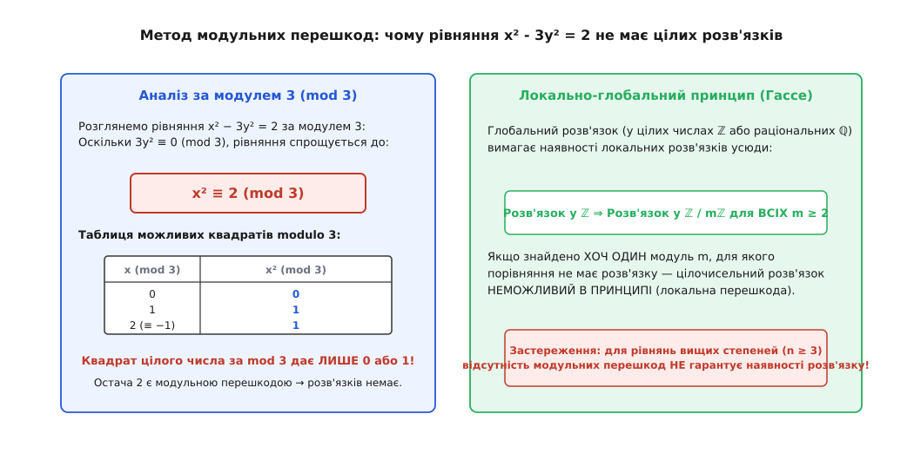

# Діофантові рівняння

<preknowlist>
- [Модульна арифметика](root:math-number-theory/modular-arithmetic) — подільність, ділення з остачею та порівняння за модулем m.
- [НСД і тотожність Безу](root:math-number-theory/bezout-identity) — найбільший спільний дільник двох чисел та його вираження через лінійну комбінацію a·x + b·y = НСД(a, b).
- [Основна теорема арифметики](root:math-number-theory/fundamental-theorem-arithmetic) — єдиність розкладу будь-якого натурального числа на прості множники.
</preknowlist>

Уявімо будівельників, які викладають квадратний майданчик площею сто квадратних метрів за допомогою двох менших квадратних платформ. Якщо дозволити розміри платформ брати довільними дійсними числами — скажімо, одна зі стороною 6 метрів, а друга зі стороною 8 метрів, — то задача розв'язується миттєво: `6² + 8² = 36 + 64 = 100`. Але варто накласти єдину умову: сторони квадратів, їхні площі чи кількісні кроки вимірювання мають бути **строго цілими числами**, як звичайна геометрія розпадається на низку несподіваних перешкод. Одна комбінація розмірів складається легко й красивими числами, а інша, майже невідмінна на вигляд — наприклад, спроба розкласти квадрат площею 7 квадратних метрів — виявляється нездійсненною за жодних умов.

Різниця між цими ситуаціями криється в природі числа. Коли ми шукаємо точки на неперервній гладкій кривій у дійсному просторі, неперервність гарантує нескінченну кількість точок. Проте коли ми вимагаємо, щоб значення змінних належали дискретній множині цілих чисел `ℤ`, неперервна лінія перетворюється на рідку сітку окремих вузлів. Питання про те, чи проходить крива точно через такі цілі вузли, виходить за межі звичайного геометричного креслення і входить у сферу арифметики.

Алгебраїчне рівняння з кількома змінними та цілими коефіцієнтами, для якого шукаються цілочисельні (або раціональні) розв'язки, називають **діофантовим рівнянням** (лат. *aequatio Diophantea*, на честь давньогрецького математика Діофанта Александрійського, гр. *Διόφαντος*, III ст. н.е.).

Історію того, як античний александрійський вчений уперше запровадив скорочені символи для позначення невідомих, а П'єр Ферма через чотирнадцять століть перетворив маргінальні нотатки до цієї праці на фундамент сучасної науки, винесено в [окремий історичний екскурс](root:math-number-theory/diophantine-equations/hist-diophantus-arithmetica.md).

---

### Дискретність проти неперервності: чому ціле число міняє все

Щоб збагнути, чому діофантові рівняння є настільки складнішими за звичайні алгебраїчні рівняння, порівняймо поведінку того самого рівняння у дійсному просторі `ℝ²` та в дискретній сітці цілих чисел `ℤ²`.

Розглянемо рівняння другого степеня від двох змінних:

```
x² − 3·y² = 2
```

Якщо `x` та `y` — дійсні числа, то на площині це рівняння задає гладку гіперболу. Для будь-якого обраного значення `y` ми можемо знайти відповідне `x = ±√(2 + 3·y²)`. Точок на такій гіперболі нескінченно багато, і геометрія не бачить між ними жодної принципової різниці.

Проте якщо ми вимагаємо, щоб `x` та `y` були цілими числами, задача стає принципово іншою. Ми питаємо: чи містить ця гіпербола хоча б один вузол цілочисельної сітки? Відповідь виявляється від'ємною: **жодна точка цієї гіперболи не є цілочисельною**. Доведення цього факту спирається не на нахил дотичної чи неперервність, а на аналіз залишків від ділення на 3: ліва частина `x² − 3·y²` за модулем 3 дає лише остачі 0 або 1, тоді як права частина дорівнює 2.

```
x² − 3·y² ≡ x² (mod 3)          [бо 3·y² ділиться на 3 націло]
x² (mod 3) ∈ {0, 1}             [квадрати цілих чисел дають лише 0 або 1]
2 (mod 3) ≡ 2                   [права частина дає остачу 2]
```

Оскільки остача 2 ніколи не збігається з множиною `{0, 1}`, рівняння не має жодного розв'язку в цілих числах `ℤ`.

Оце й є головний перелом думки: **в алгебрі цілих чисел неперервна геометрія поступається місцем арифметичній структурі** — подільності, простим множникам та залишкам від ділення.

У дійсному просторі поняття близькості задається топологією та евклідовою відстанню: дві точки можна наблизити одна до одної як завгодно близько. У множині цілих чисел `ℤ` відстань між двома різними елементами не може бути меншою за 1. Тому звичайні методи математичного аналізу — взяття похідних, градієнтний спуск та лінеаризація — виявляються безсилими.


*Спектр діофантових рівнянь: від лінійних рівнянь першого степеня, розв'язність яких повністю керується НСД, до вищих степенів та 10-ї проблеми Гільберта, яка доводить алгоритмічну нерозв'язність загального випадку.*

---

### Лінійні діофантові рівняння: від алгоритму Евкліда до нормальної форми Сміта

Найпростішим класом діофантових рівнянь є лінійні рівняння першого степеня. Їхня теорія повністю завершена й спирається на лінійну алгебру над кільцем цілих чисел `ℤ`.

#### 1. Одне лінійне рівняння з двома невідомими

Розглянемо рівняння вигляду:

```
a·x + b·y = c
```

де `a, b, c` — задані цілі числа, причому `a` та `b` не дорівнюють нулю одночасно.

Нехай `d = НСД(a, b)` — найбільший спільний дільник коефіцієнтів `a` та `b`. Оскільки `d` ділить `a` і `d` ділить `b`, то для будь-яких цілих значень `x` та `y` ліва частина `a·x + b·y` обов'язково ділиться на `d`. Звідси випливає фундаментальний **критерій розв'язності**:

```
Рівняння a·x + b·y = c має розв'язки в цілих числах ℤ
тоді й лише тоді, коли d = НСД(a, b) ділить вільний член c.
```

Якщо `d` ділить `c`, тобто `c = d·k` для деякого цілого `k`, то за допомогою розширеного алгоритму Евкліда знаходять коефіцієнти Безу `(x₀, y₀)` такі, що:

```
a·x₀ + b·y₀ = d
```

Помноживши цю рівність на `k = c / d`, отримуємо **частинний розв'язок** `(x_p, y_p)`:

```
x_p = x₀ · (c / d)
y_p = y₀ · (c / d)
```

Щоб знайти всі інші розв'язки, розглянемо відповідне однорідне рівняння `a·x_h + b·y_h = 0`. Поділивши обидві частини на `d`, дістаємо:

```
(a / d)·x_h = −(b / d)·y_h
```

Оскільки числа `(a / d)` та `(b / d)` є взаємно простими, число `x_h` мусить ділитися на `(b / d)` без остачі. Отже, `x_h = (b / d)·t` для деякого цілого параметра `t ∈ ℤ`. Підставляючи це значення назад, отримуємо `y_h = −(a / d)·t`.

Повний набір розв'язків утворює одновимірну афінну ґратку в `ℤ²`:

```
x(t) = x_p + (b / d)·t
y(t) = y_p − (a / d)·t       де t ∈ ℤ
```

Детальніше геометричні властивості дискретної прямої та обчислення для великих чисел розглядає [окрема стаття про лінійні діофантові рівняння](root:math-number-theory/linear-diophantine).

#### 2. Лінійне рівняння з кількома змінними

Для рівняння з `n` невідомими:

```
a₁·x₁ + a₂·x₂ + … + aₙ·xₙ = c
```

критерій розв'язності формулюється аналогічно: розв'язок у `ℤⁿ` існує тоді й лише тоді, коли найбільший спільний дільник усіх коефіцієнтів `d = НСД(a₁, a₂, …, aₙ)` ділить `c`.

Якщо умова виконується, то множина розв'язків утворює `(n − 1)`-вимірну підґратку в `ℤⁿ`, яка параметризується `n − 1` незалежними цілими параметрами `t₁, t₂, …, tₙ₋₁ ∈ ℤ`.

#### 3. Системи лінійних діофантових рівнянь та нормальна форма Сміта

Розглянемо систему з `m` лінійних діофантових рівнянь із `n` невідомими, записану в матричному вигляді:

```
A·x = b
```

де `A ∈ ℤᵐˣⁿ` — матриця коефіцієнтів розміру `m × n`, `x ∈ ℤⁿ` — вектор невідомих, `b ∈ ℤᵐ` — вектор правих частин.

У звичайній лінійній алгебрі над полем дійсних чисел `ℝ` таку систему розв'язують методом Гаусса: ділення рядка на довільне ненульове число є законною операцією. Проте над кільцем цілих чисел `ℤ` ділення не завжди можливе. Єдиними оборотними елементами в `ℤ` є `+1` та `−1`.

Тому допустимими є лише такі перетворення матриці, які не руйнують цілочисельну структуру. Такі перетворення описуються **унімодулярними матрицями**. Квадратна цілочисельна матриця `U ∈ ℤᵐˣᵐ` називається унімодулярною, якщо її визначник дорівнює:

```
det(U) = ±1
```

Обернена матриця `U⁻¹` до унімодулярної матриці також є цілочисельною, отже, унімодулярне перетворення є ізоморфізмом цілочисельної ґратки `ℤᵐ`.

Елементарними операціями над рядками та стовпцями матриці над `ℤ` є:
1. Перестановка двох рядків (або двох стовпців).
2. Множення рядка (або стовпця) на `−1`.
3. Додавання до одного рядка (або стовпця) іншого рядка (або стовпця), помноженого на будь-яке ціле число `k ∈ ℤ`.

**Теорема про нормальну форму Сміта (Генрі Сміт, 1861):**
Для будь-якої цілочисельної матриці `A ∈ ℤᵐˣⁿ` існують такі унімодулярні матриці `U ∈ ℤᵐˣᵐ` та `V ∈ ℤⁿˣⁿ`, що матриця `D = U·A·V` є діагональною:

```
        ┌ d₁  0   0  …  0  …  0 ┐
        │  0 d₂   0  …  0  …  0 │
D =     │  0  0  d₃  …  0  …  0 │
        │  ⋮  ⋮   ⋮  ⋱  ⋮     ⋮ │
        │  0  0   0  … dᵣ  …  0 │
        │  0  0   0  …  0  …  0 │
        └  0  0   0  …  0  …  0 ┘
```

де ненульові діагональні елементи `d₁, d₂, …, dᵣ` (звані **інваріантними множниками**) є додатними цілими числами і задовольняють ланцюг подільності:

```
d₁ | d₂ | d₃ | … | dᵣ
```

Кожен інваріантний множник обчислюється через мінори матриці: `dₖ = Δₖ / Δₖ₋₁`, де `Δₖ` — найбільший спільний дільник усіх мінорів порядку `k` матриці `A` (при цьому `Δ₀ = 1`).

**Алгоритм розв'язання системи `A·x = b` через форму Сміта:**

1. Знаходимо унімодулярні матриці `U, V` та діагональну форму `D` такі, що `D = U·A·V`, звідки `A = U⁻¹·D·V⁻¹`.
2. Виконуємо заміну змінних `x = V·y` (де `y ∈ ℤⁿ`). Тоді система `A·x = b` набуває вигляду:
   ```
   (U⁻¹·D·V⁻¹)·(V·y) = b  ⇒  U⁻¹·D·y = b
   ```
3. Домноживши зліва на унімодулярну матрицю `U`, дістаємо повністю розчеплену діагональну систему:
   ```
   D·y = c       де c = U·b
   ```
4. Діагональна система розпадається на `m` незалежних одновимірних рівнянь:
   - Для кожного `i` від 1 до `r`:
     ```
     dᵢ · yᵢ = cᵢ
     ```
     Це рівняння має цілий розв'язок тоді й лише тоді, коли **`dᵢ` ділить `cᵢ`** націло. Якщо ця умова виконується, то `yᵢ = cᵢ / dᵢ`.
   - Для кожного `i` від `r + 1` до `m`:
     ```
     0 · yᵢ = cᵢ
     ```
     Це рівняння розв'язне тоді й лише тоді, коли **`cᵢ = 0`**. Якщо хоча б одне `cᵢ ≠ 0` при `i > r`, вихідна система не має жодного цілочисельного розв'язку.
   - Змінні `yᵣ₊₁, yᵣ₊₂, …, yₙ` не входять до жодного рівняння й можуть набувати **довільних цілих значень**:
     ```
     yₖ = tₖ       де tₖ ∈ ℤ для k = r + 1, …, n
     ```
5. Повний розв'язок вихідної системи отримується зворотним перетворенням:
   ```
   x = V · y
   ```
   Оскільки стовпці матриці `V` утворюють цілочисельний базис простору `ℤⁿ`, множення `V·y` дає точний параметричний вираз для всіх векторів розв'язку `x`.

#### 4. Числовий приклад розв'язання системи через форму Сміта

Розглянемо систему двох рівнянь із трьома невідомими:

```
2·x₁ + 4·x₂ + 6·x₃ = 4
4·x₁ + 6·x₂ + 8·x₃ = 6
```

Запишемо матрицю `A` та вектор правих частин `b`:

```
A = ┌ 2  4  6 ┐       b = ┌ 4 ┐
    └ 4  6  8 ┘           └ 6 ┘
```

Виконаємо покрокове приведення до нормальної форми Сміта за допомогою елементарних операцій:

1. Віднімемо від другого рядка перший, помножений на 2 (`Рядок 2 ← Рядок 2 − 2·Рядок 1`):
   ```
   ┌ 2   4   6 ┐
   └ 0  −2  −4 ┘
   ```
   Матриця перетворення рядків `U₁ = ┌ 1  0 ┐`
                                     └−2  1 ┘
2. Віднімемо від другого стовпця перший, помножений на 2, а від третього стовпця — перший, помножений на 3:
   ```
   ┌ 2   0   0 ┐
   └ 0  −2  −4 ┘
   ```
   Матриця перетворення стовпців `V₁ = ┌ 1 −2 −3 ┐`
                                       │ 0  1  0 │
                                       └ 0  0  1 ┘
3. До третього стовпця додамо другий стовпець, помножений на `−2`:
   ```
   ┌ 2   0  0 ┐
   └ 0  −2  0 ┘
   ```
4. Помножимо другий рядок на `−1`, щоб зробити діагональні елементи додатними:
   ```
   D = ┌ 2  0  0 ┐
       └ 0  2  0 ┘
   ```
   Маємо `d₁ = 2, d₂ = 2`, причому `d₁ | d₂`.

Результуючі матриці унімодулярних перетворень:

```
U = ┌  1  0 ┐         V = ┌ 1 −2   1 ┐
    └  2 −1 ┘             │ 0  1  −2 │
                          └ 0  0   1 ┘
```

Обчислимо новий вектор правих частин `c = U·b`:

```
c = ┌  1  0 ┐ ┌ 4 ┐ = ┌ 1·4 + 0·6 ┐ = ┌ 4 ┐
    └  2 −1 ┘ └ 6 ┘   └ 2·4 − 1·6 ┘   └ 2 ┘
```

Система `D·y = c` набуває вигляду:

```
2 · y₁ = 4   ⇒   y₁ = 2
2 · y₂ = 2   ⇒   y₂ = 1
y₃ = t           (вільний параметр t ∈ ℤ)
```

Повертаємося до початкових невідомих `x = V·y`:

```
┌ x₁ ┐   ┌ 1 −2   1 ┐ ┌ 2 ┐   ┌ 1·2 + (−2)·1 + 1·t ┐   ┌ 0 + t  ┐
│ x₂ │ = │ 0  1  −2 │ │ 1 │ = │ 0·2 +   1·1 − 2·t  │ = │ 1 − 2t │
└ x₃ ┘   └ 0  0   1 ┘ └ t ┘   └ 0·2 +   0·1 + 1·t  ┘   └ 0 + t  ┘
```

Усі цілі розв'язки системи описуються формулами:

```
x₁ = t
x₂ = 1 − 2·t
x₃ = t                 де t ∈ ℤ
```

Перевірка для `t = 0`: вектор `(0, 1, 0)` дає `2·0 + 4·1 + 6·0 = 4` та `4·0 + 6·1 + 8·0 = 6` (правильно). Перевірка для `t = 1`: вектор `(1, −1, 1)` дає `2·1 − 4 + 6 = 4` та `4·1 − 6 + 8 = 6` (правильно).

Цей метод є повністю алгоритмічним і дозволяє за поліноміальний час знайти всі розв'язки будь-якої системи лінійних діофантових рівнянь або довести їхню відсутність.

---

### Квадратичні форми та піфагорові трійки: геометрія хорд і Ґауссові цілі

Рівняння другого степеня описують конічні перерізи (еліпси, параболи, гіперболи) та квадратичні форми. На відміну від лінійного випадку, тут геометрія стає значно багатшою, а структура розв'язків розкривається через взаємозв'язок геометричних проекцій та алгебраїчних розширень числових полів.

#### 1. Піфагорові трійки та їхня структура

Класичне рівняння Піфагора:

```
x² + y² = z²
```

шукає трійки додатних цілих чисел `(x, y, z)`, які утворюють сторони прямокутного трикутника.

Трійку називають **примітивною**, якщо `НСД(x, y, z) = 1`. Якщо трійка не є примітивною, то поділивши всі три числа на їхній спільний дільник `d = НСД(x, y, z)`, ми завжди переходимо до примітивної трійки.

Дослідимо парність чисел у примітивній трійці:
1. `x` та `y` не можуть бути одночасно парними, адже тоді `НСД(x, y, z) ≥ 2`.
2. `x` та `y` **не можуть бути одночасно непарними**. Справді, якщо `x` та `y` непарні, то `x² ≡ 1 (mod 4)` та `y² ≡ 1 (mod 4)`. Тоді їхня сума:
   ```
   x² + y² ≡ 1 + 1 ≡ 2 (mod 4)
   ```
   Проте квадрат будь-якого цілого числа за модулем 4 може дорівнювати лише `0` (для парного `z`) або `1` (для непарного `z`). Остача 2 є неможливою для точного квадрата `z²`.

Отже, в будь-якій примітивній піфагоровій трійці **один із катетів є парним, другий катет — непарним, а гіпотенуза `z` — завжди непарною**.

#### 2. Геометричний вимір: метод хорд та стереографічна проекція

Поділивши рівняння `x² + y² = z²` на `z²`, ми переходимо до еквівалентної геометричної задачі: знайти всі **раціональні точки** `(u, v) ∈ ℚ²` на одиничному колі:

```
u² + v² = 1       де u = x / z,  v = y / z
```

Щоб знайти всі такі точки, скористаємося методом стереографічної проекції (методом проведення січних ліній):

1. Зафіксуємо базову раціональну точку `P = (−1, 0)` на колі.
2. Проведемо через точку `P` пряму з раціональним кутовим коефіцієнтом `t ∈ ℚ`:
   ```
   v = t · (u + 1)
   ```
3. Знайдемо точки перетину цієї прямої з колом, підставивши `v` у рівняння кола:
   ```
   u² + t²·(u + 1)² = 1
   u² − 1 + t²·(u + 1)² = 0
   (u + 1)·(u − 1) + t²·(u + 1)² = 0
   (u + 1) · [ (u − 1) + t²·(u + 1) ] = 0
   ```
4. Корінь `u = −1` відповідає вихідній точці `P`. Друга точка перетину визначається рівністю у квадратних дужках:
   ```
   u − 1 + t²·u + t² = 0
   u·(1 + t²) = 1 − t²
   ```
   звідки координати точки перетину дорівнюють:
   ```
   u = (1 − t²) / (1 + t²)
   v = 2·t / (1 + t²)
   ```
5. Оскільки `t` — раціональне число, запишемо його як нескоротний дріб `t = n / m`, де `m > n > 0` — натуральні числа:
   ```
   u = (1 − (n/m)²) / (1 + (n/m)²) = (m² − n²) / (m² + n²)
   v = (2·(n/m))   / (1 + (n/m)²) = (2·m·n)     / (m² + n²)
   ```

Повертаючись до цілих змінних `x = u·z` та `y = v·z`, ми отримуємо класичну **параметризацію Евкліда**:

```
x = m² − n²
y = 2·m·n
z = m² + n²
```

Трійка `(x, y, z)` є примітивною тоді й лише тоді, коли числа `m` та `n` є **взаємно простими** (`НСД(m, n) = 1`) та мають **різну парність** (одне парне, інше непарне).

Цей метод має фундаментальний висновок: **будь-яка крива другого степеня з хоча б однією раціональною точкою біраціонально еквівалентна прямій**, і всі її раціональні точки можна отримати раціональною параметризацією.

#### 3. Алгебраїчний вимір: факторизація в кільці цілих чисел Ґаусса ℤ[i]

Параметризацію піфагорових трійок можна отримати значно глибше й природніше, якщо вийти за межі звичайних цілих чисел у кільце **цілих чисел Ґаусса** `ℤ[i] = { a + b·i | a, b ∈ ℤ }`, де `i² = −1`.

Перепишемо рівняння `x² + y² = z²` як розклад на множники:

```
(x + i·y) · (x − i·y) = z²
```

Кільце `ℤ[i]` є евклідовим кільцем, а отже, володіє властивістю **єдиності розкладу на прості множники** (є факторіальним кільцем). Оборотними елементами (одиницями) в `ℤ[i]` є лише `{+1, −1, +i, −i}`, а норма елемента дорівнює `N(a + b·i) = a² + b²`.

Доведемо, що множники `x + i·y` та `x − i·y` є **взаємно простими** в `ℤ[i]`:
- Нехай деякий простий ґауссів елемент `π ∈ ℤ[i]` ділить одночасно і `(x + i·y)`, і `(x − i·y)`.
- Тоді `π` ділить їхню суму: `(x + i·y) + (x − i·y) = 2·x`.
- Також `π` ділить їхню різницю: `(x + i·y) − (x − i·y) = 2·i·y`.
- Звідси норма `N(π)` мусить ділити `N(2·x) = 4·x²` та `N(2·i·y) = 4·y²`.
- Оскільки `НСД(x, y) = 1`, спільним дільником чисел `4·x²` та `4·y²` може бути лише дільник числа 4. У кільці `ℤ[i]` число 2 розкладається як `2 = −i·(1 + i)²`, де `(1 + i)` — простий елемент із нормою `N(1 + i) = 2`.
- Якби `(1 + i)` ділив `(x + i·y)`, то норма `N(1 + i) = 2` ділила б норму `N(x + i·y) = x² + y² = z²`. Проте для примітивної трійки гіпотенуза `z` є непарною, отже `z²` не ділиться на 2.

Таким чином, числа `x + i·y` та `x − i·y` не мають спільних простих дільників: вони є строго **взаємно простими** в `ℤ[i]`.

В основній теоремі арифметики для факторіальних кілець діє правило: **якщо добуток двох взаємно простих чисел дорівнює точному квадрату `z²`, то кожне з цих чисел саме є квадратом деякого елемента з точністю до множника-одиниці**:

```
x + i·y = u · (m + i·n)²
```

де `u ∈ {±1, ±i}` — одиниця кільця `ℤ[i]`, а `m, n ∈ ℤ` — цілі числа.

Піднесемо вираз до квадрата при `u = 1`:

```
x + i·y = (m + i·n)² = (m² − n²) + i·(2·m·n)
```

Прирівнюючи дійсну та уявну частини окремо, ми дістаємо точно формули Евкліда:

```
x = m² − n²
y = 2·m·n
z = m² + n²
```

Вибір інших одиниць `u = −1, ±i` лише міняє знаки або переставляє місцями `x` та `y`.

Цей результат демонструє фундаментальний принцип алгебраїчної теорії чисел: **складне нелінійне діофантове рівняння в кільці `ℤ` перетворюється на просту задачу про подільність у відповідному розширенні `ℤ[i]`**.

#### 4. Рівняння Пелля та одиниці квадратичних полів

Іншим визначним класом квадратичних рівнянь є **рівняння Пелля**:

```
x² − d·y² = 1
```

де `d` — додатне ціле число, що не є точним квадратом.

Це рівняння факторизується у квадратичному кільці `ℤ[√d] = { x + y·√d | x, y ∈ ℤ }`:

```
(x + y·√d) · (x − y·√d) = 1
```

Рівність показує, що розв'язки рівняння Пелля відповідають **оборотним елементам (одиницям)** кільця `ℤ[√d]`. За теоремою Діріхле про одиниці, група додатних одиниць цього кільця є нескінченною циклічною групою, породженою однією **фундаментальною одиницею**:

```
ε₁ = x₁ + y₁·√d
```

Усі нескінченно численні цілі розв'язки `(xₖ, yₖ)` генеруються послідовним піднесенням фундаментальної одиниці до степеня:

```
xₖ + yₖ·√d = (x₁ + y₁·√d)ᵏ       де k ∈ ℤ
```

Фундаментальний розв'язок `(x₁, y₁)` знаходять за допомогою розкладу числа `√d` у періодичний неперервний дріб. Детальний аналіз періодів та алгоритму розв'язання викладено в [статті про рівняння Пелля](root:math-number-theory/pell-equation).

---

### Метод нескінченного спуску Ферма: абсолютна відсутність розв'язків

Коли рівняння не має розв'язків, але прості перевірки залишків за малими модулями не дають суперечності, на допомогу приходить **метод нескінченного спуску** (*descente infinie*), винайдений П'єром Ферма.

Метод спирається на **аксіому цілком впорядкованості натуральних чисел `ℕ`**: будь-яка непорожня множина натуральних чисел має найменший елемент. Зокрема, у множині `ℕ` **не існує нескінченного строго спадного ланцюга**:

```
z₀ > z₁ > z₂ > z₃ > … > 0
```

Схема методу полягає у наступному:
1. Припускаємо, що рівняння має хоча б один розв'язок у натуральних числах.
2. Обираємо розв'язок `(x₀, y₀, z₀)`, для якого значення деякої характеристики (наприклад, величини `z₀ > 0`) є **мінімально можливим**.
3. Шляхом точних алгебраїчних перетворень конструюємо з нього **новий натуральний розв'язок** `(x₁, y₁, z₁)`, для якого виконується сувора нерівність `0 < z₁ < z₀`.
4. Отримання меншого натурального розв'язку суперечить вихідному припущенню про мінімальність `z₀`. Отже, припущення про існування розв'язків є хибним.


*Конструкція нескінченного спуску: побудова все менших натуральних розв'язків впирається у суперечність із цілковитою впорядкованістю натурального ряду.*

#### Повне доведення для рівняння `x⁴ + y⁴ = z²`

Доведемо, що рівняння:

```
x⁴ + y⁴ = z²
```

не має розв'язків у додатних цілих числах `x, y, z > 0`.

*(Зауважимо: оскільки `x⁴ + y⁴ = (z²)² = z⁴` є окремим випадком цього рівняння при `z = c²`, з цього результату автоматично випливає доведення Великої теореми Ферма для показника `n = 4`).*

**Доведення:**

Припустимо протилежне: нехай множина розв'язків у натуральних числах є непорожньою. За принципом цілком впорядкованості оберемо такий розв'язок `(x, y, z)`, у якого **число `z > 0` є найменшим можливим**.

**Крок 1. Взаємна простота.**
Якщо `НСД(x, y) = d > 1`, то існує просте число `p`, яке ділить і `x`, і `y`. Тоді `p⁴` ділить ліву частину `x⁴ + y⁴ = z²`, звідки `p²` ділить `z`. Поділивши рівняння на `p⁴`, ми дістаємо новий розв'язок `(x/p, y/p, z/p²)`, у якого нова гіпотенуза `z/p² < z` є строго меншою за `z`. Це суперечить мінімальності `z`. Отже, `НСД(x, y) = 1`.

**Крок 2. Перша параметризація піфагорової трійки.**
Запишемо рівняння у вигляді:

```
(x²)² + (y²)² = z²
```

Оскільки `НСД(x, y) = 1`, трійка `(x², y², z)` є примітивною піфагоровою трійкою.
Одне з чисел `x²` чи `y²` є парним, а друге — непарним. Без втрати загальності вважатимемо, що **`x` — непарне число, а `y` — парне**.

Тоді за формулами параметризації піфагорових трійок існують такі взаємно прості натуральні числа `m > n > 0` різної парності, що:

```
x² = m² − n²
y² = 2·m·n
z  = m² + n²
```

**Крок 3. Друга параметризація піфагорової трійки.**
Перепишемо рівність `x² = m² − n²` у вигляді:

```
x² + n² = m²
```

Оскільки `НСД(m, n) = 1`, числа `(x, n, m)` знову утворюють примітивну піфагорову трійку.
Оскільки `x` є непарним, `x²` також непарне. Отже, число `n` обов'язково є **парним**, а число `m` — **непарним**.

Застосуємо формули піфагорових трійок удруге: існують такі взаємно прості натуральні числа `u > v > 0` різної парності, що:

```
n = 2·u·v
m = u² + v²
```

**Крок 4. Факторизація та виділення квадратів.**
Підставимо отримані вирази для `m` та `n` у формулу для `y²`:

```
y² = 2·m·n = 2 · (u² + v²) · (2·u·v) = 4·u·v·(u² + v²)
```

Поділимо обидві частини рівності на 4:

```
(y / 2)² = u · v · (u² + v²)
```

Оскільки `НСД(u, v) = 1`, числа `u`, `v` та `u² + v²` є **попарно взаємно простими**:
- `НСД(u, v) = 1`.
- Якщо деяке просте `p` ділить `u` та `u² + v²`, то `p` ділить `v²`, що суперечить `НСД(u, v) = 1`.
- Аналогічно для `v` та `u² + v²`.

Добуток трьох попарно взаємно простих натуральних чисел дорівнює точному квадрату `(y / 2)²`. За основною теоремою арифметики це можливо тоді й лише тоді, коли **кожне з трьох чисел саме є точним квадратом**:

```
u = a²
v = b²
u² + v² = c²
```

для деяких натуральних чисел `a, b, c > 0`.

**Крок 5. Побудова нового розв'язку та суперечність.**
Підставимо `u = a²` та `v = b²` у рівність `u² + v² = c²`:

```
(a²)² + (b²)² = c²   ⇒   a⁴ + b⁴ = c²
```

Ми отримали нову трійку натуральних чисел `(a, b, c)`, яка задовольняє вихідне рівняння `x⁴ + y⁴ = z²`!

Порівняємо величину нового числа `c` із вихідним `z`:

```
c ≤ c² = u² + v² = m < m² + n² = z
```

Оскільки `n > 0`, маємо сувору нерівність:

```
0 < c < z
```

Ми побудували цілочисельний розв'язок `(a, b, c)` зі значенням `c < z`, що прямо суперечить вихідному вибору `z` як найменшого можливого розв'язку.

Отже, рівняння `x⁴ + y⁴ = z²` не має розв'язків у додатних цілих числах `ℕ`. ∎

З геометричної точки зору це доведення означає, що **не існує прямокутного трикутника з цілими (або раціональними) сторонами, площа якого дорівнює квадрату цілого числа** (задача про конгруентні числа: число 1 не є конгруентним).

---

### Локально-глобальний принцип Гассе та межі його застосування

Коли ми розв'язуємо діофантове рівняння, ми шукаємо розв'язки у «глобальних» числових структурах — кільці `ℤ` або полі раціональних чисел `ℚ`. Проте досліджувати рівняння безпосередньо над `ℚ` часто буває вкрай важко.

Натомість ми можемо розглядати рівняння над простішими «локальними» полями:
1. Над полем дійсних чисел `ℝ` (неперервна топологія, аналіз знаків та границь).
2. Над полями **p-адичних чисел `ℚₚ`** для кожного простого числа `p` (що відповідає аналізу порівнянь за модулями `pᵏ` для всіх степенів `k ≥ 1`).

Якщо рівняння має розв'язок у раціональних числах `ℚ`, то цей самий розв'язок автоматично є розв'язком у `ℝ` та в усіх `ℚₚ`. Це дає очевидну необхідну умову: **відсутність розв'язку хоча б в одному локальному полі (модульна перешкода або відсутність дійсних коренів) гарантує відсутність глобального розв'язку в `ℚ`**.

**Локально-глобальний принцип (принцип Гассе)** ставить зворотне питання:
*Чи вірно, що якщо рівняння має нетривіальні розв'язки у дійсному просторі `ℝ` та в усіх p-адичних полях `ℚₚ` для кожного простого `p`, то воно обов'язково має розв'язок у раціональних числах `ℚ`?*


*Принцип модульних перешкод: локальний аналіз за модулями p перевіряє сумісність рівняння у всіх p-адичних полях ℚₚ.*

#### 1. Лема Гензеля: підйом локальних розв'язків

Щоб з'ясувати, чи існує розв'язок у `ℚₚ`, не потрібно перевіряти нескінченно багато степенів `pᵏ`. Достатньо скористатися **лемою Гензеля** (аналогом методу дотичних Ньютона для p-адичних чисел).

Якщо для многочлена `f(x)` знайдеться таке ціле число `a`, що:

```
f(a) ≡ 0 (mod p)       і       f'(a) ≢ 0 (mod p)
```

то цей простий розв'язок за модулем `p` єдиним чином піднімається до точного розв'язку за модулем `pᵏ` для будь-якого степеня `k`, утворюючи точний корінь у кільці p-адичних цілих чисел `ℤₚ ⊂ ℚₚ`.

#### 2. Теорема Гассе–Мінковського для квадратичних форм

Для рівнянь другого степеня локально-глобальний принцип виконується абсолютно.

**Теорема Гассе–Мінковського (1923):**
Квадратична форма:

```
Q(x₁, x₂, …, xₙ) = ∑ aᵢⱼ · xᵢ · xⱼ = 0       де aᵢⱼ ∈ ℚ
```

має нетривіальний раціональний розв'язок у `ℚⁿ` тоді й лише тоді, коли вона має нетривіальні розв'язки у полі дійсних чисел `ℝ` та в усіх p-адичних полях `ℚₚ` для кожного простого числа `p`.

Це фундаментальний результат: для перевірки розв'язності будь-якого однорідного рівняння другого степеня достатньо перевірити знаки коефіцієнтів у `ℝ` та скінченну кількість простих чисел `p`, які ділять дискримінант форми.

#### 3. Порушення принципу Гассе: кубіка Сельмера

Для рівнянь третього та вищих степенів локально-глобальний принцип **перестає діяти**. Наявність локальних розв'язків у всіх полях `ℝ` та `ℚₚ` більше не гарантує існування раціонального розв'язку.

Найвідоміший контрприклад побудував норвезький математик Ернст Сельмер 1951 року для кубічного однорідного рівняння:

```
3·x³ + 4·y³ + 5·z³ = 0
```

Дослідження цього рівняння показує:
1. **Розв'язність у `ℝ`:** Функція `3·x³ + 4·y³ + 5·z³` є неперервною і набуває як додатних, так і від'ємних значень. Наприклад, поклавши `y = 1, z = 0`, дістаємо `x = −∛(4/3) ∈ ℝ`. Дійсні розв'язки існують.
2. **Розв'язність в усіх `ℚₚ`:** Рівняння має нетривіальні розв'язки в усіх p-адичних полях `ℚₚ` для кожного простого `p` (включно з критичними простими `p = 2, 3, 5`, де застосовується витончений аналіз залишків кубів).
3. **Відсутність глобального розв'язку в `ℚ`:** Попри наявність розв'язків у всіх без винятку локальних полях, це рівняння **не має жодного раціонального розв'язку `(x, y, z) ≠ (0, 0, 0)`**.

Причина цього явища криється у тонкій структурі алгебраїчної геометрії: сукупність локальних розв'язків утворює геометричний простір, який не склеюється в глобальну раціональну точку через **обструкцію Брауера–Маніна**. Алгебраїчною мірою порушення принципу Гассе для еліптичних кривих є **група Тейта–Шафаревича** `Ш(E/ℚ)`: нетривіальні елементи цієї групи відповідають саме кривим, які мають точки скрізь локально, але не мають жодної глобальної раціональної точки.

Іншим прикладом є крива четвертого степеня Лінда–Райхардта (1940): `2·y² = 1 − 17·x⁴`, яка також локально розв'язна скрізь, але не має раціональних точок.

Строгі доведення для інших числових форм зібрані у [математичній вставці про модульні перешкоди](root:math-number-theory/diophantine-equations/math-modular-obstructions.md).

---

### Скінченність, рід кривої та теореми Зігеля і Фальтінгса

Центральним питанням діофантового аналізу є не лише наявність розв'язків, а й їхня **кількість**: чи утворюють вони скінченну множину, чи розгортаються у нескінченну родину.

В алгебраїчній геометрії кожній плоскій алгебраїчній кривій `P(x, y) = 0` зіставляють фундаментальну топологічну характеристику — **рід кривої** `g` (кількість «ручок» або «дірок» на відповідній комплексній поверхні Рімана). Для гладкої плоскої кривої степеня `d` рід обчислюється за формулою:

```
g = (d − 1)·(d − 2) / 2
```

За залежністю структури розв'язків від роду `g` рівняння поділяють на три фундаментальні геометричні класи:

```
┌─────────────────┬───────────┬───────────────────────────┬───────────────────────────┐
│ Рід кривої      │ Степінь d │ Раціональні точки ℚ       │ Цілочисельні точки ℤ      │
├─────────────────┼───────────┼───────────────────────────┼───────────────────────────┤
│ g = 0 (Коніки)  │ d = 1, 2  │ Порожня або нескінченна   │ Порожня або нескінченна   │
│ g = 1 (Кубіки)  │ d = 3     │ Група Морделла–Вейля ℤʳ⊕T │ Завжди СКІНЧЕННА (Зігель) │
│ g ≥ 2 (Вищі)    │ d ≥ 4     │ Завжди СКІНЧЕННА (Фальтінгс)│ Завжди СКІНЧЕННА          │
└─────────────────┴───────────┴───────────────────────────┴───────────────────────────┘
```

1. **Рід `g = 0` (Прямі та конічні перерізи):**
   Якщо крива другого степеня має хоча б одну раціональну точку, то за допомогою стереографічної проекції всі її раціональні точки взаємно однозначно параметризуються раціональними функціями `u(t), v(t)`. Раціональних точок **нескінченно багато**. Для цілих точок кількість може бути як нескінченною (як у рівнянні Пелля `x² − d·y² = 1`), так і скінченною (як у колах `x² + y² = C`).

2. **Рід `g = 1` (Еліптичні криві):**
   Рівняння вигляду `y² = x³ + a·x + b` задають еліптичні криві. За **теоремою Морделла–Вейля (1922)**, множина раціональних точок утворює скінченнопороджену абелеву групу:
   ```
   E(ℚ) ≅ ℤʳ ⊕ T
   ```
   де `r ≥ 0` — алгебраїчний ранг кривої, а `T` — скінченна група кручення. Якщо ранг `r > 0`, раціональних точок нескінченно багато, і всі вони генеруються з скінченного набору базових точок за допомогою додавання точок на кривій (методом січних і дотичних).

   Проте для **цілих** розв'язків діє **теорема Зігеля (1929)**: будь-яка алгебраїчна крива роду `g ≥ 1` містить лише **скінченну кількість цілочисельних точок `(x, y) ∈ ℤ²`**.

3. **Рід `g ≥ 2` (Криві вищих степенів):**
   Для кривих степеня `d ≥ 4` рід `g ≥ 3`. Протягом шістдесяти років залишалася відкритою гіпотеза Морделла (1922), яка стверджувала, що такі криві не можуть мати нескінченно багато раціональних точок.
   У 1983 році німецький математик Герд Фальтінгс довів це твердження (**теорема Фальтінгса**): будь-яка алгебраїчна крива роду `g ≥ 2` над числовим полем має лише **скінченну кількість раціональних точок**.

Цей результат підсумовує колосальний вододіл: підняття степеня рівняння від 2 до 4 перетворює нескінченний континуум раціональних розв'язків на скінченну множину поодиноких ізольованих точок.

---

### Діофантові наближення та теорема Ліувілля

Окремим потужним методом дослідження діофантових рівнянь є **теорія діофантових наближень** — наука про те, наскільки близько ірраціональні дійсні числа `α` можна наблизити раціональними дробами `p / q`.

Жозеф Ліувілль 1844 року встановив фундаментальну межу: алгебраїчні ірраціональності не можуть наближатися раціональними дробами «надто швидко».

**Теорема Ліувілля:**
Якщо `α` є алгебраїчним числом степеня `n ≥ 2` (тобто коренем незвідного многочлена степеня `n` із цілими коефіцієнтами), то існує така додатна константа `C(α) > 0`, що для будь-якого раціонального дробу `p / q` (де `q > 0`) виконується нерівність:

```
| α − (p / q) | > C(α) / qⁿ
```

Ця теорема дозволила Ліувіллю вперше в історії математики сконструювати явні **трансцендентні числа** (числа, які не є коренями жодного цілочисельного многочлена). Зокрема, число Ліувілля:

```
L = ∑ 10^(−k!) = 0.110001000000000000000001…
```

наближається раціональними сумами настільки швидко, що порушує нерівність Ліувілля для будь-якого степеня `n`, а отже, не може бути алгебраїчним.

Протягом століття показник степеня `n` у знаменнику послідовно покращували:
- Аксель Туе (1909): знизив показник до `(n / 2) + 1 + ε`.
- Карл Зігель (1921): знизив до `2·√n`.
- Фрімен Дайсон (1947): знизив до `√(2·n)`.
- Клаус Рот (1955, Філдсівська премія): встановив остаточну, неулучшувану оцінку (**теорема Туе–Зігеля–Рота**): для будь-якого алгебраїчного ірраціонального `α` та будь-якого `ε > 0` нерівність:
  ```
  | α − (p / q) | < 1 / q^(2 + ε)
  ```
  має лише **скінченну кількість розв'язків** у нескоротних дробах `p / q`.

З теореми Туе безпосередньо випливає скінченність розв'язків для широкого класу рівнянь: будь-яке **рівняння Туе**:

```
F(x, y) = aₙ·xⁿ + aₙ₋₁·xⁿ⁻¹·y + … + a₁·x·yⁿ⁻¹ + a₀·yⁿ = c
```

де `F` — незвідна однорідна форма степеня `n ≥ 3`, має лише **скінченну кількість цілих розв'язків `(x, y) ∈ ℤ²`**.

---

### Гіпотеза abc: великий синтез теорії чисел

Наприкінці XX століття (1985 рік) Йозеф Естерле та Девід Массер сформулювали **гіпотезу abc**, яка вважається одним із найглибших узагальнень діофантового аналізу. Вона пов'язує докупи адитивну структуру цілих чисел (додавання `a + b = c`) та їхню мультиплікативну структуру (розклад на прості множники).

Для будь-якого натурального числа `n` його **радикалом** `rad(n)` називають добуток усіх його різних простих дільників у першому степені:

```
rad(n) = ∏ p       де p — прості дільники числа n
```

Наприклад:
- `rad(16) = rad(2⁴) = 2`
- `rad(72) = rad(2³ · 3²) = 2 · 3 = 6`

**Формулювання гіпотези abc:**
Для будь-якого дійсного числа `ε > 0` існує така додатна константа `C(ε) > 0`, що для будь-якої трійки взаємно простих додатних цілих чисел `a, b, c`, які задовольняють рівність `a + b = c`, виконується нерівність:

```
c < C(ε) · (rad(a·b·c))^(1 + ε)
```

Гіпотеза стверджує, що якщо числа `a` та `b` складаються з високих степенів простих чисел (через що їхній радикал малий), то їхня сума `c` не може одночасно мати високі степені простих множників.

**Наслідки гіпотези abc:**
Якщо гіпотеза abc є вірною, то з неї як прості короткі наслідки випливають десятки фундаментальних теорем:
1. **Велика теорема Ферма для великих показників:** Рівність `xⁿ + yⁿ = zⁿ` при `a = xⁿ, b = yⁿ, c = zⁿ` дає `rad(a·b·c) = rad(x·y·z) ≤ x·y·z < z³`. Нерівність `zⁿ < C(ε)·(z³)^(1+ε)` при `n ≥ 6` унеможливлює існування розв'язків для всіх достатньо великих `n`.
2. **Теорема Каталана (доведена Міхайлеску 2002 року):** Єдиним розв'язком рівняння `xᵖ − yʳ = 1` у натуральних числах `x, y, p, r > 1` є `3² − 2³ = 1`.
3. **Скінченність кількості розв'язків** для довільних поліноміальних рівнянь вищих степенів без необхідності залучення складної когомологічної техніки.

---

### Межа алгоритмічності: 10-та проблема Гільберта та теорема DPRM

На II Міжнародному конгресі математиків у Парижі 1900 року Давид Гільберт сформулював список 23 найважливіших математичних проблем прийдешнього століття. Десята проблема звучала так:

> *«Нехай задано довільне діофантове рівняння з довільною кількістю невідомих та цілими раціональними коефіцієнтами. Вказати універсальний метод (алгоритм), за допомогою якого через скінченне число операцій можна визначити, чи має це рівняння цілі розв'язки.»*

Гільберт був переконаний, що такий алгоритмічний механізм існує — програма, яка отримує на вхід коефіцієнти многочлена і за скінченний час видає однозначну відповідь: `ТАК` чи `НІ`.

Пошук цього алгоритму тривав сімдесят років і завершився несподіваним відкриттям фундаментальної межі обчислюваності.

#### 1. Теорема Девіса–Патнама–Робінсон–Матіясевича (DPRM)

У 1950–1960-х роках американські дослідники Мартін Девіс, Гіларі Патнам та Джулія Робінсон розробили гіпотезу, яка пов'язувала теорію алгоритмів із діофантовими множинами.

Множина натуральних чисел `S ⊆ ℕ` називається **діофантовою**, якщо існує такий многочлен `P(a, x₁, x₂, …, xₖ)` із цілими коефіцієнтами, що:

```
a ∈ S  ⟺  існують такі x₁, x₂, …, xₖ ∈ ℕ, що P(a, x₁, x₂, …, xₖ) = 0
```

Множина `S ⊆ ℕ` називається **рекурсивно перелічуваною** (або обчислюваною), якщо існує алгоритм (комп'ютерна програма або машина Тюрінга), яка може послідовно згенерувати всі елементи цієї множини.

У 1970 році двадцятичотирирічний математик Юрій Матіясевич здійснив вирішальний прорив: використовуючи властивості чисел Фібоначчі та розв'язки рівняння Пелля, він побудував поліноміальне діофантове представлення для експоненційного зростання `y = xᶻ`.

Це остаточно замкнуло доведення **теореми DPRM**:

```
Множина є діофантовою тоді й лише тоді, коли вона є рекурсивно перелічуваною.
```

```
                   ┌─────────────────────────────────────────┐
                   │    Рекурсивно перелічувані множини     │
                   │      (Обчислювані алгоритми Тюрінга)    │
                   └────────────────────┬────────────────────┘
                                        │
                                        │  Теорема DPRM (1970)
                                        │  (еквівалентність)
                                        ▼
                   ┌─────────────────────────────────────────┐
                   │           Діофантові множини            │
                   │    { a ∈ ℕ | ∃ x: P(a, x₁, …, xₖ) = 0 } │
                   └─────────────────────────────────────────┘
```

#### 2. Наслідки теореми DPRM

З теореми DPRM випливають фундаментальні наслідки для математичної логіки та теорії обчислень:

1. **Алгоритмічна нерозв'язність 10-ї проблеми Гільберта:**
   Алан Тюрінг 1936 року довів, що **проблема зупинки** (визначення за текстом довільної програми, чи завершить вона роботу, чи зациклиться) є алгоритмічно нерозв'язною.
   Оскільки множина програм, що зупиняються, є рекурсивно перелічуваною, за теоремою DPRM вона є діофантовою! Це означає, що проблему зупинки довільної програми можна закодувати у вигляді **одного конкретного діофантового рівняння**.
   Якби існував алгоритм Гільберта, він міг би розв'язати проблему зупинки Тюрінга, що неможливо.
   
   **Висновок: універсального алгоритму для розпізнавання розв'язності діофантових рівнянь не існує в принципі.**

2. **Універсальне діофантове рівняння:**
   Існує одне фіксоване поліноміальне рівняння:
   ```
   U(e, n, x₁, x₂, …, xₘ) = 0
   ```
   яке діє як універсальний комп'ютер: підстановка номера програми `e` та вхідного значення `n` перетворює питання про результат роботи програми на питання про існування цілих коренів `x₁, …, xₘ`.

3. **Многочлени, що породжують прості числа:**
   Оскільки множина простих чисел є обчислюваною, вона є діофантовою. Це дозволило побудувати явний цілочисельний многочлен від 26 змінних (поліном Джонса–Сато–Вади–Вієнса, 1976), множина **додатних значень** якого при невід'ємних цілих аргументах точно збігається з множиною всіх простих чисел!

4. **Зв'язок із неповнотою Геделя:**
   У будь-якій несуперечливій формальній системі аксіом (як-от арифметика Пеано чи ZFC) існують такі діофантові рівняння, які **не мають цілих розв'язків, але цей факт принципово неможливо довести в межах самої системи**.

Практичний чисельний рушій для розв'язування лінійних систем та перевірки модульних перешкод на Python і C++ реалізовано у [вставці «Чисельний розв'язник діофантових рівнянь»](root:math-number-theory/diophantine-equations/proj-diophantine-solver.md).

---

> 🔧 **Навіщо це.** Діофантові рівняння — це не лише абстрактна математична краса. На їхньому аналізі побудовано сучасні протоколи захисту даних та обчислювальні технології:
>
> 1. **Криптографія на еліптичних кривих (ECC):** Сучасний захист веб-з'єднань (TLS/HTTPS), мобільного зв'язку та цифрових підписів (ECDSA, Ed25519) спирається на обчислення в групах раціональних точок на діофантових еліптичних кривих над скінченними полями `y² = x³ + a·x + b (mod p)`.
> 2. **RSA та генерація ключів:** Обчислення секретного ключа в RSA спирається на розв'язання лінійного порівняння `e·d ≡ 1 (mod φ(n))`, що є лінійним діофантовим рівнянням `e·d + φ(n)·k = 1`, яке розв'язується розширеним алгоритмом Евкліда.
> 3. **Факторизація великих чисел (алгоритм квадратичного решета):** Найшвидші алгоритми розкладання чисел на прості множники (QS та NFS) шукають нетривіальні розв'язки діофантового порівняння `x² ≡ y² (mod N)` для побудови дільників `НСД(x − y, N)`.
> 4. **Цілочисельне лінійне програмування (ILP):** Оптимізація ланцюгів постачання, розподіл ресурсів у хмарних серверах та планування інструкцій у мікропроцесорах описуються системами лінійних діофантових рівнянь та нерівностей із невід'ємними цілими обмеженнями.

---

### Синтез та цілісна картина

Діофантові рівняння утворюють міст між дискретною арифметикою цілих чисел та неперервною геометрією просторів.

- **Лінійний рівень (`степінь 1`):** Повністю підпорядковується найбільшому спільному дільнику, алгоритму Евкліда та нормальній формі Сміта для матриць.
- **Квадратичний рівень (`степінь 2`):** Керується стереографічною проекцією, факторизацією в розширеннях `ℤ[i]` та `ℤ[√d]`, а також локально-глобальним принципом Гассе–Мінковського.
- **Кубічний рівень (`степінь 3`):** Розкриває багату групову структуру еліптичних кривих Морделла–Вейля, скінченність цілих точок за теоремою Зігеля та обструкцію Брауера–Маніна (кубіка Сельмера).
- **Вищі степені (`степінь ≥ 4`):** Вводять нескінченний спуск Ферма, жорсткі межі діофантових наближень Туе–Зігеля–Рота, скінченність точок за теоремою Фальтінгса та синтетичну силу гіпотези abc.
- **Загальний рівень:** Упирається в абсолютний бар'єр 10-ї проблеми Гільберта та теорему DPRM про алгоритмічну нерозв'язність.

Вимога цілочисельності перетворює гладкі криві на випробування глибинної структури чисел — задачу, у якій кожна знайдена точка є перетином геометрії, алгебри та теорії алгоритмів.
