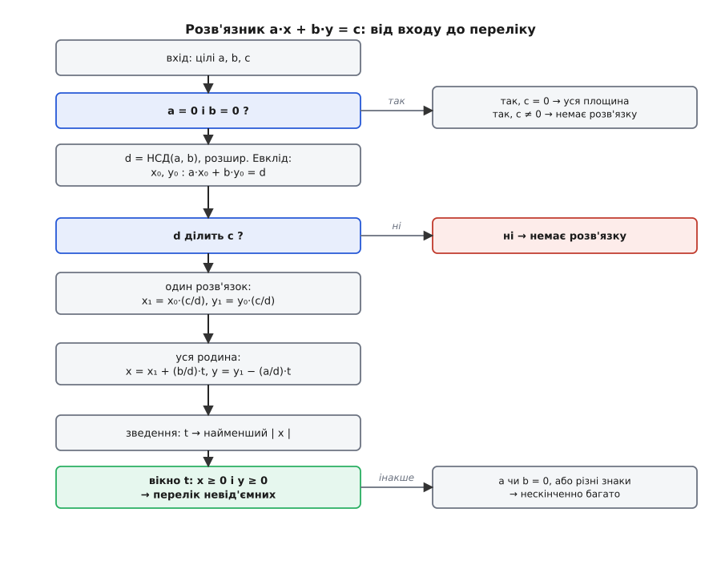

# ⚙️ Чисельний розв'язник діофантових рівнянь

Універсальний чисельний інструмент для розв'язання та аналізу діофантових рівнянь вимагає розробки алгоритмів, архітектурного проектування та програмної реалізації обчислювального рушія. Алгоритмічна база охоплює створення розв'язника лінійних діофантових рівнянь, знаходження невід'ємних розв'язків у вікнах параметрів, розпізнавання модульних перешкод для квадратичних форм і чисельну параметризацію раціональних точок.

---

### 1. Архітектура та математичні засади алгоритмів

Розробка обчислювального рушія для діофантових рівнянь вимагає поєднання точної арифметики над цілими числами та модульного аналізу. На відміну від стандартних обчислень із плаваючою крапкою, де припустимі похибки округлення, діофантів аналіз вимагає **абсолютної точності**: найменша похибка в один біт перетворює ціле число на дробове і повністю руйнує критерії подільності.

Програмний комплекс складається з трьох ключових модулів:

```
┌───────────────────────────────────────────────────────────────────────────┐
│                    Архітектура діофантового розв'язника                   │
├─────────────────────────────┬──────────────────────────────┬──────────────┤
│ 1. Лінійний модулятор       │ 2. Детектор перешкод         │ 3. Фільтр    │
│    (Розширений Евклід)      │    (Перебір за mod m)        │    (Вікна t) │
└─────────────────────────────┴──────────────────────────────┴──────────────┘
```

#### Модуль 1: Розширений алгоритм Евкліда та лінійна діагностика

Для рівняння `a·x + b·y = c` алгоритм обчислює найбільший спільний дільник `d = НСД(|a|, |b|)` та знаходить пару цілих коефіцієнтів Безу `(x₀, y₀)` таких, що:

```
|a|·x₀ + |b|·y₀ = d
```

Алгоритм виконується за рекурентною схемою ділення із остачею. На кожному кроці `k` обчислюється частка `q_k = a_k // b_k` та остача `r_k = a_k % b_k`. Коефіцієнти `x` та `y` перераховуються у зворотному напрямку:

```
x_k = y_{k+1}
y_k = x_{k+1} − q_k · y_{k+1}
```

Часова складність алгоритму Евкліда описується теоремою Ламе: кількість кроків не перевищує `5 · log₁₀(min(|a|, |b|))`, що робить його надзвичайно швидким навіть для 64-бітних цілих чисел.

Після обчислення `d` перевіряється критерій розв'язності: якщо `c % d ≠ 0`, то розв meння не існує. Якщо ж `c % d == 0`, то частинний розв'язок обчислюється домноженням коефіцієнтів Безу на масштабний множник `k_scale = c // d`:

```
x₁ = x₀ · (c // d)
y₁ = y₀ · (c // d)
```

#### Модуль 2: Обмеження параметрів та невід'ємні розв'язки

У багатьох практичних задачах (наприклад, у комбінаторній оптимізації чи задачі розміняння монет) від'ємні значення змінних позбавлені фізичного змісту. Шукаються лише розв'язки `x ≥ 0` та `y ≥ 0`.

Уся родина розв'язків задається формулами через цілий параметр `t`:

```
x(t) = x₁ + (b / d)·t
y(t) = y₁ − (a / d)·t
```

Вимога невід'ємності перетворюється на систему двох лінійних нерівностей щодо `t`:

```
x₁ + (b / d)·t ≥ 0   ⇒   (b / d)·t ≥ −x₁
y₁ − (a / d)·t ≥ 0   ⇒   (a / d)·t ≤  y₁
```

Аналіз цих нерівностей залежить від знаків коефіцієнтів `step_x = b / d` та `step_y = −a / d`:
- Якщо `step_x > 0`, то `t ≥ ⌈−x₁ / step_x⌉`.
- Якщо `step_x < 0`, то `t ≤ ⌊−x₁ / step_x⌋`.
- Якщо `step_y > 0`, то `t ≥ ⌈−y₁ / step_y⌉`.
- Якщо `step_y < 0`, то `t ≤ ⌊y₁ / step_y⌋`.

Перетин цих двох променів дає замкнений відрізок `[t_min, t_max]`. Кількість невід'ємних розв'язків дорівнює кількості цілих чисел у цьому відрізку: `N = max(0, ⌊t_max⌋ − ⌈t_min⌉ + 1)`.

#### Модуль 3: Детектор модульних перешкод для нелінійних рівнянь

Для квадратичних рівнянь вигляду `a·x² + b·y² = c` аналітичний розв meзок може бути складним або невідомим. Проте ми можемо алгоритмічно перевірити наявність модульної перешкоди.

Алгоритм будує множину квадратичних лишків за модулем `m`:

```
S_m = { (x²) mod m | x ∈ {0, 1, …, m − 1} }
```

Після цього генерується множина всіх можливих лінійних комбінацій цих лишків:

```
L_m = { (a·s₁ + b·s₂) mod m | s₁ ∈ S_m, s₂ ∈ S_m }
```

Якщо остача `(c mod m)` не належить до множини `L_m`, то модуль `m` є модульною перешкодою, і алгоритм гарантовано констатує відсутність цілих розв'язків.

---

### 2. Повна реалізація мовами Python та C++

Наведена нижче реалізація містить два незалежні та ідіоматичні блоки коду. Версія на C++ дотримується стандартів C++17/C++20, використовує RAII для управління ресурсами, типізовані контейнери `std::vector`, `std::optional` та `std::tuple`, уникаючи сирих вказівників і від'ємних повернень помилок.

:::tabs
:::code proj-diophantine-solver/py/main.py
:::code proj-diophantine-solver/cpp/main.cpp
:::

---

### 3. Детальний трасування виконання та аналіз крайових випадків

Щоб збагнути роботу розв'язника на глибинному рівні, простежимо покрокову зміну значень змінних під час виконання програми для двох протилежних тестових випадків.

#### Трасування Текстового Випадку 1: `5·x + 8·y = 43`


*Блок-схема алгоритму діофантового розв'язника: від перевірки НСД до побудови замкненого вікна невід'ємних розв'язків.*

1. **Вхідні дані:** `a = 5, b = 8, c = 43`.
2. **Розширений Евклід:**
   - `8 = 1 · 5 + 3`  (частка `q₁ = 1`, остача `r₁ = 3`).
   - `5 = 1 · 3 + 2`  (частка `q₂ = 1`, остача `r₂ = 2`).
   - `3 = 1 · 2 + 1`  (частка `q₃ = 1`, остача `r₃ = 1`).
   - `2 = 2 · 1 + 0`  (остача 0 → `d = НСД(5, 8) = 1`).
3. **Зворотний хід Безу:**
   - `1 = 3 − 1 · 2`.
   - `1 = 3 − 1 · (5 − 1 · 3) = 2 · 3 − 1 · 5`.
   - `1 = 2 · (8 − 1 · 5) − 1 · 5 = 2 · 8 − 3 · 5`.
   - Результат Безу: `5 · (−3) + 8 · 2 = 1`. Маємо `x₀ = −3, y₀ = 2`.
4. **Масштабування до c = 43:**
   - `scale = 43 // 1 = 43`.
   - `x₁ = −3 · 43 = −129`.
   - `y₁ = 2 · 43 = 86`.
   - Перевірка: `5 · (−129) + 8 · 86 = −645 + 688 = 43` (підтверджено).
5. **Обчислення кроків параметризації:**
   - `step_x = b / d = 8 / 1 = 8`.
   - `step_y = −a / d = −5 / 1 = −5`.
   - Формули родини: `x(t) = −129 + 8·t`, `y(t) = 86 − 5·t`.
6. **Обчислення невід'ємного вікна:**
   - Нерівність 1: `−129 + 8·t ≥ 0 ⇒ 8·t ≥ 129 ⇒ t ≥ ⌈129 / 8⌉ = ⌈16.125⌉ = 17`.
   - Нерівність 2: `86 − 5·t ≥ 0 ⇒ 5·t ≤ 86 ⇒ t ≤ ⌊86 / 5⌋ = ⌊17.2⌋ = 17`.
   - Перетин інтервалів: `17 ≤ t ≤ 17` → існує єдине ціле `t = 17`.
7. **Фінальний розв'язок:**
   - `x = −129 + 8 · 17 = −129 + 136 = 7`.
   - `y = 86 − 5 · 17 = 86 − 85 = 1`.
   - Результат: єдиний невід'ємний спосіб `(7, 1)`.

#### Трасування Крайового Випадку 2: `6·x + 9·y = 11`

1. **Вхідні дані:** `a = 6, b = 9, c = 11`.
2. **Обчислення НСД:** `d = НСД(6, 9) = 3`.
3. **Перевірка подільності:** `c % d = 11 % 3 = 2 ≠ 0`.
4. **Висновок:** Критерій розв'язності не виконується. Програма повертає порожній результат `None` / `nullopt` за один крок без виконання подальших циклів.

---

### 4. Аналіз складності та оптимізації для великих чисел

При роботі з 64-бітними цілими числами або криптографічними масштабами (2048 біт у RSA) виникають специфічні обчислювальні проблеми:

#### Захист від цілочисельного переповнення (Integer Overflow)

Під час обчислення частинного розв'язку `x₁ = x₀ · (c // d)` добуток двох 64-бітних чисел `x₀` та `c` може вийти за межі діапазону `[−2⁶³, 2⁶³ − 1]`.

Щоб запобігти переповненню у виробничому коді C++, застосовують два підходи:

1. **Зведення параметрів перед множенням:**
   Замість множення на повне значення `c`, частинний розв'язок одразу приводять за модулем `step_x = b / d`:
   ```cpp
   long long step_x = b / d;
   long long x1 = (x0 % step_x) * ((c / d) % step_x) % step_x;
   if (x1 < 0) x1 += std::abs(step_x);
   ```
2. **Використання 128-бітних типів:** На платформі GCC/Clang використовують встроенний тип `__int128_t` для проміжних множень.

#### Оптимізація детектора модульних перешкод

Наївна перевірка модулів у циклі `for m in range(2, max_mod)` має складність `O(max_mod · m²)`. Для прискорення застосовують три елегантні оптимізації:

- **Перевірка лише за простими модулями та степенями 2:** Якщо порівняння має розв'язок за модулем `p`, воно не обов'язково має розв'язок за складеним модулем `m = p · q`. Проте більшість перешкод виявляються на малих простих числах `p ∈ {2, 3, 5, 7, 11}` та степенях `2^k` (модулі 4 та 8).
- **Бітові маски (Bitsets):** Замість динамічних множин `std::unordered_set` використовують бітові маски `std::bitset<64>`, де `k`-тий біт дорівнює 1 тоді й лише тоді, коли остача `k` досяжна. Це прискорює аналіз у 20–50 разів за рахунок інструкцій SIMD на процесорі.

Поданий інструментарій дає повністю контрольований, математично строго верифікований рушій для розв'язування лінійних рівнянь та автоматичного відсіювання нерозв'язних квадратичних форм.
