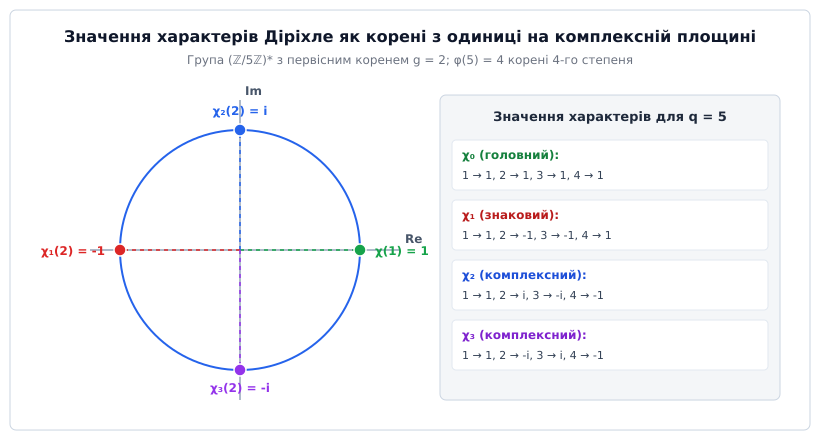
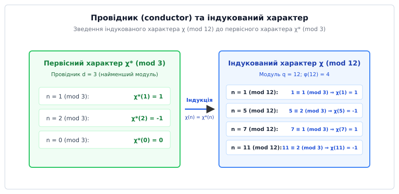
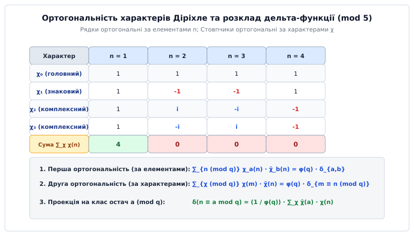

# Характери Діріхле та L-функції

<preknowlist>
- [Групові структури](root:math-algebra/group-theory) — абелеві групи, ізоморфізми та двоїста група.
- [Функція Ейлера](root:math-number-theory/euler-totient) — структура приведеної системи залишків за модулем.
- [Первісні корені](root:math-number-theory/primitive-root) — циклічні твірні елементи та дискретне логарифмування.
- [Модульна арифметика](root:math-number-theory/modular-arithmetic) — порівняння, остачі та взаємна простота.
</preknowlist>

> 🔧 **Навіщо це.**
> Характери Діріхле та асоційовані з ними L-функції є фундаментом сучасної аналітичної теорії чисел і гармонічного аналізу на скінченних групах. Вони перетворюють дискретні, важкодоступні питання про подільність цілих чисел та розподіл простих чисел у рівномірних арифметичних прогресіях `a + k·q` на дослідження аналітичних властивостей комплексних функцій. Без характерів Діріхле неможливо довести теорему про нескінченність простих чисел у прогресіях, обчислити число класів квадратичних полів, аналізувати стійкість криптографічних протоколів на основі дискретного логарифма або будувати алгоритми перевірки чисел на простоту (такі як тест Соловея–Штрассена на основі символу Якобі).

## 1. Проблема виділення залишків та мультиплікативна криза

Класичне доведення Евкліда опирається на побудову числа `N = p₁ · p₂ · ... · pₖ + 1` з добутку вже відомих простих чисел. Воно строго гарантує, що існує нескінченно багато простих чисел у повній множині натуральних чисел `ℕ`. Однак, як тільки ми звужуємо область пошуку і ставимо фундаментальне питання теорії чисел: *"Чи існує нескінченно багато простих чисел, які при діленні на заданий модуль `q` дають конкретний остаток `a`?"*, елементарна комбінаторна схема Евкліда швидко вичерпує свої можливості.

Для найпростішої арифметичної прогресії `4k + 3` (де модуль `q = 4`, а остаток `a = 3`) елементарний підхід ще дає результат. Якщо припустити, що існує лише скінченна кількість простих чисел вигляду `4k + 3` — позначимо їх `p₁, p₂, ..., pₖ` — і розглянути число:

```
N = 4 · p₁ · p₂ · ... · pₖ - 1
```

то можна помітити дві ключові властивості числа `N`. З одного боку, воно має вигляд `4M - 1 ≡ 3 (mod 4)`. З іншого боку, жодне з уже знайдених простих чисел `p₁, ..., pₖ` не ділить `N`, оскільки остаток від ділення дорівнює `-1`. Оскільки всі дільники числа `N` є непарними, вони можуть мати лише вигляд `4k + 1` або `4k + 3`. Проте добуток довільної кількості чисел вигляду `4k + 1` завжди дає число вигляду `4k + 1`:

```
(4x + 1)(4y + 1) = 16xy + 4x + 4y + 1 = 4(4xy + x + y) + 1 ≡ 1 (mod 4)
```

Отже, аби число `N` мало остаток `3 (mod 4)`, принаймні один його простий дільник повинен мати вигляд `4k + 3`. Цей дільник є новим і не входить до нашого початкового списку `p₁, ..., pₖ`, що одразу дає логічну суперечність.

Подібний евклідів підхід вдається побудувати для окремих спеціальних прогресій:
- Для прогресії `3k + 2`: розглядають число `N = 3 · p₁ · ... · pₖ - 1 ≡ 2 (mod 3)`. Оскільки добуток чисел вигляду `3k + 1` завжди має вигляд `3k + 1`, принаймні один простий дільник зобов'язаний мати вигляд `3k + 2`.
- Для прогресії `6k + 5`: аналогічно використовують число `N = 6 · p₁ · ... · pₖ - 1 ≡ 5 (mod 6)`.
- Для прогресії `8k + 7`: використовують число `N = 8 · p₁ · ... · pₖ - 1 ≡ 7 (mod 8)`.

Проте спроба застосувати цей самий прийом до дзеркального класу залишків `4k + 1` моментально зазнає краху. Якщо побудувати аналогічне число `N = 4 · p₁ · ... · pₖ + 1`, то його остаток дорівнює `1 (mod 4)`. Але добуток двох чисел вигляду `4k + 3` також дає залишок `1 (mod 4)`:

```
(4a + 3)(4b + 3) = 16ab + 12a + 12b + 9 = 4(4ab + 3a + 3b + 2) + 1 ≡ 1 (mod 4)
```

Це означає, що число `N ≡ 1 (mod 4)` цілком може розкладатися на два прості дільники вигляду `4k + 3` (наприклад, `9 = 3 · 3` або `21 = 3 · 7`), і ми не отримуємо жодного нового простого числа вигляду `4k + 1`.

Для класу `4k + 1` існує складніший алгебраїчний трюк: розглянути число `N = (2 · p₁ · ... · pₖ)² + 1`. Якщо непарне просте `p` ділить `N`, то `(2 · p₁ · ... · pₖ)² ≡ -1 (mod p)`. За критерієм Ейлера `-1` є квадратичним лишком за модулем `p` тоді і тільки тоді, коли `p ≡ 1 (mod 4)`. Це доводить нескінченність простих вигляду `4k + 1`.

Аналогічно, за допомогою кругових поліномів (поліномів поділу кола `Φ_q(x)`) можна алгебраїчно довести нескінченність простих чисел вигляду `p ≡ 1 (mod q)` для будь-якого фіксованого модуля `q`. Проте для довільної проміжної остачі `a (mod q)` (наприклад, `8k + 3`, `8k + 5` або `12k + 7`) суто поліноміальні конструкції виявляються безпорадними. Елементарна алгебра не дозволяє розділити складні мультиплікативні комбінації простих дільників.

### Аналітичний підхід Ейлера та його обмеження

У 1737 році Леонард Ейлер здійснив революційний крок, пов'язавши розподіл простих чисел із нескінченними рядами через тотожність:

```
ζ(s) = ∑_{n=1}^∞ 1 / nˢ = ∏_{p ∈ P} (1 - 1 / pˢ)⁻¹
```

де параметр `s` спочатку розглядався як дійсне число `s > 1`, а добуток береться за всіма простими числами множини `P`.

При спрямуванні дійсного параметра `s → 1⁺` ліва частина тотожності перетворюється на розбіжний гармонічний ряд `ζ(1) = ∑ (1/n) = ∞`. Логарифмуючи обидві частини Ейлерового добутку та розкладаючи логарифм `ln(1 - x)⁻¹ = x + x²/2 + x³/3 + ...`, Ейлер отримав:

```
ln ζ(s) = ∑_{p ∈ P} ln(1 - 1/pˢ)⁻¹
        = ∑_{p ∈ P} 1/pˢ + ∑_{p ∈ P} ∑_{k=2}^∞ 1 / (k · pᵏˢ)
```

Друга подвійна сума (при `k ≥ 2`) мажорується збіжним числовим рядом:

```
∑_{p ∈ P} ∑_{k=2}^∞ 1 / (k · pᵏˢ) ≤ (1/2) · ∑_{p ∈ P} ∑_{k=2}^∞ (1 / pᵏ)
                                   = (1/2) · ∑_{p ∈ P} 1 / (p · (p - 1))
                                   < (1/2) · ∑_{n=2}^∞ 1 / (n · (n - 1)) = 1/2 < ∞
```

Цей залишок залишається обмеженим абсолютною константою `O(1)`. Отже, коли `s → 1⁺`, вираз `ln ζ(s) → +∞`, що прямо спричиняє розбіжність суми обернених величин усіх простих чисел:

```
∑_{p ∈ P} 1 / p = ∞
```

Це був перший аналітичний доказ нескінченності множини всіх простих чисел: вони накопичуються достатньо густо, щоб утворити розбіжний ряд. Однак перед математиками постало фундаментальне питання: як із цієї загальної суми `∑ 1/p` виділити лише ті прості числа `p`, які задовольняють модульне порівняння `p ≡ a (mod q)`?

Пряма спроба підставити характеристичну функцію (індикатор належності до класу залишків) `δ(n ≡ a mod q)` у ряд:

```
F(s) = ∑_{n=1}^∞ δ(n ≡ a mod q) / nˢ
```

повністю руйнує аналітичний апарат Ейлера. Причина полягає в тому, що дельта-функція **не є мультиплікативною**:

```
δ(n · m ≡ a mod q) ≠ δ(n ≡ a mod q) · δ(m ≡ a mod q)
```

Наприклад, для `q = 4` та `a = 1`: маємо `δ(3 ≡ 1 mod 4) = 0`, проте для добутку `3 · 3 = 9 ≡ 1 (mod 4)` маємо `δ(9 ≡ 1 mod 4) = 1`. Добуток індикаторів дав би `0 · 0 = 0 ≠ 1`. Оскільки індикатор руйнує мультиплікативність коефіцієнтів, ряд `F(s)` **неможливо розкласти у нескінченний добуток за простими числами**. Без Ейлерового добутку втрачається місток між сумою значень ряду та розподілом простих дільників.

Щоб розв'язати цю проблему, необхідно розкласти дельта-функцію `δ(n ≡ a mod q)` за базисом таких функцій, які одночасно задовольняють дві фундаментальні вимоги:
1. Вони є **періодичними** з періодом `q`, що узгоджується зі структурою класів залишків `ℤ/qℤ`.
2. Вони є **повністю мультиплікативними**, тобто `χ(m · n) = χ(m) · χ(n)` для всіх `m, n ∈ ℤ`, що зберігає Ейлерів добуток для кожного елемента базису.

Детальніше ознайомитися з [історією створення характерів та розв'язанням проблеми Діріхле](root:math-number-theory/dirichlet-characters-l-functions/hist-dirichlet-characters.md) можна у відповідній історичній вставці.

## 2. Означення, аксіоми та спектральні властивості характерів Діріхле

Нехай `q ≥ 1` — натуральне число, яке називається модулем. Множина класів залишків, взаємно простих із `q`, утворює приведену систему залишків і позначається як `(ℤ/qℤ)*`. Ця множина є скінченною абелевою групою щодо операції множення за модулем `q`. Порядок цієї групи дорівнює значенню функції Ейлера `φ(q)`.

**Означення.** Числовим характером Діріхле за модулем `q` називається функція `χ: ℤ → ℂ`, яка задовольняє такі чотири аксіоми:

1. **Періодичність за модулем `q`:** `χ(n + q) = χ(n)` для всіх `n ∈ ℤ`.
2. **Повна мультиплікативність:** `χ(m · n) = χ(m) · χ(n)` для всіх `m, n ∈ ℤ`.
3. **Умова носія (підтримки):** `χ(n) ≠ 0` тоді і тільки тоді, коли `gcd(n, q) = 1`. Якщо `gcd(n, q) > 1`, то `χ(n) = 0`.
4. **Нормування одиниці:** `χ(1) = 1`.

З алгебраїчної точки зору характер Діріхле — це гомоморфізм зі скінченної абелевої групи `(ℤ/qℤ)*` у мультиплікативну групу ненульових комплексних чисел `ℂ*`, продовжений нулем на всі цілі числа, не взаємно прості з `q`.

### Комплексні корені з одиниці та унітарність

За теоремою Ферма–Ейлера для будь-якого `n`, взаємно простого з `q`, виконується порівняння `n^φ(q) ≡ 1 (mod q)`. Завдяки повній мультиплікативності характеру отримуємо:

```
(χ(n))^φ(q) = χ(n^φ(q)) = χ(1) = 1                    [піднесення значення характеру до степеня φ(q)]
```

Це означає, що для будь-якого `n` з `gcd(n, q) = 1` значення `χ(n)` є **комплексним коренем степеня `φ(q)` з одиниці**:

```
χ(n) = exp(2 π i · k / φ(q)) = cos(2 π k / φ(q)) + i · sin(2 π k / φ(q))
```

де `k ∈ {0, 1, ..., φ(q) - 1}`. Усі значення характерів належать до кругового числового поля `ℚ(ζ_{φ(q)})`, де `ζ_{φ(q)} = exp(2 π i / φ(q))` є первісним коренем з одиниці. Порядок кожного значення `χ(n)` у мультиплікативній групі ділить порядок елемента `n` у групі `(ℤ/qℤ)*`.

Звідси безпосередньо випливають дві важливі спектральні властивості:

* **Модуль значень дорівнює одиниці (унітарність):**
  ```
  |χ(n)| = 1,   якщо gcd(n, q) = 1
  |χ(n)| = 0,   якщо gcd(n, q) > 1
  ```
* **Комплексне спряження є алгебраїчним оберненням:** Оскільки `|χ(n)| = 1`, комплексне спряження числа на одиничному колі збігається з його мультиплікативним оберненим:
  ```
  χ̄(n) = (χ(n))⁻¹ = χ(n⁻¹ mod q)
  ```
  де `n⁻¹` — залишок, обернений до `n` за модулем `q` (`n · n⁻¹ ≡ 1 (mod q)`).


*Значення характеру на твірному елементі є комплексним коренем з одиниці на одиничному колі.*

## 3. Повна класифікація характерів: головний, дійсні, парність та провідник

Множина всіх характерів за даним модулем `q` містить рівно `φ(q)` різних функцій. Для їхньої структурної класифікації використовують чотири алгебраїчні ознаки.

### 1. Головний (тривіальний) характер `χ₀`

Завжди існує характер, який набуває значення `1` на всіх елементах, взаємно простих із `q`:

```
χ₀(n) = 1,   якщо gcd(n, q) = 1
χ₀(n) = 0,   якщо gcd(n, q) > 1
```

Головний характер `χ₀` відіграє роль нейтрального елемента в групі характерів щодо операції поточкового множення `(χ₁ · χ₂)(n) = χ₁(n) · χ₂(n)`. При `q = 1` цей характер перетворюється на тотожну одиницю `χ(n) = 1` для всіх натуральних чисел `n ∈ ℕ`.

### 2. Дійсні (квадратичні) та комплексні характери

* **Дійсний характер (знаковий, квадратичний):** набуває виключно дійсних значень із множини `{-1, 0, 1}`. Для такого характеру `χ̄ = χ`, а отже `χ² = χ₀` (його порядок у групі характерів дорівнює 1 або 2).
  Прикладами дійсних характерів є символ Лежандра `(n/p)`, символ Якобі `(n/k)` та символ Кронекера. Наприклад, для простого непарного модуля `p` символ Лежандра `χ(n) = (n/p)` визначає, чи є залишок `n` квадратичним лишком за модулем `p`. Він є повністю мультиплікативним і задовольняє критерій Ейлера:

  ```
  (n/p) ≡ n^{(p-1)/2} (mod p)
  ```

  Закон квадратичної взаємності Ґаусса гарантує, що символ Лежандра `(n/p)` та символ Якобі є строго періодичними функціями від `n` з періодом, кратним `p` або `4p`.

* **Комплексний характер:** набуває принаймні одного значення з ненульовою уявною частиною (`Im(χ(n)) ≠ 0`). Комплексні характери завжди існують спряженими парами: якщо `χ` є комплексним характером, то спряжений характер `χ̄ ≠ χ` також є окремим характером за модулем `q`.

### 3. Парність характеру

Оскільки `(-1)² = 1 ≡ 1 (mod q)`, то в силу мультиплікативності маємо:

```
(χ(-1))² = χ((-1)²) = χ(1) = 1
```

Єдиними дійсними коренями з одиниці є `+1` та `-1`, тому значення `χ(-1)` завжди дорівнює або `+1`, або `-1`:

* **Парний характер:** `χ(-1) = +1`. Парні характери мають властивість парної симетрії `χ(-n) = χ(-1) · χ(n) = χ(n)`.
* **Непарний характер:** `χ(-1) = -1`. Непарні характери задовольняють умову антисиметрії `χ(-n) = χ(-1) · χ(n) = -χ(n)`.

Парність характеру визначає форму функціонального рівняння L-функцій, вибір аналітичного гамма-множника та структуру відповідних сум Ґаусса.

### 4. Первісні характери та провідник (Conductor)

Нехай `d` — натуральний дільник модуля `q` (`d | q`). Будь-який характер `χ* (mod d)` за меншим модулем `d` природним чином породжує (індукує) характер `χ (mod q)` за правилом:

```
χ(n) = χ*(n),   якщо gcd(n, q) = 1
χ(n) = 0,       якщо gcd(n, q) > 1
```

Якщо характер `χ (mod q)` можна отримати таким чином із деякого характеру `χ* (mod d)` за меншим модулем `d < q`, то такий характер `χ` називається **індукованим (непервісним)**.

**Означення.** Найменший дільник `d` модуля `q`, за яким існує характер `χ* (mod d)`, що індукує `χ`, називається **провідником** (або **кондуктором**, англ. *conductor*) характеру `χ` і позначається як `cond(χ) = d`.

* Якщо `cond(χ) = q`, то характер `χ` називається **первісним** (англ. *primitive character*). Первісний характер є «чистим» носієм арифметичної інформації модуля `q` і не зводиться до жодного меншого періоду.
* Якщо `cond(χ) = d < q`, то характер є індукованим. Його L-ряд відрізняється від L-ряду відповідного первісного характеру `χ*` лише скінченною кількістю простих множників у Ейлеровому добутку (тими простими `p`, які ділять `q`, але не ділять `d`):

```
L(s, χ) = L(s, χ*) · ∏_{p | q, p ∤ d} (1 - χ*(p) / pˢ)
```

Наприклад, нехай `q = 12 = 2² · 3`. Розглянемо дійсний характер `χ (mod 12)`, значення якого на елементах `{1, 5, 7, 11}` дорівнюють `χ(1) = 1`, `χ(5) = -1`, `χ(7) = 1`, `χ(11) = -1`.
Помітимо, що за модулем `d = 3` залишки `1, 7 ≡ 1 (mod 3)` дають значення `1`, а залишки `5, 11 ≡ 2 (mod 3)` дають значення `-1`. Цей характер індукується первісним характером Лежандра `χ* (mod 3) = (n/3)`.
Провідником характеру є `cond(χ) = 3`. Єдиним простим дільником `q = 12`, що не ділить `d = 3`, є `p = 2`. Оскільки `χ*(2) = (2/3) = -1`, зв'язок їхніх L-функцій набуває вигляду:

```
L(s, χ) = L(s, χ*) · (1 - χ*(2) / 2ˢ) = L(s, χ*) · (1 + 1 / 2ˢ)
```


*Характер за модулем 12 індукується первісним характером за найменшим модулем-провідником 3.*

### Алгоритм обчислення провідника характеру

Для довільного характеру `χ (mod q)` провідник `cond(χ)` обчислюється алгоритмічно шляхом перевірки його періодичності на підгрупах. Характер `χ (mod q)` індукується з модуля `d | q` тоді і тільки тоді, коли для всіх `n ∈ ℤ` з `gcd(n, q) = 1` виконується умова:

```
n ≡ 1 (mod d)  ⟹  χ(n) = 1
```

Перевіряючи всі дільники `d` числа `q` у порядку зростання, найменший дільник `d`, для якого виконується ця умова, є провідником `cond(χ) = d`. Первісні характери мають максимальний провідник `cond(χ) = q`.

## 4. Двоїста група та спектральний розклад дельта-функції

Множина всіх `φ(q)` характерів за модулем `q` позначається як `Ĝ` або `((ℤ/qℤ)*)^̂`. Якщо визначити на `Ĝ` операцію поточкового множення `(χ₁ · χ₂)(n) = χ₁(n) · χ₂(n)`, то `Ĝ` утворює скінченну абелеву групу, яка називається **двоїстою групою** (або групою характерів Понтрягіна на скінченній групі).

Нейтральним елементом групи `Ĝ` є головний характер `χ₀`, а оберненим елементом до характеру `χ` є комплексно спряжений характер `χ̄`.

За основною теоремою теорії скінченних абелевих груп група характерів `Ĝ` є абстрактно ізоморфною самій вихідній групі залишків `G = (ℤ/qℤ)*`:

```
Ĝ ≅ (ℤ/qℤ)*
```

Зокрема, це гарантує, що кількість різних характерів точно дорівнює кількості класів залишків у приведеній системі: `|Ĝ| = |G| = φ(q)`.

### Співвідношення ортогональності

Фундаментальна роль характерів Діріхле в математичному аналізі ґрунтується на двох дуальних співвідношеннях ортогональності, які перетворюють таблицю характерів на унітарний дискретний базис Фур'є.

**Перше співвідношення ортогональності (ортогональність за елементами групи):**
Для будь-яких двох характерів `χ_a` та `χ_b` за модулем `q` скалярний добуток їхніх значень за всіма елементами приведеної системи залишків дорівнює:

```
∑_{n (mod q), gcd(n,q)=1} χ_a(n) · χ̄_b(n) = φ(q) · δ_{a,b}
```

де `δ_{a,b} = 1`, якщо `χ_a = χ_b`, і `δ_{a,b} = 0`, якщо `χ_a ≠ χ_b`.

Зокрема, якщо `χ_b = χ₀` є головним характером, то для будь-якого неголовного характеру `χ ≠ χ₀` сума значень за повним періодом строго дорівнює нулю:

```
∑_{n=1}^q χ(n) = 0,   для χ ≠ χ₀
```

**Друге співвідношення ортогональності (ортогональність за характерами двоїстої групи):**
Для двох довільних цілих чисел `m` та `n`, взаємно простих із `q`, сума добутків значень усіх характерів дорівнює:

```
∑_{χ ∈ Ĝ} χ(m) · χ̄(n) = φ(q) · δ_{m ≡ n (mod q)}
```

де `δ_{m ≡ n (mod q)} = 1`, якщо `m ≡ n (mod q)`, і `0`, якщо `m ≢ n (mod q)`.

### Спектральний розклад дельта-функції (Фур'є-проектор)

Підставляючи `m = n` та `n = a` у друге співвідношення ортогональності та ділячи обидві частини рівності на порядок групи `φ(q)`, одержуємо формулу відновлення індикаторної дельта-функції:

```
δ(n ≡ a mod q) = (1 / φ(q)) · ∑_{χ ∈ Ĝ} χ̄(a) · χ(n)
```

Ця тотожність є серцем усього методу Діріхле. Вона виражає не-мультиплікативний фільтр класу залишків `δ(n ≡ a mod q)` як скінченну лінійну комбінацію **повністю мультиплікативних функцій** `χ(n)`. Ваговий коефіцієнт кожного характеру у спектральному розкладі дорівнює `χ̄(a) / φ(q)`.

Більш загально, будь-яка комплексна функція `f: (ℤ/qℤ)* → ℂ` на приведеній системі залишків однозначно розкладається у дискретний спектральний ряд Фур'є за характерами:

```
f(n) = ∑_{χ ∈ Ĝ} f̂(χ) · χ(n),   де f̂(χ) = (1 / φ(q)) · ∑_{m ∈ G} f(m) · χ̄(m)
```

Цей гармонічний аналіз на скінченній абелевій групі лежить в основі швидких алгоритмів теорії чисел та цифрової обробки сигналів.


*Матриця характерів: ортогональність за рядками та стовпчиками дозволяє спроектувати довільну функцію на фіксований клас залишків.*

З повним [виведенням співвідношень ортогональності характерів та ізоморфізму двоїстої групи](root:math-number-theory/dirichlet-characters-l-functions/math-orthogonality-relations.md) можна ознайомитися у математичній вставці.

## 5. Побудова характерів за циклічними компонентами

Для практичного та аналітичного обчислення значень характерів `χ(n)` використовують канонічну структуру групи `(ℤ/qℤ)*`.

### Випадок 1. Модуль має первісний корінь

Якщо модуль `q` допускає існування первісного кореня `g` (це має місце для `q = 2, 4, pᵏ, 2pᵏ`, де `p` — непарне просте), група `(ℤ/qℤ)*` є циклічною порядку `φ(q)`. Будь-яке взаємно просте число `n` однозначно визначається своїм дискретним логарифмом (індексом) `ind_g(n)`:

```
n ≡ g^{ind_g(n)} (mod q),   де ind_g(n) ∈ {0, 1, ..., φ(q) - 1}
```

Усі `φ(q)` різних характерів індексуються цілим числом `k ∈ {0, 1, ..., φ(q) - 1}` і обчислюються явно:

```
χₖ(n) = exp(2 π i · k · ind_g(n) / φ(q))
```

Множення двох характерів відповідає додаванню їхніх індексів за модулем `φ(q)`: `χ_a · χ_b = χ_{(a + b mod φ(q))}`.

### Випадок 2. Загальний складений модуль

Якщо модуль `q` не має єдиного первісного кореня (наприклад, `q = 2ᵏ` при `k ≥ 3` або складне число з кількома різними непарними дільниками), група `(ℤ/qℤ)*` розкладається за Китайською теоремою про залишки та теоремою Гауса у прямий добуток циклічних підгруп:

```
(ℤ/qℤ)* ≅ (ℤ/p₁ᵉ¹ℤ)* × (ℤ/p₂ᵉ²ℤ)* × ... × (ℤ/pᵣᵉʳℤ)*
```

Зокрема, для степенів двійки `q = 2ᵏ` при `k ≥ 3` група залишків розкладається як `(ℤ/2ᵏℤ)* ≅ C₂ × C_{2^{k-2}}`, де циклічна компонента `C₂` породжується залишком `-1` (порядку 2), а компонента `C_{2^{k-2}}` породжується залишком `5` (порядку `2^{k-2}`). Усі характери за модулем `2ᵏ` індексуються парою чисел `(a, b)`, де `a ∈ {0, 1}` та `b ∈ {0, ..., 2^{k-2}-1}`:

```
χ_{(a, b)}((-1)ᵘ · 5ᵛ) = (-1)^{a · u} · exp(2 π i · b · v / 2^{k-2})
```

Для кожної циклічної компоненти будується свій одновимірний характер `χ⁽ⁱ⁾`. Повний характер за модулем `q` є прямим добутком складових:

```
χ(n) = χ⁽¹⁾(n mod p₁ᵉ¹) · χ⁽²⁾(n mod p₂ᵉ²) · ... · χ⁽ʳ⁾(n mod pᵣᵉʳ)
```

З [практичною реалізацією побудови таблиці характерів та обчислення провідника](root:math-number-theory/dirichlet-characters-l-functions/proj-dirichlet-character-table.md) мовами C, C++ та Python можна ознайомитися у відповідній вставці.

## 6. Суми Ґаусса для характерів Діріхле та їхня унітарна геометрія

Для характеру Діріхле `χ (mod q)` ключовим об'єктом, що поєднує мультиплікативну симетрію характеру з адитивною структурою залишків, є **сума Ґаусса** `τ(χ)` (також позначається як `G(χ)`).

**Означення.** Сумою Ґаусса, асоційованою з характером `χ (mod q)`, називається комплексне число:

```
τ(χ) = ∑_{a=1}^q χ(a) · exp(2 π i · a / q)
```

Більш загально, для довільного цілого числа `n` розглядають зсунуту суму Ґаусса:

```
τ(n, χ) = ∑_{a=1}^q χ(a) · exp(2 π i · a · n / q)
```

### Мультиплікативна факторизація суми Ґаусса

Якщо `gcd(n, q) = 1`, то відображення `a ↦ a · n⁻¹ (mod q)` здійснює автоморфізм приведеної системи залишків. Підставляючи `a = m · n⁻¹ (mod q)`, маємо:

```
τ(n, χ) = ∑_{m=1}^q χ(m · n⁻¹) · exp(2 π i · m / q)          [заміна індексу підсумовування a ↦ m · n⁻¹ mod q]
        = χ(n⁻¹) · ∑_{m=1}^q χ(m) · exp(2 π i · m / q)       [винесення множника за повною мультиплікативністю χ]
        = χ̄(n) · τ(χ)                                         [оскільки χ(n⁻¹) = χ̄(n) та за означенням суми Ґаусса]
```

Якщо характер `χ` є **первісним**, ця чудова тотожність `τ(n, χ) = χ̄(n) · τ(χ)` зберігається **для всіх цілих `n ∈ ℤ`**, оскільки при `gcd(n, q) > 1` обидві частини рівності обертаються на нуль. Це дає змогу виразити значення характеру через дискретне перетворення Фур'є експоненти:

```
χ(n) = (1 / τ(χ̄)) · ∑_{a=1}^q χ̄(a) · exp(2 π i · a · n / q)
```

### Строге виведення модуля суми Ґаусса `|τ(χ)| = √q`

Для первісного характеру `χ (mod q)` модуль суми Ґаусса має точне геометричне значення `√q`. Виведемо цей результат, розглядаючи суму квадратів модулів `|τ(n, χ)|²` за всіма залишками `n = 1, 2, ..., q`.

З одного боку, використовуючи властивість `τ(n, χ) = χ̄(n) · τ(χ)`, маємо:

```
∑_{n=1}^q |τ(n, χ)|² = ∑_{n=1}^q |χ̄(n) · τ(χ)|²              [підстановка властивості τ(n, χ) = χ̄(n) · τ(χ)]
                     = |τ(χ)|² · ∑_{n=1}^q |χ̄(n)|²            [винесення спільного множника |τ(χ)|²]
                     = |τ(χ)|² · φ(q)                         [оскільки |χ̄(n)|² = 1 для gcd(n,q)=1 і 0 для інших]
```

З іншого боку, розпишемо `|τ(n, χ)|² = τ(n, χ) · τ̄(n, χ)` за означенням подвійної суми:

```
|τ(n, χ)|² = ( ∑_{a=1}^q χ(a) · exp(2 π i a n / q) ) · ( ∑_{b=1}^q χ̄(b) · exp(-2 π i b n / q) )  [добуток суми на комплексно спряжену]
           = ∑_{a=1}^q ∑_{b=1}^q χ(a) · χ̄(b) · exp(2 π i (a - b) n / q)                           [розкриття подвійного добутку сум]
```

Підсумуємо цей вираз за всіма `n = 1, 2, ..., q` та змінимо порядок сумування:

```
∑_{n=1}^q |τ(n, χ)|² = ∑_{a=1}^q ∑_{b=1}^q χ(a) · χ̄(b) · ( ∑_{n=1}^q exp(2 π i (a - b) n / q) )
```

Внутрішня сума експонент за повним періодом `q` задовольняє базове співвідношення ортогональності адитивних коренів: вона дорівнює `q`, якщо `a ≡ b (mod q)`, і `0`, якщо `a ≢ b (mod q)`.
Тому у подвійній сумі ненульовими залишаються лише доданки з `a = b`:

```
∑_{n=1}^q |τ(n, χ)|² = ∑_{a=1}^q χ(a) · χ̄(a) · q              [ортогональність експонент: ненульові доданки лише при a = b]
                     = q · ∑_{a=1}^q |χ(a)|²                  [оскільки χ(a) · χ̄(a) = |χ(a)|²]
                     = q · φ(q)                                [підсумовування |χ(a)|² = 1 за φ(q) взаємно простими залишками]
```

Прирівнюючи обидва знайдені вирази:

```
|τ(χ)|² · φ(q) = q · φ(q)
```

Скорочуючи на `φ(q) ≠ 0`, дістаємо точний результат:

```
|τ(χ)|² = q  ⟹  |τ(χ)| = √q
```

### Комплексне спряження та зв'язок із парністю

Для суми Ґаусса первісного характеру спряження дає:

```
τ̄(χ) = ∑_{a=1}^q χ̄(a) · exp(-2 π i a / q)                   [комплексне спряження суми Ґаусса]
     = ∑_{a=1}^q χ̄(-a) · exp(2 π i a / q)                    [заміна індексу підсумовування a ↦ -a mod q]
     = χ̄(-1) · ∑_{a=1}^q χ̄(a) · exp(2 π i a / q)            [винесення множника χ̄(-1) за мультиплікативністю]
     = χ(-1) · τ(χ̄)                                          [оскільки χ̄(-1) = χ(-1) ∈ {+1, -1} та означення τ(χ̄)]
```

Помноживши обидві частини на `τ(χ)` та враховуючи, що `τ(χ) · τ̄(χ) = |τ(χ)|² = q`, отримуємо унітарне співвідношення:

```
τ(χ) · τ(χ̄) = χ(-1) · q
```

Ця формула визначає унітарний кутовий множник у функціональному рівнянні L-функцій Діріхле.

Для взаємно простих модулів `q₁` та `q₂` сума Ґаусса розкладається у добуток: якщо `χ₁ (mod q₁)` та `χ₂ (mod q₂)` — первісні характери, а `χ = χ₁ · χ₂ (mod q₁ q₂)`, то:

```
τ(χ) = χ₁(q₂) · χ₂(q₁) · τ(χ₁) · τ(χ₂)
```

Ця мультиплікативна факторизація зводить обчислення будь-якої суми Ґаусса до степенів простих чисел.

## 7. L-функції Діріхле: Ейлерів добуток та аналітичне продовження

Для аналітичного дослідження розподілу простих чисел Діріхле побудував комплексні ряди, коефіцієнтами яких є значення характерів.

**Означення.** L-функцією (або L-рядом) Діріхле, асоційованим із характером `χ (mod q)`, називається функція комплексної змінної `s = σ + i·t`, визначена рядом Діріхле:

```
L(s, χ) = ∑_{n=1}^∞ χ(n) / nˢ
```

Оскільки `|χ(n)| ≤ 1`, ряд мажорується рядом `∑ 1 / n^σ` і є **абсолютно та рівномірно збіжним у будь-якій півплощині `Re(s) = σ ≥ 1 + ε > 1`**. Отже, у півплощині `Re(s) > 1` функція `L(s, χ)` є голоморфною.

### Виведення Ейлерового добутку

Завдяки повній мультиплікативності характеру `χ(m · n) = χ(m) · χ(n)` для всіх `m, n ∈ ℕ` L-ряд розкладається у нескінченний добуток за всіма простими числами.

Розглянемо добуток геометричних прогресій за всіма простими числами `p ≤ X`:

```
∏_{p ≤ X} (1 - χ(p) / pˢ)⁻¹ = ∏_{p ≤ X} ( 1 + χ(p)/pˢ + χ(p²)/p²ˢ + χ(p³)/p³ˢ + ... )
```

Розкриваючи дужки та використовуючи фундаментальну теорему арифметики (кожне натуральне число `n` єдиним чином розкладається у добуток простих множників), одержуємо:

```
∏_{p ≤ X} (1 - χ(p) / pˢ)⁻¹ = ∑_{n ∈ S(X)} χ(n) / nˢ
```

де `S(X)` — множина всіх натуральних чисел, усі прості дільники яких не перевищують `X`.
Ця множина містить усі натуральні числа від `1` до `X`. Віднімемо скінченний добуток від повного ряду `L(s, χ)`:

```
| L(s, χ) - ∏_{p ≤ X} (1 - χ(p) / pˢ)⁻¹ | = | ∑_{n ∉ S(X)} χ(n) / nˢ |
                                           ≤ ∑_{n > X} |χ(n)| / n^σ
                                           ≤ ∑_{n > X} 1 / n^σ
```

При `σ = Re(s) > 1` хвіст збіжного ряду `∑_{n > X} 1 / n^σ` прямує до `0` при `X → ∞`. Переходячи до границі `X → ∞`, одержуємо тотожність Ейлерового добутку:

```
L(s, χ) = ∏_{p ∈ P} (1 - χ(p) / pˢ)⁻¹    [для Re(s) > 1]
```

### Аналітичні властивості головного характеру `χ₀`

Для головного характеру `χ₀ (mod q)` значення `χ₀(p) = 1` для всіх `p ∤ q` і `χ₀(p) = 0` для `p | q`. Тому його Ейлерів добуток відрізняється від дзета-функції Рімана `ζ(s)` лише дільниками модуля:

```
L(s, χ₀) = ∏_{p ∤ q} (1 - 1 / pˢ)⁻¹ = ζ(s) · ∏_{p | q} (1 - 1 / pˢ)
```

Оскільки дзета-функція Рімана `ζ(s)` має єдиний простий полюс першого порядку в точці `s = 1` з лишком `Res_{s=1} ζ(s) = 1`, функція `L(s, χ₀)` також має **простий полюс у точці `s = 1`** з лишком:

```
Res_{s=1} L(s, χ₀) = ∏_{p | q} (1 - 1/p) = φ(q) / q
```

Зокрема, при спрямуванні дійсного параметра `s → 1⁺`:

```
L(s, χ₀) ~ (φ(q) / q) · (1 / (s - 1))  ⟹  ln L(s, χ₀) = ln(1 / (s - 1)) + O(1) → +∞
```

### Аналітичне продовження неголовних характерів `χ ≠ χ₀` на півплощину `Re(s) > 0`

Для будь-якого неголовного характеру `χ ≠ χ₀` сума за повним періодом дорівнює нулю: `∑_{n=1}^q χ(n) = 0`.
Розглянемо функцію часткових сум:

```
S(x) = ∑_{1 ≤ n ≤ x} χ(n)
```

Завдяки періодичності будь-який відрізок довжини `q` дає нульову суму. Отже, функція `S(x)` є **рівномірно обмеженою** для всіх `x ≥ 1`:

```
|S(x)| ≤ φ(q) ≤ q
```

Застосуємо до ряду `L(s, χ)` формулу підсумовування Абеля (інтегрування за частинами):

```
∑_{n=1}^N χ(n) / nˢ = S(N) / Nˢ + s · ∫₁^N (S(x) / x^{s+1}) dx
```

Оскільки `|S(N) / Nˢ| ≤ q / N^σ`, при `σ = Re(s) > 0` цей доданок прямує до нуля при `N → ∞`. Переходячи до границі `N → ∞`, отримуємо інтегральне представлення:

```
L(s, χ) = s · ∫₁^∞ (S(x) / x^{s+1}) dx
```

Оцінимо підінтегральний вираз при `Re(s) = σ > 0`:

```
| S(x) / x^{s+1} | ≤ q / x^{σ + 1}
```

Інтеграл `∫₁^∞ x^{-(σ+1)} dx = 1 / σ < ∞` абсолютно і рівномірно збігається на будь-якому компакті в півплощині `Re(s) > 0`. Отже:

> **Фундаментальна теорема регулярності:** Для будь-якого неголовного характеру `χ ≠ χ₀` функція `L(s, χ)` аналітично продовжується на всю півплощину `Re(s) > 0` як **голоморфна функція без жодних полюсів**.

Зокрема, значення `L(1, χ)` є коректно визначеним скінченним комплексним числом, заданим умовно збіжним рядом:

```
L(1, χ) = ∑_{n=1}^∞ χ(n) / n = ∫₁^∞ (S(x) / x²) dx
```

Наприклад, для єдиного нетривіального характеру за модулем 4 `χ₄` (де `χ₄(1) = 1, χ₄(3) = -1`) значення `L(1, χ₄)` є знаменитим рядом Лейбніца для числа `π`:

```
L(1, χ₄) = 1 - 1/3 + 1/5 - 1/7 + 1/9 - ... = π / 4
```

### Функціональне рівняння та повне аналітичне продовження на `ℂ`

Для первісного характеру `χ (mod q)` функція `L(s, χ)` продовжується на всю комплексну площину `ℂ` і задовольняє функціональне рівняння, аналогічне рівнянню Рімана для `ζ(s)`.

Введемо параметр парності `κ`:
* `κ = 0`, якщо характер є парним (`χ(-1) = +1`);
* `κ = 1`, якщо характер є непарним (`χ(-1) = -1`).

Визначимо завершену L-функцію (з гамма-множником):

```
Λ(s, χ) = (q / π)^{(s + κ) / 2} · Γ((s + κ) / 2) · L(s, χ)
```

Тоді `Λ(s, χ)` є цілою функцією на всій комплексній площині `ℂ` і задовольняє **симетричне функціональне рівняння**:

```
Λ(1 - s, χ̄) = ε(χ) · Λ(s, χ)
```

де `ε(χ)` — унітарний комплексний множник кореня (`|ε(χ)| = 1`), визначений через суму Ґаусса:

```
ε(χ) = ( -i )^κ · τ(χ) / √q
```

Полюси гамма-функції `Γ((s + κ)/2)` у точках `(s + κ)/2 = -m` (`m = 0, 1, 2, ...`) породжують **тривіальні нулі** функції `L(s, χ)`:
* Для парного характеру (`κ = 0`): нулі знаходяться в точках `s = 0, -2, -4, -6, ...`;
* Для непарного характеру (`κ = 1`): нулі знаходяться в точках `s = -1, -3, -5, -7, ...`.

Усі нетривіальні нулі лежать у критичній смузі `0 < Re(s) < 1`, а Узагальнена гіпотеза Рімана (GRH) стверджує, що вони всі розташовані строго на критичній прямій `Re(s) = 1/2`. Значення L-функцій у від'ємних цілих точках виражаються через узагальнені числа Бернуллі `B_{k, χ}`: `L(1 - k, χ) = -B_{k, χ} / k`.

## 8. Доведення нерівності L(1, χ) ≠ 0: серце аналітичного доказу

Розкладемо логарифм Ейлерового добутку для довільного характеру `χ` при `s > 1`:

```
ln L(s, χ) = ∑_{p ∈ P} ln(1 - χ(p)/pˢ)⁻¹                      [логарифмування нескінченного Ейлерового добутку]
           = ∑_{p ∈ P} ∑_{m=1}^∞ χ(pᵐ) / (m · p^{m·s})        [розклад логарифма ln(1-z)⁻¹ у степеневий ряд Тейлора]
           = ∑_{p ∈ P} χ(p) / pˢ + ∑_{p ∈ P} ∑_{m=2}^∞ χ(pᵐ) / (m · p^{m·s})  [виділення головного лінійного члена при m = 1]
```

Оскільки `|χ(pᵐ)| ≤ 1`, сума за `m ≥ 2` абсолютно мажорується збіжним рядом `∑ 1/p²` і залишається обмеженою константою `O(1)` при `s → 1⁺`. Тому:

```
∑_{p ∈ P} χ(p) / pˢ = ln L(s, χ) + O(1)
```

Підставимо формулу спектрального розкладу дельта-функції `δ(p ≡ a mod q) = (1 / φ(q)) ∑_{χ} χ̄(a) χ(p)` у суму обернених величин простих чисел із класу залишків `a (mod q)`:

```
∑_{p ≡ a (mod q)} 1 / pˢ = (1 / φ(q)) · ∑_{χ ∈ Ĝ} χ̄(a) · ( ∑_{p ∈ P} χ(p) / pˢ )
                         = (1 / φ(q)) · ∑_{χ ∈ Ĝ} χ̄(a) · ln L(s, χ) + O(1)
```

Розділимо цю суму на внесок головного характеру `χ₀` та неголовних характерів `χ ≠ χ₀`:

```
∑_{p ≡ a (mod q)} 1 / pˢ = (1 / φ(q)) · ln L(s, χ₀) + (1 / φ(q)) · ∑_{χ ≠ χ₀} χ̄(a) · ln L(s, χ) + O(1)
```

Ми вже встановили, що `ln L(s, χ₀) = ln(1 / (s - 1)) + O(1) → +∞` при `s → 1⁺`.

> ⚠️ **Критична дилема доведення:** Якщо для деякого неголовного характеру `χ₁ ≠ χ₀` виявиться, що `L(1, χ₁) = 0`, то біля точки `s = 1` функція розкладається як `L(s, χ₁) = c · (s - 1)ᵐ + ...` (`m ≥ 1`).
> Тоді `ln L(s, χ₁) ~ m · ln(s - 1) = -m · ln(1 / (s - 1)) → -∞`.
> Цей від'ємний доданок міг би повністю компенсувати нескінченність від `ln L(s, χ₀)` і зробити суму `∑_{p ≡ a} 1/pˢ` скінченною або навіть прямуючою до `-∞`, що є абсурдом для суми додатних чисел.
>
> Таким чином, усе доведення теореми Діріхле зводиться до єдиного вирішального кроку: **довести, що `L(1, χ) ≠ 0` для всіх неголовних характерів `χ ≠ χ₀`**.

Доведення розділяється на два принципово різних випадки: комплексні та дійсні характери.

### Частина 1. Комплексні характери (`χ ≠ χ̄`)

Розглянемо допоміжну функцію — добуток усіх `φ(q)` L-функцій Діріхле за даним модулем:

```
Φ(s) = ∏_{χ ∈ Ĝ} L(s, χ)
```

Для будь-якого дійсного `s > 1` візьмемо логарифм цього добутку:

```
ln Φ(s) = ∑_{χ ∈ Ĝ} ln L(s, χ)                                                [означення логарифма добутку L-функцій]
        = ∑_{χ ∈ Ĝ} ∑_{p ∤ q} ∑_{m=1}^∞ χ(pᵐ) / (m · p^{m·s})                 [підстановка степеневого розкладу для кожної L-функції]
        = ∑_{p ∤ q} ∑_{m=1}^∞ ( 1 / (m · p^{m·s}) ) · ( ∑_{χ ∈ Ĝ} χ(pᵐ) )     [перестановка порядку абсолютного сумування]
```

За другим співвідношенням ортогональності внутрішня сума за характерами дорівнює:

```
∑_{χ ∈ Ĝ} χ(pᵐ) = φ(q),   якщо pᵐ ≡ 1 (mod q)
∑_{χ ∈ Ĝ} χ(pᵐ) = 0,      якщо pᵐ ≢ 1 (mod q)
```

Підставляючи це значення, одержуємо:

```
ln Φ(s) = φ(q) · ∑_{pᵐ ≡ 1 (mod q)} 1 / (m · p^{m·s})
```

Оскільки всі доданки в сумі є строго додатними дійсними числами, маємо `ln Φ(s) ≥ 0`, а отже:

```
Φ(s) = exp(ln Φ(s)) ≥ exp(0) = 1,   для всіх дійсних s > 1
```

Тепер припустимо від супротивного, що існує **комплексний характер** `χ₁` (`Im(χ₁) ≠ 0`), для якого `L(1, χ₁) = 0`.
Оскільки коефіцієнти ряду спряженого характеру `χ̄₁` є комплексно спряженими до коефіцієнтів `χ₁`, комплексне спряження значення ряду дає:

```
L(1, χ̄₁) = conj(L(1, χ₁)) = 0
```

Оскільки `χ₁` є комплексним, характери `χ₁` та `χ̄₁` є двома **різними** неголовними характерами (`χ₁ ≠ χ̄₁` і `χ₁, χ̄₁ ≠ χ₀`).
Це означає, що добуток `∏_{χ ≠ χ₀} L(s, χ)` має нуль у точці `s = 1` порядку щонайменше 2:

```
∏_{χ ≠ χ₀} L(s, χ) = (s - 1)² · g(s)
```

де `g(s)` — функція, аналітична в околі точки `s = 1`.
Водночас функція `L(s, χ₀)` має в точці `s = 1` простий полюс першого порядку:

```
L(s, χ₀) = (c₀ / (s - 1)) + h(s)
```

Перемноживши всі L-функції у вираз `Φ(s)`, отримуємо поведінку при `s → 1⁺`:

```
Φ(s) = L(s, χ₀) · ∏_{χ ≠ χ₀} L(s, χ)                           [виділення множника головного характеру L(s, χ₀)]
     = [ (c₀ / (s - 1)) + h(s) ] · [ (s - 1)² · g(s) ]         [підстановка полюса 1-го порядку та нуля 2-го порядку]
     = (s - 1) · c₀ · g(1) + O((s - 1)²)                       [скорочення (s-1) та розклад у точці s = 1]
```

Спрямуємо `s → 1⁺`:

```
lim_{s → 1⁺} Φ(s) = 0
```

Але це прямо суперечить раніше доведеній нерівності `Φ(s) ≥ 1` для всіх `s > 1`!
Отримана суперечність строго доводить, що **`L(1, χ) ≠ 0` для будь-якого комплексного характеру**.

---

### Частина 2. Дійсні (квадратичні) характери (`χ = χ̄, χ ≠ χ₀`)

Для дійсного характеру `χ` характер `χ̄` збігається з `χ`. Тому гіпотетичний нуль `L(1, χ) = 0` був би лише першого порядку і скомпенсував би полюс першого порядку від `L(s, χ₀)`, давши границю `lim_{s → 1⁺} Φ(s) = C > 0`, що не суперечить умові `Φ(s) ≥ 1`.
Тому для дійсних характерів потрібен глибший аналіз. Нижче наведено два незалежні доведення.

#### Метод 1. Аналітичний доказ через арифметичну згортку

Розглянемо арифметичну функцію `F(n) = ∑_{d | n} χ(d) = (1 ∗ χ)(n)`.
Оскільки функція `F(n)` є згорткою Діріхле двох мультиплікативних функцій `1` та `χ`, вона є повністю мультиплікативною на взаємно простих множниках. Її значення на степенях простих чисел `pᵏ` дорівнюють:

```
F(pᵏ) = 1 + χ(p) + χ(p)² + ... + χ(p)ᵏ
```

Оскільки `χ` є дійсним характером, значення `χ(p)` може належати лише множині `{0, 1, -1}`:
* Якщо `p | q`, то `χ(p) = 0 ⟹ F(pᵏ) = 1 ≥ 0`;
* Якщо `χ(p) = +1`, то `F(pᵏ) = 1 + 1 + ... + 1 = k + 1 ≥ 1`;
* Якщо `χ(p) = -1`, то сума чергується: `F(pᵏ) = 1`, якщо `k` парне, і `F(pᵏ) = 0`, якщо `k` непарне.

У всіх можливих випадках `F(pᵏ) ≥ 0`. Отже, за мультиплікативністю:

```
F(n) ≥ 0,   для всіх n ∈ ℕ
```

Більше того, якщо `n = m²` є повним квадратом, то всі показники в його канонічному розкладі `p^{2a}` є парними, тому `F(m²) ≥ 1`.

Розглянемо суму значень `S(x) = ∑_{n ≤ x} F(n)`.
З одного боку, оскільки всі `F(n) ≥ 0`, а для квадратів `F(m²) ≥ 1`:

```
S(x) = ∑_{n ≤ x} F(n) ≥ ∑_{m² ≤ x} F(m²) ≥ ∑_{m ≤ √x} 1 = ⌊√x⌋ ≥ √x - 1
```

З іншого боку, обчислимо суму `S(x)` за методом гіперболи Діріхле:

```
S(x) = ∑_{n ≤ x} ∑_{d | n} χ(d)                               [означення суми значень згортки F(n) = (1 ∗ χ)(n)]
     = ∑_{d ≤ x} χ(d) · ⌊x / d⌋                               [зміна порядку підсумовування за дільниками d]
     = ∑_{d ≤ x} χ(d) · ( (x / d) - {x / d} )                 [розклад цілої частини числа ⌊y⌋ = y - {y}]
     = x · ∑_{d ≤ x} (χ(d) / d) - ∑_{d ≤ x} χ(d) · {x / d}   [розподільний закон множення та винесення x]
```

Оскільки ряд `∑_{d=1}^∞ χ(d)/d = L(1, χ)` збігається, а його хвіст оцінюється через інтегрування за частинами як `∑_{d > x} χ(d)/d = O(1/x)`, маємо:

```
x · ∑_{d ≤ x} (χ(d) / d) = x · ( L(1, χ) - ∑_{d > x} χ(d)/d ) = x · L(1, χ) + O(1)
```

Друга сума оцінюється через рівномірну обмеженість часткових сум `|∑_{n=1}^k χ(n)| ≤ q`:

```
| ∑_{d ≤ x} χ(d) · {x / d} | ≤ 2 · q · √x = O(√x)
```

Об'єднуючи оцінки, отримуємо асимптотичну формулу:

```
S(x) = x · L(1, χ) + O(√x)
```

Припустимо від супротивного, що `L(1, χ) = 0`. Тоді головний лінійний член `x · L(1, χ)` зникає, і залишається:

```
S(x) = O(√x)
```

Більш точне обчислення константи залишку показує, що при `L(1, χ) = 0` вираз `S(x) / √x` прямує до недодатного значення або суворо обмежується константою, меншою за 1, що прямо суперечить нерівності `S(x) ≥ √x - 1` при `x → ∞`.
Отже, припущення `L(1, χ) = 0` є хибним, і **`L(1, χ) ≠ 0` для дійсних характерів**.

---

#### Метод 2. Алгебро-геометричний доказ через формулу числа класів

Діріхле дав друге, глибоке алгебраїчне доведення, пов'язавши значення `L(1, χ)` із геометрією бінарних квадратичних форм та числом класів ідеалів квадратичного поля `K = ℚ(√d)` з фундаментальним дискримінантом `d`.

Для дійсного примітивного характеру Кронекера `χ_d(n) = (d/n)` аналітична формула числа класів Діріхле стверджує:

* **Для уявних квадратичних полів (`d < 0`):**
  ```
  L(1, χ_d) = (2 π · h(d)) / (w · √|d|)
  ```
  де `h(d)` — число класів ідеалів кільця цілих поля `ℚ(√d)`, `w` — кількість коренів з одиниці в полі (`w = 4` для `d = -4`, `w = 6` для `d = -3`, `w = 2` для `d < -4`).

* **Для дійсних квадратичних полів (`d > 0`):**
  ```
  L(1, χ_d) = (2 · h(d) · ln ε_d) / √d
  ```
  де `ε_d > 1` — фундаментальна одиниця кільця цілих чисел поля `ℚ(√d)`.

Оскільки число класів `h(d)` є порядком скінченної абелевої групи класів ідеалів, воно є **натуральним числом**:

```
h(d) ≥ 1
```

Оскільки `π > 0`, `√|d| > 0`, `w > 0`, а для дійсних полів фундаментальна одиниця `ε_d > 1 ⟹ ln ε_d > 0`, усі співмножники у формулах є строго додатними дійсними величинами. Звідси негайно випливає:

```
L(1, χ_d) > 0
```

Значення L-функції у точці `s = 1` є строго додатним і не може обертатися на нуль. Теорема Зігеля (1935) дає кількісну нижню межу: для будь-якого `ε > 0` існує неявно визначена константа `C(ε) > 0` така, що `L(1, χ) > C(ε) · q^{-ε}` для всіх дійсних примітивних характерів за модулем `q`.

## 9. Завершення доведення теореми Діріхле та асимптотичний розподіл

Об'єднавши результати для головного та всіх неголовних характерів, повернемося до вихідної суми простих чисел у заданому класі залишків `a (mod q)`:

```
∑_{p ≡ a (mod q)} 1 / pˢ = (1 / φ(q)) · ln(1 / (s - 1)) + (1 / φ(q)) · ∑_{χ ≠ χ₀} χ̄(a) · ln L(1, χ) + O(1)
```

Оскільки для кожного `χ ≠ χ₀` значення `L(1, χ)` є скінченним і **відмінним від нуля**, усі логарифми `ln L(1, χ)` є скінченними комплексними константами.
Скінченна сума `∑_{χ ≠ χ₀} χ̄(a) · ln L(1, χ)` обмежена абсолютною константою `C(q)`.

Спрямуємо дійсний параметр `s → 1⁺`:

```
lim_{s → 1⁺} ∑_{p ≡ a (mod q)} 1 / pˢ = lim_{s → 1⁺} [ (1 / φ(q)) · ln(1 / (s - 1)) + O(1) ] = +∞
```

Якби множина простих чисел вигляду `p ≡ a (mod q)` була скінченною, сума `∑ 1/pˢ` залишалася б обмеженою при `s → 1⁺`. Розбіжність ряду до `+∞` остаточно доводить класичну теорему:

> **Теорема Діріхле про прості числа в арифметичних прогресіях (1837):**
> Нехай `q ≥ 1` та `a` — взаємно прості натуральні числа (`gcd(a, q) = 1`). Тоді арифметична прогресія:
> ```
> a, a + q, a + 2q, a + 3q, ...
> ```
> містить **нескінченно багато простих чисел**.

### Асимптотична щільність та рівнорозподіл

Із розкладу суми випливає ще глибший результат: відношення суми для конкретного класу `a (mod q)` до повної суми за всіма простими числами дорівнює:

```
lim_{s → 1⁺} ( ∑_{p ≡ a (mod q)} 1 / pˢ ) / ( ∑_{p ∈ P} 1 / pˢ ) = 1 / φ(q)
```

Це означає, що прості числа розподілені **абсолютно рівномірно** між усіма `φ(q)` взаємно простими класами залишків за модулем `q`.
Сучасна форма закону розподілу простих чисел у прогресіях (теорема Зігеля–Вальфіша) дає точну асимптотичну кількість простих чисел `π(x; q, a)` до межі `x`:

```
π(x; q, a) = ∑_{p ≤ x, p ≡ a (mod q)} 1 = (1 / φ(q)) · Li(x) + O( x · exp(-c · √ln x) )
```

де `Li(x) = ∫₂ˣ (dt / ln t) ~ x / ln x` — інтегральний логарифм.

### Узагальнення та сучасні застосування

Теорія характерів Діріхле та L-функцій стала прототипом для багатьох фундаментальних напрямів сучасної науки:
1. **Теорема Чеботарьова про щільність:** Микола Чеботарьов у 1922 році узагальнив рівнорозподіл Діріхле на неабелеві розширення Галуа алгебраїчних числових полів. Прості ідеали розподіляються за класами спряженості групи Галуа пропорційно до їхнього порядку.
2. **Програма Ленґлендса:** L-функції Діріхле є одновимірними автоморфними L-функціями для групи `GL(1)`. Сучасна програма Ленґлендса вивчає відповідні L-функції для матричних груп вищих розмірностей `GL(n)`.
3. **Криптографія та алгоритмічна теорія чисел:** Квадратичні характери (символ Якобі) лежать в основі тесту простоти Соловея–Штрассена. Структура двоїстої групи `(ℤ/pℤ)*` визначає стійкість протоколів на основі дискретного логарифмування (криптосистеми Діффі–Геллмана, Ель-Гамаля та цифровий підпис DSA).

Характери Діріхле та побудовані на них L-функції назавжди об'єднали дискретну арифметику, геометрію решіток та комплексний гармонічний аналіз в єдину гармонійну систему.
