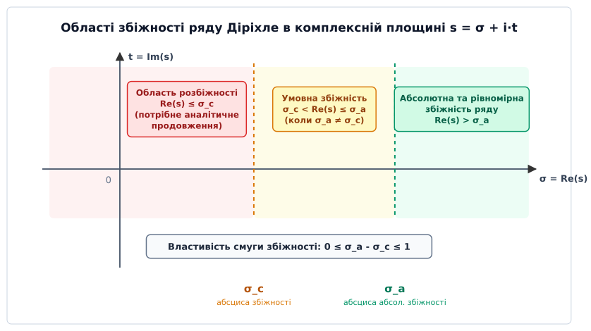
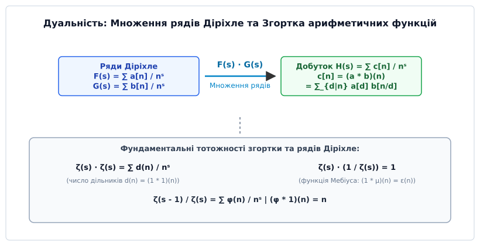
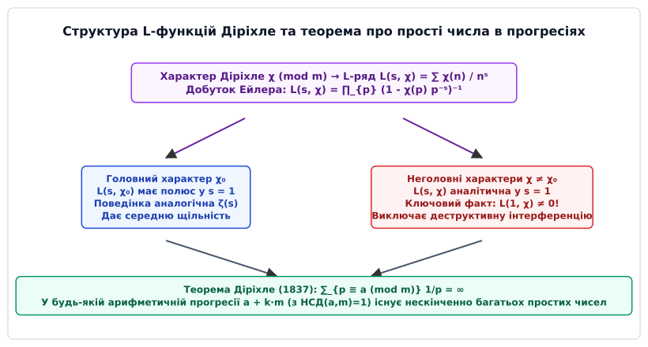

# Ряди Діріхле

<preknowlist>
- [Основна теорема арифметики](root:math-number-theory/fundamental-theorem-arithmetic) — унікальність розкладу натуральних чисел на прості множники.
- [Формула добутку Ейлера](root:math-number-theory/euler-product-formula) — розклад Дзета-суми на нескінченний добуток за простими числами.
- [Функція Ейлера](root:math-number-theory/euler-totient) — аналіз мультиплікативних арифметичних функцій та їхніх властивостей.
</preknowlist>

> 🔧 **Навіщо це.**
> Ряди Діріхле є головним аналітичним містком між дискретною теорією чисел та неперервним комплексним аналізом. Вони перетворюють складні комбінаторні та арифметичні зв'язки подільності (згортку дільників, факторизацію, оцінку кількості простих чисел) у звичайне алгебраїчне множення аналітичних функцій. Без рядів Діріхле неможливо довести теорему про нескінченність простих чисел у довільних арифметичних прогресіях, побудувати алгоритми факторизації великих чисел (General Number Field Sieve), аналізувати стійкість криптографічних систем RSA чи опис спектрів у квантовій фізиці.

## 1. Від адитивних генераторних функцій до мультиплікативних рядів

Коли ми аналізуємо комбінаторні або адитивні задачі теорії чисел (наприклад, кількість способів розкласти ціле число `n` у суму декількох доданків чи задачу про монети Фробеніуса), основним інструментом є звичайні степеневі твірні функції (англ. *ordinary generating functions*, OGF) вигляду `A(x) = ∑_{n=1}^∞ a[n] xⁿ`. Головна зручність степеневого ряду полягає у тому, що при множенні двох таких рядів показники степенів базового числа `x` додаються:

```
xⁿ · xᵐ = xⁿ⁺ᵐ
```

Завдяки цій властивості добуток двох рядів `A(x) · B(x)` утворює новий степеневий ряд, коефіцієнт якого при `xᵏ` дорівнює адитивній згортці `∑_{i+j=k} a[i] b[j]`. Адитивна згортка ідеально відповідає операції додавання індексів у групі `(ℤ, +)` і дозволяє легко рахувати кількість комбінаторних комбінацій.

Проте фундаментальна структура подільності та канонічного розкладу цілих чисел на прості множники є принципово **мультиплікативною**, а не адитивною. Головна алгебраїчна операція в теорії чисел — це не додавання, а знаходження додатних дільників числа `n = d · m` у напівгрупі `(ℕ, ·)`.

Якщо спробувати застосувати звичайні степеневі ряди до арифметичних функцій (таких як число дільників `d(n)`, функція Ейлера `φ(n)` чи функція Мебіуса `μ(n)`), додавання показників степенів `n + m` повністю руйнує інформацію про подільність та взаємну простоту коефіцієнтів. Степеневий ряд невмотивовано поєднує доданки `a[3] x³` та `a[4] x⁴` у коефіцієнт `x⁷`, хоча числа 3 і 4 не мають жодного адитивного відношення до розкладу числа 7 на прості множники.

З точки зору функціонального аналізу, для мультиплікативних структур потрібне функціональне перетворення, яке переводить множення цілих чисел у додавання показників. Розглянемо складене число `n = 6 = 2 · 3`. Нам потрібна така базова функція `f(n)`, щоб для неї виконувалася рівність `f(6) = f(2) · f(3)`.

У 1837 році Петер Густав Лежен Діріхле запропонував обрати як базову функцію знаменника степені натурального індексу `n⁻ˢ = 1 / nˢ`, де `s` — комплексна змінна. З точки зору інтегрального аналізу, ряд Діріхле являє собою дискретне **перетворення Мелліна-Стілтьєса** (англ. *Mellin–Stieltjes transform*). Якщо перетворення Фур'є та Лапласа пов'язані з адитивною групою дійсних чисел, то перетворення Мелліна та ряди Діріхле пов'язані з мультиплікативною структурою чисел:

```
n⁻ˢ · m⁻ˢ = (n · m)⁻ˢ
```

Ряд вигляду:

```
F(s) = ∑_{n=1}^∞ a[n] / nˢ = a[1]/1ˢ + a[2]/2ˢ + a[3]/3ˢ + a[4]/4ˢ + ...
```

називається **рядом Діріхле** (лат. *series Dirichletiana*). Якщо ввести суматорну функцію коефіцієнтів `A(x) = ∑_{n ≤ x} a[n]`, то ряд Діріхле можна записати як інтеграл Стілтьєса:

```
F(s) = ∫_{1⁻}^∞ x⁻ˢ d A(x) = s · ∫_1^∞ A(x) · x⁻ˢ⁻¹ dx
```

Підстановкою `x = eᵘ` цей вираз зводиться до класичного перетворення Лапласа суматорної функції на логарифмічній шкалі `A(eᵘ)`. Вибір бази `n⁻ˢ` забезпечує пряме узгодження аналітичних операцій з Основною теоремою арифметики.

## 2. Аналітична анатомія та півплощини збіжності

Нехай `s = σ + i·t` — комплексне число, де дійсна частина `σ = Re(s)` називається абсцисою, а `t = Im(s)` — уявною частиною.

Розкриємо кожен член ряду Діріхле через показникову та тригонометричні функції:

```
n⁻ˢ = n⁻⁽σ ⁺ ⁱᵗ⁾                                      [підстановка s = σ + i·t]
    = n⁻σ · n⁻ⁱᵗ                                      [властивість степеня: nᵃ⁺ᵇ = nᵃ · nᵇ]
    = n⁻σ · e⁻ⁱᵗ ˡⁿ ⁿ                                 [показникова форма: n⁻ⁱᵗ = e⁻ⁱᵗ ˡⁿ ⁿ]
    = n⁻σ · ( cos(t · ln n) - i · sin(t · ln n) )     [формула Ейлера: e⁻ⁱθ = cos θ - i sin θ]
```

Модуль окремого члена ряду дорівнює `|a[n] / nˢ| = |a[n]| / n^σ`. Звідси випливає фундаментальний факт: **абсолютна збіжність ряду Діріхле визначається виключно дійсною частиною `σ = Re(s)`** і абсолютно не залежить від уявного параметра `t`.

На відміну від звичайних степеневих рядів, де областю збіжності є круг у комплексній площині `|z| < R`, для рядів Діріхле областями збіжності є **праві півплощини**.


*Області абсолютної та умовної збіжності ряду Діріхле в комплексній площині s = σ + i·t, розділені абсцисами σ_c та σ_a.*

### Чотири абсциси ряду Діріхле

Для кожного ряду Діріхле визначають чотири фундаментальні дійсні межі, які задають геометрію його поведінки на комплексній площині:

1. **Абсциса абсолютної збіжності `σ_a`:** Ряд `∑ |a[n]| / n^σ` збігається при `Re(s) > σ_a` і розбігається при `Re(s) < σ_a`.
2. **Абсциса простої збіжності `σ_c`:** Ряд `∑ a[n] / nˢ` збігається (можливо, умовно) у півплощині `Re(s) > σ_c` і розбігається при `Re(s) < σ_c`.
3. **Абсциса рівномірної збіжності `σ_u`:** Найменше дійсне число таке, що ряд збігається рівномірно на будь-якій замкненій півплощині `Re(s) ≥ σ₀ > σ_u`.
4. **Абсциса голоморфності `σ_h` (або обмеженості `σ_b`):** Межа півплощини `Re(s) > σ_h`, у яку функція `F(s)` продовжується як голоморфна та обмежена на вертикальних прямих функція.

Між цими величинами завжди виконується ланцюг фундаментальних нерівностей:

```
-∞ ≤ σ_h ≤ σ_u ≤ σ_c ≤ σ_a ≤ +∞
```

Ширина смуг між різними типами збіжності обмежена строгими теоремами:

- **Смуга умовної збіжності:** `0 ≤ σ_a - σ_c ≤ 1`. Ширина смуги, де ряд збігається умовно, не може перевищувати одиниці.
- **Смуга Бора:** `0 ≤ σ_a - σ_u ≤ 1/2`. Згідно з класичною теоремою Бора–Бонебліста–Гілле, абсциса абсолютної та рівномірної збіжності відрізняються не більше ніж на `1/2`.

### Теорема Каена та сумування Абеля

Фундаментальна теорема Ежена Каена (1894) стверджує: якщо ряд `∑ a[n] / nˢ` збігається у точці `s₀ = σ₀ + i·t₀`, то він збігається для будь-якої точки `s` з `Re(s) > σ₀`, причому рівномірно всередині будь-якого кутового сектора `|arg(s - s₀)| ≤ θ < π/2`.

Розглянемо повне виведення цього факту через перетворення Абеля (дискретне інтегрування за частинами).

Позначимо через `A(x) = ∑_{n ≤ x} a[n] n⁻ˢ⁰` часткові суми ряду в точці збіжності `s₀`. Оскільки ряд у точці `s₀` збігається, послідовність `A(x)` є обмеженою деякою константою: `|A(x)| ≤ M` для всіх `x ≥ 1`.

Запишемо часткову суму ряду в довільній точці `s`:

```
∑_{n=1}^N a[n] n⁻ˢ
= ∑_{n=1}^N (a[n] n⁻ˢ⁰) · n⁻⁽ˢ ⁻ ˢ⁰⁾                  [виділення множника збіжності]
= ∑_{n=1}^N (A(n) - A(n-1)) · n⁻⁽ˢ ⁻ ˢ⁰⁾             [представлення a[n] n⁻ˢ⁰ через різницю сум]
= A(N) · N⁻⁽ˢ ⁻ ˢ⁰⁾ + ∑_{n=1}^{N-1} A(n) · ( n⁻⁽ˢ ⁻ ˢ⁰⁾ - (n+1)⁻⁽ˢ ⁻ ˢ⁰⁾ )  [перегрупування доданків]
```

Використовуючи тотожність `n⁻ʷ - (n+1)⁻ʷ = w · ∫_n^{n+1} x⁻ʷ⁻¹ dx` для `w = s - s₀`, згортаємо суму в інтеграл:

```
∑_{n=1}^N a[n] n⁻ˢ = A(N) · N⁻⁽ˢ ⁻ ˢ⁰⁾ + (s - s₀) · ∫_1^N A(x) · x⁻⁽ˢ ⁻ ˢ⁰ ⁺ ¹⁾ dx
```

Оцінимо кожен доданок при `N → ∞` за умови `σ = Re(s) > σ₀ = Re(s₀)`:

1. Оскільки `|A(N)| ≤ M`, перший член оцінюється як `|A(N) · N⁻⁽ˢ ⁻ ˢ⁰⁾| ≤ M · N⁻⁽σ ⁻ σ₀⁾ → 0` при `N → ∞`.
2. Модуль підінтегрального виразу не перевищує `M · x⁻⁽σ ⁻ σ₀ ⁺ ¹⁾`. Інтеграл збігається абсолютно:

```
| (s - s₀) · ∫_1^∞ A(x) · x⁻⁽ˢ ⁻ ˢ⁰ ⁺ ¹⁾ dx | ≤ M · |s - s₀| · ∫_1^∞ x⁻⁽σ ⁻ σ₀ ⁺ ¹⁾ dx = M · |s - s₀| / (σ - σ₀)
```

Якщо точка `s` знаходиться всередині кутового сектора `|s - s₀| / (σ - σ₀) ≤ 1 / cos θ`, збіжність є абсолютною та рівномірною. Звідси випливає, що сума ряду `F(s)` є голоморфною функцією у всій відкритій півплощині `Re(s) > σ_c`.

Цей результат є аналогом теореми Абеля для степеневих рядів: якщо ряд Діріхле збігається в точці `s₀ = σ₀ + i·t₀`, то при наближенні точки `s` до `s₀` зсередини кутового сектора (сектора Штольца) `|arg(s - s₀)| ≤ θ < π/2` граничне значення функції дорівнює значенню суми ряду в цій точці:

```
lim_{s → s₀, |arg(s - s₀)| ≤ θ} F(s) = F(s₀)
```

Геометрія збіжності рядів Діріхле відрізняється від круга збіжності степеневих рядів Тейлора. У степеневому ряді на колі збіжності `|z| = R` присутня принаймні одна особлива точка функції. У рядах Діріхле пряма `Re(s) = σ_c` не слугує універсальною природною межею аналітичності: функція буває голоморфною на цій прямій або продовжується на всю комплексну площину (як, наприклад, ета-функція Діріхле). Для рядів із невід'ємними коефіцієнтами діє теорема Ландау.

### Формули для обчислення абсцис збіжності

Для практичного знаходження величин `σ_c` та `σ_a` застосовують граничні формули:

1. **Якщо сума `∑ a[n]` розбігається** (часткові суми `A(N) = ∑_{n=1}^N a[n]` необмежені):

```
σ_c = lim sup_{N → ∞} ( ln |A(N)| / ln N )
```

2. **Якщо сума `∑ a[n]` збігається** (часткові суми прямують до скінченної межі, `A(∞) = S`):

```
σ_c = lim sup_{N → ∞} ( ln |∑_{n=N+1}^∞ a[n]| / ln N )
```

3. **Для абсциси абсолютної збіжності `σ_a`:**

```
σ_a = lim sup_{N → ∞} ( ln (∑_{n=1}^N |a[n]|) / ln N )
```

Якщо коефіцієнти `a[n]` задовольняють умову росту `|a[n]| = O(n^α)`, то `σ_a ≤ α + 1`.

### Теорема Ландау про особливу точку на межі збіжності

**Теорема (Едмунд Ландау):** Якщо всі коефіцієнти ряду Діріхле є невід'ємними дійсними числами (`a[n] ≥ 0` для всіх `n ∈ ℕ`), а абсциса збіжності `σ_c` є скінченною, то точка `s = σ_c` на дійсній осі обов'язково є **особливою точкою** (сингулярністю) аналітичної функції `F(s)`.

*Доведення (від супротивного):*

Припустимо, що функція `F(s)` є регулярною (голоморфною) в точці `s = σ_c`. Тоді існує круг з центром у точці `s₀ = σ₀ > σ_c` радіуса `R > σ₀ - σ_c`, у якому функція `F(s)` розкладається у степеневий ряд Тейлора:

```
F(s) = ∑_{k=0}^∞ ( F⁽ᵏ⁾(σ₀) / k! ) · (s - σ₀)ᵏ
```

Обчислимо похідні функції `F(s)` у точці `σ₀` за допомогою почленного диференціювання ряду Діріхле:

```
F⁽ᵏ⁾(σ₀) = (-1)ᵏ · ∑_{n=1}^∞ a[n] · (ln n)ᵏ / n^σ₀
```

Підставимо ці похідні у ряд Тейлора в дійсній точці `s₁ = σ_c - ε` зліва від абсциси збіжності (де `0 < ε < R - (σ₀ - σ_c)`):

```
F(s₁) = ∑_{k=0}^∞ [ ( (-1)ᵏ / k! ) · ( ∑_{n=1}^∞ a[n] (ln n)ᵏ n⁻^σ₀ ) ] · (s₁ - σ₀)ᵏ
      = ∑_{k=0}^∞ ( 1 / k! ) · ( ∑_{n=1}^∞ a[n] (ln n)ᵏ n⁻^σ₀ ) · (σ₀ - s₁)ᵏ   [спрощення (-1)ᵏ (s₁ - σ₀)ᵏ = (σ₀ - s₁)ᵏ]
```

Оскільки `a[n] ≥ 0` та `σ₀ - s₁ > 0`, **усі члени цього подвійного ряду є строго невід'ємними**. За теоремою Фубіні–Тонеллі ми маємо право поміняти порядок сумування:

```
F(s₁) = ∑_{n=1}^∞ a[n] n⁻^σ₀ · [ ∑_{k=0}^∞ ( (σ₀ - s₁) · ln n )ᵏ / k! ]    [перестановка порядку подвійного підсумовування]
      = ∑_{n=1}^∞ a[n] n⁻^σ₀ · e^⁽σ₀ ⁻ ˢ¹⁾ ˡⁿ ⁿ                            [згортання експоненціального ряду Тейлора]
      = ∑_{n=1}^∞ a[n] n⁻^σ₀ · n^⁽σ₀ ⁻ ˢ¹⁾                                 [властивість e^(w ln n) = n^w]
      = ∑_{n=1}^∞ a[n] / n^s₁                                              [підсумкове спрощення n^(-σ₀ + σ₀ - s₁)]
```

Ми отримали, що ряд Діріхле `∑ a[n] / nˢ` збігається в дійсній точці `s₁ = σ_c - ε < σ_c`. Це прямо суперечить визначенню `σ_c` як точної нижньої межі точок збіжності! Отже, функція `F(s)` не може бути голоморфною в точці `s = σ_c`, що й доводить теорему Ландау.

З теореми Ландау випливає важливий наслідок: для рядів з невід'ємними коефіцієнтами `σ_a = σ_c`, тобто смуга умовної збіжності має нульову ширину.

### Приклади та крайові випадки визначення абсцис

- **Скінченні багаточлени Діріхле:** Якщо `a[n] = 0` для всіх `n > N`, ряд містить скінченну кількість доданків. Він збігається на всій комплексній площині: `σ_c = σ_a = -∞`.
- **Факторіальні коефіцієнти:** Для `a[n] = n!` члени ряду зростають швидше за будь-який степінь знаменника, тому ряд розбігається всюди: `σ_c = σ_a = +∞`.
- **Ета-функція Діріхле `η(s) = ∑_{n=1}^∞ (-1)ⁿ⁻¹ / nˢ`:**
  Часткові суми коефіцієнтів `a[n] = (-1)ⁿ⁻¹` коливаються між 1 та 0, тобто є обмеженими константою `M = 1`. За формулою Каена для обмежених сум `σ_c = 0`.
  Для абсолютної збіжності маємо гармонічний ряд `∑ 1 / n^σ`, який збігається лише при `σ > 1`, отже `σ_a = 1`.
  Смуга `0 < Re(s) ≤ 1` є смугою умовної збіжності одиничної ширини (`σ_a - σ_c = 1`).

## 3. Аналітичні операції над рядами Діріхле

Усередині півплощини збіжності `Re(s) > σ_c` ряд Діріхле визначає голоморфну функцію, над якою можна виконувати стандартні операції комплексного аналізу.

### 1. Почленне диференціювання довільного порядку

Оскільки ряд Діріхле збігається рівномірно на будь-якому компакті всередині `Re(s) > σ_c`, його можна диференціювати почленно будь-яку кількість разів:

```
d/ds ( n⁻ˢ ) = d/ds ( e⁻ˢ ˡⁿ ⁿ ) = - ln(n) · e⁻ˢ ˡⁿ ⁿ = - (ln n) / nˢ
```

Для похідної `k`-го порядку отримуємо формулу:

```
F⁽ᵏ⁾(s) = (-1)ᵏ · ∑_{n=1}^∞ a[n] · (ln n)ᵏ / nˢ
```

Оскільки множник `(ln n)ᵏ` росте повільніше за будь-який степінь `n^ε` (для будь-якого `ε > 0`), почленне диференціювання **не змінює абсцис збіжності**: абсциси `σ_c` та `σ_a` для ряду похідної точно збігаються з абсцисами вихідного ряду `F(s)`.

### 2. Теорема єдиності коефіцієнтів ряду Діріхле

**Теорема (тотожність рядів Діріхле):** Нехай два ряди Діріхле `F(s) = ∑ a[n] / nˢ` та `G(s) = ∑ b[n] / nˢ` збігаються для `Re(s) > σ₀`. Якщо `F(sₖ) = G(sₖ)` на нескінченній послідовності дійсних точок `sₖ → +∞`, то їхні коефіцієнти попарно рівні: `a[n] = b[n]` для всіх `n ∈ ℕ`.

*Доведення (метод математичної індукції):*

Розглянемо різницевий ряд `H(s) = F(s) - G(s) = ∑_{n=1}^∞ c[n] / nˢ`, де `c[n] = a[n] - b[n]`. Відомо, що `H(sₖ) = 0` для `sₖ → +∞`.

Припустимо супротивне: нехай не всі `c[n]` дорівнюють нулю. Нехай `N ≥ 1` — найменший натуральний індекс, для якого `c[N] ≠ 0`. Тоді:

```
H(s) = c[N] / Nˢ + ∑_{n=N+1}^∞ c[n] / nˢ = 0
```

Помножимо обидві частини рівності на `Nˢ`:

```
c[N] + ∑_{n=N+1}^∞ c[n] · (N / n)ˢ = 0
```

Оцінимо суму у правій частині при `s = σ → +∞`:

```
| ∑_{n=N+1}^∞ c[n] · (N / n)^σ | ≤ ( N / (N + 1) )^⁽σ ⁻ σ₁⁾ · ∑_{n=N+1}^∞ |c[n]| / n^σ₁
```

де `σ₁ > σ₀` — фіксована точка абсолютної збіжності. Оскільки `N / (N + 1) < 1`, при `σ → +∞` геометричний множник `( N / (N + 1) )^σ` прямує до нуля, тому вся сума прямує до нуля:

```
c[N] = - lim_{σ → +∞} ∑_{n=N+1}^∞ c[n] · (N / n)^σ = 0
```

Ми отримали `c[N] = 0`, що прямо суперечить вибору індексу `N`. Отже, `c[n] = 0` для всіх `n ∈ ℕ`, тобто `a[n] = b[n]`.

### 3. Почленне інтегрування

Інтегруючи ряд Діріхле вздовж променя від точки `s` до `+∞` у півплощині абсолютної збіжності, отримуємо:

```
∫_s^{+∞} ( F(w) - a[1] ) dw = ∑_{n=2}^∞ a[n] · ∫_s^{+∞} n⁻ʷ dw = ∑_{n=2}^∞ a[n] / ( nˢ · ln n )
```

Ця операція дозволяє інтегрувати ряди Діріхле для знаходження логарифмічних первісних.

### 4. Інтегральне представлення та аналітичне продовження

Нехай `A(x) = ∑_{n ≤ x} a[n]` — суматорна функція коефіцієнтів. Якщо `Re(s) > max(0, σ_c)`, ряд Діріхле можна тотожно виразити через інтеграл:

```
F(s) = s · ∫_1^∞ A(x) / xˢ⁺¹ dx
```

Ця формула є головним інструментом **аналітичного продовження** рядів Діріхле за межу `Re(s) = 1`.

Припустимо, що суматорна функція має регулярний асимптотичний тренд: `A(x) = C · x + R(x)`, де помилка зростає повільніше: `R(x) = O(x^θ)` з `0 ≤ θ < 1`. Розділимо інтеграл на дві частини:

```
F(s) = s · ∫_1^∞ ( C · x + R(x) ) · x⁻ˢ⁻¹ dx
     = C · s · ∫_1^∞ x⁻ˢ dx + s · ∫_1^∞ R(x) · x⁻ˢ⁻¹ dx     [лінійність інтеграла: розбиття суми]
     = ( C · s ) / (s - 1) + s · ∫_1^∞ R(x) · x⁻ˢ⁻¹ dx       [обчислення первісної: ∫_1^∞ x⁻ˢ dx = 1/(s-1)]
```

Оскільки `R(x) = O(x^θ)`, підінтегральна функція `R(x) x⁻ˢ⁻¹` оцінюється як `O(x^⁽θ ⁻ σ ⁻ ¹⁾)`. Цей інтеграл збігається абсолютно для всіх `Re(s) > θ`.

Таким чином, ми отримали явне мероморфне продовження функції `F(s)` у ширшу півплощину `Re(s) > θ`. Функція `F(s)` має єдиний простий полюс у точці `s = 1` з лишком:

```
Res_{s=1} F(s) = lim_{s → 1} (s - 1) · F(s) = C
```

Проілюструємо це на прикладі Дзета-функції Рімана `ζ(s) = ∑_{n=1}^∞ 1 / nˢ`. Для неї `a[n] = 1`, тому часткова сума дорівнює цілій частині `A(x) = [x] = x - {x}`, де `{x}` — дробова частина числа (`0 ≤ {x} < 1`). Головний коефіцієнт `C = 1`, а залишок `R(x) = -{x} = O(1)` (тобто `θ = 0`).

Підставивши це в інтегральну формулу, отримуємо:

```
ζ(s) = s / (s - 1) - s · ∫_1^∞ {x} / xˢ⁺¹ dx
```

Інтеграл збігається для всіх `Re(s) > 0`. Ця формула продовжує Дзета-функцію Рімана на всю праву півплощину `Re(s) > 0` і доводить, що `ζ(s)` має єдиний полюс першого порядку в точці `s = 1` з лишком `Res_{s=1} ζ(s) = 1`.

## 4. Алгебра згортки та мультиплікативна дуальність

Розглянемо множення двох рядів Діріхле `F(s) = ∑ a[n] / nˢ` та `G(s) = ∑ b[n] / nˢ`. У півплощині абсолютної збіжності ми маємо право перемножити ряди член за членом:

```
F(s) · G(s)
= ( ∑_{n=1}^∞ a[n] / nˢ ) · ( ∑_{m=1}^∞ b[m] / mˢ )   [розгортання виразів за визначенням]
= ∑_{n=1}^∞ ∑_{m=1}^∞ (a[n] · b[m]) / (n · m)ˢ        [почленне множення та групування]
= ∑_{k=1}^∞ [ ∑_{d|k} a[d] · b[k/d] ] / kˢ            [заміна k = n · m та d = n]
= ∑_{k=1}^∞ (a * b)(k) / kˢ                           [за визначенням згортки Діріхле]
```

Сума у квадратних дужках називається **згорткою Діріхле** (або арифметичною згорткою) коефіцієнтів `a` та `b`, що позначається як `(a * b)(k)`. Детальний строгий вивід та алгебраїчні властивості цієї операції містяться у вставці [Алгебра згортки Діріхле](root:math-number-theory/dirichlet-series/math-dirichlet-convolution.md).


*Дуальність між множенням рядів Діріхле та згорткою коефіцієнтів на прикладах Дзета-функції, функції Мебіуса та функції Ейлера.*

### Таблиця фундаментальних рядів Діріхле

Нижче наведено зведену таблицю головних арифметичних функцій теорії чисел, їхніх твірних рядів Діріхле та областей абсолютної збіжності:

| Арифметична функція `f(n)` | Назва та арифметичне значення | Ряд Діріхле `F(s) = ∑ f(n)/nˢ` | `σ_a` | Алгебраїчний вираз |
|---|---|---|---|---|
| `1(n) = 1` | Константна одиниця | `ζ(s)` | `1` | `∏_p (1 - p⁻ˢ)⁻¹` |
| `Nᵏ(n) = nᵏ` | Степенева функція | `ζ(s - k)` | `k + 1` | `∏_p (1 - pᵏ⁻ˢ)⁻¹` |
| `μ(n)` | Функція Мебіуса (індикатор парності простих дільників) | `1 / ζ(s)` | `1` | `∏_p (1 - p⁻ˢ)` |
| `φ(n)` | Функція Ейлера (кількість взаємно простих дільників) | `ζ(s - 1) / ζ(s)` | `2` | `∏_p (1 - p⁻ˢ) / (1 - p¹⁻ˢ)` |
| `d(n) = τ(n)` | Кількість додатних дільників `n` | `ζ(s)²` | `1` | `∏_p (1 - p⁻ˢ)⁻²` |
| `d_k(n)` | Число розкладів `n` у добуток `k` множників | `ζ(s)ᵏ` | `1` | `∏_p (1 - p⁻ˢ)⁻ᵏ` |
| `σ_k(n)` | Сума `k`-х степенів дільників `∑_{d\|n} dᵏ` | `ζ(s) · ζ(s - k)` | `max(1, k+1)` | `∏_p ( (1 - p⁻ˢ)(1 - pᵏ⁻ˢ) )⁻¹` |
| `Λ(n)` | Функція Мангольдта (`ln p`, якщо `n = pᵏ`) | `- ζ'(s) / ζ(s)` | `1` | `∑_{p, k} (ln p) p⁻ᵏˢ` |
| `Λ(n) / ln n` | Ваговий індикатор степенів простих чисел | `ln ζ(s)` | `1` | `∑_{p, k} (1/k) p⁻ᵏˢ` |
| `q(n) = \|μ(n)\|` | Індикатор безквадратних чисел (`μ(n)²`) | `ζ(s) / ζ(2s)` | `1` | `∏_p (1 + p⁻ˢ)` |
| `λ(n) = (-1)^Ω(n)` | Функція Ліувілля (повна парність простих множників) | `ζ(2s) / ζ(s)` | `1` | `∏_p (1 + p⁻ˢ)⁻¹` |
| `2^ω(n)` | Кількість безквадратних дільників числа `n` | `ζ(s)² / ζ(2s)` | `1` | `∏_p (1 + 2p⁻ˢ + 2p⁻²ˢ + ...)` |
| `d(n²)` | Кількість дільників квадрата числа `n` | `ζ(s)³ / ζ(2s)` | `1` | `∏_p (1 + 3p⁻ˢ + 5p⁻²ˢ + ...)` |
| `J_k(n)` | Узагальнена функція Жордана `nᵏ ∏ (1 - p⁻ᵏ)` | `ζ(s - k) / ζ(s)` | `k + 1` | `∏_p (1 - p⁻ˢ) / (1 - pᵏ⁻ˢ)` |

### Детальний аналіз ключових співвідношень

Розглянемо виведення найбільш важливих аналітичних тотожностей з наведеної таблиці:

#### 1. Обернена Дзета-функція та функція Мебіуса
З умови `(1 * μ)(n) = ε(n)` (де `ε(1) = 1` та `ε(n) = 0` для `n > 1`) випливає:

```
ζ(s) · ( ∑_{n=1}^∞ μ(n) / nˢ ) = 1   ⇒   1 / ζ(s) = ∑_{n=1}^∞ μ(n) / nˢ
```

Оскільки `ζ(s)` має нулі в критичній смузі, функція `1 / ζ(s)` має в цих точках полюси.

#### 2. Відношення Дзета-функцій та функція Ейлера
За теоремою Гаусса `∑_{d|n} φ(d) = n`, тобто `φ * 1 = N`. Переходячи до рядів Діріхле:

```
( ∑_{n=1}^∞ φ(n) / nˢ ) · ζ(s) = ζ(s - 1)   ⇒   ∑_{n=1}^∞ φ(n) / nˢ = ζ(s - 1) / ζ(s)
```

#### 3. Індикатор безквадратних чисел `|μ(n)|`
Кожне натуральне число `n` однозначно факторизується як `n = a² · b`, де `b` — безквадратне число (`|μ(b)| = 1`). У термінах згортки це означає, що константа `1` є згорткою індикатора квадратів та індикатора безквадратних чисел: `1 = q * sq`.
Переходячи до рядів:

```
ζ(s) = ( ∑_{n=1}^∞ |μ(n)| / nˢ ) · ζ(2s)   ⇒   ∑_{n=1}^∞ |μ(n)| / nˢ = ζ(s) / ζ(2s)
```

#### 4. Логарифмічна похідна Дзета-функції та функція Мангольдта
Взявши логарифм від Ейлерового добутку `ln ζ(s) = - ∑_{p} ln(1 - p⁻ˢ)`, розкладемо логарифм у ряд Тейлора `ln(1 - x) = - ∑_{k=1}^∞ xᵏ / k`:

```
ln ζ(s) = ∑_{p ∈ ℙ} ∑_{k=1}^∞ 1 / (k · pᵏˢ)
```

Продиференціюємо цей вираз за змінною `s` (враховуючи, що `d/ds (p⁻ᵏˢ) = - k ln(p) p⁻ᵏˢ`):

```
- ζ'(s) / ζ(s) = - d/ds (ln ζ(s)) = ∑_{p ∈ ℙ} ∑_{k=1}^∞ (ln p) / pᵏˢ
```

Згрупувавши доданки за натуральним індексом `n = pᵏ`, ми отримуємо ряд Діріхле для функції Мангольдта `Λ(n)`:

```
- ζ'(s) / ζ(s) = ∑_{n=1}^∞ Λ(n) / nˢ
```

де `Λ(n) = ln p`, якщо `n = pᵏ` є степенем простого числа, і `0` в інших випадках. Цей ряд є фундаментом аналітичного доведення теореми про розподіл простих чисел.

#### 5. Алгебраїчна структура кільця арифметичних функцій

Множина всіх комплексних арифметичних функцій `𝔸 = { f: ℕ → ℂ }` утворює комутативне кільце з одиницею `(𝔸, +, *)` щодо звичайного поточкового додавання та згортки Діріхле `*`. Одиничним елементом щодо згортки є дельта-функція Діріхле `ε(n)` (де `ε(1) = 1` та `ε(n) = 0` для `n > 1`).

Відображення `D: f ↦ ∑_{n=1}^∞ f(n) / nˢ`, яке зіставляє арифметичній функції її формальний ряд Діріхле, є кільцевим ізоморфізмом між кільцем `(𝔸, +, *)` та алгеброю формальних рядів Діріхле `ℂ[[n⁻ˢ]]`:

```
D(f + g, s) = D(f, s) + D(g, s)
D(f * g, s) = D(f, s) · D(g, s)
D(ε, s) = 1
```

Елемент `f ∈ 𝔸` є оборотним відносно згортки Діріхле тоді й лише тоді, коли `f(1) ≠ 0`. Обернена функція `f⁻¹` знаходиться з тотожності `D(f⁻¹, s) = 1 / D(f, s)`. Наприклад, для функції Жордана `J_k(n) = nᵏ · ∏_{p|n} (1 - p⁻ᵏ)` маємо `J_k * 1 = Nᵏ`, звідки ряд Діріхле знаходиться миттєво як ділення рядів:

```
D(J_k, s) = D(Nᵏ, s) / D(1, s) = ζ(s - k) / ζ(s)
```

При `k = 1` функція Жордана збігається з функцією Ейлера `J₁(n) = φ(n)`, повертаючи тотожність `D(φ, s) = ζ(s - 1) / ζ(s)`.

## 5. Добуток Ейлера для загальних рядів Діріхле

Арифметична функція `a(n)` називається **мультиплікативною**, якщо для будь-якої пари взаємно простих чисел `n` та `m` (тобто `НСД(n, m) = 1`) виконується умова:

```
a(n · m) = a(n) · a(m)
```

Якщо ця рівність виконується для абсолютно всіх натуральних чисел `n` та `m` (навіть не взаємно простих), функція називається **цілком мультиплікативною**.

Завдяки Основній теоремі арифметики кожне натуральне число `n > 1` однозначно розкладається у добуток простих множників `n = p₁ᵃ¹ · p₂ᵃ² ... pₖᵃᵏ`.

Якщо функція `a(n)` є мультиплікативною, значення `a(n)` повністю визначається її значеннями на степенях простих чисел:

```
a(n) = a(p₁ᵃ¹) · a(p₂ᵃ²) ... a(pₖᵃᵏ)
```

Підставимо це розкладання у ряд Діріхле `F(s) = ∑_{n=1}^∞ a[n] / nˢ`:

```
F(s) = ∑_{n=1}^∞ a(p₁ᵃ¹ · p₂ᵃ² ... pₖᵃᵏ) / (p₁ᵃ¹ · p₂ᵃ² ... pₖᵃᵏ)ˢ        [канонічний розклад n на прості]
     = ∑_{n=1}^∞ [ a(p₁ᵃ¹) / p₁ᵃ¹ˢ ] · [ a(p₂ᵃ²) / p₂ᵃ²ˢ ] ...            [мультиплікативність функції a(n)]
```

Розкриваючи дужки у нескінченному добутку за всіма простими числами `p ∈ ℙ`, ми отримуємо **загальну формулу добутку Ейлера**:

```
F(s) = ∏_{p ∈ ℙ} ( 1 + a(p)/pˢ + a(p²)/p²ˢ + a(p³)/p³ˢ + ... )
```

Для **цілком мультиплікативної** функції виконується `a(pᵏ) = (a(p))ᵏ`. У цьому випадку кожна дужка є нескінченною спадною геометричною прогресією зі знаменником `q = a(p) / pˢ`:

```
1 + a(p)/pˢ + (a(p)/pˢ)² + (a(p)/pˢ)³ + ... = 1 / ( 1 - a(p) / pˢ )   [сума геометричної прогресії 1/(1-q)]
```

Звідси отримуємо елегантний канонічний розклад Ейлера для цілком мультиплікативних функцій:

```
F(s) = ∏_{p ∈ ℙ} 1 / ( 1 - a(p) / pˢ )   [Re(s) > σ_a]
```

Ця формула зводить аналіз нескінченної суми за всіма натуральними числами до аналізу незалежних співмножників для кожного простого числа `p`.

## 6. L-функції Діріхле та прості числа в прогресіях

Головним тріумфом застосування рядів Діріхле в історії математики стало доведення теореми про нескінченність простих чисел у кожній допустимій арифметичній прогресії. Детальний історичний шлях та контекст відкриття описані у вставці [Історія виникнення рядів Діріхле](root:math-number-theory/dirichlet-series/hist-peter-dirichlet.md).

Нехай `m ≥ 2` — фіксований модуль. **Характером Діріхле** за модулем `m` (англ. *Dirichlet character*) називається цілком мультиплікативна функція `χ: ℤ → ℂ`, яка задовольняє три умови:

1. `χ(n) = χ(n mod m)` (періодичність з періодом `m`);
2. `χ(n) ≠ 0` тоді й лише тоді, коли `НСД(n, m) = 1`;
3. `χ(a · b) = χ(a) · χ(b)` для всіх `a, b ∈ ℤ`.

Ряд Діріхле, побудований на коефіцієнтах `a[n] = χ(n)`, називається **L-функцією Діріхле**:

```
L(s, χ) = ∑_{n=1}^∞ χ(n) / nˢ = ∏_{p ∈ ℙ} 1 / ( 1 - χ(p) / pˢ )
```

Завдяки періодичності та ортогональності характерів сума `∑_{n=1}^m χ(n)` дорівнює нулю для всіх неголовних характерів (`χ ≠ χ₀`).


*Структура L-функцій Діріхле, розгалуження поведінки головного та неголовних характерів та підсумкова теорема Діріхле.*

Властивість ортогональності дозволяє тотожно виділити прості числа конкретного класу остач `a (mod m)`:

```
∑_{p ≡ a (mod m)} 1 / pˢ = (1 / φ(m)) · ∑_{χ} χ̄(a) · ln L(s, χ) + O(1)   [при s → 1+]
```

Ключові кроки аналітичного доведення Діріхле:

1. **Головний характер `χ₀`:** `L(s, χ₀)` поводиться як `ζ(s)` і має полюс першого порядку в точці `s = 1`. Її логарифм `ln L(s, χ₀)` прямує до `+∞` при `s → 1+`.
2. **Неголовні характери `χ ≠ χ₀`:** Сума коефіцієнтів на періоді дорівнює нулю, тому ряд `L(s, χ)` збігається в точці `s = 1` і визначає скінченне значення `L(1, χ)`.
3. **Ненульове значення `L(1, χ) ≠ 0`:** Діріхле довів, що для жодного неголовного характеру `L(1, χ)` не може дорівнювати нулю! Це гарантує, що доданки `ln L(s, χ)` залишаються обмеженими і не можуть знешкодити нескінченність `+∞` від головного характеру.

У результаті сума `∑_{p ≡ a (mod m)} 1 / p` розбігається, що доводить наявність нескінченної кількості простих чисел у будь-якій допустимій арифметичній прогресії `a + k · m`.

## 7. Інтегральне обернення Перрона та асимптотичні методи

Ряди Діріхле дозволяють не лише доводити якісні теореми, а й точно обчислювати асимптотичні суми арифметичних функцій `A(x) = ∑_{n ≤ x} a[n]`.

Головним інструментом зв'язку між аналітичним рядом та його дискретною суматорною функцією є **формула Перрона** (Оскар Перрон, 1908 рік), яка є спеціальним випадком інверсії перетворення Мелліна.

### Лема про розривний множник Коші

В основі формули Перрона лежить властивість комплексного інтеграла вздовж нескінченної вертикальної прямої `Re(s) = c > 0`:

```
I(y) = (1 / (2π · i)) · ∫_{c - i∞}^{c + i∞} (yˢ / s) ds
```

Для цього інтеграла виконуються співвідношення:

- `I(y) = 1`, якщо `y > 1`;
- `I(y) = 1/2`, якщо `y = 1`;
- `I(y) = 0`, якщо `0 < y < 1`.

*Доведення леми за теоремою про лишки:*

Розглянемо зрізаний інтеграл `I(y, T) = (1 / (2π · i)) · ∫_{c - iT}^{c + iT} (yˢ / s) ds` та замкнемо контур інтегрування прямокутником:

1. **Випадок `y > 1` (тобто `ln y > 0`):**
   Замикаємо контур вліво прямокутником з вершинами `c - iT`, `c + iT`, `-R + iT`, `-R - iT`. Всередині цього контуру підінтегральна функція `yˢ / s` має єдиний простий полюс у точці `s = 0` з лишком:

```
Res_{s=0} [ yˢ / s ] = lim_{s → 0} s · (yˢ / s) = y⁰ = 1
```

   На лівій вертикальній межі `Re(s) = -R` чисельник `|yˢ| = y⁻ᴿ = e⁻ᴿ ˡⁿ ʸ → 0` при `R → +∞`. Горизонтальні відрізки при `T → ∞` дають оцінку залишкового члена `O( yᶜ / (T · ln y) )`. За теоремою Коші про лишки інтеграл дорівнює точно `1`.

2. **Випадок `0 < y < 1` (тобто `ln y < 0`):**
   Замикаємо контур вправо прямокутником з вершинами `c - iT`, `c + iT`, `R + iT`, `R - iT`. У правій півплощині функція `yˢ / s` є голоморфною і не має жодних полюсів. На правій вертикальній межі `|yˢ| = yᴿ = e⁻ᴿ ˡⁿ⁽¹/ʸ⁾ → 0` при `R → +∞`. Відповідно, інтеграл дорівнює `0`.

3. **Випадок `y = 1`:**
   Підставимо `y = 1` (отже `1ˢ = 1`) та параметризуємо відрізок прямої `s = c + i·t` при `t ∈ [-T, T]`:

```
I(1, T) = (1 / (2π · i)) · ∫_{-T}^T ( 1 / (c + i·t) ) · i dt
        = (1 / (2π)) · ∫_{-T}^T ( (c - i·t) / (c² + t²) ) dt                                   [домноження чисельника й знаменника на c - it]
        = (c / (2π)) · ∫_{-T}^T ( 1 / (c² + t²) ) dt - (i / (2π)) · ∫_{-T}^T ( t / (c² + t²) ) dt  [розділення на дійсну та уявну частини]
```

   Уявна частина зникає через непарність функції `t / (c² + t²)`. Дійсна частина обчислюється таблично:

```
I(1, T) = (c / π) · ∫_0^T ( 1 / (c² + t²) ) dt = (1 / π) · arctg(T / c)
```

   При `T → +∞` значення `arctg(T / c) → π / 2`, тому `I(1) = (1 / π) · (π / 2) = 1/2`.

### Точна та згладжена формула Перрона

Підставимо у розривний інтеграл `y = x / n`. Тоді `I(x / n) = 1` для всіх `n < x`, `I(x / n) = 0` для всіх `n > x`, а при `n = x` (якщо `x` — ціле число) маємо `I(1) = 1/2`.

Почленно інтегруючи ряд Діріхле `F(s) = ∑ a[n] / nˢ`, отримуємо **точну формулу Перрона**:

```
∑_{n ≤ x} ' a[n] = (1 / (2π · i)) · ∫_{c - i∞}^{c + i∞} F(s) · (xˢ / s) ds
```

де штрих біля знака суми `∑'` означає згладжену суматорну функцію:

```
∑_{n ≤ x} ' a[n] = ∑_{n < x} a[n] + (1/2) · a[x]   [якщо x ∈ ℕ]
∑_{n ≤ x} ' a[n] = ∑_{n ≤ x} a[n]                   [якщо x ∉ ℕ]
```

Для практичних обчислень застосовують **зрізану формулу Перрона** з скінченною висотою інтегрування `T`:

```
∑_{n ≤ x} ' a[n] = (1 / (2π · i)) · ∫_{c - iT}^{c + iT} F(s) · (xˢ / s) ds + R(x, T)
```

де залишковий член `R(x, T)` оцінюється через швидкість росту коефіцієнтів:

```
|R(x, T)| ≤ ∑_{n=1, n ≠ x}^∞ |a[n]| · (x / n)ᶜ · min( 1, 1 / ( T · |ln(x / n)| ) ) + (c / T) · |a[x]|
```

### Метод зсуву контуру та лишки

Головна сила формули Перрона полягає у можливості обчислення головного асимптотичного члена суми через **зсув контуру інтегрування вліво**:

1. Пряма інтегрування `Re(s) = c > σ_a` зсувається вліво на пряму `Re(s) = α < σ_a`.
2. При проходженні контуру через особливі точки функції `F(s) · (xˢ / s)` (полюси Дзета- чи L-функцій) за теоремою Коші генеруються лишки:

```
∑_{n ≤ x} a[n] = ∑_{полюси s₀} Res_{s = s₀} [ F(s) · (xˢ / s) ] + (1 / (2π · i)) · ∫_{α - i∞}^{α + i∞} F(s) · (xˢ / s) ds
```

Інтеграл на новій прямій `Re(s) = α` має порядок росту `O(x^α)`, що стає меншим залишковим членом.

### Розібраний приклад: Проблема дільників Діріхле

Знайдемо асимптотику для суми кількості дільників `D(x) = ∑_{n ≤ x} d(n)`.

Твірним рядом для `d(n)` є квадрат Дзета-функції `F(s) = ζ(s)²` з `σ_a = 1`. За формулою Перрона при `c = 1 + ε`:

```
D(x) = (1 / (2π · i)) · ∫_{c - i∞}^{c + i∞} ζ(s)² · (xˢ / s) ds
```

Функція `ζ(s)` має простий полюс у точці `s = 1` з розкладом у ряд Лорана:

```
ζ(s) = 1 / (s - 1) + γ + O(s - 1)
```

де `γ ≈ 0.577215...` — стала Ейлера–Маскероні. Піднесемо цей розклад до квадрата:

```
ζ(s)² = ( 1 / (s - 1) + γ + O(s - 1) )²
      = 1 / (s - 1)² + (2γ) / (s - 1) + O(1)          [піднесення до квадрата за формулою (a+b)²]
```

Розкладемо співмножник `xˢ / s` у ряд Тейлора навколо точки `s = 1`:

```
xˢ = x · e^⁽ˢ ⁻ ¹⁾ ˡⁿ ˣ = x · [ 1 + (s - 1) · ln x + O((s - 1)²) ]
1 / s = 1 / ( 1 + (s - 1) ) = 1 - (s - 1) + O((s - 1)²)
xˢ / s = x · [ 1 + (ln x - 1) · (s - 1) + O((s - 1)²) ]
```

Перемножимо отримані ряди для знаходження коефіцієнта при `1 / (s - 1)` (лишка в полюсі другого порядку):

```
ζ(s)² · (xˢ / s) = x · [ 1 / (s - 1)² + (ln x - 1 + 2γ) / (s - 1) + O(1) ]
```

Лишок у точці `s = 1` дорівнює:

```
Res_{s=1} [ ζ(s)² · (xˢ / s) ] = x · ln x + (2γ - 1) · x
```

Зсунувши контур інтегрування на пряму `Re(s) = 1/2`, отримуємо класичну асимптотичну формулу Діріхле:

```
∑_{n ≤ x} d(n) = x · ln x + (2γ - 1) · x + O(√x)
```

Цей результат, отриманий Діріхле геометричним методом гіперболи, формула Перрона виводить автоматично з єдиного комплексного полюса!

### Зв'язок з розподілом простих чисел (формула Рімана–Мангольдта)

Застосування формули Перрона до ряду Мангольдта `- ζ'(s) / ζ(s)` дозволяє оцінити суматорну функцію Чебишова `ψ(x) = ∑_{n ≤ x} Λ(n)`:

```
ψ(x) = (1 / (2π · i)) · ∫_{c - i∞}^{c + i∞} ( - ζ'(s) / ζ(s) ) · (xˢ / s) ds
```

Полюс у точці `s = 1` дає головний член `x`. Недиференційовні нулі Дзета-функції `ζ(ρ) = 0` (де `ρ = β + i·γ`) у критичній смузі формують хвильові коливання `- x^ρ / ρ`. Це приводить до точної явної формули Рімана–фон Мангольдта:

```
ψ(x) = x - ∑_{ρ} ( x^ρ / ρ ) - ln(2π) - (1/2) · ln(1 - x⁻²)
```

Гіпотеза Рімана про те, що всі нетривіальні нулі мають `Re(ρ) = 1/2`, еквівалентна найточнішій оцінці залишкового члена `ψ(x) = x + O(√x · ln² x)` для розподілу простих чисел.

## 8. Обчислювальні алгоритми та програмне моделювання

У комп'ютерній математиці, криптографічному аналізі та алгоритмах факторизації великих чисел обчислення зрізаних рядів Діріхле та згортка їхніх коефіцієнтів виконуються за допомогою ситоподібних алгоритмів зі складністю `O(N log N)`.

Детальний аналіз алгоритмічних оптимізацій, структури пам'яті, порівняння мов C та C++ і приклади покрокового виконання наведені у вставці [Обчислення та згортка рядів Діріхле](root:math-number-theory/dirichlet-series/proj-dirichlet-series-sim.md).

Ряди Діріхле залишаються невід'ємною частиною математичного апарату інформатики, аналізу алгоритмів факторизації та сучасної аналітичної теорії чисел.
