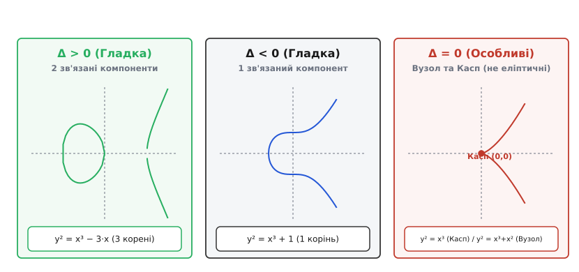
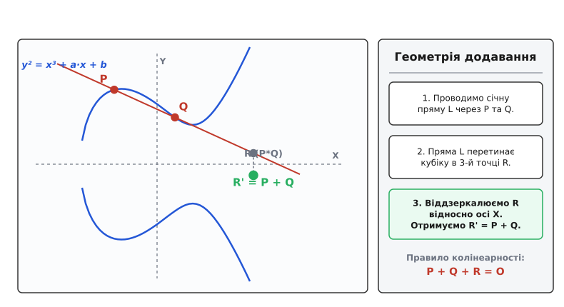
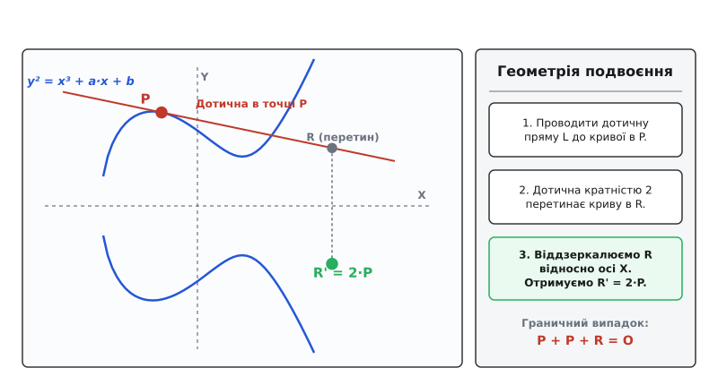
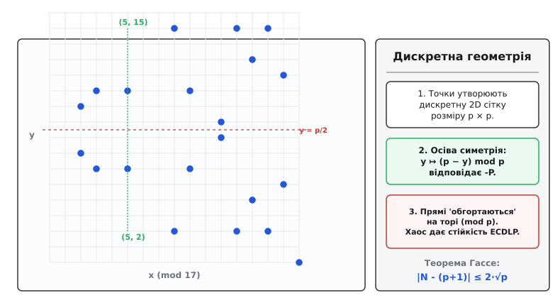

<preknowlist>
- [НСД та алгоритм Евкліда](root:math-number-theory/gcd-euclidean) — подільність цілих чисел, найбільший спільний дільник та розширений алгоритм Евкліда.
- [Модульна арифметика](root:math-number-theory/modular-arithmetic) — порівняння за модулем, обчислення у кільці залишків ℤ/pℤ та обернені елементи.
</preknowlist>

# Еліптичні криві

Еліптична крива — це неособлива алгебраїчна кубічна крива роду 1 з виділеною раціональною точкою. На множині її точок існує природна структура абелевої групи, яка об'єднує глибокі результати теорії чисел, проективної геометрії, комплексно-функціонального аналізу та сучасної криптографії.

---

## 1. Від конік до кубік: Геометрична природа роду кривої

Розв'язання діофантових рівнянь у раціональних чи цілих числах кардинально залежить від так званого **геометричного роду** алгебраїчної кривої `g` (числа «ручок» або топологічних отворів у відповідній компактній комплексній поверхні). 

### Класифікація Діофантової геометрії за родом кривої:

1. **Криві роду `g = 0` (Коніки):**
   - Рівняння вигляду `A·x² + B·x·y + C·y² + D·x + E·y + F = 0`.
   - Якщо існує хоча б одна раціональна точка `P₀ = (x₀, y₀)`, то проведена через неї пряма `y - y₀ = t·(x - x₀)` з раціональним нахилом `t ∈ ℚ` перетинає коніку у **другій** точці `P(t)`.
   - Оскільки рівняння коніки квадратичне, підстановка прямої дає квадратне рівняння від `x`, один корінь якого `x₀` вже відомий і є раціональним. За теоремою Вієта другий корінь `x(t)` також зобов'язаний бути раціональним числом.
   - Це дає повну раціональну параметризацію: коніка має або нескінченно багато раціональних точок (як одиничне коло `x² + y² = 1`, параметризоване піфагоровими трійками `x = (1 - t²)/(1 + t²)`, `y = 2t/(1 + t²)`), або жодної (як коло `x² + y² = 3`).
   - **Теорема Лежандра про квадратичні форми:** Для коніки над полем `ℚ` діє локально-глобальний принцип Гассе–Мінковського: рівняння `a·x² + b·y² + c·z² = 0` має ненульовий раціональний розв'язок у `ℚ` тоді й лише тоді, коли воно має розв'язки у полі дійсних чисел `ℝ` та в усіх `p`-адичних полях `ℚ_p` (що перевіряється символами Гільберта `(a, b)_p = 1`).

```
       g = 0 (Коніка)                        g = 1 (Еліптична крива / Кубіка)
       Параметризація прямими                Груповий закон (метод хорд і дотичних)

          \   /                                      Y ^
           \ /                                         |     /---\
      ------*-------> X                                |    /     \
           / \                                         +---*-------*---> X
          /   \                                        |    \     /
       (Раціональна                                    |     \---/
      параметризація)                             (Точки утворюють абелеву групу)
```

2. **Криві роду `g = 1` (Еліптичні криві / Кубіки):**
   - Топологічно така крива є тором `S¹ × S¹`, а не сферою, тому її неможливо покрити однією раціональною параметризацією.
   - За теоремою Безу, будь-яка пряма лінія перетинає кубічну криву рівно в **трьох** точках у проективній площині (з урахуванням кратності та точок на нескінченності).
   - Зі знання однієї раціональної точки `P₀` неможливо побудувати параметризацію всієї кривої, оскільки пряма перетинає кубіку ще у двох невідомих точках, координати яких утворюють невизначене квадратне рівняння.
   - Проте якщо відомо **дві** раціональні точки `P` та `Q`, пряма через них перетинає кубіку у **третій** точці `R`. Підстановка прямої у кубічне рівняння дає кубічний многочлен з двома відомими раціональними коренями `x_P` та `x_Q`. За теоремою Вієта сума трьох коренів дорівнює коефіцієнту при квадратичному члені, тому третій корінь `x_R` гарантовано є раціональним числом:
     ```
     x_P + x_Q + x_R = λ²
     x_R = λ² - x_P - x_Q
     ```
   - За теоремою Морделла–Вейля, множина раціональних точок утворює скінченно породжену абелеву групу `E(ℚ) ≅ E(ℚ)_{tors} ⊕ ℤʳ`.

3. **Криві вищого роду `g ≥ 2` (Теорема Фальтінгса / Гіпотеза Морделла):**
   - 1983 року Герд Фальтінгс довів фундаментальну гіпотезу Морделла: будь-яка алгебраїчна крива роду `g ≥ 2` над будь-яким числовим полем `K` містить лише **скінченну кількість `K`-раціональних точок**. Це підкреслює винятковий статус роду `g = 1` як єдиного класу кривих із нетривіальною нескінченною груповою структурою!

### Проективна площина ℙ² та точка на нескінченності O

Афінна площина `(x, y)` не є замкненою щодо перетинів: дві паралельні прямі не перетинаються, а вертикальні прямі не мають скінченної точки перетину з кривою у третьому місці. Щоб усунути ці винятки, геометрію еліптичних кривих розглядають у **двовимірній проективній площині `ℙ²(K)`**.

Точка проективної площини задається трійкою однорідних координат `(X : Y : Z)`, де принаймні одна координата є ненульовою, а пропорційні трійки `(c·X : c·Y : c·Z)` для `c ≠ 0` позначають ту саму точку.

Зв'язок між афінними та проективними координатами на головній карті `Z ≠ 0`:

```
x = X / Z,   y = Y / Z
```

Підставляючи `x = X/Z` та `y = Y/Z` у коротке рівняння Вейєрштрасса `y² = x³ + a·x + b` та домножуючи на `Z³`, отримуємо **однорідне проективне рівняння еліптичної кривої**:

```
Y²·Z = X³ + a·X·Z² + b·Z³
```

Знайдемо точки перетину цієї кривої з **прямою на нескінченності `Z = 0`**:

```
Y²·0 = X³ + a·X·0² + b·0³
0 = X³  ⇒  X = 0
```

Оскільки `X = 0` та `Z = 0`, а однорідні координати не можуть бути одночасно нулями, координата `Y` повинна бути ненульовою (`Y ≠ 0`). Нормуючи трійку на `Y` (ділячи на `Y`), отримуємо єдину проективну точку на нескінченності:

```
O = (0 : 1 : 0)
```

Ця точка `O` лежить на кривій, є спільною точкою перетину всіх вертикальних прямих на площині й виконує роль **нейтрального елемента (нуля групи)**. Дотична пряма до кривої у точці `O` є прямою `Z = 0`, яка має порядок дотику 3 (точка перегину).

### Історична задача про конгруентні числа (Congruent Number Problem)

Найдавнішим прикладом виникнення еліптичних кривих у теорії чисел є класична проблема конгруентних чисел, яку досліджував арабський математик Аль-Караджі у X столітті та Леонард Ейлер у XVIII столітті.

Натуральне число `N` називається **конгруентним**, якщо воно є площею прямокутного трикутника з раціональними сторонами `a, b, c ∈ ℚ`:

```
a² + b² = c²,   (1/2) · a · b = N
```

Зробивши алгебраїчну заміну змінних:

```
x = (c / 2)²,   y = (a² - b²) · c / 8
```

отримуємо, що знаходження раціонального прямокутного трикутника площі `N` є строго еквівалентним знаходженню раціональної точки `(x, y)` з `y ≠ 0` на еліптичній кривій:

```
E_N : y² = x³ - N²·x
```

П'єр Ферма за допомогою власного методу нескінченного спуску довів, що числа `N = 1, 2, 3` не є конгруентними (що еквівалентно доведенню того, що діофантове рівняння `x⁴ - y⁴ = z²` не має ненульових цілих розв'язків).

Число `N = 5` є конгруентним, оскільки прямокутний трикутник зі сторонами `a = 3/2`, `b = 20/3`, `c = 41/6` має площу `(1/2)·(3/2)·(20/3) = 5`. Відповідна раціональна точка на кривій `y² = x³ - 25·x` має координати `P = (1681/144, 62279/1728)`. Точка `P` має нескінченний порядок у групі `E₅(ℚ)`, тому ранг кривої `rank(E₅(ℚ)) ≥ 1`.

Теорема Джеррольда Таннела (Tunnell's Theorem, 1983) дає повний критерій перевірки конгруентності числа `N` через підрахунок кількості цілих розв'язків діофантових рівнянь виду `2x² + y² + 8z² = n`, умови якого спираються на модулярні форми ваги 3/2 (відображення Шімури) та прямо випливають із Гіпотези Берча і Свіннертона-Даєра.

---

## 2. Рівняння Вейєрштрасса, дискримінант та морфологія

Будь-яку неособливу кубічну криву роду 1 з раціональною точкою над полем `K` (при характеристиці поля `char(K) ≠ 2, 3`) можна шляхом біраціональних проективних перетворень звести до **короткої форми Вейєрштрасса**:

```
y² = x³ + a·x + b
```

де `a, b ∈ K`. Повний вивід цього зведення з загального 10-членного кубічного многочлена наведено у вставці [🧮 Виведення формул групового закону](root:math-number-theory/elliptic-curves/math-group-law-derivation.md).

### Зважені проективні координати та заміни змінних

Рівняння Вейєрштрасса інваріантне щодо зважених проективних замін координат:
```
(x, y) ↦ (u² · x', u³ · y')   де u ∈ K*
```
При такій заміні параметри кривої перетворюються за правилом:
```
a' = a / u⁴,   b' = b / u⁶,   Δ' = Δ / u¹²
```
Ці вагові коефіцієнти (вага `x` дорівнює 2, вага `y` дорівнює 3) визначають геометрію простору модулів еліптичних кривих.

### Дискримінант кривої та умова гладкості

Крива називається **неособливою (гладкою)**, якщо в жодній її точці часткові похідні не обнуляються одночасно. Для многочлена `F(x, y) = y² - x³ - a·x - b = 0`:

```
∂F/∂x = -3·x² - a = 0
∂F/∂y = 2·y = 0  ⇒  y = 0
```

Обнулення обох похідних означає, що при `y = 0` кубічний многочлен `P(x) = x³ + a·x + b` має кратний корінь (тобто `P(x) = 0` і `P'(x) = 3x² + a = 0`).

Умову відсутності кратних коренів виражає **дискримінант еліптичної кривої `Δ`**:

```
Δ = -16 · (4·a³ + 27·b²)
```

Якщо корені кубічного многочлена позначити `e₁, e₂, e₃ ∈ K̄`, то дискримінант прямо виражається через квадрати їхніх різниць:

```
Δ = 16 · (e₁ - e₂)² · (e₂ - e₃)² · (e₃ - e₁)²
```

- **`Δ ≠ 0`**: Усі три корені різні, крива є гладкою (неособливою) еліптичною кривою.
- **`Δ = 0`**: Крива є особливою (виродженою):
  - Якщо `a = 0, b = 0` (`y² = x³`), усі три корені збігаються `e₁ = e₂ = e₃ = 0`. Виникає **касп (точка загострення)**. Дотичні в цій точці зливаються в одну з потрійним дотиком. Група регулярних точок `E_{ns}(K) ≅ K⁺` ізоморфна адитивній групі поля (адитивна редукція, символ Кодайри `II`).
  - Якщо `4·a³ + 27·b² = 0` при `a, b ≠ 0` (наприклад `y² = x³ - 3x + 2 = (x - 1)²·(x + 2)`), збігаються два корені. Виникає **вузол (точка самоперетину)** з двома різними дотичними прямими. Група регулярних точок `E_{ns}(K) ≅ K*` ізоморфна мультиплікативній групі поля (мультиплікативна редукція, символ Кодайри `I_n`).


*Форма еліптичної кривої над дійсними числами ℝ залежить від знака дискримінанта Δ: при Δ > 0 крива складається з двох зв'язних компонент, при Δ < 0 — з однієї; при Δ = 0 крива стає особливою (вузол або касп).*

### Дійсна топологія: дві компоненти проти однієї

Над полем дійсних чисел `ℝ` поведінка графіка визначається знаком дискримінанта `Δ`:
1. **`Δ > 0` (`4a³ + 27b² < 0`):** Кубічний многочлен має **три дійсні корені** `e₁ < e₂ < e₃`. Графік кривої складається з **двох відокремлених зв'язних компонент**: замкненого овалу (яйця) над інтервалом `x ∈ [e₁, e₂]` та нескінченної незамкненої гілки над променем `x ∈ [e₃, +∞)`. Група дійсних точок топологічно ізоморфна `E(ℝ) ≅ S¹ × ℤ/2ℤ`.
2. **`Δ < 0` (`4a³ + 27b² > 0`):** Кубічний многочлен має **один дійсний корінь** `e₁` та пару комплексно-спряжених коренів. Графік кривої має лише **одну нескінченну зв'язку компоненту**, що простягається від `e₁` до `+∞`. Група дійсних точок ізоморфна колу `E(ℝ) ≅ S¹`.

### j-інваріант та класифікація кривих

Для класифікації еліптичних кривих із точністю до ізоморфізму над алгебраїчно замкненим полем використовується **`j`-інваріант**:

```
j = 1728 · (4·a³) / (4·a³ + 27·b²) = -1728 · (4·a³) / Δ
```

Дві еліптичні криві `E₁` та `E₂` є ізоморфними над `K̄` тоді й тільки тоді, коли `j(E₁) = j(E₂)`. Якщо дві криві мають однаковий `j`-інваріант над незамкненим полем `K`, вони можуть відрізнятися на квадратичний множник (квадратичний викрут `d·y² = x³ + a·x + b`).

---

## 3. Геометричний груповий закон (метод хорд і дотичних)

Множина точок неособливої еліптичної кривої `E(K)` разом із проективною точкою на нескінченності `O = (0 : 1 : 0)` утворює **абелеву (комутативну) групу** відносно геометричної операції додавання `+`.

### Геометричне правило:

1. **Колінеарні точки сумуються в нуль:**
   Якщо три точки `P, Q, R` лежать на одній прямій лінії `L`, їхня групова сума дорівнює нейтральному елементу:
   ```
   P + Q + R = O
   ```
2. **Визначення суми `P + Q`:**
   З попереднього правила випливає: `P + Q = -R`, де `-R` — протилежний елемент до точки `R`.
   - Проводимо пряму через точки `P` та `Q`.
   - Знаходимо третю точку перетину прямої з кривою `R = (x_R, y_R)`.
   - Віддзеркалюємо точку `R` відносно осі абсцис `X`: отримуємо точку `-R = (x_R, -y_R)`.
   - Точка `-R` і є шуканою сумою `P + Q`.


*Геометричне додавання точок P та Q: пряма перетинає криву в точці R, а її симетричне віддзеркалення відносно осі абсцис дає суму R' = P + Q.*

3. **Подвоєння точки `2·P` (`P = Q`):**
   Якщо точки збігаються, січна пряма граничним переходом стає **дотичною прямою** до кривої у точці `P`. Дотична перетинає криву у третій точці `R`. Віддзеркалення `-R = (x_R, -y_R)` дає подвоєну точку `2·P`.


*Геометричне подвоєння точки P: дотична пряма в точці P перетинає криву в точці R, віддзеркалення якої дає 2·P = R'.*

4. **Нейтральний елемент `O` та протилежна точка `-P`:**
   Вертикальна пряма, що проходить через точку `P = (x, y)`, перетинає криву у точці `(x, -y)` та прямує до точки `O` на нескінченності. Отже, `P + (-P) + O = O`, звідки:
   ```
   -P = (x, -y),   P + O = P
   ```

### Доведення асоціативності через групу дивізорів Pic⁰(E)

Найглибшою властивістю групового закону є **асоціативність**: `(P + Q) + R = P + (Q + R)`. Пряме геометричне або алгебраїчне доведення вимагає перевірки рівності громіздких раціональних виразів від кількох змінних або застосування теореми Келі–Бахараха про 9 точок перетину двох кубік.

Алгебро-геометричне доведення спирається на теорію **дивізорів**:
- **Дивізор `D`** — це формальна скінченна ℤ-лінійна комбінація точок кривої: `D = ∑ n_P · [P]`.
- **Степінь дивізора** — сума коефіцієнтів: `deg(D) = ∑ n_P`. Дивізори степеня 0 утворюють групу `Div⁰(E)`.
- **Головний дивізор** — дивізор нулів і полюсів раціональної функції `f` на кривій: `div(f) = ∑ ord_P(f) · [P]`. Головні дивізори утворюють підгрупу `Princ(E) ⊂ Div⁰(E)`.
- **Фактор-група Пікара** `Pic⁰(E) = Div⁰(E) / Princ(E)` є абстрактною групою за визначенням.
- Відображення Абеля–Якобі `ϕ: E → Pic⁰(E)`, задане формулою `P ↦ [ [P] - [O] ]`, є бієкцією (за теоремою Рімана–Роха).
- Оскільки додавання точок на кривій `P + Q = S` строго відповідає додаванню класів дивізорів `([P] - [O]) + ([Q] - [O]) ≡ ([S] - [O]) (mod Princ(E))`, група `E(K)` ізоморфна групі `Pic⁰(E)`. А оскільки додавання у групі `Pic⁰(E)` асоціативне за визначенням фактор-групи, це повністю доводить асоціативність групового закону на кривій!

### Алгебраїчні формули координат над полем K (char ≠ 2, 3)

Нехай задано дві точки `P = (x₁, y₁)` та `Q = (x₂, y₂)`. Їхня сума `P + Q = (x₃, y₃)` обчислюється так:

1. **Обчислення нахилу прямої `λ`:**
   ```
   λ = (y₂ - y₁) / (x₂ - x₁),           якщо P ≠ Q (січна пряма)
   λ = (3·x₁² + a) / (2·y₁),            якщо P = Q (дотична пряма)
   ```
2. **Обчислення координат суми `(x₃, y₃)`:**
   ```
   x₃ = λ² - x₁ - x₂
   y₃ = λ·(x₁ - x₃) - y₁
   ```

### Повна класифікація крайових випадків групового закону над 𝔽ₚ

У програмній реалізації над скінченним полем `𝔽ₚ` (де `p > 3`) пряме застосування наївних формул натрапляє на особливі геометричні конфігурації, де знаменники перетворюються на нуль. Повна та вичерпна класифікація всіх можливих парних входів `P` та `Q` наведена нижче:

```
+---------------------------------------------------------------------------------------------------------+
| Конфігурація точок (P, Q)   | Умова перевірки                 | Геометрична поведінка | Результат (x₃, y₃) |
+-----------------------------+---------------------------------+-----------------------+--------------------+
| 1. Нейтральний вхід P = O   | P.is_infinity == true           | Пряма не проводиться  | Q                  |
| 2. Нейтральний вхід Q = O   | Q.is_infinity == true           | Пряма не проводиться  | P                  |
| 3. Протилежні точки (P = -Q)| x₁ == x₂ І y₁ == p - y₂ (y₁≠0)  | Вертикальна січна     | O (is_infinity)    |
| 4. Точка 2-го порядку (y₁=0)| P == Q І y₁ == 0                | Вертикальна дотична   | O (is_infinity)    |
| 5. Горизонтальна дотична    | P == Q І 3x₁² + a ≡ 0 (y₁≠0)    | λ = 0 (горизонталь)   | (-2x₁, -y₁)        |
| 6. Точка 3-го порядку (flex)| P == Q І Ψ₃(x₁) ≡ 0 (mod p)     | Потрійний дотик дотичн| 2P = -P (3P = O)   |
| 7. Загальне подвоєння (P=Q) | P == Q І y₁ ≠ 0                 | Гладка дотична        | Дотичні формули    |
| 8. Загальне додавання (P≠Q) | x₁ ≠ x₂                         | Гладка січна          | Січні формули      |
+---------------------------------------------------------------------------------------------------------+
```

#### Детальний аналіз критичних крайових випадків:

1. **Точки 2-го порядку (2-кручення `E[2]`):**
   Точка `P = (x₁, y₁)` має порядок 2 тоді й лише тоді, коли `2·P = O`, що еквівалентно `P = -P`. Оскільки `-P = (x₁, -y₁)`, умова означає:
   ```
   y₁ = -y₁  ⇒  2·y₁ ≡ 0 (mod p)  ⇒  y₁ = 0
   ```
   Підставляючи `y₁ = 0` у рівняння Вейєрштрасса, отримуємо кубічне рівняння для абсциси:
   ```
   x₁³ + a·x₁ + b ≡ 0 (mod p)
   ```
   Кількість раціональних точок порядку 2 у групі `E(𝔽ₚ)` залежить від кількості коренів кубічного многочлена у полі `𝔽ₚ`:
   - **3 точки 2-го порядку** (разом із `O` утворюють підгрупу Кляйна `ℤ/2ℤ ⊕ ℤ/2ℤ`), якщо многочлен має 3 корені в `𝔽ₚ`. Тоді порядок групи `#E(𝔽ₚ)` обов'язково ділиться на 4.
   - **1 точка 2-го порядку** (підгрупа `ℤ/2ℤ`), якщо многочлен має рівно 1 корінь в `𝔽ₚ`. Порядок групи `#E(𝔽ₚ)` є парним (ділиться на 2), але не ділиться на 4 як група `E[2]`.
   - **0 точок 2-го порядку** (лише `O`), якщо многочлен не має коренів в `𝔽ₚ` (є незвідним). Порядок групи `#E(𝔽ₚ)` є непарним числом!

2. **Точки 3-го порядку (3-кручення `E[3]`, точки перегину кубіки):**
   Точка `P = (x₁, y₁)` має порядок 3 (`3·P = O`), якщо `2·P = -P = (x₁, -y₁)`.
   Це означає, що абсциса подвоєної точки повинна збігатися з вихідною абсцисою: `x_{2P} = x₁`.
   
   Розпишемо цю умову крок за кроком через формули подвоєння:
   ```
   x_{2P} = λ² - 2·x₁ = x₁             [умова x_{2P} = x₁]
   λ² = 3·x₁                           [перенесення доданків]
   ```
   Підставимо явний вираз для нахилу дотичної `λ = (3·x₁² + a) / (2·y₁)`:
   ```
   (3·x₁² + a)² / (4·y₁²) = 3·x₁       [піднесення до квадрата]
   (3·x₁² + a)² = 12·x₁·y₁²            [множення на знаменник 4·y₁²]
   ```
   Оскільки точка лежить на кривій, підставимо `y₁² = x₁³ + a·x₁ + b`:
   ```
   9·x₁⁴ + 6·a·x₁² + a² = 12·x₁·(x₁³ + a·x₁ + b)       [розкриття лівої та правої частини]
   9·x₁⁴ + 6·a·x₁² + a² = 12·x₁⁴ + 12·a·x₁² + 12·b·x₁   [множення на 12·x₁]
   3·x₁⁴ + 6·a·x₁² + 12·b·x₁ - a² = 0                  [зведення подібних доданків]
   ```
   Отриманий многочлен 4-го степеня — це в точності **3-й поділковий многочлен `Ψ₃(x)`**!
   
   Геометричний зміст: дотична пряма у точці `P` перетинає кубічну криву в точці `P` з **кратністю 3** (точка перегину або flex). Тобто дотична пряма не перетинає криву в жодній іншій точці площини. Оскільки третя точка перетину знову є `P`, віддзеркалення третьої точки перетину дає `-P`. Отже, `2·P = -P`, звідки додаванням `P` маємо `3·P = O`.

3. **Горизонтальна дотична (`3·x₁² + a ≡ 0 (mod p)` при `y₁ ≠ 0`):**
   У цій конфігурації нахил дотичної `λ = 0`. Формули додавання спрощуються до чистого масштабування:
   ```
   x₃ = 0² - 2·x₁ = -2·x₁ mod p
   y₃ = 0·(x₁ - x₃) - y₁ = -y₁ mod p
   ```
   Це дає регулярну скінченну точку на кривій без виникнення виняткових ситуацій.

### Поділкові многочлени (Division Polynomials)

Для явного обчислення скалярного множення `n·P = (x_n, y_n)` використовують послідовність поділкових многочленів `Ψ_n(x, y) ∈ ℤ[a, b, x, y]`:
- `Ψ₁ = 1`
- `Ψ₂ = 2·y`
- `Ψ₃ = 3·x⁴ + 6·a·x² + 12·b·x - a²`
- `Ψ₄ = 4·y · (x⁶ + 5·a·x⁴ + 20·b·x³ - 5·a²·x² - 4·a·b·x - 8·b² - a³)`

Рекурентні формули для довільного `m ≥ 2`:
```
Ψ_{2m+1} = Ψ_{m+2}·Ψ_m³ - Ψ_{m-1}·Ψ_{m+1}³
Ψ_{2m}   = (2·y)⁻¹ · Ψ_m · (Ψ_{m+2}·Ψ_{m-1}² - Ψ_{m-2}·Ψ_{m+1}²)
```
Координати точки `n·P` виражаються як:
```
x_n = x - (Ψ_{n-1} · Ψ_{n+1}) / (Ψ_n²)
y_n = (Ψ_{2n}) / (2 · Ψ_n⁴)
```
Точки порядку `n` (група `n`-кручення `E[n]`) є в точності коренями рівняння `Ψ_n(x) = 0`.

### Розібраний числовий приклад обчислень над скінченним полем

**Умова:** Розглянемо еліптичну криву `y² ≡ x³ + 2·x + 3 (mod 97)`. Параметри: `a = 2`, `b = 3`, модуль `p = 97`. Візьмемо точку `P = (3, 6)` на кривій.

Перевіримо належність точки `P` кривій:
```
y² = 6² = 36 mod 97
x³ + 2x + 3 = 3³ + 2·3 + 3 = 27 + 6 + 3 = 36 mod 97   [рівність виконується]
```

**Крок 1: Обчислимо подвоєння точки `2·P = (x₂, y₂)`**
```
λ = (3·x₁² + a) / (2·y₁) mod 97        [формула нахилу дотичної для подвоєння]
  = (3·3² + 2) / (2·6) mod 97          [підстановка x₁ = 3, y₁ = 6, a = 2]
  = (27 + 2) / 12 mod 97               [арифметика чисельника та знаменника]
  = 29 / 12 mod 97                     [скорочення доданків]
```
Знайдемо обернений елемент `12⁻¹ mod 97` за алгоритмом Евкліда: `12 · 89 = 1068 = 11 · 97 + 1 ≡ 1 mod 97`, отже `12⁻¹ ≡ 89 mod 97`.
```
λ = 29 · 89 mod 97                     [множення на обернений елемент 12⁻¹ ≡ 89]
  = 2581 mod 97                        [добуток у цілих числах]
  = 59                                 [залишок від ділення 2581 на 97]

x₂ = λ² - 2·x₁ mod 97                  [формула абсциси подвоєної точки]
    = 59² - 2·3 mod 97                  [підстановка λ = 59 та x₁ = 3]
    = 3481 - 6 mod 97                   [обчислення квадрата]
    = 3475 mod 97                       [різниця у цілих числах]
    = 80                                [залишок від ділення 3475 на 97]

y₂ = λ·(x₁ - x₂) - y₁ mod 97           [формула ординати подвоєної точки]
    = 59·(3 - 80) - 6 mod 97            [підстановка значень]
    = 59·(-77) - 6 mod 97               [різниця у дужках]
    = -4543 - 6 mod 97                  [добуток]
    = -4549 mod 97                      [сума від'ємних чисел]
    = 10                                [нормалізація: -4549 + 47·97 = 10]
```
Отримано: `2·P = (80, 10)`. Перевірка: `10² = 100 ≡ 3 mod 97`, а `80³ + 2·80 + 3 = 512000 + 160 + 3 = 512163 = 5280 · 97 + 3 ≡ 3 mod 97`.

**Крок 2: Обчислимо додавання `3·P = P + 2·P` де `P = (3, 6)` та `2·P = (80, 10)`**
```
λ = (y₂ - y₁) / (x₂ - x₁) mod 97       [формула нахилу січної для P ≠ Q]
  = (10 - 6) / (80 - 3) mod 97         [підстановка (x₁, y₁) = (3, 6), (x₂, y₂) = (80, 10)]
  = 4 / 77 mod 97                      [обчислення різниць]
  = 4 / (-20) mod 97                   [перехід: 77 ≡ -20 mod 97]
  = -1 / 5 mod 97                      [скорочення чисельника і знаменника на 4]
  = -39 mod 97                         [множення на 5⁻¹ ≡ 39 mod 97: 5·39 = 195 ≡ 1]
  = 58                                 [нормалізація: -39 + 97 = 58]

x₃ = λ² - x₁ - x₂ mod 97               [формула абсциси суми точок]
    = 58² - 3 - 80 mod 97               [підстановка λ = 58, x₁ = 3, x₂ = 80]
    = 3364 - 83 mod 97                  [обчислення квадрата та суми]
    = 3281 mod 97                       [різниця]
    = 80                                [залишок від ділення 3281 на 97]

y₃ = λ·(x₁ - x₃) - y₁ mod 97           [формула ординати суми точок]
    = 58·(3 - 80) - 6 mod 97            [підстановка значень]
    = 58·(-77) - 6 mod 97               [різниця в дужках]
    = -4466 - 6 mod 97                  [добуток]
    = -4472 mod 97                      [віднімання]
    = 87                                [нормалізація: -4472 + 47·97 = 87]
```
Отримано: `3·P = (80, 87)`. Зауважимо, що `y₃ = 87 = 97 - 10 = -y₂`, тобто `3·P = - (2·P)`, отже `3·P + 2·P = 5·P = O`. Також `4·P = 2·(2·P) = (3, 91) = -P`. Точка `P = (3, 6)` породжує циклічну підгрупу порядку 5: `{O, (3,6), (80,10), (80,87), (3,91)}`.

---

## 4. Моделі кривих, проективні координати та покроковий аналіз складності

Залежно від практичних вимог швидкодії, простоти реалізації та стійкості до атак по побічних каналах, у сучасній інженерії застосовують різні алгебраїчні моделі еліптичних кривих та системи координат без операції ділення.

```
+-----------------------------------------------------------------------------------+
|  Модель кривої      | Канонічне рівняння           | Головне криптографічне втілення|
+---------------------+------------------------------+------------------------------+
| Коротка Вейєрштрасса| y² = x³ + a·x + b            | secp256k1 (Bitcoin), NIST P-256|
| Монтгомері          | B·y² = x³ + A·x² + x         | Curve25519 (X25519 в TLS 1.3)|
| Скручена Едвардса   | a·x² + y² = 1 + d·x²·y²      | Ed25519 (EdDSA підписи)      |
| Гессе               | x³ + y³ + z³ = 3·d·x·y·z     | Вбудовані криптопроцесори    |
+-----------------------------------------------------------------------------------+
```

### Проблема афінної модульної інверсії

В афінних координатах кожна операція додавання точок `P + Q` або подвоєння `2·P` вимагає знаходження оберненого елемента за модулем `p` (обчислення `(x₂ - x₁)⁻¹ mod p` або `(2·y₁)⁻¹ mod p`). Модульна інверсія `I` за розширеним алгоритмом Евкліда чи малою теоремою Ферма (`a⁻¹ ≡ aᵖ⁻² mod p`) коштує від 60 до 120 операцій множення у полі (`I ≈ 80–120M`).

При 256-бітному скалярному множенні `k·P` пряма афінна арифметика вимагає сотень дорогих інверсій, що неприпустимо сповільнює роботу. Для усунення цього точки переводять у багатовимірні проективні простори, де ділення замінюються кількома множеннями `M` та піднесеннями до квадрата `S`, а єдина фінальна інверсія виконується лише один раз для виведення результату `(x, y) = (X/Z², Y/Z³)`.

### 1. Стандартні проективні координати (Standard Projective Coordinates)

Точка записується трійкою `(X : Y : Z)`, де:
```
x = X / Z,   y = Y / Z
```
Рівняння кривої набуває однорідного вигляду: `Y²·Z = X³ + a·X·Z² + b·Z³`.
- Загальне додавання: `12M + 2S`
- Подвоєння: `7M + 5S` (а при `a = -3`: `7M + 3S`)

### 2. Проективні координати Якобі (Jacobian Coordinates)

У координатах Якобі кожна змінна має зважений степінь: `x` має вагу 2, `y` — вагу 3, `Z` — вагу 1:
```
x = X / Z²,   y = Y / Z³
```
Підстановка у коротке рівняння Вейєрштрасса дає:
```
(Y / Z³)² = (X / Z²)³ + a·(X / Z²) + b
Y² / Z⁶ = X³ / Z⁶ + a·X / Z² + b
Y² = X³ + a·X·Z⁴ + b·Z⁶
```
Нейтральний елемент на нескінченності задається як `O = (1 : 1 : 0)` (або будь-яка трійка `(u² : u³ : 0)`).

#### Покроковий аналіз подвоєння точки Якобі (Jacobian Doubling, 2·P):
Нехай `P = (X₁, Y₁, Z₁)`. Обчислимо `2·P = (X₃, Y₃, Z₃)`:

1. `A = Y₁²` [1S — піднесення до квадрата]
2. `B = 4·X₁·A` [1M — множення]
3. `C = 8·A² = 8·Y₁⁴` [1S — піднесення до квадрата]
4. `D = 3·X₁² + a·Z₁⁴`:
   - Для довільного `a`: обчислюється `Z₁²` [1S], `Z₁⁴ = (Z₁²)²` [1S], `X₁²` [1S], `D = 3·X₁² + a·Z₁⁴` [1M]. Разом: `3S + 1M`.
   - **Оптимізація `a = -3` (NIST P-256):** `3·X₁² - 3·Z₁⁴ = 3·(X₁ - Z₁²)·(X₁ + Z₁²)`. Оскільки `Z₁²` вже є, потрібне лише `1M + 1S` замість `1M + 3S`!
   - **Оптимізація `a = 0` (secp256k1):** `D = 3·X₁²`. Потрібне лише `1S` без жодних операцій із `Z₁`!
5. `X₃ = D² - 2·B` [1S — квадрат `D`]
6. `Y₃ = D·(B - X₃) - C` [1M — множення]
7. `Z₃ = 2·Y₁·Z₁ = (Y₁ + Z₁)² - Y₁² - Z₁²` [1M — множення]

**Підсумок витрат Jacobian Doubling:**
- Загальний випадок: `4M + 4S` (або `1M + 8S`)
- Оптимізований `a = -3` (NIST P-256): `3M + 5S`
- Оптимізований `a = 0` (secp256k1): `1M + 5S` (або `3M + 4S`)

#### Покроковий аналіз додавання точок Якобі (Jacobian Addition, P + Q):
Нехай `P = (X₁, Y₁, Z₁)` та `Q = (X₂, Y₂, Z₂)`. Обчислимо `P + Q = (X₃, Y₃, Z₃)`:

1. `U₁ = X₁·Z₂²` [1M + 1S]
2. `U₂ = X₂·Z₁²` [1M + 1S]
3. `S₁ = Y₁·Z₂³ = Y₁·Z₂·Z₂²` [2M]
4. `S₂ = Y₂·Z₁³ = Y₂·Z₁·Z₁²` [2M]
5. `H = U₂ - U₁`
6. `R = S₂ - S₁`
7. `X₃ = R² - H³ - 2·U₁·H²` [1S від `R`, 1S від `H` для `H²`, 1M для `H³ = H·H²`, 1M для `U₁·H²`]
8. `Y₃ = R·(U₁·H² - X₃) - S₁·H³` [1M для `R·(...)`, 1M для `S₁·H³`]
9. `Z₃ = Z₁·Z₂·H` [2M]

**Підсумок витрат General Jacobian Addition:** `12M + 4S`.

#### Змішане додавання Якобі-Афінне (Mixed Jacobian-Affine Addition):
Якщо точка `Q` задана в афінних координатах (`Z₂ = 1`, наприклад, базова точка генератора `G` або точки у таблиці попередніх обчислень wNAF):
- `U₁ = X₁`, `S₁ = Y₁` (оскільки `Z₂ = 1`, обчислювати `Z₂²` та `Z₂³` не потрібно!).
- `U₂ = X₂·Z₁²` [1M + 1S], `S₂ = Y₂·Z₁³` [2M].
- `Z₃ = Z₁·H` [1M замість 2M].

**Підсумок витрат Mixed Addition (`Z₂ = 1`):** `8M + 3S`.
Це скорочує накладні витрати додавання на 35%!

### 3. Координати Чудновського (Chudnovsky Jacobian Coordinates)

Девід та Григорій Чудновські (1986) помітили, що в координатах Якобі значна частина обчислень витрачається на повторне знаходження степенів `Z²` та `Z³`. Вони запропонували представляти точку 5-кою координат:
```
(X : Y : Z : Z² : Z³)
```
Зберігаючи значення `Z²` та `Z³` разом із точкою, наступні операції змішаного та загального додавання не витрачають множень на їх відновлення:
- Додавання двох точок Чудновського з виходом у форму Чудновського: `11M + 3S`
- Змішане додавання Чудновський + Якобі: `10M + 3S`
- Подвоєння точки Чудновського: `5M + 4S` (при `a = -3`: `4M + 4S`)

### 4. Модифіковані координати Якобі (Modified Jacobian Coordinates)

Модифіковані координати Якобі зберігають 4-ку значень:
```
(X : Y : Z : a·Z⁴)
```
Це дозволяє виконувати подвоєння точки для довільного коефіцієнта `a` за фіксовані `4M + 4S` без додаткових розрахунків `Z⁴`.

### 5. Скручені криві Едвардса та розширені координати (Extended Edwards)

Скручена крива Едвардса `a·x² + y² = 1 + d·x²·y²` володіє повними формулами додавання:
```
x₃ = (x₁·y₂ + y₁·x₂) / (1 + d·x₁·x₂·y₁·y₂)
y₃ = (y₁·y₂ - a·x₁·x₂) / (1 - d·x₁·x₂·y₁·y₂)
```
Якщо `a` є квадратичним лишком, а `d` — нелишком у `𝔽ₚ`, знаменники ніколи не дорівнюють нулю.

У розширених координатах Гаса–Хісіла–Вонга–Картера (2008) точка задається 4-кою `(X : Y : Z : T)`, де `x = X/Z`, `y = Y/Z` та `T = X·Y / Z`:
- Загальне додавання: `9M + 1S` (при `a = -1`, як в Ed25519: `8M + 1S`)
- Змішане додавання (`Z₂ = 1`): `7M + 1S` (при `a = -1`: `6M + 1S`)
- Подвоєння: `4M + 4S` (або `3M + 4S`)

### 6. Криві Монтгомері та драбина Монтгомері (Montgomery Ladder)

Крива Монтгомері `B·y² = x³ + A·x² + x` дозволяє обчислювати скалярне множення `k·P` без використання ординати `y`. Точка в проективних координатах задається парою `(X : Z)`, де `x = X / Z`.

Диференціальне додавання `(X_{P+Q} : Z_{P+Q})` точок `P` та `Q` за відомої різниці `P - Q = (X_{P-Q} : Z_{P-Q})` та подвоєння `2·P` об'єднуються в єдиний крок драбини Монтгомері (Montgomery Ladder Step):
- Обчислення `(2·P, P + Q)` вимагає лише **`5M + 4S + 1M_A`** (де `M_A` — множення на малу константу `(A + 2)/4`).
- Для Curve25519 (`A = 486662`), константа `(A + 2)/4 = 121666` вміщується в один регістр.
- Алгоритм виконує фіксовану кількість операцій незалежно від бітів скаляра, забезпечуючи сталий час (Constant-Time) та повний захист від атак за часом (Timing Attacks).

### Зведена таблиця обчислювальної складності систем координат

```
+---------------------------------------------------------------------------------------------------+
| Система координат            | Точка              | Подвоєння (2P) | Додавання (P+Q) | Змішане (Z₂=1)|
+------------------------------+--------------------+----------------+-----------------+---------------+
| Афінні координати            | (x, y)             | 1I + 2M + 2S   | 1I + 2M + 1S    | 1I + 2M + 1S  |
| Стандартні проективні        | (X : Y : Z)        | 7M + 5S        | 12M + 2S        | 9M + 2S       |
| Якобі (загальний a)          | (X : Y : Z)        | 4M + 4S        | 12M + 4S        | 8M + 3S       |
| Якобі (a = -3, NIST P-256)   | (X : Y : Z)        | 3M + 5S        | 12M + 4S        | 8M + 3S       |
| Якобі (a = 0, secp256k1)     | (X : Y : Z)        | 1M + 5S        | 12M + 4S        | 8M + 3S       |
| Чудновського                 | (X : Y : Z : Z²: Z³)| 5M + 4S       | 11M + 3S        | 10M + 3S      |
| Модифіковані Якобі           | (X : Y : Z : a·Z⁴) | 4M + 4S        | 13M + 6S        | 9M + 3S       |
| Розширені Едвардса (Ed25519) | (X : Y : Z : T)    | 4M + 4S        | 8M + 1S         | 6M + 1S       |
| Монтгомері (X-only драбина)  | (X : Z)            | 5M + 4S (на біт, сумісно подвоєння + додавання)|
+---------------------------------------------------------------------------------------------------+
```

---

## 5. Комплексна геометрія: Еліптичні функції, гратки та модулярна група

У комплексній геометрії будь-яка еліптична крива над полем `ℂ` ізоморфна комплексному тору `ℂ / Λ`, де `Λ = {m·ω₁ + n·ω₂ : m, n ∈ ℤ}` — двовимірна гратка періодів.

Ізоморфізм задається еліптичною `℘`-функцією Вейєрштрасса:

```
z ↦ (℘(z) : ℘'(z) : 1)
```

Детальний аналітичний вивід формули `(℘'(z))² = 4·℘(z)³ - g₂·℘(z) - g₃`, рядів Ейзенштейна та історії відкриття еліптичних інтегралів Ейлером, Гауссом та Якобі наведено у вставці [📜 Історія відкриття еліптичних інтегралів](root:math-number-theory/elliptic-curves/hist-elliptic-integrals.md).

### Верхня півплощина ℍ та дія модулярної групи SL₂(ℤ)

Відношення періодів `τ = ω₂ / ω₁` з умовою `Im(τ) > 0` задає точку на комплексній верхній півплощині `ℍ = { τ ∈ ℂ : Im(τ) > 0 }`.

Дві гратки `Λ_τ` та `Λ_{τ'}` задають ізоморфні еліптичні криві над `ℂ` тоді й лише тоді, коли `τ'` отримується з `τ` дією модулярної групи `SL₂(ℤ)` за допомогою дробово-лінійного перетворення (перетворення Мебіуса):
```
τ' = (a·τ + b) / (c·τ + d),   де a, b, c, d ∈ ℤ,  a·d - b·c = 1
```

Група `SL₂(ℤ)` породжується двома матрицями: трансляцією `T = (1, 1; 0, 1)` (`τ ↦ τ + 1`) та інверсією `S = (0, -1; 1, 0)` (`τ ↦ -1/τ`). Фундаментальна область дії модулярної групи має вигляд:
```
F = { τ ∈ ℍ : |Re(τ)| ≤ 1/2,  |τ| ≥ 1 }
```

Модулярна функція `j(τ)` є автоморфною формою ваги 0, яка взаємно однозначно відображає фактор-простір `ℍ / SL₂(ℤ)` на комплексну площину `ℂ`. Її ряд Фур'є (q-розклад за `q = exp(2πiτ)`) починається як:
```
j(τ) = 1/q + 744 + 196884·q + 21493760·q² + 864299970·q³ + ...
```
Коефіцієнти цього ряду мають глибокий зв'язок з розмірностями незвідних представлень простої спорадичної групи «Монстр» (явище Monstrous Moonshine Конвея–Нортона, доведене Річардом Борчердсом).

### Сигма- та Дзета-функції Вейєрштрасса та Співвідношення Лежандра

Поряд із `℘(z)`, Вейєрштрасс увів **дзета-функцію `ζ(z)`**, яка описується рядом:

```
ζ(z) = 1/z + ∑_{w ∈ Λ\{0}} [ 1/(z - w) + 1/w + z/w² ]
```

Похідна дзета-функції дорівнює мінус `℘`-функції: `ζ'(z) = -℘(z)`. Інтегруючи `ζ(z)`, отримують цілу **сигма-функцію Вейєрштрасса `σ(z)`**:

```
σ(z) = z · ∏_{w ∈ Λ\{0}} (1 - z/w) · exp(z/w + (1/2) · (z/w)²)
```

Значення залишків дзета-функції на періодах `η₁ = 2·ζ(ω₁ / 2)` та `η₂ = 2·ζ(ω₂ / 2)` задовольняють **Співвідношення Лежандра для періодів**:

```
η₁ · ω₂ - η₂ · ω₁ = 2 · π · i
```

### Топологічна структура Риманової поверхні роду 1

Топологічно еліптична крива над `ℂ` є двовимірним тором `S¹ × S¹` з ейлеровою характеристикою `χ = 2 - 2g = 0`. Проективно її можна розглядати як дволисте накриття комплексної проективної прямої `ℙ¹(ℂ)` з 4 точками розгалуження `e₁, e₂, e₃` та `∞`.

Перша група гомологій тора `H₁(E, ℤ) ≅ ℤ ⊕ ℤ` породжується двома незалежними замкненими циклами `γ₁` (A-цикл) та `γ₂` (B-цикл). Інтегрування інваріантного голоморфного диференціала `ω = dx / (2y)` уздовж цих циклів відновлює періоди гратки:

```
ω₁ = ∮_{γ₁} dx / (2y),   ω₂ = ∮_{γ₂} dx / (2y)
```

### Комплексне множення (Complex Multiplication, CM) та зв'язок з кривими над 𝔽ₚ

Для абсолютної більшості граток періодів `Λ` кільце ендоморфізмів `End(E)` складається лише зі звичайного цілочисельного множення `[m] : z ↦ m·z`, тому `End(E) ≅ ℤ`.

Проте для спеціальних граток існують додаткові ендоморфізми `α ∈ ℂ \ ℤ`, такі що `α·Λ ⊆ Λ`. Це явище називається **Комплексним множенням (CM)**.

#### 1. Алгебраїчна природа CM над ℂ:
Нехай `α ∈ ℂ \ ℤ` задовольняє `α·Λ ⊆ Λ`. Тоді:
```
α · 1 = a + b·τ          де a, b ∈ ℤ
α · τ = c + d·τ          де c, d ∈ ℤ
```
Виключаючи `α`, отримуємо квадратне рівняння для модуля періодів `τ`:
```
b·τ² + (a - d)·τ - c = 0
```
Оскільки `Im(τ) > 0`, дискримінант цього рівняння `D = (a - d)² + 4·b·c < 0` обов'язково є **від'ємним**. Отже, `τ` належить **уявному квадратичному полю `K = ℚ(√-d)`**.

Кільце ендоморфізмів `End(E)` є **порядком `𝒪_D`** у полі `K` з дискримінантом `D = f²·D_K` (де `f` — кондуктор порядку).

Найвідоміші симетричні криві:
1. **Крива Гаусса `y² = x³ - x` (`j = 1728`):** Квадратна гратка `Λ = ℤ ⊕ i·ℤ`. Ендоморфізм `[i] : (x, y) ↦ (-x, i·y)`. `End(E) ≅ ℤ[i]` (Гаусові цілі числа, `D = -4`).
2. **Крива Ейзенштейна `y² = x³ + 1` (`j = 0`):** Гексагональна гратка `Λ = ℤ ⊕ ζ₃·ℤ` (`ζ₃ = exp(2πi/3)`). Ендоморфізм `[ζ₃] : (x, y) ↦ (ζ₃·x, y)`. `End(E) ≅ ℤ[ζ₃]` (числа Ейзенштейна, `D = -3`).

#### 2. Многочлени класів Гільберта (Hilbert Class Polynomials):
Група класів ідеалів `Cl(𝒪_D)` порядку `𝒪_D` діє просто транзитивно на множині класів ізоморфізму еліптичних кривих із CM на `𝒪_D`. Кількість таких класів дорівнює числу класів ідеалів `h(D) = #Cl(𝒪_D)`.

**Многочлен класів Гільберта `H_D(X)`** визначається як добуток по всіх представниках класів ідеалів `[𝔞] ∈ Cl(𝒪_D)`:
```
H_D(X) = ∏_{[𝔞] ∈ Cl(𝒪_D)} (X - j(𝔞))
```
Фундаментальні властивості `H_D(X)`:
- `H_D(X) ∈ ℤ[X]` — всі коефіцієнти многочлена є **строго цілими числами**!
- Степінь многочлена `deg(H_D) = h(D)`.
- Корені `j(𝔞)` є алгебраїчними цілими числами, які породжують **поле класів Гільберта `H = K(j(E))`** — максимальне нерозгалужене абелеве розширення поля `K`.

Приклади многочленів класів Гільберта:
- `D = -3` (`h = 1`): `H_{-3}(X) = X` (корінь `j = 0`)
- `D = -4` (`h = 1`): `H_{-4}(X) = X - 1728` (корінь `j = 1728`)
- `D = -23` (`h = 3`): `H_{-23}(X) = X³ + 3491750·X² - 5151296875·X + 12771880859375`

#### 3. Теорема редукції Деурінга та перехід до скінченних полів 𝔽ₚ:
Як пов'язані комплексні гратки з еліптичними кривими над скінченними полями `𝔽ₚ`? Відповідь дає фундаментальна **Теорема Деурінга про редукцію**:

> **Теорема Деурінга:** Нехай `E` — еліптична крива над числовим полем із комплексним множенням на порядок `𝒪_D` уявного квадратичного поля `K = ℚ(√-d)`.
> Нехай `p` — просте число, яке повністю розкладається в полі `K` на добуток двох головних ідеалів:
> 
> `4·p = t² + |D|·v²`   для деяких цілих `t, v ∈ ℤ`
> 
> Тоді многочлен класів Гільберта `H_D(X)` повністю розкладається на лінійні множники у скінченному полі `𝔽ₚ`. Кожен його корінь `j₀ ∈ 𝔽ₚ` визначає неособливу еліптичну криву `Ẽ / 𝔽ₚ`, яка має слід Фробеніуса рівно `±t`.
> 
> Кількість точок на кривій дорівнює:
> `#Ẽ(𝔽ₚ) = p + 1 - t`   (або `p + 1 + t` для її квадратичного викруту).

#### 4. Практичний алгоритм побудови кривих методом CM (Atkin-Morain):
Метод CM дозволяє генерувати еліптичні криві над `𝔽ₚ` з **наперед заданою криптографічною кількістю точок `N`**:

1. **Вибір порядку `N`:** Обираємо бажаний простий порядок групи `N ≈ 2²⁵⁶`.
2. **Розв'язання рівняння норми:** Знаходимо малий дискримінант `D < 0` (`h(D) ≤ 50`), такий що для сліду `t = p + 1 - N` виконується `4p = t² + |D|·v²`.
3. **Обчислення многочлена Гільберта:** Будуємо многочлен `H_D(X) ∈ ℤ[X]`.
4. **Знаходження кореня `j₀`:** Знаходимо корінь `j₀` рівняння `H_D(X) ≡ 0 (mod p)` у полі `𝔽ₚ`.
5. **Побудова рівняння кривої:**
   ```
   k = j₀ / (1728 - j₀) mod p
   a = 3·k mod p,   b = 2·k mod p
   E : y² = x³ + a·x + b
   ```
6. **Вибір правильного викруту:** Перевіряємо порядок випадкової точки `P ∈ E(𝔽ₚ)`. Якщо `N·P = O`, криву знайдено; якщо ні — беремо її квадратичний викрут.

Метод CM є незамінним для побудови кривих для спарювань (Barreto-Naehrig BN254, BLS12-381) та в алгоритмі доведення простоти чисел за допомогою еліптичних кривих (ECPP).

---

## 6. Теорема Морделла–Вейля та раціональні точки над ℚ

Головним результатом арифметики еліптичних кривих над полем раціональних чисел `ℚ` є **Теорема Морделла–Вейля** (Морделл 1922 для `ℚ`, Вейль 1928 для числових полів):

> **Теорема Морделла–Вейля:** Група раціональних точок `E(ℚ)` неособливої еліптичної кривої є **скінченно породженою абелевою групою**:
>
> `E(ℚ) ≅ E(ℚ)_tors ⊕ ℤʳ`
>
> де `E(ℚ)_tors` — скінченна група точок кручення, а `r ≥ 0` — **ранг еліптичної кривої**.

### Конструкція доведення: Метод нескінченного спуску Ферма

Доведення спирається на дві складові:
1. **Слабка теорема Морделла:** Фактор-група `E(ℚ) / 2·E(ℚ)` є скінченною. Вона обчислюється через 2-спуск та точну послідовність Сельмера:
   ```
   0 → E(ℚ) / 2·E(ℚ) → Sel^(2)(E/ℚ) → Ш(E/ℚ)[2] → 0
   ```
   Оскільки група Сельмера `Sel^(2)(E/ℚ)` є ефективно обчислюваною скінченною групою, це дає алгоритмічну верхню межу на ранг кривої.
2. **Канонічна висота Нерона–Тате `ĥ(P)`:** Функція `ĥ: E(ℚ) → ℝ_{\ge 0}`, яка вимірює арифметичну складність координат точки та є строго квадратичною формою:
   ```
   ĥ(2·P) = 4·ĥ(P)
   ĥ(P + Q) + ĥ(P - Q) = 2·ĥ(P) + 2·ĥ(Q)
   ```
Множина точок з обмеженою висотою `{P ∈ E(ℚ) : ĥ(P) ≤ B}` завжди скінченна.

### Регулятор Морделла–Вейля R_E та група Тейта–Шафаревича Ш(E/ℚ)

Для базису точок нескінченного порядку `{P₁, P₂, ..., P_r}` будується симетрична матриця Грама:

```
⟨P_i, P_j⟩ = (1/2) · [ ĥ(P_i + P_j) - ĥ(P_i) - ĥ(P_j) ]
```

Визначник цієї матриці `R_E = det(⟨P_i, P_j⟩)` називається **Регулятором Морделла–Вейля**.

Для кубічних кривих локально-глобальний принцип Гассе (наявність розв'язку над `ℚ` за умови наявності розв'язків над `ℝ` та `ℚ_p`) взагалі кажучи **не виконується**. Приклад Ернста Сельмера (1951): рівняння `3·x³ + 4·y³ + 5·z³ = 0` має розв'язки над `ℝ` та над усіма `ℚ_p`, але не має жодного ненульового раціонального розв'язку над `ℚ`! Мірою цього відхилення є скінченна **Група Тейта–Шафаревича `Ш(E/ℚ)`**. Спарювання Касселса–Тейта є невиродженим знакозмінним спарюванням на групі Шафаревича–Тейта, з чого випливає, що якщо група `Ш(E/ℚ)` скінченна, її порядок обов'язково є повним квадратом (`#Ш = 1, 4, 9, 16, ...`).

### Структура точок кручення: Теорема Мазура та Теорема Луца–Жіловена

Які групи кручення `E(ℚ)_tors` можливі над `ℚ`? Відповідь дає фундаментальна теорема Баррі Мазура (1977):

> **Теорема Мазура:** Група кручення `E(ℚ)_tors` для будь-якої еліптичної кривої над `ℚ` може бути ізоморфною лише одній із **15 груп**:
> - `ℤ / n·ℤ`, де `1 ≤ n ≤ 10` або `n = 12`;
> - `ℤ / 2·ℤ ⊕ ℤ / 2n·ℤ`, де `1 ≤ n ≤ 4`.

Для знаходження точок кручення використовують **Теорему Луца–Жіловена (Lutz-Nagell)**:
- Якщо `P = (x, y) ∈ E(ℚ)_tors`, то `x, y ∈ ℤ`.
- При цьому або `y = 0` (точка 2-го порядку), або `y²` ділить дискримінант кривої `Δ` (`y² | Δ`).

#### Приклад знаходження точок кручення кривої y² = x³ + 1
Розглянемо еліптичну криву `y² = x³ + 1` над `ℚ`. Параметри: `a = 0`, `b = 1`.
Обчислимо дискримінант: `Δ = -16 · (4·0³ + 27·1²) = -432 = -2⁴ · 3³`.
За теоремою Луца–Жіловена, якщо `P = (x, y)` — нетривіальна точка скінченного порядку, то `x, y ∈ ℤ`, причому або `y = 0`, або `y² | 432`.
Квадратні дільники числа 432: `y² ∈ {1, 4, 9, 16, 36, 144}`, отже `y ∈ {0, ±1, ±2, ±3, ±4, ±6, ±12}`.
1. Якщо `y = 0`: `x³ + 1 = 0 ⇒ x = -1`. Точка `(-1, 0)` має порядок 2.
2. Якщо `y = ±1`: `x³ + 1 = 1 ⇒ x³ = 0 ⇒ x = 0`. Точки `(0, 1)` та `(0, -1)` мають порядок 3.
3. Якщо `y = ±3`: `x³ + 1 = 9 ⇒ x³ = 8 ⇒ x = 2`. Точки `(2, 3)` та `(2, -3)` мають порядок 6.
4. Інші значення `y` не дають цілих коренів `x`.
Разом із точкою на нескінченності `O` отримуємо повну групу кручення з 6 елементів: `E(ℚ)_{tors} = { O, (-1, 0), (0, 1), (0, -1), (2, 3), (2, -3) } ≅ ℤ / 6ℤ`.

---

## 7. Проблема рангу, Факторизація Ленстри (ECM) та Гіпотеза BSD

Ранг `r` описує нескінченну складову `E(ℚ) ≅ E(ℚ)_tors ⊕ ℤʳ`:
- `r = 0`: лише скінченна кількість раціональних точок.
- `r ≥ 1`: нескінченно багато раціональних точок, які породжуються `r` незалежними генераторами.
- Наразі невідомо, чи обмежений ранг `r` зверху; найвищий відомий точний ранг `r ≥ 28` знайдений Ноамом Елкісом у 2006 році. Гіпотеза Гольдфельда стверджує, що при випадковому впорядкуванні еліптичних кривих за висотою 50% кривих мають ранг 0, 50% — ранг 1, а криві з рангом `r ≥ 2` складають множину міри нуль (0%).

### Метод факторизації Хендріка Ленстри (ECM)

Груповий закон на еліптичних кривих утворює один із найпотужніших алгоритмів факторизації великих чисел `N`.

Метод Ленстри (1987) розглядає псевдо-криву над кільцем `ℤ / N·ℤ` та точку `P`. 
- **Стадія 1:** Обирається границя гладкості `B₁`. Обчислюється `k = ∏_{p ≤ B₁} p^{\lfloor \log_{p} B₁ \rfloor}`. Обчислюється `k·P`. Якщо для деякого простого дільника `p | N` порядок групи `#E(𝔽_p)` є `B₁`-гладким, а для дільника `q` — ні, то знаменник при додаванні точок ділиться на `p`. Тоді `gcd(Z, N)` повертає нетривіальний дільник `p`!
- **Стадія 2:** Якщо стадія 1 не знайшла дільник, виконується перевірка на одне велике просте число `B₁ < q ≤ B₂` за допомогою методу кроків немовляти і кроків велетня (Baby-Step Giant-Step).

Складність `O(exp((√2 + o(1)) · √(ln p · ln ln p)))` робить ECM найкращим у світі алгоритмом для пошуку дільників розміром 20–80 десяткових знаків.

### Гіпотеза Берча і Свіннертона-Даєра (BSD)

Одна з 7 Проблем Тисячоліття Інституту Клея — **Гіпотеза BSD** пов'язує аналітичну поведінку `L`-функції кривої `L(E, s)` у точці `s = 1` з алгебраїчним рангом `r`:

```
L(E, s) = ∏_{p ∤ Δ} [ 1 - a_p·p⁻ˢ + p¹⁻²ˢ ]⁻¹
```

де `a_p = p + 1 - #E(𝔽ₚ)` — слід Фробеніуса.

> **Гіпотеза BSD:** Порядок нуля `L(E, s)` у точці `s = 1` дорівнює алгебраїчному рангу `r`:
>
> `ord_{s=1} L(E, s) = r`

Повна асимптотична формула BSD стверджує:

```
lim_{s → 1}  L(E, s) / (s - 1)ʳ  =  ( Ω_E · R_E · #Ш(E/ℚ) · ∏ c_p ) / ( #E(ℚ)_tors )²
```
Теорема Гросса–Загіра (1986) та теорема Віктора Коливагіна (1988) повністю довели гіпотезу BSD для кривих аналітичного рангу `r = 0` та `r = 1` через точки Хегнера на модулярних кривих.

---

## 8. Еліптичні криві над скінченними полями 𝔽ₚ, Теорема Гассе та Алгоритм SEA

У криптографії розглядають еліптичні криві над скінченними полями `𝔽ₚ` (де `p` — велике просте число). Оскільки координати належать скінченній множині `𝔽ₚ`, кількість точок `#E(𝔽ₚ)` є скінченним цілим числом.


*Дискретна еліптична крива над скінченним полем 𝔽ₚ утворює симетричну сітку точок відносно горизонтальної осі y = p/2 завдяки тотожності y² ≡ (p - y)² (mod p).*

### Структура групи точок над скінченним полем

За класифікацією скінченних абелевих груп, група точок `E(𝔽ₚ)` над скінченним полем завжди ізоморфна або циклічній групі, або прямому добутку двох циклічних груп:

```
E(𝔽ₚ) ≅ ℤ / d₁·ℤ ⊕ ℤ / d₂·ℤ
```

де `d₂ | d₁` та `d₂ | (p - 1)`. Зокрема, якщо `d₂ = 1`, група є **строго циклічною** `E(𝔽ₚ) ≅ ℤ / N·ℤ`, що є ідеальним для криптографічних застосувань.

### Звичайні проти суперсингулярних кривих (Ordinary vs Supersingular)

Еліптичні криві над полем `𝔽ₚ` характеристики `p` поділяються на два класи:
- **Звичайні криві (Ordinary):** Слід Фробеніуса `t ≢ 0 (mod p)`. Підгрупа `p`-кручення `E[p] ≅ ℤ/pℤ`. Кільце ендоморфізмів `End(E)` є порядком в уявному квадратичному полі (ранг 2).
- **Суперсингулярні криві (Supersingular):** Слід Фробеніуса `t ≡ 0 (mod p)` (для `p ≥ 5` це означає `t = 0`, тобто `#E(𝔽ₚ) = p + 1`). Підгрупа `p`-кручення є тривіальною: `E[p] = {O}`. Кільце ендоморфізмів над алгебраїчним замиканням `End(E)` є максимальним порядком у некомутативній **алгебрі кватерніонів** над `ℚ`, розгалуженій у `p` та `∞` (ранг 4!).

### Символ Лежандра та Теорема Гассе

Кількість розв'язків рівняння `y² ≡ x³ + a·x + b (mod p)` для кожного фіксованого `x` виражається через символ Лежандра:
- `1 + ((x³ + a·x + b) / p)` (враховуючи 0, 1 або 2 розв'язки по `y`).

Додаючи точку на нескінченності `O`, отримуємо точну суму:

```
#E(𝔽ₚ) = p + 1 + ∑_{x ∈ 𝔽ₚ} ( (x³ + a·x + b) / p )
```

Оцінку цієї суми дає фундаментальна **Теорема Гассе (1934)**:

> **Теорема Гассе:** Кількість точок еліптичної кривої `#E(𝔽ₚ)` задовольняє нерівність:
>
> `| #E(𝔽ₚ) - (p + 1) | ≤ 2 · √p`

Величина `t = p + 1 - #E(𝔽ₚ)` називається **слідом ендоморфізму Фробеніуса**. Ендоморфізм Фробеніуса `π: (x, y) ↦ (xᵖ, yᵖ)` задовольняє характеристичне рівняння `π² - t·π + p = 0`. Дзета-функція кривої над `𝔽ₚ` задається виразом `Z(E/𝔽ₚ, T) = (1 - t·T + p·T²) / ((1 - T)·(1 - p·T))`, а кількість точок над будь-яким розширенням `𝔽_{p^k}` дорівнює `#E(𝔽_{p^k}) = p^k + 1 - α^k - β^k`, де `α, β` — комплексні корені многочлена `T² - t·T + p`.

### Підрахунок точок: Від алгоритму Шоофа до SEA

Для побудови криптографічної кривої (наприклад при `p ≈ 2²⁵⁶`) необхідно знати точну кількість точок `#E(𝔽ₚ) = N`, щоб переконатися, що `N` містить великий простий дільник.

```
+-------------------------------------------------------------------------+
| Алгоритм підрахунку точок   | Часова складність       | Застосовність   |
+-----------------------------+-------------------------+-----------------+
| Наївний перебір Лежандра    | O(p · log p)            | p < 10⁶         |
| Baby-step Giant-step        | O(p^{1/4})              | p < 10¹⁴        |
| Алгоритм Шоофа (1985)       | O(log⁸ p)               | p ≈ 2¹⁰⁰        |
| Алгоритм SEA (Шооф-Елкіс-Аткін)| O(log⁴ p)           | p ≈ 2²⁵⁶ - 2¹⁰²⁴|
+-------------------------------------------------------------------------+
```

### Алгоритм Шоофа (Schoof's Algorithm)

Рене Шооф (1985) запропонував перший детермінований поліноміальний алгоритм:
1. Обирається набір малих простих чисел `S = {ℓ₁, ℓ₂, ..., ℓ_k}`, таких що їхній добуток перевищує інтервал Гассе: `∏ ℓ_i > 4·√p`.
2. Для кожного малого простого `ℓ` розглядається підгрупа `ℓ`-кручення `E[ℓ]`. На ній ендоморфізм Фробеніуса діє як лінійний оператор, що задовольняє `π² - t·π + p ≡ 0 (mod ℓ)`.
3. За допомогою **поділкових многочленів `Ψ_ℓ(x)`** обчислення виконуються символьно у фактор-кільці `𝔽ₚ[x, y] / (y² - x³ - ax - b, Ψ_ℓ(x))`.
4. Знайшовши залишки `t mod ℓ_i` для всіх `ℓ_i ∈ S`, повне значення сліду Фробеніуса `t` однозначно відновлюється за **Китайською теоремою про залишки (CRT)**!

### Розширення Елкіса та Аткіна (Алгоритм SEA)

Слабким місцем алгоритму Шоофа є високий степінь поділкового многочлена `deg(Ψ_ℓ) = (ℓ² - 1) / 2`, що призводить до складності `O(log⁸ p)`.

Ноам Елкіс та А. О. Л. Аткін запропонували використовувати **модулярні многочлени `Φ_ℓ(X, Y)`**:
- **Прості числа Елкіса:** Якщо `Φ_ℓ(X, j(E))` має корінь у `𝔽ₚ`, то підгрупа `E[ℓ]` містить 1-вимірний підпростір, інваріантний щодо Фробеніуса. Тоді поділковий многочлен `Ψ_ℓ(x)` має дільник `f_ℓ(x)` степеня всього `(ℓ - 1) / 2` замість `(ℓ² - 1) / 2`! Обчислення у кільці по модулю `f_ℓ(x)` прискорюються у десятки разів.
- **Прості числа Аткіна:** Якщо коренів немає, аналіз структури розкладу `Φ_ℓ(X, j(E))` обмежує можливі значення `t mod ℓ` до невеликої підмножини.

Алгоритм SEA знижує складність до **`O(log⁴ p)`** (а з використанням швидкого множення FFT — до `O(log³ p)`), дозволяючи генерувати криптографічні криві за мілісекунди.

---

## 9. Криптографічні застосування: ECDLP, ECDH, ECDSA, Ed25519 та атаки

Криптографічна стійкість систем на еліптичних кривих спирається на складність **Проблеми дискретного логарифма на еліптичній кривій (ECDLP)**:

> **Задача ECDLP:** За даними точками `P` та `Q = k·P` на еліптичній кривій над `𝔽ₚ` знайти ціле число `k` (приватний ключ).

На відміну від факторизації RSA чи дискретного логарифма у полі `𝔽ₚ*` (де працює субекспоненційний метод решета числового поля GNFS), для випадкових еліптичних кривих не існує суб'єкспоненційних алгоритмів! Найкращий відомий загальний метод — `ρ`-алгоритм Полларда — має експоненційну складність:

```
T_ECDLP = O(√n)
```

де `n` — простий порядок базової точки `P`.

### Порівняння розмірів ключів для однакового рівня безпеки:

| Рівень безпеки (біти) | Симетричний ключ (AES) | RSA ключ (біти) | Еліптична крива ECC (біти) | Економія розміру |
|---|---|---|---|---|
| **80** | 80 | 1024 | **160** | 1 : 6 |
| **128** (стандарт) | 128 | 3072 | **256** (secp256k1 / Curve25519) | 1 : 12 |
| **256** (найвищий) | 256 | 15360 | **512** | 1 : 30 |

> 🔧 **Навіщо це.** Еліптичні криві — це фундамент захисту сучасного інтернету та фінансових технологій. Щоразу, коли встановлюється HTTPS-з'єднання (TLS 1.3), підключається сесія SSH, підписується транзакція у Bitcoin чи Ethereum або надсилається повідомлення у Signal, процесор виконує скалярне множення точок еліптичної кривої. Повний код реалізації точкової арифметики трьома мовами програмування детально розібрано у вставці [⚙️ Реалізація точкової арифметики](root:math-number-theory/elliptic-curves/proj-ecc-point-arithmetic.md).

### Протокол обміну ключами ECDH (Elliptic Curve Diffie-Hellman)

Протокол дозволяє двом учасникам (Алісі та Бобу) сформувати спільний таємний сеансовий ключ через публічний незахищений канал:

```
Аліса (приватний ключ d_A)                   Боб (приватний ключ d_B)
Публічний: Q_A = d_A · G                     Публічний: Q_B = d_B · G
         |                                            |
         +--------------> Q_A ----------------------->|
         |<-------------- Q_B <-----------------------+
         |                                            |
Обчислює: S = d_A · Q_B                      Обчислює: S = d_B · Q_A
            = d_A · (d_B · G)                           = d_B · (d_A · G)
```

Обидві сторони отримують **ідентичну спільну точку** `S = (x_S, y_S)`. Координата `x_S` подається на вхід функції формування ключа (KDF, наприклад HKDF-SHA256) для отримання симетричного ключа AES-256-GCM.

### Алгоритм цифрового підпису ECDSA

Стандарт **ECDSA** (використовується у Bitcoin, Ethereum, TLS):

1. **Генерація пари ключів:** Приватний ключ `d ∈ [1, n-1]`. Публічний ключ `Q = d·G`.
2. **Створення підпису повідомлення `m`:**
   - Обчислюється геш `h = Hash(m)`.
   - Генерується криптографічно випадкове одноразове число (nonce) `k ∈ [1, n-1]`.
   - Обчислюється точка `R = k·G = (x₁, y₁)`.
   - Координата `r = x₁ mod n`. Якщо `r = 0`, обирається інше `k`.
   - Обчислюється `s = k⁻¹ · (h + r·d) mod n`. Якщо `s = 0`, обирається інше `k`.
   - Підпис — пара чисел `(r, s)`.
3. **Перевірка підпису `(r, s)`:**
   - Обчислюються `u₁ = h · s⁻¹ mod n` та `u₂ = r · s⁻¹ mod n`.
   - Обчислюється точка `P = u₁·G + u₂·Q = (x₂, y₂)`.
   - Підпис є валідним тоді і тільки тоді, коли `x₂ mod n == r`.

**Математичне доведення коректності верифікації:**
```
P = u₁·G + u₂·Q
  = (h·s⁻¹)·G + (r·s⁻¹)·(d·G)                 [підстановка u₁, u₂ та Q = d·G]
  = s⁻¹ · (h + r·d) · G                       [винесення s⁻¹·G за дужки]
  = (k · (h + r·d)⁻¹) · (h + r·d) · G         [підстановка s = k⁻¹(h + r·d)]
  = k · G = (x₁, y₁)                          [скорочення (h + r·d)]
```
Отже, `x₂ = x₁ ≡ r (mod n)`, що доводить абсолютну строгість перевірки.

### Катастрофа повторного використання nonce k у ECDSA

Якщо для двох різних повідомлень `m₁` та `m₂` підписант випадково або внаслідок дефекту генератора псевдовипадкових чисел застосує **одне й те саме значення `k`**:

```
s₁ = k⁻¹ · (h₁ + r·d) mod n
s₂ = k⁻¹ · (h₂ + r·d) mod n

s₁ - s₂ = k⁻¹ · (h₁ - h₂) mod n
k = (h₁ - h₂) · (s₁ - s₂)⁻¹ mod n
d = r⁻¹ · (s₁·k - h₁) mod n
```

Зловмисник миттєво обчислює одноразовий nonce `k`, а з нього — **приватний ключ `d`**! Саме ця вразливість призвела до повного злому захисту консолі Sony PlayStation 3 у 2010 році.

### Детерміновані підписи Ed25519 (EdDSA) та Шнорр (BIP-340)

Щоб повністю усунути вразливість генератора випадкових чисел, стандарт **Ed25519 (EdDSA)** обчислює nonce детерміновано:

```
k = SHA-512( prefix || m )
```

де `prefix` — таємний хеш приватного ключа. Це гарантує унікальність `k` для кожного повідомлення `m` і повний захист від витоку ключа.

У протоколі Bitcoin (оновлення Taproot / BIP-340) впроваджено **підписи Шнорра**. Їхня лінійність дозволяє агрегувати підписи кількох учасників (MuSig) в один 64-байтний підпис, що кардинально підвищує масштабованість блокчейну.

### Спарювання у криптографії (Pairing-Based Cryptography)

Білінійні спарювання Вейля та Тейта–Ліхтенбаума `e: G₁ × G₂ → G_T` відкрили новий клас криптографічних протоколів:
1. **Короткі цифрові підписи BLS (Boneh-Lynn-Shacham):** Довжина підпису всього 48 байтів, можливість миттєвого агрегування тисяч підписів у єдиний константного розміру (використовується консенсусом Ethereum PoS).
2. **Шифрування на основі ідентифікатора (Identity-Based Encryption, IBE):** Публічним ключем користувача може бути звичайний рядок (email-адреса) без необхідності сертифікатів PKI.
3. **Криптографічні докази з нульовим розголошенням (zk-SNARKs):** Системи Groth16 та PLONK використовують спарювання на кривих BN254 та BLS12-381 для компактної верифікації доведень у блокчейнах. Обчислення спарювання виконується за алгоритмом Міллера за час `O(log r)`.

### Криптографічні атаки та вимоги безпеки

1. **Атака Поліга–Хеллмана (Pohlig-Hellman):** Якщо порядок групи `#E(𝔽ₚ) = N` є гладким (розкладається на малі прості множники `N = ∏ p_i^{e_i}`), задача ECDLP зводиться до розв'язання дискретного логарифма у малих підгрупах порядку `p_i` з наступним відновленням `k` через CRT. Складність падає до `O(∑ e_i · √p_i)`. **Вимога:** Порядок групи `N` повинен містити великий простий дільник `n ≥ 2²⁵⁶`.
2. **Атака на некоректні криві (Invalid Curve Attack):** Якщо сервер не перевіряє, що отримана точка `Q` задовольняє рівняння кривої, зловмисник надсилає точку з викрученої кривої `E'` малого порядку і викрадає ключ за кілька запитів.
3. **MOV-атака (Менезес–Окамото–Ванстоун) через спарювання Вейля:** Зводить задачу ECDLP у групі точок `E(𝔽ₚ)` до задачі класичного DLP у мультиплікативній групі розширення поля `𝔽_{p^k}*`, де працює субекспоненційний алгоритм GNFS. **Вимога:** Степінь занурення (embedding degree) `k` повинен бути достатньо великим (`k > 20` для неспарюваних кривих).
4. **Аномальні криві (Атака Смарта–Сато–Аракі):** Якщо `#E(𝔽ₚ) = p` (слід Фробеніуса `t = 1`), задача ECDLP розв'язується за поліноміальний час `O(log³ p)` через p-адичний логарифм у формальних групах!
5. **Атаки по побічних каналах (Side-Channel Attacks):** Простий аналіз потужності (SPA) та диференціальний аналіз (DPA) реєструють різницю в споживанні енергії між операціями додавання та подвоєння. **Захист:** Рандомізація проективних координат `(r²·X, r³·Y, r·Z)`, засліплення скаляра `k' = k + r·n` та використання регулярних алгоритмів (драбина Монтгомері).

---

## 10. Модулярність та доведення Останньої теореми Ферма

Еліптичні криві відіграли центральну роль у розв'язанні найвідомішої математичної проблеми — **Останньої теореми Ферма** (`xⁿ + yⁿ = zⁿ` не має ненульових цілих розв'язків при `n ≥ 3`).

1984 року Герхард Фрей показав, що якби існував гіпотетичний розв'язок `aⁿ + bⁿ = cⁿ`, то з нього можна побудувати особливу еліптичну криву:

```
y² = x · (x - aⁿ) · (x + bⁿ)
```

Крива Фрея має дискримінант `Δ = (a·b·c)²ⁿ / 256` і є напівстабільною. 1986 року Кен Рібет довів гіпотезу Серра про зниження рівня (Epsilon Conjecture): представлення Галуа `ρ_{E_{Frey}, p}` при зниженні рівня переходить у модулярну форму ваги 2 рівня `N = 2`. Але простір параболічних форм рівня 2 є тривіальним: `S₂(Γ₀(2)) = {0}`! Отже, крива Фрея **не може бути модулярною**.

1994 року Ендрю Вайлс (за участі Річарда Тейлора) довів **Теорему про модулярність (Гіпотезу Таніями–Шимури–Вейля)** для напівстабільних еліптичних кривих:

> **Теорема про модулярність:** Кожна еліптична крива над `ℚ` є **модулярною**, тобто пов'язана з відповідною параболічною модулярною новою формою ваги 2.

Оскільки кожна еліптична крива над `ℚ` зобов'язана бути модулярною, а крива Фрея модулярною бути не може, це означає, що **крива Фрея не існує**. Отже, не існує й початкового розв'язку рівняння Ферма! Остання теорема Ферма була остаточно доведена після 358 років наукового пошуку.

---

## 11. Постквантова криптографія на ізогеніях

З розвитком квантових комп'ютерів алгоритм Шора дозволить за поліноміальний час розв'язувати задачу дискретного логарифма ECDLP, що зробить класичну криптографію на еліптичних кривих вразливою. 

Відповіддю сучасної математики стала **Криптографія на ізогеніях суперсингулярних еліптичних кривих**:
- Замість скалярного множення точок розглядається граф ізогеній — раціональних відображень між різними суперсингулярними еліптичними кривими `ϕ: E₁ → E₂`.
- Суперсингулярний граф ізогеній є графом Рамануджана (має максимальне спектральне розширення).
- Знаходження шляху між двома заданими кривими в графі ізогеній (Supersingular Isogeny Path Problem) є NP-складною задачею, стійкою до квантового алгоритму Шора.
- Протокол цифрового підпису **SQISign** (Short Quaternion and Isogeny Signature) володіє найкоротшим розміром публічного ключа і підпису серед усіх відомих постквантових схем (підпис займає всього 177 байтів).
- Схема комутативної дії групи **CSIDH** (Commutative Supersingular Isogeny Diffie-Hellman) базується на дії групи класів ідеалів уявного квадратичного поля на множині суперсингулярних кривих над `𝔽ₚ`.
- **Злам протоколу SIDH / SIKE (2022):** У липні 2022 року Воутер Кастрик та Томас Декрю опублікували атаку, яка за лічені хвилини на одному ядрі CPU відновлює секретний ключ SIDH. Атака використала допоміжні точки кручення, передані у протоколі, та теорему Кані про розклад добутку абелевих поверхонь `E₁ × E₂`. Проте схеми CSIDH та SQISign не передають допоміжних точок кручення і залишаються повністю стійкими.

---

## 12. Порівняльний інженерний аналіз стандартизованих кривих

У світовій криптографічній індустрії 99% трафіку забезпечують три сімейства кривих. Кожне з них втілює принципово різний баланс між алгебраїчною структурою, інженерною швидкодією та стійкістю до атак по побічних каналах:

1. **NIST P-256 (`secp256r1`, prime256v1):** Стандарт уряду США (FIPS 186-4, ANSI X9.62), протоколи TLS 1.2/1.3, апаратні модулі безпеки Apple Secure Enclave та Google Titan.
2. **SECP256k1 (крива Кобліца / GLV):** Стандарт SECG, світовий де-факто стандарт блокчейн-індустрії (Bitcoin, Ethereum, Polkadot).
3. **Curve25519 / Ed25519 (криві Бернштейна):** Криві Монтгомері та Едвардса, протоколи Signal Protocol, SSH, TLS 1.3, WireGuard, Tor.

### 1. Будова поля та алгоритми модульної редукції

Швидкодія криптографії на 80% залежить від швидкості множення та редукції великих 256-бітних чисел:

```
+---------------------------------------------------------------------------------------------------------+
| Крива        | Просте число модуля p                | Тип простого числа     | Механізм швидкої редукції   |
+--------------+--------------------------------------+------------------------+-----------------------------+
| NIST P-256   | 2²⁵⁶ - 2²²⁴ + 2¹⁹² + 2⁹⁶ - 1         | Узагальнене Мерсенна   | Сума/різниця 9 слів (32-біт)|
| SECP256k1    | 2²⁵⁶ - 2³² - 977                     | Солінаса / Кобліца     | Множення на c = 2³² + 977   |
| Curve25519   | 2²⁵⁵ - 19                            | Псевдо-Мерсенна        | Множення на малу константу 19|
+---------------------------------------------------------------------------------------------------------+
```

#### Деталі реалізації редукції:
- **NIST P-256:** Модуль `p` розроблений під 32-бітні регістри. Редукція 512-бітного числа вимагає додавання та віднімання дев'яти 256-бітних комбінацій вихідних 32-бітних слів. Проте чергування знаків `+` та `-` створює складні ланцюжки переносів та позичань (carries/borrows). Написання constant-time коду без витоку за часом вимагає складного маскування розрядів, що у минулому призводило до серйозних вразливостей в OpenSSL.
- **SECP256k1:** Завдяки тотожності `2²⁵⁶ ≡ 2³² + 977 (mod p)`, будь-яке число понад 256 бітів зводиться множенням старшої половини на константу `c = 0x1000003D1` та одноразовим додаванням до молодшої половини. Це вимагає лише лінійних 64-бітних операцій і реалізується без умовних переходів.
- **Curve25519:** Використовує представлення у нефіксованій розрядності (Radix-2⁵¹): 255-бітне число розбивається на 5 лімбів по 51 біту у 64-бітних регістрах. Оскільки `64 - 51 = 13` бітів залишаються вільними, проміжні додавання та множення виконуються без негайного поширення переносів (Lazy Carry Reduction). Старші біти редукуються множенням на 19. Це забезпечує рекордну швидкість на 64-бітних процесорах без жодного розгалуження.

### 2. Алгебраїчна оптимізація GLV на кривій SECP256k1

Крива SECP256k1 `y² = x³ + 7` (`a = 0, b = 7`) має `j`-інваріант `j = 0` і володіє нетривіальним ендоморфізмом третього степеня:
```
ϕ(x, y) = (β · x, y)
```
де `β³ ≡ 1 (mod p)` є кубічним коренем з одиниці у полі `𝔽ₚ`:
```
β = 0x7ae96a2b657c637b11a3c70919f6f852f5e2f02f0e990724b613ca9705309b2f
```
На циклічній групі точок порядку `n` дія ендоморфізму еквівалентна скалярному множенню на константу `λ`:
```
ϕ(P) = λ · P,   де λ² + λ + 1 ≡ 0 (mod n)
λ = 0x5363ad4cc05c30e0a5261c028812645a122e22ea20816678df02967c1b23bd72
```

#### Механізм прискорення Gallant-Lambert-Vanstone (GLV):
1. Довільний 256-бітний приватний скаляр `k ∈ [1, n-1]` за допомогою алгоритму редукції векторів на двовимірній гратці розкладається на два **128-бітні напівскаляри**:
   ```
   k ≡ k₁ + k₂ · λ (mod n),   де |k₁|, |k₂| < √n ≈ 2¹²⁸
   ```
2. Скалярне множення `k·P` зводиться до сумісного двовимірного множення:
   ```
   k · P = k₁ · P + k₂ · ϕ(P)
   ```
3. Точка `ϕ(P) = (β·x, y)` обчислюється миттєво за **1 модульне множення** `β·x mod p` (без скалярного циклу).
4. За допомогою паралельного алгоритму Штрауса або 2D-wNAF кількість подвоєнь точок скорочується вдвічі: з 256 до **128 кроків**! Це забезпечує прискорення підписання та верифікації на 35–50%.

Криві NIST P-256 та Curve25519 не мають такого ефективно обчислюваного ендоморфізму і не підтримують метод GLV.

### 3. Повнота формул, кофактори та атаки малого підгрупового кручення

```
+---------------------------------------------------------------------------------------------------------+
| Властивість безпеки          | NIST P-256             | SECP256k1              | Curve25519 / Ed25519   |
+------------------------------+------------------------+------------------------+------------------------+
| Модель кривої                | Коротка Вейєрштрасса   | Коротка Вейєрштрасса   | Монтгомері / Едвардса  |
| Кофактор групи h = #E / n    | h = 1 (строго проста)  | h = 1 (строго проста)  | h = 8 (підгрупа 8-круч)|
| Повнота формул додавання     | Неповні (є винятки)    | Неповні (є винятки)    | Повні (без винятків)   |
| Стійкість викруту (Twist)    | Нестійка               | Нестійка               | Twist-Secure (#E' = 4n')|
| Походження констант (NUMS)   | Невідоме зерно АНБ     | Прості числа (a=0,b=7) | Мінімальне ціле A=486662|
+---------------------------------------------------------------------------------------------------------+
```

#### Ризики та захист:
- **Кофактор `h = 8` у Curve25519:** Порядок групи ділиться на 8. Якщо протокол отримує публічну точку від зловмисника, вона може належати підгрупі 8-го порядку (Small Subgroup Attack). Захист: протокол множить ключ на кофактор 8 або перевіряє, що `n·P = O`.
- **Повні формули Ed25519:** В афінних та розширених координатах формули Едвардса не мають жодного особливого випадку (вони однаково працюють для `P = Q`, `P = -Q`, `O`). Це гарантує нульовий ризик витоку бітів через умовні розгалуження на рівні асемблерного коду.
- **Стійкість до викруту (Twist Security):** Якщо атакуючий надсилає точку, яка не лежить на кривій, обчислення переходять на квадратичний викрут кривої. У Curve25519 квадратичний викрут має порядок `4 · n'` (де `n'` — велике просте число), що робить атаки некоректних кривих (Invalid Curve Attacks) неможливими. У NIST P-256 порядок викруту містить малі дільники, що вимагає обов'язкової явної перевірки належності точки кривій `y² ≡ x³ - 3x + b` перед початком обчислень.

### 4. Велика порівняльна інженерна матриця

```
+---------------------------------------------------------------------------------------------------------+
| Параметр порівняння         | NIST P-256 (secp256r1)  | SECP256k1              | Curve25519 / Ed25519   |
+-----------------------------+-------------------------+------------------------+------------------------+
| Рівняння кривої             | y² = x³ - 3x + b        | y² = x³ + 7            | -x² + y² = 1 + d·x²·y² |
| Розмір поля (біти)          | 256                     | 256                    | 255                    |
| Рівень стійкості            | 128 бітів               | 128 бітів              | 128 бітів              |
| Форма редукції              | Сума 32-бітних слів     | Множення на c=0x1000003D1| Radix-2⁵¹ lazy reduction|
| Підтримка GLV               | Ні                      | Так (2x прискорення)   | Ні                     |
| Формули без винятків        | Ні (потрібне маскування)| Ні (потрібне маскування)| Так (Complete addition)|
| Захист від таймінг-атак     | Складний в оптимізації  | Помірний               | Природний (X-драбина)  |
| Потреба перевірки точок     | Суворо обов'язкова      | Суворо обов'язкова     | Не обов'язкова (X25519)|
| Основне застосування        | TLS, Apple, Android PKI | Bitcoin, Ethereum, Web3| Signal, SSH, WireGuard |
+---------------------------------------------------------------------------------------------------------+
```

### 5. Інші спеціалізовані стандарти кривих

Поряд із трьома основними кривими, у специфічних доменах застосовуються інші стандартизовані параметри:
1. **Крива Curve448 / Ed448 (Goldilocks):** Створена Майком Гамбургом над полем із «золотим» простим числом `p = 2⁴⁴⁸ - 2²²⁴ - 1`. Забезпечує 224-бітний рівень захисту та ідеальну оптимізацію множення завдяки симетрії розкладу на 56-бітні машинні слова (RFC 7748).
2. **Німецькі криві Brainpool (RFC 5639):** Сімейство кривих `brainpoolP256r1`, `brainpoolP384r1`, `brainpoolP512r1`, згенерованих детерміновано за допомогою геш-функції SHA-1 від початкових математичних констант (`e`, `π`) без використання закритих констант спецслужб.
3. **Французький стандарт ANSSI FRP256v1:** Національна 256-бітна крива Франції, оптимізована для захисту державних інформаційних ресурсів та європейських стандартів електронної ідентифікації eIDAS.
4. **Китайський стандарт SM2 (GB/T 32918):** Національний криптографічний стандарт Китаю на базі 256-бітної еліптичної кривої у формі Вейєрштрасса для цифрових підписів та шифрування у банківському та державному секторах.
5. **Криві для спарювань (BN254, BLS12-381):** Спеціалізовані криві для блокчейн-систем нульового розголошення (Zcash, Ethereum 2.0). Мають степінь занурення `k = 12` та порядок підгрупи, що дозволяє проводити ефективні спарювання у вежах розширень полів `𝔽_{p¹²}`.

---

## 13. Підсумок

Еліптичні криві є унікальним математичним мостом, що з'єднує чисту теорію чисел, проективну геометрію, комплексний аналіз та сучасну практичну криптографію. 

Від довжини дуги еліпса у XVIII столітті та комплексних функцій Вейєрштрасса — до доведення Останньої теореми Ферма, захисту світового фінансового трафіку у TLS 1.3, протоколів цифрового підпису Ed25519, систем доказів із нульовим розголошенням zk-SNARKs та постквантових схем SQISign — еліптичні криві залишаються однією з найглибших і найпродуктивніших концепцій у сучасній науці.
