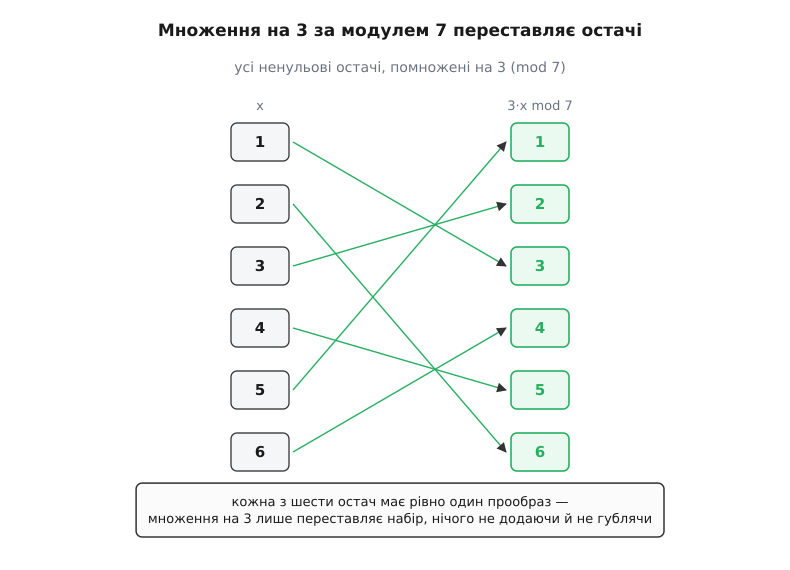
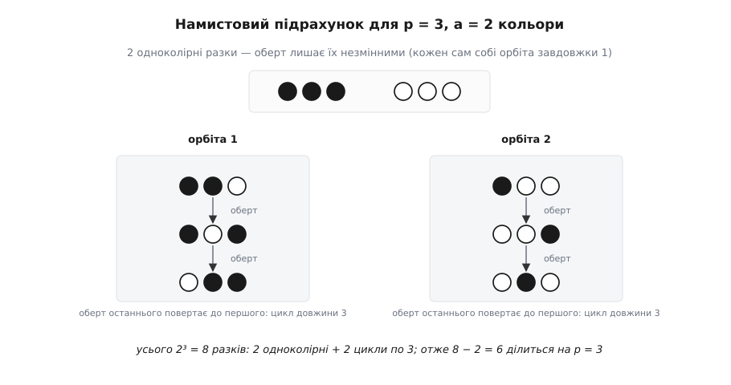
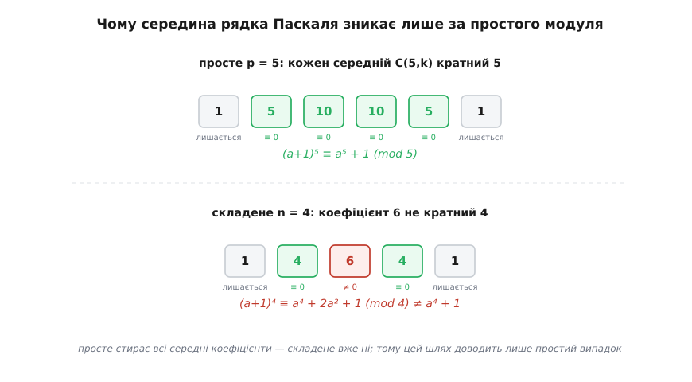
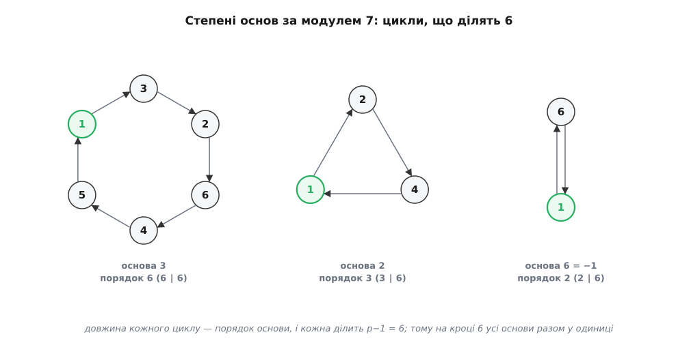
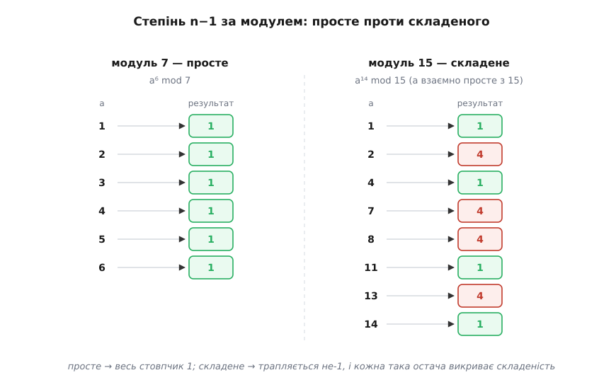

# Мала теорема Ферма

<preknowlist>
- [Модульна арифметика](root:math-number-theory/modular-arithmetic) — запис a ≡ b (mod n) («однакова остача при діленні на n») і дії з остачами: додавання, множення, піднесення до степеня можна вести прямо на остачах.
- [Прості числа](root:math-number-theory/prime-numbers) — число, що ділиться лише на 1 і на себе; вирішальна властивість: якщо просте p ділить добуток a·b, то воно ділить хоча б один із множників.
- [НСД і взаємна простота](root:math-number-theory/gcd-euclidean) — коли найбільший спільний дільник двох чисел дорівнює 1, вони не мають спільного простого множника.
</preknowlist>

**Візьмімо просте число, скажімо 7, і піднесімо до шостого степеня будь-яке число, що на 7 не ділиться.**

```
2⁶ = 64    = 7·9    + 1
3⁶ = 729   = 7·104  + 1
4⁶ = 4096  = 7·585  + 1
5⁶ = 15625 = 7·2232 + 1
```

Щоразу остача — одиниця. Числа настільки різні, як 2 і 5, піднесені до того самого шостого степеня, приходять до тієї самої одиниці. Це не примха сімки: візьміть 11, піднесіть будь-що взаємно просте з 11 до десятого степеня — знову остача 1; візьміть 13, десятий замініть на дванадцятий — знову 1. Складається правило: для простого p кожне число a, не кратне p, піднесене до степеня p−1, дає остачу 1 при діленні на p.

Дивує тут ось що: остача **забуває, з якого числа ми почали**. Різні a, спільна відповідь. Отже, у самій будові простого числа закладено щось, що зрівнює всі його ненульові остачі, тільки-но їх достатньо розкрутити степенем. Знайти це «щось» — і є мета.

## Дві подоби одного твердження

Правило записують так:

```
aᵖ⁻¹ ≡ 1 (mod p),   якщо p просте і p не ділить a
```

Умова «p не ділить a» тут необхідна: якщо a кратне p, то й будь-який його степінь кратний p, остача завжди 0, ніякої одиниці. Тому число a мусить бути взаємно простим із p — а для простого p це те саме, що «не ділиться на p».

Ту саму теорему часто пишуть в іншій, безумовній подобі:

```
aᵖ ≡ a (mod p),   для будь-якого цілого a
```

Ці два записи — одне твердження, просто помножене на a. Якщо aᵖ⁻¹ ≡ 1, то, домноживши обидві частини на a, дістанемо aᵖ ≡ a. А коли a кратне p, обидві частини останнього рядка дорівнюють 0 за модулем p, тож рівність тримається й тут — тому друга подоба обходиться геть без умов і охоплює всі цілі числа заразом. У зворотний бік: якщо aᵖ ≡ a і при цьому a взаємно просте з p, то на a можна [скоротити](root:math-number-theory/modular-inverse) (воно оборотне за модулем p), і лишається aᵖ⁻¹ ≡ 1. Отже, обидві подоби рівносильні; перша говорить про степінь p−1 і вимагає взаємної простоти, друга говорить про степінь p і не вимагає нічого.

## Три дороги до однієї істини: як доводити теорему

Рівність aᵖ ≡ a (mod p) можна довести щонайменше трьома принципово різними шляхами: алгебраїчним перетасуванням лишків, комбінаторним підрахунком намистин та індукцією через біном Ньютона. Кожен шлях відкриває свій пласт структури.

### 1. Алгебраїчний шлях Ейлера: перестановка лишків

Візьмімо всі ненульові остачі за модулем p — числа

```
1, 2, 3, …, p−1
```

і помножмо кожне з них на наше a, а результат зведімо за модулем p. Вийде новий набір: a·1, a·2, …, a·(p−1), кожне взяте за модулем p. Цей новий набір — **ті самі числа 1, 2, …, p−1, лише переставлені в іншому порядку**. Множення на a перетасовує остачі, але не додає й не губить жодної.

Щоб у це переконатися, перевіримо дві речі, і кожна з них тримається саме на простоті p:

1. **Жодне a·k не перетворюється на нуль.** Якби a·k ділилося на p, то, оскільки p просте, воно мусило б ділити або a, або k. Але a на p не ділиться (це наша умова), а k лежить між 1 і p−1, тож і воно на p не кратне. Простий множник нізвідки взятися не може — отже, кожне a·k за модулем p лишається серед ненульових остач 1 … p−1.
2. **Ніякі два результати не збігаються.** Припустимо, що a·i та a·j дають однакову остачу, тобто a·i ≡ a·j (mod p). Тоді p ділить різницю a·(i − j). Знову: p просте, a на нього не ділиться — значить, за лемою Евкліда p ділить (i − j). Але i та j обидва лежать між 1 і p−1, тому їхня різниця за абсолютною величиною строго менша за p. Єдине число, кратне p і менше за p за модулем, — це нуль. Отже, i = j. Різні входи обов'язково дають різні виходи.



*Множення на 3 за модулем 7 переводить набір {1,2,3,4,5,6} сам у себе, лише переставляючи його; стрілки — це бієкція, у якій кожна остача має рівно один прообраз.*

Оскільки відображення ін'єктивне на скінченній множині, набір a·1, a·2, …, a·(p−1) за модулем p — це повна перестановка набору 1, 2, …, p−1. А перестановка не змінює добутку: перемножити ті самі числа в іншому порядку — дістати те саме значення. Прирівняймо два добутки:

```
(a·1)·(a·2)·…·(a·(p−1))  ≡  1·2·…·(p−1)   (mod p)
```

Ліворуч кожен із p−1 співмножників містить число a; винесемо всі ці a разом:

```
aᵖ⁻¹ · (1·2·…·(p−1))  ≡  1·2·…·(p−1)   (mod p)
```

Ліворуч і праворуч стоїть факторіал (p−1)!. Кожне з чисел 1, 2, …, p−1 взаємно просте з p, тож і весь їхній добуток (p−1)! взаємно простий із p. Отже, на (p−1)! можна [скоротити обидві частини рівності](root:math-number-theory/modular-inverse) (помножити на модульний обернений до факторіала):

```
aᵖ⁻¹ ≡ 1 (mod p)
```

**Простежмо доведення на p = 7, a = 3.** Помножмо кожну остачу від 1 до 6 на 3 і зведімо за модулем 7:

```
3·1 = 3  ≡ 3 (mod 7)
3·2 = 6  ≡ 6 (mod 7)
3·3 = 9  ≡ 2 (mod 7)
3·4 = 12 ≡ 5 (mod 7)
3·5 = 15 ≡ 1 (mod 7)
3·6 = 18 ≡ 4 (mod 7)
```

Вийшов набір {3, 6, 2, 5, 1, 4} — та сама шістка {1, 2, 3, 4, 5, 6}, лише перетасована. Перемножуємо:

```
(3·1)·(3·2)·(3·3)·(3·4)·(3·5)·(3·6) ≡ 1·2·3·4·5·6   (mod 7)
3⁶ · (1·2·3·4·5·6)                  ≡ 1·2·3·4·5·6   (mod 7)
3⁶ · 720                            ≡ 720           (mod 7)
```

Оскільки 720 = 7·102 + 6 ≡ 6 (mod 7) і НСД(6, 7) = 1, скорочуємо на 720 і дістаємо 3⁶ ≡ 1 (mod 7). Пряма перевірка: 3⁶ = 729 = 7·104 + 1. Збіглося ідеально.

### 2. Комбінаторний шлях Голомба: кольорові намиста

Другий спосіб, запропонований Юліусом Петерсеном 1872 року та популяризований Соломоном Ґоломбом 1956 року, не вимагає теорії подільності взагалі — він просто рахує предмети двома способами.

Уявімо **разок** — рядок із p намистин, де кожна намистина може бути пофарбована в один із a можливих кольорів.

1. **Прямий підрахунок.** На кожну з p позицій маємо a незалежних варіантів кольору. Усього можливих розфарбованих рядків існує рівно

```
aᵖ
```

2. **Підрахунок за орбітами обертання.** Замкнімо разок у кільце й почнімо зсувати намистини по колу на одну позицію (циклічний зсув). Усі aᵖ рядків розбиваються на групи взаємно перехідних візерунків — орбіти дії циклічного зсуву.

Скільки намистин може бути в такій орбіті?
- **Одноколірні разки.** Якщо всі p намистин мають однаковий колір (наприклад, суцільно червоні чи суцільно сині), оберт нічого не змінює. Такий разок утворює орбіту завдовжки 1. Одноколірних разків існує рівно стільки, скільки кольорів: рівно a.
- **Мішані разки.** Візьмімо будь-який разок, де використано щонайменше два різні кольори. Стверджуємо: його орбіта містить **рівно p** різних рядків. Справді, якби оберт на меншу кількість кроків k (де 0 < k < p) повертав візерунок у початковий стан, період повторення кольорів мусив би ділити загальну довжину p. Але число p — **просте**, його єдині дільники — це 1 і p. Період 1 означає одноколірний разок, який ми вже відкинули. Отже, період може дорівнювати лише p, і всі p циклічних зсувів мішаного разка є строго різними.



*Оберт розкладає всі 2³ разків на орбіти. Одноколірні нерухомі, мішані ходять циклами точно по p = 3 — і саме тому надлишок 8 − 2 накривається цілими трійками.*

Отже, якщо відкинути a одноколірних разків, решта aᵖ − a мішаних рядків розпадаються на групи рівно по p штук:

```
aᵖ − a = p · (кількість мішаних орбіт)   ⟹   aᵖ ≡ a (mod p)
```

**Перевірка для p = 3 намистини, a = 2 кольори (чорний ● та білий ○):**
Усього рядків 2³ = 8.
- Одноколірні (орбіти довжини 1): {●●●} та {○○○} — рівно 2 штуки.
- Мішані (8 − 2 = 6 штук), що розпадаються на дві орбіти довжини 3:
  - Орбіта 1: {●●○, ●○●, ○●●}
  - Орбіта 2: {●○○, ○○●, ○●○}
Маємо 8 − 2 = 6 = 2·3, отже 2³ ≡ 2 (mod 3). Докладніший комбінаторний аналіз і розбір перестановок дивіться у [додаткових доведеннях теореми](root:math-number-theory/fermat-little-theorem/math-more-proofs.md).

### 3. Індуктивний шлях: біном Ньютона й «мрія першокурсника»

Третій підхід спирається на [математичну індукцію](root:math-logic/mathematical-induction) за значенням основи a при фіксованому простому модулі p.

**База індукції.** Для a = 0 рівність 0ᵖ = 0 ≡ 0 (mod p) очевидна. Для a = 1 маємо 1ᵖ = 1 ≡ 1 (mod p).

**Крок індукції.** Припустимо, що твердження істинне для числа a, тобто aᵖ ≡ a (mod p). Розглянемо наступне число (a + 1) і піднесемо його до степеня p за формулою [бінома Ньютона](root:math-combinatorics/combinations):

```
(a + 1)ᵖ = aᵖ + C(p,1)·aᵖ⁻¹ + C(p,2)·aᵖ⁻² + … + C(p,p−1)·a + 1
```

де C(p, k) — біноміальний коефіцієнт («число сполук з p по k»):

```
C(p, k) = p! / (k! · (p − k)!)
```

Дослідимо середні члени розкладу, де 1 ≤ k ≤ p−1. Запишемо тотожність:

```
k · C(p, k) = p · C(p−1, k−1)
```

Права частина явно ділиться на просте число p, отже, і ліва частина k · C(p, k) ділиться на p. Але k лежить у межах 1 ≤ k ≤ p−1, тобто k строго менше за p і не може ділитися на p. За лемою Евкліда про подільність добутку на просте число, якщо p ділить k · C(p, k) і НСД(k, p) = 1, то p **обов'язково ділить сам коефіцієнт C(p, k)**.

Це означає, що за модулем p кожен внутрішній доданок розкладу обертається на нуль:

```
C(p, k) ≡ 0 (mod p)   для всіх 1 ≤ k ≤ p−1
```

У результаті розклад бінома редукується до тотожності, яку в алгебрі звуть **ендоморфізмом Фробеніуса** (або жартівливо — «мрією першокурсника»):

```
(a + 1)ᵖ ≡ aᵖ + 1 (mod p)
```



*За простого модуля вся середина рядка Паскаля обертається на нуль — лишаються тільки крайні aᵖ та 1. За складеного серед коефіцієнтів знаходиться «недільний» (для n = 4 це 6), і мрія першокурсника не справджується.*

Тепер крок індукції замикається в один рядок:

```
(a + 1)ᵖ ≡ aᵖ + 1 ≡ a + 1 (mod p)
```

Твердження доведено для всіх невід'ємних цілих a. Для від'ємних чисел рівність поширюється автоматично: при непарному p маємо (−a)ᵖ = −(aᵖ) ≡ −a (mod p), а при p = 2 знаки плюс і мінус за модулем 2 збігаються.

### Порівняння трьох шляхів: чому для узагальнення годиться лише один

Придивімося, чому доведення через намисто та біном Ньютона принципово зачинені всередині простих модулів. Намисто вимагає відсутності проміжних дільників у p (для n = 4 візерунок ●○●○ має період 2, тому орбіта містить лише 2 елементи, і подільність руйнується). Біном вимагає подільності всіх середніх коефіцієнтів C(n, k) на n (для n = 4 коефіцієнт C(4,2) = 6 не ділиться на 4).

Натомість алгебраїчний шлях Ейлера вимагає лише однієї речі: щоб відображення x ↦ a·x було **бієкцією** (перестановкою), а спільний добуток можна було скоротити. Для цього непотрібна абсолютна простота модуля n — достатньо, щоб елемент a був **оборотним**, тобто НСД(a, n) = 1. Саме тому узагальнення малої теореми Ферма на складені модулі виростає безпосередньо з перестановкового доведення.

## Порядок остачі та мультиплікативна група

Теорема Ферма стверджує, що aᵖ⁻¹ ≡ 1 (mod p), але одиниця нерідко виникає значно раніше.

Розглянемо степені двійки за модулем 7:
```
2¹ = 2
2² = 4
2³ = 8 ≡ 1 (mod 7)
```
Одиниця з'явилася вже на третьому кроці. Далі степені циклічно повторюються: 2⁴ ≡ 2, 2⁵ ≡ 4, 2⁶ ≡ 1.

Найменший додатний показник степеня k ≥ 1, для якого aᵏ ≡ 1 (mod p), називають [мультиплікативним порядком](root:math-number-theory/multiplicative-order) числа a за модулем p і позначають `ord_p(a)`.

Як порядок k = 3 узгоджується з показником p−1 = 6? Напряму: 2⁶ = (2³)² ≡ 1² = 1. Степінь потрапляє в 1 на кожному кроці, кратному 3.

**Теорема про подільність показника:** Якщо aᵐ ≡ 1 (mod p), то порядок `ord_p(a)` обов'язково ділить m. Зокрема, `ord_p(a)` завжди є дільником числа p−1.

Доведення діленням з остачею:
Поділимо p−1 на порядок k:
```
p − 1 = q·k + r,   де 0 ≤ r < k
```
Піднесемо a до степеня p−1:
```
aᵖ⁻¹ = a^(q·k + r) = (aᵏ)ᵍ · aʳ ≡ 1ᵍ · aʳ = aʳ (mod p)
```
Оскільки за теоремою Ферма aᵖ⁻¹ ≡ 1, маємо aʳ ≡ 1 (mod p). Якби остача r була більшою за нуль (0 < r < k), ми знайшли б додатний показник r, строго менший за мінімальний порядок k, що дає одиницю. Це суперечить означенню k як найменшого степеня. Отже, остача r = 0, що означає: k націло ділить p−1.



*Кожна основа котиться своїм замкненим циклом остач; довжина циклу — це порядок основи, і кожна з довжин ділить p−1 = 6. Тому на кроці 6 усі основи одночасно опиняються в одиниці.*

Мовою [теорії груп](root:math-algebra/group-theory), ненульові остачі за простим модулем утворюють мультиплікативну групу (ℤ/pℤ)* порядку p−1. За теоремою Лагранжа, порядок будь-якого елемента групи ділить порядок самої групи. Елементи, порядок яких дорівнює в точності p−1 (як число 3 за модулем 7), генерують усю групу і називаються **первісними коренями**.

## Узагальнення: теорема Ейлера та теорема Кармайкла

Коли модуль m складений, піднесення до степеня m−1 взагалі не гарантує одиниці. Наприклад, для m = 15 і основи a = 2 маємо:

```
2⁴ = 16 ≡ 1 (mod 15)
2¹⁴ = (2⁴)³ · 2² ≡ 1³ · 4 = 4 (mod 15)
```

Остача дорівнює 4, а не 1. Причина очевидна: складений модуль містить дільники нуля (3·5 ≡ 0 mod 15), тому множення на a переставляє не всі остачі, а лише ті, що не мають спільних дільників із модулем.

### Теорема Ейлера: звуження до взаємно простих лишків

Кількість чисел у проміжку від 1 до m, які взаємно прості з m, задає [функція Ейлера](root:math-number-theory/euler-totient) φ(m). Набір таких лишків називають **зведеною системою залишків**:

```
{ r₁, r₂, …, r_φ(m) }
```

Якщо взяти число a, взаємно просте з m (тобто НСД(a, m) = 1), і помножити кожен елемент rᵢ на a, ми отримаємо набір {a·r₁, a·r₂, …, a·r_φ(m)}, який є точною перестановкою початкової зведеної системи залишків за модулем m.

Перемноживши всі елементи:

```
(a·r₁)·(a·r₂)·…·(a·r_φ(m)) ≡ r₁·r₂·…·r_φ(m) (mod m)
a^φ(m) · ∏ rᵢ ≡ ∏ rᵢ (mod m)
```

Оскільки кожне rᵢ взаємно просте з m, весь їхній добуток ∏ rᵢ також взаємно простий із m, і на нього можна скоротити:

```
a^φ(m) ≡ 1 (mod m),   якщо НСД(a, m) = 1
```

Це **теорема Ейлера**. Мала теорема Ферма є її окремим випадком: коли p просте, усі числа 1, 2, …, p−1 взаємно прості з p, тобто φ(p) = p−1, і формула повертає aᵖ⁻¹ ≡ 1.

**Приклад для m = 10:**
Числа, взаємно прості з 10: {1, 3, 7, 9}, отже φ(10) = 4.
Візьмемо a = 3:
```
3⁴ = 81 = 10·8 + 1 ≡ 1 (mod 10)
```
Візьмемо a = 7:
```
7⁴ = 2401 = 10·240 + 1 ≡ 1 (mod 10)
```

### Теорема Кармайкла: точний універсальний показник λ(m)

Чи є показник φ(m) найменшим степенем, що дає одиницю для всіх взаємно простих основ одночасно?

Для простих модулів p та їхніх степенів pᵏ — так. Проте для складених модулів група (ℤ/mℤ)* за [Китайською теоремою про залишки](root:math-number-theory/chinese-remainder-theorem) ізоморфна прямому добутку незалежних циклічних груп. Одиниці в кожній компоненті досягаються паралельно, тому спільний показник визначається не добутком порядків, а їхнім найменшим спільним кратним.

Цей мінімальний універсальний показник задає [функція Кармайкла](root:math-number-theory/carmichael-function) `λ(m)`:
- для степенів двійки: `λ(2) = 1`, `λ(4) = 2`, `λ(2ᵏ) = 2^(k−2)` при k ≥ 3;
- для степенів непарних простих: `λ(pᵏ) = φ(pᵏ) = p^(k−1)·(p − 1)`;
- для канонічного розкладу `m = p₁^k₁ · p₂^k₂ · … · p_r^k_r`:

```
λ(m) = НСК( λ(p₁^k₁), λ(p₂^k₂), …, λ(p_r^k_r) )
```

**Теорема Кармайкла:** Для будь-якого a, взаємно простого з m:

```
a^λ(m) ≡ 1 (mod m)
```

Оскільки λ(m) завжди ділить φ(m), показник Кармайкла часто набагато менший за показник Ейлера.

**Розглянемо m = 15 = 3 · 5:**
```
φ(15) = φ(3) · φ(5) = 2 · 4 = 8
λ(15) = НСК(φ(3), φ(5)) = НСК(2, 4) = 4
```
Перевіримо всі вісім взаємно простих із 15 остач у 4-му степені:
```
1⁴  = 1    ≡ 1 (mod 15)
2⁴  = 16   ≡ 1 (mod 15)
4⁴  = 256  ≡ 1 (mod 15)
7⁴  = 2401 ≡ 1 (mod 15)
8⁴  = 4096 ≡ 1 (mod 15)
11⁴ = (15−4)⁴ ≡ (−4)⁴ = 256 ≡ 1 (mod 15)
13⁴ = (15−2)⁴ ≡ (−2)⁴ = 16  ≡ 1 (mod 15)
14⁴ = (15−1)⁴ ≡ (−1)⁴ = 1   ≡ 1 (mod 15)
```
Кожне взаємно просте число досягає одиниці вже на степені 4, що рівно вдвічі менше за φ(15) = 8.



*Ліворуч простий модуль: усі ненульові остачі, піднесені до p−1, дають 1. Праворуч складений: навіть серед взаємно простих остач знаходяться такі, чий (n−1)-й степінь не 1 — саме на цій відмінності будують тест на простоту.*

## Псевдопрості числа та числа Кармайкла

Мала теорема Ферма дає необхідну умову простоти: якщо n просте, то aⁿ⁻¹ ≡ 1 (mod n) для всіх a, не кратних n. Якщо обернути це твердження як контрапозицію, маємо потужний фільтр складеності: якщо для деякої основи a виявилося, що aⁿ⁻¹ ≢ 1 (mod n), то число n **гарантовано складене**.

Проте зворотне твердження хибне: виконання рівності aⁿ⁻¹ ≡ 1 (mod n) **не доводить**, що n просте.

### Псевдопрості числа Ферма за основою a

Складене число n, для якого виконується конгруенція

```
aⁿ⁻¹ ≡ 1 (mod n)
```

називають **псевдопростим числом Ферма за основою a**. Для такого числа основа a виступає «брехуном» (Fermat liar), оскільки тест приймає складене число за просте.

Найменшим псевдопростим числом Ферма за основою 2 є **341 = 11 · 31**.

Покажемо, чому 2³⁴⁰ ≡ 1 (mod 341):
1. За модулем 31:
```
2⁵ = 32 ≡ 1 (mod 31)
2³⁴⁰ = (2⁵)⁶⁸ ≡ 1⁶⁸ = 1 (mod 31)
```
2. За модулем 11:
```
2⁵ = 32 ≡ −1 (mod 11)   ⟹   2¹⁰ = (2⁵)² ≡ (−1)² = 1 (mod 11)
2³⁴⁰ = (2¹⁰)³⁴ ≡ 1³⁴ = 1 (mod 11)
```
Оскільки 2³⁴⁰ − 1 ділиться і на 31, і на 11, а числа 31 та 11 взаємно прості, різниця 2³⁴⁰ − 1 ділиться на їхній добуток 341:
```
2³⁴⁰ ≡ 1 (mod 341)
```
Основа 2 нездатна викрити складеність числа 341. Проте достатньо змінити основу на a = 3:
```
3³⁴⁰ ≡ 56 (mod 341) ≠ 1
```
Основа 3 є «свідком складеності» (Fermat witness) і миттєво доводить, що 341 — складене число.

### Абсолютні псевдопрості числа (числа Кармайкла)

Чи існують складені числа, які обманюють тест Ферма за **всіма** взаємно простими основами a одночасно?

Такі числа існують і називаються **числами Кармайкла** (або абсолютними псевдопростими). Для них конгруенція aⁿ⁻¹ ≡ 1 (mod n) виконується для кожного цілого a, взаємно простого з n. Мовою функції Кармайкла це означає, що універсальний показник `λ(n)` націло ділить `n − 1`.

**Критерій Корсельта (1899):** Складене число n є числом Кармайкла тоді й лише тоді, коли:
1. n є **вільним від квадратів** (не ділиться на p² для жодного простого p);
2. Для кожного простого дільника p числа n різниця **p − 1 ділить n − 1** (тобто `(p − 1) ∣ (n − 1)`).

**Доведення достатності критерію Корсельта:**
Нехай n = p₁ · p₂ · … · p_k — добуток попарно різних простих чисел, і для кожного дільника p_i виконується умова n − 1 = c_i · (p_i − 1).
Нехай a — будь-яке число, взаємно просте з n. Тоді a не ділиться на жодне p_i.
За малою теоремою Ферма:
```
a^(p_i − 1) ≡ 1 (mod p_i)
```
Піднесемо обидві частини до степеня c_i:
```
aⁿ⁻¹ = a^(c_i · (p_i − 1)) = (a^(p_i − 1))^c_i ≡ 1^c_i = 1 (mod p_i)
```
Оскільки aⁿ⁻¹ ≡ 1 (mod p_i) для кожного простого дільника p_i, то за [Китайською теоремою про залишки](root:math-number-theory/chinese-remainder-theorem) рівність виконується і за їхнім спільним добутком:
```
aⁿ⁻¹ ≡ 1 (mod n)
```

**Чому число Кармайкла мусить бути вільним від квадратів?**
Якби n ділилося на p², група (ℤ/p²ℤ)* містила б елементи порядку p·(p−1). Щоб рівність aⁿ⁻¹ ≡ 1 трималася за модулем p², степінь n−1 мусив би ділитися на p. Але p ділить n, тому p ділило б різницю n − (n − 1) = 1, що неможливо.

**Найменше число Кармайкла — 561 = 3 · 11 · 17.**
Перевіримо умови Корсельта:
1. 561 є вільним від квадратів (3, 11, 17 — перші степені).
2. Перевірка дільників для n − 1 = 560:
   - для p₁ = 3:  p₁ − 1 = 2;   560 = 2 · 280   (2 ділить 560);
   - для p₂ = 11: p₂ − 1 = 10;  560 = 10 · 56   (10 ділить 560);
   - для p₃ = 17: p₃ − 1 = 16;  560 = 16 · 35   (16 ділить 560).
Усі умови виконано!

Обчислимо універсальний показник Кармайкла:
```
λ(561) = НСК(3−1, 11−1, 17−1) = НСК(2, 10, 16) = 80
```
Оскільки 560 = 80 · 7, для будь-якої основи a, взаємно простої з 561, маємо:
```
a⁵⁶⁰ = (a⁸⁰)⁷ ≡ 1⁷ = 1 (mod 561)
```


*Ліворуч від кожної клітинки — основа a, усередині — доля aⁿ⁻¹ mod n. У 341 є зелені свідки, тож кілька основ його викривають. У 561 зелених немає взагалі: усі взаємно прості основи брешуть, і конгруенція Ферма безсила — лишаються тільки сірі «випадкові» влучення в дільник, яких у великих чисел Кармайкла практично не буває.*

Наступні числа Кармайкла: 1105 = 5 · 13 · 17, 1729 = 7 · 13 · 19 (знамените число Гарді — Рамануджана), 2465 = 5 · 17 · 29, 2821 = 7 · 13 · 31.

1994 року Вільям Олфорд, Ендрю Ґранвіль та Карл Померанс строго довели, що чисел Кармайкла існує **нескінченно багато**, тому простий тест Ферма принципово неможливо зробити надійним лише збільшенням кількості випадкових основ.

## Застосування в обчисленнях та асиметричній криптографії

Мала теорема Ферма лежить у фундаменті комп'ютерної алгебри та криптографії з відкритим ключем.

### 1. Зведення астрономічних степенів

Нехай треба знайти остачу від ділення 3¹⁰⁰⁰⁰⁰⁰ на 7. Пряме піднесення дало б число з майже півмільйона десяткових цифр. Але 3⁶ ≡ 1 (mod 7), тому показник степеня можна редукувати за модулем p − 1 = 6:

```
1000000 = 6 · 166666 + 4
3¹⁰⁰⁰⁰⁰⁰ = (3⁶)¹⁶⁶⁶⁶⁶ · 3⁴ ≡ 1¹⁶⁶⁶⁶⁶ · 3⁴ = 3⁴ (mod 7)
3⁴ = 81 = 7 · 11 + 4 ≡ 4 (mod 7)
```
Замість мільйона операцій — одне ділення показника та піднесення до четвертого степеня за допомогою [швидкого піднесення до степеня за модулем](root:math-number-theory/modular-exponentiation).

### 2. Модульне обернення й константний час

Ділення за модулем простого числа p — це множення на обернений елемент a⁻¹, для якого a · a⁻¹ ≡ 1 (mod p).
Розщепивши теорему Ферма:
```
a · aᵖ⁻² = aᵖ⁻¹ ≡ 1 (mod p)   ⟹   a⁻¹ ≡ aᵖ⁻² (mod p)
```

Наприклад, обернений до 3 за модулем 7:
```
3⁻¹ ≡ 3⁷⁻² = 3⁵ = 243 = 7 · 34 + 5 ≡ 5 (mod 7)
Перевірка: 3 · 5 = 15 = 7 · 2 + 1 ≡ 1 (mod 7)
```

> 🔧 **Навіщо це.** У криптографії на еліптичних кривих (наприклад, протоколи Ed25519 та secp256k1 у Bitcoin) обчислення оберненого елемента за розширеним алгоритмом Евкліда є вразливим до атак за часом виконання (timing side-channel attacks), оскільки кількість ітерацій та гілкувань у ньому залежить від бітів секретного ключа. Натомість піднесення до фіксованого степеня p − 2 виконується алгоритмом квадратів-множень за строго однакове число тактів процесора незалежно від вхідного значення, забезпечуючи константний час роботи (constant-time execution).

### 3. Асиметрична криптосистема RSA: доведення коректності

У криптосистемі [RSA](root:sf-security/rsa) вибирають два великі прості числа p і q, обчислюють модуль n = p · q та функцію Ейлера φ(n) = (p − 1)(q − 1) (або функцію Кармайкла λ(n) = НСК(p − 1, q − 1)).

Відкритий показник e та таємний показник d пов'язані співвідношенням:
```
e · d ≡ 1 (mod φ(n))   ⟹   e · d = 1 + k · (p − 1)(q − 1)
```
Шифрування повідомлення m перетворює його на шифротекст c = mᵉ mod n. Розшифрування обчислює cᵈ mod n = m^(e·d) mod n.

Чому m^(e·d) ≡ m (mod n) для **будь-якого** повідомлення m?
Доведемо це малою теоремою Ферма окремо для модулів p та q:

1. **За модулем p:**
   - Якщо m не ділиться на p, то за малою теоремою Ферма mᵖ⁻¹ ≡ 1 (mod p):
     ```
     m^(e·d) = m^(1 + k(p − 1)(q − 1)) = m · (m^(p − 1))^(k(q − 1)) ≡ m · 1^(k(q − 1)) = m (mod p)
     ```
   - Якщо m ділиться на p, то m ≡ 0 (mod p), отже 0^(e·d) ≡ 0 ≡ m (mod p).
   В обох випадках m^(e·d) ≡ m (mod p).

2. **За модулем q:**
   - Повністю аналогічно: m^(e·d) ≡ m (mod q).

3. **Об'єднання за модулем n = p · q:**
   Оскільки p і q — різні прості числа, їхній НСД дорівнює 1. З конгруенцій m^(e·d) ≡ m (mod p) та m^(e·d) ≡ m (mod q) за [Китайською теоремою про залишки](root:math-number-theory/chinese-remainder-theorem) випливає:
   ```
   m^(e·d) ≡ m (mod p · q)   ⟹   cᵈ ≡ m (mod n)
   ```
Розшифрування завжди повертає початковий відкритий текст m.

### 4. Тести простоти та генерація криптографічних ключів

Для створення ключів RSA необхідно знаходити випадкові прості числа на сотні й тисячі бітів (наприклад, 1024 або 2048 бітів). Перебір дільників до √n вимагав би ~10¹⁵⁰ операцій, що фізично неможливо.

**Тест простоти Ферма** перевіряє випадкові основи a ∈ [2, n − 2]:
- якщо aⁿ⁻¹ ≢ 1 (mod n), то n — гарантовано складене число;
- якщо aⁿ⁻¹ ≡ 1 (mod n), n оголошується ймовірно простим.
Детальний аналіз алгоритму та його програмну реалізацію мовами C і Python наведено у [проєктній вставці тесту Ферма](root:math-number-theory/fermat-little-theorem/proj-fermat-test.md).

**Як тест Міллера — Рабіна закриває діру чисел Кармайкла:**
Числа Кармайкла обманюють тест Ферма, проте їх викриває [тест Міллера — Рабіна](root:math-number-theory/miller-rabin).
Алгоритм розкладає n − 1 у вигляд 2ˢ · d (де d непарне) і перевіряє послідовність піднесень до квадрата:
```
aᵈ, a^(2d), a^(4d), …, a^(2ˢ · d) = aⁿ⁻¹ (mod n)
```
У простому полі ℤₚ рівняння x² ≡ 1 (mod p) має рівно два розв'язки: x ≡ 1 та x ≡ −1. Якщо число n складене, у ньому обов'язково існують **нетривіальні корені з одиниці** — числа x ≢ ±1 (mod n), для яких x² ≡ 1 (mod n). Щойно алгоритм зустрічає такий корінь під час послідовного піднесення до квадрата, складеність числа n вважається доведеною на 100%.

Для будь-якого складеного числа (включно з числами Кармайкла) щонайменше 3/4 усіх можливих основ a є надійними свідками Міллера — Рабіна. Перевірка k незалежних основ гарантує ймовірність помилки не більше (1/4)ᵏ; для k = 40 шанс помилитися менший за 2⁻⁸⁰ ≈ 10⁻²⁴, що перевершує надійність будь-якого комп'ютерного обладнання.

## Звідки вона взялася

Теорему сформулював П'єр де Ферма в листі до Френікля де Бессі від 18 жовтня 1640 року, ствердивши її для всіх простих і всіх основ — і, за своїм звичаєм, доведення не навів: «я надіслав би вам доведення, коли б не боявся, що воно надто довге». Чи мав він його насправді — невідомо; жодного запису не збереглося. Першу опубліковану доводку дав Леонард Ейлер 1736 року, хоча незалежно від нього по суті те саме доведення раніше, десь до 1683 року, записав у неопублікованому рукописі Ґотфрід Ляйбніц.

Назва «мала» (нім. *kleiner Fermatscher Satz*) з'явилася в друку пізно — у «Теорії чисел» Курта Гензеля 1913 року — і потрібна лише щоб не плутати цю елементарну теорему з іншою, [великою (останньою) теоремою Ферма](root:math-number-theory/fermats-last-theorem) про рівняння xⁿ + yⁿ = zⁿ, яку доведено аж 1995 року й яка з малою не має нічого спільного, крім прізвища автора. [Історія народження теореми](root:math-number-theory/fermat-little-theorem/hist-fermat-1640.md) — з листуванням Ферма, доведеннями Ейлера й розвінчанням легенди про «стародавніх китайців», які нібито знали цей факт за дві тисячі років до нашої ери, — заслуговує на окрему розповідь.

Умова «a взаємно просте з p» на початку виглядала суто технічним застереженням. Насправді вона є фундаментальним порогом: тільки-но основа стає оборотною, її степені утворюють замкнену циклічну групу, довжина якої ділить p − 1. Мала теорема Ферма — це міст, що поєднує елементарну подільність цілих чисел з алгебраїчною архітектурою скінченних полів, на яких тримається сучасна цифрова безпека.

