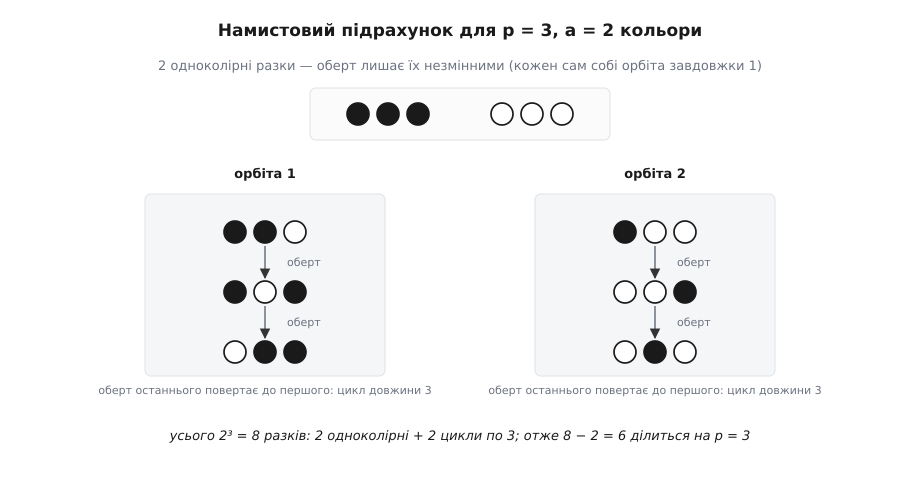
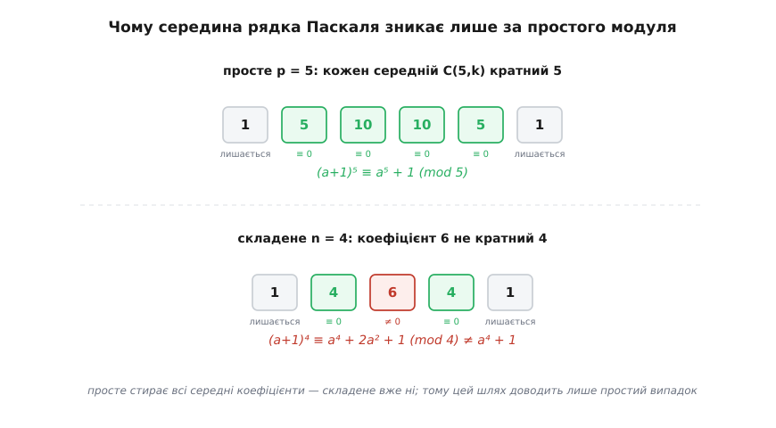

# 📿 Намисто й біном: ще два доведення малої теореми Ферма

Рівність aᵖ ≡ a (mod p) для простого числа p можна отримати кількома принципово різними шляхами. Перестановкове доведення Ейлера через скорочення на факторіал (p−1)! — найвідоміше, але далеко не єдине. Тут детально розібрано інші підходи: комбінаторний підрахунок розфарбувань замкненого намиста (дія циклічної групи та циклічний індекс Поя), індуктивне доведення через біном Ньютона, теорему Люка та ендоморфізм Фробеніуса, прямий поліноміальний розклад Ляйбніца та динамічний підрахунок періодичних орбіт відображення розтягування на колі.

Кожне з цих доведень розкриває власну грань теореми. Але що не менш важливо — кожне з них **показово ламається на складеному модулі**, і те, як саме воно ламається, пояснює, чому фундаментальне узагальнення на довільний модуль (теорема Ейлера a^φ(m) ≡ 1 mod m) виросло саме з перестановки, а не з намиста чи бінома.

## Намисто: підрахунок орбіт дії циклічної групи

Комбінаторний підхід спирається на класичний математичний прийом: один і той самий скінченний набір об'єктів підраховують двома різними способами. Перший спосіб дає повну кількість об'єктів у вигляді степеня aᵖ, а другий спосіб групує їх у симетричні блоки однакового розміру p, завдяки чому множник p виникає сам собою.

### 1. Прямий підрахунок усіх можливих розфарбувань

Уявімо **разок** — лінійну послідовність із p намистин, розташованих у ряд. Кожну намистину ми можемо пофарбувати в один із a доступних кольорів.

Скільки всього різних розфарбованих рядків можна скласти?
- для першої намистини маємо a незалежних варіантів;
- для другої — a незалежних варіантів;
- …
- для p-ї намистини — a незалежних варіантів.

Оскільки вибір кольору на кожній позиції є незалежним, загальна кількість усіх можливих розфарбованих рядків дорівнює:

```
a · a · … · a = aᵖ
```

Це наш перший, прямий результат.

### 2. Групування за орбітами циклічного зсуву

Тепер замкнемо наш разок у кільцеве намисто, з'єднавши останню p-ту намистину з першою. Почнемо повертати це кільце: циклічний зсув на один крок переводить 1-шу намистину на 2-гу позицію, 2-гу — на 3-тю, …, а p-ту — на 1-шу.

Мовою [теорії груп](root:math-algebra/group-theory), на множині X усіх aᵖ розфарбувань діє циклічна група обертань G = C_p = ℤ/pℤ порядку p. Два намиста вважаються еквівалентними (належать до однієї **орбіти**), якщо одне можна отримати з іншого деяким поворотом. Обертання розбиває всю множину X на неперетинні класи еквівалентності — орбіти.

Скільки елементів може містити одна орбіта? За теоремою про стабілізатор та орбіту, розмір будь-якої орбіти зобов'язаний бути дільником порядку групи |G| = p. Оскільки число p — **просте**, воно має лише два натуральні дільники: 1 та p.

Звідси випливає фундаментальна дихотомія:
1. **Одноколірні намиста (орбіти розміру 1).** Якщо всі p намистин пофарбовані в один і той самий колір (суцільно білі, суцільно чорні тощо), будь-який поворот переводить намисто саме в себе. Воно утворює орбіту, що складається рівно з одного елемента. Одноколірних намист існує рівно стільки, скільки кольорів: рівно a.
2. **Мішані намиста (орбіти розміру p).** Візьмімо будь-яке намисто, де використано щонайменше два різні кольори. Воно не може мати стабілізатора розміру p (бо воно не одноколірне). Єдиний можливий дільник — 1, отже його орбіта містить **рівно p** попарно різних розфарбувань. Меншої кількості бути не може, бо якби візерунок збігся сам із собою при зсуві на k позицій (де 0 < k < p), крок k мусив би ділити період p, що неможливо для простого p.

### 3. Замикання рівності та лема Бернсайда

Якщо ми відкинемо a одноколірних намист, решта aᵖ − a мішаних розфарбувань розіб'ються на цілу кількість блоків, кожен з яких містить рівно p елементів:

```
aᵖ − a = p · N_мішаних
```

де N_мішаних — кількість мішаних орбіт. Оскільки N_мішаних є цілим числом, різниця aᵖ − a ділиться на p націло:

```
aᵖ ≡ a (mod p)
```

Застосуємо лему Бернсайда (Коші — Фробеніуса) для підрахунку загальної кількості різних фізичних намист N:

```
N = (1 / |G|) · ∑ |Xᵍ| = (1 / p) · (aᵖ + (p − 1) · a) = (aᵖ − a) / p + a
```

Оскільки число різних намист N є цілим, дріб (aᵖ − a) / p обов'язково є цілим числом.

Мовою теорії переліку Поя, циклічний індекс циклічної групи простого порядку C_p має вигляд:

```
Z(C_p) = (1 / p) · (x₁ᵖ + (p − 1) · x_p¹)
```

Підставивши замість кожної змінної x_k кількість кольорів a, ми миттєво отримуємо формулу загальної кількості намист N = Z(C_p)(a, a, …, a) = (aᵖ + (p − 1)·a) / p, з якої подільність aᵖ ≡ a (mod p) випливає як прямий наслідок цілочисельності результату.

**Числовий приклад 1: p = 3, a = 2 (два кольори: ● та ○)**
Усього розфарбувань 2³ = 8.
- 2 одноколірні (орбіти довжини 1): {●●●} та {○○○}.
- 6 мішаних, розбитих на 2 орбіти довжини 3:
  - Орбіта 1: {●●○, ●○●, ○●●}
  - Орбіта 2: {●○○, ○○●, ○●○}
Маємо: 8 − 2 = 6 = 2 · 3, отже 2³ ≡ 2 (mod 3).



*Оберт розкладає всі 2³ разків на орбіти. Одноколірні нерухомі, мішані ходять циклами точно по p = 3 — і саме тому надлишок 8 − 2 накривається цілими трійками.*

**Числовий приклад 2: p = 5, a = 2**
Усього розфарбувань 2⁵ = 32.
- 2 одноколірні: {●●●●●} та {○○○○○}.
- 30 мішаних намистин розпадаються на рівно 30 / 5 = 6 орбіт довжини 5:
  1. 1 біла намистина: {●●●●○, ●●●○●, ●●○●●, ●○●●●, ○●●●●}
  2. 2 білі намистини поруч: {●●●○○, ●●○○●, ●○○●●, ○○●●●, ○●●●○}
  3. 2 білі намистини через одну: {●●○●○, ●○●○●, ○●○●●, ●○●●○, ○●●○●}
  4. 3 білі намистини поруч: {●●○○○, ●○○○●, ○○○●●, ○○●●○, ○●●○○}
  5. 3 білі намистини через одну: {●○●○○, ○●○○●, ●○○●○, ○○●○●, ○●○●○}
  6. 4 білі намистини: {●○○○○, ○○○○●, ○○○●○, ○○●○○, ○●○○○}
Загальна кількість фізичних намист: N = 6 + 2 = 8.
Рівність 32 − 2 = 30 = 6 · 5 підтверджує подільність: 2⁵ ≡ 2 (mod 5).

Цей комбінаторний підхід у формі перестановок опублікував данський математик Юліус Петерсен 1872 року, а наочний образ розфарбованого намиста запропонував американський математик Соломон Ґоломб 1956 року.

### Де ламається комбінаторне доведення на складеному модулі

Розглянемо докладніше, як саме руйнується симетрія для складених модулів n = 4 та n = 6.

**Випадок n = 4, a = 2:**
Загальна кількість розфарбувань 2⁴ = 16. Одноколірних намист — 2 ({●●●●}, {○○○○}).
Мішаних намист лишається 16 − 2 = 14.
Число 14 не ділиться на 4: 14 = 4 · 3 + 2.
Причина: дільник d = 2 породжує орбіту періоду 2:
{●○●○, ○●○●} — містить лише 2 елементи замість 4.
Решта 12 рядків утворюють 3 орбіти довжини 4:
- {●●●○, ●●○●, ●○●●, ○●●●}
- {●●○○, ●○○●, ○○●●, ○●●○}
- {●○○○, ○○○●, ○○●○, ○●○○}
Сума розмірів: 2·1 + 1·2 + 3·4 = 16. Проміжна двійка заважає подільності 14 на 4.

**Випадок n = 6, a = 2:**
Загальна кількість розфарбувань 2⁶ = 64.
- Одноколірні (період 1, орбіти довжини 1): 2 штуки ({●●●●●●}, {○○○○○○}).
- Період 2 (орбіти довжини 2, бо d = 2 ділить 6): {●○●○●○, ○●○●○●} — рівно 1 орбіта з 2 елементів.
- Період 3 (орбіти довжини 3, бо d = 3 ділить 6):
  - {●●○●●○, ●○●●○●, ○●●○●●} (3 елементи);
  - {○○●○○●, ○●○○●○, ●○○●○○} (3 елементи).
  Усього 2 орбіти по 3 елементи (разом 6 елементів).
- Повний період 6: решта 64 − (2 + 2 + 6) = 54 елементи, що розпадаються на 54 / 6 = 9 орбіт довжини 6.

Загальна кількість розфарбувань: 2·1 + 1·2 + 2·3 + 9·6 = 2 + 2 + 6 + 54 = 64.
Якщо відкинути 2 одноколірні, лишається 64 − 2 = 62 розфарбування. Чи ділиться 62 на 6?
62 = 6 · 10 + 2 (остача 2). Подільність не виконується, і 2⁶ = 64 ≡ 4 ≢ 2 (mod 6).
Зайві залишки виникають саме через орбіти проміжних довжин 2 та 3, яких простий модуль не має.

## Біном Ньютона, теорема Люка та ендоморфізм Фробеніуса

Другий шлях базується на [математичній індукції](root:math-logic/mathematical-induction) за значенням основи a при фіксованому простому p.

### 1. Біноміальний коефіцієнт та лема Евкліда

Розглянемо вираз (a + 1)ᵖ і розкриємо його за формулою [бінома Ньютона](root:math-combinatorics/combinations):

```
(a + 1)ᵖ = aᵖ + C(p,1)·aᵖ⁻¹ + C(p,2)·aᵖ⁻² + … + C(p,p−1)·a + 1
```

де біноміальний коефіцієнт C(p, k) задається формулою:

```
C(p, k) = p! / (k! · (p − k)!)
```

Дослідимо подільність коефіцієнтів C(p, k) для всіх внутрішніх доданків, де 1 ≤ k ≤ p−1.
Запишемо тотожність:

```
k · C(p, k) = p · C(p − 1, k − 1)
```

(Обидві частини тотожності підраховують кількість способів вибрати з p кандидатів комітет із k осіб і призначити в ньому голову).

Права частина рівності p · C(p − 1, k − 1) явно ділиться на ціле число p. Отже, і ліва частина k · C(p, k) ділиться на p:

```
p  ділить  k · C(p, k)
```

Тепер застосуємо [лему Евкліда](root:math-number-theory/prime-numbers): якщо просте число ділить добуток двох цілих чисел, воно зобов'язане ділити хоча б один із множників.
Множник k лежить у межах 1 ≤ k ≤ p − 1. Оскільки k строго менше за просте p і k > 0, число k не має спільного дільника з p, тобто НСД(k, p) = 1.
Отже, просте p **обов'язково ділить другий множник — біноміальний коефіцієнт C(p, k)**:

```
C(p, k) ≡ 0 (mod p)   для всіх 1 ≤ k ≤ p − 1
```

### 2. Погляд крізь теорему Люка (1878)

Глибше розуміння цієї подільності дає теорема французького математика Едуара Люка (Édouard Lucas). Вона стверджує: якщо числа n та k записати в p-адичній системі числення (за основою p):

```
n = n₀ + n₁·p + n₂·p² + … + n_m·pᵐ
k = k₀ + k₁·p + k₂·p² + … + k_m·pᵐ
```

де 0 ≤ n_i, k_i < p, то біноміальний коефіцієнт за модулем p розпадається на добуток коефіцієнтів по кожному розряду:

```
C(n, k) ≡ C(n₀, k₀) · C(n₁, k₁) · … · C(n_m, k_m) (mod p)
```

(де вважається C(n_i, k_i) = 0, якщо k_i > n_i).

Застосуємо теорему Люка до нашого випадку: n = p, а 1 ≤ k ≤ p − 1.
У системі числення за основою p:
- число p записується як (1, 0)_p (тобто n₀ = 0, n₁ = 1);
- число k лежить між 1 і p − 1, тому записується як (0, k₀)_p з k₀ = k (тобто k₀ = k > 0, k₁ = 0).

Обчислимо добуток за теоремою Люка:

```
C(p, k) ≡ C(n₀, k₀) · C(n₁, k₁) = C(0, k) · C(1, 0) (mod p)
```

Але вибрати k > 0 предметів із 0 неможливо: C(0, k) = 0.
Тому C(p, k) ≡ 0 · 1 = 0 (mod p).
Теорема Люка пояснює занулення всіх середніх коефіцієнтів як прямий наслідок переносу розряду в p-адичному записі.

### 3. Ендоморфізм Фробеніуса та крок індукції

Оскільки всі проміжні коефіцієнти C(p, k) кратні p, за модулем p вони повністю обнуляються. Біном Ньютона перетворюється на тотожність:

```
(a + 1)ᵖ ≡ aᵖ + 1 (mod p)
```

В абстрактній алгебрі відображення Φ: R → R, задане як Φ(x) = xᵖ для комутативного кільця R простої характеристики p, називають **ендоморфізмом Фробеніуса**. Воно зберігає не лише множення Φ(x·y) = Φ(x)·Φ(y), а й додавання:

```
Φ(x + y) = (x + y)ᵖ = xᵖ + yᵖ = Φ(x) + Φ(y)
```

У скінченному полі 𝔽_p елементи базового поля є нерухомими точками Фробеніуса: рівняння xᵖ − x = 0 має рівно p коренів — усі елементи 0, 1, …, p − 1 поля 𝔽_p.

Тепер індукція завершується двома рядками:
- **База індукції:** при a = 0 маємо 0ᵖ = 0 ≡ 0 (mod p). При a = 1 маємо 1ᵖ = 1 ≡ 1 (mod p).
- **Крок індукції:** припустимо, що рівність істинна для a, тобто aᵖ ≡ a (mod p). Тоді для a + 1:

```
(a + 1)ᵖ ≡ aᵖ + 1 ≡ a + 1 (mod p)
```

Твердження доведено для всіх невід'ємних a, а через періодичність лишків — і для всіх цілих чисел.

**Числовий приклад: p = 5**
Рядок трикутника Паскаля: 1, 5, 10, 10, 5, 1.
Усі чотири середні числа (5, 10, 10, 5) діляться на 5:

```
(a + 1)⁵ = a⁵ + 5a⁴ + 10a³ + 10a² + 5a + 1 ≡ a⁵ + 1 (mod 5)
```



*За простого модуля вся середина рядка Паскаля обертається на нуль — лишаються тільки крайні aᵖ та 1. За складеного серед коефіцієнтів знаходиться «недільний» (для n = 4 це 6), і мрія першокурсника не справджується.*

### Де ламається біноміальне доведення на складеному модулі

Для складеного модуля n = 4 середній коефіцієнт C(4, 2) дорівнює:

```
C(4, 2) = 4! / (2! · 2!) = 24 / 4 = 6
```

Чи ділиться 6 на 4? Ні, 6 ≡ 2 (mod 4).
Тому розклад (a + 1)⁴ за модулем 4 набуває вигляду:

```
(a + 1)⁴ = a⁴ + 4a³ + 6a² + 4a + 1 ≡ a⁴ + 2a² + 1 (mod 4)
```

З'явився сторонній член 2a². Якщо взяти a = 1:
- ліва частина: (1 + 1)⁴ = 2⁴ = 16 ≡ 0 (mod 4);
- права частина: 1⁴ + 1 = 2 ≢ 0 (mod 4).

Крок індукції обвалюється, оскільки складене число n = 4 розкладається на множники 2 · 2, які «розмазуються» між знаменниками факторіалів і знищують подільність середнього коефіцієнта.

## Поліноміальний розклад Ляйбніца (без індукції)

Ґотфрід Вільгельм Ляйбніц 1683 року запропонував підхід, який об'єднує комбінаторику й біноміальні коефіцієнти в один крок, повністю уникаючи індукції.

Подамо основу a як суму a одиниць:

```
a = 1 + 1 + … + 1   (усього a доданків)
```

Піднесемо цю суму до степеня p за формулою мультиноміальної (поліноміальної) теореми:

```
aᵖ = (1 + 1 + … + 1)ᵖ = ∑ ( p! / (k₁! · k₂! · … · k_a!) )
```

де сумування ведеться за всіма наборами невід'ємних цілих чисел (k₁, k₂, …, k_a), такими що k₁ + k₂ + … + k_a = p.

Проаналізуємо коефіцієнти:
1. **Крайні доданки:** якщо один із індексів k_i = p, а всі інші k_j = 0. Коефіцієнт дорівнює p! / p! = 1. Таких доданків рівно a (по одному для кожної позиції). Їхня сума дає a · 1 = a.
2. **Всі інші доданки:** у будь-якому іншому наборі всі індекси задовольняють нерівність 0 ≤ k_i < p. Чисельник містить просте число p, а знаменник складається з добутку факторіалів чисел, строго менших за p. Жоден множник у знаменнику не може скоротити просте число p у чисельнику. Отже, кожен такий коефіцієнт націло ділиться на p.

Об'єднавши всі внутрішні члени в одну суму, маємо:

```
aᵖ = a + p · M   ⟹   aᵖ ≡ a (mod p)
```

Доведення Ляйбніца дає результат в один рядок, спираючись виключно на просту структуру дільників факторіала p!.

## Динамічні системи: періодичні точки відображення на колі

Ще одне витончене доведення походить із теорії динамічних систем і дискретного хаосу.

Розглянемо неперервне коло як одиничний півінтервал із ототожненими кінцями 𝕋 = ℝ/ℤ = [0, 1) та відображення розтягування кола у a разів:

```
f(x) = a · x mod 1   (дробова частина числа a·x)
```

Застосуємо відображення f послідовно p разів. Після p ітерацій отримуємо відображення:

```
fᵖ(x) = aᵖ · x mod 1
```

Точка x називається **періодичною точкою з періодом p**, якщо після p кроків вона повертається у вихідне положення:

```
fᵖ(x) = x  ⟺  aᵖ · x − x ∈ ℤ  ⟺  (aᵖ − 1) · x = m ∈ ℤ
```

На півінтервалі [0, 1) розв'язками цього рівняння є точки вигляду:

```
x = m / (aᵖ − 1),   де m ∈ {0, 1, 2, …, aᵖ − 2}
```

Усього таких точок існує рівно **aᵖ − 1**.

Знайдемо серед них нерухомі точки (точки з найменшим періодом 1), для яких f(x) = x:

```
(a − 1) · x = m ∈ ℤ  ⟹  x = m / (a − 1),   де m ∈ {0, 1, …, a − 2}
```

Нерухомих точок існує рівно **a − 1**.

Скільки точок мають період p, але не є нерухомими?

```
(aᵖ − 1) − (a − 1) = aᵖ − a
```

Тепер врахуємо, що число p — **просте**. Мінімальний період будь-якої точки під дією f зобов'язаний ділити p. Оскільки p просте, мінімальний період може дорівнювати лише 1 або p.
Усі точки з мінімальним періодом 1 ми вже відкинули. Отже, кожна з решти aᵖ − a точок має мінімальний період, що дорівнює **в точності p**.

Під дією відображення f ці точки об'єднуються в замкнені періодичні траєкторії (орбіти), кожна з яких складається рівно з p різних точок:

```
{x, f(x), f²(x), …, fᵖ⁻¹(x)}
```

Оскільки орбіти не перетинаються, загальна кількість точок aᵖ − a зобов'язана ділитися на довжину кожної орбіти p:

```
p  ділить  (aᵖ − a)   ⟹   aᵖ ≡ a (mod p)
```

**Числовий приклад динаміки: a = 3, p = 3**
Розглянемо відображення f(x) = 3x mod 1 на інтервалі [0, 1).
- Точки з періодом 3: розв'язки рівняння (3³ − 1)x = 26x = m ∈ ℤ, тобто точки виду x = m / 26 для m ∈ {0, 1, …, 25}. Усього 26 точок.
- Нерухомі точки (період 1): (3 − 1)x = 2x = m ∈ ℤ, тобто x = 0 (m = 0) та x = 13/26 = 1/2 (m = 1). Усього 2 точки.
- Точки строгого періоду 3: 26 − 2 = 24 точки.
Простежимо, як ці 24 точки розпадаються на рівно 24 / 3 = 8 орбіт довжини 3 під дією f(x) = 3x mod 1:
1. { 1/26 →  3/26 →  9/26 →  1/26} (бо 3 · 9/26 = 27/26 = 1 + 1/26 ≡ 1/26)
2. { 2/26 →  6/26 → 18/26 →  2/26} (бо 3 · 18/26 = 54/26 = 2 + 2/26 ≡ 2/26)
3. { 4/26 → 12/26 → 10/26 →  4/26} (бо 3 · 12 = 36 = 26 + 10; 3 · 10 = 30 = 26 + 4)
4. { 5/26 → 15/26 → 19/26 →  5/26} (бо 3 · 15 = 45 = 26 + 19; 3 · 19 = 57 = 2·26 + 5)
5. { 7/26 → 21/26 → 11/26 →  7/26} (бо 3 · 21 = 63 = 2·26 + 11; 3 · 11 = 33 = 26 + 7)
6. { 8/26 → 24/26 → 20/26 →  8/26} (бо 3 · 24 = 72 = 2·26 + 20; 3 · 20 = 60 = 2·26 + 8)
7. {14/26 → 16/26 → 22/26 → 14/26} (бо 3 · 14 = 42 = 26 + 16; 3 · 16 = 48 = 26 + 22; 3 · 22 = 66 = 2·26 + 14)
8. {17/26 → 25/26 → 23/26 → 17/26} (бо 3 · 17 = 51 = 26 + 25; 3 · 25 = 75 = 2·26 + 23; 3 · 23 = 69 = 2·26 + 17)

Усі 24 точки замкнулися у 8 замкнених циклів точно по 3 точки. Рівність 3³ − 3 = 24 = 8 · 3 підтверджує подільність безпосередньо через геометрію ітерацій.

## Чому узагальнення Ейлера виросло лише з перестановки

Порівняємо всі розглянуті методи доведення в одній зведеній таблиці:

| Метод доведення | Ключовий інваріант | Де ламається на складеному модулі | До чого природно узагальнюється |
|---|---|---|---|
| **Намисто (Петерсен, Ґоломб)** | Відсутність проміжних дільників у p (орбіти довжини 1 або p) | Виникають короткі орбіти проміжної довжини d \| n | Теорія переліку Поя, циклічний індекс |
| **Біном Ньютона (Ейлер)** | Подільність середніх C(p, k) на просте p | Коефіцієнт C(n, d) не ділиться на n через розклад n | Ендоморфізм Фробеніуса, теорема Люка |
| **Мультином (Ляйбніц)** | Нескоротність простого p у чисельнику p! | Складені множники знаменника скорочують n | Комбінаторика розбиттів |
| **Динаміка на колі** | Мінімальний період ділить просте p | З'являються точки проміжних періодів d \| n | Теорія хаосу, дзета-функція Артіна — Мазура |
| **Перестановка лишків (Ейлер, Ґаусс)** | Бієктивність множення x ↦ a·x на множині оборотних лишків | Не ламається, якщо звузити до НСД(a, n) = 1 | **Теорема Ейлера: a^φ(m) ≡ 1 (mod m)** |

Перестановка лишків тримається на фундаментальній властивості оборотних елементів: якщо елемент a є взаємно простим із модулем m, множення на a є взаємно однозначним відображенням (бієкцією) множини взаємно простих залишків самої в себе.

Складеному числу m непотрібно бути простим, щоб мати взаємно прості залишки. Достатньо розглянути [зведену систему залишків](root:math-number-theory/euler-totient) розміру φ(m) і перемножити їх:

```
a^φ(m) · ∏ rᵢ ≡ ∏ rᵢ (mod m)
```

Оскільки ∏ rᵢ взаємно просте з m, на нього можна безпечно скоротити, отримавши універсальну формулу:

```
a^φ(m) ≡ 1 (mod m)
```

Саме тому перестановковий метод Ейлера став магістральним шляхом розвитку сучасної алгебри, тоді як доведення через намисто, біном та динаміку слугують прекрасними комбінаторними та топологічними ілюстраціями внутрішньої гармонії простих чисел.
