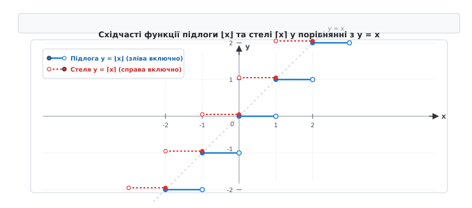
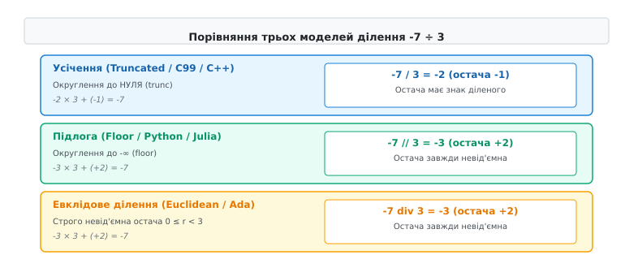
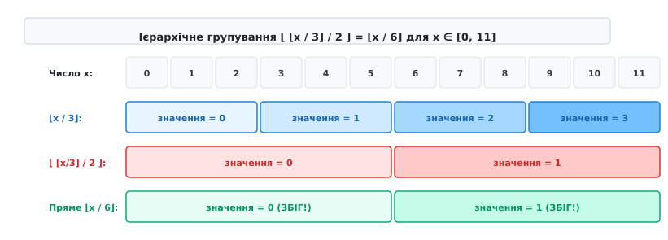
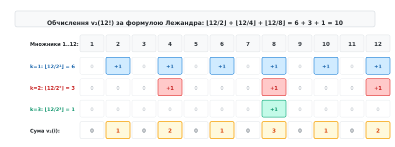

# Цілочислове ділення й підлога

<preknowlist>
- [Алгоритм Евкліда та найбільший спільний дільник](root:math-number-theory/gcd-euclidean)
- [Модульна арифметика та класи лишків](root:math-number-theory/modular-arithmetic)
</preknowlist>

При розробці геоінформаційної системи з квадратними тайлами розміром 256×256 пікселів координати об'єкта на карті `(x, y)` переводяться у номер тайла виразом `x / 256` та `y / 256`. Якщо об'єкт знаходиться у додатній напівплощині `x = 512`, він потрапляє у тайл `512 / 256 = 2`. Однак при переході від'ємної осі для точки `x = -1` стандартна цілочислова арифметика мови C99 повертає `0`, оскільки округлення відбувається вбік нуля (`truncation toward zero`). В результаті нульовий тайл розширюється і охоплює проміжок від `-255` до `255` пікселів — удвічі більший за всі інші тайли сітки. Це призводить до накладання 3D-моделей на межі півкуль, розриву текстур ландшафту та виходу за межі масиву пам'яті.

Причиною цієї інженерної аномалії є принципова відмінність між двома моделями цілочислового ділення: **усіченим діленням** (англ. *truncated division*), яке використовують мови C, C++, Rust та Java, і **діленням за підлогою** (англ. *floored division*), зафіксованим у мові Python та класичній теорії чисел.

---

## 1. Математичне означення та фундаментальні властивості підлоги і стелі

Операції округлення дійсних чисел до цілих були систематизовані Карлом Фрідріхом Ґауссом у 1808 році під час доведення квадратичного закону взаємності (де детальніше розглянуто в історичному контексті: [📜 Історія позначень та стандартизації ділення: від Гаусса до Айверсона](root:math-number-theory/floor-division/hist-gauss-floor.md)). Сучасні математичні позначення `⌊x⌋` та `⌈x⌉` запропонував Кеннет Айверсон у 1962 році під час створення мови APL.


*Функції підлоги ⌊x⌋ та стелі ⌈x⌉ утворюють ступінчасті графіки зі стрибками одиничної висоти в кожній цілій точці x ∈ ℤ.*

### Функція підлоги (Floor)
**Функцією підлоги** (або цілою частиною числа, англ. *floor function*) називається відображення `⌊·⌋: ℝ → ℤ`, яке зіставляє кожному дійсному числу `x` найбільше ціле число, що не перевищує `x`:

```
⌊x⌋ = max { n ∈ ℤ | n ≤ x }
```

Існування та єдиність такого цілого числа гарантується аксіомою Архімеда та властивістю повноти дійсних чисел `ℝ`. Еквівалентно, значення `n = ⌊x⌋` однозначно характеризується подвійною нерівністю:

```
n ≤ x < n + 1   (або x - 1 < n ≤ x)
```

Функція підлоги є монотонно неспадною, кусково-сталою та правонеперервною: для будь-якої точки `x₀ ∈ ℝ` границя праворуч збігається зі значенням функції `lim_{x → x₀⁺} ⌊x⌋ = ⌊x₀⌋`. У кожній цілій точці `x = k ∈ ℤ` функція має розрив першого роду зі стрибком одиничної висоти: `lim_{x → k⁻} ⌊x⌋ = k - 1`, тоді як `⌊k⌋ = k`.

### Функція стелі (Ceiling)
**Функцією стелі** (англ. *ceiling function*) називається відображення `⌈·⌉: ℝ → ℤ`, яке зіставляє кожному дійсному числу `x` найменше ціле число, що не менше за `x`:

```
⌈x⌉ = min { n ∈ ℤ | n ≥ x }
```

Еквівалентна подвійна нерівність для функції стелі має вигляд:

```
n - 1 < x ≤ n   (або x ≤ n < x + 1)
```

На відміну від підлоги, функція стелі є лівонеперервною: `lim_{x → x₀⁻} ⌈x⌉ = ⌈x₀⌉`, а розриви зі стрибком одиниці виникають при наближенні праворуч.

### Дробова частина (Fractional Part)
Дійсне число `x` однозначно розкладається на суму цілої частини (підлоги) та **дробової частини** (англ. *fractional part*), яка позначається `{x}`:

```
x = ⌊x⌋ + {x},   де 0 ≤ {x} < 1
```

Дробова частина `{x} = x - ⌊x⌋` є пилкоподібною періодичною функцією з основним періодом 1: `{x + k} = {x}` для будь-якого `k ∈ ℤ`. Вона має фундаментальне значення в аналітичній теорії чисел, динамічних системах, ергодичній теорії та комп'ютерній графіці при розрахунку нормалізованих текстурних координат.

### Фундаментальні алгебраїчні тотожності та нерівності
1. **Зсув на цілий доданок (Integer Translation)**: Ціле число `k ∈ ℤ` вільно вноситься під знак підлоги або виноситься за нього:
   ```
   ⌊x + k⌋ = ⌊x⌋ + k,   ⌈x + k⌉ = ⌈x⌉ + k
   ```
2. **Віддзеркалення знака (Sign Inversion / Reflection)**: Зміна знака аргументу взаємно перетворює підлогу та стелю:
   ```
   ⌈x⌉ = -⌊-x⌋,   ⌊x⌋ = -⌈-x⌉
   ```
   *Доведення*: Нерівність `n ≤ -x < n + 1` після множення на `-1` набуває вигляду `-(n + 1) < x ≤ -n`. Звідси найменше ціле, не менше за `x`, дорівнює `-n = -⌊-x⌋`.
3. **Зв'язок між стелею та підлогою**:
   ```
   ⌈x⌉ - ⌊x⌋ = 0   (якщо x ∈ ℤ)
   ⌈x⌉ - ⌊x⌋ = 1   (якщо x ∉ ℤ)
   ```
4. **Адитивні нерівності (межі дробового перенесення)**:
   Для будь-яких дійсних чисел `x, y ∈ ℝ` сума підлог обмежує підлогу суми з точністю до одиниці:
   ```
   ⌊x⌋ + ⌊y⌋ ≤ ⌊x + y⌋ ≤ ⌊x⌋ + ⌊y⌋ + 1
   ```
   *Механізм*: Розкладемо аргументи через дробові частини `x + y = ⌊x⌋ + ⌊y⌋ + ({x} + {y})`. Оскільки `0 ≤ {x} < 1` та `0 ≤ {y} < 1`, сума дробових частин лежить у напіввідкритому інтервалі `0 ≤ {x} + {y} < 2`. Якщо `{x} + {y} < 1`, то `⌊{x} + {y}⌋ = 0`, і підлога суми точно дорівнює лівій межі `⌊x⌋ + ⌊y⌋`. Якщо ж `{x} + {y} ≥ 1`, то виникає перенесення одиниці у цілу частину, і підлога суми досягає правої межі `⌊x⌋ + ⌊y⌋ + 1`.

   **Числовий приклад для випадку без перенесення:**
   ```
   x = 2.3,   y = 1.4
   ⌊2.3⌋ + ⌊1.4⌋ = 2 + 1 = 3
   ⌊2.3 + 1.4⌋ = ⌊3.7⌋ = 3   [сума дробових частин 0.3 + 0.4 = 0.7 < 1]
   ```

   **Числовий приклад для випадку з одиничним перенесенням:**
   ```
   x = 2.7,   y = 1.6
   ⌊2.7⌋ + ⌊1.6⌋ = 2 + 1 = 3
   ⌊2.7 + 1.6⌋ = ⌊4.3⌋ = 4   [сума дробових частин 0.7 + 0.6 = 1.3 ≥ 1]
   ```

5. **Ідемпотентність**: Повторне взяття підлоги чи стелі від цілого результату не змінює значення:
   ```
   ⌊⌊x⌋⌋ = ⌊x⌋,   ⌈⌈x⌉⌉ = ⌈x⌉
   ```

6. **Округлення до найближчого цілого (Round-to-nearest)**:
   Операція округлення дійсного числа `x` до найближчого цілого зі зсувом половинних значень угору виражається через зсув аргументу підлоги на `0.5`:
   ```
   round(x) = ⌊x + 0.5⌋
   ```

---

## 2. Моделі цілочислового ділення з остачею

При діленні цілого числа `a` (ділене) на ціле число `b ≠ 0` (дільник) теорема про ділення з остачею стверджує існування єдиної пари цілих чисел `q` (частка, англ. *quotient*) та `r` (остача, англ. *remainder*), що задовольняють фундаментальне співвідношення розкладу:

```
a = q · b + r
```

Оскільки для дійсного відношення `a / b` існує нескінченно багато цілих `q`, вибір конкретної пари `(q, r)` визначається **моделлю округлення частки**.


*Геометричний розподіл часток і остач для від'ємних чисел у трьох модельних системах цілочислового ділення.*

У сучасній інформатиці та прикладній математиці застосовуються три ключові моделі ділення:

### 1. Усічене ділення (Truncated Division, T-division)
У цій моделі частка округлюється у напрямку до нуля:

```
q = trunc(a / b) = sgn(a · b) · ⌊|a / b|⌋
```

- **Формула остачі**: `r = a - q · b`.
- **Властивість остачі**: Знак остачі `r` завжди збігається зі знаком діленого `a` (або дорівнює нулю), причому `-|b| < r < |b|`.
- **Стандартизація та мови**: Стандарти **ISO/IEC C99**, **C++11**, **Rust** (оператори `/` та `%`), **Java**, **Go**, **C#**, **JavaScript** (`BigInt`).
- **Апаратна основа**: Модель напряму підтримується машинними інструкціями процесорів: `IDIV` в архітектурі x86-64, `SDIV` в ARM Cortex, `div` у MIPS та RISC-V.
- **Математична симетрія**: Виконується строга симетрія відносно нуля `(-a) / b == -(a / b)` та `(-a) % b == -(a % b)`.

**Інженерна пастка**: Усічене ділення руйнує періодичність лишків на межі нуля. Проміжок ділених від `-b + 1` до `b - 1` цілком відображається у частку `q = 0`. В результаті нульова комірка має ширину `2|b| - 1` (для `b = 256` проміжок становить 511 точок від `-255` до `255`), що вдвічі більше за звичайні додатні інтервали `[256, 511]` (256 точок).

### 2. Ділення за підлогою (Floored Division, F-division)
У цій моделі частка округлюється у напрямку до мінус нескінченності:

```
q = ⌊a / b⌋
```

- **Формула остачі**: `r = a - ⌊a / b⌋ · b`.
- **Властивість остачі**: Знак остачі `r` завжди збігається зі знаком дільника `b` (або дорівнює нулю), причому `0 ≤ r < b` (якщо `b > 0`) або `b < r ≤ 0` (якщо `b < 0`).
- **Мови програмування**: **Python** (оператори `//` та `%`), **Ruby** (оператори `/` та `%`), **Julia** (функції `fld` та `mod`), **Lua**.
- **Алгебраїчна властивість**: Забезпечує строгу конгруентну періодичність `(a + k · b) % b == a % b` для будь-якого цілого `k ∈ ℤ`. Залишок утворює регулярну періодичну пилкоподібну хвилю вздовж усієї числової осі без жодних розривів чи розширень у нулі.

### 3. Евклідове ділення (Euclidean Division, E-division)
В евклідовому діленні вимоги до остачі формулюються за класичним математичним каноном: остача зобов'язана бути строго невід'ємною для будь-яких знаків операндів:

```
0 ≤ r < |b|
```

- **Обчислення частки**:
  ```
  q = ⌊a / b⌋   (якщо b > 0)
  q = ⌈a / b⌉   (якщо b < 0)
  ```
- **Мови та бібліотеки**: **Ada** (оператори `/` та `mod`), **Pascal**, **Rust** (методи `div_euclid` та `rem_euclid`), **Haskell** (`divMod`), **BQN**.
- **Застосування**: Абстрактна алгебра, криптографія з відкритим ключем (RSA, Diffie-Hellman), еліптичні криві та теорія хешування. Усі класи лишків `ℤ / |b|ℤ` автоматично відображаються у канонічну множину `{0, 1, 2, …, |b| - 1}`, усуваючи необхідність додавання модуля для від'ємних результатів.

### Зведена таблиця чотирьох квадрантів знаків
Розглянемо ділення чисел `|a| = 7` та `|b| = 3` для всіх можливих комбінацій знаків:

| Ділене `a` | Дільник `b` | Усічене (C99 / C++) `q, r` | За підлогою (Python) `q, r` | Евклідове (Ada / Rust Euclid) `q, r` |
| :--- | :--- | :--- | :--- | :--- |
| **`+7`** | **`+3`** | `q = 2,  r = 1` | `q = 2,  r = 1` | `q = 2,  r = 1` |
| **`-7`** | **`+3`** | `q = -2, r = -1` | `q = -3, r = 2` | `q = -3, r = 2` |
| **`+7`** | **`-3`** | `q = -2, r = 1` | `q = -3, r = -2` | `q = -2, r = 1` |
| **`-7`** | **`-3`** | `q = 2,  r = -1` | `q = 2,  r = -1` | `q = 3,  r = 2` |

**Перевірка інваріанта `q · b + r = a` для кожного рядка:**
- Для `(-7, +3)`:
  - Усічене: `(-2) · 3 + (-1) = -6 - 1 = -7` (остача `-1` має знак діленого `-7`).
  - За підлогою: `(-3) · 3 + 2 = -9 + 2 = -7` (остача `2` має знак дільника `3`).
  - Евклідове: `(-3) · 3 + 2 = -9 + 2 = -7` (остача `2 ≥ 0` є невід'ємною).
- Для `(+7, -3)`:
  - Усічене: `(-2) · (-3) + 1 = 6 + 1 = 7`.
  - За підлогою: `(-3) · (-3) + (-2) = 9 - 2 = 7` (остача `-2` має знак дільника `-3`).
  - Евклідове: `(-2) · (-3) + 1 = 6 + 1 = 7` (остача `1 ≥ 0`).
- Для `(-7, -3)`:
  - Усічене: `2 · (-3) + (-1) = -6 - 1 = -7`.
  - За підлогою: `2 · (-3) + (-1) = -6 - 1 = -7`.
  - Евклідове: `3 · (-3) + 2 = -9 + 2 = -7` (остача `2 ≥ 0`).

### Алгебраїчні формули перерахунку між моделями
Якщо у мові реалізовано лише усічене ділення C99 (`q_t = a / b`, `r_t = a % b`), підлогові та евклідові значення обчислюються корекцією за допомогою умовних виразів або безрозгалуженої бітової арифметики:

```
// Перерахунок у ділення за підлогою (Floored Division)
q_floor = (r_t != 0 && ((a < 0) ^ (b < 0))) ? (q_t - 1) : q_t;
r_floor = (r_t != 0 && ((a < 0) ^ (b < 0))) ? (r_t + b) : r_t;

// Перерахунок у евклідове ділення (Euclidean Division)
q_euclid = (r_t < 0) ? (b > 0 ? q_t - 1 : q_t + 1) : q_t;
r_euclid = (r_t < 0) ? (b > 0 ? r_t + b : r_t - b) : r_t;
```

Детальні порівняльні специфікації 12 мов програмування та процесорних архітектур наведено у довіднику: [📋 Порівняльний довідник моделей цілочислового ділення у мовах програмування та архітектурах систем](root:math-number-theory/floor-division/api-language-division-table.md).

---

## 3. Тотожність вкладених підлог та неперервність ділення

У багатовимірній геометрії, оптимізації компіляторів та роботі з багатовимірними масивами часто виникає потреба каскадного ділення з округленням донизу: `⌊ ⌊x / a⌋ / b ⌋`.

### Теорема про вкладену підлогу (Nested Floor Theorem)
Для будь-якого дійсного числа `x ∈ ℝ` та будь-яких додатних цілих чисел `a, b ∈ ℤ, a ≥ 1, b ≥ 1` справджуються тотожності редукції каскадного ділення:

```
⌊ ⌊x / a⌋ / b ⌋ = ⌊ x / (a · b) ⌋

⌈ ⌈x / a⌉ / b ⌉ = ⌈ x / (a · b) ⌉
```


*Геометричне покриття дискретної ґратки: групування блоків розміром a×b під дією тотожності вкладених підлог.*

### Алгебраїчне доведення теореми
Позначимо ціле число у лівій частині рівності через `q`:

```
q = ⌊ ⌊x / a⌋ / b ⌋
```

За базовим характеристичним означенням підлоги:

```
q ≤ ⌊x / a⌋ / b < q + 1
```

Помножимо всі частини нерівності на додатне ціле число `b`:

```
q · b ≤ ⌊x / a⌋ < (q + 1) · b
```

Оскільки `q · b` є цілим числом, нерівність `q · b ≤ ⌊x / a⌋` еквівалентна нерівності `q · b ≤ x / a`.
Аналогічно, оскільки `(q + 1) · b` є цілим числом, умова `⌊x / a⌋ < (q + 1) · b` еквівалентна `x / a < (q + 1) · b`.

Об'єднуючи обидва результати:

```
q · b ≤ x / a < (q + 1) · b
```

Помножимо всі частини подвійної нерівності на додатне ціле `a`:

```
q · (a · b) ≤ x < (q + 1) · (a · b)
```

Поділимо на добуток `(a · b)`:

```
q ≤ x / (a · b) < q + 1
```

За характеристичною властивістю підлоги це означає, що ціле число `q` точно дорівнює `⌊ x / (a · b) ⌋`:

```
q = ⌊ x / (a · b) ⌋
```

Рівність `⌊ ⌊x / a⌋ / b ⌋ = ⌊ x / (a · b) ⌋` повністю доведено.

### Покроковий числовий приклад
Нехай дійсне число `x = 73.8`, а дільники `a = 3` та `b = 4`.

1. **Обчислення лівої частини (каскад підлог):**
   ```
   x / a = 73.8 / 3 = 24.6
   ⌊x / a⌋ = ⌊24.6⌋ = 24
   ⌊x / a⌋ / b = 24 / 4 = 6.0
   ⌊ ⌊x / a⌋ / b ⌋ = ⌊6.0⌋ = 6
   ```

2. **Обчислення правої частини (пряме ділення на добуток):**
   ```
   a · b = 3 · 4 = 12
   x / (a · b) = 73.8 / 12 = 6.15
   ⌊ x / (a · b) ⌋ = ⌊6.15⌋ = 6
   ```

Обидва шляхи обчислення дають однаковий цілочисловий результат `6`.

У системному програмуванні це співвідношення дозволяє компіляторам оптимізувати послідовні зсуви праворуч: для беззнакових чисел операція `(x >> 2) >> 3` згортається в одну інструкцію `x >> 5`, оскільки ділення на 4 з наступним діленням на 8 еквівалентне діленню на 32.

Строгі математичні виведення супутніх тотожностей наведено у вставці: [🧮 Доведення тотожностей Ерміта, вкладених підлог та формули Лежандра](root:math-number-theory/floor-division/math-hermite-legendre.md).

---

## 4. Тотожність Ерміта та її дискретний аналіз

Французький математик Шарль Ерміт у 1868 році довів фундаментальну сумаційну тотожність, яка пов'язує підлогу масштабованого аргументу із сумою підлог аргументів з регулярними дробовими зсувами.

### Тотожність Ерміта (Hermite's Identity)
Для будь-якого дійсного числа `x ∈ ℝ` та будь-якого натурального числа `n ∈ ℕ, n ≥ 1` справджуються тотожності для підлоги та стелі:

```
∑_{k=0}^{n-1} ⌊x + k/n⌋ = ⌊n · x⌋

∑_{k=0}^{n-1} ⌈x - k/n⌉ = ⌈n · x⌉
```

### Механізм доведення через розбиття інтервалу дробових частин
Розкладемо аргумент `x` на цілу частину `⌊x⌋` та дробову частину `{x}`:

```
x = ⌊x⌋ + {x},   де 0 ≤ {x} < 1
```

Оскільки `{x} ∈ [0, 1)`, воно потрапляє в один із `n` напіввідкритих інтервалів довжиною `1/n`:

```
j/n ≤ {x} < (j + 1)/n,   де j = ⌊n · {x}⌋ ∈ {0, 1, …, n - 1}
```

Підставимо розклад `x = ⌊x⌋ + {x}` у ліву частину тотожності для довільного доданка `k ∈ {0, 1, …, n - 1}`:

```
⌊x + k/n⌋
= ⌊⌊x⌋ + {x} + k/n⌋
= ⌊x⌋ + ⌊{x} + k/n⌋   [винесення цілого доданка ⌊x⌋]
```

Значення виразу `⌊{x} + k/n⌋` залежить від суми `{x} + k/n`:
1. Якщо `k < n - j`, то `{x} + k/n < (j + 1)/n + (n - j - 1)/n = n/n = 1`. Оскільки сума менша за 1, `⌊{x} + k/n⌋ = 0`. Кількість таких доданків дорівнює `n - j`.
2. Якщо `k ≥ n - j`, то `{x} + k/n ≥ j/n + (n - j)/n = n/n = 1`, але менше за 2. Отже, `⌊{x} + k/n⌋ = 1`. Кількість таких доданків дорівнює `j`.

Підсумуємо всі `n` доданків:

```
∑_{k=0}^{n-1} ⌊x + k/n⌋
= ∑_{k=0}^{n-1} (⌊x⌋ + ⌊{x} + k/n⌋)
= n · ⌊x⌋ + (n - j) · 0 + j · 1   [підстановка кількості нулів та одиниць]
= n · ⌊x⌋ + j
= n · ⌊x⌋ + ⌊n · {x}⌋             [оскільки j = ⌊n · {x}⌋]
= ⌊n · ⌊x⌋ + n · {x}⌋             [внесення n · ⌊x⌋ під знак підлоги]
= ⌊n · (⌊x⌋ + {x})⌋
= ⌊n · x⌋
```

Тотожність повністю доведена.

### Покроковий числовий приклад
Нехай `x = 2.7`, `n = 5`.
Ціла частина `⌊x⌋ = 2`, дробова частина `{x} = 0.7`.
Індекс інтервалу `j = ⌊5 · 0.7⌋ = ⌊3.5⌋ = 3`.
Граничний індекс переходу `n - j = 5 - 3 = 2`.

Обчислимо кожен доданок суми:
- `k = 0`: `⌊2.7 + 0/5⌋ = ⌊2.70⌋ = 2` (додаток `0`)
- `k = 1`: `⌊2.7 + 1/5⌋ = ⌊2.70 + 0.20⌋ = ⌊2.90⌋ = 2` (додаток `0`)
- `k = 2`: `⌊2.7 + 2/5⌋ = ⌊2.70 + 0.40⌋ = ⌊3.10⌋ = 3` (додаток `1`)
- `k = 3`: `⌊2.7 + 3/5⌋ = ⌊2.70 + 0.60⌋ = ⌊3.30⌋ = 3` (додаток `1`)
- `k = 4`: `⌊2.7 + 4/5⌋ = ⌊2.70 + 0.80⌋ = ⌊3.50⌋ = 3` (додаток `1`)

Сума лівої частини: `2 + 2 + 3 + 3 + 3 = 13`.
Обчислення правої частини: `⌊n · x⌋ = ⌊5 · 2.7⌋ = ⌊13.5⌋ = 13`.

### Застосування у комп'ютерній графіці (Алгоритм Брезенгема)
Тотожність Ерміта розкриває дискретний механізм растеризації ліній і кривих на піксельній сітці дисплея. Під час малювання відрізка з похилим коефіцієнтом `m = dy / dx` координата пікселя по осі `y` для кроку `x` обчислюється як `y = ⌊m · x⌋`. За тотожністю Ерміта це значення представляється як сума накопичених субпіксельних зсувів, що дозволяє замінити дробову арифметику швидкими цілочисловими операціями додавання та зсуву без залучення блоку FPU.

---

## 5. Формула Лежандра для факторіалів та p-адичні оцінки

У теорії чисел та комбінаториці важливим завданням є знаходження показника степеня `v_p(n!)` (так званої **p-адичної оцінки** або показника входження), з яким просте число `p` входить у розклад факторіала `n!` на прості множники:

```
n! = ∏_{p ≤ n} p^{v_p(n!)}
```

### Формула Лежандра (Legendre's Formula)
Адрієн-Марі Лежандр у 1808 році довів, що показник степеня `v_p(n!)` точно обчислюється як сума підлог ділення `n` на всі послідовні натуральні степені простого числа `p`:

```
v_p(n!) = ⌊n / p⌋ + ⌊n / p²⌋ + ⌊n / p³⌋ + … = ∑_{k=1}^{∞} ⌊n / p^k⌋
```

Оскільки для `p^k > n` значення підлоги `⌊n / p^k⌋ = 0`, сума є скінченною і містить рівно `⌊log_p n⌋` ненульових доданків.


*Геометрична підрахункова ґратка формули Лежандра: кратність ділення чисел від 1 до n на степені простого числа p.*

### Механізм підрахунку кратності (Подвійний підрахунок на ґратці)
Розглянемо всі `n` співмножників добутку `n! = 1 · 2 · 3 · … · n`:
1. Серед чисел від `1` до `n` рівно `⌊n / p⌋` чисел діляться на `p` (це `p, 2p, 3p, …, ⌊n/p⌋·p`). Кожне з них дає щонайменше один множник `p`.
2. Числа, які діляться на `p²` (це `p², 2p², 3p², …`), дають додатковий другий множник `p`. Таких чисел є `⌊n / p²⌋`.
3. Числа, які діляться на `p³`, дають третій додатковий множник `p` (їх `⌊n / p³⌋`), і так далі.

Підсумовуючи внески кожного степеня `p^k`, отримуємо точний сумарний показник входження `v_p(n!)`.

### Формула де Поліньяка — Лежандра через суму цифр
Французький математик Альфонс де Поліньяк показав, що суму підлог у формулі Лежандра можна згорнути через суму цифр числа `n`, записаного в системі числення з основою `p`:

```
v_p(n!) = (n - S_p(n)) / (p - 1)
```

де `S_p(n)` — сума цифр числа `n` у p-ковій системі числення.

### Алгебраїчне виведення зв'язку із сумою цифр
Запишемо число `n` у системі числення з основою `p`:

```
n = a_m · p^m + a_{m-1} · p^{m-1} + … + a₁ · p + a₀ = ∑_{j=0}^{m} a_j · p^j
```

де `0 ≤ a_j ≤ p - 1` — цифри розкладу, а сума цифр `S_p(n) = ∑_{j=0}^m a_j`.

Обчислимо підлогу `⌊n / p^k⌋` для будь-якого `k ≥ 1`:

```
⌊n / p^k⌋ = a_m · p^{m-k} + a_{m-1} · p^{m-k-1} + … + a_k = ∑_{j=k}^{m} a_j · p^{j-k}
```

Підставимо ці вирази у формулу Лежандра та змінимо порядок підсумовування:

```
v_p(n!)
= ∑_{k=1}^{m} ⌊n / p^k⌋
= ∑_{k=1}^{m} ∑_{j=k}^{m} a_j · p^{j-k}
= ∑_{j=1}^{m} a_j · ( ∑_{k=1}^{j} p^{j-k} )   [перегрупування за коефіцієнтами a_j]
```

Внутрішня сума є сумою геометричної прогресії:

```
∑_{k=1}^{j} p^{j-k} = p^{j-1} + p^{j-2} + … + 1 = (p^j - 1) / (p - 1)
```

Підставимо цей результат:

```
v_p(n!)
= ∑_{j=1}^{m} a_j · (p^j - 1) / (p - 1)
= (1 / (p - 1)) · ( ∑_{j=1}^{m} a_j · p^j - ∑_{j=1}^{m} a_j )
= (1 / (p - 1)) · ( (n - a₀) - (S_p(n) - a₀) )   [додали й відняли a₀]
= (n - S_p(n)) / (p - 1)
```

Формулу де Поліньяка — Лежандра повністю доведено.

### Покрокові числові приклади

**Приклад 1: Кількість нулів у кінці числа `100!`**
Кількість кінцевих нулів у десятковому записі числа `100!` визначається показником `v_5(100!)`, оскільки множників `2` у розкладі завідомо більше ніж `5`:

1. *За класичною формулою підлог Лежандра*:
   - `⌊100 / 5⌋ = 20`
   - `⌊100 / 25⌋ = 4`
   - `⌊100 / 125⌋ = 0`
   - `v_5(100!) = 20 + 4 = 24`.

2. *За формулою суми цифр де Поліньяка*:
   - Переведемо `100` у п'ятіркову систему: `100 = 4 · 5² + 0 · 5¹ + 0 · 5⁰ = 400₅`.
   - Сума цифр: `S_5(100) = 4 + 0 + 0 = 4`.
   - `v_5(100!) = (100 - 4) / (5 - 1) = 96 / 4 = 24`.

Обидва методи дають однаковий точний результат: число `100!` закінчується строго 24 нулями.

**Приклад 2: Показник степеня двійки у розкладі `100!`**
Знайдемо степінь `v_2(100!)`:

1. *За сумою підлог*:
   - `⌊100 / 2⌋ = 50`
   - `⌊100 / 4⌋ = 25`
   - `⌊100 / 8⌋ = 12`
   - `⌊100 / 16⌋ = 6`
   - `⌊100 / 32⌋ = 3`
   - `⌊100 / 64⌋ = 1`
   - `v_2(100!) = 50 + 25 + 12 + 6 + 3 + 1 = 97`.

2. *За двійковим записом числа*:
   - Двійковий запис: `100 = 64 + 32 + 4 = 1100100₂`.
   - Кількість одиниць (сума двійкових цифр або Hamming weight): `S_2(100) = 3`.
   - `v_2(100!) = (100 - 3) / (2 - 1) = 97 / 1 = 97`.

### Теорема Куммера про біноміальні коефіцієнти
З формули Лежандра прямо випливає відома теорема Ернста Куммера (1852) для біноміального коефіцієнта `C(n, k) = n! / (k! · (n - k)!)`:

```
v_p( C(n, k) ) = v_p(n!) - v_p(k!) - v_p((n - k)!) = (S_p(k) + S_p(n - k) - S_p(n)) / (p - 1)
```

Величина `(S_p(k) + S_p(n - k) - S_p(n)) / (p - 1)` в точності дорівнює **кількості переносів розрядів**, що виникають під час додавання чисел `k` та `n - k` у системі числення з основою `p`.

---

## 6. Підлога у розв'язанні лінійних діофантових рівнянь та геометрії ґраток

Лінійне діофантове рівняння з двома невідомими має вигляд `a · x + b · y = c`, де `a, b, c ∈ ℤ`. За теоремою Безу це рівняння має цілочислові розв'язки тоді й лише тоді, коли найбільший спільний дільник `gcd(a, b)` ділить `c`.

### Алгоритмічний пошук розв'язку через підлогове ділення
Під час застосування розширеного алгоритму Евкліда (детально описаного у [Алгоритм Евкліда та найбільший спільний дільник](root:math-number-theory/gcd-euclidean)) на кожному кроці виконується цілочислове ділення за підлогою:

```
q_k = ⌊r_{k-1} / r_k⌋
```

Після знаходження часткового розв'язку `(x₀, y₀)` загальний розв'язок діофантового рівняння параметризується цілим числом `t ∈ ℤ`:

```
x = x₀ + t · (b / gcd(a, b)),   y = y₀ - t · (a / gcd(a, b))
```

Якщо на розв'язки накладаються практичні обмеження невід'ємності `x ≥ 0` та `y ≥ 0`, межі допустимого діапазону параметра `t` точно обчислюються комбінацією підлоги та стелі:

```
t_min = ⌈ -x₀ · gcd(a, b) / b ⌉,   t_max = ⌊ y₀ · gcd(a, b) / a ⌋
```

Кількість невід'ємних розв'язків діофантового рівняння дорівнює `max(0, t_max - t_min + 1)`.

### Теорема Релея — Бітті про розбиття натурального ряду
Функція підлоги утворює дивовижні взаємно доповнювані структури в теорії чисел. Якщо `α` та `β` — два додатні ірраціональні числа, які задовольняють співвідношення:

```
1/α + 1/β = 1
```

тоді дві послідовності Бітті:

```
A = { ⌊n · α⌋ | n = 1, 2, 3, … }
B = { ⌊n · β⌋ | n = 1, 2, 3, … }
```

утворюють **точне розбиття множини натуральних чисел `ℕ`**: кожне натуральне число `N ∈ ℕ` з'являється рівно в одній із цих двох послідовностей (без жодного повторення і без жодного пропуску).

**Числовий приклад**:
Нехай `α = √2 ≈ 1.4142`. Тоді `β = 2 + √2 ≈ 3.4142`, оскільки `1/√2 + 1/(2 + √2) = √2/2 + (2 - √2)/2 = 2/2 = 1`.
- Послідовність `A`: `⌊1 · √2⌋ = 1`, `⌊2 · √2⌋ = 2`, `⌊3 · √2⌋ = 4`, `⌊4 · √2⌋ = 5`, `⌊5 · √2⌋ = 7`, `⌊6 · √2⌋ = 8`, `⌊7 · √2⌋ = 9`, `⌊8 · √2⌋ = 11`, …
- Послідовність `B`: `⌊1 · β⌋ = 3`, `⌊2 · β⌋ = 6`, `⌊3 · β⌋ = 10`, `⌊4 · β⌋ = 13`, …

Об'єднання `A ∪ B = {1, 2, 3, 4, 5, 6, 7, 8, 9, 10, 11, 12, 13, …}` повністю покриває натуральний ряд.

---

## 7. Розподіл дробових частин і теорема Вейля про рівномірний розподіл

Дробова частина `{x} = x - ⌊x⌋` слугує мостом між дискретною арифметикою та неперервним аналізом на одиничному інтервалі `[0, 1)`.

### Теорема Гекке — Вейля (Equidistribution Theorem)
Німецький математик Герман Вейль у 1916 році встановив: якщо число `α` є ірраціональним, то послідовність дробових частин `{n · α}` для `n = 1, 2, 3, …` є **рівномірно розподіленою** (англ. *equidistributed*) на інтервалі `[0, 1)`.

Це означає, що для будь-якого підінтервалу `[c, d) ⊆ [0, 1)` відносна кількість точок послідовності, які потрапляють у `[c, d)`, прямує до довжини цього інтервалу `d - c`:

```
lim_{N → ∞} (1 / N) · #{ 1 ≤ n ≤ N | {n · α} ∈ [c, d) } = d - c
```

### Практичне застосування
1. **Квазі-випадкові послідовності (Метод Квазі-Монте-Карло)**: Забезпечують значно швидшу збіжність інтегрування `O(1/N)` порівняно з псевдовипадковими генераторами `O(1/√N)`.
2. **Спіраль Фібоначчі та розташування точок на сфері**: Використання дробових частин золотого перетину `ϕ = (1 + √5) / 2` у виразі `{n · ϕ}` забезпечує оптимальне пакування точок без кластеризації при 3D-рендерингу.

---

## 8. Підлога в аналізі складності алгоритмів та структур даних

Операція підлоги є ключовою при точному аналізі просторової та часової складності дискретних алгоритмів.

### Висота дерев, бітова ширина та бінарна купа (Binary Heap)
1. **Бітова довжина цілого числа**: Кількість бітів у двійковому записі додатного цілого числа `N` точно дорівнює:
   ```
   b = ⌊log₂ N⌋ + 1
   ```
2. **Висота збалансованого двійкового дерева**: Дерево пошуку або купа з `N` вузлами має висоту:
   ```
   h = ⌊log₂ N⌋
   ```
3. **Індексація бінарної купи у суцільному масиві (0-індексація)**:
   Для вузла з індексом `i` навігація ґраткою дерева виконується діленням за підлогою:
   - Батьківський вузол (Parent): `parent(i) = ⌊(i - 1) / 2⌋`
   - Лівий дочірній вузол (Left child): `left(i) = 2 · i + 1`
   - Правий дочірній вузол (Right child): `right(i) = 2 · i + 2`

4. **Безпечний бінарний пошук**:
   Класичний вираз обчислення середини інтервалу `(low + high) / 2` містить ризик переповнення при великих значеннях індексів. Безпечна формула на основі підлоги:
   ```
   mid = low + ⌊(high - low) / 2⌋
   ```

---

## 9. Практична реалізація та компіляторна оптимізація ділення на константи

Під час розробки високопродуктивного коду на мовах C та C++ необхідно враховувати апаратну ціну ділення та правила захисту від цілочислового переповнення.

### Правило безпечного ділення за стелею (Ceiling Division)
Для обчислення `⌈a / b⌉` наївний вираз `(a + b - 1) / b` спричиняє переповнення типу, якщо `a + b - 1 > UINT_MAX`. Безпечна тотожність:

```
⌈a / b⌉ = 1 + ⌊(a - 1) / b⌋   (для a > 0, b > 0)
```

Детальні реалізації безпечного ділення, конвертації моделей та бітових зсувів з тестами C та C++ наведено у практичному модулі: [⚙️ Практичні алгоритми цілочислового ділення, захист від переповнення та оптимізація зсувами](root:math-number-theory/floor-division/proj-division-implementations.md).

### Оптимізація ділення компілятором: Алгоритм Ґранлунда — Монтґомері
Апаратна інструкція цілочислового ділення `IDIV` / `DIV` на сучасних процесорах x86-64 та ARM має латентність від 12 до 45 тактів. Для порівняння, операція цілочислового множення `IMUL` виконується всього за 3 такти, а бітовий зсув `SHR` / `SAR` — за 1 такт.

Сучасні компілятори (GCC, Clang, MSVC) повністю вилучають апаратне ділення на сталу величину `d`, замінюючи його множенням на попередньо обчислену **магічну константу** (англ. *magic number*) `M` у фіксованій точці з наступним зсувом праворуч (алгоритм Торбйорна Ґранлунда та Пітера Монтґомері, 1994):

```
⌊n / d⌋ = ⌊(n · M) / 2^s⌋
```

### Математична теорема точності магічного множника
Нехай `W` — бітова розрядність цілочислового регістра (наприклад, `W = 32` або `W = 64`), а `d` — непарний дільник (`d ≥ 3`).

Дробовий дільник `1/d` наближається двійковим дробом `M / 2^s`, де `s` — величина бітового зсуву (`s ≥ W`), а цілий множник `M` обчислюється як стеля:

```
M = ⌈2^s / d⌉ = ⌊(2^s + d - 1) / d⌋
```

Тоді `M = 2^s / d + ε`, де похибка апроксимації задовольняє `0 ≤ ε < 1`.
При множенні на довільне число `n ∈ [0, 2^W - 1]` абсолютна похибка результату дорівнює:

```
(n · M) / 2^s = n / d + (n · ε) / 2^s
```

Щоб значення `⌊(n · M) / 2^s⌋` строго збігалося з `⌊n / d⌋` для **всіх** можливих значень `n < 2^W`, додатковий член `(n · ε) / 2^s` не повинен призводити до перетину цілочислової межі. Оскільки відстань від `n / d` до наступного цілого при ненульовій остачі становить щонайменше `1/d`, достатньо забезпечити умову:

```
(2^W - 1) · ε / 2^s < 1/d
```

Підбираючи мінімальний зсув `s`, який задовольняє цю нерівність, компілятор гарантує 100% математичну еквівалентність формули для всього діапазону значень типу.

### Покроковий приклад: Беззнакове ділення на 3 для 32-бітних чисел
Нехай `d = 3`, ширина слова `W = 32`.

1. Обираємо зсув `s = 33` (оскільки `2³³ = 8589934592`).
2. Обчислюємо магічний множник `M`:
   ```
   M = ⌈8589934592 / 3⌉ = ⌈2863311530.666…⌉ = 2863311531   (у шістнадцятковому записі 0xAAAAAAAB)
   ```

3. **Простежимо обчислення для `n = 100`**:
   - Обчислюємо 64-бітний добуток `n · M`:
     ```
     100 · 2863311531 = 286331153100
     ```
   - Виконуємо зсув праворуч на 33 біти (ділимо на `2³³ = 8589934592`):
     ```
     286331153100 / 8589934592 = 33.333333333333336
     ```
   - Взяття цілої частини (підлоги) дає `33`.
   - Точний результат: `100 / 3 = 33`.

4. **Простежимо крайовий випадок для максимального `n = 2³² - 1 = 4294967295`**:
   - Добуток: `4294967295 · 2863311531 = 12297829379609034645`.
   - Зсув на 33 біти: `12297829379609034645 / 8589934592 = 1431655765.0`.
   - Ціла частина дає `1431655765`.
   - Точний результат: `4294967295 / 3 = 1431655765`. Похибка дорівнює нулю!

### Асемблерний код компілятора x86-64
Ось як виглядає скомпільована функція ділення на 3:

```nasm
; Вхід: число n у регістрі EDI (32-бітний аргумент)
; Вихід: частка ⌊n / 3⌋ у регістрі EAX
mov    eax, edi
mov    edx, 0xAAAAAAAB      ; Завантаження магічної константи M
mul    edx                  ; Беззнакове множення EAX * EDX -> EDX:EAX (EDX містить зсув >> 32)
shr    edx, 1               ; Додатковий зсув на 1 біт завершує сумарний зсув >> 33
mov    eax, edx             ; Результат частки
ret
```

Замість виконання важкої апаратної інструкції `div` тривалістю 30–40 тактів, послідовність `mov + mul + shr` виконується процесором лише за 3–4 тактові цикли, забезпечуючи прискорення операції ділення майже на порядок.
