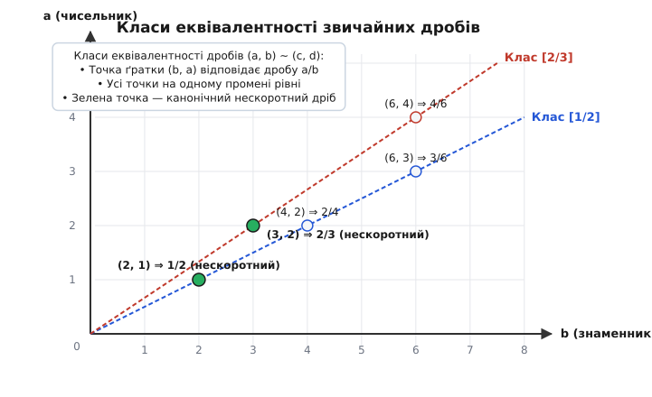
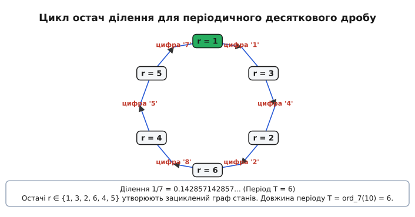
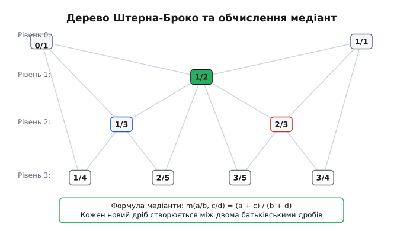

# Звичайні дроби

<preknowlist>
- [Найбільший спільний дільник (НСД)](root:math-number-theory/gcd-euclidean) — алгоритм Евкліда, властивості подільності та ділення з остачею.
- [Основна теорема арифметики](root:math-number-theory/fundamental-theorem-arithmetic) — єдиність розкладу цілих чисел на прості множники.
- [Функція Ейлера та модульна арифметика](root:math-number-theory/euler-totient) — порівняння за модулем, мультиплікативний порядок та теорема Ейлера.
- [Діофантові рівняння](root:math-number-theory/diophantine-equations) — лінійні рівняння у цілих числах та тотожність Безу.
</preknowlist>

> 🔧 **Навіщо це.**
> Звичайні дроби є фундаментальним алгебраїчним інструментом, що усуває обчислювальну обмеженість цілих чисел відносно операції ділення. У теорії чисел та абстрактній алгебрі вони створюють поле раціональних чисел Q — найменше числове поле, у якому можливе точне ділення на будь-який ненульовий елемент. В інженерії, обчислювальній геометрії, комп'ютерній алгебрі (CAS) та фінансових системах звичайні дроби забезпечують точну арифметику без накопичення помилок округлення, притаманних представленням із плаваючою крапкою (IEEE 754), а також слугують основою для найкращих раціональних наближень через неперервні дроби та послідовності Фарея.

## 1. Алгебраїчна незамкненість цілих чисел та виникнення дробів

Кільце цілих чисел `Z` є алгебраїчно замкненим відносно трьох базових арифметичних операцій: додавання, віднімання та множення. Для будь-яких двох цілих чисел `a` та `b` їхня сума `a + b`, різниця `a - b` та добуток `a · b` завжди є цілими числами, тобто належать `Z`. Це означає, що алгебраїчна структура `(Z, +, ·)` утворює комутативне кільце з одиницею. Більше того, кільце `Z` не має **дільників нуля**: якщо добуток двох цілих чисел дорівнює нулю (`a · b = 0`), то щонайменше одне з них є нулем (`a = 0` або `b = 0`). Комутативне кільце з одиницею без дільників нуля в алгебрі називається **областю цілісності** (англ. *integral domain*).

Проте відносно операції множення область цілісності `Z` не є полем: мультиплікативні обернені елементи існують лише для двох дільників одиниці — `+1` та `-1`.

Операція ділення `a / b` виходить за межі множини цілих чисел у більшості випадків. Лінійне діофантове рівняння першого степеня:
```
b · x = a                          [рівняння ділення у цілих числах]
```
має цілий розв'язок `x ∈ Z` лише тоді і тільки тоді, коли `b` є дільником `a` (що математично позначається як `b | a`). Якщо ж `b` не ділить `a` без остачі (наприклад, для рівняння `3 · x = 7`), усередині множини цілих чисел `Z` не існує жодного елемента, який міг би задовольнити цю рівність.

Спроба виміряти неперервні фізичні величини (довжину відрізка, площу, масу, часові проміжки) або поділити дискретні ресурси між кількома учасниками неминуче вимагає введення дробових часток цілого. Інтуїтивно звичайний дріб `a/b` виникає як результат поділу цілої одиниці на `b` рівних частин та взяття `a` таких частин. Число `a` називається **чисельником** (лат. *numerator* — той, що лічить частки), а число `b` — **знаменником** (лат. *denominator* — той, що називає міру поділу одиниці).

Перші спроби оперувати частками цілого зіштовхнулися з винятковою громіздкістю арифметичних записів — від єгипетських аліквотних сумувань вигляду `1/n` до вавилонських шістдесяткових розрядів. Повний огляд історичного шляху від папірусу Ахмеса до формування сучасної риски дробу викладено у [Історія виникнення концепції дробу](root:math-number-theory/fractions/hist-fraction-concept.md).

З формальної точки зору дріб можна розглядати як пару цілих чисел `(a, b)`, де `b ≠ 0`. Проте тут одразу виникає фундаментальна неєдиність представлення: пари `(1, 2)`, `(2, 4)`, `(3, 6)` та `(-5, -10)` задають одну й ту саму фізичну та числову величину. Щоб перетворити множину таких пар на строгу числову систему, необхідна формальна алгебраїчна побудова через класи еквівалентності.

## 2. Формальна алгебраїчна побудова Поля Часток (Q)

Щоб побудувати поле раціональних чисел `Q` із кільця цілих чисел `Z`, розглядається множина всіх впорядкованих пар, у яких перша компонента є довільним цілим числом, а друга — довільним ненульовим цілим числом:
```
S = Z × (Z \ {0}) = {(a, b) | a ∈ Z, b ∈ Z, b ≠ 0}   [множина формальних пар]
```

Перший елемент `a` у парі `(a, b)` виконує роль чисельника, а другий елемент `b` — роль знаменника.

На множині `S` задається бінарне відношення `~` (тильда), визначене рівністю перехресних (хрестових) добутків:
```
(a, b) ~ (c, d)  ⇔  a · d = b · c                  [відношення пропорційності]
```

### Строгий доказ відношення еквівалентності

Щоб відношення `~` коректно розбивало множину `S` на неперетинні класи, воно мусить задовольняти три аксіоми: рефлексивність, симетричність та транзитивність.

1. **Рефлексивність:** Для будь-якої пари `(a, b) ∈ S` виконується `(a, b) ~ (a, b)`.
```
a · b = b · a           [комутативність множення в Z]
⇒ (a, b) ~ (a, b)       [за визначенням відношення ~]
```

2. **Симетричність:** Якщо `(a, b) ~ (c, d)`, то `(c, d) ~ (a, b)`.
```
a · d = b · c           [умова (a, b) ~ (c, d)]
⇒ c · b = d · a         [комутативність множення в Z]
⇒ (c, d) ~ (a, b)       [за визначенням відношення ~]
```

3. **Транзитивність:** Якщо `(a, b) ~ (c, d)` та `(c, d) ~ (e, f)`, то `(a, b) ~ (e, f)`.
```
a · d = b · c           [умова (a, b) ~ (c, d)]
c · f = d · e           [умова (c, d) ~ (e, f)]

(a · d) · f = (b · c) · f             [домножили першу рівність на f]
a · d · f = b · (c · f)               [асоціативність у Z]
a · d · f = b · (d · e)               [підставили c · f = d · e]
(a · f) · d = (b · e) · d             [перегрупували множники в Z]
(a · f - b · e) · d = 0               [перенесли все вліво та винесли спільний множник d]
```
Оскільки `(c, d) ∈ S`, знаменник `d ≠ 0`. Оскільки кільце `Z` є областю цілісності (не має дільників нуля), з рівності `(a · f - b · e) · d = 0` при `d ≠ 0` випливає:
```
a · f - b · e = 0
⇒ a · f = b · e
⇒ (a, b) ~ (e, f)                     [за визначенням відношення ~]
```

Отже, відношення `~` є відношенням еквівалентності. Множина всіх класів еквівалентності позначається через `Q = S / ~`. Кожен клас еквівалентності `[(a, b)]` називається **раціональним числом** (лат. *rationalis* — відносний, пропорційний, від *ratio* — відношення) і записується як дріб `a / b`.


*Геометричне представлення класів еквівалентності дробів (a, b) на двовимірній цілочисельній ґратці. Усі точки (b, a), що лежать на одному промені, який проходить через початок координат, належать до одного класу еквівалентності та задають те саме раціональне число.*

### Алгебраїчні операції та їхня коректність

На множині класів еквівалентності `Q` визначаються дві бінарні операції:

1. **Додавання класів:**
```
[(a, b)] + [(c, d)] = [(a · d + b · c, b · d)]   [визначення додавання]
```

2. **Множення класів:**
```
[(a, b)] · [(c, d)] = [(a · c, b · d)]           [визначення множення]
```

Оскільки `b ≠ 0` та `d ≠ 0`, а в області цілісності `Z` добуток ненульових чисел є ненульовим, `b · d ≠ 0`. Отже, пара `(a · d + b · c, b · d)` та пара `(a · c, b · d)` належать множині `S`.

### Доведення незалежності операцій від вибору представника класу (Well-definedness)

Оскільки один і той самий клас еквівалентності містить нескінченно багато різних пар, необхідно перевірити, що результат додавання та множення не залежить від того, яких саме конкретних представників вибрано з класів.

Нехай `(a₁, b₁) ~ (a₂, b₂)` (тобто `a₁ · b₂ = b₁ · a₂`) та `(c₁, d₁) ~ (c₂, d₂)` (тобто `c₁ · d₂ = d₁ · c₂`).

Для операції додавання необхідно довести еквівалентність результуючих пар:
```
(a₁ · d₁ + b₁ · c₁, b₁ · d₁) ~ (a₂ · d₂ + b₂ · c₂, b₂ · d₂)
```
Перевіримо рівність перехресних добутків:
```
L = (a₁ · d₁ + b₁ · c₁) · (b₂ · d₂)
  = a₁ · d₁ · b₂ · d₂ + b₁ · c₁ · b₂ · d₂
  = (a₁ · b₂) · d₁ · d₂ + (c₁ · d₂) · b₁ · b₂    [асоціативність та комутативність у Z]
```
Підставимо рівності `a₁ · b₂ = b₁ · a₂` та `c₁ · d₂ = d₁ · c₂`:
```
L = (b₁ · a₂) · d₁ · d₂ + (d₁ · c₂) · b₁ · b₂
  = b₁ · d₁ · a₂ · d₂ + b₁ · d₁ · b₂ · c₂
  = (b₁ · d₁) · (a₂ · d₂ + b₂ · c₂) = R.         [винесли спільний множник (b₁ · d₁)]
```
Рівність `L = R` доводить, що результат додавання визначено однозначно.

Для операції множення перевіримо:
```
(a₁ · c₁, b₁ · d₁) ~ (a₂ · c₂, b₂ · d₂)
(a₁ · c₁) · (b₂ · d₂)
= (a₁ · b₂) · (c₁ · d₂)               [перегрупування множників у Z]
= (b₁ · a₂) · (d₁ · c₂)               [підстановка a₁ · b₂ = b₁ · a₂ та c₁ · d₂ = d₁ · c₂]
= (b₁ · d₁) · (a₂ · c₂)               [перегрупування множників у Z]
⇒ (a₁ · c₁, b₁ · d₁) ~ (a₂ · c₂, b₂ · d₂)
```
Отже, обидві операції є коректно визначеними на множині класів еквівалентності `Q`.

### Перевірка аксіом поля та властивості Q

Алгебраїчна структура `(Q, +, ·)` задовольняє всі аксіоми числового поля:
- **Абелева група за додаванням:** операція додавання є комутативною та асоціативною; нейтральним елементом по додаванню (нулем) є клас `0_Q = [(0, 1)]`; протилежним елементом до `[(a, b)]` є клас `[(-a, b)]`.
- **Абелева група ненульових елементів за множенням:** операція множення комутативна та асоціативна; нейтральним елементом по множенню (одиницею) є клас `1_Q = [(1, 1)]`; для будь-якого ненульового класу `[(a, b)] ≠ [(0, 1)]` (де `a ≠ 0`) існує обернений елемент `[(b, a)]`, оскільки `[(a, b)] · [(b, a)] = [(a · b, b · a)] = [(1, 1)]`.
- **Дистрибутивність:** множення дистрибутивне відносно додавання: `x · (y + z) = x · y + x · z`.

Детальний формальний доказ кожної з аксіом поля та перевірку незалежності операцій наведено у [Формальний алгебраїчний доказ побудови поля часток](root:math-number-theory/fractions/math-field-construction.md).

Кільце цілих чисел `Z` канонічно вкладається у поле `Q` через ін'єктивний гомоморфізм кілець:
```
ι: Z → Q,  ι(n) = [(n, 1)]            [канонічне вкладення Z у Q]
```
Гомоморфізм зберігає додавання `ι(n + m) = ι(n) + ι(m)` та множення `ι(n · m) = ι(n) · ι(m)`. Поле `Q` є найменшим числовим полем, яке містить кільце `Z`, і задовольняє **універсальну властивість поля часток**: для будь-якого поля `K` і будь-якого ін'єктивного кільцевого гомоморфізму `f: Z → K` існує єдиний гомоморфізм полів `f̄: Q → K`, такий що `f̄ ∘ ι = f`.

### Лінійний порядок і щільність поля Q

Для двох раціональних чисел `x = a/b` та `y = c/d` із додатними знаменниками (`b > 0, d > 0`) відношення строгого лінійного порядку визначається через перехресний добуток:
```
a/b < c/d  ⇔  a · d < b · c                       [визначення порядку на Q]
```

Це відношення порядку узгоджене з операціями:
1. Якщо `x < y`, то `x + z < y + z` для будь-якого `z ∈ Q`.
2. Якщо `x < y` та `z > 0`, то `x · z < y · z`.

На відміну від дискретної множини цілих чисел `Z` (де між `n` та `n + 1` немає жодного цілого числа), поле раціональних чисел `Q` є **всюди щільним** (англ. *dense*). Між будь-якими двома різними раціональними числами `x < y` завжди існує нескінченно багато інших раціональних чисел. Зокрема, їхнє середнє арифметичне:
```
z = (x + y) / 2                                    [середнє арифметичне]
```
задовольняє строгу нерівність `x < z < y` і належить `Q`.

## 3. Нескоротні дроби та канонічне представлення

Хоча будь-яке раціональне число описується нескінченним класом еквівалентних пар `(a, b)`, для алгоритмів, комп'ютерних систем та теоретичних доведень необхідне єдине стандартне представлення класу.

### Теорема про існування та єдиність нескоротного дробу

Для будь-якого раціонального числа `q ∈ Q` існує єдина впорядкована пара цілих чисел `(p, r)`, така що `q = p / r`, для якої одночасно виконуються дві умови:
1. `r > 0` (знаменник є строго додатним),
2. `gcd(p, r) = 1` (чисельник і знаменник є взаємно простими).

Дріб `p / r`, що задовольняє ці умови, називається **канонічним нескоротним дробом**.

### Алгебраїчний доказ єдиності канонічного представлення

Припустимо, що для одного й того самого раціонального числа `q` існують дві канонічні пари `(p₁, r₁)` та `(p₂, r₂)`, де `r₁ > 0`, `r₂ > 0`, `gcd(p₁, r₁) = 1` та `gcd(p₂, r₂) = 1`.

Оскільки обидві пари належать до одного класу еквівалентності:
```
p₁ / r₁ = p₂ / r₂
⇒ p₁ · r₂ = p₂ · r₁               [перехресне множення]
```

З рівності `p₁ · r₂ = p₂ · r₁` випливає, що число `r₁` ділить добуток `p₁ · r₂`. Оскільки за умовою `gcd(p₁, r₁) = 1`, за лемою Евкліда (якщо ціле число ділить добуток двох чисел і є взаємно простим з одним із множників, воно мусить ділити інший множник) отримуємо:
```
r₁ | r₂                            [r₁ ділить r₂]
```

Аналогічно, з тієї самої рівності `p₂ · r₁ = p₁ · r₂` випливає, що `r₂` ділить `p₂ · r₁`. Оскільки `gcd(p₂, r₂) = 1`, за лемою Евкліда:
```
r₂ | r₁                            [r₂ ділить r₁]
```

Оскільки `r₁ > 0` та `r₂ > 0` є строго додатними цілими числами, умови `r₁ | r₂` та `r₂ | r₁` можливі лише тоді, коли `r₁ = r₂`.

Підставивши `r₁ = r₂` у початкову рівність `p₁ · r₂ = p₂ · r₁`, маємо:
```
p₁ · r₁ = p₂ · r₁
```
Оскільки `r₁ > 0` (ненульове), скорочення обох частин на `r₁` дає `p₁ = p₂`. Єдиність канонічного нескоротного представлення доведено повністю.

### Покроковий алгоритм скорочення дробу через НСД

Для приведення будь-якого дробу `a/b` (де `b ≠ 0`) до канонічного вигляду `p/r` виконується три кроки:

1. **Нормалізація знаку знаменника:** Якщо `b < 0`, змінюємо знаки чисельника і знаменника: `a' = -a`, `b' = -b`. Якщо `b > 0`, залишаємо `a' = a`, `b' = b`.
2. **Обчислення найбільшого спільного дільника:** За допомогою алгоритму Евкліда знаходимо `g = gcd(|a'|, b')`.
3. **Скорочення компонент:** Обчислюємо `p = a' / g` та `r = b' / g`.

```
Початковий дріб:  -42 / -70

[Крок 1: нормалізація знаку, оскільки b = -70 < 0]
a' = -(-42) = 42
b' = -(-70) = 70

[Крок 2: алгоритм Евкліда для gcd(42, 70)]
70 = 1 · 42 + 28
42 = 1 · 28 + 14
28 = 2 · 14 + 0
g = 14

[Крок 3: ділення чисельника і знаменника на g = 14]
p = 42 / 14 = 3
r = 70 / 14 = 5

Канонічний нескоротний дріб: 3 / 5
```

### Тотожність Безу для нескоротного дробу

Якщо дріб `p / r` є нескоротним (`gcd(p, r) = 1`), то за тотожністю Безу існують такі цілі числа `x` та `y`, що:
```
p · x + r · y = 1                 [тотожність Безу для чисельника і знаменника]
```

Це співвідношення має фундаментальне значення:
1. За модулем знаменника `r` отримуємо `p · x ≡ 1 (mod r)`, тобто число `x` є мультиплікативним оберненим до чисельника `p` у кільці лишків `Z / rZ`.
2. Поділивши тотожність Безу на `r`, отримуємо:
```
(p / r) · x + y = 1 / r           [ділення тотожності Безу на знаменник r]
```
Ця рівність показує, що ціле кратне нескоротного дробу `(p / r) · x` відрізняється від цілого числа `-y` рівно на одиничну частку `1 / r`.

## 4. Точна раціональна арифметика та обчислювальні оптимізації

При додаванні та відніманні дробів із різними знаменниками `a/b` та `c/d` їх не можна складати покомпонентно, оскільки знаменники задають різний масштаб поділу одиниці. Обидва дроби зводять до спільного знаменника.

Наївна формула зведення використовує спільний знаменник `b · d`:
```
a/b ± c/d = (a · d ± b · c) / (b · d)             [наївне додавання / віднімання]
```

Проте пряме множення знаменників `b · d` призводить до швидкого зростання розрядності чисел і раннього арифметичного переповнення. Найменшим спільним знаменником є **найменше спільне кратне (НСК)** знаменників:
```
M = lcm(b, d) = (b · d) / gcd(b, d)               [найменший спільний знаменник]
```

### Оптимальний алгоритм додавання через НСК

Для обчислення суми двох нескоротних дробів `a/b` та `c/d`:
1. Знаходимо `g = gcd(b, d)`.
2. Обчислюємо додаткові множники `u = d / g` та `v = b / g`.
3. Спільний знаменник дорівнює `M = b · u = d · v = lcm(b, d)`.
4. Чисельник суми дорівнює `N = a · u + c · v`.
5. Результуючий дріб `N / M` скорочуємо на `g_res = gcd(|N|, M)`.

```
Обчислення суми:  7 / 12  +  5 / 18

[Крок 1: НСД знаменників 12 та 18]
gcd(12, 18) = 6

[Крок 2: додаткові множники]
u = 18 / 6 = 3
v = 12 / 6 = 2

[Крок 3: найменший спільний знаменник M = lcm(12, 18)]
M = 12 · 3 = 36

[Крок 4: чисельник суми N]
N = 7 · 3 + 5 · 2 = 21 + 10 = 31

[Крок 5: скорочення gcd(31, 36)]
gcd(31, 36) = 1

Канонічний результат: 31 / 36
```

```
Обчислення різниці:  11 / 28  -  5 / 42

[Крок 1: НСД знаменників 28 та 42]
gcd(28, 42) = 14

[Крок 2: додаткові множники]
u = 42 / 14 = 3
v = 28 / 14 = 2

[Крок 3: найменший спільний знаменник M = lcm(28, 42)]
M = 28 · 3 = 84

[Крок 4: чисельник різниці N]
N = 11 · 3 - 5 · 2 = 33 - 10 = 23

[Крок 5: скорочення gcd(23, 84)]
gcd(23, 84) = 1

Канонічний результат: 23 / 84
```

### Множення зі скороченням навхрест

Пряме множення дробів `(a/b) · (c/d) = (a · c) / (b · d)` обчислює добутки чисельників і знаменників, після чого вимагає скорочення на `gcd(a · c, b · d)`. Якщо `a` та `c` великі, проміжний добуток `a · c` може переповнити розрядну сітку навіть тоді, коли кінцевий скорочений результат цілком у неї вміщується.

Оптимальний алгоритм виконує попереднє скорочення "навхрест":
```
g₁ = gcd(|a|, d)                       [НСД першого чисельника та другого знаменника]
g₂ = gcd(|c|, b)                       [НСД другого чисельника та першого знаменника]

a' = a / g₁,   d' = d / g₁             [скорочення першої діагоналі]
c' = c / g₂,   b' = b / g₂             [скорочення другої діагоналі]

num = a' · c'                          [результуючий чисельник]
den = b' · d'                          [результуючий знаменник]
```

Оскільки початкові дроби були нескоротними (`gcd(|a|, b) = 1` та `gcd(|c|, d) = 1`), отриманий дріб `num / den` є **гарантовано нескоротним** (`gcd(|num|, den) = 1`), тож додаткове обчислення НСД наприкінці не потрібне.

Ділення дробів `(a/b) / (c/d)` (де `c ≠ 0`) зводиться до множення першого дробу на обернений другий дріб `(a/b) · (d/c)` за тією самою схемою скорочення навхрест.

### Порівняння дробів без ризику переповнення

Для порівняння двох додатних дробів `a/b` та `c/d` перевірка `a · d < b · c` може переповнити 64-бітний цілий тип, якщо знаменники великі. Безпечний алгоритм порівняння використовує поділ на цілу частину та остачу:
```
q₁ = a / b,   r₁ = a % b               [ціла частка та остача першого дробу]
q₂ = c / d,   r₂ = c % d               [ціла частка та остача другого дробу]
```
1. Якщо `q₁ ≠ q₂`, то `a/b < c/d ⇔ q₁ < q₂`.
2. Якщо `q₁ = q₂` і одна з остач дорівнює 0: якщо `r₁ = 0` та `r₂ = 0`, дроби рівні; якщо `r₁ = 0`, перший дріб менший; якщо `r₂ = 0`, другий дріб менший.
3. Якщо `q₁ = q₂` і `r₁ > 0, r₂ > 0`, порівняння рекурсивно зводиться до порівняння обернених дробів для остач: `a/b < c/d ⇔ d/r₂ < b/r₁`.

Цей підхід працює за час `O(log(min(b, d)))` кроків алгоритму Евкліда і повністю унеможливлює переповнення.

### Довга раціональна арифметика в CAS (BigRational)

У системах комп'ютерної алгебри (Mathematica, Maple, SymPy, SageMath) та спеціалізованих математичних бібліотеках (наприклад, модуль `mpq` у бібліотеці GMP/MPIR) тип `BigRational` представляє дріб парою цілих чисел довільної розрядності (`BigInt`). 

Це повністю усуває похибки представлення двійкової плаваючої крапки IEEE 754 (де, наприклад, десяткове число `0.1` перетворюється на нескінченний двійковий дріб `0.0001100110011..._2` і накопичує похибку при додаванні).

```
IEEE 754 double:   0.1 + 0.2 = 0.3000000000000000444...   (накопичення похибки)
BigRational:       1/10 + 2/10 = 3/10                      (абсолютна точність)
```

Повний код класу раціональної арифметики з автоматичним скороченням мовами C та C++ наведено у [Реалізація класу точної арифметики звичайних дробів](root:math-number-theory/fractions/proj-rational-arithmetic.md).

### Модульна реконструкція раціональних чисел (Rational Reconstruction)

У комп'ютерній алгебрі для швидкого розв'язання систем лінійних рівнянь з раціональними коефіцієнтами або обчислення визначників великих матриць обчислення спочатку виконують у скінченному полі `Z / mZ` за великим модулем `m` (або за кількома простими модулями `p_i` із наступним застосуванням Китайської теореми про залишки).

На фінальному кроці виникає задача **модульної реконструкції раціонального числа**: знаючи число `c ∈ [0, m - 1]`, знайти такий нескоротний дріб `p / r`, що:
```
p · r⁻¹ ≡ c (mod m)               [модульне порівняння]
|p| ≤ N,  1 ≤ r ≤ D,  де 2 · N · D < m
```

Ця задача розв'язується розширеним алгоритмом Евкліда для пари `(m, c)`: алгоритм зупиняється на першому кроці, де поточна остача стає меншою або рівною `N`. Отримані коефіцієнти розширеного алгоритму безпосередньо дають чисельник `p` та знаменник `r`. Це дозволяє виконувати точні матричні обчислення над `Q` зі швидкістю цілочисельної модульної арифметики.

## 5. Періодичні десяткові та k-кові дроби й теорія чисел

Будь-який звичайний дріб `p/q` перетворюється у позиційний запис шляхом послідовного ділення чисельника на знаменник куточком.

На кожному кроці алгоритму для поточної остачі `r_k` обчислюється наступна цифра частки `d_{k+1}` та нова остача `r_{k+1}`:
```
d_{k+1} = (10 · r_k) / q           [ціла частина — чергова десяткова цифра]
r_{k+1} = (10 · r_k) % q           [нова остача від ділення]
```

Оскільки при діленні на `q` можливі лише `q` різних значень остачі `r ∈ {0, 1, 2, ..., q - 1}`, за **принципом Діріхле** (якщо `q` кроків генерують значення з множини розміру `q`, то щонайменше одне значення повториться) послідовність остач неминуче або досягне 0 (скінченний дріб), або зациклиться не пізніше ніж через `q - 1` крок. Це доводить фундаментальну теорему: **будь-який звичайний дріб розкладається у скінченний або нескінченний періодичний дріб**.


*Граф переходу остач при діленні 1/7. Оскільки 10 mod 7 = 3, остачі утворюють замкнений цикл довжиною T = 6, що генерує повторюваний період 142857.*

### Класифікація розкладів за простими множниками знаменника

Нехай `p/q` — нескоротний дріб (`gcd(p, q) = 1`). Характер десяткового розкладу однозначно визначається канонічним розкладом знаменника `q` на прості множники:
```
q = 2^α · 5^β · q₀                 [канонічний розклад знаменника, де gcd(q₀, 10) = 1]
```

1. **Скінченний десятковий дріб:**
   Знаменник не містить інших простих дільників, крім 2 та 5 (тобто `q₀ = 1`). Дріб можна точно подати зі знаменником виду `10^k`:
```
p / (2^α · 5^β) = (p · 2^(max(α,β) - α) · 5^(max(α,β) - β)) / 10^(max(α,β))
```
   Кількість знаків після коми дорівнює `λ = max(α, β)`.
   Наприклад, `3/40 = 3 / (2³ · 5¹) = (3 · 5²) / 10³ = 75 / 1000 = 0.075` (рівно `max(3, 1) = 3` знаки).

2. **Чисто періодичний десятковий дріб:**
   Знаменник взаємно простий з основою системи числення 10 (тобто `α = 0, β = 0`, отже `gcd(q, 10) = 1`). Період починається одразу після десяткової коми: `p/q = 0.(c₁c₂...c_T)`.
   Наприклад, `1/7 = 0.(142857)`.

3. **Змішаний періодичний десятковий дріб:**
   Знаменник містить як степені 2 або 5, так і дільники `q₀ > 1`, взаємно прості з 10 (`max(α, β) > 0` та `q₀ > 1`).
   Довжина передперіоду дорівнює `λ = max(α, β)`, після чого починається повторюваний період довжини `T`.
   Наприклад, `7/12 = 7 / (2² · 3) = 0.58(3)` (передперіод `58` має довжину `max(2, 0) = 2`, період `3` має довжину 1).

### Теоретико-числовий закон довжини періоду

Для чисто періодичного дробу `p/q` з `gcd(q, 10) = 1` довжина періоду `T` є найменшим натуральним числом, для якого `10^T - 1` ділиться на `q`:
```
10^T ≡ 1 (mod q)                  [умова періодичності розкладу]
T = ord_q(10)                     [мультиплікативний порядок числа 10 за модулем q]
```

За теоремою Ейлера, якщо `gcd(q, 10) = 1`, то `10^(φ(q)) ≡ 1 (mod q)`, де `φ(q)` — функція Ейлера. Звідси випливає фундаментальна властивість: **довжина періоду `T` завжди є дільником `φ(q)`**:
```
T | φ(q)  та  T ≤ φ(q) ≤ q - 1
```

```
Приклад 1: Обчислення періоду для q = 7 (просте число, φ(7) = 6)
10¹ ≡ 3 (mod 7)
10² ≡ 2 (mod 7)
10³ ≡ 6 (mod 7)
10⁴ ≡ 4 (mod 7)
10⁵ ≡ 5 (mod 7)
10⁶ ≡ 1 (mod 7)

Мультиплікативний порядок ord_7(10) = 6.
Період 1/7 = 0.(142857) має максимально можливу довжину T = 6 = q - 1.
```

```
Приклад 2: Обчислення періоду для q = 13 (просте число, φ(13) = 12)
10¹ ≡ 10 ≡ -3 (mod 13)
10² ≡ 9 (mod 13)
10³ ≡ 12 ≡ -1 (mod 13)
10⁴ ≡ 3 (mod 13)
10⁵ ≡ 4 (mod 13)
10⁶ ≡ (-1)² ≡ 1 (mod 13)

Мультиплікативний порядок ord_13(10) = 6.
Число 6 є дільником φ(13) = 12. Період 1/13 = 0.(076923) має довжину T = 6.
```

### Дроби максимального періоду та циклічні числа

Якщо для простого знаменника `p` число 10 є **первісним коренем** за модулем `p`, то порядок `ord_p(10) = p - 1`. У цьому випадку дріб `1/p` має максимально можливу довжину періоду `T = p - 1`.

Першими такими простими числами є `7, 17, 19, 23, 29, 47, 59, 61, 97`.

Для таких дробів послідовність цифр періоду утворює **циклічне число**. Для `p = 7` період становить `142857`. Множення цього числа на `1, 2, 3, 4, 5, 6` дає циклічні перестановки тих самих цифр:
```
142857 · 1 = 142857   (дріб 1/7)
142857 · 2 = 285714   (дріб 2/7)
142857 · 3 = 428571   (дріб 3/7)
142857 · 4 = 571428   (дріб 4/7)
142857 · 5 = 714285   (дріб 5/7)
142857 · 6 = 857142   (дріб 6/7)
```

### Теорема Міді (Midy's Theorem)

Якщо `p` — просте число, `gcd(a, p) = 1`, а розклад дробу `a/p` має період парної довжини `T = 2 · m`, то сума першої та другої половин періоду, розглянутих як `m`-значні цілі числа, завжди дорівнює числу, складеному з `m` дев'яток (`10^m - 1`):
```
Період: c₁c₂...c_m c_{m+1}...c_{2m}
N₁ = c₁c₂...c_m,   N₂ = c_{m+1}...c_{2m}
N₁ + N₂ = 10^m - 1 = 999...9 (m дев'яток)
```

```
Перевірка теореми Міді:

Для 1/7 = 0.(142857), довжина T = 6 = 2 · 3, m = 3:
N₁ = 142,  N₂ = 857
N₁ + N₂ = 142 + 857 = 999

Для 1/13 = 0.(076923), довжина T = 6 = 2 · 3, m = 3:
N₁ = 076,  N₂ = 923
N₁ + N₂ = 076 + 923 = 999

Для 1/17 = 0.(05882352 94117647), довжина T = 16 = 2 · 8, m = 8:
N₁ = 05882352,  N₂ = 94117647
N₁ + N₂ = 05882352 + 94117647 = 99999999
```

*Математичне обґрунтування:* Оскільки `ord_p(10) = 2m`, число `10^(2m) - 1 = (10^m - 1)(10^m + 1)` ділиться на `p`. Оскільки `10^m - 1` не ділиться на `p` (бо період дорівнює `2m`, а не `m`), просте число `p` мусить ділити `10^m + 1`. Це означає `10^m ≡ -1 (mod p)`, звідки друга половина циклу остач є точним доповненням першої половини до `p - 1`, що при діленні генерує цифри, сума яких у кожній позиції дорівнює 9.

### Узагальнення на позиційні системи числення з довільною основою k

У системі числення з довільною натуральною основою `k ≥ 2` (двійковій `k = 2`, вісімковій `k = 8`, шістнадцятковій `k = 16`) критерії періодичності зберігають свою структуру:
- Розкладаємо знаменник нескоротного дробу `p/q` на множники: `q = u · q₀`, де всі прості дільники `u` ділять основу `k`, а `gcd(q₀, k) = 1`.
- Дріб є скінченним у `k`-ковій системі тоді і тільки тоді, коли `q₀ = 1`.
- Дріб є чисто періодичним тоді і тільки тоді, коли `u = 1` (`gcd(q, k) = 1`).
- Довжина періоду `T` у системі з основою `k` дорівнює мультиплікативному порядку основи:
```
k^T ≡ 1 (mod q₀)  ⇒  T = ord_{q₀}(k)              [довжина періоду в k-ковій системі]
```

Це правило розкриває причину похибок у двійкових комп'ютерних обчисленнях. Дріб `1/10` у десятковій системі є скінченним (`0.1`), оскільки знаменник `10 = 2¹ · 5¹` ділиться лише на прості дільники десятки. Проте в двійковій системі (`k = 2`) знаменник `10 = 2¹ · 5` містить дільник `q₀ = 5`, взаємно простий з двійкою. 

Довжина двійкового періоду для `1/10` дорівнює:
```
T = ord_5(2) = 4,  оскільки 2⁴ = 16 ≡ 1 (mod 5)
```
Тому число `1/10` у двійковій системі є нескінченним періодичним дробом `0.0(0011)_2 = 0.0001100110011..._2`. Жоден двійковий процесор із фіксованою кількістю бітів мантиси не здатен зберегти число `0.1` абсолютно точно.

### Зворотне перетворення періодичного дробу у звичайний

1. **Чисто періодичний дріб `0.(c)` із довжиною періоду `T`:**
```
x = 0.(c)
10^T · x = c.(c) = c + x
(10^T - 1) · x = c
x = c / (10^T - 1)                                [формула чисто періодичного дробу]
```
Наприклад: `0.(142857) = 142857 / (10⁶ - 1) = 142857 / 999999 = 1 / 7`.

2. **Змішаний періодичний дріб `0.a(b)` з довжиною передперіоду `λ` та періоду `T`:**
```
x = 0.a(b)
10^λ · x = a.(b)
10^(λ + T) · x = ab.(b)
(10^(λ + T) - 10^λ) · x = ab - a
x = (ab - a) / (10^λ · (10^T - 1))                [формула змішаного дробу]
```
Знаменник записується у вигляді числа, що складається з `T` дев'яток та `λ` нулів.
Наприклад: `0.58(3)` (передперіод `a = 58`, довжина `λ = 2`; період `b = 3`, довжина `T = 1`):
```
x = (583 - 58) / (10² · (10¹ - 1)) = 525 / 900 = 7 / 12
```

## 6. Послідовності Фарея та Дерево Штерна — Броко

У теорії чисел та дискретній геометрії виникає задача систематичного переліку та впорядкування всіх раціональних чисел без пропусків і дублювань.

### Послідовність Фарея (Fn)

Послідовністю Фарея порядку `n` (позначається `F_n`) називається строго зростаюча послідовність усіх нескоротних звичайних дробів із відрізка `[0, 1]`, знаменники яких не перевищують `n`:
```
F_n = { a/b | 0 ≤ a ≤ b ≤ n, gcd(a, b) = 1 }      [визначення послідовності Фарея]
```

Послідовності Фарея перших п'яти порядків:
```
F₁ = [0/1, 1/1]
F₂ = [0/1, 1/2, 1/1]
F₃ = [0/1, 1/3, 1/2, 2/3, 1/1]
F₄ = [0/1, 1/4, 1/3, 1/2, 2/3, 3/4, 1/1]
F₅ = [0/1, 1/5, 1/4, 1/3, 2/5, 1/2, 3/5, 2/3, 3/4, 4/5, 1/1]
```

Кількість елементів у послідовності `F_n` зростає через суму значень функції Ейлера:
```
|F_n| = 1 + ∑_{m=1}^n φ(m)                        [кількість дробів у F_n]
```

### Тотожність Фарея для суміжних дробів

Якщо `a/b` та `c/d` — два послідовні дроби в ряду `F_n` (причому `a/b < c/d`), то їхній перехресний визначник завжди дорівнює одиниці:
```
b · c - a · d = 1                                 [тотожність Фарея]
```

*Геометричний доказ:* Розглянемо точки цілочисельної ґратки `(b, a)` та `(d, c)` на площині. Вектори до цих точок утворюють трикутник із вершинами `(0, 0)`, `(b, a)` та `(d, c)`. Оскільки між дробами `a/b` та `c/d` у `F_n` немає жодного іншого дробу зі знаменником `≤ n`, всередині та на сторонах цього трикутника немає жодної іншої цілочисельної точки. За **формулою Піка** площа такого фундаментального трикутника дорівнює `1/2`. З іншого боку, площа трикутника через косокутний добуток дорівнює `(b · c - a · d) / 2`. Звідси неминуче `b · c - a · d = 1`.

З тотожності Фарея негайно випливає, що різниця між двома сусідніми дробами дорівнює:
```
c/d - a/b = (b · c - a · d) / (b · d) = 1 / (b · d)
```

### Медіанта Фарея та її нескоротність

Для двох додатних дробів `a/b` та `c/d` їхньою **медіантою** називається дріб:
```
m(a/b, c/d) = (a + c) / (b + d)                   [визначення медіанти]
```

Медіанта має три ключові властивості:
1. Вона строго лежить між вихідними дробами: якщо `a/b < c/d`, то:
```
a/b < (a + c) / (b + d) < c/d                     [властивість інтервалу]
```
2. Якщо вихідні дроби задовольняють тотожність Фарея `b · c - a · d = 1`, то медіанта утворює тотожність Фарея з кожним із батьківських дробів:
```
(a + c) · b - a · (b + d) = b · c - a · d = 1
c · (b + d) - d · (a + c) = b · c - a · d = 1
```
3. З цих рівностей за тотожністю Безу випливає, що `gcd(a + c, b + d) = 1`. Тобто **медіанта двох сусідніх дробів Фарея є автоматично нескоротним дробом**.

При переході від `F_n` до `F_{n+1}` нові члени з'являються виключно як медіанти тих сусідніх пар із `F_n`, сума знаменників яких дорівнює `n + 1`.

### Дерево Штерна — Броко

Дерево Штерна — Броко — це нескінченне бінарне дерево, у якому кожне додатне раціональне число `Q^+` з'являється рівно один раз у вигляді канонічного нескоротного дробу.


*Конструкція дерева Штерна — Броко. Починаючи з меж 0/1 та 1/0 (нескінченність), кожен новий вузол обчислюється як медіанта лівої та правої межі.*

Дерево будується ітеративно:
- Початкові межі: `L = 0/1` та `R = 1/0` (символічна нескінченність).
- Корінь дерева: медіанта `m(0/1, 1/0) = (0 + 1) / (1 + 0) = 1/1`.
- Для будь-якого вузла `p/q`, що виник між лівою межею `a/b` та правою межею `c/d`:
  - Лівий нащадок є медіантою з лівою межею: `m(a/b, p/q) = (a + p) / (b + q)`;
  - Правий нащадок є медіантою з правою межею: `m(p/q, c/d) = (p + c) / (q + d)`.

### Теореми дерева Штерна — Броко:
1. **Гарантована нескоротність:** Кожен дріб у дереві є нескоротним (`gcd(p, q) = 1`), оскільки для кожної пари меж зберігається інваріант `b · c - a · d = 1`.
2. **Повнота та єдиність:** Будь-яке додатне раціональне число `p/q ∈ Q^+` з'являється у дереві, і притому **рівно один раз**.
3. **Властивість бінарного пошуку:** Дерево є глобальним бінарним деревом пошуку для всіх додатних раціональних чисел: усі елементи лівого піддерева вузла менші за нього, а правого — більші.

### Двійкове кодування раціональних чисел

Будь-який дріб однозначно кодується послідовністю поворотів `L` (ліворуч) та `R` (праворуч) від кореня `1/1`.

```
Пошук шляху для дробу 3/5:
1. Корінь 1/1. Оскільки 3/5 < 1/1, повертаємо ліворуч (L).
   Межі стають [0/1, 1/1], поточний вузол: (0+1)/(1+1) = 1/2.
2. Вузол 1/2. Оскільки 3/5 > 1/2, повертаємо праворуч (R).
   Межі стають [1/2, 1/1], поточний вузол: (1+1)/(2+1) = 2/3.
3. Вузол 2/3. Оскільки 3/5 < 2/3, повертаємо ліворуч (L).
   Межі стають [1/2, 2/3], поточний вузол: (1+2)/(2+3) = 3/5.

Знайдено дріб 3/5. Його двійковий код Штерна — Броко: LRL.
```

Цей механізм забезпечує алгоритм найкращого раціонального наближення довільного дійсного числа `x` (зокрема ірраціонального): на кожному кроці порівнюємо `x` із поточною медіантою і робимо крок `L` або `R`, зупиняючись при досягненні максимального дозволеного знаменника. Історично французький годинникар Ахілл Броко винайшов це дерево саме для розрахунку зубчастих передач годинникових механізмів з оптимальним співвідношенням зубців.

## 7. Неперервні (ланцюгові) дроби та найкращі раціональні наближення

Звичайні дроби мають фундаментальний зв'язок із **неперервними (ланцюговими) дробами**.

Будь-який нескоротний звичайний дріб `p/q` (де `q > 0`) єдиним чином розкладається у скінченний ланцюговий дріб:
```
p / q = a₀ + 1 / (a₁ + 1 / (a₂ + ... + 1 / a_n))   [канонічний ланцюговий дріб]
```
що записується вектором `[a₀; a₁, a₂, ..., a_n]`, де `a₀ ∈ Z` — ціла частина, а `a_i ∈ N` (для `i ≥ 1`) — **неповні частки**.

Коефіцієнти `a_i` є послідовними неповними частками алгоритму Евкліда при знаходженні НСД `gcd(p, q)`:
```
p = a₀ · q + r₁,          0 < r₁ < q
q = a₁ · r₁ + r₂,        0 < r₂ < r₁
r₁ = a₂ · r₂ + r₃,        0 < r₃ < r₂
...
r_{n-1} = a_n · r_n + 0
```

```
Обчислення розкладу для 45 / 16:
45 = 2 · 16 + 13   ⇒  a₀ = 2,  r₁ = 13
16 = 1 · 13 + 3    ⇒  a₁ = 1,  r₂ = 3
13 = 4 · 3 + 1     ⇒  a₂ = 4,  r₃ = 1
3  = 3 · 1 + 0     ⇒  a₃ = 3,  r₄ = 0

Вектор неповних часток: [2; 1, 4, 3]

Ланцюговий дріб:
45 / 16 = 2 + 1 / (1 + 1 / (4 + 1 / 3))
```

### Підхідні дроби (P_k / Q_k) та рекурентні формули

Якщо обрізати неперервний дріб на `k`-му кроці (`k ≤ n`), отримуємо `k`-й **підхідний дріб**:
```
P_k / Q_k = [a₀; a₁, ..., a_k]   [визначення k-го підхідного дробу]
```

Чисельники `P_k` та знаменники `Q_k` обчислюються за рекурентними формулами:
```
P_{-1} = 1,              Q_{-1} = 0                   [базові початкові умови]
P₀ = a₀,                 Q₀ = 1
P₁ = a₁ · a₀ + 1,        Q₁ = a₁
P_k = a_k · P_{k-1} + P_{k-2}                          [рекурентна формула чисельника]
Q_k = a_k · Q_{k-1} + Q_{k-2}                          [рекурентна формула знаменника]
```

У матричній формі це співвідношення записується як добуток матриць:
```
( P_k     P_{k-1} ) = ( a₀  1 ) · ( a₁  1 ) · ... · ( a_k  1 )
( Q_k     Q_{k-1} )   ( 1   0 )   ( 1   0 )         ( 1    0 )
```

### Інваріант визначника та нескоротність

Обчисливши визначник обох частин матричної рівності, отримуємо фундаментальний інваріант підхідних дробів:
```
P_k · Q_{k-1} - P_{k-1} · Q_k = (-1)^(k-1)             [інваріант визначника]
```

З цієї рівності випливають три фундаментальні наслідки:
1. За тотожністю Безу `gcd(P_k, Q_k) = 1`, тобто **кожен підхідний дріб є автоматично нескоротним**.
2. Різниця між двома послідовними підхідними дробами дорівнює:
```
P_k / Q_k - P_{k-1} / Q_{k-1} = (-1)^(k-1) / (Q_k · Q_{k-1})
```
3. Підхідні дроби утворюють знакозмінне двостороннє наближення до вихідного числа: парні підхідні дроби наближають число знизу і монотонно зростають, а непарні наближають зверху і монотонно спадають:
```
P₀/Q₀ < P₂/Q₂ < P₄/Q₄ < ... ≤ p/q ≤ ... < P₅/Q₅ < P₃/Q₃ < P₁/Q₁
```

### Теореми Лагранжа про найкращі наближення

Підхідні дроби дають математично найкраще наближення раціональними числами серед усіх дробів з обмеженим знаменником:

1. **Оцінка точності наближення:**
```
|p/q - P_k/Q_k| < 1 / (Q_k · Q_{k+1}) ≤ 1 / (Q_k²)   [теорема про оцінку наближення]
```

2. **Найкраще наближення першого роду:** Дріб `P_k / Q_k` ближчий до `x`, ніж будь-який інший дріб `a/b` зі знаменником `b ≤ Q_k`:
```
|x - P_k/Q_k| < |x - a/b|  для будь-якого a/b з 1 ≤ b ≤ Q_k
```

3. **Найкраще наближення другого роду (Теорема Лагранжа):** Якщо дріб `a/b` задовольняє умову:
```
|b · x - a| < |Q_k · x - P_k|  для b ≤ Q_k
```
то `a/b` обов'язково збігається з одним із підхідних дробів `P_k / Q_k`.

### Зв'язок дерева Штерна — Броко з ланцюговими дробами

Дерево Штерна — Броко та ланцюгові дроби є двома різними представленнями однієї й тієї самої структури.

Шлях у дереві Штерна — Броко для числа `x = [a₀; a₁, a₂, ..., a_n]` складається з послідовних серій однакових поворотів:
```
R^(a₀) · L^(a₁) · R^(a₂) · L^(a₃) · ...
```
де довжина кожної серії поворотів точно дорівнює неповній частці `a_i`. Підхідні дроби `P_k / Q_k` відповідають вузлам дерева Штерна — Броко, у яких траєкторія змінює свій напрямок (з лівого на правий або навпаки).

Завдяки цим властивостям арифметика звичайних дробів, ланцюгові розклади та дерево Штерна — Броко складають основу для алгоритмів факторизації цілих чисел (метод неперервних дробів CFRAC), криптоаналізу RSA (атака Вінера через підхідні дроби), розрахунку точних календарних циклів та синтезу частотних фільтрів у цифровій обробці сигналів.
