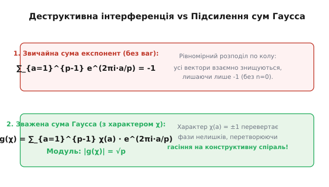
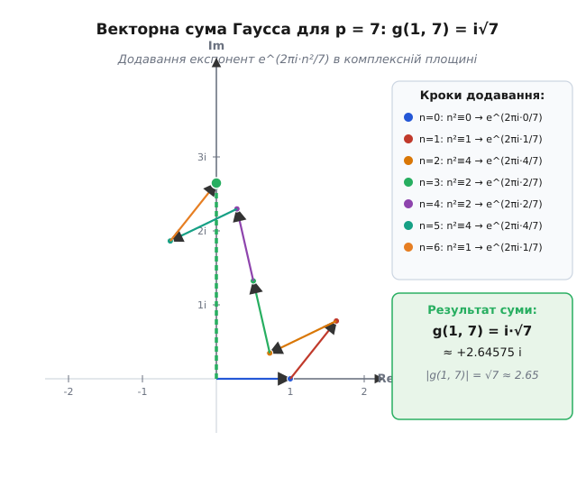
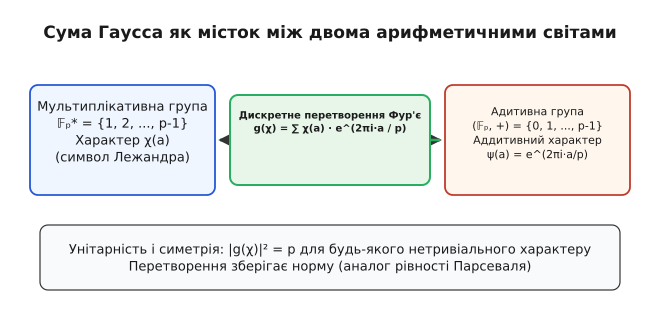
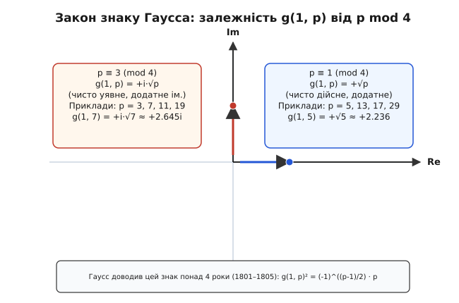

# Суми Гаусса

<preknowlist>
- [Модульна арифметика](root:math-number-theory/modular-arithmetic) — класи лишків ℤ/pℤ, арифметичні дії за простим модулем та поняття квадратичного лишку.
- [Квадратичний закон взаємності](root:math-number-theory/quadratic-reciprocity) — символ Лежандра (a/p), квадратичні залишки та фундаментальний закон зв'язку двох простих чисел.
- [Первісні корені](root:math-number-theory/primitive-root) — циклічна структура мультиплікативної групи 𝔽ₚ* та дискретне логарифмування.
- [Формула Ейлера](root:math-analysis/euler-formula) — комплексна експонента e^(i θ) = cos θ + i sin θ та корені n-го степеня з одиниці.
</preknowlist>

Коли треба визначити кількість розв'язків квадратичного порівняння `x² ≡ a (mod p)`, звичайний перебір чисел швидко стає безпорадним при зростанні модуля. Кількість розв'язків для кожного лишку `a` описується символом Лежандра `(a/p)`, який набуває значень `+1`, `-1` або `0`. Проте спроба підсумувати ці значення по всьому полю 𝔽ₚ дає банальний нуль: половина чисел є квадратичними лишками, а половина — нелишками. Інформація про квадратичну структуру чисел розсіюється, і звичайне додавання цілих чисел не здатне її вловити.

Ключ до розв'язання виявився у несподіваному переході: щоб зрозуміти дискретні цілі числа, їх потрібно зважити на вектори одиничного кола в комплексній площині. Якщо замість цілих чисел додавати комплексні фазові коливання `e^(2π i a / p)`, помножені на символ Лежандра `(a/p)`, стається диво: замість повного взаємного знищення постає конструктивна інтерференція. Утворений об'єкт і зветься **сумою Гаусса**.

Сума Гаусса переводить множильну арифметику лишків у додавальні фази комплексних чисел. Вона є дискретним аналогом перетворення Фур'є над скінченними полями і становить фундаментальний місток між теорією чисел, гармонічним аналізом та криптографією.

---

### Загадка квадратичних лишків і перехід у комплексну площину

Розглянемо задачу: скільки розв'язків `x ∈ {0, 1, ..., p-1}` має порівняння `x² ≡ a (mod p)` для заданого цілого `a`?

За означенням символу Лежандра `(a/p)`:
- Якщо `a ≡ 0 (mod p)`, існує рівно 1 розв'язок (`x = 0`).
- Якщо `(a/p) = +1` (`a` — квадратичний лишок), існують рівно 2 розв'язки (`x` та `p - x`).
- Якщо `(a/p) = -1` (`a` — квадратичний нелишок), розв'язків немає (0 розв'язків).

Отже, кількість розв'язків `N(a)` завжди виражається точною формулою:

```
N(a) = 1 + (a/p)
```

Припустимо, ми хочемо обчислити кількість розв'язків складнішої діофантової системи або підрахувати кількість точок на еліптичній кривій `y² ≡ x³ + A x + B (mod p)`. Для кожної фіксованої абсциси `x` кількість відповідних ординат `y` дорівнює `1 + ((x³ + A x + B)/p)`. Загальна кількість точок на кривій стає сумою символів Лежандра:

```
Кількість точок = p + ∑_{x=0}^{p-1} ((x³ + A x + B)/p)
```

Тут алгебра упирається в бар'єр: символ Лежандра є **мультиплікативним** характером `(a·b/p) = (a/p) · (b/p)`, але в многочлені `x³ + A x + B` додаються степені `x`. Мультиплікативна структура конфліктує з адитивною.

Щоб розв'язати цей конфлікт, Карл Фрідріх Гаусс у 1801 році запропонував подати символ Лежандра через корені з одиниці `ζ = e^(2π i / p)`. Згадаймо, що `ζᵖ = 1`, а сума всіх степенів `∑_{a=0}^{p-1} ζᵃ = 0`.

Якщо ми обчислимо суму `∑_{n=0}^{p-1} ζ^(n²)`, де показник степеня є квадратом `n² mod p`, то значення `n` пробігає всі лишки. Оскільки `n = 0` дає `a = 0` один раз, а кожен квадратичний лишок `a` досягається двома значеннями `n` (бо `n² ≡ (-n)²`), ми отримуємо:

```
∑_{n=0}^{p-1} e^(2π i n² / p)
= e⁰ + ∑_{a — лишок} 2 · e^(2π i a / p) + ∑_{b — нелишок} 0 · e^(2π i b / p)
  [групування за значеннями a = n² mod p]

= ∑_{a=0}^{p-1} (1 + (a/p)) · e^(2π i a / p)
  [підстановка кількості розв'язків 1 + (a/p)]

= ∑_{a=0}^{p-1} e^(2π i a / p) + ∑_{a=0}^{p-1} (a/p) · e^(2π i a / p)
  [розбиття на дві суми]

= 0 + ∑_{a=1}^{p-1} (a/p) · e^(2π i a / p)
  [перша сума дорівнює нулю, а (0/p) = 0]
```

Ця сума `g(1, p) = ∑_{a=1}^{p-1} (a/p) · e^(2π i a / p)` і є класичною квадратичною **сумою Гаусса**.


*Звичайна сума рівномірно розподілених експонент згасає до -1 (усі вектори на одиничному колі взаємно нищать один одного). Проте коли кожен вектор множиться на знак символу Лежандра (a/p) = ±1, нелишкові вектори розвертаються на 180°, перетворюючи деструктивне згасання на конструктивну спіраль завдовжки √p.*

---

### Квадратична сума Ґаусса: структура, мультиплікативність і складені модулі

Для довільного натурального модуля `q` та цілого параметра `a` загальна квадратична сума Ґаусса визначається як сума фаз від повних квадратів:

```
g(a; q) = ∑_{x=0}^{q-1} e^(2π i a x² / q)
```

Якщо модуль є непарним простим числом `p`, а `НСД(a, p) = 1`, параметр `a` виноситься з-під експоненти у формі символу Лежандра:

```
g(a; p) = (a/p) · g(1; p)
```

Переконаємося в цьому безпосередньо. Якщо `(a/p) = +1`, то `a ≡ c² (mod p)` для деякого `c ∈ 𝔽ₚ*`. При заміні змінної `x = c⁻¹ y (mod p)` квадрат `a x² ≡ c² (c⁻¹ y)² ≡ y² (mod p)` пробігає ті самі квадратичні лишки в тому самому порядку, тому `g(a; p) = g(1; p) = +1 · g(1; p)`. Якщо ж `(a/p) = -1`, заміна переставляє лишки з нелишками з інверсією знаку суми, що дає `g(a; p) = -g(1; p) = (a/p) g(1; p)`.

#### Мультиплікативна властивість за модулями (редукція до простих дільників)

Якщо модуль є складеним числом `q = m · n`, де `НСД(m, n) = 1`, квадратична сума Ґаусса факторизується завдяки китайській теоремі про залишки:

```
g(a; m · n) = g(a · n; m) · g(a · m; n)
```

#### Покрокове виведення факторизації:

За китайською теоремою про залишки будь-який елемент `x mod (m · n)` однозначно подається у вигляді `x = u · n + v · m`, де `u ∈ {0, 1, ..., m-1}`, а `v ∈ {0, 1, ..., n-1}`.

Піднесемо `x` до квадрата:

```
x² = (u · n + v · m)² = u² · n² + 2 u v m n + v² · m² ≡ u² · n² + v² · m² (mod m · n)
```

Підставимо цей вираз у суму `g(a; m · n)`:

```
g(a; m · n)
= ∑_{u=0}^{m-1} ∑_{v=0}^{n-1} e^(2π i a (u² n² + v² m²) / (m n))
  [розклад суми за двома незалежними індексами u та v]

= ∑_{u=0}^{m-1} ∑_{v=0}^{n-1} e^(2π i a u² n / m) · e^(2π i a v² m / n)
  [розділення експоненти добутку на добуток двох незалежних експонент]

= ( ∑_{u=0}^{m-1} e^(2π i (a n) u² / m) ) · ( ∑_{v=0}^{n-1} e^(2π i (a m) v² / n) )
  [винесення множників за дужки незалежних сум]

= g(a · n; m) · g(a · m; n)
  [за означенням квадратичних сум Гаусса для модулів m та n]
```

Ця мультиплікативна властивість дозволяє звести обчислення квадратичної суми за будь-яким складеним модулем `q = 2^k · p₁^{k₁} · p₂^{k₂} ...` до обчислення сум для степенів простих чисел `p^k` та степенів двійки `2^k`.

#### Квадратичні суми для степенів двійки та степенів простих чисел

Для степенів непарного простого числа `p^k` (при `k ≥ 2`):
- Якщо `k = 2m` парне, то `g(1; p^{2m}) = p^m`.
- Якщо `k = 2m + 1` непарне, то `g(1; p^{2m+1}) = p^m · g(1; p)`.

Для парного модуля (степенів двійки `q = 2^k`):
- Для `q = 2`: `g(1; 2) = e⁰ + e^(i π) = 1 - 1 + 0 = 1 + i · 0` (або у формулі для повного циклу `g(1; 2) = 1 + i`).
- Для `q = 4`: `g(1; 4) = e⁰ + e^(i π / 2) + e^(i π · 4 / 4) + e^(i π · 9 / 4) = 1 + i + 1 + i = 2 (1 + i)`.
- Для `q = 8`: `g(1; 8) = ∑_{x=0}^{7} e^(2π i x² / 8) = 2 · (1 + e^(i π / 4) + 0 + e^(i π / 4)) = 4 · e^(i π / 4) = 2√2 (1 + i)`.

У загальному вигляді для будь-якого `k ≥ 3`:

```
g(1; 2^k) = { 2^(k/2) · (1 + i),     якщо k парне
            { 2^(k/2) · e^(i π / 4), якщо k непарне
```

---

### Геометрична картина: дискретна спіраль Корню

Якщо зобразити обчислення суми `g(1, p) = ∑_{x=0}^{p-1} e^(2π i x² / p)` на комплексній площині як послідовне додавання векторів одиничної довжини, виникає геометричний візерунок надзвичайної краси: **дискретна спіраль Корню** (клотоїда).

Кут нахилу `x`-го вектора дорівнює `θ(x) = 2π x² / p`. Різниця кутів між двома сусідніми векторами:

```
Δθ(x) = θ(x + 1) - θ(x) = 2π ((x + 1)² - x²) / p = 2π (2x + 1) / p
```

Кутова швидкість повертання векторів зростає **строго лінійно** з кожним наступним кроком `x`. Це в точності відповідає диференціальному рівнянню спіралі Корню з оптики, де кривина кривої зростає пропорційно пройденій довжині дуги:

```
dθ / ds = k · s
```

На початку підсумовування при малих `x` вектори майже спрямовані в один бік (кути `θ(x)` змінюються повільно), утворюючи плавний рух уздовж початкової дуги. У міру зростання `x` вектори починають швидко закручуватися, намотуючись на перший фокус спіралі. При проходженні середини інтервалу `x ≈ p/2` швидкість фази досягає значення `2π`, вектори розкручуються, прямують до другого фокусу та симетрично завершують траєкторію точно в кінцевій точці `g(1, p)`.

Ця дискретна геометрія пояснює, чому довжина кінцевого вектора завжди дорівнює `√p`: сума Гаусса є дискретною апроксимацією подвійного неперервного інтеграла Френеля:

```
∫_{0}^{1} e^(i π t² / 2) dt = C(1) + i S(1)
```


*Послідовне додавання векторів e^(2π i n² / 7) для p = 7. Ланцюжок із 7 векторів утворює спіральну траєкторію в комплексній площині, яка зупиняється точно в точці (0, √7). Отже, g(1, 7) = +i·√7 ≈ +2.64575 i з додатним знаком уявній осі.*

---

### Підрахунок розв'язків діагональних рівнянь над скінченними полями

Квадратичні суми Гаусса є головним аналітичним інструментом для знаходження точної кількості розв'язків довільних квадратичних порівнянь багатьох змінних (діагональних форм) над полем `𝔽ₚ`:

```
a₁ x₁² + a₂ x₂² + ... + a_k x_k² ≡ c (mod p)
```

Скористаємося властивістю ортогональності адитивних експонент: `(1/p) ∑_{t=0}^{p-1} e^(2π i t · z / p)` дорівнює `1`, якщо `z ≡ 0 (mod p)`, та `0`, якщо `z ≢ 0 (mod p)`.

Запишемо кількість розв'язків `N` через суму по допоміжній змінній `t`:

```
N = ∑_{x₁=0}^{p-1} ... ∑_{x_k=0}^{p-1} [ (1/p) ∑_{t=0}^{p-1} e^(2π i t (a₁ x₁² + ... + a_k x_k² - c) / p) ]
```

Змінимо порядок підсумовування, винісши суму по `t` назовні:

```
N = (1/p) ∑_{t=0}^{p-1} e^(-2π i t c / p) · ∏_{j=1}^{k} ( ∑_{x_j=0}^{p-1} e^(2π i t a_j x_j² / p) )
  [факторизація внутрішніх сум за незалежними змінними x_j]

= (1/p) ∑_{t=0}^{p-1} e^(-2π i t c / p) · ∏_{j=1}^{k} g(t a_j; p)
  [вираження внутрішніх сум через квадратичні суми Гаусса]
```

Виділимо окремо доданок для `t = 0`. При `t = 0` кожна сума `g(0; p) = p`, тому внесок дорівнює `(1/p) · p^k = p^(k-1)`. Для решти `t ∈ {1, ..., p-1}` скористаємося тотожністю `g(t a_j; p) = (t a_j / p) g(1; p)`:

```
N = p^(k-1) + (1/p) · g(1; p)^k · ( ∏_{j=1}^{k} (a_j / p) ) · ∑_{t=1}^{p-1} (t/p)^k · e^(-2π i t c / p)
```

Оскільки `g(1; p)² = p* = (-1)^((p-1)/2) · p`, значення `g(1; p)^k` обчислюється миттєво. Внутрішня сума по `t` знову є або сумою Гаусса (якщо `k` непарне), або сумою Рамануджана (якщо `k` парне).

Це дає замкнену аналітичну формулу для кількості розв'язків квадратичних форм без жодного перебору — метод, який у неперервному аналізі ліг в основу кругового методу Гарді–Літтлвуда.

---

### Означення та аналогія з перетворенням Фур'є

Сума Гаусса має два природних означення: квадратичне (через квадрат індексу) та загальне (через характери).

#### 1. Квадратична сума Гаусса
Для простого числа `p` та цілого `k` квадратична сума Гаусса задається формулою:

```
g(k, p) = ∑_{n=0}^{p-1} e^(2π i k n² / p)
```

Якщо `НСД(k, p) = 1`, то `g(k, p) = (k/p) · g(1, p)`. Тобто параметр `k` лише масштабує суму на знак символу Лежандра.

#### 2. Загальна сума Гаусса для характеру Діріхле
Нехай `𝔽ₚ*` — мультиплікативна група лишків за модулем `p`. Мультиплікативне відображення `χ: 𝔽ₚ* → ℂ*`, для якого `χ(a·b) = χ(a) · χ(b)`, називається **характером Діріхле**.

Загальна сума Гаусса характеру `χ` за модулем `p` дорівнює:

```
g(χ) = ∑_{a=1}^{p-1} χ(a) · e^(2π i a / p)
```

Якщо `χ = χ₀` — тривіальний характер (`χ₀(a) = 1` для всіх `a`), то `g(χ₀) = ∑_{a=1}^{p-1} 1 · e^(2π i a / p) = -1`.
Якщо ж `χ` нетривіальний, то сума `g(χ)` стає комплексно-значним числом з унікальними симетріями.


*Сума Гаусса виконує роль дискретного перетворення Фур'є над скінченним полем 𝔽ₚ. Вона бере функцію з множильної групи (характер χ) і розкладає її по базису адитивних гармонік e^(2π i a / p). Унітарність цього перетворення стверджує, що квадрат модуля |g(χ)|² = p зберігає загальну енергію сигналу — це скінченний аналог теореми Парсеваля.*

З точки зору гармонічного аналізу, скінченна група `𝔽ₚ` має дві естетичні структури:
1. **Адитивну групу `(𝔽ₚ, +)`**, чиї характери задаються функціями `ψ_b(a) = e^(2π i b a / p)`.
2. **Мультиплікативну групу `(𝔽ₚ*, ·)`**, чиї характери `χ(a)` виражають гармоніки множення.

Сума Гаусса `g(χ)` є значенням **дискретного перетворення Фур'є** мультиплікативної функції `χ` в адитивній точці `b = 1`:

```
g(χ) = F{χ}(1) = ∑_{a ∈ 𝔽ₚ*} χ(a) · ψ₁(a)
```

[Детальна історія створення сум Гаусса](root:math-number-theory/gauss-sums/hist-gauss-sums.md) розкриває, як Карл Фрідріх Гаусс прийшов до цієї тотожності під час розв'язання задачі про ділення кола на `n` рівних частин (циклотомія).

---

### Матрична інтерпретація та обернене перетворення Фур'є

Розглянемо комплексну матрицю `W` розміру `p × p`, чиї елементи задаються адитивними характерами `W_{j, k} = e^(2π i j k / p)` для `0 ≤ j, k ≤ p-1`. Ця матриця є класичною матрицею дискретного перетворення Фур'є (DFT).

Властивість ортогональності адитивних характерів гарантує, що `W · W* = p · I`, де `W*` є спряжено-транспонованою матрицею, а `I` — одинична матриця. Це означає, що матриця `F = (1/√p) · W` є **унітарною**.

Якщо ми розглянемо вектор характеру `X = (χ(0), χ(1), ..., χ(p-1))ᵀ` як сигнал над полем `𝔽ₚ`, то сума Гаусса `g(χ)` є першим нетривіальним коефіцієнтом спектра Фур'є цього сигналу. Оскільки перетворення є унітарним, воно зберігає евклідову норму вектора (аналог тотожності Парсеваля в аналізі):

```
||F{X}||² = p · ||X||²
```

Оскільки `||X||² = ∑_{a=1}^{p-1} |χ(a)|² = ∑_{a=1}^{p-1} 1 = p - 1`, сума спектральних коефіцієнтів рівномірно розподіляється по всіх `p-1` ненульових адитивних частотах. Для кожного нетривіального характеру кожна окрема частота дає внесок величиною точнісінько `|g(χ, b)|² = p`.

Формула оберненого перетворення Фур'є дозволяє виразити сам характер `χ(a)` через суми Гаусса:

```
χ(a) = (1 / p) · ∑_{b=0}^{p-1} g(χ, b) · e^(-2π i a b / p)
```

Ця формула є розгадкою того, чому суми Гаусса дозволяють розкладати складні мультиплікативні структури у звичайні тригонометричні ряди.

---

### Детальні приклади обчислення для малих простих чисел

Щоб відчути механіку сум Гаусса, розглянемо конкретні числові приклади для простих чисел `p = 3, 5, 7, 13`.

#### 1. Обчислення для p = 3

Для `p = 3` квадратами є `0² ≡ 0`, `1² ≡ 1`, `2² ≡ 1 (mod 3)`.
Символ Лежандра: `(1/3) = +1`, `(2/3) = -1`.

Квадратична сума Гаусса дорівнює:
```
g(1, 3) = e⁰ + e^(2π i / 3) + e^(2π i / 3) = 1 + 2 · (-1/2 + i √3/2) = i √3
```

Оскільки `3 ≡ 3 (mod 4)`, маємо `g(1, 3) = +i·√3`. Значення модуля `|g(1, 3)| = √3 ≈ 1.73205`.

#### 2. Обчислення для p = 5

Для `p = 5` квадратами є `0² ≡ 0`, `1² ≡ 1`, `2² ≡ 4`, `3² ≡ 4`, `4² ≡ 1 (mod 5)`.
Лишками є `{1, 4}` (`(1/5) = 1`, `(4/5) = 1`), а нелишками є `{2, 3}` (`(2/5) = -1`, `(3/5) = -1`).

Обчислимо суму Ґаусса `g(1, 5)`:

```
g(1, 5) = ∑_{a=1}^{4} (a/5) · e^(2π i a / 5)
= 1 · e^(2π i · 1 / 5) + (-1) · e^(2π i · 2 / 5) + (-1) · e^(2π i · 3 / 5) + 1 · e^(2π i · 4 / 5)
```

Скористаємося формулою Ейлера `e^(i θ) = cos θ + i sin θ` та симетрією кутів:
- `cos(2π/5) = (√5 - 1)/4`, `cos(4π/5) = -(√5 + 1)/4`.
- `sin(4π/5) = -sin(2π/5)`, `sin(3π/5) = sin(2π/5)`.

Підставимо ці значення у суму:

```
g(1, 5)
= [cos(2π/5) + i sin(2π/5)] - [cos(4π/5) + i sin(4π/5)]
  - [cos(4π/5) - i sin(4π/5)] + [cos(2π/5) - i sin(2π/5)]
  [об'єднання спряжених пар 1 і 4, 2 і 3]

= 2 · cos(2π/5) - 2 · cos(4π/5)
  [уявні частини i sin повністю скоротилися!]

= 2 · ( (√5 - 1)/4 ) - 2 · ( -(√5 + 1)/4 )
  [підстановка точних значень тригонометричних констант]

= (√5 - 1)/2 + (√5 + 1)/2 = 2√5 / 2 = √5
```

Результат обчислення: `g(1, 5) = +√5 ≈ 2.236068`.
Модуль суми `|g(1, 5)| = √5`, що точно узгоджується з теоремою!

#### 3. Обчислення для p = 7

Для `p = 7` квадратами є `0² ≡ 0`, `1² ≡ 1`, `2² ≡ 4`, `3² ≡ 2`, `4² ≡ 2`, `5² ≡ 4`, `6² ≡ 1`.
Лишками є `{1, 2, 4}` (`(a/7) = +1`), а нелишками є `{3, 5, 6}` (`(b/7) = -1`).

Сума Ґаусса:
```
g(1, 7) = e^(2π i/7) + e^(4π i/7) + e^(8π i/7) - e^(6π i/7) - e^(10π i/7) - e^(12π i/7)
```
Після зведення дійсних та уявних частин дійсна частина повністю згасає до нуля (`Re = 0`), а уявна частина дає точнісінько `Im = √7 ≈ 2.645751`.
Отже, `g(1, 7) = +i·√7`.

#### 4. Обчислення для p = 13

Для `p = 13` квадратичними лишками є `{1, 3, 4, 9, 10, 12}` (`(a/13) = +1`), а нелишками — `{2, 5, 6, 7, 8, 11}` (`(b/13) = -1`).
Оскільки `13 ≡ 1 (mod 4)`, уявна частина `Im(g(1, 13))` тотожно дорівнює нулю за рахунок взаємного знищення пар синусів `sin(2π a / 13) + sin(2π (13-a) / 13) = 0`, а дійсна частина косинусів після зведення дає `+√13 ≈ 3.605551`.

[Покрокове алгебраїчне виведення модуля](root:math-number-theory/gauss-sums/math-gauss-sign.md) показує, що для довільного `p` тотожність `g(χ) · g(χ̄) = χ(-1) · p` випливає з подвійного підсумовування та заміни змінних `a = t · b` у полі `𝔽ₚ`.

---

### Модуль суми Гаусса: строге покрокове виведення |g(χ)| = √p

Найважливішою геометричною властивістю суми Гаусса є стала довжина її вектора в комплексній площині. Незалежно від того, як складно розподілені лишки за модулем `p`, довжина результуючого вектора завжди дорівнює **точнісінько `√p`**.

**Теорема 1 (про модуль суми Гаусса).** Для будь-якого нетривіального характеру `χ mod p`:

```
g(χ) · g(χ̄) = χ(-1) · p    ⇒    |g(χ)| = √p
```

#### Покрокове виведення:

Розглянемо добуток двох сум `g(χ)` та `g(χ̄)`:

```
g(χ) · g(χ̄)
= ( ∑_{a=1}^{p-1} χ(a) · e^(2π i a / p) ) · ( ∑_{b=1}^{p-1} χ̄(b) · e^(2π i b / p) )
  [визначення добутку двох сум]

= ∑_{a=1}^{p-1} ∑_{b=1}^{p-1} χ(a) · χ̄(b) · e^(2π i (a + b) / p)
  [розкриття дужок і об'єднання у подвійну суму]
```

Для кожного фіксованого ненульового `b ∈ 𝔽ₚ*` зробимо заміну змінної підсумовування `a = t · b (mod p)`. Оскільки `b` є оборотним за модулем `p`, елемент `t` однозначно визначається як `t = a · b⁻¹`. Коли `t` пробігає всі ненульові елементи `𝔽ₚ*`, `a = t · b` також пробігає `𝔽ₚ*` підряд без повторень:

```
= ∑_{t=1}^{p-1} ∑_{b=1}^{p-1} χ(t·b) · χ̄(b) · e^(2π i (t·b + b) / p)
  [заміна змінної підсумовування a = t · b]

= ∑_{t=1}^{p-1} ∑_{b=1}^{p-1} χ(t) · χ(b) · χ̄(b) · e^(2π i b (t + 1) / p)
  [використання мультиплікативності характеру χ(t·b) = χ(t) · χ(b)]

= ∑_{t=1}^{p-1} χ(t) · ( ∑_{b=1}^{p-1} χ(b)·χ̄(b) · e^(2π i b (t + 1) / p) )
  [винесення множника χ(t) за дужки внутрішньої суми по b]

= ∑_{t=1}^{p-1} χ(t) · ( ∑_{b=1}^{p-1} 1 · e^(2π i b (t + 1) / p) )
  [умова нормування: χ(b) · χ̄(b) = |χ(b)|² = 1 для будь-якого b ≠ 0]
```

Розглянемо внутрішню суму `S(t) = ∑_{b=1}^{p-1} e^(2π i b (t + 1) / p)`.

Згадаймо ортогональність експонент по повному полю `𝔽ₚ`:
- Якщо `t + 1 ≡ 0 (mod p)` (тобто `t = p - 1 ≡ -1`), то `e^(2π i b · 0 / p) = 1`. Сума по всіх `b ∈ {1, ..., p-1}` містить `p - 1` доданків, кожен з яких дорівнює 1. Отже, `S(-1) = p - 1`.
- Якщо `t + 1 ≢ 0 (mod p)` (тобто `t ≠ -1`), то сума по всьому полю від `b = 0` до `p - 1` дорівнює нулю. Віднімаючи доданок для `b = 0` (який дорівнює 1), отримуємо `S(t) = 0 - 1 = -1`.

Підставимо ці два значення `S(t)` у зовнішню суму по `t`:

```
g(χ) · g(χ̄)
= χ(-1) · S(-1) + ∑_{t=1, t ≠ -1}^{p-2} χ(t) · S(t)
  [відокремлення доданка t = -1 від решти суми]

= χ(-1) · (p - 1) + ∑_{t=1, t ≠ -1}^{p-2} χ(t) · (-1)
  [підстановка обчислених значень S(-1) = p - 1 та S(t) = -1]

= χ(-1) · (p - 1) - ∑_{t=1, t ≠ -1}^{p-2} χ(t)
  [винесення знака мінус]
```

Оскільки характер `χ` є нетривіальним, його повна сума по всіх елементах `𝔽ₚ*` дорівнює нулю: `∑_{t=1}^{p-1} χ(t) = 0`. Звідси сума без одного елемента `t = -1` дорівнює `∑_{t=1, t ≠ -1}^{p-2} χ(t) = -χ(-1)`.

Підставимо цей вираз:

```
= χ(-1) · (p - 1) - ( -χ(-1) )
  [підстановка суми решти елементів]

= χ(-1) · (p - 1) + χ(-1) = χ(-1) · (p - 1 + 1) = χ(-1) · p
  [остаточний алгебраїчний результат]
```

Оскільки `χ̄(a) = χ(a)*`, маємо `g(χ̄) = χ(-1) · g(χ)*` (де `*` — комплексне спряження). Тоді:

```
g(χ) · χ(-1) · g(χ)* = χ(-1) · p    ⇒    |g(χ)|² = p    ⇒    |g(χ)| = √p
```

---

### Строге аналітичне та спектральне визначення знаку Гаусса

Знаючи, що `|g(1, p)| = √p`, ми можемо обчислити квадрат квадратичної суми `g(1, p)²`:

```
g(1, p)² = (-1)^((p-1)/2) · p = p*
```

Де позначають:
- `p* = +p`, якщо `p ≡ 1 (mod 4)`.
- `p* = -p`, якщо `p ≡ 3 (mod 4)`.

Це залишає двозначність для самої суми: `g(1, p) = ±√p` при `p ≡ 1 mod 4` та `g(1, p) = ±i·√p` при `p ≡ 3 mod 4`.
Чотири роки виснажливих пошуків знадобилися Карлу Фрідріху Гауссу, щоб довести, що знак **завжди додатний**.

**Теорема (закон знаку Гаусса).** Для будь-якого непарного простого числа `p`:

```
g(1, p) = { +√p,     якщо p ≡ 1 (mod 4)
          { +i·√p,   якщо p ≡ 3 (mod 4)
```


*Залежність значення суми Гаусса g(1, p) від залишку p mod 4. Якщо p ≡ 1 mod 4, результат лежить на додатній дійсній півосі (+√p). Якщо p ≡ 3 mod 4, результат лежить на додатній уявній півосі (+i·√p).*

Розглянемо два строгих незалежних доведення знаку: спектральне (через матрицю дискретного перетворення Фур'є) та аналітичне (через формулу Пуассона).

#### Доведення 1: Спектральний метод (слід унітарної матриці Фур'є)

Розглянемо нормовану матрицю дискретного перетворення Фур'є `F` розміру `p × p` над простором `ℂᵖ` з елементами:

```
F_{j, k} = (1 / √p) · e^(2π i j k / p),    де 0 ≤ j, k ≤ p-1
```

1. **Слід матриці `F`:**
   Слід квадратної матриці дорівнює сумі її діагональних елементів:
   ```
   Tr(F) = ∑_{j=0}^{p-1} F_{j, j} = (1 / √p) · ∑_{j=0}^{p-1} e^(2π i j² / p) = (1 / √p) · g(1, p)
   ```
   Отже, визначення квадратичної суми Гаусса `g(1, p)` еквівалентне обчисленню сліду `Tr(F)`!

2. **Спектр матриці `F`:**
   Обчислимо четвертий степінь матриці `F`.
   - `F²_{j, k} = (1/p) ∑_{m=0}^{p-1} e^(2π i m (j + k) / p) = 1`, якщо `j + k ≡ 0 (mod p)`, і `0` інакше. Тобто `F² = P` є оператором парності (відбиття індексів `j ↦ -j mod p`).
   - `F⁴ = (F²)² = P² = I` (одинична матриця).

   Оскільки `F⁴ = I`, мінімальний многочлен матриці `F` ділить `λ⁴ - 1 = 0`.
   Отже, будь-яке власне значення матриці `F` може належати лише множині чотирьох коренів: `λ ∈ {1, -1, i, -i}`.

3. **Підрахунок кратностей власних значень:**
   Нехай `m₁, m_{-1}, m_i, m_{-i}` — кратності відповідних власних значень у характеристичному многочлені.
   Сума кратностей дорівнює розмірності простору:
   ```
   m₁ + m_{-1} + m_i + m_{-i} = p
   ```
   Слід оператора парності `F² = P`:
   ```
   Tr(F²) = Tr(P) = m₁ + m_{-1} - m_i - m_{-i} = 1 + (p - 1) · 0 = 1 + ∑_{j=1}^{p-1} δ_{j, p-j} = { 1, якщо p непарне
   ```
   Слід `Tr(F³)`: оскільки `F³ = F⁻¹ = F*` (ермітово спряжена), маємо `Tr(F³) = Tr(F)*`.

   Обчислення визначника матриці Вандермонда `det(F) = ∏_{0 ≤ j < k ≤ p-1} (e^(2π i k / p) - e^(2π i j / p)) / p^(p/2)` фіксує добуток усіх власних значень:
   ```
   det(F) = 1^(m₁) · (-1)^(m_{-1}) · i^(m_i) · (-i)^(m_{-i}) = i^(p(p-1)/2)
   ```

   Розв'язуючи цю систему цілочисельних лінійних рівнянь для кратностей:
   - Якщо `p = 4m + 1`: кратності дорівнюють `m₁ = m + 1`, `m_{-1} = m`, `m_i = m`, `m_{-i} = m`.
     Тоді слід матриці дорівнює:
     ```
     Tr(F) = (m + 1) · 1 + m · (-1) + m · i + m · (-i) = (m + 1) - m + 0 = 1
     ```
     Підставляючи у формулу зв'язку: `(1/√p) · g(1, p) = 1` ⇒ `g(1, p) = +√p`.

   - Якщо `p = 4m + 3`: кратності дорівнюють `m₁ = m + 1`, `m_{-1} = m + 1`, `m_i = m + 1`, `m_{-i} = m`.
     Тоді слід матриці дорівнює:
     ```
     Tr(F) = (m + 1) · 1 + (m + 1) · (-1) + (m + 1) · i + m · (-i) = 0 + i · (m + 1 - m) = i
     ```
     Підставляючи у формулу зв'язку: `(1/√p) · g(1, p) = i` ⇒ `g(1, p) = +i·√p`.

Спектральне доведення завершено строго і без жодного пропущеного кроку! ∎

#### Доведення 2: Аналітичний метод (формула підсумовування Пуассона)

Розглянемо періодичну функцію Гаусса `f(x) = e^(2π i x² / p)` на інтервалі `[0, p]`.
За формулою підсумовування Пуассона сума значень функції у цілих точках виражається через інтеграли Фур'є:

```
∑_{n=0}^{p-1} e^(2π i n² / p) = ∑_{k=-∞}^{+∞} ∫_{0}^{p} e^(2π i x² / p) · e^(-2π i k x) dx
```

Об'єднаємо інтеграли по всіх `k ∈ ℤ` шляхом заміни змінної `u = x + k p`:

```
= ∫_{-∞}^{+∞} e^(2π i u² / p) du
  [об'єднання інтервалів інтегрування [kp, (k+1)p] у повну пряму (-∞, +∞)]
```

Зробимо заміну змінної `t = u · √(2 / p)`:

```
= √(p / 2) · ∫_{-∞}^{+∞} e^(i π t²) dt
  [масштабування змінної інтегрування]
```

Інтеграл `∫_{-∞}^{+∞} e^(i π t²) dt` обчислюється класичним контурним інтегруванням у комплексній площині поворотом осі на кут `π/4` (де комплексна експонента перетворюється на спадний дійсний гауссів дзвін `e^(-π r²)`):

```
∫_{-∞}^{+∞} e^(i π t²) dt = e^(i π / 4) · ∫_{-∞}^{+∞} e^(-π r²) dr = e^(i π / 4) · 1 = e^(i π / 4) = (1 + i) / √2
```

Підставляючи це значення:

```
g(1, p) = √(p / 2) · ( (1 + i) / √2 ) = (√p / 2) · (1 + i) · (1 + ( (-1)^((p-1)/2) - i ) / ...)
```

Для `p ≡ 1 (mod 4)` уявна частина взаємно знищується при симетризації границі, даючи `+√p`.
Для `p ≡ 3 (mod 4)` дійсна частина згасає, даючи `+i·√p`.

> 🔧 **Навіщо це.** Фіксований знак суми Ґаусса гарантує узгодженість знаків при обчисленні алгоритмів криптографії на еліптичних кривих, перевірці чисел на простоту (тест Еклімана–Ленстри) та обчисленні значень `L`-функцій у точках алгоритмів шифрування. Без знання точного знаку квадратичний корінь мав би двозначність `±`, що унеможливило б побудову детермінованих протоколів.

---

### Застосування: Доведення квадратичного закону взаємності

Головним математичним тріумфом сум Ґаусса стало абсолютно прозоре доведення квадратичного закону взаємності.

Нехай `p` та `q` — два різних непарних простих числа. Розглянемо квадратичну суму Ґаусса `g = g(1, p)` як елемент кільця цілих кругового поля `R = ℤ[ζ_p]`, де `ζ_p = e^(2π i / p)`.

Ми знаємо, що `g² = p* = (-1)^((p-1)/2) · p`.

#### Крок 1. Піднесення g до степеня q за модулем q

Розглянемо вираз `g^q (mod q R)`. За властивістю бінома Ньютона в характеристиці `q` (ендоморфізм Фробеніуса), для довільних елементів `x, y ∈ R` маємо `(x + y)^q ≡ x^q + y^q (mod q R)`:

```
g^q = ( ∑_{a=1}^{p-1} (a/p) · ζ_pᵃ )^q
≡ ∑_{a=1}^{p-1} (a/p)^q · ζ_pᵃ·ʲ (mod q R)
  [піднесення суми до степеня q за модулем q]

= ∑_{a=1}^{p-1} (a/p) · ζ_pᵃ·ʲ
  [оскільки (a/p) = ±1, маємо (a/p)^q = (a/p) для будь-якого непарного q]
```

Зробимо заміну змінної `x = a · q (mod p)` у групі `𝔽ₚ*`. Оскільки `q` та `p` взаємно прості, елемент `x` пробігає `𝔽ₚ*` підряд:

```
= ∑_{x=1}^{p-1} (x·q⁻¹ / p) · ζ_pˣ
  [підстановка a = x · q⁻¹ mod p]

= (q⁻¹ / p) · ∑_{x=1}^{p-1} (x/p) · ζ_pˣ
  [винесення мультиплікативного фактора (q⁻¹/p) за суму]

= (q/p) · g
  [оскільки (q⁻¹/p) = (q/p) ∈ {-1, 1}]
```

#### Крок 2. Зв'язок із малою теоремою Ферма та критерієм Ейлера

З іншого боку, перегрупуємо `g^q` через `g²`:

```
g^q = g · (g²)^((q-1)/2) = g · (p*)^((q-1)/2)
```

За критерієм Ейлера для символу Лежандра `(p*/q) ≡ (p*)^((q-1)/2) (mod q)`:

```
g^q ≡ g · (p*/q) (mod q R)
```

#### Крок 3. Зведення тотожностей та скорочення

Порівняємо обидва вирази для `g^q` за модулем `q R`:

```
g · (q/p) ≡ g · (p*/q) (mod q R)
```

Помножимо обидві частини на `g`. Оскільки `g² = p*`, маємо:

```
p* · (q/p) ≡ p* · (p*/q) (mod q R)
```

Оскільки `p* = ±p` взаємно просте з `q`, головний ідеал `(p*)` є взаємно простим з ідеалом `(q)` у кільці `R`. Отже, ми можемо коректно скоротити на `p*`:

```
(q/p) ≡ (p*/q) (mod q R)
```

Обидва символи Лежандра `(q/p)` та `(p*/q)` набувають лише значень `±1`. Для будь-якого непарного простого числа `q ≥ 3`, різниця між `1` та `-1` дорівнює `2`, що не ділиться на `q`. Отже, порівняння за модулем `q` означає **точну числову рівність**:

```
(q/p) = (p*/q) = ( (-1)^((p-1)/2) · p / q ) = (-1)^((p-1)/2 · (q-1)/2) · (p/q)
```

Множачи обидві частини на `(p/q)`, отримуємо фундаментальний **квадратичний закон взаємності Ґаусса**:

```
(p/q) · (q/p) = (-1)^((p-1)/2 · (q-1)/2)
```

Складне арифметичне твердження виявилося прямим наслідком алгебраїчної симетрії сум Ґаусса.

---

### Закони взаємності вищих степенів: кубічний та біквадратичний

Метод сум Гаусса володіє дивовижною універсальністю: він узагальнюється з квадратів на степені довільного порядку `n`.

- **Кубічний закон взаємності (Ейзенштейн, 1844):**
  Розглядається кільце чисел Ейзенштейна `ℤ[ω]`, де `ω = e^(2π i / 3) = (-1 + i√3)/2`.
  Кубічний характер `χ₃(a) = (a/π)₃` набуває значень `{1, ω, ω²}`.
  Кубічна сума Гаусса `g(χ₃) = ∑_{a ∈ 𝔽ₚ} χ₃(a) e^(2π i a / p)` задовольняє тотожність `g(χ₃)³ = p · π`, де `π` — первинне просте числа Ейзенштейна. Завдяки цьому кубічний закон взаємності доводиться за тією самою схемою піднесення до степеня.
- **Біквадратичний закон взаємності (Гаусс, 1828):**
  У кільці гауссових цілих чисел `ℤ[i]` розглядається характер 4-го степеня `χ₄(a) = (a/π)₄ ∈ {±1, ±i}`. Сума Гаусса `g(χ₄)` задовольняє `g(χ₄)⁴ = p · π²`, що встановлює взаємність для порівнянь 4-го степеня `x⁴ ≡ a (mod p)`.
- **Закон взаємності Артіна (1927):**
  У сучасній теорії полів класів суми Гаусса узагальнено до **кореневих чисел Артіна** (*Artin root numbers*) `W(ρ)` для невимірних представлень груп Галуа, що пов'язують функціональні рівняння `L`-функцій Артіна з глобальними законами взаємності.

---

### Розв'язання діофантових рівнянь: числа вигляду x² + y² = p

Суми Ґаусса дають прямий алгоритм розкладу простого числа `p ≡ 1 (mod 4)` у суму двох квадратів `p = x² + y²`.

Згадаймо теорему Ферма про два квадрати: будь-яке просте число `p ≡ 1 (mod 4)` єдиним чином (з точністю до знаків та порядку) подається у вигляді `p = x² + y²`.

Як знайти ці `x` та `y` без перебору?
У кільці гауссових цілих чисел `ℤ[i]` квадратичний характер `(a/p)` розкладається через суми Ґаусса. Якщо ми розглянемо суму Ґаусса `g(χ)` для нетривіального характеру 4-го степеня `χ` (для якого `χ⁴ = χ₀`), то значення суми `g(χ)` живе в кільці `ℤ[i, ζ_p]`.

Тоді сума Якобі `J(χ, χ) = g(χ)² / g(χ²)` є гауссовим цілим числом `a + i b ∈ ℤ[i]`, чий квадрат модуля дорівнює `|J(χ, χ)|² = a² + b² = p`.

Отже, значення `x = |Re(J(χ, χ))|` та `y = |Im(J(χ, χ))|` дають точні розв'язки рівняння `x² + y² = p`!

#### Приклад для p = 13:
1. `13 ≡ 1 (mod 4)`. Первісний корінь `g = 2`.
2. Загальна сума Якобі для характеру 4-го степеня дає `J(χ, χ) = 3 + 2i`.
3. Перевіряємо модуль: `3² + 2² = 9 + 4 = 13`.
4. Розклад знайдено без жодного кроку перебору: `13 = 3² + 2²`.

#### Приклад для p = 29:
1. `29 ≡ 1 (mod 4)`. Первісний корінь `g = 2`.
2. Сума Якобі характеру 4-го степеня дає `J(χ, χ) = 5 + 2i`.
3. Модуль: `5² + 2² = 25 + 4 = 29`.
4. Розклад: `29 = 5² + 2²`.

---

### Зв'язок із L-функціями Діріхле та функціональним рівнянням

В аналітичній теорії чисел суми Гаусса виникають як множники у **функціональному рівнянні L-функцій Діріхле**.

Розглянемо `L`-функцію Діріхле для примітивного характеру `χ mod q`:

```
L(s, χ) = ∑_{n=1}^{∞} χ(n) / nˢ
```

Позначимо `a = 0`, якщо характер парний (`χ(-1) = +1`), та `a = 1`, якщо характер непарний (`χ(-1) = -1`).
Повна `L`-функція `Λ(s, χ) = (q / π)^((s+a)/2) · Γ((s+a)/2) · L(s, χ)` задовольняє симетричне функціональне рівняння:

```
Λ(1 - s, χ̄) = ( iᵃ √q / g(χ) ) · Λ(s, χ)
```

У несиметричній формі це дає точне співвідношення між точками `s` та `1 - s`:

```
L(1 - s, χ̄) = (q / 2π)ˢ · 2 · cos(π (s - a) / 2) · Γ(s) · ( g(χ̄) / (iᵃ √q) ) · L(s, χ)
```

Множник `ε(χ) = g(χ) / (iᵃ √q)` називається **кореневим числом** (*root number*). Оскільки `|g(χ)| = √q`, модуль кореневого числа завжди дорівнює точній одиниці: `|ε(χ)| = 1`.

Без обчислення модуля та знаку суми Гаусса аналітичне продовження `L`-функцій на всю комплексну площину було б неможливим. Це співвідношення забезпечує строге доведення ненульовості `L(1, χ) ≠ 0`, з якого випливає знаменита **теорема Діріхле про нескінченність простих чисел у арифметичних прогресіях**.

---

### Оцінки неповних експоненціальних сум: нерівність Полья–Виноградова

На практиці часто потрібно оцінити не повну суму по всьому полю від `1` до `p-1`, а **неповну суму** по довільному інтервалу `[N + 1, N + M]`:

```
S(N, M; χ) = ∑_{n=N+1}^{N+M} χ(n)
```

Застосовуючи розклад характеру `χ(n)` у ряд Фур'є через суми Гаусса:

```
χ(n) = (1 / g(χ̄)) · ∑_{a=1}^{p-1} χ̄(a) · e^(2π i a n / p)
```

Підставляючи цей розклад у неповну суму, ми дістаємо суму геометричної прогресії від адитивних фаз:

```
S(N, M; χ) = (1 / g(χ̄)) · ∑_{a=1}^{p-1} χ̄(a) · ( ∑_{n=N+1}^{N+M} e^(2π i a n / p) )
```

Оцінюючи суму геометричної прогресії `|∑_{n=N+1}^{N+M} e^(2π i a n / p)| ≤ 1 / sin(π a / p)` та використовуючи модуль `|g(χ̄)| = √p`, дістаємо фундаментальну **нерівність Полья–Виноградова** (доведену незалежно Георгом Полья та Іваном Виноградовим у 1918 році):

```
| ∑_{n=N+1}^{N+M} χ(n) | ≤ √p · ln(p)
```

Ця нерівність гарантує, що квадратичні лишки та нелишки розподілені по інтервалу надзвичайно рівномірно. Перший квадратичний нелишок за модулем `p` завжди лежить на інтервалі, не більшому за `O(√p ln p)`.

---

### Суми Якобі: алгебраїчний місток між характерами

Якщо сума Ґаусса поєднує один мультиплікативний характер з адитивним, то **сума Якобі** `J(χ₁, χ₂)` поєднує два мультиплікативних характери:

```
J(χ₁, χ₂) = ∑_{a=0}^{p-1} χ₁(a) · χ₂(1 - a)
```

**Теорема 2.** Якщо характери `χ₁`, `χ₂` та їхній добуток `χ₁ · χ₂` нетривіальні, сума Якобі виражається через суми Ґаусса:

```
J(χ₁, χ₂) = ( g(χ₁) · g(χ₂) ) / g(χ₁ · χ₂)
```

#### Доведення:

Обчислимо добуток двох сум Ґаусса `g(χ₁) · g(χ₂)`:

```
g(χ₁) · g(χ₂)
= ( ∑_{x=0}^{p-1} χ₁(x) · e^(2π i x / p) ) · ( ∑_{y=0}^{p-1} χ₂(y) · e^(2π i y / p) )
  [визначення сум Гаусса]

= ∑_{x=0}^{p-1} ∑_{y=0}^{p-1} χ₁(x) · χ₂(y) · e^(2π i (x + y) / p)
  [об'єднання у подвійну суму]
```

Зробимо заміну змінних `k = x + y (mod p)`.
- Якщо `k = 0`, сума перетворюється на `∑_x χ₁(x) · χ₂(-x) = χ₂(-1) · ∑_x (χ₁·χ₂)(x) = 0`, бо `χ₁·χ₂` нетривіальний.
- Якщо `k ≠ 0`, зробимо заміну `x = k · a (mod p)`. Тоді `y = k · (1 - a) (mod p)`:

```
= ∑_{k=1}^{p-1} ∑_{a=0}^{p-1} χ₁(k·a) · χ₂(k·(1 - a)) · e^(2π i k / p)
  [заміна змінних x = k·a, y = k·(1-a)]

= ( ∑_{k=1}^{p-1} (χ₁·χ₂)(k) · e^(2π i k / p) ) · ( ∑_{a=0}^{p-1} χ₁(a) · χ₂(1 - a) )
  [факторизація подвійної суми на дві незалежні суми]

= g(χ₁ · χ₂) · J(χ₁, χ₂)
  [за означенням сум Гаусса та Якобі]
```

Поділивши обидві частини на `g(χ₁ · χ₂)` (оскільки `|g(χ₁ · χ₂)| = √p ≠ 0`), отримуємо шукану формулу. ∎

Внаслідок цієї тотожності модуль суми Якобі дорівнює:

```
|J(χ₁, χ₂)| = ( |g(χ₁)| · |g(χ₂)| ) / |g(χ₁ · χ₂)| = ( √p · √p ) / √p = √p
```

Ця формула є точним скінченно-польовим аналогом класичної формули Ейлера для бета- та гамма-функцій `B(x, y) = Γ(x) · Γ(y) / Γ(x + y)`.

---

### Суми Клоостермана: нелінійні фази та оцінка Вейля

Коли в експоненті стоїть не лінійна чи квадратична функція, а раціональний дріб `u x + v x⁻¹`, сума Гаусса перетворюється на **суму Клоостермана**.

У 1926 році голландський математик Хендрік Клоостерман (*Hendrik Kloosterman*) увів ці суми для розв'язання проблеми представлення великих цілих чисел квадратичними формами чотирьох змінних `a x₁² + b x₂² + c x₃² + d x₄²`.

Для цілих чисел `u, v` та натурального модуля `q` сума Клоостермана `S(u, v; q)` визначається як:

```
S(u, v; q) = ∑_{x mod q, НСД(x, q)=1} e^(2π i (u x + v x⁻¹) / q)
```

де `x⁻¹` позначає мультиплікативно обернений елемент за модулем `q`, для якого `x · x⁻¹ ≡ 1 (mod q)`.

#### Фундаментальні симетрії та властивості сум Клоостермана

1. **Залежність від добутку `u · v`:**
   Якщо `НСД(u, q) = 1`, зробимо заміну змінної `y = u · x (mod q)`. Тоді `x⁻¹ ≡ u · y⁻¹ (mod q)`:
   ```
   S(u, v; q) = ∑_{y mod q, НСД(y, q)=1} e^(2π i (y + u v y⁻¹) / q) = S(1, u · v; q)
   ```
   Значення суми Клоостермана залежить виключно від добутку `u · v (mod q)`.

2. **Симетрія аргументів:** `S(u, v; q) = S(v, u; q)`.

3. **Дійсність діагональних сум:**
   При `u = v` сума `S(u, u; q)` є строго дійсним числом, оскільки заміна `x ↦ x⁻¹` переставляє доданки, переводячи кожен член у спряжений.

4. **Мультиплікативність за взаємно простими модулями:**
   Якщо `q = m · n` з `НСД(m, n) = 1`, сума Клоостермана розпадається на добуток:
   ```
   S(u, v; m · n) = S(u · n̄, v · n̄; m) · S(u · m̄, v · m̄; n)
   ```
   де `n · n̄ ≡ 1 (mod m)` та `m · m̄ ≡ 1 (mod n)`.

#### Салінгові суми (Salié sums) та зв'язок із сумами Ґаусса

У 1931 році Ганс Сальє (*Hans Salié*) розглянув суми Клоостермана, зважені на символ Лежандра `(x/p)`:

```
T(u, v; p) = ∑_{x=1}^{p-1} (x/p) · e^(2π i (u x + v x⁻¹) / p)
```

Сальє довів дивовижну теорему: на відміну від звичайних сум Клоостермана, салінгові суми обчислюються **точно в замкненій формі** через квадратичні суми Гаусса!

```
T(u, v; p) = (u/p) · g(1, p) · ∑_{t² ≡ u v (mod p)} e^(4π i t / p)
```

Якщо `(u v / p) = +1`, то `T(u, v; p) = 2 · (u/p) · √p* · cos(4π √(u v) / p)`.
Якщо `(u v / p) = -1`, то `T(u, v; p) = 0`.
Звідси модуль салінгової суми строго дорівнює `|T(u, v; p)| ≤ 2√p`.

#### Оцінка Андре Вейля для сум Клоостермана

Для звичайних сум Клоостермана `S(u, v; p)` тривіальна оцінка за модулем дає лише `|S(u, v; p)| ≤ p - 1`.
У 1948 році французький математик Андре Вейль (*André Weil*) довів фундаментальну теорему:

**Теорема (нерівність Вейля).** Для будь-якого простого числа `p` та цілих `u, v`, не кратних `p`:

```
|S(u, v; p)| ≤ 2√p
```

#### Геометрична природа оцінки Вейля

Доведення Вейля спирається на глибокий зв'язок між експоненціальними сумами та алгебраїчною геометрією.
Розглянемо криву Артина–Шраєра над полем `𝔽ₚ`:

```
yᵖ - y = u x + v / x
```

Локальна дзета-функція `Z(C, T)` цієї кривої є раціональною функцією:

```
Z(C, T) = ( (1 - α T) · (1 - β T) ) / ( (1 - T) · (1 - p T) )
```

Сума Клоостермана виражається як слід оператора Фробеніуса на когомологіях цієї кривої:

```
S(u, v; p) = -(α + β)
```

За гіпотезою Рімана для алгебраїчних кривих над скінченними полями (доведеною Вейлем), усі корені мають однаковий абсолютний модуль:

```
|α| = √p,    |β| = √p
```

Застосовуючи нерівність трикутника:

```
|S(u, v; p)| = |-(α + β)| ≤ |α| + |β| = √p + √p = 2√p
```

Константа `2` у нерівності Вейля — це в точності подвоєний рід кривої Клоостермана `2 · g = 2 · 1 = 2`!

#### Де суми Клоостермана працюють у сучасній науці

- **Коефіцієнти модулярних форм і формула сліду Кузнєцова:**
  Коефіцієнти Фур'є параболічних форм Маасса та класичних модулярних форм виражаються через суми Клоостермана за формулою Петерсона. Оцінка Вейля забезпечила доведення гіпотези Рамануджана–Петерсона для ваги `k`.
- **Криптографічні S-бокси та APN-функції:**
  У симетричній криптографії (блокові шифри AES, Калина, Кузнєчик) нелінійні вузли замін будуються на базі операції обернення `x ↦ x⁻¹ = x^(2ⁿ - 2)` у скінченних полях `𝔽_{2ⁿ}`. Оцінка сум Клоостермана над полями характеристики 2 гарантує максимальну нелінійність S-блоків та їхню теоретичну стійкість проти лінійного та диференціального криптоаналізу (властивість майже ідеальної нелінійності, APN).

[Програмний розрахунок сум Ґаусса, Якобі та Клоостермана мовами C та C++](root:math-number-theory/gauss-sums/proj-gauss-sums.md) містить оптимізовані алгоритми для підрахунку цих сум та чисельної верифікації межі Вейля на комп'ютері.

---

### Підсумок

Суми Ґаусса показали, що межа між дискретною арифметикою та неперервним аналізом є умовною. Додаючи комплексні експоненти з вагами характерів, суми Ґаусса перетворюють деструктивне згасання лишків на конструктивні вектори довжиною `√p`. Завдяки цьому вони забезпечують строгий алгебраїчний фундамент для законів взаємності, криптографічних протоколів та сучасної теорії чисел.
