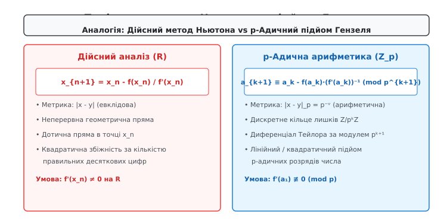
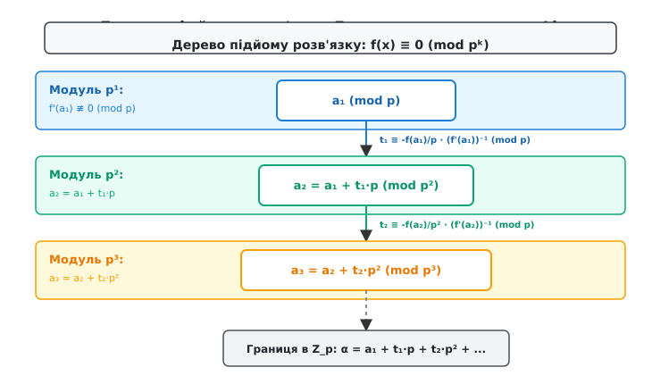
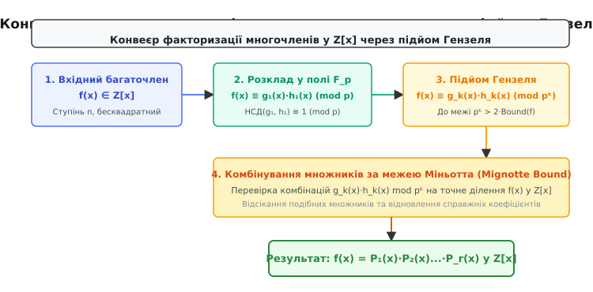

# Лема Гензеля

<preknowlist>
- [Модульна арифметика](root:math-number-theory/modular-arithmetic) — порівняння за модулем, кільця лишків Z/nZ.
- [Мультиплікативний обернений елемент](root:math-number-theory/modular-inverse) — обчислення v ≡ (f'(a))⁻¹ (mod p).
- [Тотожність Безу](root:math-number-theory/bezout-identity) — лінійні комбінації та взаємно прості числа.
- [Китайська теорема про остачі](root:math-number-theory/chinese-remainder-theorem) — об'єднання розв'язків за різними простими модулями.
- [Кільця](root:math-algebra/rings) — алгебраїчні структури Z_p та Z/pᵏZ.
</preknowlist>

> 🔧 **Навіщо це.**
> Спроба знайти корені поліноміального рівняння за великим модулем `pᵏ` безпосереднім перебором або прямолінійним розв'язанням зупиняється перед обчислювальним глухим кутом: кількість кандидатів `pᵏ` зростає експоненціально, що робить задачу нездійсненною вже для помірних степенів (наприклад, `2²⁵⁶` кандидатів у криптографії). З іншого боку, розв'язання того ж рівняння за першим степенем модуля `p` над скінченним полем `F_p` виконується за частки мілісекунди ефективними поліноміальними алгоритмами. Лема Гензеля вирішує цю фундаментальну проблему: за аналогією з методом Ньютона в математичному аналізі (де початкове наближення уточнюється за допомогою похідної) вона дає алгебраїчний механізм для «підйому» (lifting) відомого кореня `a₁ (mod p)` до точного розв'язку `a_k (mod pᵏ)` або p-адичного цілого числа в `Z_p` за `k` швидких детермінованих кроків замість `pᵏ` перевірок. Це уможливлює факторизацію багаточленів (алгоритм Берлекампа — Цассенгауза), добування квадратних коренів у криптосистемах RSA та Рабіна, аналіз еліптичних кривих і розв'язання діофантових рівнянь.

Потреба в лемі Гензеля виникає через те, що прямий перебір розв'язків порівняння `f(x) ≡ 0 (mod pᵏ)` потребує експоненціальної кількості перевірок `O(pᵏ)`, що стає обчислювально нездійсненним при великих `k`, тоді як лема Гензеля дає змогу розв'язати рівняння за простим модулем `p` (всього `p` перевірок) і ефективно підняти розв'язок до `mod pᵏ` за лінійну кількість кроків аналогічно методу Ньютона.

## 1. Проблема підйому розв'язків у модульній арифметиці

Розглянемо фундаментальну задачу теорії чисел та комп'ютерної алгебри — знаходження цілочисельних коренів поліноміального порівняння:

```
f(x) ≡ 0 (mod M)
```

де `f(x) = c_n·xⁿ + c_{n-1}·xⁿ⁻¹ + ... + c₁·x + c₀` — многочлен із цілими коефіцієнтами `c_i ∈ Z`, а модуль `M` є довільним натуральним числом.

За Основною теоремою арифметики будь-який складений модуль `M` однозначно розкладається на добуток степенів простих чисел:

```
M = p₁^{k₁} · p₂^{k₂} ... p_r^{k_r}
```

Завдяки [Китайській теоремі про остачі](root:math-number-theory/chinese-remainder-theorem) загальна задача розв'язання порівняння за модулем `M` повністю розпадається на незалежну систему порівнянь за модулями окремих примарних степенів:

```
f(x) ≡ 0 (mod p_i^{k_i}),   де i = 1, 2, ..., r
```

Якщо розв'язки знайдено для кожного окремого `p_i^{k_i}`, результуючий розв'язок за вихідним модулем `M` однозначно відновлюється за один алгебраїчний крок. Однак саме тут виникає головна обчислювальна перепона: прямолінійний пошук кореня за складеним степенем `pᵏ` вимагає перебору або перевірки `pᵏ` кандидатів. Якщо у криптографічних застосуваннях або обчисленнях на еліптичних кривих модуль `p = 2`, а показник степеня `k = 256`, множина пошуку з `2²⁵⁶` варіантів перевершує кількість елементарних частинок у доступному спостереженню Всесвіті.

З іншого боку, якщо розглянути те саме рівняння за першим степенем простого модуля `p`:

```
f(x) ≡ 0 (mod p)
```

ми опиняємося в структурі скінченного поля `F_p = Z/pZ`. Над полем `F_p` кількість елементів невелика (усього `p`), а для знаходження коренів многочленів існують строго детерміновані або високоефективні ймовірнісні алгоритми (алгоритм Берлекампа, алгоритм Кантора — Цассенгауза), які розв'язують задачу за поліноміальний час `O(deg(f) · log(p))`.

Центральне питання полягає в наступному: чи можливо використати легко знайдений розв'язок `a₁` за малим простим модулем `p` для того, щоб детерміновано побудувати розв'язок `a₂` за модулем `p²`, далі `a₃` за модулем `p³`, і послідовно дійти до `a_k (mod pᵏ)`, повністю уникнувши комбінаторного вибуху?

Ідея підйому Гензеля полягає в тому, що шуканий розв'язок `a_k (mod pᵏ)` можна подати як позиційний p-адичний розклад за зростаючими степенями простого числа `p`:

```
a_k = c₀ + c₁·p + c₂·p² + c₃·p³ + ... + c_{k-1}·p^{k-1}
```

де кожна «цифра» `c_i` належить множині найменших невід'ємних лишків `{0, 1, ..., p - 1}`.

Знаходження початкового кореня `a₁ (mod p)` фіксує молодший розряд `c₀ = a₁`. Механізм Гензеля доводить, що якщо корінь `a₁` є простим (його формальна похідна `f'(a₁) ≢ 0 (mod p)` не кратна `p`), то кожна наступна цифра `c₁, c₂, ..., c_{k-1}` однозначно обчислюється розв'язанням простого лінійного порівняння першого степеня. Замість експоненціального перебору `O(pᵏ)` ми отримуємо послідовний процес підйому зі швидкістю `O(k · deg(f))` арифметичних операцій.

## 2. Геометрична та алгебраїчна аналогія з методом Ньютона — Рафсона

Щоб зрозуміти внутрішню алгебраїчну логіку леми Гензеля, необхідно зіставити її з класичним методом дотичних Ньютона — Рафсона для пошуку дійсних коренів нелінійних рівнянь.

### Метод Ньютона у дійсному аналізі

У числовому аналізі для розв'язання рівняння `f(x) = 0` на множині дійсних чисел `R` ми обираємо початкове наближення `x₀`. У точці `(x₀, f(x₀))` проводиться дотична пряма до графіка функції `y = f(x)`:

```
y - f(x₀) = f'(x₀) · (x - x₀)
```

Точка перетину цієї дотичної прямої з віссю абсцис `y = 0` дає наступне, точніше наближення `x₁`:

```
0 - f(x₀) = f'(x₀) · (x₁ - x₀)
x₁ = x₀ - f(x₀) / f'(x₀)
```


*Аналогія між геометричним методом дотичних Ньютона у реальному аналізі та модульним підйопом Гензеля в p-адичній арифметиці.*

Якщо точний корінь позначити як `x*` (`f(x*) = 0`), а похибку на кроці `k` як `ε_k = x_k - x*`, то розклад Тейлора в околі кореня показує квадратичну збіжність методу Ньютона:

```
f(x_k) = f(x* + ε_k) = f(x*) + f'(x*)·ε_k + (f''(ξ)/2)·ε_k² = f'(x*)·ε_k + O(ε_k²)
```

Підстановка цього розкладу в ітераційну формулу Ньютона демонструє, що похибка на наступному кроці пропорційна квадрату похибки на попередньому: `|ε_{k+1}| ≤ C · |ε_k|²`. На кожному кроці кількість правильних десяткових знаків після коми подвоюється.

### Підйом Гензеля як неархімедів метод Ньютона

У модульних кільцях `Z/pᵏZ` та просторі p-адичних чисел `Q_p` поняття відстані між числами визначається не звичайною евклідовою різницею, а p-адичною метрикою `|x - y|_p`. За визначенням:

```
|x - y|_p = p^{-v_p(x - y)}
```

де `v_p(z)` — p-адичне нормування (найбільший цілий показник степеня, такий що `p^{v_p(z)}` ділить `z`).

У цій метриці два числа вважаються тим «ближчими», чим вищий степінь простого числа `p` ділить їхню різницю:
- Різниця ділиться на `p` → відстань `≤ 1/p`;
- Різниця ділиться на `p²` → відстань `≤ 1/p²`;
- Різниця ділиться на `pᵏ` → відстань `≤ 1/pᵏ`.

Таким чином, твердження `f(a_k) ≡ 0 (mod pᵏ)` мовою аналізу означає:

```
|f(a_k)|_p ≤ p^{-k}
```

Тобто `a_k` є наближеним коренем рівняння `f(x) = 0` з точністю до `k` p-адичних знаків.

Коли ми шукаємо поправку `t_k · pᵏ` для формування наступного наближення `a_{k+1} = a_k + t_k · pᵏ`, ми розкладаємо многочлен `f(x)` у модульний ряд Тейлора:

```
f(a_k + t_k·pᵏ) = f(a_k) + f'(a_k) · (t_k·pᵏ) + (f''(a_k)/2!) · (t_k·pᵏ)² + ...
```

Через те, що квадрат поправки `(t_k · pᵏ)² = t_k² · p²ᵏ` містить множник `p²ᵏ`, при переході за модулем `p^{k+1}` (оскільки `2k ≥ k + 1` для всіх `k ≥ 1`) усі квадратичні та вищі члени розкладу Тейлора обнуляються **абсолютно точно**, а не наближено:

```
f(a_k + t_k·pᵏ) ≡ f(a_k) + f'(a_k) · t_k · pᵏ (mod p^{k+1})
```

Вимога `f(a_{k+1}) ≡ 0 (mod p^{k+1})` перетворюється на точне модульне лінійне рівняння дотичної:

```
f(a_k) + f'(a_k) · (a_{k+1} - a_k) ≡ 0 (mod p^{k+1})
```

Звідки алгебраїчно отримуємо класичну формулу Ньютона, перенесену в модульне кільце:

```
a_{k+1} ≡ a_k - f(a_k) · [f'(a_k)]⁻¹ (mod p^{k+1})
```

### Порівняння лінійної та квадратичної схем підйому

Залежно від способу оновлення оберненого значення похідної виділяють дві схеми підйому Гензеля:

1. **Лінійний підйом (метод хорд / стаціонарний Ньютон):**
   Оскільки `a_k ≡ a₁ (mod p)`, значення похідної за модулем `p` залишається незмінним: `f'(a_k) ≡ f'(a₁) (mod p)`. Тому мультиплікативний обернений елемент `v ≡ [f'(a₁)]⁻¹ (mod p)` обчислюється за допомогою розширеного алгоритму Евкліда **лише один раз** на самому початку роботи. На кожній ітерації додається рівно один p-адичний розряд (`p¹ → p² → p³ → ... → pᵏ`). Для досягнення степеня `k` потрібно `k - 1` швидких лінійних кроків.

2. **Квадратичний підйом (повний метод Ньютона — Рафсона):**
   Якщо оновлювати розв'язок одразу за модулем квадрата попереднього степеня `p²ᵏ`, то точність на кожному кроці подвоюється: `p → p² → p⁴ → p⁸ → ... → p^{2ᵐ}`:
   ```
   a_{2k} ≡ a_k - f(a_k) · [f'(a_k)]⁻¹ (mod p²ᵏ)
   ```
   Ця схема потребує лише `O(log k)` ітерацій. Проте на кожному кроці необхідно обчислювати обернений елемент `[f'(a_k)]⁻¹` у кільці зростаючого розміру `Z/p²ᵏZ`. Щоб уникнути застосування алгоритму Евкліда для великих чисел, саме інвертування також здійснюють квадратичною ітерацією Ньютона: якщо `v_k ≡ [f'(a_k)]⁻¹ (mod pᵏ)`, то `v_{2k} ≡ v_k · (2 - f'(a_{2k}) · v_k) (mod p²ᵏ)`.

Детальний математичний контекст зародження цих ідей наведено у вставці [📜 Історія леми Гензеля та відкриття p-адичних чисел](root:math-number-theory/hensel-lemma/hist-hensel-p-adic.md).

## 3. Точне формулювання та алгебраїчне виведення

Перш ніж довести лему Гензеля, необхідно обґрунтувати одне ключове алгебраїчне твердження: чому формальний розклад многочлена в ряд Тейлора в цілочисельній арифметиці ніколи не створює дробових коефіцієнтів при діленні похідних на факторіали `m!`.

### Цілочисельність диференціалів Тейлора для многочленів

Нехай `f(x) = ∑_{r=0}^n c_r · xʳ` — многочлен із цілими коефіцієнтами `c_r ∈ Z`. Розглянемо зсув аргументу `f(x + h)` і застосуємо біном Ньютона до кожного монома `c_r · (x + h)ʳ`:

```
c_r · (x + h)ʳ = c_r · ∑_{m=0}^r C(r, m) · x^{r-m} · hᵐ
```

де `C(r, m) = r! / (m! · (r - m)!)` — біноміальний коефіцієнт, який завжди є цілим додатним числом.

Обчислимо `m`-ту формальну похідну від монома `c_r · xʳ`:

```
dᵐ/dxᵐ (c_r · xʳ) = c_r · r · (r - 1) ... (r - m + 1) · x^{r-m} = c_r · (r! / (r - m)!) · x^{r-m}
```

Розділивши цю похідну на факторіал `m!`, отримуємо:

```
(1 / m!) · dᵐ/dxᵐ (c_r · xʳ) = c_r · C(r, m) · x^{r-m}
```

Оскільки коефіцієнт `c_r · C(r, m)` є цілим числом, оператор `P_m(x) = f⁽ᵐ⁾(x) / m!` перетворює будь-який многочлен із цілими коефіцієнтами `f(x) ∈ Z[x]` на новий многочлен `P_m(x) ∈ Z[x]` також виключно з **цілими коефіцієнтами**.

Отже, точний алгебраїчний розклад Тейлора для цілочисельного багаточлена має вигляд:

```
f(x + h) = f(x) + f'(x)·h + P₂(x)·h² + P₃(x)·h³ + ... + P_n(x)·hⁿ
```

де всі `P_m(x) ∈ Z[x]`.

### Формулювання леми Гензеля (випадок простого кореня)

Нехай `f(x) ∈ Z[x]` — многочлен із цілими коефіцієнтами, а `p` — просте число. Нехай існує ціле число `a₁ ∈ Z`, таке що:
1. `f(a₁) ≡ 0 (mod p)` (число `a₁` є коренем за модулем `p`);
2. `f'(a₁) ≢ 0 (mod p)` (похідна не ділиться на `p`, тобто корінь є простим / некратним).

> **Лема Гензеля (простий корінь):** За виконання цих умов для кожного натурального `k ≥ 1` існує **єдиний** лишок `a_k (mod pᵏ)`, такий що:
> 1. `f(a_k) ≡ 0 (mod pᵏ)`
> 2. `a_k ≡ a₁ (mod p)`
>
> При цьому перехід від `a_k` до `a_{k+1}` визначається рекурентною формулою:
> ```
> a_{k+1} = a_k + t_k · pᵏ (mod p^{k+1})
> ```
> де коефіцієнт `t_k ∈ {0, 1, ..., p - 1}` є єдиним розв'язком лінійного порівняння:
> ```
> t_k · f'(a₁) ≡ - (f(a_k) / pᵏ) (mod p)
> ```

### Покрокове виведення формули підйому

Доведемо теорему за принципом математичної індукції за показником степеня `k`.

**База індукції (`k = 1`):** За умовою леми корінь `a₁` існує і задовольняє `f(a₁) ≡ 0 (mod p)`.

**Індукційний перехід (`k → k + 1`):** Припустимо, що ми вже знайшли розв'язок `a_k` за модулем `pᵏ`. Це означає, що `f(a_k)` без остачі ділиться на `pᵏ`, тобто:

```
f(a_k) = q_k · pᵏ   для деякого цілого q_k = f(a_k) / pᵏ ∈ Z
```

Будь-який кандидат на розв'язок `a_{k+1}` за модулем `p^{k+1}`, який узгоджується з `a_k` за модулем `pᵏ`, мусить мати вигляд:

```
a_{k+1} = a_k + t · pᵏ,   де t ∈ {0, 1, ..., p - 1}
```

Підставимо цей вираз у многочлен `f(x)` та застосуємо цілочисельний розклад Тейлора при `h = t · pᵏ`:

```
f(a_k + t·pᵏ) = f(a_k) + f'(a_k) · (t·pᵏ) + ∑_{m=2}^n P_m(a_k) · (t·pᵏ)ᵐ
```

Оцінимо степінь простого числа `p` у членах суми при `m ≥ 2`:

```
(t · pᵏ)ᵐ = tᵐ · pᵐᵏ = tᵐ · p²ᵏ · p^{(m-2)k}
```

Оскільки `k ≥ 1`, для будь-якого `m ≥ 2` виконується нерівність `m · k ≥ 2k ≥ k + 1`. Це означає, що фактор `pᵐᵏ` ділиться на `p^{k+1}` без остачі. Тому вся нелінійна частина суми Тейлора стає рівною нулю за модулем `p^{k+1}`:

```
f(a_k + t·pᵏ) ≡ f(a_k) + f'(a_k) · t · pᵏ (mod p^{k+1})
```

Враховуючи, що `a_k ≡ a₁ (mod p)`, маємо тотожність `f'(a_k) ≡ f'(a₁) (mod p)`. Тобто `f'(a_k) = f'(a₁) + c · p` для деякого цілого `c`. Тоді:

```
f'(a_k) · t · pᵏ = (f'(a₁) + c·p) · t · pᵏ = f'(a₁) · t · pᵏ + c · t · p^{k+1} ≡ f'(a₁) · t · pᵏ (mod p^{k+1})
```

Отже, умова `f(a_{k+1}) ≡ 0 (mod p^{k+1})` набуває вигляду:

```
f(a_k) + f'(a₁) · t · pᵏ ≡ 0 (mod p^{k+1})
```

Підставивши `f(a_k) = q_k · pᵏ`, отримуємо:

```
q_k · pᵏ + f'(a₁) · t · pᵏ ≡ 0 (mod p^{k+1})
```

Розділимо обидві частини рівності та сам модуль `p^{k+1}` на спільний дільник `pᵏ` (що є стандартним правилом скорочення модульних порівнянь):

```
q_k + f'(a₁) · t ≡ 0 (mod p)
```

Перенесемо вільний член `q_k` у праву частину:

```
f'(a₁) · t ≡ - q_k (mod p)
f'(a₁) · t ≡ - (f(a_k) / pᵏ) (mod p)
```

Оскільки за початковою умовою корінь є простим, `f'(a₁) ≢ 0 (mod p)`, число `f'(a₁)` є взаємно простим із модулем `p` (`gcd(f'(a₁), p) = 1`).

За теоремою про [Мультиплікативний обернений елемент](root:math-number-theory/modular-inverse) існує єдине число `v ∈ {1, 2, ..., p - 1}`, таке що:

```
v · f'(a₁) ≡ 1 (mod p)
```

Помноживши обидві частини порівняння на `v`, отримуємо однозначний розв'язок для цифри `t_k`:

```
t_k ≡ - (f(a_k) / pᵏ) · v (mod p)
```

Це доводить існування шуканого кореня `a_{k+1} = a_k + t_k · pᵏ`.

### Доведення єдиності підйому

Припустимо, що існують два розв'язки `x` та `y` за модулем `p^{k+1}`, такі що:
1. `f(x) ≡ 0 (mod p^{k+1})` та `f(y) ≡ 0 (mod p^{k+1})`;
2. `x ≡ a_k (mod pᵏ)` та `y ≡ a_k (mod pᵏ)`.

З другої умови випливає, що різниця `x - y` ділиться на `pᵏ`, тобто `x - y = s · pᵏ` для деякого цілого `s`.

Розкладемо `f(x) = f(y + s·pᵏ)` у ряд Тейлора за модулем `p^{k+1}`:

```
f(x) ≡ f(y) + f'(y) · s · pᵏ (mod p^{k+1})
```

Оскільки `f(x) ≡ 0 (mod p^{k+1})` та `f(y) ≡ 0 (mod p^{k+1})`, отримуємо:

```
0 ≡ 0 + f'(y) · s · pᵏ (mod p^{k+1})
f'(y) · s · pᵏ ≡ 0 (mod p^{k+1})
```

Розділивши на `pᵏ`:

```
f'(y) · s ≡ 0 (mod p)
```

Оскільки `y ≡ a₁ (mod p)`, маємо `f'(y) ≡ f'(a₁) ≢ 0 (mod p)`. Скоротивши на ненульовий елемент `f'(y)` у полі `F_p`, маємо:

```
s ≡ 0 (mod p)
```

Це означає, що `s` ділиться на `p`, отже `x - y = s · pᵏ = c · p · pᵏ = c · p^{k+1}`, звідки `x ≡ y (mod p^{k+1})`.

Єдиність підйому на кожному кроці повністю доведено.


*Дерево унікальних розв'язків рівняння за зростаючими ступенями p, де на кожному рівні додається один p-адичний розряд.*

Строгі докази для багатовимірних систем рівнянь та підйому факторизації многочленів винесено у вставку [🧮 Строгий доказ леми Гензеля, багатовимірний випадок та факторизація](root:math-number-theory/hensel-lemma/math-hensel-multivariate.md).

## 4. Практичні числові приклади та кроки підйому

### Приклад 1: Обчислення квадратного кореня з 7 за модулем 3⁵ = 243

Розглянемо задачу розв'язання квадратичного порівняння:

```
x² ≡ 7 (mod 243)
```

Тут многочлен має вигляд `f(x) = x² - 7`, а його похідна дорівнює `f'(x) = 2x`. Ми шукаємо розв'язок за модулем `p⁵ = 3⁵ = 243`.

#### Крок 1: Базовий розв'язок за модулем p = 3

Розв'язуємо порівняння `x² - 7 ≡ 0 (mod 3)`, що еквівалентно:

```
x² ≡ 1 (mod 3)
```

Рівняння має два корені в полі `F_3`: `a₁ = 1` та `a₁' = 2 ≡ -1 (mod 3)`.

Проведемо повний підйом для гілки `a₁ = 1`.

Обчислимо похідну в точці `a₁ = 1`:

```
f'(1) = 2 · 1 = 2 ≢ 0 (mod 3)
```

Корінь є простим. Знайдемо обернений елемент `v` до похідної за модулем 3:

```
v ≡ 2⁻¹ ≡ 2 (mod 3),   бо 2 · 2 = 4 ≡ 1 (mod 3)
```

Значення `v = 2` зафіксовано на всі наступні ітерації.

#### Крок 2: Підйом від mod 3 до mod 3² = 9

Маємо `a₁ = 1`, `p = 3`, `k = 1`.
1. Обчислюємо значення многочлена: `f(a₁) = 1² - 7 = -6`.
2. Обчислюємо частку: `q₁ = f(a₁) / 3¹ = -6 / 3 = -2`.
3. За модулем 3 частка дорівнює: `q₁ ≡ -2 ≡ 1 (mod 3)`.
4. Обчислюємо поправку `t₁`:
   ```
   t₁ ≡ - q₁ · v ≡ - 1 · 2 = -2 ≡ 1 (mod 3)
   ```
5. Формуємо новий корінь `a₂`:
   ```
   a₂ = a₁ + t₁ · 3¹ = 1 + 1 · 3 = 4
   ```

*Перевірка за модулем 9:* `f(4) = 4² - 7 = 16 - 7 = 9 ≡ 0 (mod 9)`.

#### Крок 3: Підйом від mod 9 до mod 3³ = 27

Маємо `a₂ = 4`, `p = 3`, `k = 2`, `p² = 9`.
1. Обчислюємо значення: `f(a₂) = 4² - 7 = 9`.
2. Обчислюємо частку: `q₂ = f(a₂) / 3² = 9 / 9 = 1`.
3. За модулем 3: `q₂ ≡ 1 (mod 3)`.
4. Обчислюємо поправку `t₂`:
   ```
   t₂ ≡ - q₂ · v ≡ - 1 · 2 = -2 ≡ 1 (mod 3)
   ```
5. Формуємо новий корінь `a₃`:
   ```
   a₃ = a₂ + t₂ · 3² = 4 + 1 · 9 = 13
   ```

*Перевірка за модулем 27:* `f(13) = 13² - 7 = 169 - 7 = 162 = 6 · 27 ≡ 0 (mod 27)`.

#### Крок 4: Підйом від mod 27 до mod 3⁴ = 81

Маємо `a₃ = 13`, `p = 3`, `k = 3`, `p³ = 27`.
1. Обчислюємо значення: `f(a₃) = 13² - 7 = 162`.
2. Обчислюємо частку: `q₃ = 162 / 27 = 6`.
3. За модулем 3: `q₃ = 6 ≡ 0 (mod 3)`.
4. Обчислюємо поправку `t₃`:
   ```
   t₃ ≡ - 0 · 2 ≡ 0 (mod 3)
   ```
5. Формуємо новий корінь `a₄`:
   ```
   a₄ = a₃ + t₃ · 3³ = 13 + 0 · 27 = 13
   ```

*Перевірка за модулем 81:* `f(13) = 162 = 2 · 81 ≡ 0 (mod 81)`.

#### Крок 5: Підйом від mod 81 до mod 3⁵ = 243

Маємо `a₄ = 13`, `p = 3`, `k = 4`, `p⁴ = 81`.
1. Обчислюємо значення: `f(a₄) = 162`.
2. Обчислюємо частку: `q₄ = 162 / 81 = 2`.
3. За модулем 3: `q₄ ≡ 2 (mod 3)`.
4. Обчислюємо поправку `t₄`:
   ```
   t₄ ≡ - 2 · 2 = -4 ≡ 2 (mod 3)
   ```
5. Формуємо підсумковий корінь `a₅`:
   ```
   a₅ = a₄ + t₄ · 3⁴ = 13 + 2 · 81 = 13 + 162 = 175
   ```

*Перевірка за модулем 243:* `f(175) = 175² - 7 = 30625 - 7 = 30618 = 126 · 243 ≡ 0 (mod 243)`.

Отже, єдиним підйомом початкового кореня `a₁ = 1` за модулем `243` є число `175`. Якщо підняти другий корінь `a₁' = 2`, отримуємо симетричний корінь:

```
a₅' = 243 - 175 = 68 (mod 243)
```

Перевірка для другого кореня: `68² - 7 = 4624 - 7 = 4617 = 19 · 243 ≡ 0 (mod 243)`.

### Приклад 2: Кубічне рівняння за модулем 5³ = 125

Розглянемо многочлен `f(x) = x³ + 2x + 3` за модулем `5³ = 125`.

Обчислимо його похідну: `f'(x) = 3x² + 2`.

Знайдемо корінь за модулем `p = 5`:
- `f(0) = 3 ≡ 3 (mod 5)`
- `f(1) = 1 + 2 + 3 = 6 ≡ 1 (mod 5)`
- `f(2) = 8 + 4 + 3 = 15 ≡ 0 (mod 5)`

Маємо корінь `a₁ = 2`. Перевіримо похідну:

```
f'(2) = 3 · (2²) + 2 = 12 + 2 = 14 ≡ 4 ≢ 0 (mod 5)
```

Обернений елемент до похідної: `v ≡ 4⁻¹ ≡ 4 (mod 5)`, оскільки `4 · 4 = 16 ≡ 1 (mod 5)`.

#### Підйом до mod 25:
1. `f(2) = 2³ + 2·2 + 3 = 15`.
2. `q₁ = 15 / 5 = 3`.
3. `t₁ ≡ - 3 · 4 = -12 ≡ 3 (mod 5)`.
4. `a₂ = 2 + 3 · 5 = 17`.

*Перевірка mod 25:* `f(17) = 17³ + 2·17 + 3 = 4913 + 34 + 3 = 4950 = 198 · 25 ≡ 0 (mod 25)`.

#### Підйом до mod 125:
1. `f(17) = 4950`.
2. `q₂ = 4950 / 25 = 198 ≡ 3 (mod 5)`.
3. `t₂ ≡ - 3 · 4 = -12 ≡ 3 (mod 5)`.
4. `a₃ = 17 + 3 · 25 = 92`.

*Перевірка mod 125:* `f(92) = 92³ + 2·92 + 3 = 778688 + 184 + 3 = 778875 = 6231 · 125 ≡ 0 (mod 125)`.

Корінь `a₁ = 2` однозначно піднявся до `a₃ = 92 (mod 125)`.

## 5. Вироджений випадок: Коли похідна кратна p

Що відбувається з розв'язками, коли умова простого кореня порушується, тобто значення похідної ділиться на `p` (`f'(a₁) ≡ 0 (mod p)`)?

У цьому випадку в розкладі Тейлора член першого порядку `f'(a_k) · t · pᵏ` містить додатковий множник `p`, оскільки `f'(a_k) = c · p`. Тому:

```
f'(a_k) · t · pᵏ = c · t · p^{k+1} ≡ 0 (mod p^{k+1})
```

Це призводить до того, що за модулем `p^{k+1}` лінійне рівняння підйому вироджується:

```
f(a_k + t·pᵏ) ≡ f(a_k) (mod p^{k+1})
```

Значення многочлена в будь-якій точці `a_k + t·pᵏ` взагалі **не залежить від вибору коефіцієнта `t`**. Це породжує фундаментальну дихотомію особливого випадку.

```
                  ┌────────────────────────────────────────┐
                  │          f'(a_1) ≡ 0 (mod p)           │
                  └───────────────────┬────────────────────┘
                                      │
                 ┌────────────────────┴────────────────────┐
                 ▼                                         ▼
   ┌───────────────────────────┐             ┌───────────────────────────┐
   │ f(a_k) ≢ 0 (mod p^{k+1})  │             │ f(a_k) ≡ 0 (mod p^{k+1})  │
   ├───────────────────────────┤             ├───────────────────────────┤
   │ Рівняння 0·t ≡ q (q ≢ 0)  │             │ Рівняння 0·t ≡ 0 (mod p)  │
   │    НЕМАЄ РОЗВ'ЯЗКІВ       │             │   ТОТОЖНІСТЬ ДЛЯ ВСІХ t   │
   │       (0 коренів)         │             │        (p коренів)        │
   │      Глухий кут           │             │       Розгалуження        │
   └───────────────────────────┘             └───────────────────────────┘
```

### Сценарій А: Несумісність (0 розв'язків — глухий кут)

Якщо поточне значення `f(a_k)` не ділиться на вищий степінь `p^{k+1}` (тобто `f(a_k) / pᵏ ≢ 0 (mod p)`), то рівняння для поправки набуває вигляду:

```
0 · t ≡ - (f(a_k) / pᵏ) ≢ 0 (mod p)
```

Це рівняння не має жодного розв'язку для `t ∈ {0, 1, ..., p - 1}`. Корінь `a_k` є тупиковим і **не піднімається** на рівень `mod p^{k+1}`.

### Сценарій Б: Розгалуження (p розв'язків)

Якщо значення `f(a_k)` випадково ділиться на `p^{k+1}` (тобто `f(a_k) / pᵏ ≡ 0 (mod p)`), рівняння перетворюється на тотожність:

```
0 · t ≡ 0 (mod p)
```

У цьому випадку **будь-який** вибір коефіцієнта `t ∈ {0, 1, ..., p - 1}` задовольняє умову `f(a_k + t·pᵏ) ≡ 0 (mod p^{k+1})`. Початковий корінь `a_k` розгалужується рівно на `p` різних коренів за модулем `p^{k+1}`:

```
a_{k+1}^{(t)} = a_k + t · pᵏ,   де t = 0, 1, ..., p - 1
```

### Повний розбір розгалуження: рівняння x² ≡ 1 (mod 2ᵏ)

Класичним і найважливішим у криптографії прикладом виродженого підйому є дослідження квадратних коренів з одиниці за степенями двійки:

```
f(x) = x² - 1 ≡ 0 (mod 2ᵏ)
```

Похідна многочлена дорівнює `f'(x) = 2x`. Оскільки `f'(x)` ділиться на 2 для будь-якого цілого `x`, умова простого кореня `f'(x) ≢ 0 (mod 2)` не виконується ніколи! Простежимо крок за кроком, як веде себе дерево розв'язків:

1. **За модулем p = 2 (`k = 1`):**
   Рівняння `x² ≡ 1 (mod 2)` має один корінь: `a₁ = 1`. Похідна `f'(1) = 2 ≡ 0 (mod 2)`.

2. **За модулем p² = 4 (`k = 2`):**
   Обчислимо `f(a₁) = 1² - 1 = 0`. Значення `f(1) = 0` ділиться на 4, тому виникає розгалуження для `t ∈ {0, 1}`:
   - `t = 0 → a₂ = 1 + 0·2 = 1`
   - `t = 1 → a₂ = 1 + 1·2 = 3`
   Обидва числа є коренями за модулем 4: `1² = 1 ≡ 1 (mod 4)` та `3² = 9 ≡ 1 (mod 4)`. Кількість коренів: **2**.

3. **За модулем p³ = 8 (`k = 3`):**
   Перевіримо обидва корені:
   - Для `a₂ = 1`: `f(1) = 0` ділиться на 8 → розгалужується на `1 + 0·4 = 1` та `1 + 1·4 = 5`.
   - Для `a₂ = 3`: `f(3) = 9 - 1 = 8` ділиться на 8 → розгалужується на `3 + 0·4 = 3` та `3 + 1·4 = 7`.
   Усі чотири непарні числа `{1, 3, 5, 7}` є коренями за модулем 8! Кількість коренів: **4**.

4. **За модулем p⁴ = 16 (`k = 4`):**
   Перевіримо значення `f(x) = x² - 1` для кожного з чотирьох кандидатів за модулем 16:
   - `f(1) = 0 ≡ 0 (mod 16)` → розгалужується на `1` та `1 + 8 = 9`.
   - `f(3) = 8 ≢ 0 (mod 16)` → **глухий кут** (0 розв'язків за модулем 16).
   - `f(5) = 24 ≡ 8 ≢ 0 (mod 16)` → **глухий кут** (0 розв'язків за модулем 16).
   - `f(7) = 48 ≡ 0 (mod 16)` → розгалужується на `7` та `7 + 8 = 15`.

Кандидати 3 та 5 відмирають, а кандидати 1 та 7 розгалужуються, даючи рівно чотири корені за модулем 16: `{1, 7, 9, 15}`.

При переході до будь-якого степеня `k ≥ 3` кількість розв'язків порівняння `x² ≡ 1 (mod 2ᵏ)` завжди залишається рівною **4**, а самі корені задаються формулами:

```
x ≡ ± 1 (mod 2ᵏ)   та   x ≡ ± (1 + 2^{k-1}) (mod 2ᵏ)
```

Це пояснює відомий факт з теорії груп: мультиплікативна група лишків `(Z/2ᵏZ)*` при `k ≥ 3` не є циклічною, а ізоморфна прямому добутку `Z/2Z × Z/2^{k-2}Z`.

### Узагальнена лема Гензеля за нормуванням

Якщо похідна кратна `p`, але не дорівнює нулю тотожно, корінь можна підняти, якщо початкове наближення є достатньо точним.

Позначимо показник кратності похідної як `e = v_p(f'(a₀))`.

> **Узагальнена лема Гензеля:** Нехай `f(x) ∈ Z[x]`, `a₀ ∈ Z`, і нехай `e = v_p(f'(a₀)) ≥ 0`.
> Якщо виконується умова строгого домінування:
> ```
> v_p(f(a₀)) > 2e   (тобто f(a₀) ≡ 0 (mod p^{2e+1}))
> ```
> то існує єдиний корінь `α ∈ Z_p` у кільці p-адичних цілих чисел, такий що:
> ```
> f(α) = 0   та   α ≡ a₀ (mod p^{v_p(f(a₀)) - e})
> ```

Чому поріг дорівнює саме `2e + 1`? У розкладі Тейлора `f(a + t·p^{k-e}) ≈ f(a) + f'(a)·t·p^{k-e}` лінійний член має порядок `p^e · p^{k-e} = p^k`. Квадратичний член `(f''(a)/2) · (t·p^{k-e})²` має порядок `p^{2(k-e)}`. Щоб лінійний член домінував над квадратичним (тобто квадратичний член обнулявся за модулем `p^{k+1}`), необхідно:

```
2(k - e) ≥ k + 1
2k - 2e ≥ k + 1
k ≥ 2e + 1
```

Це є прямим p-адичним еквівалентом знаменитої теореми Канторовича про збіжність методу Ньютона у функціональному аналізі.

## 6. p-адичні числа Q_p, норма Островського та повнота простору

Послідовність наближень `(a₁, a₂, a₃, ..., a_k, ...)`, яку будує лема Гензеля при необмеженому зростанні показника `k → ∞`, є фундаментальним об'єктом сучасної теорії чисел — p-адичним числом.

### Конструкція поля Q_p та кільця цілих Z_p

Для будь-якого ненульового раціонального числа `x ∈ Q` його можна однозначно записати у вигляді `x = pᵐ · (a / b)`, де цілі числа `a` та `b` не діляться на просте число `p`. Показник `m ∈ Z` називається **p-адичним нормуванням** і позначається `v_p(x) = m`.

**p-адичний абсолютний розмір (норма)** числа `x` задається формулою:

```
|x|_p = p^{-v_p(x)},   якщо x ≠ 0;   |0|_p = 0
```

Ця норма має дивовижну властивість — вона задовольняє **ультраметричну нерівність** (сильну нерівність трикутника):

```
|x + y|_p ≤ max(|x|_p, |y|_p)
```

причому якщо `|x|_p ≠ |y|_p`, то нерівність перетворюється на **строгу рівність**: `|x + y|_p = max(|x|_p, |y|_p)`.

Ультраметрична нерівність породжує геометричні властивості, неможливі у звичайній евклідовій геометрії:
- **Усі трикутники є рівнобедреними:** якщо дві сторони трикутника мають різну p-адичну довжину, то третя сторона точно дорівнює більшій з них.
- **Будь-яка точка всередині кулі є її центром:** якщо точка `y` лежить у відкритій кулі `B(x, r)`, то `B(y, r) = B(x, r)`.
- **Кулі не перетинаються частково:** будь-які дві кулі або взагалі не мають спільних точок, або одна повністю міститься всередині іншої.
- Топологічний простір `Q_p` є цілком незв'язним.

**Кільце p-адичних цілих чисел `Z_p`** визначається як одинична куля в цій метриці:

```
Z_p = { x ∈ Q_p : |x|_p ≤ 1 }
```

Будь-яке число `α ∈ Z_p` однозначно розкладається в нескінченний ряд:

```
α = ∑_{i=0}^∞ c_i · pⁱ = c₀ + c₁·p + c₂·p² + c₃·p³ + ...
```

де `c_i ∈ {0, 1, ..., p - 1}`. Кільце `Z_p` є проєктивною границею системи скінченних кілець:

```
Z_p = lim_{\leftarrow} (Z/pᵏZ)
```

Будь-яка сумісна послідовність лишків `(a₁ mod p, a₂ mod p², ..., a_k mod pᵏ, ...)`, де `a_{k+1} ≡ a_k (mod pᵏ)`, задає єдиний елемент кільця `Z_p`.

### Теорема Островського та формула добутку

Чому саме p-адичні норми мають таке фундаментальне значення? Відповідь дає класична теорема Олександра Островського (1916).

> **Теорема Островського:** Будь-яка нетривіальна норма на полі раціональних чисел `Q` топологічно еквівалентна або стандартній евклідовій нормі `|x|_∞ = |x|`, або p-адичній нормі `|x|_p` для деякого простого числа `p`.

Це означає, що окрім дійсної прямої `R` (яка є метричним поповненням `Q` за евклідовою нормою `|·|_∞`), інших нееквівалентних поповнень раціональних чисел не існує — ними є виключно p-адичні поля `Q_p` для всіх простих `p = 2, 3, 5, 7, ...`.

Усі ці норми пов'язані між собою **глобальною формулою добутку**: для будь-якого ненульового раціонального числа `x ∈ Q*`:

```
|x|_∞ · ∏_{p} |x|_p = 1
```

де добуток береться за всіма простими числами `p` (лише скінченна кількість множників відмінна від 1).

*Числовий приклад:* Розглянемо число `x = -12 = - 2² · 3¹`.
- Евклідова норма: `|-12|_∞ = 12`.
- 2-адична норма: `|-12|_2 = 2^{-2} = 1/4`.
- 3-адична норма: `|-12|_3 = 3^{-1} = 1/3`.
- p-адична норма для всіх `p ≥ 5`: `|-12|_p = p^0 = 1`.
- Добуток: `12 · (1/4) · (1/3) · 1 · 1 ... = 1`.

### Повнота простору Q_p та принцип стискуючих відображень

Поле `Q_p` є повним метричним простором: будь-яка фундаментальна послідовність Коші збігається до елемента `Q_p`.

У p-адичному аналізі збіжність нескінченних рядів є значно простішою, ніж у дійсному аналізі:

```
Ряд ∑_{n=0}^∞ u_n збігається в Q_p  ⟺  lim_{n→∞} |u_n|_p = 0
```

Жодних додаткових умов на знакозмінність чи абсолютну збіжність не потрібно: зменшення загального члена до нуля є необхідною і достатньою умовою!

У цьому контексті **лема Гензеля є точною реалізацією теореми Банаха про нерухому точку**: оператор Ньютона `N(x) = x - f(x)/f'(x)` є стискуючим відображенням на замкненій кулі `B(a₁, 1) ⊂ Z_p` із коефіцієнтом стиску `k = |p|_p = 1/p < 1`. Послідовність наближень `a_k` збігається до єдиної нерухомої точки `α ∈ Z_p`, яка є точним коренем многочлена: `f(α) = 0`.

## 7. Застосування в комп'ютерній алгебрі: Алгоритм Берлекампа — Гензеля

Найважливішим практичним застосуванням леми Гензеля в обчислювальній техніці є алгоритм факторизації многочленів із цілими коефіцієнтами в системах комп'ютерної алгебри (Maple, Mathematica, SageMath, PARI/GP, Singular).

### Проблема факторизації в Z[x]

Нехай задано многочлен високого ступеня `f(x) ∈ Z[x]`. Потрібно знайти його розклад на незвідні множники в кільці цілих многочленів:

```
f(x) = g₁(x) · g₂(x) ... g_r(x)
```

Прямий пошук дільників у `Z[x]` є експоненціально складним через неможливість передбачити значення та знаки великих коефіцієнтів проміжних дільників.

Алгоритм Берлекампа — Цассенгауза вирішує цю задачу за допомогою конвеєра з використанням підйому Гензеля:

```
┌────────────────────────────────────────────────────────┐
│ Вхідний многочлен f(x) ∈ Z[x]                          │
└──────────────────────────┬─────────────────────────────┘
                           │ 1. Виділення безквадратної частини
                           ▼
┌────────────────────────────────────────────────────────┐
│ Безквадратний f(x): gcd(f, f') = 1                     │
└──────────────────────────┬─────────────────────────────┘
                           │ 2. Редукція mod p та алгоритм Берлекампа
                           ▼
┌────────────────────────────────────────────────────────┐
│ Факторизація в скінченному полі: f ≡ h₁·h₂...h_r mod p │
└──────────────────────────┬─────────────────────────────┘
                           │ 3. Підйом Гензеля для многочленів
                           ▼
┌────────────────────────────────────────────────────────┐
│ Підняті множники: f ≡ H₁·H₂...H_r (mod pᵏ), де pᵏ > 2B │
└──────────────────────────┬─────────────────────────────┘
                           │ 4. Комбінування за межею Міньотта
                           ▼
┌────────────────────────────────────────────────────────┐
│ Справжні незвідні множники g_i(x) ∈ Z[x]               │
└────────────────────────────────────────────────────────┘
```


*Етапи алгоритму розкладу многочленів: факторизація в скінченному полі, підйом Гензеля за модулем pᵏ та комбінування множників за межею Міньотта.*

### Кроки алгоритму Берлекампа — Гензеля

1. **Попередня обробка:** Многочлен роблять вільним від квадратів діленням на `gcd(f(x), f'(x))`.
2. **Факторизація в `F_p[x]`:** Обирається невелике просте число `p`, таке що старший коефіцієнт `f(x)` не ділиться на `p`, а редукований многочлен залишається вільним від квадратів у `F_p[x]`. За допомогою алгоритму Берлекампа многочлен розкладається на незвідні унітарні множники:
   ```
   f(x) ≡ u₁(x) · u₂(x) ... u_r(x) (mod p)
   ```
3. **Поліноміальний підйом Гензеля:** Використовуючи багатовимірну лему Гензеля для поліноміальних множників (через поліноміальну тотожність Безу `α·u_i + β·u_j ≡ 1 (mod p)`), розклад піднімається від модуля `p` до модуля `pᵏ`:
   ```
   f(x) ≡ U₁(x) · U₂(x) ... U_r(x) (mod pᵏ)
   ```
4. **Критерій зупинки (Межа Міньотта):** До якого степеня `k` потрібно здійснювати підйом? Французький математик Моріс Міньотт (Maurice Mignotte) встановив фундаментальну верхню оцінку на абсолютну величину коефіцієнтів будь-якого дільника `g(x) = ∑ b_j xʲ` многочлена `f(x) = ∑ c_i xⁱ` ступеня `n`:
   ```
   |b_j| ≤ C(n - 1, j) · ||f||₂ + C(n - 1, j - 1) · |c_n|
   ```
   де `||f||₂ = √(∑ c_i²)` — евклідова норма вектора коефіцієнтів.
   Загальна межа Міньотта `B` для коефіцієнтів будь-якого дільника задається формулою:
   ```
   B = 2ⁿ · √(n + 1) · ||f||_∞
   ```
   Підйом Гензеля виконується доти, доки модуль не перевищить подвійну межу: `pᵏ > 2 · B`.
5. **Відновлення справжніх дільників:** Оскільки модуль `pᵏ` перевищує максимально можливий коефіцієнт будь-якого дільника у два рази, будь-який справжній цілочисельний коефіцієнт потрапляє в симетричний інтервал `(-pᵏ/2, pᵏ/2]`. Алгоритм перебирає підмножини модульних множників `∏_{i ∈ S} U_i(x) (mod pᵏ)`, приводить їхні коефіцієнти до симетричного інтервалу та перевіряє, чи ділить отриманий цілочисельний багаточлен `f(x)` у `Z[x]`.

### Інші застосування

1. **Квадратичні лишки та криптографія:** У криптосистемах RSA та схемах цифрового підпису Рабіна обчислення коренів за складеним модулем `N = p · q` здійснюється знаходженням розв'язку за малими модулями `p` та `q` з подальшим підйомом Гензеля до `pᵏ` та `qᵐ` і фінальним об'єднанням через Китайську теорему про остачі.
2. **Підрахунок точок на еліптичних кривих (Алгоритм SEA):** В алгоритмі Шуфа — Елкіса — Аткіна для визначення порядку групи точок еліптичної кривої `E(F_p)` для криптографії над великими полями власні значення оператора Фробеніуса обчислюються підйомом коренів модульних многочленів Вебера та факторіальних рівнянь у кільце `Z/pᵏZ`.

Програмну реалізацію лінійного та квадратичного підйому на мовах C та C++ з детальною обробкою переповнень і крайових випадків наведено у вставці [⚙️ Реалізація підйому Гензеля: корені та факторизація](root:math-number-theory/hensel-lemma/proj-hensel-lifting.md).
