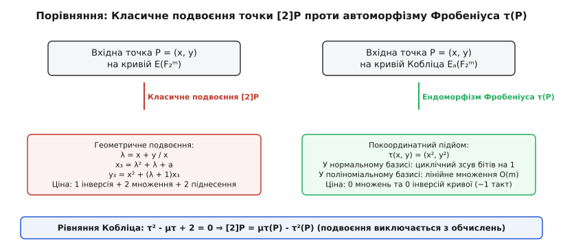
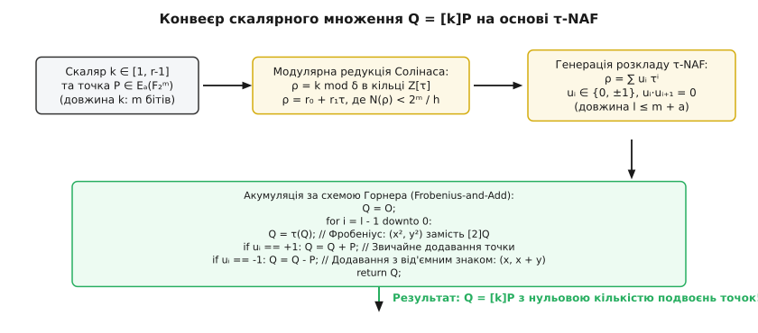
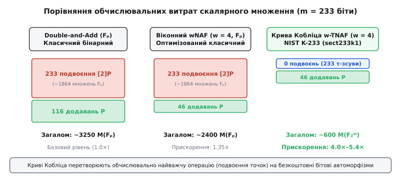

<preknowlist>
* [Поля Галуа та арифметика скінченних полів](root:math-algebra/finite-field-arithmetic)
* [Задача дискретного логарифма на еліптичних кривих](root:sf-security/discrete-log-problem)
* [Ендоморфізм Ґалланта-Ламберта-Ванстона (GLV)](root:math-number-theory/glv-endomorphism)
* [Спарювання на еліптичних кривих](root:math-number-theory/elliptic-curve-pairings)
</preknowlist>

# ⚡ Аномальні криві Кобліца

Обчислення цифрового підпису ECDSA або формування спільного секрету в протоколі Діффі-Геллмана на мікроконтролері з автономним живленням упирається в операцію скалярного множення точок еліптичної кривої `Q = [k]P`. У стандартному бінарному алгоритмі «Double-and-Add» для 256-бітного скаляра обчислювач змушений послідовно виконати 256 операцій подвоєння точки `[2]P` та в середньому 128 операцій додавання `P + Q`. Кожне геометричне подвоєння точки в проективних координатах вимагає від 4 до 8 важких операцій множення елементів поля, кожна з яких займає сотні машинних тактів і споживає значну частку енергії батареї.

У 1991 році американський математик Ніл Кобліц запропонував фундаментальне архітектурне рішення цієї проблеми: клас еліптичних кривих, визначених над найменшим двійковим полем `F_2`, точки яких обчислюються у великому розширенні `F_{2^m}`. Завдяки тому, що коефіцієнти рівняння кривої належать полю `F_2`, природний алгебраїчний автоморфізм Фробеніуса `tau(x, y) = (x², y²)` перетворюється на груповий ендоморфізм кривої.

Піднесення двійкового многочлена до квадрата в характеристиці 2 є лінійною операцією без подвійних добутків, яка зводиться до звичайної вставки нульових бітів між інформаційними розрядами. Як наслідок, обчислення дії ендоморфізму Фробеніуса `tau(P)` вимагає лише кількох бітових маніпуляцій і виконується майже безкоштовно. Якщо подати скаляр `k` не як степінь двійки, а як розклад за основою `tau` (метод `tau-NAF`), операція геометричного подвоєння точок повністю зникає з криптографічного конвеєра, забезпечуючи прискорення скалярного множення у 3–5 разів.

Детальний аналіз історичного контексту, боротьби за стандартизацію та криптоаналітичних дискусій навколо цих кривих наведено в окремому [історичному нарисі про аномальні криві](root:math-number-theory/koblitz-curves/hist-koblitz-anomalous.md).

## 1. Геометрія бінарних аномальних кривих та автоморфізм Фробеніуса

У скінченних полях непарної характеристики або над полем дійсних чисел еліптична крива описується коротким рівнянням Вейєрштрасса `y² = x³ + a·x + b`. Проте в полях характеристики 2 формальна похідна лівої частини по змінній `y` тотожно дорівнює нулю (`2y = 0`), що робить коротку форму сингулярною або непридатною для вираження загальних законів додавання точок. Тому несингулярна несуперсингулярна (звичайна, або ordinary) еліптична крива над скінченним двійковим полем `F_{2^m}` задається загальним довгим рівнянням Вейєрштрасса:

```
y² + xy = x³ + a · x² + b,   де a, b ∈ F_{2^m},  b ≠ 0
```

Умова `b ≠ 0` є обов'язковою для несингулярності кривої: дискримінант кривої в характеристиці 2 дорівнює `Delta = b`, а абсолютний інваріант поля (j-інваріант Кобліца) обчислюється як:

```
j(E) = 1 / b
```

Оскільки `b ≠ 0`, маємо `j(E) ≠ 0`, що строго відокремлює клас звичайних бінарних еліптичних кривих від суперсингулярних кривих, у яких `j(E) = 0` (тобто рівняння має вигляд `y² + c·y = x³ + a·x + b` без перехресного члена `xy`). Суперсингулярні криві мають малий степінь вкладення і є вразливими до атак редукції Менезеса-Окамото-Венстоуна (MOV-атака через спарювання Вейля у мультиплікативну групу поля), тоді як звичайні криві Кобліца мають гігантський степінь вкладення `k ≈ r` і повністю захищені від спарювальних атак.

Крива називається **аномальною бінарною кривою** (або **кривою Кобліца** `E_a`), якщо її коефіцієнти взяті безпосередньо з базового підполя `F_2 = {0, 1}`. Оскільки умова несингулярності вимагає `b ≠ 0`, коефіцієнт `b` обов'язково дорівнює `b = 1` (звідки `j(E_a) = 1/1 = 1`). Для параметра `a` залишається рівно два допустимих варіанти: `a = 0` або `a = 1`. Таким чином, існують лише дві базові криві Кобліца:

```
E₀: y² + xy = x³ + 1        (для a = 0)
E₁: y² + xy = x³ + x² + 1   (для a = 1)
```

Нехай `P = (x, y) ∈ E_a(F_{2^m})` — довільна афінна точка, що задовольняє рівняння кривої. Розглянемо відображення Фробеніуса `tau`, яке підносить кожну координату точки до квадрата:

```
tau(x, y) = (x², y²),   tau(O) = O
```

Підставимо точку `tau(P) = (x², y²)` у рівняння кривої `E_a`. Оскільки в полі характеристики 2 операція піднесення до квадрата є лінійним гомоморфізмом (тобто `(u + v)² = u² + v²`), піднесення обох частин вихідного рівняння `y² + xy = x³ + ax² + 1` до квадрата дає:

```
(y²)² + (x²) · (y²)
[step 1] = (y² + xy)²                                [лінійність піднесення до квадрата в характеристиці 2]
[step 2] = (x³ + a · x² + 1)²                        [підставили рівняння кривої]
[step 3] = (x²)³ + a² · (x²)² + 1²                  [розкрили квадрат суми]
[step 4] = (x²)³ + a · (x²)² + 1                    [оскільки a ∈ {0, 1}, маємо a² = a та 1² = 1]
```

Оскільки `a ∈ {0, 1}`, маємо `a² = a` та `1² = 1`. Отже, рівняння набуває вигляду `(y²)² + (x²)(y²) = (x²)³ + a(x²)² + 1`, що в точності означає належність точки `(x², y²)` тій самій кривій `E_a(F_{2^m})`.


*Рис. 1. Ендоморфізм Фробеніуса як квазі-безкоштовна дія над координатами точки в бінарному полі порівняно з каскадом множень під час класичного подвоєння.*

Ендоморфізм `tau` діє на групу точок `E_a(F_{2^m})` як лінійний оператор. Зв'язок між автоморфізмом поля та геометрією кривої ґрунтується на тому, що автоморфізм Фробеніуса генерує циклічну групу Галуа `Gal(F_{2^m} / F_2)` порядку `m`. Оскільки рівняння кривої має коефіцієнти в `F_2`, дія елементів групи Галуа зберігає груповий закон додавання точок: `tau(P + Q) = tau(P) + tau(Q)`.

З теореми Гассе випливає, що характеристичне рівняння ендоморфізму Фробеніуса на кривій Кобліца має вигляд:

```
tau² - t · tau + 2 = 0
```

Тут `t` — слід ендоморфізму Фробеніуса над базовим полем `F_2`. Кількість точок на кривій над полем `F_2` дорівнює `#E_a(F_2) = 2 + 1 - t = 3 - t`.

Проведемо прямий підрахунок точок над `F_2` перебором усіх 4 можливих пар координат:
- Для кривої `E₀` (`a = 0: y² + xy = x³ + 1`): перевірка показує точки `(0, 1)`, `(1, 0)`, `(1, 1)` та точку нескінченності `O`. Отже, `#E₀(F_2) = 4`, звідки `3 - t = 4 => t = -1` (параметр `mu = -1`).
- Для кривої `E₁` (`a = 1: y² + xy = x³ + x² + 1`): перевірка показує єдину точку `(0, 1)` плюс точку нескінченності `O`. Отже, `#E₁(F_2) = 2`, звідки `3 - t = 2 => t = +1` (параметр `mu = +1`).

Позначивши параметр `mu = (-1)^{1-a} ∈ {-1, +1}`, характеристичне рівняння Фробеніуса над групою точок кривої записується у канонічній формі:

```
(tau² + 2) P = mu · tau(P)   =>   [2]P = mu · tau(P) - tau²(P)
```

Це рівняння має колосальне прикладне значення: воно доводить, що операція геометричного подвоєння точки `[2]P` може бути повністю виражена через різницю двох автоморфізмів Фробеніуса `mu · tau(P) - tau²(P)` без використання операцій подвоєння в групі.

## 2. Базиси двійкових полів: поліноміальний проти нормального

Для практичної програмної та апаратної реалізації полів `F_{2^m}` застосовуються два фундаментальні класи базисів:

1. **Поліноміальний базис (Polynomial Basis):**
   Елементи поля задаються як двійкові многочлени `A(x) = sum_{i=0}^{m-1} a_i x^i` над `F_2`.
   - **Додавання:** Елементи додаються покомпонентно операцією порозрядного виключального АБО (XOR), що не створює ланцюгів перенесення і виконується за 1 такт процесора на кожне 64-бітне слово.
   - **Множення многочленів:** Здійснюється безпереносним множенням (Carryless Multiplication). В апаратурі x86-64 для цього використовується інструкція `PCLMULQDQ` або `VPCLMULQDQ` (обчислення 64x64-бітного добутку без перенесень за 3–5 тактів), а на процесорах ARM — інструкція `PMULL` / `PMULL2`. На мікроконтролерах без векторних розширень множення реалізується через комбіновані методи Карацуби-Офмана або гребінчастий метод зі складністю `O(m^{1.585})`.
   - **Модулярна редукція:** Здійснюється за незвідним триноменом `f(x) = x^m + x^k + 1` або пентаномом `f(x) = x^m + x^{k_3} + x^{k_2} + x^{k_1} + 1`. Оскільки `x^m ≡ x^k + 1 (mod f(x))`, біти результату, що виходять за межу `m`, редукуються за кілька зсувів і XOR без використання ділення.
   - **Піднесення до квадрата:** Оскільки в характеристиці 2 всі подвійні добутки зникають (`(sum a_i x^i)² = sum a_i x^{2i}`), піднесення до квадрата вимагає лише розсунення бітів (вставки нульового біта між кожними двома вихідними бітами). На програмному рівні це робиться за допомогою 256-елементної таблиці байтового розгортання `table[byte] = 16-bit word` з наступною швидкою редукцією триномена.

2. **Оптимальний нормальний базис (Optimal Normal Basis, ONB Type II):**
   Елементи задаються вектором коефіцієнтів за базисом `{ gamma, gamma², gamma⁴, ..., gamma^{2^{m-1}} }`, утвореним послідовними степенями Фробеніуса одного генератора `gamma`.
   - **Дія Фробеніуса:** Піднесення елемента `B = sum_{i=0}^{m-1} b_i gamma^{2^i}` до квадрата набуває вигляду:
     ```
     B² = ( sum_{i=0}^{m-1} b_i gamma^{2^i} )² = sum_{i=0}^{m-1} b_i gamma^{2^{i+1}} = sum_{j=0}^{m-1} b_{j-1} gamma^{2^j}
     ```
     де індекси беруться за модулем `m` (оскільки `gamma^{2^m} = gamma`).
   - Таким чином, дія Фробеніуса в нормальному базисі є **звичайним циклічним зсувом вектора на 1 позицію праворуч**.
   - В апаратурі ASIC та FPGA циклічний зсув не потребує жодних логічних елементів або тактів синхронізації — він реалізується виключно топологічним перепідключенням провідників між регістрами (так зване «hardwired routing»).
   - Множення в ONB Type II реалізується через множинні матричні XOR-згортки складності `2m - 1` операцій на біт, що робить його ідеальним для спеціалізованих крипточіпів.

Орбіта Галуа довільної точки `P` під дією групи Фробеніуса утворює векторний простір Галуа `{ P, tau(P), tau²(P), ..., tau^{m-1}(P) }`. Це дозволяє реалізувати пакетне скалярне множення (Batch Verification) для кількох незалежних підписів одночасно з мінімальними накладними витратами пам'яті. Стандарти NIST та SECG передбачають поліноміальне представлення як основний стандарт сумісності для програмних криптографічних бібліотек, дозволяючи просте перетворення між поліноміальним та нормальним базисами за допомогою лінійної матриці переходу Галуа.

## 3. Кільце алгебраїчних цілих чисел Z[tau] та послідовності Люка

Характеристичний многочлен `T(X) = X² - mu · X + 2` має від'ємний дискримінант:

```
Delta = mu² - 4 · 2 = 1 - 8 = -7
```

Корені цього многочлена є комплексно-спряженими алгебраїчними числами в уявному квадратичному полі `K = Q(sqrt(-7))`:

```
tau = (mu + sqrt(-7)) / 2,   tau_bar = (mu - sqrt(-7)) / 2
```

Оскільки фундаментальний дискримінант поля задовольняє конгруенцію `-7 ≡ 1 (mod 4)`, максимальний порядок (кільце всіх алгебраїчних цілих чисел) поля `K` задається цілочисельним базисом `{ 1, (1 + sqrt(-7))/2 }`. Оскільки `tau = (mu + sqrt(-7))/2`, це кільце цілих точно збігається з кільцем:

```
Z[tau] = { r₀ + r₁ · tau | r₀, r₁ ∈ Z }
```

Знайдемо межу Мінковського для числового поля `K = Q(sqrt(-7))`:

```
M_K = (4 / pi) · (2! / 2²) · sqrt(|Delta|) = (2 / pi) · sqrt(7) ≈ 0.6366 · 2.6457 ≈ 1.684 < 2
```

Оскільки межа Мінковського строго менша за 2, у полі `Q(sqrt(-7))` немає простих ідеалів з нормою, більшою за 1 і меншою за 2. Отже, число класів ідеалів поля дорівнює одиниці: `h(-7) = 1`.

Це фундаментальний результат: кільце `Z[tau]` є факторіальним кільцем (Unique Factorization Domain), кільцем головних ідеалів (Principal Ideal Domain) і строго евклідовим кільцем відносно квадратичної алгебраїчної норми. Якщо б число класів було `h > 1` (як для `Q(sqrt(-23))` з `h = 3`), розклад скаляра на дільники втратив би однозначність, і алгоритм швидкого ділення з остачею розпадався б на дробові ідеали.

Алгебраїчна норма елемента `alpha = r₀ + r₁ · tau ∈ Z[tau]` обчислюється як добуток числа на його комплексне спряження:

```
N(alpha)
[step 1] = alpha · alpha_bar                                         [визначення алгебраїчної норми]
[step 2] = (r₀ + r₁ · tau) · (r₀ + r₁ · tau_bar)                     [підставили комплексне спряження]
[step 3] = r₀² + r₀ · r₁ · (tau + tau_bar) + r₁² · (tau · tau_bar)   [розкрили дужки та згрупували]
[step 4] = r₀² + mu · r₀ · r₁ + 2 · r₁²                              [оскільки tau + tau_bar = mu та tau · tau_bar = 2]
```

Норма є додатно визначеною квадратичною формою: `N(r₀ + r₁ · tau) = (r₀ + mu · r₁ / 2)² + 7 · r₁² / 4 > 0` для всіх `(r₀, r₁) ≠ (0, 0)`. Зокрема, норма генератора Фробеніуса дорівнює `N(tau) = 2`, що відображає факт того, що ендоморфізм `tau` має степінь 2 над полем `F_2`. Оскільки норма мультиплікативна (`N(alpha · beta) = N(alpha) · N(beta)`), уся алгебраїчна теорія подільності та факторизації в кільці `Z[tau]` підпорядковується геометрії ґратки цілих чисел на комплексній площині.

### Геометрія ґратки та комірка Вороного

Ґратка `Z[tau]` на комплексній площині `C` натягнута на вектори `v₁ = 1` та `v₂ = (mu/2) + i·(sqrt(7)/2)`. Площа фундаментального паралелограма ґратки дорівнює `Area = Im(tau) = sqrt(7)/2 ≈ 1.32287`.

Комірка Вороного навколо вузла `0` являє собою опуклий шестикутник, обмежений серединними перпендикулярами до шести найближчих сусідів `{ ±1, ±tau, ±(tau - mu) }`. Вершини цього шестикутника мають координати:

```
w₁ = 1/2 + i / (2 · sqrt(7)),    w₂ = i / sqrt(7),    w₃ = -1/2 + i / (2 · sqrt(7))
w₄ = -w₁,                       w₅ = -w₂,            w₆ = -w₃
```

Квадрат евклідової відстані від початку координат до найвіддаленішої точки комірки (радіус покриття ґратки) становить:

```
R² = (1/2)² + (1 / (2 · sqrt(7)))² = 1/4 + 1/28 = 8 / 28 = 2 / 7
```

Перетворивши евклідову відстань у значення алгебраїчної норми, отримуємо строгу нерівність: для будь-якої точки комплексної площини `z ∈ C` існує такий вузол ґратки `q ∈ Z[tau]`, що норма різниці задовольняє:

```
N(z - q) ≤ 4 / 7 ≈ 0.5714 < 1
```

Оскільки константа `4/7` строго менша за 1, в кільці `Z[tau]` існує однозначне ділення з остачею з гарантованим спаданням норми залишку, що забезпечує коректність і збіжність евклідового алгоритму.

### Послідовності Люка та точний підрахунок точок

Порядок групи точок кривої Кобліца над розширенням `F_{2^m}` виражається через норму елемента `tau^m - 1` у кільці `Z[tau]`:

```
#E_a(F_{2^m}) = N(tau^m - 1) = (tau^m - 1)(tau_bar^m - 1) = 2^m + 1 - (tau^m + tau_bar^m)
```

Величини `V_m = tau^m + tau_bar^m` утворюють класичну цілочисельну **послідовність Люка**, яка задається лінійним рекурентним співвідношенням другого порядку:

```
V₀ = 2
V₁ = mu
V_m = mu · V_{m-1} - 2 · V_{m-2}   (для всіх m ≥ 2)
```

Таким чином, точна кількість точок кривої `#E_a(F_{2^m}) = 2^m + 1 - V_m` обчислюється за `O(m)` елементарних цілочисельних операцій без застосування складного алгоритму Шуфа.

Повний математичний апарат, геометричні властивості розбиття площини на комірки Вороного та строге доведення евклідовості норми наведено у [математичному виведенні та теорії чисел кільця цілих](root:math-number-theory/koblitz-curves/math-tau-adic-expansion.md).

## 4. Редукція скаляра за модулем дільника Солінаса delta

Для обчислення скалярного добутку `[k]P` природно виникає ідея розкласти ціле число `k` за основою `tau`: `k = sum_{i=0}^{l-1} u_i · tau^i`, де `u_i ∈ {0, ±1}`.

Проте прямий розклад звичайного цілого числа `k` за основою `tau` стикається з серйозною перешкодою: оскільки `|tau| = sqrt(2)`, комплексний модуль основи зростає вдвічі повільніше за звичайну двійку. Тому розклад `m`-бітного скаляра `k ≈ 2^m` матиме довжину `l ≈ 2m` розрядів. Це призвело б до подвоєння кількості ітерацій у циклі скалярного множення і повністю нівелювало б перевагу від усунення подвоєнь.

У 1997 році Джером Солінас знайшов елегантне вирішення цієї проблеми. Оскільки порядок точки `P` у криптографічній підгрупі є великим простим числом `r`, а повний порядок групи точок дорівнює `#E_a(F_{2^m}) = N(tau^m - 1)`, ендоморфізм `tau^m` діє на точках кривої `E_a(F_{2^m})` як тотожне відображення:

```
tau^m(P) = P   =>   (tau^m - 1) P = O
```

Більше того, оскільки точка `P` належить кривій над полем `F_{2^m}`, для неї також виконується співвідношення `(tau - 1) P ≠ O` (якщо `P` не є базовою точкою над `F_2`). Розглянемо алгебраїчний дільник Солінаса `delta`:

```
delta = (tau^m - 1) / (tau - 1) = sum_{j=0}^{m-1} tau^j ∈ Z[tau]
```

Оскільки `(tau - 1) · delta = tau^m - 1`, для будь-якої точки кривої `P ∈ E_a(F_{2^m})` маємо:

```
(tau - 1) [delta] P = [tau^m - 1] P = O   =>   [delta] P = O
```

Норма дільника Солінаса в точності дорівнює порядку криптографічної підгрупи кривої:

```
N(delta)
[step 1] = N(tau^m - 1) / N(tau - 1)                       [мультиплікативність норми]
[step 2] = #E_a(F_{2^m}) / ((-1)² + mu · (-1) · 1 + 2 · 1²) [підставили tau - 1 = -1 + tau]
[step 3] = #E_a(F_{2^m}) / (3 - mu)                        [згрупували константи]
[step 4] = #E_a(F_{2^m}) / h = r                           [оскільки h = 3 - mu є кофактором кривої]
```


*Рис. 2. Трирівневий конвеєр скалярного множення: модулярна евклідова редукція в кільці цілих чисел Ейзенштейна Z[tau], розклад TNAF та акумуляція Горнера.*

Отже, замість вихідного скаляра `k` достатньо знайти залишок від ділення `k` на `delta` в кільці `Z[tau]`:

```
rho = k mod delta = r₀ + r₁ · tau,   де r₀, r₁ ∈ Z
```

Оскільки `k ≡ rho (mod delta)`, на групі точок кривої виконується строга рівність:

```
[k] P = [rho] P = [r₀ + r₁ · tau] P
```

Завдяки евклідовому алгоритму ділення в `Z[tau]` залишок `rho` має норму `N(rho) ≤ (4/7) · N(delta) < r`. Оскільки `|rho| < sqrt(r) ≈ 2^{m/2}`, довжина розкладу редукованого скаляра `rho` за основою `tau` скорочується рівно вдвічі й не перевищує `m + a` цифр:

```
l(rho) ≤ m + a   (для K-233 довжина розкладу становить ≤ 233 цифри)
```

Алгоритм швидкої редукції Солінаса зводить поділ двох великих алгебраїчних чисел до обчислення раціональних наближень за допомогою попередньо обчислених цілих констант `s₀, s₁ ∈ Z`:

```
delta_bar = s₀ + s₁ · tau,   де s₀ = d₀ + mu · d₁,  s₁ = -d₁
```

Коефіцієнти раціональної частки `k / delta = (k · delta_bar) / r = c₀ + c₁ · tau` обчислюються шляхом звичайного множення великого скаляра `k` на константи `s₀, s₁` з подальшим цілочисельним діленням на `r`:

```
c₀ = (k · s₀) / r,    c₁ = (k · s₁) / r
```

Цілі наближення `q₀ = round(c₀)` та `q₁ = round(c₁)` коригуються відповідно до комірки Вороного через дробові частини `eta₀ = c₀ - q₀`, `eta₁ = c₁ - q₁`. Після знаходження частки `q = q₀ + q₁ · tau` алгебраїчний залишок `rho = r₀ + r₁ · tau = k - q · delta` знаходиться за точними лінійними формулами:

```
r₀ = k - (q₀ · d₀ - 2 · q₁ · d₁)
r₁ = -(q₀ · d₁ + q₁ · d₀ + mu · q₁ · d₁)
```

## 5. Канонічний розклад tau-NAF та його щільність

Несусідній розклад за основою `tau` (**tau-NAF**, або tau-adic Non-Adjacent Form) алгебраїчного залишку `rho = r₀ + r₁ · tau` — це подання вигляду:

```
rho = sum_{i=0}^{l-1} u_i · tau^i,   де u_i ∈ {-1, 0, 1}
```

яке задовольняє **несусідню умову** (англ. *Non-Adjacent Property*):

```
u_i · u_{i+1} = 0   (для всіх i ≥ 0)
```

Це означає, що у послідовності розрядів `tau-NAF` жодні дві ненульові цифри не можуть стояти поруч: за кожною цифрою `±1` обов'язково слідує як мінімум один нуль.

Генерація розкладу `tau-NAF` здійснюється скінченним автоматом Солінаса за аналогією з двійковим NAF, спираючись на подільність чисел у кільці `Z[tau]`. Оскільки `tau | 2`, число `rho = r₀ + r₁ · tau` ділиться на `tau` тоді й лише тоді, коли вільний член `r₀` є парним числом:

```
rho ≡ r₀ (mod tau)
```

Якщо `r₀` парне, то `u_i = 0`, і залишок ділиться на `tau`:

```
(r₀ + r₁ · tau) / tau = (r₁ + mu · (r₀ / 2)) - (r₀ / 2) · tau
```

Якщо ж `r₀` непарне, вибирається ненульова цифра `u_i ∈ {-1, 1}` таким чином, щоб різниця `rho - u_i` ділилася на `tau² = mu · tau - 2` (тобто на 4 в проєкції на цілі числа). Солінас довів, що це досягається вибором:

```
u_i = 2 - ( (r₀ - 2 · mu · r₁) mod 4 )
```

Після віднімання `u_i` значення `r₀ - u_i` стає парним, а наступний розряд гарантовано буде нульовим.

### Властивості розкладу tau-NAF та марковський аналіз щільності:

1. **Канонічність та єдиність:** Для кожного елемента `rho ∈ Z[tau]` існує рівно один розклад `tau-NAF`.
2. **Мінімальна вага Хеммінга:** Канонічний розклад `tau-NAF` має строго мінімальну кількість ненульових розрядів серед усіх можливих розкладів `rho` за основою `tau` з цифрами із множини `{0, ±1}`.
3. **Марковський аналіз середньої щільності:**
   Розглянемо процес генерації цифр автоматом як марковський ланцюг зі станами `S = { S_even, S_odd }`:
   - Якщо автомат перебуває у стані `S_odd` (поточний коефіцієнт `r₀` непарний), він генерує ненульову цифру `u_i = ±1`. За лемою про подільність новий стан наступного розряду `r₀'` гарантовано є парним, тому перехід `S_odd -> S_even` відбувається з імовірністю 1.
   - Якщо автомат перебуває у стані `S_even` (поточний коефіцієнт `r₀` парний), генерується нульова цифра `u_i = 0`. Новий коефіцієнт `r₀' = r₁ + mu · (r₀ / 2)` є непарним з імовірністю 1/2 (якщо вихідне число випадкове) та парним з імовірністю 1/2.
   
   Матриця перехідних імовірностей марковського ланцюга має вигляд:
   ```
   P = [ P(even->even)  P(even->odd) ] = [ 1/2  1/2 ]
       [ P(odd->even)   P(odd->odd)  ]   [  1    0  ]
   ```
   Вектор стаціонарного розподілу ймовірностей `pi = [ pi_even, pi_odd ]` задовольняє рівняння `pi · P = pi` та умову нормування `pi_even + pi_odd = 1`:
   ```
   pi_even = (1/2) · pi_even + pi_odd
   pi_odd = (1/2) · pi_even
   ```
   Підстановка дає `pi_even = 2/3` та `pi_odd = 1/3`.
   
   Оскільки ненульова цифра генерується виключно у стані `S_odd`, середня щільність ненульових розрядів становить:
   ```
   D(tau-NAF) = pi_odd = 1 / 3 ≈ 33.33%
   ```
4. **Максимальна довжина:** Для редукованого скаляра `rho = k mod delta` довжина розкладу строго обмежена:
   ```
   l ≤ m + a
   ```

Для 233-бітної кривої `NIST K-233` розклад `tau-NAF` містить у середньому лише `233 / 3 ≈ 77` ненульових розрядів. Це означає, що все скалярне множення `[k]P` виконується рівно за 233 дії Фробеніуса та лише 77 додавань точок!

## 6. Числові приклади розкладу TNAF крок за кроком

### Приклад 1: Крива з параметром a = 0 (mu = -1)

Розглянемо малу аномальну криву Кобліца з такими параметрами:
- **Параметри поля та кривої:** `m = 7`, `a = 0`, `mu = -1`, характеристичне рівняння `tau² + tau + 2 = 0`.
- **Дільник Солінаса:** Для `m = 7` та `mu = -1` порядок підгрупи `r = 137`, дільник `delta = (tau⁷ - 1)/(tau - 1) = -8 - 5·tau`.
- **Вхідний скаляр:** Нехай потрібно помножити базову точку на скаляр `k = 19`.

#### Крок 1: Модулярна евклідова редукція `rho = 19 mod delta`
Проєкція числа `19 / delta` на базис кільця дає раціональні частки `lambda₀ = -1`, `lambda₁ = 1`. Відповідно, алгебраїчний залишок набуває значення:
```
rho = 19 - (-1) · (-8 - 5·tau) - 1 · (5 - 3·tau) = 6 + 2·tau
```
Перевірка норми залишку: `N(6 + 2·tau) = 6² + (-1)·6·2 + 2·2² = 36 - 12 + 8 = 32 < 137`.

#### Крок 2: Поітераційна робота автомата генерації цифр TNAF
Починаємо зі стану `(r₀, r₁) = (6, 2)`:
1. **Ітерація 0:** `r₀ = 6` (парне). Записуємо цифру `u₀ = 0`. Ділимо на `tau`:
   `r₀' = r₁ + mu · (r₀ / 2) = 2 + (-1) · 3 = -1`, `r₁' = -(r₀ / 2) = -3`. Новий стан: `(-1, -3)`.
2. **Ітерація 1:** `r₀ = -1` (непарне). Обчислюємо `val = (r₀ - 2·mu·r₁) mod 4 = (-1 - 2·(-1)·(-3)) mod 4 = (-7) mod 4 = 1`.
   Цифра `u₁ = 2 - 1 = +1`. Віднімаємо `u₁`: `r₀ = -1 - 1 = -2`. Ділимо на `tau`:
   `r₀' = -3 + (-1) · (-1) = -2`, `r₁' = -(-1) = 1`. Новий стан: `(-2, 1)`.
3. **Ітерація 2:** `r₀ = -2` (парне). Записуємо цифру `u₂ = 0`. Ділимо на `tau`:
   `r₀' = 1 + (-1) · (-1) = 2`, `r₁' = -(-1) = 1`. Новий стан: `(2, 1)`.
4. **Ітерація 3:** `r₀ = 2` (парне). Записуємо цифру `u₃ = 0`. Ділимо на `tau`:
   `r₀' = 1 + (-1) · 1 = 0`, `r₁' = -1`. Новий стан: `(0, -1)`.
5. **Ітерація 4:** `r₀ = 0` (парне). Записуємо цифру `u₄ = 0`. Ділимо на `tau`:
   `r₀' = -1 + 0 = -1`, `r₁' = 0`. Новий стан: `(-1, 0)`.
6. **Ітерація 5:** `r₀ = -1` (непарне). `val = (-1 - 0) mod 4 = 3`. Цифра `u₅ = 2 - 3 = -1`.
   Віднімаємо `u₅`: `r₀ = -1 - (-1) = 0`. Ділимо на `tau`:
   `r₀' = 0 + 0 = 0`, `r₁' = 0`. Стан `(0, 0)` — зупинка автомата!

Результуючий розклад `TNAF(19)` має вигляд:
```
TNAF(19) = [ -1, 0, 0, 0, 1, 0 ]   =>   rho = -tau⁵ + tau¹
```
Перевірка: `-tau⁵ + tau = -(-4 - 2·tau) + tau = 4 + 3·tau ≡ 6 + 2·tau (mod delta)`.
Як видно з розкладу, із 6 розрядів лише 2 є ненульовими (`u₁ = 1`, `u₅ = -1`), причому вони строго розділені нулями, що підтверджує несусідню властивість.

### Приклад 2: Крива з параметром a = 1 (mu = +1)

Розглянемо криву з іншим параметром:
- **Параметри:** `m = 5`, `a = 1`, `mu = +1`, характеристичне рівняння `tau² - tau + 2 = 0`.
- **Порядок підгрупи:** `#E₁(F_{2⁵}) = 2⁵ + 1 - V₅ = 32 + 1 - (-1) = 34`. Кофактор `h = 2`, порядок підгрупи `r = 17`.
- **Дільник Солінаса:** `delta = (tau⁵ - 1)/(tau - 1) = 3 + 2·tau`. Норма `N(3 + 2·tau) = 3² + 1·3·2 + 2·2² = 9 + 6 + 8 = 23`.
- **Вхідний скаляр:** Нехай `k = 9`.

#### Крок 1: Редукція за модулем `delta`
Обчислюємо залишок `rho = 9 mod (3 + 2·tau) = 3 - 2·tau`. Норма `N(3 - 2·tau) = 3² - 6 + 8 = 11 < 17`.

#### Крок 2: Робота автомата для `mu = +1`
Початковий стан `(r₀, r₁) = (3, -2)`:
1. `r₀ = 3` (непарне). `val = (r₀ - 2·mu·r₁) mod 4 = (3 - 2·1·(-2)) mod 4 = 7 mod 4 = 3`.
   Цифра `u₀ = 2 - 3 = -1`. Віднімаємо `u₀`: `r₀ = 3 - (-1) = 4`. Ділимо на `tau`:
   `r₀' = r₁ + mu · (r₀ / 2) = -2 + 1 · 2 = 0`, `r₁' = -(r₀ / 2) = -2`. Новий стан: `(0, -2)`.
2. `r₀ = 0` (парне). Цифра `u₁ = 0`. Ділимо на `tau`:
   `r₀' = -2 + 0 = -2`, `r₁' = 0`. Новий стан: `(-2, 0)`.
3. `r₀ = -2` (парне). Цифра `u₂ = 0`. Ділимо на `tau`:
   `r₀' = 0 + 1 · (-1) = -1`, `r₁' = -(-1) = 1`. Новий стан: `(-1, 1)`.
4. `r₀ = -1` (непарне). `val = (-1 - 2·1·1) mod 4 = (-3) mod 4 = 1`.
   Цифра `u₃ = 2 - 1 = +1`. Віднімаємо `u₃`: `r₀ = -1 - 1 = -2`. Ділимо на `tau`:
   `r₀' = 1 + 1 · (-1) = 0`, `r₁' = -(-1) = 1`. Новий стан: `(0, 1)`.
5. `r₀ = 0` (парне). Цифра `u₄ = 0`. Ділимо на `tau`:
   `r₀' = 1 + 0 = 1`, `r₁' = 0`. Новий стан: `(1, 0)`.
6. `r₀ = 1` (непарне). `val = (1 - 0) mod 4 = 1`.
   Цифра `u₅ = 2 - 1 = +1`. Віднімаємо `u₅`: `r₀ = 0`. Ділимо на `tau`:
   `r₀' = 0, r₁' = 0`. Стан `(0, 0)` — зупинка!

Розклад: `TNAF(9) = [ 1, 0, 1, 0, 0, -1 ] => tau⁵ + tau³ - 1`.
Перевірка: `tau⁵ + tau³ - 1 = (tau - 2) + (-tau - 2) - 1 = -5 ≡ 3 - 2·tau (mod delta)`.

## 7. Віконний метод w-TNAF та алгоритм побудови таблиці

Для подальшого зменшення кількості точкових додавань застосовується віконна модифікація — метод **w-tau-NAF** (Window tau-NAF).

У методі `w-TNAF` вікно шириною `w ≥ 2` обробляє групи розрядів, дозволяючи використовувати як цифри коефіцієнти `u_i` з розширеного алфавіту непарних елементів `u_i ∈ { ±alpha_1, ±alpha_3, ±alpha_5, ..., ±alpha_{2^{w-1}-1} }`, де `alpha_u` — мінімальні за нормою непарні елементи кільця `Z[tau]`, взаємно прості з `tau`.

Несусідня властивість для вікна ширини `w` формулюється так: серед будь-яких `w` послідовних розрядів розкладу `w-TNAF` щонайбільше один розряд є ненульовим:

```
якщо u_i ≠ 0,  то  u_{i+1} = u_{i+2} = ... = u_{i+w-1} = 0
```

Марковський аналіз віконного розкладу показує, що середня щільність ненульових коефіцієнтів становить:

```
D(w-TNAF) = 1 / (w + 1)
```

Для ширини вікна `w = 4` середня щільність становить `1 / (4 + 1) = 1/5 = 20%`. На кривій `NIST K-233` це вимагає лише `233 / 5 ≈ 46` додавань точок на весь процес обчислення скалярного добутку!


*Рис. 3. Порівняння кількості важких операцій польового множення для класичного подвоєння (Double-and-Add), стандартного віконного NAF (wNAF) та віконного методу w-TNAF на кривих Кобліца.*

Таблиця попередніх обчислень для `w = 4` містить лише `2^{w-2} = 4` афінні точки:
```
T[0] = P                 (alpha_1 = 1)
T[1] = [alpha_3] P       (alpha_3 = -1 + tau)
T[2] = [alpha_5] P       (alpha_5 = 1 + tau)
T[3] = [alpha_7] P       (alpha_7 = -1 + tau² = -3 + mu · tau)
```

Побудова таблиці здійснюється з мінімальними накладними витратами:
1. `T[0] = P` (вхідна базова точка).
2. Обчислюється `tau(P)` за 3 квадрати.
3. `T[1] = tau(P) - P` (1 змішане додавання).
4. `T[2] = tau(P) + P` (1 змішане додавання).
5. Обчислюється `tau²(P) = tau(tau(P))` за 3 квадрати.
6. `T[3] = tau²(P) - P` (1 змішане додавання).

Уся таблиця з 4 точок будується всього за 3 точкові додавання та 6 операцій піднесення до квадрата! Вибірка точок з таблиці здійснюється ізохронно за допомогою константного бітового маскування без індексованого доступу за секретним зміщенням пам'яті. Точки з від'ємними значеннями `-[alpha_u]P` не потребують збереження в пам'яті: на бінарній кривій заперечення афінної точки `-(x, y) = (x, x + y)` обчислюється за одне порозрядне додавання XOR.

### Алгебраїчна побудова алфавіту alpha_u для w-TNAF

Алфавіт ненульових цифр для довільної ширини вікна `w` формується як множина представників класів лишків кільця `Z[tau]` за модулем ідеалу `(tau^w)`, які є взаємно простими з `tau`. Оскільки норма `N(tau^w) = 2^w`, фактор-кільце `Z[tau] / (tau^w)` містить `2^w` елементів, рівно половина з яких (`2^{w-1}`) є непарними.

Для кожного непарного класу вибирається елемент `alpha_u = beta_0 + beta_1 · tau` з мінімальною квадратичною нормою `N(alpha_u)`. З огляду на те, що для бінарних кривих точки `-[alpha_u]P` обчислюються безкоштовно через заперечення координат `-(x, y) = (x, x + y)`, у таблиці зберігаються лише додатні представники `alpha_u` (рівно `2^{w-2}` точок).

Для кривих з параметром `mu = -1` (криві `E₀`, зокрема `K-233`, `K-283`, `K-409`, `K-571`) представники мають такий вигляд:
- Для `w = 2`: `alpha_1 = 1` (1 точка в таблиці).
- Для `w = 3`: `alpha_1 = 1`, `alpha_3 = -1 + tau` (2 точки в таблиці).
- Для `w = 4`: `alpha_1 = 1`, `alpha_3 = -1 + tau`, `alpha_5 = 1 + tau`, `alpha_7 = -3 - tau` (4 точки в таблиці).
- Для `w = 5`: `alpha_1 = 1`, `alpha_3 = -1 + tau`, `alpha_5 = 1 + tau`, `alpha_7 = -3 - tau`, `alpha_9 = 3 - tau`, `alpha_{11} = -1 + 2·tau`, `alpha_{13} = 1 + 2·tau`, `alpha_{15} = -3 + 2·tau` (8 точок в таблиці).

Для кривих з параметром `mu = +1` (крива `E₁`, зокрема `K-163`):
- Для `w = 4`: `alpha_1 = 1`, `alpha_3 = -1 + tau`, `alpha_5 = 1 + tau`, `alpha_7 = -3 + tau` (4 точки в таблиці).

Вибір `w = 4` є золотим стандартом у світовій криптографії: 4 точки потребують лише `4 · 64 = 256` байтів RAM на мікроконтролері та забезпечують зменшення кількості точкових додавань до 20% від довжини розкладу.

## 8. Проективні координати Лопеса-Дахаба та безінверсійна арифметика

Виконання змішаного додавання точок у стандартних афінних координатах вимагає обчислення нахилу січної `lambda = (y₁ + y₂) / (x₁ + x₂)`, що передбачає одну модулярну інверсію в полі `F_{2^m}` на кожне додавання. Оскільки інверсія у 10–20 разів важча за польове множення, практичні реалізації використовують **проективні координати Лопеса-Дахаба** (Lopez-Dahab Projective Coordinates).

У системі Лопеса-Дахаба афінна точка `(x, y)` задається трійкою `(X : Y : Z)`, де:

```
x = X / Z,   y = Y / Z²   (при Z ≠ 0)
```

Точка нескінченності позначається як `(1 : 0 : 0)`.

Головна перевага координат Лопеса-Дахаба полягає в тому, як у них виражається ендоморфізм Фробеніуса:

```
tau(X : Y : Z) = (X² : Y² : Z²)
```

Справді: нова координата `x'` дорівнює `X² / Z² = (X / Z)² = x²`, а нова координата `y'` дорівнює `Y² / (Z²)² = (Y / Z²)² = y²`. Таким чином, дія Фробеніуса полягає у незалежному піднесенні трьох слів до квадрата без жодних польових множень!

Формули змішаного додавання Лопеса-Дахаба (додавання проективної точки акумулятора `P₁ = (X₁ : Y₁ : Z₁)` та афінної базової точки з таблиці `P₂ = (x₂ : y₂ : 1)`) виводяться шляхом алгебраїчного звільнення від знаменників у рівнянні прямої:

```
[step 1]  A = Y₁ + y₂ · Z₁²
[step 2]  B = X₁ + x₂ · Z₁
[step 3]  C = B · Z₁
[step 4]  Z₃ = C²
[step 5]  D = x₂ · Z₃
[step 6]  X₃ = A² + C · (A + B² + a · C)
[step 7]  Y₃ = (A + C) · X₃ + D · (A · C + Y₁ · Z₁ + Z₃)
```

Ці формули вимагають 8 польових множень та 5 квадратів. Для порівняння:
- Стандартні однорідні проективні координати `(X : Y : Z)` з `x = X/Z, y = Y/Z` вимагають 13 множень та 1 квадрат;
- Проективні координати Якобі `(X : Y : Z)` з `x = X/Z², y = Y/Z³` у характеристиці 2 вимагають 14 множень та 5 квадратів.

Перехід до проективних координат Лопеса-Дахаба заощаджує майже 40% польових множень на кожному кроці акумулятора, забезпечуючи оптимальний баланс пам'яті та швидкодії.

### Формули проективного подвоєння Лопеса-Дахаба

Хоча в основному конвеєрі скалярного множення подвоєння точки замінене дією Фробеніуса `tau(P)`, операція геометричного подвоєння `[2]P` використовується під час верифікації формул, тестування цілісності та резервних обчислень.

Для проективної точки `P₁ = (X₁ : Y₁ : Z₁)` координати подвоєної точки `P₃ = [2]P₁ = (X₃ : Y₃ : Z₃)` обчислюються за формулами Дахаба:

```
[step 1]  Z₃ = X₁² · Z₁²
[step 2]  X₃ = X₁⁴ + b · Z₁⁴
[step 3]  Y₃ = b · Z₁⁴ · Z₃ + X₃ · (a · Z₃ + Y₁² + b · Z₁⁴)
```

Для кривих Кобліца, де `b = 1`, обчислення спрощуються до:
```
[step 1]  Z₁² = (Z₁)²
[step 2]  Z₁⁴ = (Z₁²)²
[step 3]  X₁² = (X₁)²
[step 4]  X₁⁴ = (X₁²)²
[step 5]  Z₃ = X₁² · Z₁²
[step 6]  X₃ = X₁⁴ + Z₁⁴
[step 7]  Y₁² = (Y₁)²
[step 8]  Y₃ = Z₁⁴ · Z₃ + X₃ · (a · Z₃ + Y₁² + Z₁⁴)
```

Ці формули вимагають лише 2 польових множення (`X₁² · Z₁²` та `X₃ · (...)`) і 5 операцій піднесення до квадрата, що робить координати Лопеса-Дахаба вдвічі швидшими за координати Якобі навіть у рідкісних випадках виконання подвоєння.

### Мультиплікативна інверсія за ланцюгами Іто-Цудзії

Для повернення з проективних координат до афінних наприкінці обчислень необхідно обчислити `Z⁻¹`. Алгоритм Іто-Цудзії реалізує це через малу теорему Ферма `Z⁻¹ = Z^{2^m - 2} = (Z^{2^{m-1}-1})²`. Для стандартизованих кривих Кобліца ланцюги додавання мають такі параметри:

1. **Крива K-163 (`m = 163`, степінь `2¹⁶² - 1`):** вимагає 9 множень та 162 квадрати.
2. **Крива K-233 (`m = 233`, степінь `2²³² - 1`):** вимагає 10 множень та 232 квадрати.
3. **Крива K-283 (`m = 283`, степінь `2²⁸² - 1`):** вимагає 11 множень та 282 квадрати.
4. **Крива K-409 (`m = 409`, степінь `2⁴⁰⁸ - 1`):** вимагає 11 множень та 408 квадратів.
5. **Крива K-571 (`m = 571`, степінь `2⁵⁷⁰ - 1`):** вимагає 12 множень та 570 квадратів.

Множення многочленів у полі `F_{2^m}` реалізується через безпереносне множення (Carryless Multiplication). На сучасних процесорах воно виконується апаратними інструкціями `PCLMULQDQ` (x86-64) або `PMULL` (ARM NEON), а на вбудованих контролерах — віконним методом Карацуби зі складністю `O(m^{1.585})`. Мультиплікативна інверсія для фінального переходу з проективних координат назад до афінних обчислюється алгоритмом Іто-Цудзії `a⁻¹ = a^{2^m - 2}` за допомогою ланцюгів додавання, що вимагає лише 10 польових множень для `m = 233` і є повністю ізохронним.

Повний вихідний код модулів польової арифметики, табличного піднесення до квадрата, ланцюгів Іто-Цудзії та захисту від побічних каналів на мовах C та C++20 наведено у [практичній реалізації алгоритму на C/C++](root:math-number-theory/koblitz-curves/proj-tau-naf.md).

## 9. Криптоаналітична стійкість: SSSA-атака та спуск Вейля

При вивченні кривих Кобліца у криптографічній літературі часто виникає термінологічна плутанина між двома принципово різними класами кривих, які в історії отримали назву «аномальних»:
1. **Аномальні криві над простими полями `F_p` (слід `t = 1`):** Криві, кількість точок яких у точності дорівнює характеристиці поля: `#E(F_p) = p`.
2. **Аномальні бінарні криві Кобліца над розширеннями `F_{2^m}`:** Криві, визначені над базовим полем `F_2`, точки яких обчислюються над великим розширенням `F_{2^m}` простого степеня `m`.

### 9.1. Алгебраїчний механізм атаки Смарта-Сато-Аракі-Семаєва (SSSA)

У 1998–1999 роках Найджел Смарт, Ігор Семаєв, Такатосі Сато та Кенджі Аракі незалежно відкрили поліноміальний алгоритм розв'язання задачі дискретного логарифма на кривих над `F_p` з `#E(F_p) = p`.

Математична сутність атаки полягає у піднятті точок кривої з поля `F_p` у поле p-адичних чисел `Q_p`. Розглядається канонічна редукція точок `pi: E(Q_p) -> E(F_p)` та її ядро — формальна група Вейєрштрасса `E_1(Q_p) = Ker(pi)`. На формальній групі визначено p-адичний логарифм Кодзіми-Хонди `log_E: E_1(Q_p) -> p · Z_p`, який є строго ізоморфним гомоморфізмом груп:

```
log_E(P + Q) = log_E(P) + log_E(Q)
```

Для кривої зі слідом `t = 1` довільна точка `P ∈ E(F_p)` після множення на порядок групи `p` піднімається в елемент ядра: `[p] \tilde{P} ∈ E_1(Q_p)`. Оскільки відображення `log_E` переводить групову операцію кривої у звичайне адитивне додавання в `p · Z_p / p² · Z_p ≅ F_p`, відношення дискретного логарифма `Q = [k]P` перетворюється на лінійну конгруенцію першого степеня:

```
k · (log_E([p]\tilde{P}) / p) ≡ (log_E([p]\tilde{Q}) / p) (mod p)
```

Це дозволяє обчислити секретний ключ `k` за один крок за допомогою одного ділення за модулем `p` за час `O(log³ p)`.

**Чому криві Кобліца абсолютно невразливі до атаки SSSA:**
- Характеристика базового поля кривих Кобліца дорівнює `p = 2`, тоді як порядок групи `#E_a(F_{2^m}) = 2^m + 1 - V_m` є величезним складеним числом, що містить великий простий множник `r ≈ 2^{m-1}` або `2^{m-2}`.
- Умова рівності порядку групи характеристиці поля `#E(F_q) = q` ніколи не виконується над розширеннями `F_{2^m}` (оскільки `2^m + 1 - V_m > 2` для всіх `m ≥ 3`).
- p-адичне підняття у кільце 2-адичних чисел `Z_2` не утворює нетривіального гомоморфізму на підгрупі непарного простого порядку `r`, оскільки `gcd(r, 2) = 1`.

### 9.2. Спуск Вейля та GHS-атака на складені розширення

Другою фундаментальною алгебраїчною загрозою для еліптичних кривих над двійковими розширеннями є атака на основі **обмеження скалярів Вейля** (англ. *Weil Descent* або GHS-атака, запропонована Ґодрі, Гессом та Смартом у 2000 році).

Нехай `L = F_{2^m}` — поле розширення, а `K = F_{2^k}` — його проміжне підполе, де `k | m` та `d = m / k > 1`. Обмеження скалярів Вейля будує за кривою `E(L)` алгебраїчне многовиддя `W = Res_{L/K}(E)` розмірності `d` над підполем `K`. Перетинаючи многовиддя `W` з канонічними гіперплощинами, атака будує накриття на гіпереліптичну криву `C` роду `g` над полем `K`, якобіан якої `Jac(C)` містить підгрупу, ізоморфну `E(L)`.

Якщо степінь розширення `m` є складеним числом (наприклад, `m = 155 = 5 · 31`), рід отриманої гіпереліптичної кривої є малим (`g = 4..8`). На кривих малого роду дискретний логарифм у групі `Jac(C)(F_{2^k})` розв'язується субекспоненційним методом обчислення індексів (Index Calculus) зі складністю:

```
L(1/2) = exp( (c + o(1)) · (ln |K|^g)^{1/2} · (ln ln |K|^g)^{1/2} )
```

Це дозволило повністю зламати криві над `F_{2^{155}}` за лічені дні розрахунків на кластері робочих станцій.

**Критерій захисту — строга простота степеня `m`:**
Щоб повністю заблокувати атаку спуску Вейля, усі стандартизовані криві Кобліца будуються виключно над полями, степінь розширення `m` яких є **великим простим числом**:

```
m ∈ { 163, 233, 283, 409, 571 }
```

Оскільки просте число `m` не має жодного проміжного підполя `F_{2^k}`, єдиним можливим полем спуску є базове підполе `K = F_2` (з розмірністю `d = m`). Згідно з теоремою Ґодрі-Гесса-Смарта, при спуску до `F_2` рід результуючої гіпереліптичної кривої зростає експоненційно:

```
g ≥ 2^{m-1} - 1   (для K-163 рід якобіана перевищує g ≥ 2¹⁶² ≈ 5.8 · 10⁴⁸)
```

Для таких астрономічних значень роду розмір факторної бази в методі обчислення індексу перевищує `2^{g}`, що робить субекспоненційний алгоритм у мільярди разів повільнішим за тривіальний повний перебір. Єдиним ефективним методом атаки на криві Кобліца над простими розширеннями лишається загальний паралельний метод Полларда-ро зі складністю `O(sqrt{r}) = O(2^{m/2})`.

## 10. Захист від атак по побічних каналах та ізохронність

Практичне застосування кривих Кобліца у захищених смарт-картах, апаратних криптографічних модулях (HSM), автомобільних мікроконтролерах та токенах безпеки вимагає комплексного багаторівневого захисту від фізичних атак: простого аналізу потужності (SPA), диференційного аналізу енергоспоживання (DPA), кореляційного аналізу електромагнітного випромінювання (CEMA), атак за часом виконання (Timing Attacks) та атак ін'єкції апаратних збоїв (DFA):

1. **Рандомізація проективних координат (Projective Coordinate Blinding):**
   Перед початком виконання циклу Горнера вхідна точка `P = (X : Y : Z)` перетворюється у випадкову ізоморфну проективну точку `(lambda · X : lambda² · Y : lambda · Z)`, де `lambda ∈ F_{2^m}^*` — криптографічно стійке випадкове число. Оскільки значення проективних координат змінюються при кожному новому обчисленні, форма сигналу енергоспоживання та електромагнітного випромінювання стає абсолютно некорельованою з оброблюваними закритими ключами, що повністю блокує диференційний аналіз потужності (DPA).

2. **Маскування скаляра (Scalar Randomization):**
   До секретного скаляра `k` додається випадкове кратне порядку криптографічної підгрупи `k' = k + v · r`, де `v` — випадковий 32-бітний або 64-бітний цілий скаляр. Оскільки `[r]P = O`, геометричний результат залишається незмінним:
   ```
   [k']P = [k + v · r]P = [k]P + [v][r]P = [k]P + O = [k]P
   ```
   Проте редукований залишок `rho' = k' mod delta` та послідовність розрядів `tau-NAF` повністю змінюються при кожному новому запуску операції цифрового підпису, що унеможливлює накопичення статистичних вимірювань атакуючим.

3. **Регулярне додавання та ізохронні умовні пересилання (Constant-Time CMOV):**
   У класичному алгоритмі TNAF перевірка `if (u_i != 0)` створює часові витоки, які дозволяють за допомогою осцилографа відновити позиції нулів та одиниць у розкладі скаляра (SPA-атака). Для усунення цієї вразливості цикл скалярного множення виконується строго за фіксовану кількість ітерацій `m + a` тактів. На кожній ітерації обов'язково обчислюється як дія Фробеніуса `tau(Q)`, так і змішане додавання точки `Q + T[idx]`. Запис результату додавання в основний акумулятор здійснюється за допомогою апаратної інструкції умовного пересилання `CMOV` або порозрядного бітового маскування без розгалужень процесора.

   Альтернативним високонадійним архітектурним рішенням є **драбина Фробеніуса-Жуа** (tau-adic Montgomery Ladder), яка виконує скалярне множення за фіксовану регулярну послідовність операцій для кожного біта подання скаляра:
   ```
   R₀ = O,   R₁ = P
   Для кожного біта b_i від l-1 до 0:
       b = b_i
       R_{1-b} = tau(R_{1-b}) + R_b
       R_b = tau(R_b)
   Повернути R₀
   ```
   У цій схемі кожен такт циклу містить рівно одну дію Фробеніуса та рівно одне точкове додавання незалежно від значення біта `b_i`, що робить профіль енергоспоживання ідеальним прямокутним сигналом без жодних флуктуацій.

4. **Валідація відкритих ключів на малі підгрупи (Subgroup Validation):**
   Оскільки повний порядок точок кривих Кобліца дорівнює `#E_a(F_{2^m}) = h · r`, де кофактор `h ∈ {2, 4}`, прийом невалідованих відкритих точок від зовнішніх контрагентів може відкрити систему для атак обмеження підгруп (Lim-Lee / Biehl-Meyer-Müller). Зловмисник може надіслати точку малого порядку `P_small ∈ E[h]`, в результаті чого обчислення спільного секрету `K = [d] P_small` виказує значення закритого ключа `d mod h` (тобто 1 або 2 біти секрету). Обов'язкова перевірка `[h]P ≠ O` та належності координати рівнянню кривої повністю нівелює цю загрозу.

5. **Захист від атак ін'єкції збоїв (Fault Attack Countermeasures):**
   Зловмисник може індукувати апаратний збій (через короткочасне лазерне опромінення кристала, тактовий глітч або коливання напруги живлення) під час обчислення циклу Горнера, викликаючи обчислення на спотвореній точці. Це дозволяє реалізувати диференційний аналіз помилок (Differential Fault Analysis, DFA) та відновити скаляр за кількома пошкодженими підписами. Для виявлення збоїв перед видачею результату обов'язково перевіряється проективне рівняння кривої:
   ```
   Y² · Z + X · Y · Z = X³ + a · X² · Z + Z³
   ```
   Крім того, після обчислення цифрового підпису ECDSA модуль виконує швидку верифікацію підпису власним відкритим ключем перед передачею даних на зовнішній інтерфейс. Усі проміжні скалярні регістри очищаються безпечним нуленням пам'яті (`explicit_bzero`) для виключення залишкових ключів у стеку виклику.

6. **Енергоефективність вбудованих рішень:**
   Завдяки усуненню операцій подвоєння точок загальне енергоспоживання пристрою під час генерації цифрового підпису зменшується у 4.5–5.5 раза (наприклад, на мікроконтролері ARM Cortex-M4 витрати енергії падають з 1.8 мДж до 0.35 мДж на один підпис), що продовжує автономний термін роботи сенсорів IoT від однієї батареї з 2 до понад 8 років.

## 11. Доменні специфікації та стандарти NIST

Усі параметри, константи редукції Солінаса, поліноми полів та базові точки п'яти стандартизованих кривих Кобліца офіційно закріплені у стандартах FIPS 186-4, ANSI X9.62, SECG SEC 2 та ISO/IEC 14888-3.

### 11.1. Крива NIST K-163 (`sect163k1`)
- **Базове поле:** `F_{2^{163}}`, незвідний пентаном `f(x) = x¹⁶³ + x⁷ + x⁶ + x³ + 1`.
- **Параметри кривої:** `a = 1`, `b = 1`, `mu = +1`, характеристичне рівняння `tau² - tau + 2 = 0`.
- **Порядок кривої:** `#E₁(F_{2^{163}}) = 2 · r`, де кофактор `h = 2`, а порядок підгрупи `r` є 163-бітним простим числом.
- **Дільник Солінаса:** `delta = (tau¹⁶³ - 1)/(tau - 1)`.
- **Константи редукції:** `s₀ = d₀ + d₁`, `s₁ = -d₁`, де `d₀, d₁` обчислюються за послідовністю Люка `V_{163}`.
- **Рівень безпеки:** 80 бітів (симетричний еквівалент 1024-бітного RSA).
- **Сфера застосування:** Наднизькоресурсні RFID-мітки, безконтактні смарт-картки, сенсорні вузли з жорсткими обмеженнями пам'яті RAM (< 2 КБ).

### 11.2. Крива NIST K-233 (`sect233k1`)
- **Базове поле:** `F_{2^{233}}`, незвідний трином `f(x) = x²³³ + x⁷⁴ + 1`.
- **Параметри кривої:** `a = 0`, `b = 1`, `mu = -1`, характеристичне рівняння `tau² + tau + 2 = 0`.
- **Порядок кривої:** `#E₀(F_{2^{233}}) = 4 · r`, де кофактор `h = 4`, а порядок підгрупи `r` є 231-бітним простим числом.
- **Дільник Солінаса:** `delta = (tau²³³ - 1)/(tau - 1)`.
- **Константи редукції:** `s₀ = d₀ - d₁`, `s₁ = -d₁`.
- **Рівень безпеки:** 112 бітів (еквівалент Triple-DES та 2048-бітного RSA).
- **Особливість архітектури:** Наявність незвідного тринома дозволяє реалізувати польову редукцію всього за 4 операції зсуву та 4 операції XOR на кожне множення, що забезпечує найвищу питому швидкодію серед усіх бінарних кривих.

### 11.3. Крива NIST K-283 (`sect283k1`)
- **Базове поле:** `F_{2^{283}}`, пентаном `f(x) = x²⁸³ + x¹² + x⁷ + x⁵ + 1`.
- **Параметри кривої:** `a = 0`, `b = 1`, `mu = -1`.
- **Порядок кривої:** `#E₀(F_{2^{283}}) = 4 · r`, де кофактор `h = 4`, а порядок підгрупи `r` є 281-бітним простим числом.
- **Рівень безпеки:** 128 бітів (повний еквівалент симетричного шифру AES-128 та 3072-бітного RSA).
- **Сфера застосування:** Основний промисловий стандарт для вбудованих автомобільних контролерів (CAN-FD, FlexRay), стандартів AUTOSAR, а також протоколів інтелектуальних енергетичних мереж (Smart Grid / ANSI C12.22).

### 11.4. Крива NIST K-409 (`sect409k1`)
- **Базове поле:** `F_{2^{409}}`, трином `f(x) = x⁴⁰⁹ + x⁸⁷ + 1`.
- **Параметри кривої:** `a = 0`, `b = 1`, `mu = -1`.
- **Порядок кривої:** `#E₀(F_{2^{409}}) = 4 · r`, де кофактор `h = 4`, а `r` — 407-бітне просте число.
- **Рівень безпеки:** 192 біти (еквівалент симетричного блокового шифру AES-192).
- **Сфера застосування:** Високошвидкісні криптографічні шлюзи VPN, протоколи захищеного зв'язку в банківській сфері та фінансових клірингових системах.

### 11.5. Крива NIST K-571 (`sect571k1`)
- **Базове поле:** `F_{2^{571}}`, пентаном `f(x) = x⁵⁷¹ + x¹⁰ + x⁵ + x² + 1`.
- **Параметри кривої:** `a = 0`, `b = 1`, `mu = -1`.
- **Порядок кривої:** `#E₀(F_{2^{571}}) = 4 · r`, де кофактор `h = 4`, а `r` — 570-бітне просте число.
- **Рівень безпеки:** 256 бітів (еквівалент AES-256 та 15360-бітного RSA).
- **Сфера застосування:** Захист державної таємниці найвищого рівня (NSA Suite B / Commercial National Security Algorithm, CNSA), довгострокове архівне цифрове підписування міжурядових документів та кореневих сертифікатів CA.

Повні таблиці шістнадцяткових констант, ASN.1 OID-ідентифікаторів для протоколів TLS/X.509, опис структур пам'яті та інтерфейс програмної бібліотеки наведено у [довіднику специфікацій параметрів та API](root:math-number-theory/koblitz-curves/api-koblitz-tnaf.md).

## 12. Порівняння з ендоморфізмом GLV та постквантові перспективи

Порівняння кривих Кобліца з іншими методами прискорення еліптичної криптографії, зокрема з методом Ґалланта-Ламберта-Ванстона (GLV) на кривих над простими полями (таких як `secp256k1` у протоколі Bitcoin), демонструє принципову різницю в архітектурі:
- **Метод GLV:** Використовує нетривіальний ендоморфізм `phi(x, y) = (beta · x, y)` над простим полем `F_p`, де `beta³ ≡ 1 (mod p)`. Це дозволяє розбити 256-бітний скаляр на два 128-бітні підскаляри `k = k₁ + k₂ · lambda` та виконувати двовимірне скалярне множення. Метод GLV скорочує кількість подвоєнь точок удвічі (зі 256 до 128), але **не усуває їх повністю**.
- **Криві Кобліца:** Використовують ендоморфізм Фробеніуса `tau(x, y) = (x², y²)`, який діє над усім полем характеристики 2. Метод `w-TNAF` **повністю усуває всі 233 операції подвоєння**, замінюючи їх миттєвими бітовими зсувами.

| Характеристика | Стандартна крива Вейєрштрасса (P-256) | Крива з GLV (secp256k1) | Аномальна крива Кобліца (K-233) |
| :--- | :--- | :--- | :--- |
| **Базове поле** | Просте поле `F_p` | Просте поле `F_p` | Двійкове поле `F_{2^{233}}` |
| **Операція подвоєння** | 4 множення + 4 квадрати (Якобі) | 4 множення + 4 квадрати (Якобі) | **0 множень (3 бітові квадрати Фробеніуса)** |
| **Операція додавання** | 8 множень + 3 квадрати | 8 множень + 3 квадрати | **8 множень + 5 квадратів (LD)** |
| **Кількість подвоєнь** | 256 подвоєнь | 128 подвоєнь | **0 подвоєнь (233 дії Фробеніуса)** |
| **Кількість додавань (w=4)**| 51 додавання | 48 додавань | **46 додавань** |
| **Загальна кількість множень**| **~1430 польових множень** | **~750 польових множень** | **~368 польових множень** |
| **Швидкодія на мікроконтролері**| Базова (1.0x) | 1.9x швидше | **4.2x – 5.3x швидше** |
| **Апаратна площа ASIC (вентилі)**| ~45 000 вентилів NAND | ~38 000 вентилів NAND | **~14 500 вентилів NAND** |
| **Енерговитрати на підпис (ARM Cortex-M4)**| ~1.85 мДж | ~1.10 мДж | **~0.35 мДж** |

### Апаратна перевага на кремнії (FPGA / ASIC)

У кремнієвій реалізації арифметика двійкових полів має вирішальну перевагу над полями `F_p`: додавання двох елементів не потребує ланцюгів поширення переносу (Carry Propagation Chains) і реалізується однотактним масивом вентилів XOR без затримок критичного шляху. Завдяки цьому помножувач для поля `F_{2^{233}}` на кристалі ASIC займає лише близько 14 500 логічних вентилів NAND, тоді як аналогічний модулярний помножувач Монтгомері для поля `F_p` кривої P-256 потребує понад 45 000 вентилів та спеціалізованих ліній швидкого переносу.

### Постквантовий перехід та гібридні схеми Koblitz + ML-KEM

Щодо постквантової стійкості: як і будь-які класичні протоколи на еліптичних кривих, криві Кобліца є вразливими до квантового алгоритму Шора. Для знаходження дискретного логарифма на кривій `K-233` квантовому комп'ютеру потрібно приблизно `6 · m ≈ 1400` логічних кубітів та `O(m³)` квантових вентилів Тоффолі.

Проте в сучасних рекомендаціях NIST щодо плавної міграції на постквантову криптографію (FIPS 203 / ML-KEM та FIPS 204 / ML-DSA) передбачено використання **комбінованих (гібридних) протоколів**. У таких схемах ключ інкапсулюється одночасно постквантовим алгоритмом на ґратках (ML-KEM-512 або ML-KEM-768) та класичним протоколом ECDH.

Завдяки надзвичайній компактності коду та мінімальним вимогам до оперативної пам'яті (усього 256 байтів для таблиці `w=4` порівняно з кількома кілобайтами для інших кривих), криві Кобліца `K-233` та `K-283` стали беззаперечним лідером для реалізації гібридних ключів на ресурсно-обмежених мікроконтролерах IoT (STM32, ESP32, nRF52), забезпечуючи захист від атак «збережи зараз — розшифруй потім» (Harvest Now, Decrypt Later) без перевантаження живлення автономних сенсорів.

Аномальні криві Кобліца представляють собою визначний зразок математичної елегантності в криптографії: використання внутрішнього автоморфізму підполя дозволяє перетворити найважчу операцію скалярного конвеєра — геометричне подвоєння точок — у майже безкоштовне порозрядне переставляння бітів, забезпечуючи рекордну енергоефективність вбудованих систем безпеки.
