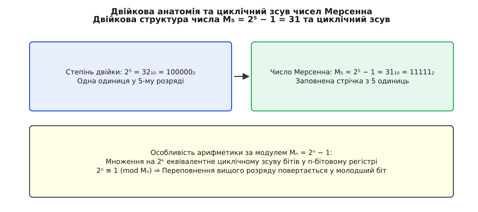
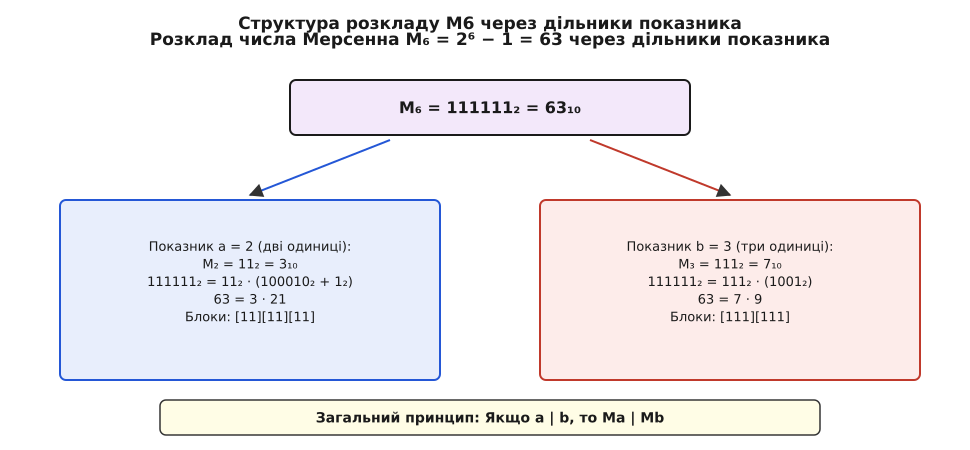
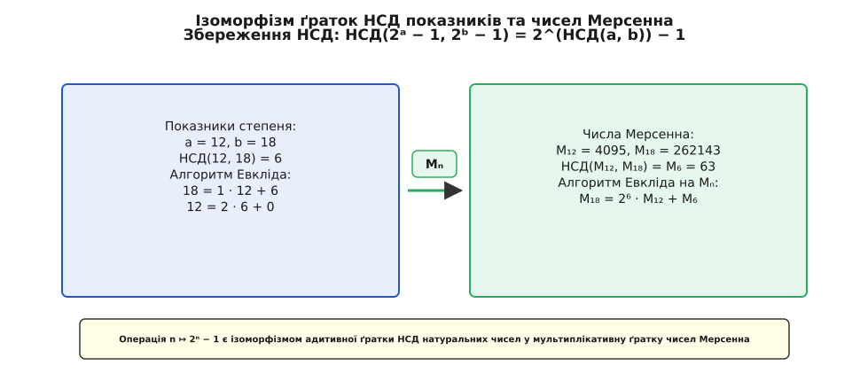
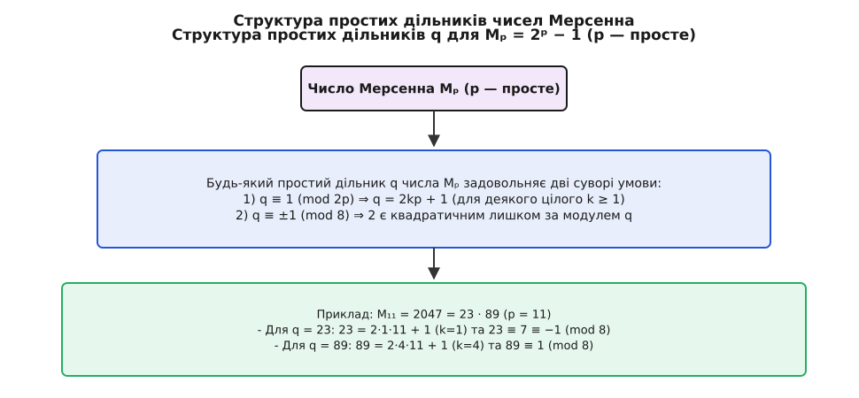

# Числа Мерсенна

<preknowlist>
- [Прості числа](root:math-number-theory/prime-numbers) — цілі числа, що мають рівно два різних натуральних дільники.
- [Конгруенції за модулем](root:math-number-theory/modular-arithmetic) — поняття порівняння a ≡ b (mod m) та операції в кільці лишків.
- [Позиційні системи](root:math-number-theory/positional-systems) — двійковий запис числа як сума степенів двійки.
- [НСД та алгоритм Евкліда](root:math-number-theory/gcd-euclidean) — найбільший спільний дільник двох чисел і його знаходження діленням з остачею.
- [Основна теорема арифметики](root:math-number-theory/fundamental-theorem-arithmetic) — єдиність розкладу натурального числа на прості множники.
</preknowlist>

Якщо піднести двійку до довільного цілого степеня `n` і відняти одиницю, отримаємо число `M♞ = 2ⁿ − 1`. На перший погляд, це найпростіша арифметична маніпуляція — звичайне зсунення єдиного одиничного біта в порожнечу нижчих розрядів. Проте це зсунення створює суцільну маску з `n` двійкових одиниць, яка перетворює алгебру числа `2ⁿ − 1` на унікальне дзеркало для всієї теорії чисел.

Числа вигляду `2ⁿ − 1` називаються **числами Мерсенна** на честь французького математика XVII століття Марена Мерсенна. Їхня будова поєднує в собі геометричну простоту позиційного двійкового кодування з глибокими алгебраїчними законами подільності. Подільність показників степеня прямо переноситься на подільність самих чисел, найбільший спільний дільник показників ізоморфно віддзеркалюється в НСД чисел Мерсенна, а приведення за модулем `2ⁿ − 1` у сучасних комп'ютерах замінює дороге цілочисельне ділення на швидкий циклічний зсув бітів.

У комп'ютерній інженерії та криптографії операція взяття остачі від ділення на звичайне число вимагає десятків тактів процесора через складність апаратного ділення. Але коли модуль має вигляд `2ⁿ − 1`, операція ділення вироджується в паралельне додавання розрядів і бітові зсуви, що дозволяє виконувати мільярди модульних операцій на секунду в генераторах псевдовипадкових чисел та алгоритмах швидкого множення.

## Двійкова анатомія, репунітна структура та кільцева арифметика

Математичне означення числа Мерсенна описується тотожністю:

```
M♞ = 2ⁿ − 1
```

Послідовність цих чисел для перших кількох натуральних показників `n = 1, 2, 3, 4, 5, 6, 7, 8, 9, 10, 11, 12` утворює ланцюг:

```
M₁  = 2¹ − 1 = 1
M₂  = 2² − 1 = 3
M₃  = 2³ − 1 = 7
M₄  = 2⁴ − 1 = 15
M₅  = 2⁵ − 1 = 31
M₆  = 2⁶ − 1 = 63
M₇  = 2⁷ − 1 = 127
M₈  = 2⁸ − 1 = 255
M₉  = 2⁹ − 1 = 511
M₁₀ = 2¹⁰ − 1 = 1023
M₁₁ = 2¹¹ − 1 = 2047
M₁₂ = 2¹² − 1 = 4095
```

Найголовніша властивість чисел Мерсенна розкривається при їхньому запису в двійковій системі числення. Степінь двійки `2ⁿ` у позиційній двійковій системі з основою 2 записується як одиниця, за якою слідують `n` нулів. Наприклад, `2⁴ = 16₁₀ = 10000₂`, `2⁸ = 256₁₀ = 100000000₂`, `2¹² = 4096₁₀ = 1000000000000₂`.

Віднімання одиниці від числа `2ⁿ` викликає ланцюговий перенос (позичення) крізь усі `n` позиційних розрядів. Оскільки `2ⁿ = 100…0₂`, після віднімання одиниці єдиний старший одиничний біт обнуляється, а всі `n` молодших розрядів перетворюються на суцільну маску з `n` одиниць без жодного нуля:

```
2⁴ = 10000₂
2⁴ − 1 = 1111₂ = 15₁₀

2⁸ = 100000000₂
2⁸ − 1 = 11111111₂ = 255₁₀

2¹² = 1000000000000₂
2¹² − 1 = 111111111111₂ = 4095₁₀
```

У теорії чисел об'єкти, позиційний запис яких складається виключно з однаково повторюваної цифри (в даному випадку з одиниці), називаються **репунітами** (від англійського *repeated unit*). Числа Мерсенна `M♞` є двійковими репунітами. З точки зору алгебри суми скінченної геометричної прогресії зі знаменником `q = 2` та першим членом `b₁ = 1`, ця маска виражається тотожністю:

```
2ⁿ − 1 = 1 · 2ⁿ⁻¹ + 1 · 2ⁿ⁻² + … + 1 · 2¹ + 1 · 2⁰ = ∑ₖ₌₀ⁿ⁻¹ 2ᵏ
```

Ця двійкова суцільність створює особливу алгебраїчну структуру в кільці лишків за модулем `M♞`. Оскільки `2ⁿ = M♞ + 1`, у конгруенціях за модулем `M♞` виконується фундаментальне порівняння:

```
2ⁿ ≡ 1 (mod M♞)
```

Це означає, що піднесення двійки до `n`-го степеня є тотожно рівносильним множенню на 1 за модулем `M♞`. У комп'ютерній регістровій пам'яті множення довільного числа на `2ᵏ` за модулем `2ⁿ − 1` перетворюється на звичайний циклічний зсув `n`-бітового слова ліворуч, де старші біти, які виходять за межі `n`-го розряду, закольцовуються і повертаються в наймолодші розряди числа (механізм end-around carry).

### Механізм циклічного бітового зсуву: детальний числовий розбір

Проілюструємо цей процес на конкретних числових прикладах.

#### Приклад 1: Кільце лишків за модулем M₅ = 31

Візьмемо число `x = 5`. У 5-бітовому двійковому представленні:

```
x = 5₁₀ = 00101₂
```

Помножимо `x` на `2³ = 8` за модулем `31`. У звичайній арифметиці:

```
5 · 8 = 40 ≡ 9 (mod 31)
```

Тепер виконаємо циклічний зсув двійкового слова `00101₂` ліворуч на 3 біти в межах 5-розрядного регістра:
1. Початковий стан: `[0, 0, 1, 0, 1]`
2. Зсув на 1 біт ліворуч: старший біт 0 переходить у кінець ⇒ `[0, 1, 0, 1, 0]` (число 10).
3. Зсув на 2 біти ліворуч: старший біт 0 переходить у кінець ⇒ `[1, 0, 1, 0, 0]` (число 20).
4. Зсув на 3 біти ліворуч: старший біт 1 переходить у молодший розряд ⇒ `[0, 1, 0, 0, 1]`.

Отриманий двійковий результат:

```
01001₂ = 0 · 16 + 1 · 8 + 0 · 4 + 0 · 2 + 1 · 1 = 9₁₀
```

Результат циклічного зсуву `9₁₀` точнісінько збігається з модульним множенням `(5 · 8) mod 31 = 9`.

#### Приклад 2: Множення числа 13 на 4 за модулем M₅ = 31

Візьмемо число `x = 13₁₀ = 01101₂`. Помножимо на `2² = 4`:

```
13 · 4 = 52 ≡ 21 (mod 31)
```

Виконаємо циклічний зсув на 2 біти ліворуч:
1. Початковий 5-бітовий стан: `[0, 1, 1, 0, 1]`
2. Зсув на 1 біт ліворуч: `[1, 1, 0, 1, 0]`
3. Зсув на 2 біти ліворуч: старший біт 1 переходить у молодший розряд ⇒ `[1, 0, 1, 0, 1]`

Перевіряємо значення: `10101₂ = 16 + 4 + 1 = 21₁₀`. Результат знову ідеально збігається!

Для детального огляду зведемо перші 12 чисел Мерсенна, їхній двійковий запис, просту чи складену природу та повний розклад на прості множники в єдину таблицю:

| `n` | `M♞ = 2ⁿ − 1` | Двійковий запис | Статус | Розклад на прості множники |
| :--- | :--- | :--- | :--- | :--- |
| **1** | `1` | `1₂` | Ні просте, ні складене | — |
| **2** | `3` | `11₂` | **Просте** | `3` |
| **3** | `7` | `111₂` | **Просте** | `7` |
| **4** | `15` | `1111₂` | Складене | `3 · 5` |
| **5** | `31` | `11111₂` | **Просте** | `31` |
| **6** | `63` | `111111₂` | Складене | `3² · 7 = 9 · 7` |
| **7** | `127` | `1111111₂` | **Просте** | `127` |
| **8** | `255` | `11111111₂` | Складене | `3 · 5 · 17 = 15 · 17` |
| **9** | `511` | `111111111₂` | Складене | `7 · 73` |
| **10** | `1023` | `1111111111₂` | Складене | `3 · 11 · 31 = 33 · 31` |
| **11** | `2047` | `11111111111₂` | Складене | `23 · 89` |
| **12** | `4095` | `111111111111₂` | Складене | `3² · 5 · 7 · 13 = 63 · 65` |


*Двійкова анатомія та циклічний зсув чисел Мерсенна при модульному зведенні за M_n.*

Історичний процес систематичного дослідження цих чисел — від перших евристичних здогадів античності до праць паризького чернця Марена Мерсенна 1644 року та сучасного обчислювального пошуку на суперкомп'ютерах — детально висвітлено у вставці [📜 Марен Мерсенн та історія списку 1644 року](root:math-number-theory/mersenne-numbers/hist-mersenne-monk.md).

## Подільність показників та поліноміальний розклад

Центральною теоретико-числовою властивістю послідовності чисел Мерсенна є точна відповідність між алгебраїчною подільністю показників степеня та подільністю самих чисел.

### Теорема про подільність показників

Якщо натуральне число `a` ділить натуральне число `b` без остачі (`a | b`), то число Мерсенна `M␁ = 2ᵃ − 1` ділить число Мерсенна `M_b = 2ᵇ − 1` без остачі (`M␁ | M_b`).

### Алгебраїчне доведення

Нехай `b = a · k` для деякого цілого коефіцієнта `k ≥ 1`. Скористаємося класичною алгебраїчною тотожністю розкладу різниці `k`-их степеней `x𐞥 − 1` на множники:

```
x𐞥 − 1 = (x − 1) · (x𐞥⁻¹ + x𐞥⁻² + … + x + 1)
```

Підставимо у цю тотожність змінну `x = 2ᵃ`. Оскільки `x𐞥 = (2ᵃ)𐞥 = 2ᵃᵏ = 2ᵇ` та `x − 1 = 2ᵃ − 1`, ми отримуємо точний розклад числа Мерсенна `2ᵇ − 1`:

```
2ᵇ − 1
= (2ᵃ − 1) · ((2ᵃ)𐞥⁻¹ + (2ᵃ)𐞥⁻² + … + 2ᵃ + 1)   [підстановка x = 2ᵃ у розклад різниці степеней]
= (2ᵃ − 1) · (2ᵃ⁽ᵏ⁻¹⁾ + 2ᵃ⁽ᵏ⁻²⁾ + … + 2ᵃ + 1)    [спрощення показників степеня]
```

Проаналізуємо другий множник у цій формулі. Він являє собою суму цілих степеней двійки:

```
S = 2ᵃ⁽ᵏ⁻¹⁾ + 2ᵃ⁽ᵏ⁻²⁾ + … + 2ᵃ + 1
```

Оскільки `a ≥ 1` та `k ≥ 1`, кожна додама величина є цілим натуральним числом, а отже й сума `S` є цілим натуральним числом. Отже, число `2ᵇ − 1` розкладається у добуток цілого числа `2ᵃ − 1` на ціле число `S`. Це доводить, що `2ᵃ − 1` є дільником `2ᵇ − 1` без остачі.

### Розклад через кругові поліноми (Cyclotomic Polynomials)

Глибший погляд на структуру дільників числа Мерсенна дає розклад за допомогою кругових поліномів Ейлера `Φ_d(x)`. У загальній алгебрі для будь-якого натурального `n` виконується тотожність:

```
xⁿ − 1 = ∏_d|n Φ_d(x)
```

де добуток береться за всіма дільниками `d` числа `n`. Підставивши `x = 2`, отримуємо канонічний алгебраїчний розклад числа Мерсенна `M♞`:

```
2ⁿ − 1 = ∏_d|n Φ_d(2)
```

Кожен множник `Φ_d(2)` несе у собі алгебраїчний внесок дільника `d`. Обчислимо кругові поліноми та їхні значення для перших дільників:
- `Φ₁(2) = 2 − 1 = 1`
- `Φ₂(2) = 2 + 1 = 3`
- `Φ₃(2) = 2² + 2 + 1 = 7`
- `Φ₄(2) = 2² + 1 = 5`
- `Φ₅(2) = 2⁴ + 2³ + 2² + 2 + 1 = 31`
- `Φ₆(2) = 2² − 2 + 1 = 3`
- `Φ₇(2) = 2⁶ + 2⁵ + 2⁴ + 2³ + 2² + 2 + 1 = 127`
- `Φ₈(2) = 2⁴ + 1 = 17`
- `Φ₁₀(2) = 2⁴ − 2³ + 2² − 2 + 1 = 11`
- `Φ₁₂(2) = 2⁴ − 2² + 1 = 13`
- `Φ₁₅(2) = 2⁸ − 2⁷ + 2⁵ − 2⁴ + 2³ − 2 + 1 = 151`
- `Φ₂₁(2) = 2¹² − 2¹¹ + 2⁹ − 2⁸ + 2⁶ − 2⁵ + 2³ − 2² + 1 = 337`

Розглянемо канонічні розклади для складених показників:

1. **Для n = 12 (дільники 1, 2, 3, 4, 6, 12):**
   ```
   M₁₂ = 2¹² − 1 = Φ₁(2) · Φ₂(2) · Φ₃(2) · Φ₄(2) · Φ₆(2) · Φ₁₂(2)
   4095 = 1 · 3 · 7 · 5 · 3 · 13 = 3² · 5 · 7 · 13
   ```

2. **Для n = 15 (дільники 1, 3, 5, 15):**
   ```
   M₁₅ = 2¹⁵ − 1 = Φ₁(2) · Φ₃(2) · Φ₅(2) · Φ₁₅(2)
   32767 = 1 · 7 · 31 · 151 = 7 · 31 · 151
   ```

3. **Для n = 21 (дільники 1, 3, 7, 21):**
   ```
   M₂₁ = 2²¹ − 1 = Φ₁(2) · Φ₃(2) · Φ₇(2) · Φ₂₁(2)
   2097151 = 1 · 7 · 127 · 337 = 7 · 127 · 337
   ```

### Двійкова геометрія блочного розкладу

Наочно цей алгебраїчний розклад виражається у двійковій формі запису. Якщо показник `b` складається з `k` однакових блоків довжиною `a` бітів (`b = a · k`), то двійкова стрічка з `b` одиниць розбивається на `k` однакових повторюваних періодів, кожен з яких утворений числом `2ᵃ − 1`.

Проілюструємо цей механізм на кількох конкретних обчислювальних прикладах.

#### Приклад 1: Показник b = 6

Число `b = 6` має натуральні дільники `a = 2` та `a = 3`. Порахуємо відповідні числа Мерсенна:

```
M₂ = 2² − 1 = 3
M₃ = 2³ − 1 = 7
M₆ = 2⁶ − 1 = 63
```

Застосуємо формулу розкладу для `a = 2` (`k = 3`):

```
63 = 2⁶ − 1
= (2² − 1) · (2²·² + 2²·¹ + 1)                  [розклад за тотожністю для a = 2, k = 3]
= 3 · (2⁴ + 2² + 1)                              [обчислення 2² − 1 = 3 та показників 4, 2]
= 3 · (16 + 4 + 1)                               [піднесення двійки до степенів]
= 3 · 21                                         [додавання доданків у дужках]
```

У двійковій системі числення цей розклад відповідає розбиттю шести одиниць на три блоки по дві одиниці:

```
63₁₀ = 111111₂ = 11₂ · 100010₂ + 11₂ = 11₂ · 10101₂ = 3₁₀ · 21₁₀
```

Тепер застосуємо формулу для дільника `a = 3` (`k = 2`):

```
63 = 2⁶ − 1
= (2³ − 1) · (2³·¹ + 1)                          [розклад за тотожністю для a = 3, k = 2]
= 7 · (8 + 1)                                    [обчислення 2³ − 1 = 7 та 2³ = 8]
= 7 · 9                                          [додавання в дужках]
```

У двійковій системі це відповідає розбиттю шести одиниць на два блоки по три одиниці:

```
63₁₀ = 111111₂ = 111₂ · 1000₂ + 111₂ = 111₂ · 1001₂ = 7₁₀ · 9₁₀
```


*Структурний розклад M6 на двійкові блоки по дві та три одиниці.*

#### Приклад 2: Показник b = 8

Число `b = 8` має дільники `a = 2` та `a = 4`. Обчислимо значення:

```
M₂ = 3
M₄ = 15
M₈ = 255
```

Застосуємо розклад для `a = 4` (`k = 2`):

```
255 = 2⁸ − 1 = (2⁴ − 1) · (2⁴ + 1) = 15 · 17
```

Двійковий запис демонструє розбиття восьми одиниць на два блоки по чотири одиниці: `11111111₂ = 1111₂ · 10001₂ = 15 · 17`.

#### Приклад 3: Показник b = 9

Число `b = 9` має дільник `a = 3` (`k = 3`). Обчислимо значення:

```
M₃ = 2³ − 1 = 7
M₉ = 2⁹ − 1 = 511
```

Застосуємо тотожність:

```
511 = 2⁹ − 1 = (2³ − 1) · (2⁶ + 2³ + 1) = 7 · (64 + 8 + 1) = 7 · 73
```

У двійковій формі: `111111111₂ = 111₂ · 1001001₂ = 7 · 73`.

#### Приклад 4: Показник b = 10

Для `b = 10` дільниками є `a = 2` та `a = 5`. Обчислимо значення:

```
M₂ = 3
M₅ = 31
M₁₀ = 1023
```

Розклад для `a = 5` (`k = 2`) дає:

```
1023 = 2¹⁰ − 1 = (2⁵ − 1) · (2⁵ + 1) = 31 · 33
```

У двійковому записі це розбиття десяти одиниць на два блоки по п'ять одиниць: `1111111111₂ = 11111₂ · 100001₂ = 31 · 33`.

З усіх цих прикладів випливає фундаментальний арифметичний висновок: **будь-яка складеність показника `n` неодмінно породжує складене число Мерсенна `M♞`**.

## Алгоритм Евкліда на показниках та ізоморфізм ґраток НСД

Властивість подільності показників поглиблюється до фундаментальної теореми про збереження найбільшого спільного дільника під час переходу від показників до чисел Мерсенна.

### Теорема про НСД чисел Мерсенна

Для будь-яких двох натуральних чисел `a` та `b` найбільший спільний дільник відповідних чисел Мерсенна дорівнює числу Мерсенна, показник якого є найбільшим спільним дільником `a` та `b`:

```
НСД(2ᵃ − 1, 2ᵇ − 1) = 2^(НСД(a, b)) − 1
```

### Механізм доведення через крок алгоритму Евкліда

Доведення цієї теореми спирається на паралелізм ділення з остачею. Нехай при діленні показника `a` на `b` з остачею маємо `a = q · b + r`, де `0 ≤ r < b`.

Розкладемо вираз `2ᵃ − 1` через цю остачу:

```
2ᵃ − 1 = 2^(q·b + r) − 1 = 2ʳ · (2^(q·b) − 1) + (2ʳ − 1)
```

Оскільки `2^(q·b) − 1` ділиться на `2ᵇ − 1` без остачі (як ми довели в попередньому розділі), доданок `2ʳ · (2^(q·b) − 1)` є кратним числу `2ᵇ − 1`. Отже, точна остача від ділення числа `2ᵃ − 1` на `2ᵇ − 1` дорівнює саме `2ʳ − 1`.

За класичною властивістю алгоритму Евкліда:

```
НСД(2ᵃ − 1, 2ᵇ − 1) = НСД(2ᵇ − 1, 2ʳ − 1)
```

Це означає, що кожен крок алгоритму Евкліда для обчислення `НСД(a, b)` точнісінько віддзеркалюється в ланцюгу кроків алгоритму Евкліда для обчислення `НСД(2ᵃ − 1, 2ᵇ − 1)`. Коли на останньому кроці остача показників стає `rₖ = НСД(a, b)`, остача чисел Мерсенна стає `2^(rₖ) − 1 = 2^(НСД(a, b)) − 1`.

Проілюструємо цей паралелізм на кількох детальних обчислювальних прикладах.

#### Практичний приклад 1: a = 12, b = 18

Виконаємо алгоритм Евкліда для показників `12` та `18`:

```
18 = 1 · 12 + 6
12 = 2 · 6 + 0   ⇒   НСД(12, 18) = 6
```

Тепер обчислимо числа Мерсенна:

```
M₁₂ = 2¹² − 1 = 4095
M₁₈ = 2¹⁸ − 1 = 262143
M₆ = 2⁶ − 1 = 63
```

Застосуємо алгоритм Евкліда до чисел Мерсенна:

```
262143 = 64 · 4095 + 63
4095 = 65 · 63 + 0   ⇒   НСД(4095, 262143) = 63 = M₆
```

#### Практичний приклад 2: a = 15, b = 25

Виконаємо алгоритм Евкліда для показників `15` та `25`:

```
25 = 1 · 15 + 10
15 = 1 · 10 + 5
10 = 2 · 5 + 0   ⇒   НСД(15, 25) = 5
```

Обчислимо числа Мерсенна:

```
M₁₅ = 2¹⁵ − 1 = 32767
M₂₅ = 2²⁵ − 1 = 33554431
M₅ = 2⁵ − 1 = 31
```

Виконаємо покроковий ланцюг ділення з остачею:

```
33554431 = 1024 · 32767 + 1023
32767 = 32 · 1023 + 31
1023 = 33 · 31 + 0   ⇒   НСД(32767, 33554431) = 31 = M₅
```

Кожен крок точнісінько відтворює остачі показників: `2¹⁰ − 1 = 1023`, `2⁵ − 1 = 31` та `2⁰ − 1 = 0`!

#### Практичний приклад 3: a = 14, b = 21

Виконаємо алгоритм Евкліда для показників `14` та `21`:

```
21 = 1 · 14 + 7
14 = 2 · 7 + 0   ⇒   НСД(14, 21) = 7
```

Обчислимо відповідні числа Мерсенна:

```
M₁₄ = 2¹⁴ − 1 = 16383
M₂₁ = 2²¹ − 1 = 2097151
M₇ = 2⁷ − 1 = 127
```

Виконаємо ділення з остачею:

```
2097151 = 128 · 16383 + 127
16383 = 129 · 127 + 0   ⇒   НСД(16383, 2097151) = 127 = M₇
```

#### Практичний приклад 4: a = 8, b = 12

Показники `8` та `12`: `12 = 1 · 8 + 4`, `8 = 2 · 4 + 0 ⇒ НСД(8, 12) = 4`.

Числа Мерсенна: `M₈ = 255`, `M₁₂ = 4095`, `M₄ = 15`.

Ланцюг ділення: `4095 = 16 · 255 + 15`, `255 = 17 · 15 + 0 ⇒ НСД(255, 4095) = 15 = M₄`.


*Ізоморфізм адитивної ґратки показників та мультиплікативної ґратки чисел Мерсенна.*

Повне строге алгебраїчне виведення цієї теореми, а також аналіз первинних простих дільників за теоремою Зігмонді (Zsigmondy's Theorem) наведено у вставці [🧮 Алгебраїчні властивості дільників та теореми про НСД чисел Мерсенна](root:math-number-theory/mersenne-numbers/math-gcd-mersenne.md).

### Властивість сильної роздільності та теорема про НСК

У абстрактній алгебрі послідовність чисел `(uₙ)ₙ≥₁` називається **сильною роздільною послідовністю**, якщо операція взяття НСД для індексів точно переноситься на самі члени:

```
НСД(uₐ, u_b) = u_(НСД(a, b))
```

Послідовність чисел Мерсенна `M♞ = 2ⁿ − 1` є класичним представником сильних роздільних послідовностей. Вона задає структурний гомоморфізм між ґраткою цілих чисел відносно подільності `⟨N, НСД, НСК⟩` та мультиплікативною ґраткою чисел Мерсенна.

Для найменшого спільного кратного (НСК) чисел Мерсенна справедлива теорема:

```
НСК(2ᵃ − 1, 2ᵇ − 1) = (2ᵃ − 1) · (2ᵇ − 1) / (2^(НСД(a, b)) − 1)
```

Наприклад, для `a = 4` (`M₄ = 15`) та `b = 6` (`M₆ = 63`):
- `НСД(4, 6) = 2 ⇒ НСД(15, 63) = 2² − 1 = 3`
- `НСК(15, 63) = (15 · 63) / 3 = 945 / 3 = 315`

### Критерій взаємної простоти

З теореми про НСД випливає важливий наслідок:

```
НСД(2ᵃ − 1, 2ᵇ − 1) = 1   ⇔   НСД(a, b) = 1
```

Числа Мерсенна `M␁` та `M_b` є взаємно простими тоді й лише тоді, коли їхні показники `a` та `b` є взаємно простими натуральними числами.

## Прості дільники та структура їхньої форми q = 2kp + 1

Зв'язок між показником та дільниками дозволяє сформулювати умови простоти чисел Мерсенна та визначити жорстку арифметичну форму їхніх простих дільників.

### Необхідна умова простоти

Якщо число Мерсенна `M♞ = 2ⁿ − 1` є **простим**, то його показник `n` обов'язково є **простим числом**.

Це випливає з контрапозиції доведеної раніше теореми подільності: якби показник `n` був складеним (`n = a · b` із `a, b > 1`), то `M␁ = 2ᵃ − 1` було б власним дільником `M♞` (бо `1 < 2ᵃ − 1 < 2ⁿ − 1`), і число `M♞` було б складеним.

### Недостатність умови

Обернене твердження **не справджується**: якщо показник `p` є простим, число Мерсенна `Mₚ = 2ᵖ − 1` **не обов'язково** є простим.

Перші контрприклади показують, що серед простих показників `p` складені числа Мерсенна трапляються регулярно:

```
M₁₁ = 2¹¹ − 1 = 2047 = 23 · 89
M₂₃ = 2²³ − 1 = 8388607 = 47 · 178481
M₂₉ = 2²⁹ − 1 = 536870911 = 233 · 2304167
M₃₇ = 2³⁷ − 1 = 137438953471 = 223 · 616318177
M₄₁ = 2⁴¹ − 1 = 2199023255551 = 13367 · 164511353
M₄₃ = 2⁴³ − 1 = 8796093022207 = 431 · 9719 · 2099863
M₆₇ = 2⁶⁷ − 1 = 147573952589676412927 = 193707721 · 761838257287
```

### Теорема про арифметичну форму простих дільників

Якщо `p` — непарне просте число, то будь-який простий дільник `q` числа `Mₚ = 2ᵖ − 1` обов'язково задовольняє дві суворі системи конгруенцій:

```
1) q ≡ 1 (mod 2p)   ⇒   q = 2k·p + 1   (для деякого цілого k ≥ 1)
2) q ≡ ±1 (mod 8)   ⇒   q ≡ 1 або q ≡ 7 (mod 8)
```

### Обґрунтування умов

1. **Перша умова (`q = 2kp + 1`):** Оскільки `q | (2ᵖ − 1)`, маємо `2ᵖ ≡ 1 (mod q)`. Мультиплікативний порядок числа 2 за модулем `q` дорівнює `p` (бо `p` просте). За Малою теоремою Ферма `2^(q−1) ≡ 1 (mod q)`, звідки порядок `p` ділить `q − 1`. Оскільки `q` непарне, `q − 1` ділиться на `2p`, тобто `q = 2kp + 1`.
2. **Друга умова (`q ≡ ±1 mod 8`):** З рівняння `2ᵖ ≡ 1 (mod q)` випливає, що `2^((q−1)/2) = 2^(kp) = (2ᵖ)ᵏ ≡ 1ᵏ ≡ 1 (mod q)`. За критерієм Ейлера це означає, що 2 є квадратичним лишком за модулем `q`. За квадратичним законом взаємності Гаусса 2 є квадратичним лишком за модулем `q` тоді й лише тоді, коли `q ≡ ±1 (mod 8)`.


*Затискання дільників чисел Мерсенна в арифметичну сітку q = 2kp + 1.*

Проілюструємо застосування цієї теореми на прикладах факторизації кількох чисел Мерсенна.

#### Аналіз M₁₁ = 2047 (p = 11)

Шукаємо дільники вигляду `q = 22k + 1`:
- `k = 1`: `q = 23`. Перевіряємо за модулем 8: `23 ≡ 7 ≡ −1 (mod 8)` — умова виконується! Перевіряємо ділення: `2047 / 23 = 89`. Число 89 також є простим!
- Перевіряємо `89`: `89 = 22 · 4 + 1` (`k = 4`) та `89 ≡ 1 (mod 8)` — обоє дільників `23` та `89` ідеально лягають у сітку теореми.

#### Аналіз M₂₃ = 8388607 (p = 23)

Шукаємо дільники вигляду `q = 46k + 1`:
- `k = 1`: `q = 47`. Перевіряємо за модулем 8: `47 ≡ 7 ≡ −1 (mod 8)` — умова виконується! Перевіряємо ділення: `8388607 / 47 = 178481`.
- Число `178481` також є простим: `178481 = 46 · 3880 + 1` (`k = 3880`) та `178481 ≡ 1 (mod 8)`.

#### Аналіз M₂₉ = 536870911 (p = 29)

Шукаємо дільники вигляду `q = 58k + 1`:
- `k = 1`: `q = 59`. Перевіряємо `59 mod 8 = 3` — відкинуто!
- `k = 2`: `q = 117` (складене, `117 mod 8 = 5` — відкинуто!).
- `k = 3`: `q = 175` (складене, `2²⁹ mod 175 ≠ 1`).
- `k = 4`: `q = 233`. `233 mod 8 = 1` — фільтр пройдено! `2²⁹ mod 233 = 1`.
- Дільник `233` знайдено. Другий співмножник: `536870911 / 233 = 2304167`.

#### Аналіз M₃₇ = 137438953471 (p = 37)

Шукаємо дільники вигляду `q = 74k + 1`:
- `k = 1`: `q = 75` (складене).
- `k = 2`: `q = 149`. `149 mod 8 = 5` — відкинуто квадратичним фільтром!
- `k = 3`: `q = 223`. `223 mod 8 = 7` — фільтр пройдено! `2³⁷ mod 223 = 1`.
- Дільник `223` знайдено: `137438953471 / 223 = 616318177`.

#### Аналіз M₄₁ = 2199023255551 (p = 41)

Шукаємо дільники вигляду `q = 82k + 1`:
- Найменший дільник досягається при `k = 163`: `q = 13367`.
- Перевірка: `13367 mod 8 = 7` та `2⁴¹ mod 13367 = 1`.
- Розклад: `M₄₁ = 13367 · 164511353`.

#### Чому M₁₃ = 8191 є простим (p = 13)

Шукаємо дільники вигляду `q = 26k + 1` із `q ≡ ±1 (mod 8)` та `q ≤ √8191 ≈ 90.5`:
- `k = 1`: `q = 27` (не просте).
- `k = 2`: `q = 53`. Перевіряємо `mod 8`: `53 ≡ 5 (mod 8)` — відкинуто другим фільтром!
- `k = 3`: `q = 79`. Перевіряємо `mod 8`: `79 ≡ 7 (mod 8)`. Перевіряємо ділення: `8191 / 79 = 103.68…` (не ділиться без остачі).

Жоден кандидат у діапазоні до `√8191` не підійшов. Отже, число `M₁₃ = 8191` є **простим числом Мерсенна**!

Ці дві умови радикально скорочують перебір при перевірці чисел Мерсенна на наявність дільників. Замість перевірки всіх простих чисел перевіряються лише ті, що лежать на перетині прогресії `2kp + 1` та класів `1, 7 mod 8`.

## Подвійні числа Мерсенна та гіпотеза Каталана

Особливий інтерес в аналітичній теорії чисел становлять **подвійні числа Мерсенна** (Double Mersenne Numbers), які визначаються рекурсивною підстановкою числа Мерсенна в показник степеня:

```
M_(Mₚ) = 2^(2ᵖ − 1) − 1 = 2^(Mₚ) − 1
```

де `p` — просте число.

Розглянемо перші члени цієї послідовності:

1. **p = 2:** `M₂ = 3 ⇒ M_(M₂) = 2³ − 1 = 7` (**просте**).
2. **p = 3:** `M₃ = 7 ⇒ M_(M₃) = 2⁷ − 1 = 127` (**просте**).
3. **p = 5:** `M₅ = 31 ⇒ M_(M₅) = 2³¹ − 1 = 2147483647` (**просте**).
4. **p = 7:** `M₇ = 127 ⇒ M_(M₇) = 2¹²⁷ − 1 = 170141183460469231731687303715884105727` (**просте**, доведено Еженом Каталаном у 1876 році).
5. **p = 13:** `M₁₃ = 8191 ⇒ M_(M₁₃) = 2⁸¹⁹¹ − 1`. Це гігантське число, яке налічує 2466 десяткових цифр. У 1957 році Рафаель Робінсон на комп'ютері встановив, що воно є складеним.

Бельгійський математик Ежен Шарль Каталан висунув гіпотезу, що нескінченна рекурентна вежа:

```
C₀ = 2
C₁ = 2² − 1 = 3
C₂ = 2³ − 1 = 7
C₃ = 2⁷ − 1 = 127
C₄ = 2¹²⁷ − 1
C₅ = 2^(C₄) − 1
```

складається виключно з простих чисел. Проте перевірка простоти числа `C₅ = 2^(2¹²⁷ − 1) − 1` виходить далеко за межі можливостей усієї сучасної земної цивілізації, оскільки його двійковий запис містить понад `10³⁸` бітів (більше, ніж кількість атомів у планеті Земля).

## Комбінаторні зв'язки: булеві ґратки, грані симплексів та Ханойські вежі

Числа Мерсенна природно виникають у комбінаториці дискретних структур та геометрії:

1. **Потужність булеана скінченної множини:**
   Кількість усіх можливих непорожніх підмножин множини з `n` елементів точно дорівнює:
   ```
   |P(S) \ {∅}| = 2ⁿ − 1 = M♞
   ```
   За біноміальною теоремою Ньютона: `(1 + 1)ⁿ − 1 = ∑ₖ₌₁ⁿ C(n, k) = 2ⁿ − 1`.
2. **Геометрія багатовимірних симплексів:**
   Загальна кількість непорожніх граней усіх розмірностей (вершин, ребер, 2D-граней тощо) у `(n−1)`-вимірному геометричному симплексі `Δₙ₋₁` дорівнює `2ⁿ − 1 = M♞`. Наприклад, для тривимірного тетраедра (`n = 4`): 4 вершини + 6 ребер + 4 грані + 1 тривимірне тіло = 15 = `M₄`.
3. **Задача про Ханойські вежі (Towers of Hanoi):**
   Класична головоломка французького математика Едуара Люка (1883) полягає в перенесенні піраміди з `n` дисків різного діаметра з одного стрижня на інший за правилом: «за один хід можна перемістити лише один диск, і заборонено класти більший диск на менший».
   Мінімальна кількість ходів `T♞`, необхідна для розв'язання головоломки для `n` дисків, описується лінійною рекурентністю:
   ```
   T₁ = 1
   T♞ = 2·T♞₋₁ + 1
   ```
   Розгортаючи цей рекурентний ланцюг за індукцією:
   ```
   T♞ = 2ⁿ⁻¹ + 2ⁿ⁻² + … + 2¹ + 1 = 2ⁿ − 1 = M♞
   ```
   Для легендарних 64 золотих дисків Брахми жерцям потрібно виконати `2⁶⁴ − 1 = 18446744073709551615` рухів, що при швидкості 1 хід на секунду триватиме приблизно 585 мільярдів років.

## Тест простоти Люка-Лемера (Lucas-Lehmer Test)

Для велетенських чисел Мерсенна з показниками `p > 100` прямий пошук дільників стає неможливим, навіть з урахуванням фільтрів `q = 2kp + 1`. Тому в обчислювальній теорії чисел застосовується детермінований тест Люка-Лемера (LLT).

### Алгоритм тесту Люка-Лемера

Нехай `p > 2` — непарне просте число. Побудуємо рекурентну послідовність чисел:

```
S₁ = 4
Sₖ₊₁ = (Sₖ² − 2) mod Mₚ   (для k = 1, 2, …, p − 2)
```

**Критерій простоти Люка-Лемера:**
Число Мерсенна `Mₚ = 2ᵖ − 1` є **простим** тоді й лише тоді, коли:

```
Sₚ₋₁ ≡ 0 (mod Mₚ)
```

Тобто останній член послідовності `Sₚ₋₁` повинен ділитися на `Mₚ` без остачі.

### Алгебраїчні засади тесту: послідовності Люка над Z[√3]

Рекурентність `Sₖ₊₁ = Sₖ² − 2` виникає з піднесення до квадрата елементів квадратичного кільця `Z[√3]`. Розглянемо число:

```
ω = 2 + √3,   ω⁻¹ = 2 − √3
```

Добуток цих спряжених чисел дорівнює `ω · ω⁻¹ = (2 + √3)(2 − √3) = 4 − 3 = 1`.

Члени послідовності `Sₖ` виражаються явно через степені `ω`:

```
Sₖ = ω^(2^(k−1)) + ω^(−2^(k−1))
```

Для `k = 1`: `S₁ = ω¹ + ω⁻¹ = (2 + √3) + (2 − √3) = 4`.
Для `k = 2`: `S₂ = ω² + ω⁻² = (ω + ω⁻¹)² − 2 = 4² − 2 = 14`.

У скінченному полі `F_(Mₚ²)` число `Mₚ` ділить `Sₚ₋₁` тоді й лише тоді, коли елемент `ω` породжує циклічну групу порядку `2ᵖ`, що можливо виключно за умови простоти `Mₚ`.

### Простеження тесту Люка-Лемера на прикладах

1. **Перевірка M₃ = 7 (p = 3):**
   - Потрібно виконати `p − 2 = 1` ітерацію.
   - `S₁ = 4`.
   - Обчислюємо `S₂ = (4² − 2) mod 7 = (16 − 2) mod 7 = 14 mod 7 = 0`.
   - Оскільки `S₂ = 0`, число `M₃ = 7` є простим!

2. **Перевірка M₅ = 31 (p = 5):**
   - Потрібно виконати `p − 2 = 3` ітерації (`S₂, S₃, S₄`).
   - `S₁ = 4`
   - `S₂ = (4² − 2) mod 31 = 14 mod 31 = 14`
   - `S₃ = (14² − 2) mod 31 = (196 − 2) mod 31 = 194 mod 31 = 8`
   - `S₄ = (8² − 2) mod 31 = (64 − 2) mod 31 = 62 mod 31 = 0`
   - Оскільки `S₄ = 0`, число `M₅ = 31` є простим!

3. **Перевірка M₇ = 127 (p = 7):**
   - Потрібно виконати 5 ітерацій (`S₂` до `S₆`):
   - `S₁ = 4`
   - `S₂ = 14`
   - `S₃ = 194 mod 127 = 67`
   - `S₄ = (67² − 2) mod 127 = (4489 − 2) mod 127 = 4487 mod 127 = 42`
   - `S₅ = (42² − 2) mod 127 = (1764 − 2) mod 127 = 1762 mod 127 = 111`
   - `S₆ = (111² − 2) mod 127 = (12321 − 2) mod 127 = 12319 mod 127 = 0`
   - Оскільки `S₆ = 0`, число `M₇ = 127` є простим!

4. **Перевірка M₁₁ = 2047 (p = 11, складене число):**
   - Виконуємо 9 ітерацій (`S₂` до `S₁₀`):
   - `S₁ = 4`
   - `S₂ = 14`
   - `S₃ = 194`
   - `S₄ = (194² − 2) mod 2047 = 37634 mod 2047 = 788`
   - `S₅ = (788² − 2) mod 2047 = 701`
   - `S₆ = (701² − 2) mod 2047 = 119`
   - `S₇ = (119² − 2) mod 2047 = 1877`
   - `S₈ = (1877² − 2) mod 2047 = 240`
   - `S₉ = (240² − 2) mod 2047 = 282`
   - `S₁₀ = (282² − 2) mod 2047 = 1736 ≠ 0`
   - Оскільки `S₁₀ ≠ 0`, число `M₁₁ = 2047` є **складеним**!

Цей алгоритм виконує лише `p − 2` операцій множення та зведення за модулем `2ᵖ − 1`, що робить його найшвидшим детермінованим тестом простоти у світі.

## Методи факторизації чисел Мерсенна

Для чисел Мерсенна розроблено спеціалізовані методи пошуку дільників:

1. **Оптимізоване пробне ділення (Trial Division):**
   Перевірка кандидатів `q = 2kp + 1` за умови `q ≡ ±1 (mod 8)`. Ефективно знаходить малі дільники (до 60–80 бітів) за мілісекунди.
2. **Алгоритм p − 1 Поларда (Pollard's p − 1 Algorithm):**
   Оскільки для дільника `q` числа Мерсенна число `q − 1` завжди ділиться на `2p`, структура `q − 1` дуже часто виявляється гладкою (B-smooth). Це дозволяє алгоритму Поларда швидко знаходити фактори розміром до 40–50 десяткових знаків.
3. **Метод еліптичних кривих (ECM, Lenstra elliptic-curve factorization):**
   Використовує випадкові еліптичні криві над кільцем `Z / Mₚ Z` для пошуку дільників середнього розміру (до 60–70 десяткових знаків).
4. **Загальний метод решета числового поля (GNFS / SNFS):**
   Спеціальне решето числового поля (Special Number Field Sieve) ідеально підходить для чисел вигляду `rⁿ ± s` і є найпотужнішим алгоритмом повної факторизації великих складених чисел Мерсенна.

## Обчислення тесту Люка-Лемера через FFT на суперкомп'ютерах

Коли показник `p` досягає десятків мільйонів (наприклад `p = 82589933`), кожне число `Sₖ` займає понад 10 мегабайтів оперативної пам'яті. Звичайне множення чисел такої довжини вимагало б `O(N²)` операцій і тривало б роки для однієї ітерації.

Сучасні програми тестування (зокрема Prime95 у проєкті GIMPS) використовують швидке дискретне зважене перетворення Фур'є (Discrete Weighted Transform, DWT / FFT):

1. **Розбиття числа на блоки:** Число `Sₖ` розбивається на масив з `K` чисел із плаваючою крапкою подвійної точності (IEEE-754 double precision).
2. **Пряме перетворення Фур'є (FFT):** Масив переводиться в частотну область за час `O(K log K)`.
3. **Поточкове зведення в квадрат:** Кожен комплексний коефіцієнт частотного спектра підноситься до квадрата за один такт ALU.
4. **Обернене перетворення (Inverse FFT):** Спектр повертається у часову область.
5. **Розподіл переносу розрядів (Carry Resolution):** Виконується нормалізація двійкових розрядів та віднімання двійки.

Це скорочує час однієї ітерації з годин до мілісекунд, дозволяючи перевіряти числа з десятками мільйонів десяткових знаків.

## Модульна арифметика Мерсенна в процесорній архітектурі

Особливості чисел Мерсенна роблять їх фундаментальним інструментом у прикладній комп'ютерній алгебрі та розробці програмного забезпечення.

### Безділильне приведення за модулем Мерсенна

Стандартна операція знаходження остачі від ділення `%` на процесорах потребує інструкції ділення, яка виконується десятки тактів. Проте для модуля `M♞ = 2ⁿ − 1` приведення виконується через побітові операції.

Нехай `x` — 64-бітне ціле число, яке потрібно звести за модулем `M♞ = 2ⁿ − 1`. Розділимо біти числа `x` на два блоки: старші біти `A` (зсунуті на `n` позицій) та молодші `n` бітів `B`:

```
x = A · 2ⁿ + B
```

Оскільки `2ⁿ ≡ 1 (mod 2ⁿ − 1)`, маємо:

```
x ≡ A · 1 + B = A + B (mod 2ⁿ − 1)
```

Алгоритм обчислення на C/C++ зводиться до двох побітових маніпуляцій:

```
uint64_t high = x >> n;
uint64_t low = x & ((1ULL << n) - 1);
uint64_t result = high + low;
```

Якщо сума `high + low` все ще перевищує або дорівнює `2ⁿ − 1`, від неї віднімають `2ⁿ − 1` або повторюють згортання. Жодної інструкції ділення не використовується — лише зсув `>>`, побітове «І» `&` та додавання `+`.

### Застосування у генераторах, кодуванні та регістрах LFSR

1. **Генератори псевдовипадкових чисел:** Найвідоміший генератор Вихор Мерсенна (Mersenne Twister, MT19937) використовує як період число Мерсенна `M₁₉₉₃₇ = 2¹⁹⁹³⁷ − 1`. Це гарантує колосальну довжину періоду `2¹⁹⁹³⁷ − 1 ≈ 4.3 · 10⁶⁰⁰¹` та високу якість 623-вимірного статистичного розподілу.
2. **Регістри зсуву з лінійним зворотним зв'язком (LFSR):**
   Лінійні регістри зсуву довжиною `n` бітів над полем `F₂` генерують псевдовипадкові послідовності максимальної довжини (m-послідовності) з періодом рівно `2ⁿ − 1 = M♞`. Вони лежать в основі стандартів супутникової навігації (GPS C/A коди) та бездротових протоколів CDMA (Code Division Multiple Access).
3. **Циклічні коди та коди Ріда-Соломона:**
   У теорії корекції помилок розширення Галуа `F_(2ⁿ)` мають мультиплікативну групу порядку `2ⁿ − 1 = M♞`. Первісні елементи поля породжують циклічні коди БЧХ та Ріда-Соломона довжини `M♞`, де кодування та синдромне декодування зводяться до швидких побітових зсувів у кільці многочленів `F₂[x] / (x^(M♞) − 1)`.
4. **Перетворення у скінченних полях:** Дискретне перетворення Фур'є (FFT / NTT) у кільцях за модулем чисел Мерсенна дозволяє виконувати точне множення надвеликих чисел без втрати точності з плаваючою крапкою. Оскільки степені двійки `2^k` є точними коренями з одиниці, метеликові операції FFT виконуються виключно через бітові зсуви та додавання.
5. **Псевдомерсеннівські модулі у криптографії:**
   Сучасні криптографічні стандарти на еліптичних кривих використовують псевдомерсеннівські прості числа вигляду `2ⁿ − c` (Crall primes):
   - Крива NIST P-521 використовує точне просте число Мерсенна `2⁵²¹ − 1`.
   - Крива Curve25519 використовує число `2²⁵⁵ − 19`.
   - Крива Ed448 використовує число `2⁴⁴⁸ − 2²²⁴ − 1`.
   Ці модулі забезпечують рекордну швидкість скалярного множення точок кривої та повний захист від атак за часом виконання (Constant-Time Execution).

Практичні реалізації цих алгоритмів мовами C та C++ з використанням сучасних паттернів приведення типів та шаблонів детально розібрано у вставці [⚙️ Швидкі алгоритми арифметики за модулем Мерсенна та пробного ділення](root:math-number-theory/mersenne-numbers/proj-mersenne-arithmetic.md).

## Теорема Ейлера-Евкліда та парні досконалі числа

Найвідомішим зв'язком чисел Мерсенна з класичною теорією чисел є зв'язок із досконалими числами — числами, які дорівнюють сумі своїх власних дільників (`σ(n) = 2n`).

### Формулювання теореми Ейлера-Евкліда

Парне натуральне число `E` є досконалим тоді й лише тоді, коли воно подається у вигляді:

```
E = 2ᵖ⁻¹ · (2ᵖ − 1) = 2ᵖ⁻¹ · Mₚ
```

де `Mₚ = 2ᵖ − 1` є **простим числом Мерсенна**.

### Двостороння структура зв'язку

- **Пряма частина (Евклід, IV ст. до н.е.):** Якщо `Mₚ = 2ᵖ − 1` є простим числом, то `E = 2ᵖ⁻¹ · Mₚ` є парним досконалим числом.
  *Доведення Евкліда:* Функція суми дільників `σ(n)` є мультиплікативною. Оскільки `2ᵖ⁻¹` та `Mₚ` взаємно прості, маємо:
  `σ(E) = σ(2ᵖ⁻¹) · σ(Mₚ) = (2ᵖ − 1) · (Mₚ + 1) = (2ᵖ − 1) · 2ᵖ = 2 · (2ᵖ⁻¹ · Mₚ) = 2E`.
  Отже, число `E` дійсно є досконалим!
- **Обернена частина (Ейлер, XVIII ст.):** Будь-яке **парне** досконале число неминуче має вигляд `2ᵖ⁻¹ · Mₚ`, де `Mₚ` — просте число Мерсенна.
  *Доведення Ейлера:* Нехай `E` — парне досконале число. Виділимо максимальний степінь двійки: `E = 2^{k-1} · m`, де `k ≥ 2`, а `m` — непарне натуральне число.
  Оскільки функція `σ` мультиплікативна: `σ(E) = σ(2^{k-1}) · σ(m) = (2^k − 1) · σ(m)`.
  Оскільки `E` досконале: `σ(E) = 2E = 2^k · m`.
  Звідси: `(2^k − 1) · σ(m) = 2^k · m`.
  Оскільки `2^k − 1` та `2^k` взаємно прості, число `m` повинно ділитися на `2^k − 1`. Отже, `m = (2^k − 1) · d` для деякого натурального `d`.
  Підставивши `m` у рівняння: `(2^k − 1) · σ(m) = 2^k · (2^k − 1) · d ⇒ σ(m) = 2^k · d`.
  Але число `m` завжди має принаймні два дільники: `m` та `d` (якщо `d < m`). Сума цих двох дільників дорівнює `m + d = (2^k − 1)d + d = 2^k · d = σ(m)`.
  Якщо сума всіх дільників `m` вичерпується лише `m` та `d`, число `m` не може мати жодних інших дільників! Це означає, що `d = 1`, а число `m = 2^k − 1` є **простим числом**. Позначивши `k = p`, отримуємо `E = 2^{p-1} · (2^p − 1)`.

Цей зв'язок є взаємно однозначним відповідництвом: кожному простому числу Мерсенна відповідає рівно одне парне досконале число, і навпаки. Питання про нескінченність кількості парних досконалих чисел еквівалентне питанню про нескінченність кількості простих чисел Мерсенна.

Таблиця перших кількох парних досконалих чисел:

| `p` | Просте число Мерсенна `Mₚ` | Парне досконале число `2ᵖ⁻¹ · Mₚ` |
| :--- | :--- | :--- |
| **2** | `3` | `2¹ · 3 = 6` |
| **3** | `7` | `2² · 7 = 28` |
| **5** | `31` | `2⁴ · 31 = 496` |
| **7** | `127` | `2⁶ · 127 = 8128` |
| **13** | `8191` | `2¹² · 8191 = 33550336` |
| **17** | `131071` | `2¹⁶ · 131071 = 8589869056` |
| **19** | `524287` | `2¹⁸ · 524287 = 137438691328` |
| **31** | `2147483647` | `2³⁰ · 2147483647 = 2305843008139952128` |

Детальніше концепцію рівноваги дільників та доведення теореми Ейлера-Евкліда висвітлено у статтях [Досконалі числа](root:math-number-theory/perfect-numbers) та [Теорема Евкліда-Ейлера](root:math-number-theory/perfect-numbers).

## Хронологія відкриття рекордних простих чисел

Історія пошуку найбільших простих чисел нерозривно пов'язана з числами Мерсенна завдяки швидкості тесту Люка-Лемера:

| Показник `p` | Рік відкриття | Першовідкривач / Обчислювальна система | Кількість десяткових цифр |
| :--- | :--- | :--- | :--- |
| **p = 2, 3, 5, 7** | Античність | Давньогрецькі математики | 1–3 цифри |
| **p = 13** | 1536 | Гілель Реґіус (Hudalrichus Regius) | 4 цифри |
| **p = 17, 19** | 1588 | П'єтро Катальді (Pietro Cataldi) | 6 цифр |
| **p = 31** | 1772 | Леонард Ейлер (ручний розрахунок) | 10 цифр |
| **p = 61** | 1883 | Іван Первушин | 19 цифр |
| **p = 127** | 1876 | Едуар Люка (найбільше «ручне» просте число) | 39 цифр |
| **p = 521** | 1952 | Рафаель Робінсон (комп'ютер SWAC) | 157 цифр |
| **p = 44497** | 1979 | Девід Словінські (суперкомп'ютер Cray-1) | 13 395 цифр |
| **p = 859433** | 1994 | Девід Словінські (суперкомп'ютер Cray C90) | 258 716 цифр |
| **p = 1398269** | 1996 | Проєкт GIMPS (початок розподілених обчислень) | 420 921 цифра |
| **p = 82589933** | 2018 | GIMPS (Патрік Лярош) | 24 862 048 цифр |
| **p = 136279841** | 2024 | GIMPS (Люк Дюран, GPU-обчислення) | 41 024 320 цифр |

## Відкриті проблеми теорії чисел

Дослідження чисел Мерсенна пов'язане з кількома найзнаменитішими нерозв'язаними проблемами сучасної математики:

1. **Гіпотеза про нескінченність простих чисел Мерсенна:**
   Чи існує нескінченна кількість простих чисел вигляду `2ᵖ − 1`?
   Евристичні моделі Ленстри-Померанса-Ваґстаффа передбачають, що кількість простих чисел Мерсенна з показником `p ≤ x` асимптотично наближається до `e^γ / ln 2 · ln x ≈ 2.57 · ln x`. Проте строгого математичного доведення не існує до сьогодні.
2. **Проблема парних та непарних досконалих чисел:**
   - Оскільки існує бієкція між парними досконалими числами та простими числами Мерсенна, нескінченність парних досконалих чисел еквівалентна першій гіпотезі.
   - Чи існує хоча б одне **непарне досконале число**? Доведено, що якщо таке число існує, воно повинно перевищувати `10¹⁵⁰⁰` і мати щонайменше 101 простий дільник, але приклад досі не знайдено.
3. **Гіпотеза про прості числа Ферма:**
   Числа Ферма `Fₙ = 2^(2ⁿ) + 1` є двійковими дуалами чисел Мерсенна. Якщо серед чисел Мерсенна знайдено вже понад 50 простих чисел, то для чисел Ферма простими є лише перші п'ять (`F₀` до `F₄`), а всі наступні перевірені значення виявилися складеними.

## Алгебраїчний та обчислювальний синтез

Числа Мерсенна `M♞ = 2ⁿ − 1` утворюють нерозривний міст між позиційним двійковим кодуванням, абстрактною алгебраїчною теорією дільників та прикладною мікропроцесорною арифметикою. Їхній двійковий запис у вигляді суцільного масиву одиниць робить їх природними об'єктами для побітових регістрових зсувів, а структура розкладу показників `a | b ⇒ M␁ | M_b` показує, як лінійне ділення в показниках перетворюється на мультиплікативне ділення в самих числах.

Завдяки детермінованому тесту Люка-Лемера та алгоритмам швидкого перетворення Фур'є числа Мерсенна залишаються абсолютними лідерами серед найбільших відомих людству простих чисел, відкриваючи шлях до розуміння фундаментальної гармонії простих множників і досконалих чисел.

