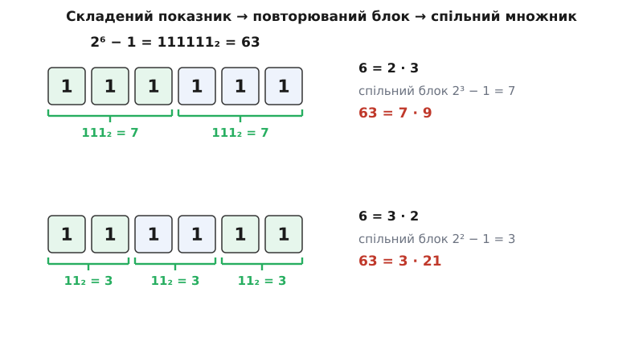
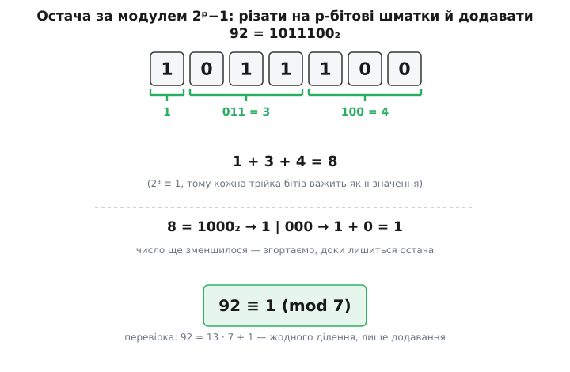
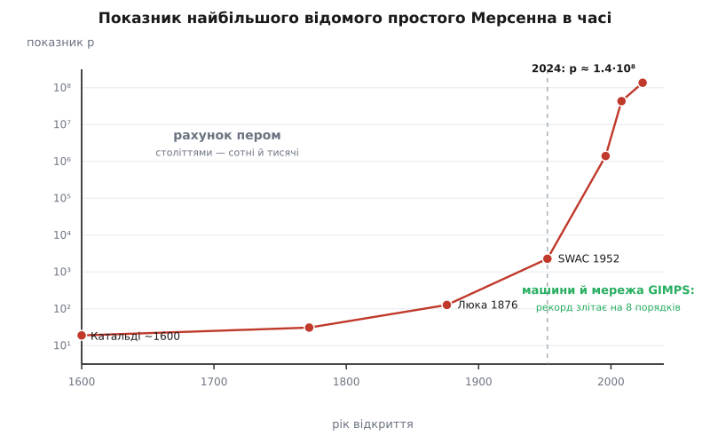

# Числа Мерсенна і прості Мерсенна

<preknowlist>
- [Прості числа](root:math-number-theory/prime-numbers) — число, що ділиться лише на 1 і на себе; що таке розклад на прості множники.
- [Конгруенції за модулем](root:math-number-theory/modular-arithmetic) — запис a ≡ b (mod m), ділення з остачею, дії із залишками.
- [Основна теорема арифметики](root:math-number-theory/fundamental-theorem-arithmetic) — однозначний розклад на прості; звідси беруться дільники й їхня сума.
- [Мультиплікативний порядок](root:math-number-theory/multiplicative-order) — найменший показник d > 0, для якого aᵈ ≡ 1 (mod m).
- [Квадратичні лишки](root:math-number-theory/quadratic-residues) — коли число є точним квадратом за модулем простого q; символ Лежандра.
- [Позиційні системи](root:math-number-theory/positional-systems) — двійковий запис числа як сума степенів двійки.
</preknowlist>

Якщо спитати, яке найбільше просте число люди знають на цю мить, відповідь щоразу має той самий вигляд: одиниця, відібрана від степеня двійки. Найбільше відоме просте — це `2¹³⁶²⁷⁹⁸⁴¹ − 1`, число завдовжки понад сорок один мільйон десяткових цифр. Попереднє було таким самим на вигляд, і те, що перед ним, і майже кожен рекордсмен за останні півтора століття. Це не випадковість і не мода. Число вигляду `2ᵖ − 1` несе в собі виняткову внутрішню будову, і саме ця будова робить його водночас **рідкісно простим** і **дешевим для перевірки** — двома якостями, потрібними, щоб виграти перегони за найбільше просте. Розберімо цю будову до дна: звідки береться форма, чому показник мусить бути простим, як таке число пов'язане з античними досконалими числами, чому дільники числа Мерсенна затиснуті у вузькі класи лишків, як влаштований алгебраїчний доказ тесту Люка–Лемера у кільці `Z[√3]` і як розподілена мережа GIMPS множить числа на десятки мільйонів бітів без ділення за допомогою дискретного перетворення з ірраціональною основою.

## Що це за число

**Числом Мерсенна** називають число вигляду

```
Mₙ = 2ⁿ − 1
```

(за іменем французького ченця ордену мінімів Марена Мерсенна, 1588–1648, який у 1644 році склав список таких чисел, що претендують на простоту). Перші кілька членів послідовності:

```
M₁ = 1     M₂ = 3     M₃ = 7     M₄ = 15
M₅ = 31    M₆ = 63    M₇ = 127   M₈ = 255
```

Найпростіше побачити суть цих чисел у двійковому запису. Степінь двійки `2ⁿ` — це одиниця з `n` нулями: `2⁴ = 10000₂`. Відняти одиницю — і всі `n` розрядів перетворюються на суцільні одиниці:

```
2⁴ = 10000₂
2⁴ − 1 = 1111₂ = 15
```

Тобто `Mₙ` у двійковій системі — це суцільна стрічка з `n` одиниць. Це не декоративна деталь, а алгебраїчний ключ: уся арифметика чисел Мерсенна — це арифметика такої стрічки одиниць, і саме з неї випливають і їхня рідкісна простота, і легкість перевірки.

Серед `Mₙ` нас цікавлять **прості числа Мерсенна** — ті `Mₙ`, що самі є простими: 3, 7, 31, 127… А `M₄ = 15 = 3·5` чи `M₆ = 63 = 7·9` — складені, вони випадають. Питання «коли `2ⁿ − 1` просте» і є серцевиною теми.

## Показник мусить бути простим

Перше спостереження у списку: прості `Mₙ` трапляються тільки на простих `n`. `M₂, M₃, M₅, M₇` — прості; `M₄, M₆, M₈, M₉` — ні. Це не емпіричний збіг, а алгебраїчна необхідність, і вона випливає з тотожності скороченого множення.

Розгляньмо різницю степенів `xᵇ − 1`. Вона завжди ділиться на `x − 1`:

```
xᵇ − 1 = (x − 1)·(xᵇ⁻¹ + xᵇ⁻² + … + x + 1)
```

Перемноживши дужки, легко переконатися, що всі проміжні члени скорочуються телескопом, лишаючи `xᵇ − 1`. Підставмо тепер `x = 2ᵃ`. Тоді `xᵇ = 2ᵃᵇ`, і тотожність набуває вигляду:

```
2ᵃᵇ − 1 = (2ᵃ − 1)·(2ᵃ⁽ᵇ⁻¹⁾ + 2ᵃ⁽ᵇ⁻²⁾ + … + 2ᵃ + 1)
```

Якщо показник `n` **складений**, тобто `n = a·b` з цілими `a, b > 1`, то `2ⁿ − 1` розпадається на два множники. Перший множник — це `2ᵃ − 1 > 1` (бо `a > 1`), а другий — сума степенів, що також строго більша за одиницю. Отже, складений показник неминуче дає складене число Мерсенна.

Звідси за правилом контрапозиції маємо твердження: **якщо `2ⁿ − 1` просте, то показник `n` обов'язково є простим**. Інакше `n` розклався б на множники, а вслід за ним розклалося б і `2ⁿ − 1`.

У двійковому запису ця сама думка постає геометрично. Стрічка з `n = a·b` одиниць розбивається на `b` блоків по `a` одиниць, і кожен такий блок відповідає множнику `2ᵃ − 1`, зсунутому по розрядах:



*Складений показник розбиває двійкову стрічку одиниць на однакові блоки; кожен блок — спільний множник, тому число не може бути простим.*

**Розклад `2⁶ − 1 = 63` двома способами:**

```
6 = 2·3:
  63 = (2³ − 1)·(2³ + 1)       = 7 · 9
  63 = (2² − 1)·(2⁴ + 2² + 1)  = 3 · 21
```

Обидва розбиття показують `63` складеним рівно тому, що показник `6` має нетривіальні дільники 2 і 3.

Тут криється головна пастка теми: **обернене твердження не діє**. Простий показник є необхідною умовою, але аж ніяк не достатньою. Найменший контрприклад:

```
2¹¹ − 1 = 2047 = 23 · 89
```

Показник `11` є простим числом, але `2047` складене. Прості числа Мерсенна ховаються **винятково** серед чисел `Mₚ = 2ᵖ − 1` із простим `p`, але навіть серед них трапляються дедалі рідше. Відтепер ми позначаємо кандидата на простоту через `Mₚ = 2ᵖ − 1`, де `p` — просте число.

## Теорема Евкліда–Ейлера про досконалі числа

Перш ніж переходити до алгоритмів тестування, з'ясуймо, навіщо ці числа вивчали дві тисячі років — задовго до появи криптографії та комп'ютерних мереж. Причина криється у пошуку [досконалих чисел](root:math-number-theory/perfect-numbers) — чисел, які дорівнюють сумі всіх своїх власних натуральних дільників (усіх дільників, крім самого числа). Найменші з них знали ще античні піфагорійці:

```
6 = 1 + 2 + 3
28 = 1 + 2 + 4 + 7 + 14
496 = 1 + 2 + 4 + 8 + 16 + 31 + 62 + 124 + 248
8128 = 1 + 2 + 4 + … + 4064
```

### Функція суми дільників σ(n)

Мовою теорії чисел досконалість зручно описувати через арифметичну функцію `σ(n)` — суму **всіх** дільників числа `n`, включно з `1` та самим `n`. Якщо сума власних дільників дорівнює `n`, то додавши до неї `n`, отримуємо:

```
n досконале  ⟺  σ(n) = 2n
```

Обчислення `σ(n)` спирається на дві властивості:

1. **Сума дільників степеня двійки:**
   Дільниками числа `2ᵏ` є степені `1, 2, 4, …, 2ᵏ`. Їхня сума утворює геометричну прогресію:
   ```
   σ(2ᵏ) = 1 + 2 + 4 + … + 2ᵏ = 2ᵏ⁺¹ − 1
   ```

2. **Мультиплікативність функції `σ`:**
   Якщо числа `a` і `b` взаємно прості (`gcd(a, b) = 1`), то `σ(a·b) = σ(a)·σ(b)`. Це випливає з [основної теореми арифметики](root:math-number-theory/fundamental-theorem-arithmetic): кожен дільник `d` добутку `ab` однозначно записується як `d = d₁·d₂`, де `d₁ | a`, а `d₂ | b`. Сума всіх таких добутків розкладається на добуток двох незалежних сум:
   ```
   σ(ab) = ∑ d₁·d₂ = (∑ d₁) · (∑ d₂) = σ(a) · σ(b)
   ```

### Пряма теорема Евкліда

Евклід у IX книзі «Начал» (твердження 36, близько 300 р. до н. е.) довів: **якщо число `q = 2ᵖ − 1` є простим, то число `N = 2ᵖ⁻¹·(2ᵖ − 1)` є досконалим**.

Доведення розгортається прямим обчисленням `σ(N)`. Оскільки `q = 2ᵖ − 1` є непарним простим числом, множники `2ᵖ⁻¹` і `q` є взаємно простими:

```
σ(N) = σ(2ᵖ⁻¹ · q)
     = σ(2ᵖ⁻¹) · σ(q)                    [мультиплікативність σ для взаємно простих]
     = (2ᵖ − 1) · (1 + q)                [сума дільників степеня 2 і простого числа q]
     = q · (1 + (2ᵖ − 1))                [підставили q = 2ᵖ − 1]
     = q · 2ᵖ                            [спростили 1 + 2ᵖ − 1 = 2ᵖ]
     = 2 · (2ᵖ⁻¹ · q)                    [винесли множник 2]
     = 2N                                [за означенням N = 2ᵖ⁻¹·q]
```

Оскільки `σ(N) = 2N`, число `N` є досконалим.

**Числовий приклад при `p = 3`:**
```
q = 2³ − 1 = 7   (просте)
N = 2² · 7 = 28
σ(28) = σ(4) · σ(7) = (1 + 2 + 4) · (1 + 7) = 7 · 8 = 56 = 2 · 28
```

### Обернена теорема Ейлера

Через дві тисячі років Леонард Ейлер розв'язав обернену задачу: він довів, що **будь-яке парне досконале число обов'язково має вигляд `2ᵖ⁻¹·(2ᵖ − 1)`, де `2ᵖ − 1` — просте число Мерсенна**.

Наведемо строгий доказ цього твердження крок за кроком.

Нехай `N` — довільне парне досконале число. Оскільки `N` парне, виділимо з нього максимальний степінь двійки:

```
N = 2ᵏ · m,      де k ≥ 1, а m — непарне натуральне число
```

Обчислимо `σ(N)` двома способами:

1. З умови досконалості:
   ```
   σ(N) = 2N = 2 · (2ᵏ · m) = 2ᵏ⁺¹ · m
   ```

2. За мультиплікативністю `σ` (оскільки `gcd(2ᵏ, m) = 1`):
   ```
   σ(N) = σ(2ᵏ) · σ(m) = (2ᵏ⁺¹ − 1) · σ(m)
   ```

Прирівняємо обидва вирази. Позначимо для стислості непарне число `s = 2ᵏ⁺¹ − 1` (оскільки `k ≥ 1`, маємо `s ≥ 3`):

```
s · σ(m) = 2ᵏ⁺¹ · m = (s + 1) · m = s · m + m
```

Перенесемо `s · m` у ліву частину:

```
s · (σ(m) − m) = m
```

З цієї рівності випливає, що число `m` ділиться на `s` націло. Позначимо частку через `c = m / s`, тобто `m = s · c`. Тоді:

```
s · (σ(m) − s · c) = s · c
σ(m) − s · c = c
σ(m) = s · c + c = m + c
```

Проаналізуймо множину дільників числа `m`.
Число `m` має принаймні два дільники: саме число `m` і число `c = m / s`. Оскільки `s ≥ 3`, дільник `c` строго менший за `m` (`c = m / s < m`), тому `m` і `c` — два різні дільники.

Сума **всіх** натуральних дільників числа `m` дорівнює `σ(m)`. Але ми щойно отримали:

```
σ(m) = m + c
```

Це означає, що сума всіх дільників числа `m` вичерпується сумою лише двох дільників `m` та `c`. Отже, число `m` не має жодних інших дільників, крім `m` та `c`.

Оскільки одиниця ділить будь-яке натуральне число, дільник `1` мусить належати двоелементній множині `{c, m}`. Оскільки `s ≥ 3`, число `m = s · c ≥ 3 · c ≥ 3 > 1`, тому `m ≠ 1`. Звідси неминуче:

```
c = 1
```

Підставивши `c = 1` у формули для `m` і `σ(m)`, маємо:

```
m = s · 1 = s = 2ᵏ⁺¹ − 1
σ(m) = m + 1
```

Рівність `σ(m) = m + 1` означає, що число `m` має рівно два дільники: `1` і `m`. Отже, `m = 2ᵏ⁺¹ − 1` є **простим числом**. Поклавши `p = k + 1`, ми бачимо, що `m = 2ᵖ − 1` — просте число Мерсенна (звідки, як ми довели вище, і сам показник `p` мусить бути простим).

Саме ж початкове парне число `N` набуває вигляду:

```
N = 2ᵏ · m = 2ᵖ⁻¹ · (2ᵖ − 1)
```

Теорему повністю доведено.

### Бієкція та геометричний зв'язок

Теорема Евкліда–Ейлера встановлює взаємно однозначну відповідність (бієкцію): **кожне парне досконале число породжується рівно одним простим числом Мерсенна, і навпаки**.

Крім того, кожне парне досконале число є **трикутним числом** `T_q = q(q + 1) / 2`, де `q = 2ᵖ − 1`:

```
N = 2ᵖ⁻¹ · (2ᵖ − 1) = (q + 1) / 2 · q = q · (q + 1) / 2 = T_q
```

Наприклад:
- `p = 2 ⟹ q = 3 ⟹ N = 6 = T₃ = 1 + 2 + 3`
- `p = 3 ⟹ q = 7 ⟹ N = 28 = T₇ = 1 + 2 + … + 7`
- `p = 5 ⟹ q = 31 ⟹ N = 496 = T₃₁ = 1 + 2 + … + 31`

Докладніше про історію та варіанти доведення читайте у вставці [як саме прості Мерсенна вичерпують усі парні досконалі числа](root:math-number-theory/mersenne-primes/math-euclid-euler.md).

> **Відкрита проблема.** Теорема Евкліда–Ейлера повністю класифікує *парні* досконалі числа. Питання про існування хоча б одного *непарного* досконалого числа залишається найстарішою нерозв'язаною проблемою математики (комп'ютерні перевірки показали, що непарне досконале число, якщо воно існує, мусить перевищувати `10¹⁵⁰⁰` і мати щонайменше 101 простий дільник).

## Розподіл дільників чисел Мерсенна

Якщо перевіряти простоту `Mₚ = 2ᵖ − 1` звичайним перебором дільників, обчислення зайшли б у глухий кут навіть для помірних `p`. Наприклад, для `p = 67` число `M₆₇` має 21 десяткову цифру. Проте алгебраїчна форма `2ᵖ − 1` накладає жорсткі обмеження на вигляд будь-якого можливого дільника.

**Теорема про структуру дільників:** якщо `p` — непарне просте число, то будь-який простий дільник `q` числа `Mₚ = 2ᵖ − 1` обов'язково задовольняє дві конгруенції:

```
q ≡ 1 (mod 2p)        і        q ≡ ±1 (mod 8)
```

Розберімо кожну з цих умов окремо.

### Перша умова: q ≡ 1 (mod 2p)

Нехай просте `q` ділить `2ᵖ − 1`. За мовою конгруенцій:

```
2ᵖ ≡ 1 (mod q)
```

Розгляньмо [мультиплікативний порядок](root:math-number-theory/multiplicative-order) числа 2 за модулем `q` — найменше натуральне число `d`, для якого `2ᵈ ≡ 1 (mod q)`.
Відомо, що якщо `2ⁿ ≡ 1 (mod q)`, то показник `n` ділиться на порядок `d`.

З рівності `2ᵖ ≡ 1 (mod q)` випливає, що `d | p`. Оскільки `p` — просте число, для `d` є лише дві можливості: `d = 1` або `d = p`.
Якби `d = 1`, то `2¹ ≡ 1 (mod q)`, тобто `q | (2 − 1) = 1`, що неможливо для простого `q`.
Отже:

```
d = ord_q(2) = p
```

За [малою теоремою Ферма](root:math-number-theory/fermat-little-theorem), для будь-якого простого `q > 2`:

```
2^(q−1) ≡ 1 (mod q)
```

Отже, порядок `d = p` мусить ділити `q − 1`, тобто `p | (q − 1)`.
Крім того, оскільки `Mₚ` непарне, його дільник `q` є непарним простим числом (`q ≥ 3`), тому `q − 1` є парним числом: `2 | (q − 1)`.
Оскільки `p` непарне просте, числа `p` і `2` взаємно прості (`gcd(2, p) = 1`). Число, яке ділиться на `p` і на `2` одночасно, ділиться на їхній добуток `2p`:

```
2p | (q − 1)  ⟹  q ≡ 1 (mod 2p)  ⟹  q = 2kp + 1,   k ∈ ℕ
```

### Друга умова: q ≡ ±1 (mod 8)

Ця умова показує, що двійка є [квадратичним лишком](root:math-number-theory/quadratic-residues) за модулем `q`.

Оскільки `p` — непарне просте число, число `p + 1` є парним, а отже показник `(p + 1) / 2` є цілим числом. Помножимо конгруенцію `2ᵖ ≡ 1 (mod q)` на 2:

```
2 · 2ᵖ ≡ 2 · 1 (mod q)
2^(p+1) ≡ 2 (mod q)
(2^((p+1)/2))² ≡ 2 (mod q)
```

Ми явно знайшли квадратний корінь із числа 2 за модулем `q`: це число `x = 2^((p+1)/2)`. Це означає, що число 2 є квадратичним лишком за модулем `q`, тобто символ Лежандра `(2 | q) = +1`.

За другим доповненням до квадратичного закону взаємності Гаусса:

```
(2 | q) = (−1)^((q²−1)/8) = +1  ⟺  q ≡ ±1 (mod 8)  (тобто q ≡ 1 або q ≡ 7 mod 8)
```

### Звуження перебору дільників за модулем 8p

Оскільки `gcd(2p, 8) = 2`, найменше спільне кратне `lcm(2p, 8) = 8p`. Поєднання умов `q ≡ 1 (mod 2p)` та `q ≡ ±1 (mod 8)` фіксує дільники `q` у вузьких класах лишків за модулем `8p`.

Серед чотирьох можливих класів за модулем `8p`, що дають остачу 1 за модулем `2p`:
`{1, 2p + 1, 4p + 1, 6p + 1}`,
умова `q ≡ ±1 (mod 8)` залишає рівно **два класи**!

**Приклад для `p = 11` (`M₁₁ = 2047`):**
- `2p = 22`, `8p = 88`.
- Кандидати у дільники мають вигляд `q = 22k + 1` і задовольняють `q ≡ ±1 (mod 8)`.
- При `k = 1`: `q = 23`. Перевірка: `23 ≡ 1 (mod 22)` і `23 ≡ 7 ≡ −1 (mod 8)`. Справді, `2047 = 23 · 89`.
- При `k = 4`: `q = 89`. Перевірка: `89 ≡ 1 (mod 22)` і `89 ≡ 1 (mod 8)`.

**Як Ейлер вручну довів простоту `M₃₁ = 2 147 483 647`:**
Для `p = 31` будь-який простий дільник складеного `M₃₁` не перевищував би `√M₃₁ ≈ 46 340`.
Усього простих чисел до `46 340` налічується `4792`.
- Умова `q ≡ 1 (mod 62)` звужує кількість кандидатів до `157`.
- Додаткова умова `q ≡ ±1 (mod 8)` залишає лише класи `1` та `63` за модулем `248`, що скорочує список до **84 простих чисел**!

Ейлер у 1772 році перевірив ділення на ці 84 числа вручну і довів простоту `M₃₁`. Детальний алгебраїчний розбір дивізорних сит наведено у вставці [структура дільників чисел Мерсенна](root:math-number-theory/mersenne-primes/math-divisor-form.md).

## Математична теорія тесту Люка–Лемера

Пробне ділення, навіть оптимізоване формою `q = 2kp + 1`, залишається алгоритмом експоненційної складності. Для великих `p` потрібен детермінований поліноміальний алгоритм. Для чисел Мерсенна таким є **тест Люка–Лемера (LLT)** (розроблений Едуаром Люка у 1876–1878 роках та вдосконалений Дерриком Лемером у 1930-х).

### Формулювання критерію

Нехай `p` — непарне просте число. Визначимо числову послідовність `{Sₖ}`:

```
S₀ = 4
Sₖ = Sₖ₋₁² − 2      при k ≥ 1
```

**Критерій Люка–Лемера:** число `Mₚ = 2ᵖ − 1` є простим тоді й лише тоді, коли елемент `Sₚ₋₂` ділиться на `Mₚ` націло:

```
Sₚ₋₂ ≡ 0 (mod Mₚ)
```

**Перевірка `M₅ = 31` (`p = 5`, потрібно обчислити до `S₃`):**

```
S₀ = 4
S₁ = 4² − 2 = 14
S₂ = 14² − 2 = 194 ≡ 8 (mod 31)       [бо 194 = 6 · 31 + 8]
S₃ = 8² − 2 = 62 ≡ 0 (mod 31)         [бо 62 = 2 · 31]
```

Оскільки `S₃ ≡ 0 (mod 31)`, число `M₅ = 31` є простим.

### Алгебраїчна структура у кільці Z[√3]

Чому послідовність починається з 4, звідки береться віднімання 2 і чому індекс зупинки саме `p − 2`?

Розгляньмо кільце `Z[√3] = { a + b√3 | a, b ∈ Z }`. Визначимо фундаментальні спряжені елементи:

```
ω  = 2 + √3
ω̄ = 2 − √3
```

Зауважимо, що їхній добуток дорівнює одиниці:

```
ω · ω̄ = (2 + √3) · (2 − √3) = 4 − 3 = 1
```

**Лема про замкнений вигляд послідовності:**
Для кожного `k ≥ 0` виконується тотожність:

```
Sₖ = ω^(2ᵏ) + ω̄^(2ᵏ)
```

*Доведення за індукцією:*
- База `k = 0`:
  ```
  S₀ = ω¹ + ω̄¹ = (2 + √3) + (2 − √3) = 4
  ```
- Індукційний перехід від `k` до `k + 1`:
  ```
  Sₖ₊₁ = Sₖ² − 2
       = (ω^(2ᵏ) + ω̄^(2ᵏ))² − 2                    [підставили вираз для Sₖ]
       = ω^(2ᵏ⁺¹) + 2 · (ω · ω̄)^(2ᵏ) + ω̄^(2ᵏ⁺¹) − 2  [розкрили квадрат суми]
       = ω^(2ᵏ⁺¹) + 2 · 1 + ω̄^(2ᵏ⁺¹) − 2           [бо ω·ω̄ = 1]
       = ω^(2ᵏ⁺¹) + ω̄^(2ᵏ⁺¹)                       [скоротили 2 − 2 = 0]
  ```

Умова `Sₚ₋₂ ≡ 0 (mod Mₚ)` мовою елементів кільця набуває вигляду:

```
ω^(2ᵖ⁻²) + ω̄^(2ᵖ⁻²) ≡ 0 (mod Mₚ)
```

Помножимо обидві частини на `ω^(2ᵖ⁻²)`:

```
ω^(2ᵖ⁻¹) + 1 ≡ 0 (mod Mₚ)  ⟺  ω^(2ᵖ⁻¹) ≡ −1 (mod Mₚ)
```

Піднісши до квадрата, маємо:

```
ω^(2ᵖ) ≡ (−1)² ≡ 1 (mod Mₚ)
```

Оскільки `2ᵖ = Mₚ + 1`, ця умова є прямим аналогом малої теореми Ферма у розширенні `Z[√3]`.

### Доведення необхідності (якщо Mₚ просте ⟹ Sₚ₋₂ ≡ 0 mod Mₚ)

Нехай `Mₚ = 2ᵖ − 1` — просте число (`p ≥ 3`).

1. **Квадратичний характер трійки:**
   Оскільки `p ≥ 3`, `Mₚ = 2ᵖ − 1 ≡ 7 (mod 12)` (бо `2ᵖ ≡ 0 mod 4 ⟹ Mₚ ≡ 3 mod 4`, та `2ᵖ ≡ 2 mod 3 ⟹ Mₚ ≡ 1 mod 3`).
   За квадратичним законом взаємності:
   ```
   (3 | Mₚ) · (Mₚ | 3) = (−1)^((3−1)/2 · (Mₚ−1)/2) = (−1)^(1 · (Mₚ−1)/2) = −1    [бо Mₚ ≡ 3 mod 4]
   (Mₚ | 3) = (1 | 3) = +1
   ⟹ (3 | Mₚ) = −1
   ```
   Оскільки символ Лежандра `(3 | Mₚ) = −1`, число 3 не є квадратом у скінченному полі `F = Z_{Mₚ}`. Тому факторінформація `F[√3] = Z_{Mₚ}[√3]` є скінченним полем Галуа `GF(Mₚ²)` із `Mₚ²` елементів.

2. **Автоморфізм Фробеніуса:**
   У полі `GF(Mₚ²)` характеристика дорівнює `Mₚ`. За властивістю бінома у полі простої характеристики:
   ```
   (a + b√3)^(Mₚ) = a^(Mₚ) + b^(Mₚ) · (√3)^(Mₚ)        [біном Ньютона у полі простої характеристики Mₚ]
                  = a + b · 3^((Mₚ−1)/2) · √3           [мала теорема Ферма і поділ (√3)^(Mₚ) = (√3)^(Mₚ−1)·√3]
                  = a + b · (3 | Mₚ) · √3               [критерій Ейлера: 3^((Mₚ−1)/2) ≡ (3 | Mₚ)]
                  = a − b√3                             [підставили (3 | Mₚ) = −1]
   ```
   Зокрема, для `ω = 2 + √3`:
   ```
   ω^(Mₚ) = 2 − √3 = ω̄ = ω⁻¹
   ```

3. **Обчислення степеня `ω^(2ᵖ⁻¹)`:**
   Звернемо увагу на алгебраїчну тотожність:
   ```
   (1 + √3)² = 1 + 2√3 + 3 = 4 + 2√3 = 2 · (2 + √3) = 2ω  ⟹  ω = (1 + √3)² / 2
   ```
   Піднесемо `ω` до степеня `(Mₚ + 1) / 2 = 2ᵖ⁻¹`:
   ```
   ω^((Mₚ+1)/2) = [ (1 + √3)² / 2 ]^((Mₚ+1)/2) = (1 + √3)^(Mₚ+1) / 2^((Mₚ+1)/2)
   ```
   Чисельник:
   ```
   (1 + √3)^(Mₚ+1) = (1 + √3)^(Mₚ) · (1 + √3)          [виділили множник першого степеня]
                   = (1 − √3) · (1 + √3)               [застосували дію Фробеніуса (1 + √3)^(Mₚ) = 1 − √3]
                   = 1 − 3 = −2                        [різниця квадратів: 1 − (√3)² = 1 − 3]
   ```
   Знаменник:
   ```
   2^((Mₚ+1)/2) = 2 · 2^((Mₚ−1)/2) = 2 · (2 | Mₚ)
   ```
   Оскільки `Mₚ = 2ᵖ − 1 ≡ 7 (mod 8)`, маємо `(2 | Mₚ) = +1`, тому знаменник дорівнює `2 · (+1) = 2`.

   Отримуємо:
   ```
   ω^(2ᵖ⁻¹) = ω^((Mₚ+1)/2) ≡ −2 / 2 = −1 (mod Mₚ)
   ```
   Звідси:
   ```
   Sₚ₋₂ = ω^(2ᵖ⁻²) + ω̄^(2ᵖ⁻²)                          [за формулою для Sₖ при k = p − 2]
        = (ω^(2ᵖ⁻¹) + 1) / ω^(2ᵖ⁻²)                    [бо ω̄ = ω⁻¹: спільний знаменник]
        = (−1 + 1) / ω^(2ᵖ⁻²)                          [підставили ω^(2ᵖ⁻¹) ≡ −1]
        = 0                                            [бо чисельник −1 + 1 = 0]
   ```
   Необхідність доведено.

### Доведення достатності (якщо Sₚ₋₂ ≡ 0 mod Mₚ ⟹ Mₚ просте)

Припустимо, що `Sₚ₋₂ ≡ 0 (mod Mₚ)`. Нехай `q` — довільний простий дільник числа `Mₚ`.

Тоді у фактор-кільці `Z_q[√3]` виконується:
```
ω^(2ᵖ⁻²) + ω̄^(2ᵖ⁻²) ≡ 0 (mod q)
```
Помноживши на `ω^(2ᵖ⁻²)`, отримуємо:
```
ω^(2ᵖ⁻¹) ≡ −1 (mod q)
```
Піднісши до квадрата:
```
ω^(2ᵖ) ≡ 1 (mod q)
```

Знайдемо мультиплікативний порядок елемента `ω` у мультиплікативній групі кільця `(Z_q[√3])^×`:
- Оскільки `ω^(2ᵖ) ≡ 1 (mod q)`, порядок ділить `2ᵖ`.
- Оскільки `ω^(2ᵖ⁻¹) ≡ −1 ≢ 1 (mod q)` (бо `q ≥ 3`), порядок не ділить `2ᵖ⁻¹`.

Отже, мультиплікативний порядок `ω` в `(Z_q[√3])^×` дорівнює **точно `2ᵖ`**.

За теоремою Лагранжа, порядок будь-якого елемента групи ділить порядок самої групи. Кільце `Z_q[√3]` містить `q²` елементів, тому його мультиплікативна група одиниць містить не більше ніж `q² − 1` елементів:

```
2ᵖ ≤ |(Z_q[√3])^×| ≤ q² − 1 < q²
```

Добудемо квадратний корінь з обох частин нерівності:

```
q > √(2ᵖ) > √(2ᵖ − 1) = √Mₚ
```

Ми отримали дивовижний факт: **кожен простий дільник `q` числа `Mₚ` строго більший за `√Mₚ`**.

Якби число `Mₚ` було складеним, воно мало б принаймні один простий дільник `q ≤ √Mₚ` (або розкладалося б на добуток двох дільників, кожен з яких `> √Mₚ`, що дало б добуток `> Mₚ`). Це суперечить отриманій нерівності.
Отже, число `Mₚ` не може мати жодних нетривіальних дільників і є **простим числом**.

Тест Люка–Лемера повністю обґрунтовано в обидва боки. Реалізацію тесту мовами C і C++ наведено у практичній вставці [тест Люка–Лемера в коді](root:math-number-theory/mersenne-primes/proj-lucas-lehmer.md).

## Чому арифметика Мерсенна майже безкоштовна

Тест Люка–Лемера вимагає виконання `p − 2` послідовних кроків піднесення до квадрата чисел довжиною `p` бітів. Для рекордних показників `p ≈ 1.4 · 10⁸` квадрат числа сягає майже 300 мільйонів двійкових розрядів.

У довільному модулярному тесті взяття остачі від ділення багаторозрядного числа є найдорожчою операцією, що вимагає класичного ділення великих чисел. Проте за модулем числа Мерсенна ділення не потрібне взагалі завдяки тотожності:

```
2ᵖ ≡ 1 (mod Mₚ)
```

Це означає, що у двійковому записі розряд з вагою `2ᵖ⁺ʲ` є еквівалентним розряду з вагою `2ʲ`. Зведення числа `X` довжиною `2p` бітів за модулем `Mₚ = 2ᵖ − 1` виконується простим розрізанням двійкового числа на молодшу частину `X₀` (молодші `p` бітів) та старшу частину `X₁` (біти від `p` до `2p − 1`), після чого ці частини просто додаються:

```
X = X₁ · 2ᵖ + X₀ ≡ X₁ · 1 + X₀ = X₁ + X₀ (mod 2ᵖ − 1)
```



*За модулем 2ᵖ−1 остача береться складанням p-бітових шматків: оскільки 2ᵖ важить як 1, згортання стрічки замінює ділення.*

**Числовий приклад обчислення `92 mod 7` (`M₃ = 2³ − 1 = 7`, `p = 3`):**

```
92 = 1011100₂
розбиваємо на блоки по 3 біти: [1] [011] [100]
додаємо значення блоків:        1  +  3   +  4  = 8
повторне згортання (8 = 1000₂): [1] [000] ⟹ 1 + 0 = 1
Результат: 92 ≡ 1 (mod 7)      [перевірка: 92 = 13 · 7 + 1]
```

Остача обчислюється самими лише побітовими зсувами й додаваннями, без жодної інструкції ділення.

> 🔧 **Навіщо це.** Той самий принцип лежить в основі сучасної асиметричної криптографії. Криптографічні еліптичні криві будують над псевдо-мерсеннівськими простими полями (числами вигляду `2ⁿ − c` з малим `c`), де редукція виконується за кілька тактів процесора: крива NIST P-521 працює над справжнім простим Мерсенна `2⁵²¹ − 1`, а швидкісна Curve25519 — над псевдо-мерсеннівським числом `2²⁵⁵ − 19`.

## Архітектура GIMPS і швидке множення IBDWT

Проєкт **GIMPS** (*Great Internet Mersenne Prime Search*), заснований Джорджем Волтменом у 1996 році, перетворив пошук простих Мерсенна на розподілену обчислювальну систему світового масштабу. Центральний координатор PrimeNet (розроблений Скоттом Куровскі) розподіляє діапазони показників між тисячами комп'ютерів-волонтерів і хмарних серверів.

### Багаторівневий конвеєр фільтрації

Щоб не витрачати тижні роботи процесора на повний тест Люка–Лемера для складених чисел, кожен показник `p` проходить крізь 4-рівневий конвеєр:

1. **Sieve / Trial Factoring (GPU/CPU):**
   Швидкий пошук малих дільників вигляду `q = 2kp + 1` (`q ≡ ±1 mod 8`) до межі `2⁶⁵`–`2⁸⁰`. Цей крок відсіює понад 65% усіх кандидатів за лічені секунди.
2. **Алгоритм Полларда `p − 1`:**
   Перевіряє, чи має `Mₚ` дільник `q`, для якого `q − 1` розкладається на малі прості множники (є гладким числом).
3. **Основний тест Люка–Лемера (LLT) або PRP:**
   Для кандидатів, які витримали попередні сита, запускається повний цикл із `p − 2` кроків.
4. **Криптографічна сертифікація PRP (тест Ферма з перевіркою Гербіча):**
   Сучасний клієнт Prime95 генерує компактний криптографічний сертифікат проходження тесту (proof of primality). Будь-який інший комп'ютер у мережі може верифікувати цей сертифікат за кілька секунд без повторення багатотижневого повного обчислення.

### Множення великих чисел через DWT з ірраціональною основою (IBDWT)

Ключовим обчислювальним вузлом LLT є множення великих цілих чисел.
Класичне множення «стовпчиком» має складність `O(N²)`, що для `p = 10⁸` вимагало б `10¹⁶` операцій на кожен крок.
Звичайне [швидке перетворення Фур'є (FFT)](root:com-signal/fft) зводить множення до циклічної згортки двох масивів за час `O(N log N)`. Проте лінійне FFT-множення вимагає доповнення чисел нулями вдвічі (zero-padding), щоб запобігти циклічному накладанню результатів (wrap-around), після чого виконується окремий прохід модулярного зведення.

Алгоритм **IBDWT** (*Irrational Base Discrete Weighted Transform*), розроблений Річардом Кренделлом, Баррі Фейджином та Ернстом Ірґасом у 1994 році, радикально змінює цей процес:

1. **Ірраціональна основа:**
   Замість фіксованої цілочисельної основи довжина `p` розбивається на `N` лімбів (де `N` — степінь двійки). Базовий крок є ірраціональним числом `θ = 2^(p/N)`.
2. **Зважування вхідного сигналу:**
   Вхідний масив чисел `aⱼ` перед прямим FFT множиться на вагові коефіцієнти:
   ```
   wⱼ = 2^( (j · p mod N) / N )
   a'ⱼ = aⱼ · wⱼ
   ```
3. **Пряме та обернене комплексне FFT:**
   Обчислюється комплексне перетворення довжини `N`, спектральне піднесення до квадрата `Bₖ = (A'ₖ)²` та обернене IFFT.
4. **Зворотне зважування та автоматична редукція:**
   Отримані значення діляться на `wⱼ²` та округлюються до найближчого цілого:
   ```
   bⱼ = round( b'ⱼ / wⱼ² )
   ```
5. **Магія згортки:**
   Завдяки підібраним вагам `wⱼ`, елементи, що виходять за межу довжини `N` (циклічний wrap-around), повертаються на початок масиву помноженими рівно на `2ᵖ`. Але оскільки обчислення ведуться за модулем `2ᵖ − 1`, множник `2ᵖ` тотожно дорівнює 1!

В результаті **модулярне зведення відбувається безкоштовно всередині самого перетворення Фур'є, без подвоєння довжини масиву (zero-padding)**. Це зменшує споживання пам'яті вдвічі, подвоює швидкість обчислень і дозволяє велетенським масивам уміщуватися у швидкому кеші L2/L3 процесора або спільній пам'яті GPU.

Контроль похибки округлення гарантує коректність: якщо максимальна похибка `|b'ⱼ/wⱼ² − round(...)|` наближається до 0.4, розмір FFT `N` автоматично збільшується.

## Рекорди, історія та відкриті проблеми

На середину 2020-х років математиці відомо **52 прості числа Мерсенна**. Зростання величини найбільшого знайденого простого числа в часі наочно демонструє стрибок від епохи ручних обчислень до ери розподілених систем:



*Показник найбільшого відомого простого Мерсенна в часі (шкала логарифмічна): епоха пера трималася на сотнях, перші комп'ютери й розподілена мережа підняли планку на вісім порядків.*

Історичні віхи цієї естафети охоплюють понад чотири століття:
- **1603 рік:** П'єтро Катальді довів простоту `M₁₇` та `M₁₉` пробним діленням.
- **1772 рік:** Леонард Ейлер довів простоту `M₃₁ = 2 147 483 647` за допомогою структури дільників `q ≡ 1 (mod 62)` та `q ≡ ±1 (mod 8)`.
- **1876 рік:** Едуар Люка довів простоту `M₁₂₇ = 2¹²⁷ − 1` (39 цифр) за допомогою своєї рекурентної послідовності. Це число донині залишається найбільшим простим числом, доведеним вручну без комп'ютера.
- **1952 рік:** Комп'ютер SWAC у Каліфорнійському університеті за одну ніч знайшов `M₅₂₁` та `M₆₀₇`, відкривши еру машинних обчислень.
- **Жовтень 2024 року:** Хмарна GPU-мережа під керівництвом Люка Дюранта (проєкт GIMPS) відкрила 52-ге просте Мерсенна — `M₁₃₆₂₇₉₈₄₁ = 2¹³⁶²⁷⁹⁸⁴¹ − 1`.

Кількість десяткових цифр у числі `Mₚ` обчислюється через десятковий логарифм двійки:

```
кількість цифр = ⌊p · log₁₀2⌋ + 1 ≈ 0.30103 · p
p = 136 279 841  ⟹  ≈ 41 024 320 цифр
```

Драматичну історію виправлення помилок у списку Мерсенна читайте у хроніці [полювання на прості Мерсенна](root:math-number-theory/mersenne-primes/hist-mersenne-hunt.md).

### Відкриті математичні проблеми

Попри колосальні обчислювальні успіхи, фундаментальна теорія чисел Мерсенна містить кілька відкритих питань:

1. **Нескінченність простих Мерсенна:**
   Досі строго не доведено, чи є множина простих чисел Мерсенна нескінченною. Гіпотеза Ленстри–Померанса–Ваґстаффа (LPW) на основі евристичних моделей стверджує, що кількість простих Мерсенна з показником `p ≤ x` асимптотично наближається до:
   ```
   (e^γ / log 2) · log(log x) ≈ 2.57 · log(log x)
   ```
2. **Непарні досконалі числа:**
   Чи існує хоча б одне непарне досконале число?
3. **Послідовність Каталана–Мерсенна:**
   Визначимо рекурентну послідовність `c₀ = 2`, `cₙ₊₁ = 2^(cₙ) − 1`.
   Перші члени: `c₀ = 2`, `c₁ = 3`, `c₂ = 7`, `c₃ = 127`, `c₄ = 2¹²⁷ − 1` (усі прості). Чи є число `c₅ = 2^(2¹²⁷−1) − 1` простим? Це гігантське число містить приблизно `5.1 · 10³⁷` десяткових знаків і наразі є абсолютно недосяжним для будь-яких обчислювальних засобів людства.
