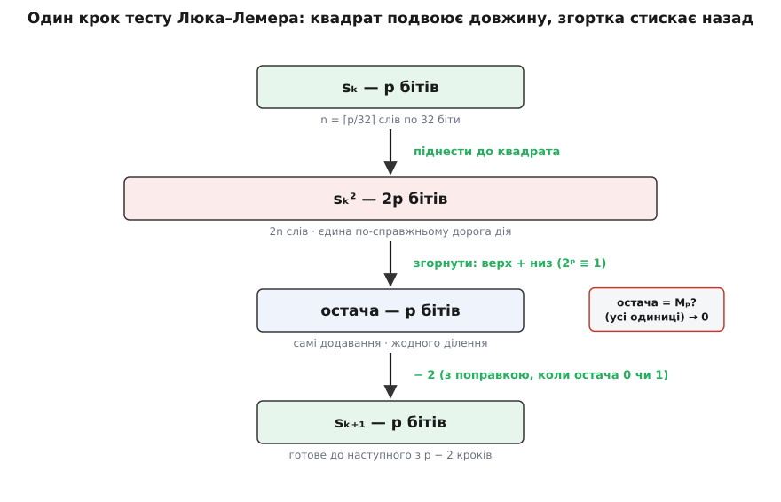

# ⚙️ Тест Люка–Лемера в коді: піднести до квадрата й ні разу не поділити

Уся перевірка `Mₚ = 2ᵖ − 1` на простоту зводиться до однієї рекурсії `s → s² − 2` за модулем `Mₚ` — та коли `Mₚ` завбільшки з невеликий роман, складність ховається не в рекурсії, а в тому, як піднести мільйонорозрядне число до квадрата й узяти від нього остачу, жодного разу не поділивши. Саме це ми й напишемо: спершу двадцять рядків для малих `p`, потім той самий тест на великих числах з арифметикою, на якій тримається пошук рекордних простих.

## Задача

Тест каже: для непарного простого `p` число `Mₚ = 2ᵖ − 1` просте тоді й лише тоді, коли передостанній член послідовності

```
S₀ = 4
Sₖ = Sₖ₋₁² − 2      (усе за модулем Mₚ)
```

ділиться на `Mₚ`, тобто `Sₚ₋₂ ≡ 0 (mod Mₚ)`. Рекурсію видно неозброєним оком: `p − 2` кроки, на кожному — одне піднесення до квадрата, віднімання двійки й зведення за модулем. Написати це для `M₃₁` — вправа на десять хвилин. Написати це так, щоб воно перевірило `2¹³⁶²⁷⁹⁸⁴¹ − 1` — число на сорок один мільйон цифр — за осяжний час, і є справжня задача.

Двійка на кожному кроці зводить справу до двох дорогих операцій. Перша — **піднесення до квадрата**: `Sₖ²` удвічі довше за `Sₖ`, тож без зведення числа роздувалися б подвійно-експоненційно й перше ж множення на рекордному `p` не влізло б у пам'ять. Друга — **остача за модулем `Mₚ`**, яку доводиться брати щокроку. Взяти остачу — це поділити, а ділення багаторозрядного числа найдорожче з усього. Обидві операції треба зробити швидкими; на щастя, форма `2ᵖ − 1` дарує майже безкоштовну другу.

## Ідея

Остача за модулем `Mₚ` не потребує ділення взагалі. Причина — рівність `2ᵖ ≡ 1 (mod Mₚ)`, пряме прочитання означення `Mₚ = 2ᵖ − 1`. Вона означає, що будь-який розряд ваги `2ᵖ⁺ʲ` за модулем `Mₚ` важить рівно стільки ж, скільки розряд ваги `2ʲ`. Тому щоб узяти велике число за модулем `Mₚ`, досить **порізати його двійковий запис на шматки по `p` бітів і скласти їх**: старша половина «згортається» на молодшу без сліду. Кілька таких згортань — і від числа лишається остача, самими зсувами й додаваннями (докладніше про [конгруенції за модулем](root:math-number-theory/modular-arithmetic) — окремо).

Отже, план: піднести до квадрата (єдина по-справжньому дорога дія), згорнути результат за модулем `Mₚ`, відняти двійку — і так `p − 2` рази. Різниця між навчальною й рекордною версією — лише в тому, чим представлене число: одним 64-бітним регістром чи масивом слів на мільйони розрядів.

## Чому саме четвірка: алгебраїчне походження рекурсії

Рекурсія `s → s² − 2` зі стартовим значенням `S₀ = 4` не є випадковим підбором констант — вона народжується в квадратичному розширенні кільця лишків `(ℤ / Mₚ ℤ)[√3]`.

Розгляньмо спряжені числа `α = 2 + √3` та `β = 2 − √3`. Їхній добуток `α · β = (2 + √3)(2 − √3) = 4 − 3 = 1`. Вони є коренями характеристичного рівняння `x² − 4x + 1 = 0`.

Побудуймо послідовність Люка `Vₙ = αⁿ + βⁿ`. Її перший член дорівнює:

```
V₁ = α¹ + β¹ = (2 + √3) + (2 − √3) = 4 = S₀
```

Подвоєння індексу дає тотожність:

```
V₂ₙ = α²ⁿ + β²ⁿ = (αⁿ + βⁿ)² − 2(αβ)ⁿ = Vₙ² − 2
```

Тому члени нашої послідовності `Sₖ` є степенями двійки в індексах послідовності Люка:

```
Sₖ = V_{2ᵏ} = α^(2ᵏ) + β^(2ᵏ)
```

Умова `Sₚ₋₂ ≡ 0 (mod Mₚ)` означає, що `α^(2ᵖ⁻²) + β^(2ᵖ⁻²) ≡ 0 (mod Mₚ)`. Помноживши на `α^(2ᵖ⁻²)`, дістаємо `α^(2ᵖ⁻¹) ≡ −1 (mod Mₚ)`, а після піднесення до квадрата:

```
α^(2ᵖ) ≡ 1  (mod Mₚ)
```

Порядок елемента `α = 2 + √3` у групі оборотних елементів квадратичного розширення дорівнює рівно `2ᵖ = Mₚ + 1`. Це можливо тоді й лише тоді, коли `Mₚ` є справжнім простим числом, для якого кільце `(ℤ / Mₚ ℤ)[√3]` є скінченним полем з `Mₚ²` елементами.


## Покрокове простеження: від M₅ до складеного M₁₁

Перш ніж переходити до коду, простежмо роботу алгоритму вручну на двох показових випадках: простому `M₅ = 31` та складеному `M₁₁ = 2047`.

### Просте число M₅ = 2⁵ − 1 = 31 (p = 5)

Кількість кроків циклу дорівнює `p − 2 = 5 − 2 = 3` кроки.

1. **Старт (`k = 0`):** `S₀ = 4`.
2. **Крок 1 (`k = 1`):**
   ```
   S₁ = (S₀² − 2) mod 31 = (4² − 2) mod 31 = (16 − 2) mod 31 = 14
   ```
   Число `14 < 31`, тому зведення за модулем не потрібне.
3. **Крок 2 (`k = 2`):**
   ```
   S₂ = (S₁² − 2) mod 31 = (14² − 2) mod 31 = (196 − 2) mod 31 = 194 mod 31
   ```
   Застосуймо бітове згортання до числа `194 = 11000010₂`. Розрізаємо на блоки по `p = 5` бітів:
   - Молодші 5 бітів: `X₀ = 00010₂ = 2`.
   - Старші біти: `X₁ = 110₂ = 6`.
   - Сума блоків: `X₀ + X₁ = 2 + 6 = 8`.
   - Оскільки `8 < 31`, маємо `S₂ = 8`. (Перевірка: `194 = 6 · 31 + 8` — остача 8).
4. **Крок 3 (`k = 3 = p − 2`):**
   ```
   S₃ = (S₂² − 2) mod 31 = (8² − 2) mod 31 = (64 − 2) mod 31 = 62 mod 31
   ```
   Згортання для `62 = 111110₂`:
   - Молодші 5 бітів: `X₀ = 11110₂ = 30`.
   - Старші біти: `X₁ = 1₂ = 1`.
   - Сума блоків: `X₀ + X₁ = 30 + 1 = 31`.
   - Оскільки сума дорівнює `M₅ = 31` (стрічка з 5 одиниць), це значення еквівалентне **нулю** за модулем 31: `S₃ ≡ 0 (mod 31)`.

Оскільки `S₃ = S₅₋₂ = 0`, число `M₅ = 31` **просте**.

### Складене число M₁₁ = 2¹¹ − 1 = 2047 (p = 11)

Кількість кроків дорівнює `p − 2 = 9`. Обчислюємо члени послідовності за модулем 2047:

```
S₀ = 4
S₁ = (4² − 2)    = 14
S₂ = (14² − 2)   = 194
S₃ = (194² − 2)  = 37634 ≡ 788   (mod 2047)  [бо 37634 = 18 · 2047 + 788]
S₄ = (788² − 2)  = 620942 ≡ 701  (mod 2047)
S₅ = (701² − 2)  = 491399 ≡ 119  (mod 2047)
S₆ = (119² − 2)  = 14159 ≡ 1877  (mod 2047)
S₇ = (1877² − 2) = 3523127 ≡ 240 (mod 2047)
S₈ = (240² − 2)  = 57598 ≡ 282   (mod 2047)
S₉ = (282² − 2)  = 79522 ≡ 1736  (mod 2047)
```

Останній член `S₉ = S₁₁₋₂ = 1736 ≠ 0`. Число `M₁₁ = 2047` визнано **складеним** без жодного пробного ділення й без з'ясування його конкретних множників `23` і `89`.

## Навчальна версія на 64 бітах

Поки `Mₚ` влазить у 64-бітне слово (тобто `p ≤ 61`; `M₆₁ = 2⁶¹ − 1` — найбільше просте Мерсенна, що вміщується в машинне слово), усе роблять апаратні цілі. Єдина тонкість — переповнення: `Sₖ²` сягає `2p` бітів, тож проміжний квадрат треба тримати в **ширшому** типі, ніж самі `Sₖ`.

:::tabs
:::code proj-lucas-lehmer/c/navchalna-versiia-na-64.c
:::code proj-lucas-lehmer/cpp/navchalna-versiia-na-64.cpp
:::

Тут уже видно дві пастки в мініатюрі. Квадрат `s * s` **мусить** обчислюватися в `unsigned __int128` — інакше результат тихо загорнеться в 64 бітах і тест почне брехати. А `r − 2` після зведення може піти в мінус (коли `r` дорівнює `0` або `1`), тож віднімання йде за модулем: `r + M − 2`. Прогнавши це по всіх `p`, дістаємо рівно те, що треба:

```
M2 = 2^2 - 1 просте     M13 = 2^13 - 1 просте     M31 = 2^31 - 1 просте
M3 = 2^3 - 1 просте     M17 = 2^17 - 1 просте     M61 = 2^61 - 1 просте
M5 = 2^5 - 1 просте     M19 = 2^19 - 1 просте
M7 = 2^7 - 1 просте
```

Оператор `%` тут — одна машинна інструкція, тож ділення не жаль. Але щойно `Mₚ` перестане вміщуватися в регістр, апаратного ділення не стане зовсім — і ось тоді згортання з «ідеї» перетворюється на єдиний спосіб вижити.

## Прибрати ділення: згортання замість остачі

Замінімо `%` на згортання ще на 64-бітних числах — щоб побачити механіку окремо від мороки з масивами. Число `x` (до `2p` бітів після квадрата) ріжемо на молодші `p` бітів і все, що вище; додаємо; повторюємо, доки згори щось лишається:

:::tabs
```c
/* x mod (2ᵖ − 1) без ділення: згортаємо старші біти на молодші */
uint64_t reduce_small(unsigned __int128 x, int p) {
    uint64_t M = ((uint64_t)1 << p) - 1;       /* p одиниць — маска молодших p бітів */
    while (x >> p) {                           /* доки є біти вище p-го */
        x = (x & M) + (x >> p);               /* низ + верх: бо 2ᵖ ≡ 1 */
    }
    return (x == M) ? 0 : (uint64_t)x;        /* усі одиниці — це нуль! */
}
```
```cpp
// x mod (2ᵖ − 1) без ділення: згортаємо старші біти на молодші
constexpr std::uint64_t reduce_small(unsigned __int128 x, int p) noexcept {
    const std::uint64_t M = (static_cast<std::uint64_t>(1) << p) - 1;
    while (x >> p) {
        x = (x & M) + (x >> p);
    }
    return (x == M) ? 0 : static_cast<std::uint64_t>(x);
}
```
:::

Останній рядок — третя, найпідступніша пастка. Згортання лишає результат у діапазоні `[0, Mₚ]`, і межу `Mₚ = 2ᵖ − 1` — суцільну стрічку з `p` одиниць — воно **не** зводить далі, бо в неї рівно `p` бітів, вище нічого нема. Але `Mₚ ≡ 0 (mod Mₚ)`: стрічка з усіх одиниць представляє нуль. Забути цей випадок — значить проґавити саме той момент, коли `Sₚ₋₂` обертається на нуль, тобто сплутати просте число зі складеним. Одне порівняння `x == M` рятує весь тест.

Підставивши `reduce_small` замість `sq % M`, дістанемо ту саму відповідь без жодного ділення. На 64 бітах виграшу ще нема — `%` теж одна інструкція. Виграш увесь попереду: на великих числах ділення коштує сотні операцій, а згортання лишається кількома додаваннями.

## Чому згортання завжди завершується: доведення обмеженості

Розгляньмо, чому цикл `while (x >> p)` виконується щонайбільше двічі. Це ключова гарантія швидкості.

1. На вході маємо `x = Sₖ² < Mₚ² = (2ᵖ − 1)² < 2^(2p)`. Число `x` має не більше ніж `2p` бітів.
2. Розбиваємо `x` на старшу частину `high = x >> p < 2ᵖ` та молодшу частину `low = x & (2ᵖ − 1) < 2ᵖ`.
3. Їхня сума:
   ```
   x' = low + high < 2ᵖ + 2ᵖ = 2^(p+1)
   ```
   Тобто після першого складання довжина числа зменшується щонайбільше до `p + 1` бітів.
4. На другій ітерації старша частина `high' = x' >> p` може набувати лише значення `0` або `1` (один перенесений біт).
5. Після другого складання:
   ```
   x'' = (x' & (2ᵖ − 1)) + high' ≤ (2ᵖ − 1) + 1 = 2ᵖ
   ```
   Число `x''` не перевищує `2ᵖ`. Якщо `x'' = 2ᵖ`, наступне згортання дає `1 + 0 = 1`. Якщо `x'' = 2ᵖ − 1`, воно зупиняється на `Mₚ` і перетворюється на `0`.

Отже, циклічне згортання завжди потребує лише 1–2 додавання великих чисел і ніколи не зависає.

## Великі числа: число як масив слів

Рекордне `Mₚ` — це десятки мільйонів бітів, тож число доводиться тримати масивом 32-бітних слів (**лімбів**), молодшим уперед — звичайний [позиційний запис](root:math-number-theory/positional-systems) з основою `2³²`. Число `< 2ᵖ` вкладається в `n = ⌈p/32⌉` лімбів; його квадрат — у `2n`. Уся арифметика тепер робиться руками, з поширенням переносів.

В ідіоматичному C++ ми використовуємо `std::span` для неволодіючих представлень масивів (zero-cost views) і `std::vector` для динамічного володіння пам'яттю (RAII). Це повністю виключає витоки пам'яті й ручне керування покажчиками.

Серце реалізації — зведення за модулем. Воно дослівно повторює `reduce_small`, тільки «розрізати на бите `p`» стає роботою зі зсувами по масиву. Позначмо `Q = p / 32` і `R = p % 32`: оскільки `p` — просте більше за двійку, воно непарне й не кратне `32`, тож `R` завжди в межах `[1, 31]` (це важливо — межовий випадок `R = 0` не трапляється).

:::tabs
:::code proj-lucas-lehmer/c/velyki-chysla-chyslo-iak.c
:::code proj-lucas-lehmer/cpp/velyki-chysla-chyslo-iak.cpp
:::

Другий дорогий шматок — саме піднесення до квадрата. Найпростіше множення — «стовпчиком», кожне слово на кожне; для числа з `n` лімбів це `n²` множень слів:

:::tabs
:::code proj-lucas-lehmer/c/velyki-chysla-chyslo-iak-2.c
:::code proj-lucas-lehmer/cpp/velyki-chysla-chyslo-iak-2.cpp
:::

Лишилося відняти двійку за модулем — те саме `r + M − 2`, лише з поширенням позики по лімбах, з тим самим доглядом за випадком `s < 2`. Ось повний тест і його «стовпчиковий» рушій:

:::tabs
:::code proj-lucas-lehmer/c/velyki-chysla-chyslo-iak-3.c
:::code proj-lucas-lehmer/cpp/velyki-chysla-chyslo-iak-3.cpp
:::

Цей код доводить простоту `M₅₂₁`, `M₆₀₇`, `M₁₂₇₉` (числа на сотні цифр) за частки секунди й відхиляє `M₅₂₃` — попри просте `523` — бо простий показник ще не гарантує простого `Mₚ`. Кожен крок ілюстрований на схемі: квадрат подвоює довжину, згортка повертає її назад, і все — без ділення.



*Один крок рекурсії над великим числом: єдина дорога дія — квадрат, що подвоює довжину; згортка стискає результат назад до p бітів самими додаваннями, і −2 завершує крок.*

## Крайові випадки віднімання двійки за модулем

Окрема тонка операція — віднімання двійки `s = (s − 2) mod Mₚ`. Оскільки поточне значення `s` лежить у діапазоні `[0, Mₚ)`, звичайне віднімання беззнакових чисел може спричинити від'ємний результат у двох крайових випадках:

1. **`s = 0`:**
   ```
   (0 − 2) mod Mₚ = Mₚ − 2 = (2ᵖ − 1) − 2 = 2ᵖ − 3
   ```
   У двійковому записі `Mₚ − 2` є послідовністю з `p − 1` старших одиниць та нуля у молодшому біті: `111…110₂`.
2. **`s = 1`:**
   ```
   (1 − 2) mod Mₚ = Mₚ − 1 = (2ᵖ − 1) − 1 = 2ᵖ − 2
   ```
   У двійковому записі `Mₚ − 1` є послідовністю з одиниць з нулем у другому молодшому біті: `111…101₂`.
3. **`s ≥ 2`:**
   Виконується звичайне віднімання двійки з поширенням позики (`borrow`) по лімбах масиву.

Функція `sub2_mod_mp` перевіряє, чи є в числі ненульові старші лімби (`above`). Якщо всі старші лімби дорівнюють нулю, а молодший лімб менший за 2, число попередньо ініціалізується значенням `Mₚ`, після чого з нього віднімається дельта `2 − s[0]`. Це гарантує безпомилкову роботу на всьому діапазоні значень.

## Складність, стіна FFT і пастки

Тепер видно, чому тест Люка–Лемера — інша вагова категорія, ніж пошук дільників. Пробне ділення, навіть звужене до дільників особливої форми `2p·k + 1`, у гіршому разі перебирає порядку `2^(p/2)` кандидатів: кількість роботи **експоненційна** за `p`. Люка–Лемер робить `p − 2` кроки, кожен поліноміальний за `p` — тобто весь тест поліноміальний. Ось ця прірва й тримає монополію чисел Мерсенна на рекорд:

```
метод                        робота на крок       усього (p−2 кроки)     клас за p
──────────────────────────────────────────────────────────────────────────────────
пробне ділення               —                    ~2^(p/2)/p перевірок   експонента
Люка–Лемер, «стовпчик»       O(n²) = O(p²)         O(p³)                  поліном
Люка–Лемер, FFT-множення     O(n log n)           O(p² log p)            поліном
```

Але й поліном поліному різний. «Стовпчикове» множення з `O(p²)` на крок годиться до `p` у кілька тисяч; для рекордного `p ≈ 1.4·10⁸` воно дало б порядку `10¹⁶` операцій **на кожен** із `10⁸` кроків — безнадійно. Тут стоїть стіна, яку долає лише швидке множення. Добуток двох чисел — це згортка їхніх цифр, а згортку вміє порахувати [швидке перетворення Фур'є](root:com-signal/fft) за `O(n log n)` замість `O(n²)`. Це не прискорення на відсотки, а зміна класу: саме воно робить рекордні тести можливими.

### Еволюція алгоритмів множення для LLT

У практичних обчислювачах використовується ціла драбина алгоритмів множення залежно від розміру показника `p`:

1. **Шкільне множення (Schoolbook):** `O(n²)`. Ефективне для `p < 2048` завдяки мінімальним накладним витратам на керування пам'яттю та кеш процесора.
2. **Алгоритм Карацуби:** `O(n^1.585)`. Розбиває кожне число на 2 частини й зводить 4 множення до 3. Працює в діапазоні `2048 ≤ p < 10000`.
3. **Алгоритм Тьома–Кука (Toom-3 / Toom-4):** `O(n^1.465)`. Розбиває число на 3 або 4 частини.
4. **Алгоритм Шьонхаге–Штрассена (FFT над кільцями):** `O(n log n log log n)`. Використовує дискретне перетворення Фур'є над кільцем лишків за модулем чисел Ферма.
5. **IBDWT (Irrational Base Discrete Weighted Transform):** `O(n log n)`. Спеціалізоване комплексне перетворення Фур'є для чисел Мерсенна.

Справжній рушій GIMPS іде ще на крок далі. Замість «помножити, а потім згорнути» він зливає **обидві** дорогі операції в одне перетворення — IBDWT (irrational base discrete weighted transform), яке Річард Кренделл і Баррі Фейджин описали 1994 року (*Discrete Weighted Transforms and Large-Integer Arithmetic*, Math. Comp.). Хитро підібравши ваги — «ірраціональну основу», підігнану під `2ᵖ − 1`, — воно виконує зведення за модулем `Mₚ` **безкоштовно**, просто в ході множення, ще й меншим перетворенням. Це той самий трюк згортки, що ми написали руками, тільки вбудований у ядро FFT. Саме IBDWT крутиться в клієнті Prime95 і в GPU-версіях, якими знайдено останні рекорди.

Лишаються дві пастки саме великого масштабу. Перша — **округлення**: FFT рахує в числах з рухомою комою, і кожну цифру згортки треба, округливши, дістати назад цілою; на мільйонах розрядів помилка округлення підкрадається до `0.5`, за якою результат зіпсується мовчки. Тому рекордні клієнти вплітають періодичну самоперевірку, що ловить і збій округлення, і апаратний збій пам'яті. Друга — уже знайома нам **межа `Mₚ`**: усі реалізації окремо обробляють випадок, коли остача виходить рівною самому `Mₚ`, бо це замаскований нуль — саме той нуль, заради якого весь тест і затівався.
