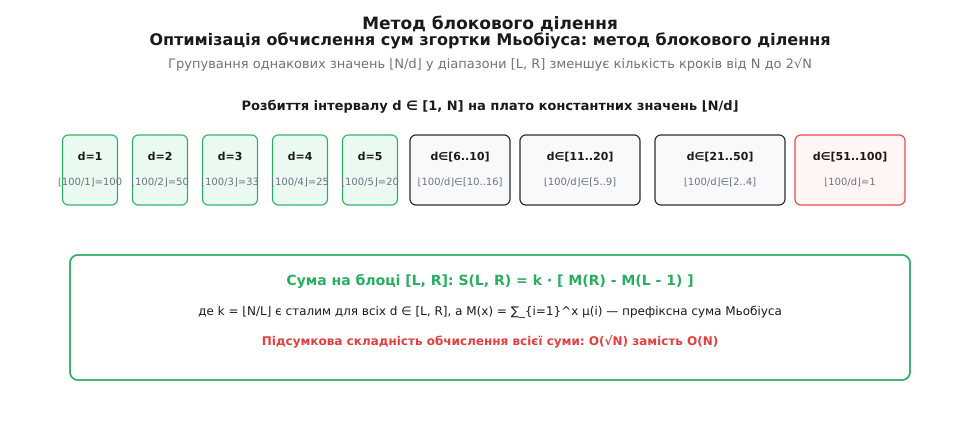
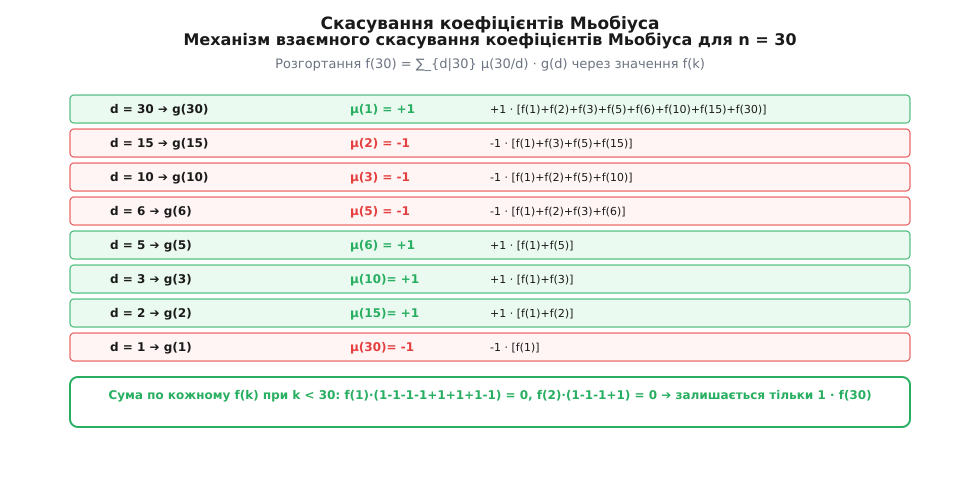
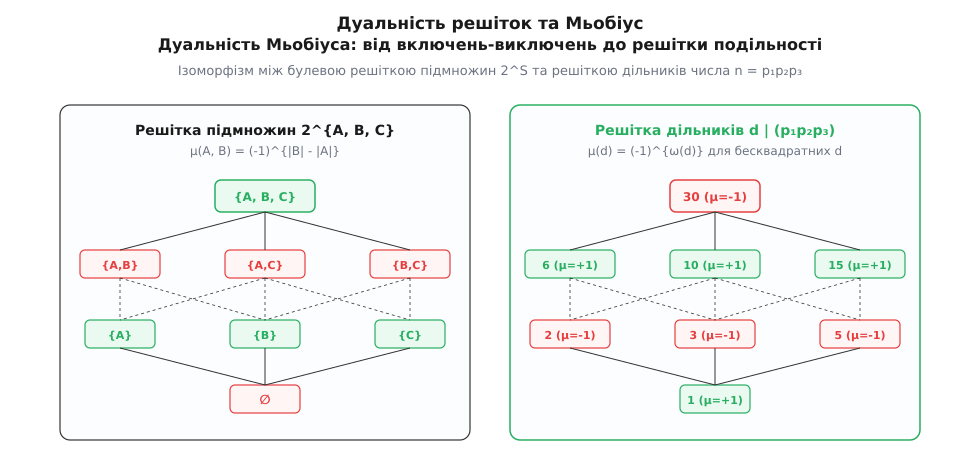

# Обернення Мьобіуса

<preknowlist>
- [Арифметичні функції](root:math-number-theory/arithmetic-functions) — мультиплікативність, згортка Діріхле та алгебра числових функцій.
- [Основна теорема арифметики](root:math-number-theory/fundamental-theorem-arithmetic) — канонічний розклад цілого числа на прості множники.
- [Функція Ейлера](root:math-number-theory/euler-totient) — кількість взаємно простих чисел та тотожність для суми по дільниках.
- [Решітка дільників](root:math-number-theory/divisor-lattice) — частковий порядок за подільністю, діаграми Гассе та булеві підрешітки.
</preknowlist>

Якщо обчислити значення [функції Ейлера](root:math-number-theory/euler-totient) `φ(d)` для всіх шістьох дільників числа `12` та просумувати їх, виходить `φ(1) + φ(2) + φ(3) + φ(4) + φ(6) + φ(12) = 1 + 1 + 2 + 2 + 2 + 4 = 12`. Якщо взяти довільну мультиплікативну або адитивну числову функцію `f(n)` і побудувати нову функцію `g(n)` шляхом підсумовування значень `f(d)` по всіх дільниках `d`, що ділять `n`, ми отримуємо акумульовану суму `g(n) = ∑_{d|n} f(d)`. Проте в реальних математичних та обчислювальних задачах часто спостерігається зворотна ситуація: нам легше виміряти або обчислити сумарну функцію `g(n)`, тоді як вихідні значення `f(n)` лишаються захованими всередині цієї суми. Виникає фундаментальна алгебраїчна задача: якщо відомі значення акумульованої суми `g(n)` для кожного натурального числа, як розплутати цей вузол подільності й точно відновити значення початкової функції `f(n)`?

Розглянемо цю задачу на прикладі аналізу числових послідовностей у комбінаториці та теорії автоматизованих систем. Припустимо, що `g(n)` означає загальну кількість елементів певної складної системи, які володіють хоча б однією з інваріантних властивостей, пов'язаних із дільником `n`. У той же час функція `f(n)` вимірює кількість фундаментальних «примітивних» елементів, для яких `n` є точним та нерозкладним періодом. Оскільки кожен об'єкт із періодом `d` автоматично є об'єктом для будь-якого кратного періоду `n` (де `d` ділить `n`), підсумкова кількість об'єктів `g(n)` утворюється шляхом прямого додавання `f(d)` по всіх дільниках `d | n`.

Пряма спроба виразити `f(n)` через `g(n)` для перших кількох натуральних чисел розкриває чітку алгоритмічну структуру. Для `n = 1` сума містить лише один доданок `g(1) = f(1)`, тому `f(1) = g(1)`. Для `n = 2` дільниками є `1` та `2`, отже `g(2) = f(1) + f(2) = g(1) + f(2)`, звідки `f(2) = g(2) - g(1)`. Для `n = 3` аналогічно отримуємо `f(3) = g(3) - g(1)`. Для `n = 4` дільниками є `1, 2, 4`, тому `g(4) = f(1) + f(2) + f(4) = g(1) + (g(2) - g(1)) + f(4) = g(2) + f(4)`, що виражається як `f(4) = g(4) - g(2)`. Для `n = 5` просте число дає `f(5) = g(5) - g(1)`. Для `n = 6` дільниками є `1, 2, 3, 6`, а розгортання дає `g(6) = f(1) + f(2) + f(3) + f(6) = g(1) + (g(2) - g(1)) + (g(3) - g(1)) + f(6) = g(2) + g(3) - g(1) + f(6)`, звідки `f(6) = g(6) - g(3) - g(2) + g(1)`.

Продовжуючи цей аналіз далі для числа `n = 8` (де дільниками є `1, 2, 4, 8`), отримуємо `g(8) = f(1) + f(2) + f(4) + f(8) = g(4) + f(8)`, звідки `f(8) = g(8) - g(4)`. Зверніть увагу, що значення `g(2)` та `g(1)` взагалі не беруть участі у виразі для `f(8)`, їхні коефіцієнти дорівнюють нулю! Для числа `n = 10` (де дільниками є `1, 2, 5, 10`), отримуємо `f(10) = g(10) - g(5) - g(2) + g(1)`. Для числа `n = 12` (де дільниками є `1, 2, 3, 4, 6, 12`), отримуємо `f(12) = g(12) - g(6) - g(4) + g(2)`.

Аналізуючи ці перші вирази, можна помітити несподіваний алгебраїчний закон. Значення `f(n)` завжди виражається у вигляді лінійної комбінації значень `g(n/d)` по дільниках `d`, причому коефіцієнти перед значеннями `g(n/d)` набувають лише трьох можливих значень: `+1`, `-1` або `0`. Для `n = 6` коефіцієнти при `g(6), g(3), g(2), g(1)` дорівнюють відповідно `+1, -1, -1, +1`. Для `n = 4` коефіцієнти при `g(4), g(2), g(1)` дорівнюють `+1, -1, 0`.

У кожному випадку початкове значення `f(n)` відновлюється як лінійна комбінація значень `g(n/d)` з цілочисельними коефіцієнтами `+1`, `-1` або `0`. Видатний німецький математик Август Фердинанд Мьобіус довів у 1832 році, що ці коефіцієнти підпорядковуються універсальному закону, який не залежить від вибору конкретної функції `f`. Детальніше про історичний контекст цього відкриття, праці Мьобіуса та роль цієї ідеї у становленні аналітичної теорії чисел викладено у матеріалі [історичний екскурс](root:math-number-theory/mobius-inversion/hist-mobius-inversion.md).

## Функція Мьобіуса: вагові коефіцієнти знешкодження

Ключем до розплутування сум по дільниках є спеціальна арифметична **функція Мьобіуса** `μ(n)` (нім. *Möbius-Funktion*). Вона зіставляє кожному натуральному числу `n ∈ {1, 2, 3, ...}` одне з трьох значень `{-1, 0, 1}` залежно від структури його канонічної факторизації.

Нехай `n > 1` розкладається на прості множники згідно з [основною теоремою арифметики](root:math-number-theory/fundamental-theorem-arithmetic):

```
n = p₁^{k₁} · p₂^{k₂} · … · p_r^{k_r}
```

Тоді значення функції Мьобіуса `μ(n)` визначається за правилом:

```
          {  1,   якщо n = 1
μ(n) =    {  (-1)^r, якщо k₁ = k₂ = ... = k_r = 1  (n — бесквадратне число)
          {  0,   якщо існує k_i ≥ 2  (n ділиться на квадрат простого p²)
```

Усі натуральні числа розбиваються функцією Мьобіуса на три взаємовиключні категорії:
1. **Одиниця `n = 1`:** одиниця не містить простих множників (`r = 0`), тому за домовленістю `μ(1) = (-1)⁰ = 1`.
2. **Бесквадратні числа (англ. *square-free integers*):** числа, у канонічному розкладі яких жодне просте не повторюється двічі або більше разів (усі показники `k_i = 1`). Якщо таке число містить парну кількість різних простих множників `r`, то `μ(n) = (-1)^r = 1` (наприклад, `μ(6) = μ(2 · 3) = 1`, `μ(10) = μ(2 · 5) = 1`, `μ(15) = μ(3 · 5) = 1`). Якщо кількість простих множників непарна, то `μ(n) = -1` (наприклад, для будь-якого простого `p` маємо `μ(p) = -1`, а для трьох множників `μ(30) = μ(2 · 3 · 5) = -1`, `μ(42) = μ(2 · 3 · 7) = -1`).
3. **Числа з повторюваними простими множниками:** якщо число ділиться на квадрат будь-якого простого числа `p²`, значення функції строго дорівнює нулю: `μ(4) = μ(2²) = 0`, `μ(12) = μ(2² · 3) = 0`, `μ(18) = μ(2 · 3²) = 0`, `μ(27) = μ(3³) = 0`.

Значення `μ(n)` обнуляються для будь-яких чисел, що містять кратні прості множники, оскільки такі числа не створюють нових комбінаторних граней у решітці дільників. Вони дублюють інформацію, яка вже була повністю врахована на бесквадратних дільниках нижчого порядку.

Функція Мьобіуса `μ(n)` є **мультиплікативною**: якщо два числа взаємно прості (`gcd(a, b) = 1`), то `μ(a · b) = μ(a) · μ(b)`. Це означає, що значення функції на будь-якому великому бесквадратному числі обчислюється як прямий добуток значень на його простих множниках:

```
μ(p₁ · p₂ · … · p_r) = μ(p₁) · μ(p₂) · … · μ(p_r) = (-1) · (-1) · … · (-1) = (-1)^r
```

Якщо ж хоча б один із множників виявиться у степені два або вище, весь добуток негайно стає рівним нулю.

Для систематизованого огляду чисельних значень, асимптотичних оцінок та зв'язків із дзета-функцією Рімана створено окремий [довідник властивостей](root:math-number-theory/mobius-inversion/api-mobius-properties.md).

Головна алгебраїчна таємниця функції Мьобіуса полягає у її фундаментальній тотожності підсумовування по дільниках. Якщо взяти довільне натуральне число `n` та просумувати значення `μ(d)` по всіх його дільниках `d`, результати зводяться до індикатора одиниці:

```
∑_{d|n} μ(d) = [n == 1] = { 1,  якщо n = 1
                          { 0,  якщо n > 1
```

Щоб зрозуміти, чому ця сума завжди перетворюється на нуль для будь-якого `n > 1`, розкладемо `n` на прості множники: `n = p₁^{k₁} · p₂^{k₂} · … · p_r^{k_r}` (де `r ≥ 1`). Оскільки для всіх дільників `d`, які діляться на квадрат `p²`, значення `μ(d) = 0`, ненульовий внесок у суму дають лише ті дільники `d`, які складаються з різних простих множників із множини `{p₁, p₂, ..., p_r}` у першому степені:

- Дільник `d = 1` (нуль простих множників): існує `C_r⁰ = 1` такий дільник зі значенням `μ(1) = +1`.
- Дільники з одного простого `d = p_i`: існує `C_r¹` таких дільників зі значенням `μ(p_i) = -1`.
- Дільники з двох простих `d = p_i · p_j`: існує `C_r²` таких дільників зі значенням `μ(p_i · p_j) = +1`.
- Дільники з `k` простих множників: існує `C_r^k` таких дільників зі значенням `(-1)^k`.

Загальна сума згортається у біноміальний розклад:

```
∑_{d|n} μ(d)
= C_r⁰ · (+1) + C_r¹ · (-1) + C_r² · (+1) + … + C_r^r · (-1)^r   [групування за кількістю простих множників у дільнику]
= ∑_{k=0}^r C_r^k · (-1)^k · 1^{r-k}                             [запис у формі біноміальної суми]
= (1 - 1)^r                                                     [біном Ньютона (x + y)^r при x = -1, y = 1]
= 0                                                             [піднесення нуля до степеня r ≥ 1]
```

Сума коефіцієнтів Мьобіуса по решітці дільників будь-якого складеного або простого числа `n > 1` утворює ідеально збалансовану систему знакозмінного взаємного знищення.

## Теорема обернення Мьобіуса

На основі тотожності сумування коефіцієнтів формулюється класична теорема обернення. Вона встановлює точну еквівалентність між прямою сумою по дільниках та її зворотною розгорткою.

**Теорема (класичне обернення Мьобіуса).** Нехай `f: ℤ⁺ → ℂ` — довільна arithmetic функція, а `g: ℤ⁺ → ℂ` визначається як сума значень `f` по всіх дільниках числа `n`:

```
g(n) = ∑_{d|n} f(d)
```

Тоді й лише тоді початкова функція `f(n)` відновлюється для кожного натурального числа `n` за формулою:

```
f(n) = ∑_{d|n} μ(d) · g(n/d) = ∑_{d|n} μ(n/d) · g(d)
```

### Доведення прямого напряму: від g до f

Припустимо, що функція `g(n)` задана через пряму суму `g(n) = ∑_{d|n} f(d)`. Підставимо вирази для `g(n/d)` у праву частину формули обернення:

```
∑_{d|n} μ(d) · g(n/d)
= ∑_{d|n} μ(d) · [ ∑_{m | (n/d)} f(m) ]        [підстановка означення функції g(n/d)]
```

Проаналізуємо структуру пар дільників `(d, m)`. Умова `d | n` означає існування цілого `k₁` такого, що `d · k₁ = n`. Внутрішня умова `m | (n/d)` означає існування цілого `k₂` такого, що `m · k₂ = n / d`, що еквівалентно тотожності `d · m · k₂ = n`.

Це співвідношення є симетричним відносно дільників `d` та `m`. Умова, що `d` ділить `n`, а `m` ділить частку `n/d`, повністю рівносильна умові, що `m` ділить `n`, а `d` ділить частку `n/m`.

Змінимо порядок підсумовування, зробивши зовнішнім індексом дільник `m`, а внутрішнім — дільник `d`:

```
∑_{d|n} μ(d) · [ ∑_{m | (n/d)} f(m) ]
= ∑_{m|n} f(m) · [ ∑_{d | (n/m)} μ(d) ]        [зміна порядку підсумовування за дільниками]
= ∑_{m|n} f(m) · [n/m == 1]                     [застосування тотожності суми коефіцієнтів Мьобіуса]
= f(n) · 1 + ∑_{m < n, m|n} f(m) · 0             [виділення єдиного ненульового доданка при n/m = 1, тобто m = n]
= f(n)                                           [підсумкове спрощення]
```

### Доведення зворотного напряму: від f до g

Припустимо тепер, що для кожного `n` виконується співвідношення `f(n) = ∑_{d|n} μ(d) · g(n/d)`. Перевіримо, чи дійсно сума `∑_{d|n} f(d)` відновлює значення `g(n)`:

```
∑_{d|n} f(d)
= ∑_{d|n} [ ∑_{k|d} μ(k) · g(d/k) ]             [підстановка виразу для f(d)]
= ∑_{k|n} μ(k) · [ ∑_{m | (n/k)} g(m) ]         [заміна індексів m = d/k та зміна порядку сумування]
= ∑_{m|n} g(m) · [ ∑_{k | (n/m)} μ(k) ]         [перегрупування відносно значень g(m)]
= ∑_{m|n} g(m) · [n/m == 1]                     [тотожність підсумовування для функції Мьобіуса]
= g(n)                                          [єдиний ненульовий доданок при m = n]
```

Обидва напрями доведено строго й повністю. Співвідношення `g(n) = ∑_{d|n} f(d)` та `f(n) = ∑_{d|n} μ(d) g(n/d)` є логічно еквівалентними.


*Взаємне скасування коефіцієнтів Мьобіуса в решітці дільників числа 30: усі суми g(d) зі знаками μ(30/d) зводяться до 1 · f(30).*

### Покроковий числовий розбір взаємного знищення

Простежимо дію механізму на кількох типах чисел, щоб побачити, як скорочуються проміжні доданки.

**Випадок 1: Добуток трьох різних простих чисел `n = 30 = 2 · 3 · 5`.**
Дільниками числа `30` є вісім чисел: `1, 2, 3, 5, 6, 10, 15, 30`. За формулою обернення розгортаємо `f(30)`:

```
f(30)
= μ(1)g(30) + μ(2)g(15) + μ(3)g(10) + μ(5)g(6) + μ(6)g(5) + μ(10)g(3) + μ(15)g(2) + μ(30)g(1)   [підстановка дільників 30 та формули обернення]
= g(30) - g(15) - g(10) - g(6) + g(5) + g(3) + g(2) - g(1)                                     [обчислення значень функції Мьобіуса]
```

Розпишемо кожне `g(d)` через його вихідні доданки `f(k)`:
- `f(1)` входить у всі вісім значень `g(d)`, його сумарний коефіцієнт дорівнює `1 - 1 - 1 - 1 + 1 + 1 + 1 - 1 = 0`.
- `f(2)` входить у `g(30), g(10), g(6), g(2)`, його коефіцієнт дорівнює `1 - 1 - 1 + 1 = 0`.
- `f(3)` входить у `g(30), g(15), g(6), g(3)`, його коефіцієнт дорівнює `1 - 1 - 1 + 1 = 0`.
- `f(5)` входить у `g(30), g(15), g(10), g(5)`, його коефіцієнт дорівнює `1 - 1 - 1 + 1 = 0`.
- `f(6)` входить у `g(30), g(6)`, його коефіцієнт дорівнює `1 - 1 = 0`.
- `f(10)` входить у `g(30), g(10)`, його коефіцієнт дорівнює `1 - 1 = 0`.
- `f(15)` входить у `g(30), g(15)`, його коефіцієнт дорівнює `1 - 1 = 0`.
- І лише `f(30)` входить виключно у `g(30)` із коефіцієнтом `+1`.

Усі проміжні значення `f(k)` при `k < 30` скорочуються, залишаючи в результаті чисте значення `f(30)`.

**Випадок 2: Число з квадратом простого множника `n = 12 = 2² · 3`.**
Дільниками числа `12` є `1, 2, 3, 4, 6, 12`. Формула обернення дає:

```
f(12)
= μ(1)g(12) + μ(2)g(6) + μ(3)g(4) + μ(4)g(3) + μ(6)g(2) + μ(12)g(1)   [підстановка дільників 12]
= g(12) - g(6) - g(4) + 0 · g(3) + g(2) + 0 · g(1)                   [обчислення значень μ: μ(4)=0, μ(12)=0]
= g(12) - g(6) - g(4) + g(2)                                         [спрощення виразу]
```

Оскільки `μ(4) = 0` та `μ(12) = 0`, доданки `g(3)` та `g(1)` взагалі не входять у кінцеву суму.

**Випадок 3: Число `n = 60 = 2² · 3 · 5`.**
Дільниками числа `60` є дванадцять чисел: `1, 2, 3, 4, 5, 6, 10, 12, 15, 20, 30, 60`. Ненульові коефіцієнти Мьобіуса мають лише вісім бесквадратних дільників `d ∈ {1, 2, 3, 5, 6, 10, 15, 30}`:

```
f(60) = g(60) - g(30) - g(20) - g(12) + g(10) + g(6) + g(4) - g(2)
```

**Випадок 4: Степінь простого числа `n = p^k` (де `k ≥ 1`).**
Дільниками степеня `p^k` є числа `1, p, p², ..., p^k`. За формулою обернення маємо:

```
f(p^k)
= μ(1) · g(p^k) + μ(p) · g(p^{k-1}) + μ(p²) · g(p^{k-2}) + … + μ(p^k) · g(1) [формула обернення для дільників p^k]
= g(p^k) - g(p^{k-1})                                                         [обнулення значень μ(p^j) = 0 для всіх j ≥ 2]
```

Для степенів одного простого числа обернення Мьобіуса перетворюється на звичайну скінченну різницю між сусідніми значеннями акумульованої послідовності.

## Згортка Діріхле: ділення у кільці функцій

Найбільш глибоке алгебраїчне розуміння обернення Мьобіуса дає теорія [арифметичних функцій](root:math-number-theory/arithmetic-functions) та операція **згортки Діріхле**.

Нехай `f` та `g` — дві арифметичні функції зі значеннями у `ℂ`. Їхньою згорткою Діріхле називається функція `(f * g)`, визначена як:

```
(f * g)(n) = ∑_{d|n} f(d) · g(n/d) = ∑_{a · b = n} f(a) · g(b)
```

Операція згортки є комутативною (`f * g = g * f`), асоціативною (`(f * g) * h = f * (g * h)`) та дистрибутивною відносно звичайного додавання функцій.

Нейтральним елементом (одиницею кільця відносно згортки) є індикатор одиниці `e(n) = [n == 1]`:

```
(f * e)(n) = ∑_{d|n} f(d) · [n/d == 1] = f(n)
```

Позначимо через `u(n) = 1` постійну одиничну функцію (для всіх `n ≥ 1`). У цих термінах сума по дільниках `g(n) = ∑_{d|n} f(d)` є просто згорткою функції `f` з постійною функцією `u`:

```
g = f * u
```

Тотожність для функції Мьобіуса `∑_{d|n} μ(d) = [n == 1]` мовою згортки означає, що згортка `μ` та `u` дає нейтральний елемент `e`:

```
μ * u = e
```

Функція Мьобіуса `μ` є **алгебраїчно оберненим елементом (інверсом)** до постійної функції `u` у кільці арифметичних функцій: `u⁻¹ = μ`.

Тепер формула обернення Мьобіуса виводиться в один алгебраїчний рядок за допомогою закону асоціативності:

```
g * μ = (f * u) * μ
= f * (u * μ)                                   [асоціативність згортки Діріхле]
= f * e                                         [підстановка u * μ = e]
= f                                             [властивість нейтрального елемента e]
```

Обернення Мьобіуса — це точний еквівалент звичайного алгебраїчного множення рівняння `g = f * u` на зворотний елемент `u⁻¹ = μ`.

### Загальний обернений елемент Діріхле

Довільна арифметична функція `f` має обернену відносно згортки функцію `f⁻¹` (таку, що `f * f⁻¹ = e`) тоді й лише тоді, коли `f(1) ≠ 0`. Значення `f⁻¹(n)` обчислюються за рекурентною формулою:

```
f⁻¹(1) = 1 / f(1)
f⁻¹(n) = - (1 / f(1)) · ∑_{d|n, d > 1} f(d) · f⁻¹(n/d)    [для n > 1]
```

Якщо підставити сюди постійну функцію `u(n) = 1`, рекурентний розв'язок дає точні значення функції Мьобіуса: `u⁻¹(1) = 1`, `u⁻¹(p) = -1`, `u⁻¹(p²) = 0`, тобто `u⁻¹ = μ`.

Повний формальний виклад цієї структури, її матричний ізоморфізм та зв'язок з алгебрами рядів Діріхле наведено у статті [алгебраїчне виведення](root:math-number-theory/mobius-inversion/math-mobius-algebra.md).

## Варіації та мультиплікативна форма

Класична сума по дільниках є базовою, але не єдиною формою обернення Мьобіуса. У математиці виділяють дві інші важливі форми: мультиплікативну (добуточну) та неперервну (суматорну для функцій дійсної змінної).

### 1. Мультиплікативна (добуточна) форма

Якщо операція додавання по дільниках замінюється операцією множення:

```
G(n) = ∏_{d|n} F(d)
```

то застосування логарифма перетворює добуток на звичайну суму: `ln G(n) = ∑_{d|n} ln F(d)`. Застосовуючи класичне обернення Мьобіуса до функцій `ln G` та `ln F`, отримуємо:

```
ln F(n) = ∑_{d|n} μ(d) · ln G(n/d) = ∑_{d|n} ln( G(n/d)^{μ(d)} )
```

Потенціювання обох частин повертає нас до вихідних функцій і дає мультиплікативну форму обернення Мьобіуса:

```
F(n) = ∏_{d|n} G(n/d)^{μ(d)} = ∏_{d|n} G(d)^{μ(n/d)}
```

Класичним застосуванням цієї форми є розклад кругових многочленів (поліномів поділу кола) `Φ_n(x)`. Многочлен `x^n - 1` розкладається на добуток кругових многочленів по всіх дільниках `d | n`:

```
x^n - 1 = ∏_{d|n} Φ_d(x)
```

Застосовуючи мультиплікативне обернення Мьобіуса, отримуємо явну формулу для обчислення `n`-го кругового многочлена:

```
Φ_n(x) = ∏_{d|n} (x^{n/d} - 1)^{μ(d)} = ∏_{d|n} (x^d - 1)^{μ(n/d)}
```

Проілюструємо обчислення для `n = 6` (дільники `1, 2, 3, 6` зі значеннями `μ(6)=1, μ(3)=-1, μ(2)=-1, μ(1)=1`):

```
Φ_6(x)
= (x⁶ - 1)¹ · (x³ - 1)⁻¹ · (x² - 1)⁻¹ · (x¹ - 1)¹   [підстановка d ∈ {1, 2, 3, 6} та μ(6/d)]
= ( (x⁶ - 1)(x - 1) ) / ( (x³ - 1)(x² - 1) )       [перенесення від'ємних степенів у знаменник]
= ( (x³ - 1)(x³ + 1)(x - 1) ) / ( (x³ - 1)(x - 1)(x + 1) ) [розклад різниці кубів та різниці квадратів]
= (x³ + 1) / (x + 1)                               [скорочення спільних множників]
= x² - x + 1                                       [ділення суми кубів на (x + 1)]
```

Аналогічно для `n = 12` (дільники `1, 2, 3, 4, 6, 12` із ненульовими значеннями `μ(12/d)` лише для бесквадратних часток `12/d ∈ {1, 2, 3, 6}`, тобто `d ∈ {12, 6, 4, 2}`):

```
Φ_12(x)
= (x¹² - 1)¹ · (x⁶ - 1)⁻¹ · (x⁴ - 1)⁻¹ · (x² - 1)¹  [підстановка ненульових коефіцієнтів Мьобіуса]
= ( (x¹² - 1)(x² - 1) ) / ( (x⁶ - 1)(x⁴ - 1) )      [групування чисельника та знаменника]
= ( (x⁶ + 1)(x² - 1) ) / (x⁴ - 1)                  [скорочення на (x⁶ - 1)]
= ( (x² + 1)(x⁴ - x² + 1)(x² - 1) ) / ( (x² - 1)(x² + 1) ) [розклад (x⁶ + 1) та (x⁴ - 1)]
= x⁴ - x² + 1                                      [остаточний вигляд дванадцятого кругового многочлена]
```

### 2. Неперервна (суматорна) форма для функцій дійсної змінної

У багатьох задачах аналітичної теорії чисел та комбінаторного аналізу підсумовування ведеться не по дільниках фіксованого числа, а по всіх цілих числах, що не перевищують дійсний параметр `x`.

**Теорема (неперервне обернення Мьобіуса).** Нехай `F: [1, ∞) → ℂ` — довільна функція дійсної змінної (при `x < 1` вважаємо `F(x) = 0`), а функція `G: [1, ∞) → ℂ` визначається співвідношенням:

```
G(x) = ∑_{n ≤ x} F(x / n)
```

Тоді для будь-якого `x ≥ 1` значення `F(x)` точно відновлюється формулою:

```
F(x) = ∑_{n ≤ x} μ(n) · G(x / n)
```

#### Доведення:
Підставимо означення функції `G(x/n)` у праву частину формули відновлення:

```
∑_{n ≤ x} μ(n) · G(x / n)
= ∑_{n ≤ x} μ(n) · [ ∑_{m ≤ x/n} F((x/n) / m) ]   [підстановка виразу для G(x/n)]
= ∑_{n ≤ x} ∑_{m ≤ x/n} μ(n) · F(x / (n · m))     [внесення μ(n) під знак внутрішньої суми]
```

Подвійна сума береться по всіх парах натуральних чисел `(n, m)`, для яких їхній добуток задовольняє нерівність `n · m ≤ x`. Зробимо заміну змінних: нехай `k = n · m`. Число `k` змінюється від `1` до `⌊x⌋`. Для кожного фіксованого `k` число `n` є дільником `k` (`n | k`), а число `m = k / n`.

Змінюючи порядок підсумовування, отримуємо:

```
∑_{n·m ≤ x} μ(n) · F(x / (n · m))
= ∑_{k ≤ x} F(x / k) · [ ∑_{n | k} μ(n) ]         [перегрупування за значенням добутку k = n · m]
= ∑_{k ≤ x} F(x / k) · [k == 1]                   [тотожність суми коефіцієнтів Мьобіуса]
= F(x / 1) · 1                                    [єдиний ненульовий доданок виникає при k = 1]
= F(x)                                            [повне відновлення початкового значення]
```

Зворотне твердження доводиться аналогічно: якщо `F(x) = ∑_{n ≤ x} μ(n) G(x/n)`, то `∑_{n ≤ x} F(x/n) = G(x)`.

#### Застосування суматорної форми:

**1. Зв'язок функції Чебишова з логарифмом факторіала.**
Функція Чебишова `ψ(x) = ∑_{n ≤ x} Λ(n)` підсумовує значення функції фон Мангольдта. Відомо, що логарифм факторіала розкладається як:

```
ln ⌊x⌋! = ∑_{n ≤ x} ln n = ∑_{n ≤ x} ∑_{d|n} Λ(d) = ∑_{d ≤ x} Λ(d) · ⌊x / d⌋ = ∑_{d ≤ x} ψ(x / d)
```

Покладаючи `G(x) = ln ⌊x⌋!` та `F(x) = ψ(x)`, за неперервним оберненням Мьобіуса отримуємо явний вираз для функції Чебишова:

```
ψ(x) = ∑_{n ≤ x} μ(n) · ln ⌊x / n⌋!
```

Це співвідношення дає змогу виводити асимптотику розподілу простих чисел безпосередньо з формули Стірлінга для факторіала.

**2. Асимптотика кількості бесквадратних чисел.**
Число `n` є бесквадратним тоді й лише тоді, коли `μ²(n) = 1`. Відомо, що `μ²(n) = ∑_{d² | n} μ(d)`. Підсумовуючи кількість бесквадратних чисел `Q(x) = ∑_{n ≤ x} μ²(n)` на відрізку `[1, x]`, отримуємо:

```
Q(x) = ∑_{n ≤ x} ∑_{d² | n} μ(d) = ∑_{d ≤ √x} μ(d) · ⌊x / d²⌋
```

Використовуючи наближення `⌊x / d²⌋ = x / d² - {x / d²}`, сума розпадається на головний член та похибку:

```
Q(x) = x · ∑_{d=1}^∞ (μ(d) / d²) + O(√x) = (x / ζ(2)) + O(√x) = (6 / π²) · x + O(√x)
```

Щільність бесквадратних чисел серед натуральних чисел становить точно `6 / π² ≈ 60.79%`.

## Практичні застосування: від алгебри Ґаусса до комбінаторики слів

Формула обернення Мьобіуса знаходить пряме практичне застосування далеко за межами елементарної арифметики — зокрема у теорії полів Ґалуа, криптографії, алгоритмах стиснення даних та аналізі періодичних послідовностей.

### 1. Підрахунок кількості незвідних многочленів над скінченним полем (формула Ґаусса)

У криптографії (симетричний шифр AES, еліптичні криві, гешування GHASH) та теорії кодування (коди Ріда-Соломона) фундаментальну роль відіграє побудова скінченних полів Ґалуа `𝔽_{q^n}`. Для побудови такого поля необхідно мати нормований (monic) незвідний (irreducible) многочлен степеня `n` над базовим полем `𝔽_q` (де `q = p^m` — степінь простого числа).

Виникає питання: скільки взагалі існує нормованих незвідних многочленів степеня `n` над полем `𝔽_q`? Позначимо цю кількість через `N_q(n)`.

Розглянемо поле `𝔽_{q^n}`, яке містить рівно `q^n` елементів. Мультиплікативна група цього поля складається з `q^n - 1` елементів, тому кожен елемент `α ∈ 𝔽_{q^n}` задовольняє рівняння `α^{q^n} = α`, тобто є коренем многочлена `x^{q^n} - x`.

Кожен елемент `α ∈ 𝔽_{q^n}` має над `𝔽_q` свій мінімальний незвідний многочлен `P(x)`, степінь якого `d` обов'язково є дільником числа `n` (`d | n`). Навпаки, будь-який нормований незвідний многочлен степеня `d | n` розпадається у полі `𝔽_{q^n}` на `d` різних коренів.

Отже, многочлен `x^{q^n} - x` розкладається над полем `𝔽_q` на добуток усіх нормованих незвідних многочленів, степінь `d` яких ділить `n`:

```
x^{q^n} - x = ∏_{d | n} ∏_{P \in \text{Irr}_q(d)} P(x)
```

Порівняємо степені многочленів у лівій та правій частинах цієї рівності:
- Степінь лівої частини дорівнює `q^n`.
- Кожен незвідний многочлен степеня `d` додає `d` до загального степеня, а таких многочленів існує `N_q(d)`. Отже, добуток по всіх незвідних многочленах степеня `d` має степінь `d · N_q(d)`.

Прирівнюючи степені, отримуємо фундаментальну тотожність:

```
q^n = ∑_{d | n} d · N_q(d)
```

Позначимо `g(n) = q^n` та `f(n) = n · N_q(n)`. Це класична сума по дільниках `g(n) = ∑_{d|n} f(d)`. Застосовуючи формулу обернення Мьобіуса, відновлюємо `f(n)`:

```
n · N_q(n) = ∑_{d | n} μ(d) · q^{n/d} = ∑_{d | n} μ(n/d) · q^d
```

Ділення на `n` дає знамениту **формулу Ґаусса** для кількості незвідних многочленів:

```
N_q(n) = (1 / n) · ∑_{d | n} μ(d) · q^{n/d}
```

#### Розрахунок незвідних многочленів над двійковим полем 𝔽₂ (q = 2):

- **Степінь n = 1:**
  ```
  N_2(1) = (1/1) · [ μ(1) · 2¹ ] = 2
  ```
  Ці два многочлени: `x` та `x + 1`.

- **Степінь n = 2:**
  ```
  N_2(2) = (1/2) · [ μ(1) · 2² + μ(2) · 2¹ ] = (1/2) · [ 4 - 2 ] = 1
  ```
  Єдиний незвідний многочлен степеня 2: `x² + x + 1`.

- **Степінь n = 3:**
  ```
  N_2(3) = (1/3) · [ μ(1) · 2³ + μ(3) · 2¹ ] = (1/3) · [ 8 - 2 ] = 2
  ```
  Ці два многочлени: `x³ + x + 1` та `x³ + x² + 1`.

- **Степінь n = 4:**
  ```
  N_2(4) = (1/4) · [ μ(1) · 2⁴ + μ(2) · 2² + μ(4) · 2¹ ] = (1/4) · [ 16 - 4 + 0 ] = 3
  ```
  Ці три многочлени: `x⁴ + x + 1`, `x⁴ + x³ + 1`, `x⁴ + x³ + x² + x + 1`.

- **Степінь n = 6:**
  ```
  N_2(6) = (1/6) · [ μ(1)·2⁶ + μ(2)·2³ + μ(3)·2² + μ(6)·2¹ ] = (1/6) · [ 64 - 8 - 4 + 2 ] = 54 / 6 = 9
  ```

Оскільки головний член `q^n / n` зростає експоненційно швидше за всі від'ємні поправки, значення `N_q(n)` завжди строго більше нуля для будь-якого `n ≥ 1` та будь-якого `q`. Це дає строге алгебраїчне доведення того, що скінченне поле `𝔽_{q^n}` існує для будь-якого степеня `n`.

### 2. Підрахунок аперіодичних слів та намист Лінда (слів Ліндона)

Розглянемо задачу комбінаторики слів, яка виникає в алгоритмах стиснення даних (перетворення Барроуза-Вілера BWT), теорії формальних мов та вільних алгебрах Лі.

Нехай задано алфавіт із `k` різних символів. Розглянемо всі можливі слова (рядки) довжини `n`. Загальна кількість таких слів дорівнює `k^n`.

Слово `w` довжини `n` називається **періодичним**, якщо воно утворене повторенням деякого коротшого слова `u` довжини `d < n` рівно `n/d` разів (тобто `w = u^{n/d}`, де `d | n`). Якщо ж слово не може бути записане як повторення коротшого блоку, воно називається **примітивним (або аперіодичним)**.

Будь-яке слово довжини `n` має єдиний мінімальний період `d`, який ділить `n`, і є повторенням примітивного слова довжини `d`. Якщо позначити через `W(d, k)` кількість примітивних слів довжини `d`, то сума по всіх дільниках дає загальну кількість слів:

```
k^n = ∑_{d | n} W(d, k)
```

Застосовуючи формулу обернення Мьобіуса, знаходимо кількість примітивних слів довжини `n`:

```
W(n, k) = ∑_{d | n} μ(d) · k^{n/d}
```

Два слова довжини `n` вважаються циклічно еквівалентними, якщо одне можна отримати з іншого циклічним зсувом. Для примітивного слова довжини `n` усі його `n` циклічних зсувів є попарно різними. Клас еквівалентності циклічних зсувів примітивного слова називається **намистом Лінда (або словом Ліндона)**, а його представником обирають лексикографічно найменше слово.

Кількість намист Лінда довжини `n` над алфавітом із `k` символів дорівнює:

```
L(n, k) = W(n, k) / n = (1 / n) · ∑_{d | n} μ(d) · k^{n/d}
```

#### Приклад для бінарного алфавіту (k = 2, символи {0, 1}) при n = 4:
Кількість примітивних слів: `W(4, 2) = μ(1) · 2⁴ + μ(2) · 2² + μ(4) · 2¹ = 16 - 4 + 0 = 12`.
Кількість намист Лінда: `L(4, 2) = 12 / 4 = 3`.

Ці 3 намиста формуються такими 12 словами (по 4 зсуви на клас):
1. Клас `0001`: слова `0001, 0010, 0100, 1000`.
2. Клас `0011`: слова `0011, 0110, 1100, 1001`.
3. Клас `0111`: слова `0111, 1110, 1101, 1011`.

(Слова `0000`, `1111` мають період 1, а `0101`, `1010` мають період 2; разом `12 + 2 + 2 = 16 = 2⁴`).

> 💡 **Міст між алгеброю та комбінаторикою.**
> Порівнюючи формулу Ґаусса для незвідних многочленів `N_q(n)` та формулу для намист Лінда `L(n, k)`, ми бачимо повний збіг: `N_q(n) = L(n, q)`. Кількість нормованих незвідних многочленів степеня `n` над полем `𝔽_q` тотожно дорівнює кількості намист Лінда довжини `n` над алфавітом із `q` символів.

### 3. Явний вираз для функції Ейлера

Класична тотожність Ґаусса стверджує, що сума значень [функції Ейлера](root:math-number-theory/euler-totient) `φ(d)` по всіх дільниках `n` дорівнює самому числу `n`:

```
n = ∑_{d|n} φ(d)
```

Застосуємо обернення Мьобіуса до цієї тотожності, де `g(n) = n`, а `f(n) = φ(n)`:

```
φ(n) = ∑_{d|n} μ(d) · (n/d) = n · ∑_{d|n} (μ(d) / d)
```

Якщо розкласти `n` на прості множники `n = p₁^{k₁} · … · p_r^{k_r}`, то функція `μ(d)/d` є мультиплікативною, а її сума по дільниках розгортається у добуток по унікальних простих дільниках:

```
φ(n) = n · (1 - 1/p₁) · (1 - 1/p₂) · … · (1 - 1/p_r)
```

Формула Ейлера виводиться через обернення Мьобіуса у два прості алгебраїчні кроки.

### 4. Кількість взаємно простих пар від 1 до N

Розглянемо задачу підрахунку кількості пар цілих чисел `(i, j)`, таких що `1 ≤ i, j ≤ N` та `gcd(i, j) = 1`. Позначимо цю величину через `K(N)`.

Скориставшись індикаторною тотожністю `∑_{d | gcd(i,j)} μ(d) = [gcd(i,j) == 1]`, запишемо:

```
K(N) = ∑_{i=1}^N ∑_{j=1}^N [gcd(i, j) == 1]
= ∑_{i=1}^N ∑_{j=1}^N [ ∑_{d | gcd(i,j)} μ(d) ]     [підстановка тотожності функції Мьобіуса]
= ∑_{d=1}^N μ(d) · [ ∑_{1 ≤ i ≤ N, d|i} 1 ] · [ ∑_{1 ≤ j ≤ N, d|j} 1 ] [зміна порядку підсумовування]
```

Оскільки кількість чисел від `1` до `N`, які діляться на `d`, дорівнює `⌊N / d⌋`, внутрішні суми згортаються у добуток `⌊N / d⌋ · ⌊N / d⌋`:

```
K(N) = ∑_{d=1}^N μ(d) · ⌊N / d⌋²
```

Асимптотична оцінка цієї суми дає:

```
K(N) = N² · ∑_{d=1}^∞ (μ(d) / d²) + O(N ln N) = (6 / π²) · N² + O(N ln N)
```

Ймовірність того, що дві навмання вибрані великі цілі числа виявляться взаємно простими, прямує до константи `6 / π² ≈ 0.607927` (що дорівнює `1 / ζ(2)`).

## Узагальнення Роти: частково впорядковані множини

У 1964 році видатний італо-американський математик Джан-Карло Рота (Gian-Carlo Rota) здійснив прорив в алгебраїчній комбінаториці, узагальнивши теорію Мьобіуса на довільні **частково впорядковані множини (посети, англ. *partially ordered sets, posets*)**.

Нехай `(P, ≤)` — локально скінченний посет (це означає, що для будь-яких двох елементів `x ≤ y` у `P` замкнений інтервал `[x, y] = { z ∈ P : x ≤ z ≤ y }` містить скінченну кількість елементів).

Розглянемо простір усіх функцій двох змінних `f(x, y)`, визначених для пар `x ≤ y`. Множина таких функцій утворює **інцидентну алгебру** `I(P)` відносно операції згортки:

```
(f * g)(x, y) = ∑_{x ≤ z ≤ y} f(x, z) · g(z, y)
```

Нейтральним елементом відносно цієї згортки є дельта-функція Кронекера `δ(x, y) = [x == y]`.

**Дзета-функцією посету** `ζ ∈ I(P)` називається індикатор порядку:

```
ζ(x, y) = { 1,  якщо x ≤ y
          { 0,  інакше
```

**Функція Мьобіуса посету** `μ(x, y)` визначається як обернений елемент до дзета-функції `ζ` в інцидентній алгебрі: `μ * ζ = ζ * μ = δ`. Це означає:

```
∑_{x ≤ z ≤ y} μ(x, z) · ζ(z, y) = ∑_{x ≤ z ≤ y} μ(x, z) = δ(x, y)
```

Це співвідношення дає рекурентну формулу для обчислення значень `μ(x, y)` на будь-якому локально скінченному посеті:

```
μ(x, x) = 1
μ(x, y) = - ∑_{x ≤ z < y} μ(x, z)   [для всіх x < y]
```

### Загальна теорема обернення Роти

Нехай `f, g: P → ℂ` — функції на елементах посету `P`. Справджуються взаємно обернені пари співвідношень:

**Нижня форма (підсумовування знизу вгору):**
```
g(y) = ∑_{x ≤ y} f(x)   ⇔   f(y) = ∑_{x ≤ y} g(x) · μ(x, y)
```

**Верхня / дуальна форма (підсумовування зверху вниз):**
```
G(x) = ∑_{y ≥ x} F(y)   ⇔   F(x) = ∑_{y ≥ x} μ(x, y) · G(y)
```


*Ізоморфізм між решіткою підмножин (принцип включень-виключень) та решіткою бесквадратних дільників у дуальності Мьобіуса.*

### Принцип включень-виключень як обернення Роти на решітці підмножин

Розглянемо решітку всіх підмножин скінченної множини `S = {1, 2, ..., n}` відносно відношення включення `(2^S, ⊆)`. Елементами посету є підмножини `A, B ⊆ S`, а порядок `A ≤ B` означає `A ⊆ B`.

Обчислимо функцію Мьобіуса для решітки підмножин за рекурентною формулою Роти. Якщо `A = B`, то `μ(A, A) = 1`. Якщо `|B \ A| = 1`, то `μ(A, B) = -μ(A, A) = -1`. За індукцією доводиться, що для будь-яких `A ⊆ B`:

```
μ(A, B) = (-1)^{|B| - |A|}
```

Застосуємо дуальну форму обернення Роти до задачі підрахунку об'єктів за властивостями:
- Нехай `S` — множина `n` властивостей.
- `F(A)` — кількість об'єктів, які мають *точно* набір властивостей `A` і жодних інших.
- `G(B) = ∑_{A ⊇ B} F(A)` — кількість об'єктів, які мають *принаймні* всі властивості з множини `B`.

За формулою обернення Роти виражаємо `F(B)` через `G`:

```
F(B) = ∑_{A ⊇ B} (-1)^{|A| - |B|} · G(A)
```

Для порожньої множини `B = ∅` (кількість об'єктів, які не мають **жодної** з `n` властивостей):

```
F(∅) = ∑_{A ⊆ S} (-1)^{|A|} · G(A) = G(∅) - ∑_{|A|=1} G(A) + ∑_{|A|=2} G(A) - … + (-1)^n G(S)
```

Це точна класична формула **Принципу включень-виключень (англ. *Principle of Inclusion-Exclusion, PIE*)**. Принцип включень-виключень є прямим наслідком обернення Мьобіуса на булевій решітці підмножин.

### Решітка дільників цілого числа

Якщо розглянути решітку дільників числа `n` відносно відношення подільності `(D_n, |)`, то для `a | b` значення функції Мьобіуса посету залежить виключно від частки:

```
μ_{D_n}(a, b) = μ(b / a)
```

де `μ` — класична числово-теоретична функція Мьобіуса 1832 року. Теорія чисел і комбінаторика підмножин виявилися двома гранями єдиної алгебраїчної теорії інцидентних алгебр.

> 🔧 **Навіщо це.**
> Обернення Мьобіуса перетворює важкі комбінаторні задачі з багатьма взаємозалежними обмеженнями на суму незалежних задач по дільниках або підмножинах. У криптографії (генерація незвідних многочленів для AES та еліптичних кривих), аналізі алгоритмів та обчислювальній теорії графів обернення Мьобіуса у зв'язці з лінійним решетом скорочує час виконання алгоритмів від експоненційного `O(2^N)` або лінійного `O(N)` до сублінійного `O(√N)`.

## Обчислювальний вимір: від лінійного решета до O(√N)

На практиці для ефективного обчислення сум за участю функції Мьобіуса застосовується поєднання двох ключових алгоритмічних технік:

1. **Лінійне решето Ератосфена-Ейлера:** дозволяє обчислити масив усіх значень `μ(1), μ(2), ..., μ(N)` за лінійний час `O(N)` та пам'ять `O(N)`. При побудові решета використовується мультиплікативна властивість: якщо `i % p == 0`, то `p · i` ділиться на `p²`, тому `μ(p · i) = 0`; якщо ж `i % p != 0`, то `μ(p · i) = -μ(i)`.

2. **Метод блокового ділення (корнева оптимізація):** при обчисленні сум вигляду `∑_{d=1}^N μ(d) · f(⌊N / d⌋)` вираз `k = ⌊N / d⌋` набуває не більше `2 · √N` різних значень. Для поточного лівого краю `L` максимальний правий край `R`, на якому частка `⌊N / d⌋` залишається сталою, дорівнює `R = ⌊N / ⌊N / L⌋⌋`. Сума `μ(d)` на відрізку `[L, R]` обчислюється за `O(1)` як різниця префіксних сум `M(R) - M(L - 1)`.


*Покрокова апроксимація виразу ⌊N/d⌋ для прискорення обчислення сум згортки Мьобіуса за час O(√N).*

Повні вихідні коди алгоритмів побудови лінійного решета та блокового підсумовування мовами Python, C та C++ з детальним розбором оптимізацій наведено у матеріалі [практична реалізація](root:math-number-theory/mobius-inversion/proj-mobius-inversion.md).
