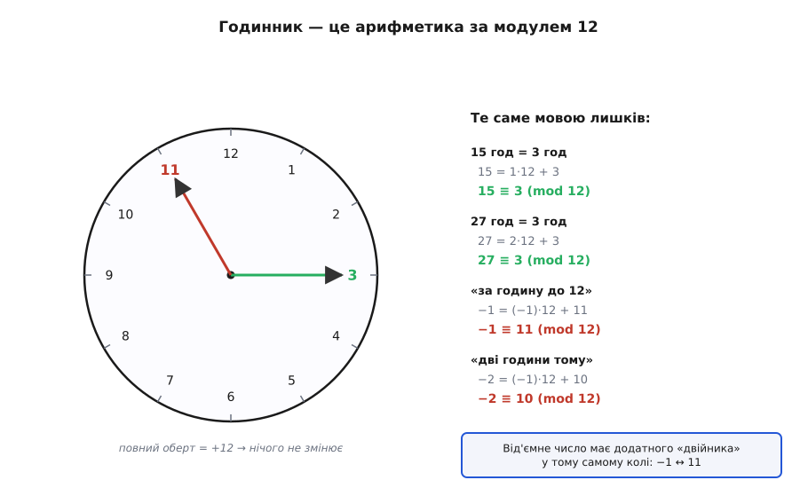
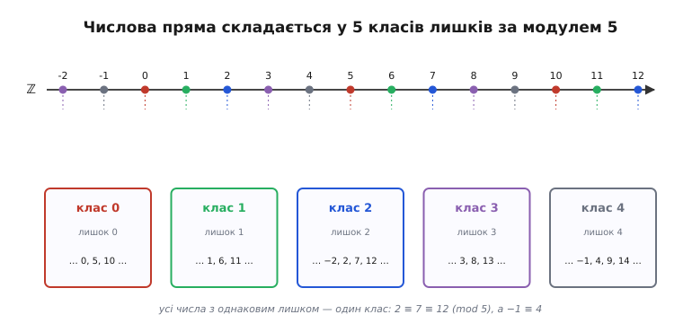
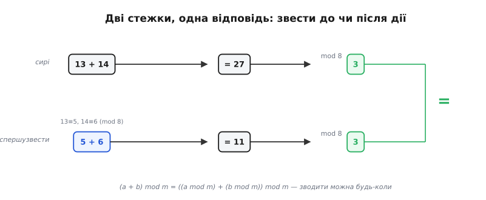
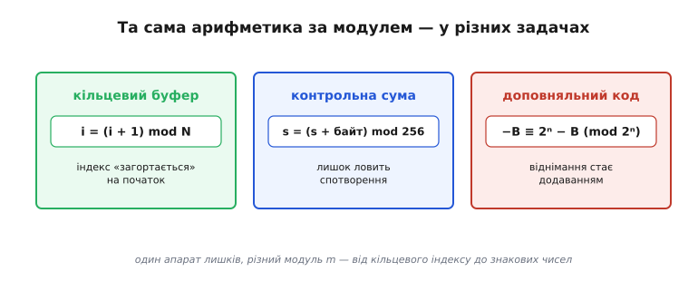

# Модульна арифметика

<preknowlist>
- [НСД і алгоритм Евкліда](root:math-number-theory/gcd-euclidean) — найбільший спільний дільник, взаємно прості числа та пошук спільної мірки двох цілих чисел.
- [Подільність і прості числа](root:math-number-theory/prime-numbers) — ділення націло з остачею, канонічний розклад на множники та властивості простих чисел.
- [Алгебра доповняльного коду](root:math-number-theory/twos-complement-algebra) — як комп'ютерні процесори представляють від'ємні числа у фіксованій бітовій сітці.
</preknowlist>

Спитайте будь-кого, котра година буде через п'ять годин після десятої вечора, — і відповідь прийде миттєво: третя ночі. Ніхто не скаже «п'ятнадцята»: число перевалило через дванадцять і пішло лічитися заново від нуля. Ми робимо так щодня, не задумуючись, — і саме в цій звичці лічити по колу й захована ціла галузь математики. Вона зветься **модульна арифметика** (іноді — арифметика лишків), і коротко її суть така: ми відкидаємо все, крім **залишку від ділення** на якесь фіксоване число. Виявляється, з цими залишками можна повноцінно рахувати — додавати, віднімати, множити, а за певних умов і ділити. Ця проста ідея лежить в основі речей від календаря і контрольних сум банківських карток до асиметричної криптографії RSA та внутрішньої логіки процесорних регістрів.

### Залишок як єдине, що важить

Звичайні цілі числа лежать на нескінченній прямій: вліво мінус, вправо плюс, кінця немає. Але часто нам **не потрібне** все число — потрібен лише його залишок після ділення на щось. Котра година — це залишок від ділення на 12 (або 24). Який сьогодні день тижня через сто днів — залишок від ділення на 7. У всіх таких задачах велике число можна сміливо викинути, лишивши тільки «скільки зайвого понад повні оберти».

Строго це формулює теорема про ділення з остачею: для будь-якого цілого числа `a` і додатного цілого числа `m`, званого **модулем** (*modulus* — латиною «міра», «мірка»), існують єдині цілі числа `q` (частка) та `r` (залишок), для яких виконується рівність:

```
a = q · m + r,   де 0 ≤ r < m
```

Лічити «за модулем `m`» означає: щойно дійшли до `m`, починаємо знову з нуля. Лишаються тільки числа 0, 1, 2, …, `m − 1` — рівно `m` можливих залишків, і жодного більше. Усе інше зводиться до одного з них. Число `r` позначають як `a mod m` — це відстань від найближчого кратного до `m`, що лежить ліворуч від `a`.

Найзнайоміша така лічба — звичайний годинник із модулем 12.


*Циферблат — наочна арифметика за модулем 12. «Третя» і «п'ятнадцята» — той самий кут стрілки, тому 15 і 3 однакові за модулем 12: 15 = 1·12 + 3. Найважливіше праворуч унизу: рух назад теж лишається на колі. «За годину до дванадцятої» — це 11, тобто −1 збігається з 11. Від'ємне число має додатного двійника в тому самому колі.*

### Конгруентність і знак ≡

Щоб говорити про це строго, потрібен спосіб сказати «два числа дають однаковий залишок». Два цілих числа `a` і `b` називають **конгруентними за модулем m** (від латини *congruere* — «збігатися», «сходитися»), якщо їхня різниця ділиться на `m` націло без залишку. Записують це знаком, навмисне схожим на знак рівності, але потроєним:

```
a ≡ b (mod m)    ⇔    m ділить (a − b)
```

Читається «`a` конгруентне `b` за модулем `m`». Найпростіше це уявити саме як однаковий залишок: `13 ≡ 5 (mod 8)`, бо обидва лишають 5; а `15 ≡ 3 (mod 12)`, бо «п'ятнадцята година» — це третя. Перевірка через різницю дає те саме: `13 − 5 = 8` ділиться на 8, `15 − 3 = 12` ділиться на 12.

Конгруентність володіє трьома фундаментальними властивостями відношення еквівалентності:
- **рефлексивність**: `a ≡ a (mod m)`, оскільки різниця `a − a = 0` ділиться на будь-який додатний модуль `m`;
- **симетричність**: якщо `a ≡ b (mod m)`, то й `b ≡ a (mod m)`, бо якщо `m` ділить `(a − b)`, то `m` ділить і `-(a − b) = (b − a)`;
- **транзитивність**: якщо `a ≡ b (mod m)` та `b ≡ c (mod m)`, то `a ≡ c (mod m)`. Справді, `(a − c) = (a − b) + (b − c)`, а сума двох чисел, кратних `m`, завжди кратна `m`.

Завдяки цим властивостям конгруентність розкладає всю нескінченну множину цілих чисел `ℤ` на `m` неперетинних **класів лишків** (*residuum* — латиною «залишок»): у кожному класі лежать усі ті числа, що дають один і той самий залишок при діленні на `m`. Клас залишку `r` позначають як `[r]_m` або `r + mℤ = { r + k·m | k ∈ ℤ }`. За модулем 5 таких класів рівно п'ять — від `[0]₅` до `[4]₅`, — і кожне ціле число потрапляє точно в один із них. Нескінченна пряма ніби складається в кілька кошиків.


*Числа з однаковим залишком від ділення на 5 сходяться в один клас і за модулем 5 вважаються рівними: 2 ≡ 7 ≡ 12. Кожен колір — окремий клас. Від'ємні теж лягають на місце: −1 потрапляє в клас 4, бо −1 = (−1)·5 + 4. «Звести за модулем 5» означає просто визначити, у якому з п'яти кошиків лежить число.*

Цей самий знак ≡ і слово «модуль» увів 1801 року двадцятичотирилітній Карл Фрідріх Гаусс у книзі «Дослідження з арифметики» (*Disquisitiones Arithmeticae*). Багато окремих фактів про залишки знали й до нього — П'єр де Ферма й Леонард Ойлер вільно ними оперували, рахуючи дні великодніх таблиць і остачі степенів, — але саме Гаусс зібрав ці розрізнені трюки в струнку теорію з доведеннями й, головне, дав їм **позначення**. Прорив був саме в значку: Гаусс довів, що зі знаком ≡ можна поводитися майже як зі звичайним «=», і тим перетворив лічбу по колу на повноцінну алгебру.

### Чому за модулем можна спокійно рахувати

Один залишок — це ще не арифметика. Арифметика починається тоді, коли із залишків можна **щось рахувати**. І тут лежить головна властивість, яку довів Гаусс: конгруенції за **спільним** модулем можна почленно **додавати, віднімати й перемножувати**:

```
якщо  a ≡ a′ (mod m)  і  b ≡ b′ (mod m),  то:
      a + b ≡ a′ + b′      (mod m)
      a − b ≡ a′ − b′      (mod m)
      a · b ≡ a′ · b′      (mod m)
```

Перевіримо, чому це законно для додавання та множення. За умовою різниці діляться на `m`: `a − a′ = k₁·m` та `b − b′ = k₂·m` для деяких цілих чисел `k₁` і `k₂`.

Розглянемо різницю сум двох чисел:

```
(a + b) − (a′ + b′)
= (a − a′) + (b − b′)               [перегрупували доданки]
= k₁·m + k₂·m                       [підставили k₁·m замість (a − a′) та k₂·m замість (b − b′)]
= m·(k₁ + k₂)                       [винесли спільний множник m за дужки]
```

Оскільки різниця `(a + b) − (a′ + b′)` ділиться на `m` націло, отримуємо `a + b ≡ a′ + b′ (mod m)`.

Тепер розглянемо різницю добутків двох чисел:

```
a·b − a′·b′
= a·b − a·b′ + a·b′ − a′·b′         [додали й відняли a·b′]
= a·(b − b′) + b′·(a − a′)          [винесли спільні множники a та b′]
= a·(k₂·m) + b′·(k₁·m)              [підставили вирази для різниць через кратні модуля m]
= m·(a·k₂ + b′·k₁)                  [винесли спільний модуль m за дужки]
```

Оскільки різниця `a·b − a′·b′` кратна `m`, маємо `a·b ≡ a′·b′ (mod m)`.

Ці два виведення забезпечують фундаментальну властивість алгебри залишків — **коректність операцій над класами лишків** (*well-definedness*). Це означає, що результати операцій `[a]_m + [b]_m = [a + b]_m` та `[a]_m · [b]_m = [a · b]_m` не залежать від того, які саме конкретні числа ми візьмемо представниками з відповідних класів.

Практичний наслідок звучить просто, але він — ключ до всього: **зводити за модулем можна будь-коли**, хоч до дії, хоч після неї, результат той самий. Не треба тягати великі числа — можна спершу взяти залишки, а тоді додати або перемножити малі:

```
(a + b) mod m = ((a mod m) + (b mod m)) mod m
(a · b) mod m = ((a mod m) · (b mod m)) mod m
```


*Верхня стежка: додати сирі 13 + 14 = 27, тоді взяти залишок — вийде 3. Нижня: спершу звести (13 ≡ 5, 14 ≡ 6), додати малі 5 + 6 = 11, тоді залишок — знову 3. Відповідь та сама: (a + b) mod m = ((a mod m) + (b mod m)) mod m. Саме це й робить ≡ повноцінною рівністю — і дозволяє відкидати «зайве» коли зручно.*

### Алгебраїчна структура кільця ℤ/nℤ

Коли ми беремо множину всіх `n` класів лишків `{0, 1, 2, ..., n − 1}` і задаємо на ній операції додавання та множення за модулем `n`, ми отримуємо повноцінну алгебраїчну систему, яка в сучасній алгебрі позначається як **`ℤ/nℤ`** (фактор-кільце цілих чисел за ідеалом `nℤ`, часто скорочується як `ℤₙ`).

Ця структура задовольняє всі аксіоми **комутативного кільця з одиницею**:
1. **Замкненість**: додавання та множення будь-яких двох лишків знову дає лишок із множини `{0, 1, ..., n − 1}`.
2. **Асоціативність**: `(a + b) + c ≡ a + (b + c)` та `(a · b) · c ≡ a · (b · c) (mod n)`.
3. **Комутативність**: `a + b ≡ b + a` та `a · b ≡ b · a (mod n)`.
4. **Нейтральні елементи**: `0` є нейтральним щодо додавання (`a + 0 ≡ a`), а `1` — нейтральним щодо множення (`a · 1 ≡ a`).
5. **Протилежний елемент**: для кожного `a` існує елемент `-a ≡ n − a (mod n)`, такий що `a + (n − a) ≡ n ≡ 0 (mod n)`.
6. **Дистрибутивність**: множення дистрибутивне відносно додавання: `a · (b + c) ≡ a·b + a·c (mod n)`.

#### Адитивна група (ℤ/nℤ, +) та її підгрупи

Відносно операції додавання множина `ℤ/nℤ` утворює **скінченну циклічну групу** порядку `n`. Її нейтральним елементом є `0`, а канонічним породжувальним елементом (твірною) виступає `1`, оскільки послідовне додавання одиниці `1, 1+1=2, ..., n·1 ≡ 0` обходить усі елементи кільця.

Кожен елемент `a ∈ ℤ/nℤ` породжує власну циклічну підгрупу `⟨a⟩ = {0, a, 2a, ..., (k−1)a}`. Кількість елементів у цій підгрупі називають **адитивним порядком елемента** `a` і позначають `ord_+(a)`.

Порядок елемента `a` в адитивній групі обчислюється через найбільший спільний дільник із модулем `n`:

```
ord_+(a) = n / НСД(a, n)
```

За теоремою Лагранжа про підгрупи скінченної групи, порядок будь-якої підгрупи зобов'язаний ділити загальний порядок групи `n`. Ба більше, для циклічної групи діє фундаментальна теорема про класифікацію підгруп: **для кожного натурального дільника `d` числа `n` існує одна і лише одна підгрупа порядку `d`**, і вона породжується елементом `n / d`.

Розглянемо це детально на конкретному прикладі кільця `ℤ/12ℤ`, порядок якого дорівнює 12:
- Дільники числа 12: це множина `{1, 2, 3, 4, 6, 12}`.
- Підгрупа порядку `d = 1`: породжується елементом `12 / 1 = 12 ≡ 0`. Множина: `{0}`. Порядок елемента: `ord_+(0) = 12 / НСД(0, 12) = 12 / 12 = 1`.
- Підгрупа порядку `d = 2`: породжується елементом `12 / 2 = 6`. Множина: `{0, 6}`. Порядок елемента: `ord_+(6) = 12 / НСД(6, 12) = 12 / 6 = 2`.
- Підгрупа порядку `d = 3`: породжується елементом `12 / 3 = 4`. Множина: `{0, 4, 8}`. Порядки елементів: `ord_+(4) = 12 / 4 = 3` та `ord_+(8) = 12 / НСД(8, 12) = 12 / 4 = 3`.
- Підгрупа порядку `d = 4`: породжується елементом `12 / 4 = 3`. Множина: `{0, 3, 6, 9}`. Порядки елементів: `ord_+(3) = 12 / 3 = 4` та `ord_+(9) = 12 / НСД(9, 12) = 12 / 3 = 4`.
- Підгрупа порядку `d = 6`: породжується елементом `12 / 6 = 2`. Множина: `{0, 2, 4, 6, 8, 10}`. Порядки елементів: `ord_+(2) = 12 / 2 = 6` та `ord_+(10) = 12 / НСД(10, 12) = 12 / 2 = 6`.
- Підгрупа порядку `d = 12`: збігається з усією групою `ℤ/12ℤ`. Її породжують усі елементи `a`, для яких `НСД(a, 12) = 1`, тобто числа 1, 5, 7, 11. Порядок кожного з них: `ord_+(1) = ord_+(5) = ord_+(7) = ord_+(11) = 12`.

#### Дільники нуля та небезпека наївного скорочення

У звичайній арифметиці діє залізне правило: якщо добуток двох чисел дорівнює нулю (`a · b = 0`), то щонайменше одне з них обов'язково нуль. У кільці лишків за складеним модулем це правило більше **не діє**.

Два ненульові залишки можуть у добутку дати нуль за модулем `n`, якщо їхній звичайний добуток ділиться на `n`. Такі елементи називають **дільниками нуля**.

Елемент `a ∈ ℤ/nℤ` є дільником нуля тоді й лише тоді, коли він ненульовий (`a ≢ 0`) і не є взаємно простим із модулем: `1 < НСД(a, n) < n`.

Погляньмо на конкретні приклади:
- У кільці `ℤ/6ℤ`: елементи `2 ≢ 0` і `3 ≢ 0`, але `2 · 3 = 6 ≡ 0 (mod 6)`. Тут 2, 3 і 4 є дільниками нуля (бо `4 · 3 = 12 ≡ 0 (mod 6)`).
- У кільці `ℤ/12ℤ`: візьмемо `3` і `4`. Обидва ненульові, але `3 · 4 = 12 ≡ 0 (mod 12)`. Також `8 · 9 = 72 = 6 · 12 ≡ 0 (mod 12)`, `2 · 6 = 12 ≡ 0 (mod 12)`.

Наявність дільників нуля призводить до того, що **рівняння за модулем не можна просто скорочувати на спільний множник**:

```
2 · 4 = 8 ≡ 2   (mod 6)
5 · 4 = 20 ≡ 2  (mod 6)
```

Маємо рівність `2 · 4 ≡ 5 · 4 (mod 6)`. Якби ми за звичною шкільною алгеброю скоротили обидві частини на 4, ми отримали б `2 ≡ 5 (mod 6)`, що є абсолютно хибним (`2 mod 6 = 2`, а `5 mod 6 = 5`).

Розберімо загальний закон скорочення конгруенцій. Нехай `a · c ≡ b · c (mod n)`. Це означає, що різниця `(a · c − b · c) = c · (a − b)` ділиться на `n`. Позначимо найбільший спільний дільник як `d = НСД(c, n)`.

Розділимо всі три величини `c`, `n` та вираз на `d`:

```
c · (a − b) = k · n                 [за означенням конгруенції, для деякого цілого k]
(c / d) · (a − b) = k · (n / d)     [розділили обидві частини рівності на d = НСД(c, n)]
```

Числа `(c / d)` та `(n / d)` є взаємно простими за побудовою: `НСД(c / d, n / d) = 1`. За лемою Евкліда про подільність, якщо число `(n / d)` ділить добуток `(c / d) · (a − b)` і є взаємно простим із першим множником, воно зобов'язане ділити другий множник `(a − b)`.

Отже, `(a − b)` ділиться на `(n / d)`, що означає:

```
a · c ≡ b · c (mod n)    ⇒    a ≡ b  (mod n / НСД(c, n))
```

У нашому прикладі `2 · 4 ≡ 5 · 4 (mod 6)` спільний множник `c = 4`, а модуль `n = 6`. Обчислюємо `НСД(4, 6) = 2`. Скорочуючи на 4, ми зобов'язані розділити модуль 6 на 2: отримуємо `2 ≡ 5 (mod 3)`, що є чистісінькою правдою (`2 mod 3 = 2` і `5 mod 3 = 2`).

#### Оборотні елементи та мультиплікативна група (ℤ/nℤ)*

Якщо число `a` не є дільником нуля з модулем `n`, для нього може існувати **мультиплікативний обернений елемент** — таке число `x`, що:

```
a · x ≡ 1 (mod n)
```

Такий елемент позначають як `a⁻¹ mod n`. Елементи, що мають обернений, називають **оборотними елементами** (або *одиницями кільця*, англ. *units*).

Число `a` оборотне за модулем `n` тоді й лише тоді, коли `a` та `n` є **взаємно простими**, тобто їхній найбільший спільний дільник дорівнює одиниці: `НСД(a, n) = 1`. Якщо ж `НСД(a, n) = d > 1`, то `a` є дільником нуля і оберненого елемента для нього не існує в принципі.

Множина всіх оборотних елементів кільця `ℤ/nℤ` утворює самостійну алгебраїчну структуру відносно операції множення — **мультиплікативну групу кільця лишків**, яка позначається як **`(ℤ/nℤ)*`** або `U(n)`.

Кількість елементів у цій групі визначається [функцією Ейлера](root:math-number-theory/euler-totient) `φ(n)`, яка рахує кількість чисел від 1 до `n − 1`, взаємно простих із `n`:

```
|(ℤ/nℤ)*| = φ(n)
```

Погляньмо на структуру такої групи для `n = 10`. Елементи кільця `ℤ/10ℤ` — це `{0, 1, 2, 3, 4, 5, 6, 7, 8, 9}`. Взаємно простими з 10 є лише 1, 3, 7, 9. Отже:

```
(ℤ/10ℤ)* = {1, 3, 7, 9},   φ(10) = 4
```

Перевіримо пари взаємно обернених чисел у `(ℤ/10ℤ)*`:
- `1 · 1 = 1 ≡ 1 (mod 10)`  →  `1⁻¹ ≡ 1`
- `3 · 7 = 21 ≡ 1 (mod 10)`  →  `3⁻¹ ≡ 7`, `7⁻¹ ≡ 3`
- `9 · 9 = 81 ≡ 1 (mod 10)`  →  `9⁻¹ ≡ 9`

Порядки елементів у мультиплікативній групі (найменше ціле `k ≥ 1`, для якого `a^k ≡ 1 (mod n)`):
- Для `a = 1`: `1¹ ≡ 1 (mod 10)` → порядок `ord_*(1) = 1`.
- Для `a = 9`: `9¹ = 9`, `9² = 81 ≡ 1 (mod 10)` → порядок `ord_*(9) = 2`.
- Для `a = 3`: `3¹ = 3`, `3² = 9`, `3³ = 27 ≡ 7`, `3⁴ = 81 ≡ 1 (mod 10)` → порядок `ord_*(3) = 4`.
- Для `a = 7`: `7¹ = 7`, `7² = 49 ≡ 9`, `7³ = 343 ≡ 3`, `7⁴ = 2401 ≡ 1 (mod 10)` → порядок `ord_*(7) = 4`.

Елементи, порядок яких дорівнює повному порядку групи `φ(n)`, називають **первісними коренями** ([первісний корінь](root:math-number-theory/primitive-root)). У групі `(ℤ/10ℤ)*` первісними коренями є числа 3 та 7: степені числа 3 генерують усю групу: `3¹ ≡ 3`, `3² ≡ 9`, `3³ ≡ 7`, `3⁴ ≡ 1`.

Для будь-якого елемента `a ∈ (ℤ/nℤ)*` виконується [теорема Ейлера](root:math-number-theory/euler-totient):

```
a^(φ(n)) ≡ 1 (mod n)
```

Погляньмо також на приклад простого модуля `p = 13`. Тут порядок групи дорівнює `φ(13) = 12`. Елементи `{1, 2, 3, 4, 5, 6, 7, 8, 9, 10, 11, 12}` мають такі мультиплікативні порядки:
- порядок 1: число 1;
- порядок 2: число 12 (бо `12² ≡ (−1)² = 1 mod 13`);
- порядок 3: числа 3 і 9 (бо `3³ = 27 ≡ 1`, `9³ = 729 = 56 · 13 + 1 ≡ 1`);
- порядок 4: числа 5 і 8 (бо `5² = 25 ≡ −1`, `5⁴ ≡ 1`);
- порядок 6: числа 4 і 10;
- порядок 12 (первісні корені): числа 2, 6, 7, 11. Рівно `φ(12) = 4` первісні корені, кожен із яких своїми степенями породжує всі 12 ненульових залишків.

#### Поле ℤ/pℤ (𝔽_p) для простих модулів

Особливий і найважливіший для криптографії випадок настає тоді, коли модуль є **простим числом `p`**.

Оскільки просте число `p` не має інших дільників, крім 1 і самого себе, **кожне** ненульове число `a ∈ {1, 2, ..., p − 1}` є взаємно простим із `p`: `НСД(a, p) = 1`.

Це веде до фундаментальних наслідків:
1. У кільці `ℤ/pℤ` **немає жодного дільника нуля**.
2. **Кожен ненульовий елемент є оборотним**.
3. Мультиплікативна група складається з усіх ненульових лишків: `(ℤ/pℤ)* = {1, 2, ..., p − 1}`, а її порядок дорівнює `φ(p) = p − 1`.
4. Мультиплікативна група `(ℤ/pℤ)*` завжди є циклічною групою (теорема Гаусса), тобто в ній обов'язково існують первісні корені.

Кільце, у якому кожен ненульовий елемент має обернений за множенням, називається **полем** (Field). Поле за простим модулем позначають як **`𝔽_p`** або `GF(p)` (*Galois Field* — скінченне поле Галуа).

У полі `𝔽_p` арифметика стає настільки ж повноцінною, як і в полі дійсних чисел `ℝ`: тут можна додавати, віднімати, множити й **ділити на будь-яке число, крім нуля**.

### Лінійні конгруенції та розширений алгоритм Евкліда

Як розв'язувати рівняння вигляду `a · x ≡ b (mod m)` для довільних цілих чисел `a`, `b` та модуля `m`? Оскільки дробів у модульній арифметиці немає, розв'язання базується на теорії подільності та тотожності Безу.

Запишемо конгруенцію у вигляді лінійного діофантового рівняння:

```
a · x ≡ b (mod m)    ⇔    a · x − m · y = b,   де x, y ∈ ℤ
```

За [тотожністю Безу](root:math-number-theory/bezout-identity), для будь-яких двох цілих чисел `a` та `m` існують цілі коефіцієнти `u` та `v` такі, що:

```
a · u + m · v = НСД(a, m)
```

Позначимо найбільший спільний дільник як `d = НСД(a, m)`. Оскільки ліва частина `a · x − m · y` завжди ділиться на `d`, права частина `b` також зобов'язана ділитися на `d`.

Звідси випливає фундаментальна теорема про розв'язність лінійних конгруенцій:
1. Конгруенція `a · x ≡ b (mod m)` має розв'язок тоді й лише тоді, коли `d = НСД(a, m)` ділить число `b`. Якщо `b` не ділиться на `d`, розв'язків **не існує**.
2. Якщо `d` ділить `b`, то конгруенція має **рівно `d` різних розв'язків** за модулем `m` у множині `{0, 1, ..., m − 1}`.

#### Загальний алгоритм розв'язання

1. За допомогою [розширеного алгоритму Евкліда](root:math-number-theory/gcd-euclidean) обчислюємо `d = НСД(a, m)` та коефіцієнти Безу `u`, `v`, для яких `a · u + m · v = d`.
2. Перевіряємо подільність: якщо залишок `b mod d ≠ 0`, зупиняємось — розв'язків немає.
3. Ділимо всі складові конгруенції на `d`: отримуємо еквівалентне рівняння `(a / d) · x ≡ (b / d) (mod m / d)`. Оскільки `НСД(a / d, m / d) = 1`, коефіцієнт при `x` є оборотним за новим модулем `m / d`.
4. Знаходимо базовий розв'язок `x₀`:
   ```
   x₀ = ((b / d) · u) mod (m / d)
   ```
5. Записуємо всі `d` несумісних за модулем `m` розв'язків з кроком `m / d`:
   ```
   x_k = x₀ + k · (m / d),   де k = 0, 1, 2, ..., d − 1
   ```

#### Покроковий приклад 1: єдиний розв'язок 17·x ≡ 5 (mod 43)

Розв'яжемо лінійну конгруенцію `17 · x ≡ 5 (mod 43)`. Оскільки 43 — просте число, `НСД(17, 43) = 1`, отже `d = 1` і рівняння має рівно один розв'язок.

**Крок 1. Прямий хід алгоритму Евкліда для 43 та 17:**

```
43 = 2 · 17 + 9     [частка q₁ = 2, залишок r₁ = 9]
17 = 1 · 9 + 8      [частка q₂ = 1, залишок r₂ = 8]
 9 = 1 · 8 + 1      [частка q₃ = 1, залишок r₃ = 1 — НСД знайдено]
 8 = 8 · 1 + 0      [ділення закінчилося]
```

**Крок 2. Зворотний хід (виражаємо остачу 1 через 43 та 17):**

```
1 = 9 − 1 · 8                       [з третього рядка]
  = 9 − 1 · (17 − 1 · 9)            [підставили 8 = 17 − 1·9 з другого рядка]
  = 2 · 9 − 1 · 17                  [звели подібні доданки для 9]
  = 2 · (43 − 2 · 17) − 1 · 17      [підставили 9 = 43 − 2·17 з першого рядка]
  = 2 · 43 − 5 · 17                 [звели коефіцієнти для 43 та 17]
```

Отримали тотожність Безу: `2 · 43 + (−5) · 17 = 1`.

Звідси `(−5) · 17 ≡ 1 (mod 43)`. Зведемо від'ємний коефіцієнт до канонічного додатного залишку:

```
−5 ≡ 43 − 5 = 38 (mod 43)
```

Перевіримо обернений елемент: `17 · 38 = 646 = 15 · 43 + 1 ≡ 1 (mod 43)`. Усе сходиться: `17⁻¹ ≡ 38 (mod 43)`.

**Крок 3. Знаходження невідомого x:**

Помножимо обидві частини вихідного рівняння `17 · x ≡ 5 (mod 43)` на знайдений обернений елемент 38:

```
x ≡ 5 · 17⁻¹
  ≡ 5 · 38
  ≡ 190
  ≡ 4 · 43 + 18
  ≡ 18 (mod 43)
```

Перевірка розв'язку: `17 · 18 = 306 = 7 · 43 + 5 ≡ 5 (mod 43)`. Відповідь: `x ≡ 18 (mod 43)`.

#### Покроковий приклад 2: кілька розв'язків 14·x ≡ 21 (mod 35)

Розв'яжемо рівняння `14 · x ≡ 21 (mod 35)`.

**Крок 1. Обчислюємо НСД та перевіряємо умову розв'язності:**
- `35 = 2 · 14 + 7`
- `14 = 2 · 7 + 0`
- Отже, `d = НСД(14, 35) = 7`.
- Число `b = 21` ділиться на `d = 7` (`21 = 3 · 7`). Умова виконується: конгруенція має рівно `d = 7` різних розв'язків за модулем 35.

**Крок 2. Зводимо рівняння діленням на d = 7:**

```
(14 / 7) · x ≡ (21 / 7) (mod 35 / 7)
2 · x ≡ 3 (mod 5)
```

**Крок 3. Знаходимо базовий розв'язок у ℤ/5ℤ:**
Шукаємо `2⁻¹ mod 5`. Оскільки `2 · 3 = 6 ≡ 1 (mod 5)`, маємо `2⁻¹ ≡ 3 (mod 5)`.
Множимо праву частину на 3:

```
x₀ = (3 · 3) mod 5 = 9 mod 5 = 4
```

Перевіримо: `2 · 4 = 8 ≡ 3 (mod 5)`. Базовий розв'язок знайдено вірно.

**Крок 4. Записуємо всі 7 розв'язків за модулем 35 з кроком m / d = 35 / 7 = 5:**

```
x₀ = 4
x₁ = 4 + 5 = 9
x₂ = 4 + 10 = 14
x₃ = 4 + 15 = 19
x₄ = 4 + 20 = 24
x₅ = 4 + 25 = 29
x₆ = 4 + 30 = 34
```

**Крок 5. Перевіряємо кожен із 7 розв'язків у початковому рівнянні 14·x (mod 35):**
- Для `x = 4`: `14 · 4 = 56 = 1 · 35 + 21 ≡ 21 (mod 35)`
- Для `x = 9`: `14 · 9 = 126 = 3 · 35 + 21 ≡ 21 (mod 35)`
- Для `x = 14`: `14 · 14 = 196 = 5 · 35 + 21 ≡ 21 (mod 35)`
- Для `x = 19`: `14 · 19 = 266 = 7 · 35 + 21 ≡ 21 (mod 35)`
- Для `x = 24`: `14 · 24 = 336 = 9 · 35 + 21 ≡ 21 (mod 35)`
- Для `x = 29`: `14 · 29 = 406 = 11 · 35 + 21 ≡ 21 (mod 35)`
- Для `x = 34`: `14 · 34 = 476 = 13 · 35 + 21 ≡ 21 (mod 35)`

Усі 7 значень дають точний залишок 21 за модулем 35.

#### Покроковий приклад 3: випадок відсутності розв'язку 6·x ≡ 7 (mod 15)

Розглянемо конгруенцію `6 · x ≡ 7 (mod 15)`.

Обчислимо найбільший спільний дільник коефіцієнта і модуля: `НСД(6, 15) = 3`.
Запишемо рівняння в діофантовому вигляді: `6 · x − 15 · y = 7`.

Винесемо спільний дільник 3 за дужки в лівій частині:

```
3 · (2 · x − 5 · y) = 7
```

Для будь-яких цілих чисел `x` та `y` вираз у дужках `(2·x − 5·y)` є цілим числом, тому ліва частина рівності обов'язково ділиться на 3. Проте права частина `7` не ділиться на 3 націло (`7 = 2 · 3 + 1`). Отримуємо суперечність. Отже, рівняння `6 · x ≡ 7 (mod 15)` не має жодного цілого розв'язку.

#### Обернення через малу теорему Ферма

Коли модуль `p` є простим числом, знайти `b⁻¹ mod p` можна ще одним елегантним способом — через [малу теорему Ферма](root:math-number-theory/fermat-little-theorem). Вона стверджує, що для будь-якого `b`, не кратного `p`:

```
b^(p − 1) ≡ 1 (mod p)
```

Розкладемо ліву частину на множники: `b · b^(p − 2) ≡ 1 (mod p)`. Звідси безпосередньо випливає формула:

```
b⁻¹ ≡ b^(p − 2) (mod p)
```

Для нашого прикладу `17⁻¹ mod 43`:
`17⁻¹ ≡ 17⁴¹ (mod 43)`. Швидке піднесення 17 до степеня 41 за модулем 43 дає той самий результат: `38`.

:::tabs
```c
#include <stdint.h>
#include <stdbool.h>

// Розширений алгоритм Евкліда: повертає d = НСД(a, b) та коефіцієнти x, y
int64_t ext_gcd(int64_t a, int64_t b, int64_t *x, int64_t *y) {
    if (b == 0) {
        *x = 1;
        *y = 0;
        return a;
    }
    int64_t x1 = 0, y1 = 0;
    int64_t d = ext_gcd(b, a % b, &x1, &y1);
    *x = y1;
    *y = x1 - (a / b) * y1;
    return d;
}

// Модульне обернення: повертає true, якщо a⁻¹ mod m існує
bool mod_inverse(int64_t a, int64_t m, int64_t *out_inv) {
    int64_t x = 0, y = 0;
    int64_t d = ext_gcd(a, m, &x, &y);
    if (d != 1) {
        return false; // НСД ≠ 1, елемент не є оборотним
    }
    *out_inv = (x % m + m) % m; // канонічний додатний залишок
    return true;
}
```
```cpp
#include <cstdint>
#include <optional>
#include <tuple>

// Розширений алгоритм Евкліда: повертає кортеж {gcd, x, y}
constexpr std::tuple<int64_t, int64_t, int64_t> ext_gcd(int64_t a, int64_t b) noexcept {
    if (b == 0) {
        return {a, 1, 0};
    }
    auto [d, x1, y1] = ext_gcd(b, a % b);
    return {d, y1, x1 - (a / b) * y1};
}

// Пошук мультиплікативного оберненого a⁻¹ mod m
constexpr std::optional<int64_t> mod_inverse(int64_t a, int64_t m) noexcept {
    auto [d, x, y] = ext_gcd(a, m);
    if (d != 1) {
        return std::nullopt; // обернений існує тільки для взаємно простих
    }
    return (x % m + m) % m;
}
```
```python
from typing import Optional, Tuple

def ext_gcd(a: int, b: int) -> Tuple[int, int, int]:
    if b == 0:
        return a, 1, 0
    d, x1, y1 = ext_gcd(b, a % b)
    return d, y1, x1 - (a // b) * y1

def mod_inverse(a: int, m: int) -> Optional[int]:
    d, x, _ = ext_gcd(a, m)
    if d != 1:
        return None  # числа не взаємно прості
    return (x % m + m) % m
```
:::

### Китайська теорема про залишки (CRT) та системи конгруенцій

Коли модуль `n` є добутком кількох попарно взаємно простих чисел `n = m₁ · m₂ · ... · m_k` (де `НСД(m_i, m_j) = 1` при `i ≠ j`), [китайська теорема про залишки (CRT)](root:math-number-theory/chinese-remainder-theorem) встановлює дивовижний факт: **кільце `ℤ/nℤ` є канонічно ізоморфним прямому добутку менших кілець**:

```
ℤ/(m₁·m₂·...·m_k)ℤ  ≅  ℤ/m₁ℤ × ℤ/m₂ℤ × ... × ℤ/m_kℤ
```

Це означає, що система лінійних порівнянь:

```
x ≡ a₁ (mod m₁)
x ≡ a₂ (mod m₂)
...
x ≡ a_k (mod m_k)
```

завжди має єдиний розв'язок за модулем загального добутку `M = m₁ · m₂ · ... · m_k`.

#### Конструктивний алгоритм побудови розв'язку

1. Обчислюємо загальний модуль як повний добуток: `M = m₁ · m₂ · ... · m_k`.
2. Для кожного рівняння `i ∈ {1, ..., k}` обчислюємо частинний модуль `M_i = M / m_i` (добуток усіх модулів, крім `m_i`).
3. Оскільки `НСД(M_i, m_i) = 1`, знаходимо обернений елемент `y_i = M_i⁻¹ mod m_i` за допомогою розширеного алгоритму Евкліда:
   ```
   M_i · y_i ≡ 1 (mod m_i)
   ```
4. Формуємо підсумковий розв'язок за явною формулою Гаусса:
   ```
   x = (a₁ · M₁ · y₁ + a₂ · M₂ · y₂ + ... + a_k · M_k · y_k) mod M
   ```

Чому ця формула працює? Погляньмо на значення виразу за модулем окремого `m_j`. Для кожного доданка з індексом `i ≠ j` число `M_i` містить `m_j` як множник, тому `a_i · M_i · y_i ≡ 0 (mod m_j)`. Лишається лише один доданок з індексом `i = j`:

```
x ≡ a_j · (M_j · y_j) ≡ a_j · 1 ≡ a_j (mod m_j)
```

Формула автоматично задовольняє всі `k` конгруенцій одночасно.

#### Покроковий числовий приклад: класична задача Сунь Цзи

Розв'яжемо давньокитайську задачу, сформульовану математиком Сунь Цзи у III столітті: знайти найменше натуральне число, яке при діленні на 3 дає залишок 2, при діленні на 5 дає залишок 3, а при діленні на 7 дає залишок 2:

```
x ≡ 2 (mod 3)
x ≡ 3 (mod 5)
x ≡ 2 (mod 7)
```

**Крок 1. Перевіряємо взаємну простоту та рахуємо модулі:**
- Модулі: `m₁ = 3`, `m₂ = 5`, `m₃ = 7`. Усі вони попарно взаємно прості.
- Загальний модуль: `M = 3 · 5 · 7 = 105`.
- Частинні модулі:
  - `M₁ = 105 / 3 = 35`
  - `M₂ = 105 / 5 = 21`
  - `M₃ = 105 / 7 = 15`

**Крок 2. Знаходимо модульні обернені y_i:**
- Для `M₁ = 35`: `35 mod 3 = 2`. Шукаємо `2 · y₁ ≡ 1 (mod 3)`. Оскільки `2 · 2 = 4 ≡ 1 (mod 3)`, маємо `y₁ = 2`.
- Для `M₂ = 21`: `21 mod 5 = 1`. Шукаємо `1 · y₂ ≡ 1 (mod 5)`. Отримуємо `y₂ = 1`.
- Для `M₃ = 15`: `15 mod 7 = 1`. Шукаємо `1 · y₃ ≡ 1 (mod 7)`. Отримуємо `y₃ = 1`.

**Крок 3. Обчислюємо суму добутків:**

```
x = (a₁ · M₁ · y₁ + a₂ · M₂ · y₂ + a₃ · M₃ · y₃) mod M
  = (2 · 35 · 2 + 3 · 21 · 1 + 2 · 15 · 1) mod 105
  = (140 + 63 + 30) mod 105
  = 233 mod 105
  = 2 · 105 + 23
  = 23
```

**Крок 4. Перевіряємо отриману відповідь 23:**
- `23 = 7 · 3 + 2 ≡ 2 (mod 3)`  ✓
- `23 = 4 · 5 + 3 ≡ 3 (mod 5)`  ✓
- `23 = 3 · 7 + 2 ≡ 2 (mod 7)`  ✓

Розв'язок знайдено бездоганно: `x = 23` (а загальний розв'язок: `x ≡ 23 (mod 105)`).

#### Алгоритм Гарнера для обчислень без переповнення

Класична формула Гаусса вимагає обчислення повного добутку `M = ∏ m_i` та великих проміжних добутків `a_i · M_i · y_i`. Якщо система містить десятки модулів по 64 біти, їхній добуток `M` виходить за межі стандартних типів даних.

Для уникнення роботи з наддовгими числами застосовують **алгоритм Гарнера** (*Garner's Algorithm*). Він представляє число `x` у змішаній системі числення за базисом `(m₁, m₂, ..., m_k)`:

```
x = v₀ + v₁ · m₁ + v₂ · (m₁ · m₂) + ... + v_(k−1) · (m₁ · m₂ · ... · m_(k−1))
```

Коефіцієнти `v_i ∈ [0, m_(i+1) − 1]` обчислюються послідовно крок за кроком з використанням лише операцій за малими модулями `m_i`, що дозволяє ефективно реалізувати алгоритм навіть на апаратних контролерах із фіксованою розрядністю.

#### Випадок не взаємно простих модулів

Якщо в системі порівнянь `x ≡ a₁ (mod m₁)` та `x ≡ a₂ (mod m₂)` модулі мають спільний дільник `d = НСД(m₁, m₂) > 1`, розв'язок існує тоді й лише тоді, коли `a₁ ≡ a₂ (mod d)`. У такому разі систему зводять до еквівалентної конгруенції за модулем найменшого спільного кратного `[m₁, m₂] = (m₁ · m₂) / d`. Якщо ж `a₁ ≢ a₂ (mod d)`, система взагалі не має спільних розв'язків.

:::tabs
```c
#include <stdint.h>
#include <stdbool.h>
#include <stddef.h>

// Розв'язання системи конгруенцій x ≡ rem[i] (mod mod[i])
bool crt_solve(const int64_t *rem, const int64_t *mod, size_t n, int64_t *out_x, int64_t *out_M) {
    int64_t M = 1;
    for (size_t i = 0; i < n; i++) {
        M *= mod[i];
    }

    int64_t x = 0;
    for (size_t i = 0; i < n; i++) {
        int64_t M_i = M / mod[i];
        int64_t y_i = 0;
        if (!mod_inverse(M_i, mod[i], &y_i)) {
            return false; // модулі не є попарно взаємно простими
        }
        int64_t term = ((rem[i] % M) * (M_i % M)) % M;
        term = (term * (y_i % M)) % M;
        x = (x + term) % M;
    }

    *out_x = (x % M + M) % M;
    *out_M = M;
    return true;
}
```
```cpp
#include <cstdint>
#include <optional>
#include <span>

struct CrtSolution {
    int64_t x;
    int64_t total_modulus;
};

// Розв'язання системи конгруенцій через CRT
std::optional<CrtSolution> crt_solve(
    std::span<const int64_t> rem,
    std::span<const int64_t> mod
) noexcept {
    if (rem.size() != mod.size() || rem.empty()) {
        return std::nullopt;
    }

    int64_t total_m = 1;
    for (int64_t m : mod) {
        total_m *= m;
    }

    int64_t x = 0;
    for (size_t i = 0; i < mod.size(); ++i) {
        int64_t M_i = total_m / mod[i];
        auto y_i = mod_inverse(M_i, mod[i]);
        if (!y_i) {
            return std::nullopt; // відсутня взаємна простота
        }
        int64_t term = static_cast<int64_t>(
            static_cast<__int128_t>(rem[i]) * M_i % total_m * (*y_i) % total_m
        );
        x = (x + term) % total_m;
    }

    return CrtSolution{
        .x = (x % total_m + total_m) % total_m,
        .total_modulus = total_m
    };
}
```
```python
from typing import List, Optional, Tuple

def crt_solve(remainders: List[int], moduli: List[int]) -> Optional[Tuple[int, int]]:
    if len(remainders) != len(moduli) or not moduli:
        return None

    total_m = 1
    for m in moduli:
        total_m *= m

    x = 0
    for r, m in zip(remainders, moduli):
        m_i = total_m // m
        y_i = mod_inverse(m_i, m)
        if y_i is None:
            return None  # модулі не взаємно прості
        x = (x + r * m_i * y_i) % total_m

    return (x % total_m + total_m) % total_m, total_m
```
:::

### Від'ємні числа лягають на коло самі собою

Окрема краса модульної арифметики в тому, як природно в неї вписуються **від'ємні числа** — без жодного окремого «знака мінус» у самій системі. Повний оберт по колу нічого не змінює: `a + m ≡ a (mod m)`. Тому **рух назад на N** дає рівно те саме, що рух **уперед на m − N**:

```
−N ≡ m − N   (mod m)
```

За модулем 12 це означає `−1 ≡ 11`: «за годину до дванадцятої» і «одинадцята» — той самий момент. Від'ємне число тут не окрема сутність, а просто **інша назва** свого додатного двійника на колі. Перевірка несуперечлива: `N + (−N)` має давати нуль, і справді `N + (m − N) = m ≡ 0` — повний оберт замикається в нуль.

Саме ця тотожність `−N ≡ m − N` і є математичним серцем того, як комп'ютери кодують від'ємні числа в [доповняльному коді](root:math-number-theory/twos-complement-algebra). Працює вона за будь-якого модуля, але по-справжньому розкривається на одному особливому виборі — степені двійки.

### Особливий випадок: модуль 2ⁿ

Досі модулем було «людське» число — 12 годин, 7 днів, 43 для рівняння. Та найважливіший для техніки випадок — коли модуль є **степенем двійки**, `m = 2ⁿ`. Причина проста й глибока водночас: регістр на `n` бітів **за самою своєю конструкцією** рахує за модулем `2ⁿ`.

У такий регістр уміщається рівно `2ⁿ` різних комбінацій нулів та одиниць — і ні на одну більше (256 для байта, 65536 для 16-бітного слова, `2³²` для 32-бітного цілого). Дійшовши до найбільшого значення, регістр на наступному кроці перевалює в нуль: старший біт переносу фізично нікуди записати, і апаратний суматор його **відкидає**. Але «відкинути біти, старші за `n`-й» — це арифметично точно те саме, що **взяти залишок від ділення на `2ⁿ`**. Отже, будь-яке додавання чи множення в `n`-бітному регістрі автоматично виконується за модулем `2ⁿ` — байдуже, хотіли ми того чи ні.

Чому степінь двійки такий зручний для обчислень? Тому що залишок за модулем `2ⁿ` беруть не важким апаратним діленням, а **поробітковою маскою молодших бітів**: `x mod 2ⁿ` — це просто `x & (2ⁿ − 1)`.

```
x mod 2ⁿ  =  x & (2ⁿ − 1)
```

Для процесора побітове «І» (`AND`) — це один машинний такт із мінімальним енергоспоживанням, тоді як команда цілочисельного ділення `DIV`/`IDIV` вимагає від 10 до 40 тактів конвеєра.

:::tabs
```c
#include <stdint.h>
#include <stddef.h>

// 8-бітна контрольна сума: переповнення uint8_t — це чесний mod 256
uint8_t checksum8(const uint8_t *data, size_t len) {
    uint8_t s = 0;
    for (size_t i = 0; i < len; i++) {
        s += data[i]; // кожне додавання апаратно зводиться за модулем 256
    }
    return s;
}

// Швидке взяття залишку для розміру таблиці TABLE_SIZE = 2ⁿ
uint32_t bucket_index(uint32_t hash, uint32_t table_size) {
    return hash & (table_size - 1); // еквівалент hash % table_size
}
```
```cpp
#include <cstdint>
#include <numeric>
#include <span>

// Та сама 8-бітна сума засобами стандартної бібліотеки C++
uint8_t checksum8(std::span<const uint8_t> data) {
    return std::accumulate(data.begin(), data.end(), uint8_t{0});
}

// У C++ перевірку степеня двійки можна виконати ще на етапі компіляції
template <uint32_t TableSize>
    requires ((TableSize & (TableSize - 1)) == 0 && TableSize > 0)
constexpr uint32_t bucket_index(uint32_t hash) noexcept {
    return hash & (TableSize - 1);
}
```
```python
def checksum8(data: bytes) -> int:
    s = 0
    for b in data:
        # У Python довга арифметика, тому модуль 256 задаємо явною маскою
        s = (s + b) & 0xFF
    return s

def bucket_index(hash_val: int, table_size: int) -> int:
    # table_size має бути степенем двійки (2ⁿ)
    return hash_val & (table_size - 1)
```
:::

### Worked-приклад: −5 у байті як 251

Зведімо все докупи на байті (`n = 8`, модуль `2⁸ = 256`) — закодуймо від'ємне число −5. За тотожністю `−N ≡ m − N` маємо `−5 ≡ 256 − 5 = 251 (mod 256)`. Перевіримо, що цей запис справді поводиться як −5:

```
кодуємо −5 за модулем 256:
  −5 ≡ 256 − 5 = 251        (251 = 11111011₂ у бітах)

перевірка «−5 додане до 5 дає нуль»:
   5 + 251 = 256 = 1·256 + 0
   256 ≡ 0 (mod 256)        ✓  повний оберт замкнувся в нуль

віднімання як додавання: 7 − 5 = 7 + (−5) = 7 + 251:
   7 + 251 = 258 = 1·256 + 2
   258 ≡ 2 (mod 256)        ✓  і справді 7 − 5 = 2
```

Останній рядок показує фундаментальну інженерну оптимізацію: щоб відняти 5, процесор просто додає 251 (код числа −5) і викидає вихідний перенос за межі 8 бітів. Ніякої окремої апаратної схеми віднімання не потрібно — той самий суматор виконує і додавання, і віднімання. Бітовий патерн `11111011₂` при цьому означає і 251 як беззнакове число (`uint8_t`), і −5 як знакове число (`int8_t`); уся різниця полягає лише в інтерпретації старшого біта людиною чи компілятором.

### Інженерні застосування: контрольні суми, буфери та хешування

Модульна арифметика виникає скрізь, де дані передаються ненадійними каналами, зберігаються в обмеженій пам'яті або розподіляються по масивах.


*Один і той самий апарат лишків, різний модуль m. Індекс кільцевого буфера беруть за модулем розміру, щоб він загортався на початок. Контрольну суму накопичують за модулем 256, щоб ловити спотворення. Доповняльний код кодує мінус за модулем 2ⁿ. Змінюється лише модуль і те, що ми домовилися робити із залишком.*

#### Контрольні суми: алгоритми Луна, ISBN та Verhoeff

Найпростіша сума байтів за модулем 256 виявляє будь-яку одиночну зміну біта, але має серйозну ваду: вона абсолютно «сліпа» до перестановки двох сусідніх байтів місцями (`a + b = b + a`). Для захисту від людських помилок при введенні номерів створено спеціальні модульні схеми з вагами.

**1. Алгоритм Луна (Luhn, ISO/IEC 7812-1)**
Використовується в банківських картках (Visa, Mastercard), номерах IMEI телефонів та номерах транспортних документів. Обчислення ведеться за **модулем 10**:
- Рухаючись справа наліво від передостанньої цифри, кожну другу цифру подвоюють (`2 · d`).
- Якщо результат подвоєння більший або дорівнює 10, від нього віднімають 9 (що еквівалентно додаванню цифр десяткового запису: для 14 маємо `1 + 4 = 5`, і `14 − 9 = 5`).
- Усі отримані значення додаються. Повний номер валідний тоді й лише тоді, коли загальна сума кратна 10: `Total ≡ 0 (mod 10)`.

Оскільки `(2·d) mod 9 ≠ d mod 9` для всіх цифр `d ∈ {1, ..., 9}`, алгоритм Луна гарантовано виявляє 100% одиночних помилок введення (`d → d′`) та понад 98% перестановок сусідніх цифр (`ab → ba`, за винятком пари `09 ↔ 90`).

:::tabs
```c
#include <stdbool.h>
#include <string.h>

bool luhn_validate(const char *digits) {
    int sum = 0;
    int len = strlen(digits);
    bool alternate = false;

    for (int i = len - 1; i >= 0; i--) {
        if (digits[i] < '0' || digits[i] > '9') return false;
        int d = digits[i] - '0';
        if (alternate) {
            d *= 2;
            if (d > 9) d -= 9; // редукція за модулем 9
        }
        sum += d;
        alternate = !alternate;
    }
    return (sum % 10) == 0;
}
```
```cpp
#include <string_view>

constexpr bool luhn_validate(std::string_view digits) noexcept {
    int sum = 0;
    bool alternate = false;

    for (auto it = digits.rbegin(); it != digits.rend(); ++it) {
        if (*it < '0' || *it > '9') return false;
        int d = *it - '0';
        if (alternate) {
            d *= 2;
            if (d > 9) d -= 9;
        }
        sum += d;
        alternate = !alternate;
    }
    return (sum % 10) == 0;
}
```
```python
def luhn_validate(digits: str) -> bool:
    total = 0
    for idx, char in enumerate(reversed(digits)):
        if not char.isdigit():
            return False
        d = int(char)
        if idx % 2 == 1:
            d *= 2
            if d > 9:
                d -= 9
        total += d
    return total % 10 == 0
```
:::

**2. Міжнародний стандарт книги ISBN-10 та ISBN-13**
У книжковому коді **ISBN-10** використовується зважена сума за **простим модулем 11**:

```
10·d₁ + 9·d₂ + 8·d₃ + ... + 2·d₉ + 1·d₁₀ ≡ 0 (mod 11)
```

Якщо контрольна цифра `d₁₀` виходить рівною 10, її записують римською літерою `X`. Завдяки тому, що 11 — просте число, різниця ваг `(11 − i) − (11 − j) = j − i` ніколи не ділиться на 11. Це математично гарантує **100% виявлення як будь-якої одиночної помилки, так і будь-якої перестановки двох цифр**.

Сучасний **ISBN-13** використовує модуль 10 із чергуванням ваг 1 і 3: `d₁ + 3·d₂ + d₃ + 3·d₄ + ... + d₁₃ ≡ 0 (mod 10)`, що забезпечило пряму сумісність із глобальними товарними штрих-кодами EAN-13.

**3. Алгоритм Верхуффа (Verhoeff) та циклічні коди CRC**
Нідерландський математик Якобус Верхуфф пішов ще далі: замість комутативного кільця лишків `ℤ/10ℤ` він застосував операції в діедральній групі `D₅` (групі симетрій правильного п'ятикутника з 10 елементів). Некомутативне множення перестановок дозволило створити алгоритм, який ловить 100% одиночних замін і 100% перестановок сусідніх цифр без потреби вводити літеру `X`.

У мережевих протоколах і накопичувачах працює [циклічна надмірність (CRC)](root:math-algebra/crc-polynomials): там модульна арифметика переноситься з цілих чисел на многочлени над скінченним полем `𝔽₂[x]`, де додавання виконується операцією XOR, а залишок від ділення на породжувальний поліном надійно детектує пакети спотворених бітів.

#### Кільцеві буфери (Ring Buffers)

Кільцевий буфер — це структура даних FIFO (First-In, First-Out), організована поверх звичайного фіксованого масиву пам'яті довжини `N`. Два покажчики — `head` (куди писати) та `tail` (звідки читати) — неперервно рухаються вперед, загортаючись на початок за модулем `N`:

```
head = (head + 1) mod N
tail = (tail + 1) mod N
```

Якщо розмір буфера обрати степенем двійки `N = 2ᵏ`, операція `mod N` замінюється надшвидкою бітовою маскою `& (N − 1)`.

Особливо красиве інженерне рішення полягає у використанні нескінченно зростаючих цілих чисел `uint32_t` для `head` і `tail` без ручного скидання в нуль:
- При доступі до пам'яті індекс береться як `head & (N − 1)`.
- Кількість заповнених елементів завжди дорівнює `head − tail`.
- Умова порожнього буфера: `head == tail`.
- Умова повного буфера: `head − tail == N`.

Коли 32-бітний лічильник `head` доходить до `2³² − 1` і переповнюється, модульна арифметика апаратного регістра автоматично забезпечує коректність різниці `head − tail` завдяки властивостям кільця `ℤ/2³²ℤ`.

:::tabs
```c
#include <stdint.h>
#include <stdbool.h>

#define BUFFER_CAPACITY 64 // обов'язково степінь двійки: 2⁶

typedef struct {
    uint8_t storage[BUFFER_CAPACITY];
    uint32_t head;
    uint32_t tail;
} RingBuffer;

bool ring_push(RingBuffer *rb, uint8_t byte) {
    if ((rb->head - rb->tail) >= BUFFER_CAPACITY) {
        return false; // буфер заповнений
    }
    rb->storage[rb->head & (BUFFER_CAPACITY - 1)] = byte;
    rb->head++;
    return true;
}

bool ring_pop(RingBuffer *rb, uint8_t *out_byte) {
    if (rb->head == rb->tail) {
        return false; // буфер порожній
    }
    *out_byte = rb->storage[rb->tail & (BUFFER_CAPACITY - 1)];
    rb->tail++;
    return true;
}
```
```cpp
#include <cstdint>
#include <array>
#include <optional>

template <size_t Capacity>
    requires ((Capacity & (Capacity - 1)) == 0 && Capacity > 0)
class RingBuffer {
public:
    bool push(uint8_t byte) noexcept {
        if (size() >= Capacity) return false;
        storage_[head_ & (Capacity - 1)] = byte;
        head_++;
        return true;
    }

    std::optional<uint8_t> pop() noexcept {
        if (empty()) return std::nullopt;
        uint8_t val = storage_[tail_ & (Capacity - 1)];
        tail_++;
        return val;
    }

    [[nodiscard]] size_t size() const noexcept { return head_ - tail_; }
    [[nodiscard]] bool empty() const noexcept { return head_ == tail_; }

private:
    std::array<uint8_t, Capacity> storage_{};
    uint32_t head_{0};
    uint32_t tail_{0};
};
```
:::

#### Модульне хешування та Rolling Hash

У хеш-таблицях 32- чи 64-бітне значення хеш-функції необхідно відобразити в обмежений діапазон індексів масиву кошиків `[0 ... M − 1]`.

Тут виникає принциповий вибір модуля `M`:
1. **`M = 2ᵏ` (степінь двійки)**: індекс обчислюється миттєво як `hash & (M − 1)`. Проте результат залежить **виключно від `k` молодших бітів** хешу. Якщо хеш-функція має слабку ентропію в молодших розрядах (наприклад, адреси вказівників, вирівняні по 8 чи 16 байтів, де молодші 3-4 біти завжди нулі), усі ключі потраплять у лічені кошики, викликавши колапс швидкодії таблиці до `O(N)`.
2. **`M` — просте число (Prime Modulus)**: операція `hash % M` змушує **кожен біт** вхідного хешу впливати на кінцевий залишок. Це захищає хеш-таблицю від кластеризації колізій, якщо вхідні ключі мають регулярні арифметичні кроки.

**Ковзне поліноміальне хешування (Rolling Hash / Алгоритм Рабіна-Карпа)**
Для пошуку підрядка довжини `k` у тексті рахують поліноміальний хеш вікна за простим модулем `M`:

```
H = (c₀·p^(k−1) + c₁·p^(k−2) + ... + c_(k−1)) mod M
```

При зсуві вікна на одну позицію вправо старий символ `c₀` вибуває, а новий `c_new` додається. Завдяки властивостям модульної арифметики новий хеш `H_next` обчислюється за `O(1)`:

```
H_next = ((H − c₀ · p^(k−1)) · p + c_new) mod M
```

Якщо різниця `H − c₀ · p^(k−1)` стає від'ємною, ми просто додаємо кратне модуля: `(diff % M + M) % M`.

### Криптографічні протоколи: Діффі-Геллман та RSA

У сучасній криптографії з відкритим ключем модульна арифметика створює основу для так званих **односторонніх функцій** (англ. *one-way functions*): дій, які надзвичайно легко обчислити в прямому напрямку, але практично неможливо обернути у зворотному напрямку без секретної інформації.

#### Протокол обміну ключами Діффі-Геллмана

1976 року Вітфілд Діффі та Мартін Геллман запропонували протокол, який дозволяє двом сторонам (традиційно Алісі та Бобу) встановити спільний секретний ключ через абсолютно відкритий і прослуховуваний канал зв'язку.

Безпека протоколу базується на складності обчислення [дискретного логарифма](root:math-number-theory/discrete-logarithm) у мультиплікативній групі `(ℤ/pℤ)*`:
- **Пряма операція**: обчислення `y = g^x mod p` виконується за логарифмічний час `O(log x)`.
- **Зворотна операція**: знаходження секретного показника `x` за відомими `g`, `y` та `p` (задача дискретного логарифмування) для великих простих чисел `p` вимагає субекспоненційного часу і є нездійсненною на сучасних комп'ютерах. Найвідоміші загальні алгоритми (зокрема алгоритм великих і малих кроків Шенкса) мають часову складність порядку `O(√p)`.

**Схема протоколу:**
1. Сторони відкрито домовляються про загальні параметри: велике просте число `p` та [первісний корінь](root:math-number-theory/primitive-root) `g ∈ (ℤ/pℤ)*`.
2. Аліса генерує випадкове секретне число `a ∈ [2, p − 2]`, обчислює відкритий ключ `A = g^a mod p` і передає його Бобу.
3. Боб генерує випадкове секретне число `b ∈ [2, p − 2]`, обчислює відкритий ключ `B = g^b mod p` і передає його Алісі.
4. Аліса бере отримане від Боба число `B` і підносить до свого секретного степеня `a`:
   ```
   S_Alice = B^a mod p = (g^b)^a mod p = g^(a · b) mod p
   ```
5. Боб бере отримане від Аліси число `A` і підносить до свого секретного степеня `b`:
   ```
   S_Bob = A^b mod p = (g^a)^b mod p = g^(a · b) mod p
   ```
6. Обидві сторони отримали одне й те саме секретне число `S = g^(a·b) mod p`, тоді як перехоплювач, що бачить лише `p, g, A, B`, не може знайти `S` без розв'язання дискретного логарифма.

**Покроковий числовий приклад:**
Візьмемо малі параметри для наочного ручного розрахунку: просте число `p = 23` та основу `g = 5` (перевіримо, що 5 — первісний корінь mod 23: степені 5 породжують усі 22 ненульові залишки).

1. Секретні ключі сторін:
   - Аліса обирає: `a = 6`.
   - Боб обирає: `b = 15`.

2. Обчислення відкритих ключів:
   - Аліса обчислює `A = 5⁶ mod 23`:
     - `5² = 25 ≡ 2 (mod 23)`
     - `5⁴ = 2² = 4 (mod 23)`
     - `A = 5⁶ = 5⁴ · 5² ≡ 4 · 2 = 8 (mod 23)`
     - Аліса надсилає Бобу число `A = 8`.
   - Боб обчислює `B = 5¹⁵ mod 23`:
     - `5⁸ = 4² = 16 ≡ −7 (mod 23)`
     - `B = 5¹⁵ = 5⁸ · 5⁴ · 5² · 5¹ ≡ 16 · 4 · 2 · 5 = 16 · 40 ≡ 16 · 17 = 272 = 11 · 23 + 19 ≡ 19 (mod 23)`
     - Боб надсилає Алісі число `B = 19`.

3. Обчислення спільного секретного ключа:
   - Аліса обчислює `S = B^a mod p = 19⁶ mod 23`:
     - `19 ≡ −4 (mod 23)`
     - `19² ≡ (−4)² = 16 ≡ −7 (mod 23)`
     - `19⁴ ≡ (−7)² = 49 ≡ 3 (mod 23)`
     - `S = 19⁶ = 19⁴ · 19² ≡ 3 · (−7) = −21 ≡ 2 (mod 23)`
   - Боб обчислює `S = A^b mod p = 8¹⁵ mod 23`:
     - `8² = 64 = 2 · 23 + 18 ≡ 18 ≡ −5 (mod 23)`
     - `8⁴ ≡ (−5)² = 25 ≡ 2 (mod 23)`
     - `8⁸ ≡ 2² = 4 (mod 23)`
     - `S = 8¹⁵ = 8⁸ · 8⁴ · 8² · 8¹ ≡ 4 · 2 · (−5) · 8 = 8 · (−40) ≡ 8 · 6 = 48 = 2 · 23 + 2 ≡ 2 (mod 23)`

Обидві сторони прийшли до спільного секретного ключа `S = 2`.

#### Асиметрична криптосистема RSA

1977 року Рон Рівіст, Аді Шамір та Леонард Адлеман розробили криптосистему RSA, яка стала стандартом шифрування та цифрового підпису. Її математична надійність спирається на складність розкладу великого складеного числа `N = p · q` на прості множники та [теорему Ейлера](root:math-number-theory/euler-totient).

**1. Генерація пари ключів:**
1. Обираємо два великих випадкових простих числа `p` та `q`.
2. Обчислюємо модуль RSA: `N = p · q`. Довжина `N` у сучасних системах становить 2048–4096 бітів.
3. Обчислюємо функцію Ейлера від модуля `N`:
   ```
   φ(N) = (p − 1) · (q − 1)
   ```
4. Обираємо відкриту експоненту `e` таку, що `1 < e < φ(N)` та `НСД(e, φ(N)) = 1`. Найчастіше використовують стандартне число `e = 65537 = 2¹⁶ + 1` (четверте число Ферма), оскільки воно має в двійковому записі лише дві одиниці, що прискорює шифрування.
5. Знаходимо секретну експоненту `d` як мультиплікативний обернений елемент до `e` за модулем `φ(N)` за допомогою розширеного алгоритму Евкліда:
   ```
   e · d ≡ 1 (mod φ(N))
   ```
6. **Відкритий ключ** (публікується всім): пара `(e, N)`.
   **Секретний ключ** (зберігається в таємниці): число `d` (разом із `p` та `q`).

**2. Шифрування та розшифрування:**
- **Шифрування повідомлення `m` (`0 ≤ m < N`)**:
  ```
  c = m^e mod N
  ```
- **Розшифрування шифротексту `c`**:
  ```
  m = c^d mod N
  ```

**3. Строге доведення коректності розшифрування:**
За побудовою `e · d ≡ 1 (mod φ(N))`, отже існує таке ціле `k`, що:

```
e · d = 1 + k · φ(N) = 1 + k · (p − 1) · (q − 1)
```

Розглянемо вираз `c^d = (m^e)^d = m^(e · d) = m^(1 + k · (p − 1) · (q − 1))` за модулями `p` і `q`.

Для простого модуля `p` можливі два випадки:
- Якщо `m` не ділиться на `p` (`НСД(m, p) = 1`), то за малою теоремою Ферма `m^(p − 1) ≡ 1 (mod p)`. Тоді:
  ```
  m^(e·d) = m · (m^(p−1))^(k·(q−1)) ≡ m · 1^(k·(q−1)) ≡ m (mod p)
  ```
- Якщо `m` ділиться на `p`, то `m ≡ 0 (mod p)`, тому й `m^(e·d) ≡ 0 ≡ m (mod p)`.

В обох випадках рівність `m^(e·d) ≡ m (mod p)` виконується безумовно. Абсолютно аналогічно доводиться, що `m^(e·d) ≡ m (mod q)`.

Оскільки `p` та `q` — різні прості числа, за китайською теоремою про залишки конгруенції за модулями `p` та `q` гарантують виконання конгруенції за їхнім добутком `N = p · q`:

```
c^d = m^(e·d) ≡ m (mod N)
```

Повідомлення `m` відновлюється точно.

**4. Покроковий числовий приклад RSA:**
Візьмемо малі прості числа `p = 61` та `q = 53`.

- Модуль: `N = 61 · 53 = 3233`.
- Функція Ейлера: `φ(N) = (61 − 1) · (53 − 1) = 60 · 52 = 3120`.
- Обираємо відкриту експоненту `e = 17`. Перевіримо, що `НСД(17, 3120) = 1`:
  `3120 = 183 · 17 + 9`
  `17 = 1 · 9 + 8`
  `9 = 1 · 8 + 1` (НСД = 1).
- Знаходимо секретну експоненту `d = 17⁻¹ mod 3120` розширеним алгоритмом Евкліда:
  `1 = 9 − 1 · 8 = 9 − 1 · (17 − 1 · 9) = 2 · 9 − 1 · 17`
  `  = 2 · (3120 − 183 · 17) − 1 · 17 = 2 · 3120 − 367 · 17`.
  Звідси `−367 · 17 ≡ 1 (mod 3120)`.
  Зводимо до додатного залишку: `d = 3120 − 367 = 2753`.
  Перевірка: `17 · 2753 = 46801 = 15 · 3120 + 1 ≡ 1 (mod 3120)`.

**Шифрування:**
Нехай наше повідомлення `m = 65` (код символу 'A' в таблиці ASCII).
Шифротекст: `c = 65¹⁷ mod 3233`.
Розкладемо 17 у двійковий запис: `17 = 16 + 1 = 10001₂`.
Обчислюємо степені 65 за модулем 3233:
- `65¹ = 65`
- `65² = 4225 = 3233 + 992 ≡ 992 (mod 3233)`
- `65⁴ = 992² = 984064 = 304 · 3233 + 1232 ≡ 1232 (mod 3233)`
- `65⁸ = 1232² = 1517824 = 469 · 3233 + 1547 ≡ 1547 (mod 3233)`
- `65¹⁶ = 1547² = 2393209 = 740 · 3233 + 789 ≡ 789 (mod 3233)`
- `c = 65¹⁶ · 65¹ = 789 · 65 = 51285 = 15 · 3233 + 2790 ≡ 2790 (mod 3233)`.

Шифротекст: `c = 2790`.

**Розшифрування:**
Обчислюємо `m = 2790²⁷⁵³ mod 3233`.
Швидке двійкове піднесення до степеня дає `m = 65`. Вихідне повідомлення відновлено повністю.

**5. Прискорення RSA-CRT у 4 рази:**
У практичних бібліотеках операцію розшифрування `c^d mod N` оптимізують за допомогою китайської теореми про залишки. Замість одного піднесення 2048-бітного числа обчислюють два незалежні піднесення за половинними модулями `p` та `q`:
- `m_p = c^(d mod (p−1)) mod p`
- `m_q = c^(d mod (q−1)) mod q`
- Підсумкове повідомлення відновлюють за формулою CRT: `m = m_q + q · ((m_p − m_q) · (q⁻¹ mod p) mod p)`.

Оскільки бітова довжина чисел скорочується вдвічі, а множення має квадратичну складність `O(k²)`, розшифрування прискорюється в 4 рази.

**6. Інженерні вимоги: паддинг OAEP проти атак на детермінізм:**
У «чистому» (підручниковому, *textbook*) RSA однакове повідомлення завжди дає однаковий шифротекст `c = m^e mod N`. Це дозволяє атакуючому перевіряти здогадки щодо вмісту повідомлень. У реальних протоколах перед шифруванням застосовують схеми випадкового доповнення (паддингу), зокрема OAEP (*Optimal Asymmetric Encryption Padding*), які рандомізують повідомлення та математично унеможливлюють атаки на основі підібраного шифротексту.

### Швидке модульне піднесення до степеня та побічні канали

У криптографічних протоколах (RSA, Діффі-Геллман, цифрові підписи) ключовою операцією є [піднесення до степеня за модулем](root:math-number-theory/modular-exponentiation): `a^b mod m`, де основа `a`, показник `b` та модуль `m` є гігантськими числами на 2048 або 4096 бітів.

Пряме обчислення тут неможливе: число `a^b` містило б стільки цифр, що його запис не помістився б у пам'ять усіх серверів світу. Проте завдяки властивості `(x · y) mod m = ((x mod m) · (y mod m)) mod m` проміжний результат **зводять за модулем після кожного множення**. Проміжні числа ніколи не перевищують `m²`.

Алгоритм двійкового піднесення до степеня (**Square-and-Multiply**) розкладає показник степеня `b` у двійковий запис `b = ∑ b_i · 2ⁱ` і виконує обчислення за `O(log b)` кроків:

:::tabs
```c
#include <stdint.h>

// Алгоритм швидкого двійкового піднесення до степеня: (base^exp) mod mod
uint64_t mod_pow(uint64_t base, uint64_t exp, uint64_t mod) {
    uint64_t result = 1;
    base %= mod;
    while (exp > 0) {
        if (exp & 1) {
            result = (uint64_t)((__uint128_t)result * base % mod);
        }
        base = (uint64_t)((__uint128_t)base * base % mod);
        exp >>= 1;
    }
    return result;
}
```
```cpp
#include <cstdint>

constexpr uint64_t mod_pow(uint64_t base, uint64_t exp, uint64_t mod) noexcept {
    uint64_t result = 1;
    base %= mod;
    while (exp > 0) {
        if (exp & 1) {
            result = static_cast<uint64_t>(
                static_cast<__uint128_t>(result) * base % mod
            );
        }
        base = static_cast<uint64_t>(
            static_cast<__uint128_t>(base) * base % mod
        );
        exp >>= 1;
    }
    return result;
}
```
```python
def mod_pow(base: int, exp: int, mod: int) -> int:
    result = 1
    base %= mod
    while exp > 0:
        if exp & 1:
            result = (result * base) % mod
        base = (base * base) % mod
        exp >>= 1
    return result
```
:::

#### Атаки по сторонніх каналах (Side-Channel Attacks)

Наївна реалізація `Square-and-Multiply` несе смертельну небезпеку для криптографії. Зверніть увагу на умову `if (exp & 1)`:
- якщо поточний біт секретного ключа `exp` дорівнює **1**, процесор виконує і піднесення до квадрата, і додаткове множення;
- якщо біт дорівнює **0**, виконується лише піднесення до квадрата.

Множення двох великих чисел споживає більше енергії та займає більше часу, ніж його відсутність. Зловмисник, вимірюючи споживання струму смарт-карти осцилографом (простий аналіз потужності, SPA — *Simple Power Analysis*) або вимірюючи затримки відповідей сервера через мережу (атаки за часом, *Timing Attacks*), бачить на графіку піки множення й безпосередньо зчитує біти секретного ключа один за одним.

Детально ці вразливості розглядаються у статті [Square-and-Multiply та захист від атак по побічних каналах](root:math-number-theory/square-and-multiply-side-channels).

Для захисту криптографічні бібліотеки (OpenSSL, BoringSSL) використовують алгоритми з **константним часом виконання** (*Constant-Time execution*), зокрема **драбину Монтгомері (Montgomery Ladder)** та [редукцію Монтгомері](root:math-number-theory/montgomery-reduction), де на кожному кроці циклу завжди виконується рівно одне множення й одне піднесення до квадрата незалежно від значення біта:

```
Драбина Монтгомері: інваріант R₁ − R₀ = base
Для кожного біта b_i (від старшого до молодшого):
  якщо b_i == 0:
      R₁ = (R₀ · R₁) mod m
      R₀ = (R₀ · R₀) mod m
  якщо b_i == 1:
      R₀ = (R₀ · R₁) mod m
      R₁ = (R₁ · R₁) mod m
```

Обидві гілки виконують ідентичні операції над однаковим обсягом пам'яті, що згладжує енергетичний профіль і позбавляє криптоаналітика витоку інформації.

### Чому модульна арифметика — міст між алгеброю і залізом

Модульна арифметика показує, як абстрактна математична ідея замкненого кола перетворюється на універсальний інструмент обчислювального світу:
- **У залізі**: скінченні регістри на `n` бітів природно реалізують кільце `ℤ/2ⁿℤ`, де переповнення — це не збій, а законне зведення за модулем, що дозволяє суматору однаково додавати й віднімати.
- **У мережах та інтерфейсах**: модульні ваги алгоритмів Луна, ISBN та циклічні поліноми CRC перетворюють прості залишки на фільтри, які ловлять випадкові спотворення даних і друкарські помилки.
- **У структурах даних**: маска `& (N − 1)` перетворює лінійний масив на кільцевий FIFO-буфер, а операція за простим модулем розсіює ключі по бакетах хеш-таблиці.
- **У криптографії**: поля `𝔽_p` та групи `(ℤ/nℤ)*` створюють математичні лабіринти, у яких легко перемножувати й підносити до степеня в прямому напрямку, але неможливо знайти секретний ключ зворотним діленням без знання структури модуля.

Розуміння того, як поводяться класи лишків, дільники нуля та оборотні елементи, знімає страх перед переповненням і дає ключ до швидких, точних та безпечних алгоритмів.
