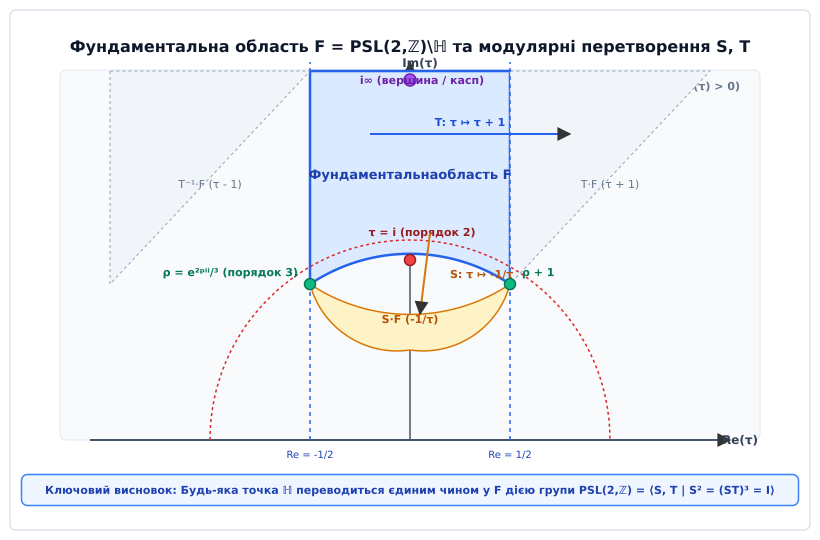
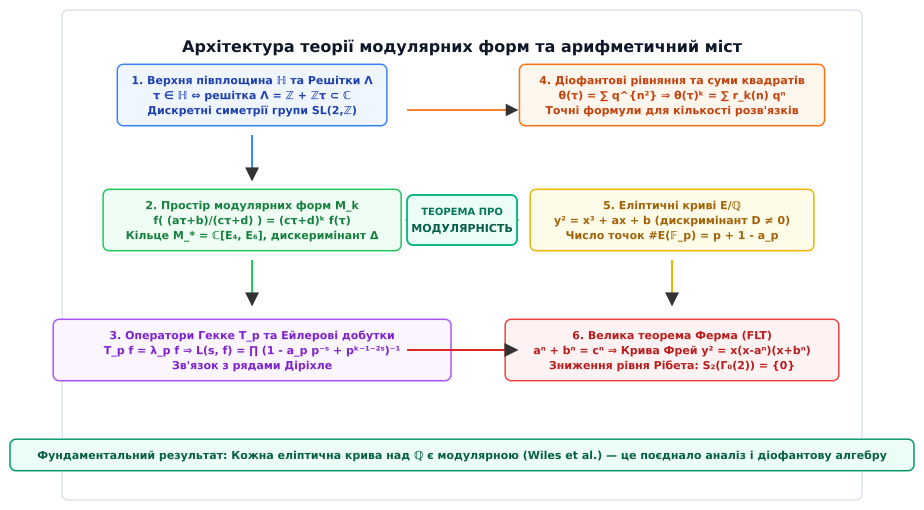

# Модулярні форми

<preknowlist>
- [Модулярна арифметика](root:math-number-theory/modular-arithmetic) — порівняння за модулем, класи залишків та дискретні симетрії.
- [L-функції Діріхле](root:math-number-theory/dirichlet-l-functions) — аналітичні ряди, L-функції та їхні Ейлерові добутки.
- [Діофантові рівняння](root:math-number-theory/diophantine-equations) — представлення цілих чисел алгебраїчними формами та сумами квадратів.
- [Основна теорема арифметики](root:math-number-theory/fundamental-theorem-arithmetic) — мультиплікативна структура цілих чисел та розклад на прості множники.
</preknowlist>

> 🔧 **Навіщо це.**
> Модулярні форми утворюють найпотужніший міст між неперервним комплексним аналізом та дискретною теорією чисел. Вони виникають там, де аналітичні функції володіють нескінченною симетрією відносно дробово-лінійних перетворень модулярної групи `SL(2, ℤ)`. Завдяки цій внутрішній симетрії коефіцієнти Фур'є модулярних форм кодують точні розв'язки фундаментальних діофантових задач: від обчислення кількості способів представлення чисел сумами квадратів `r_k(n)` до розкладу простих дільників у гескеївських L-функціях. Модулярні форми є центральним елементом доведення Великої теореми Ферма (через теорему про модулярність еліптичних кривих Вайлса), основою сучасної криптографії на еліптичних кривих, теорії струн та програми Ленглендса.

## 1. Від геометричних решіток до Верхньої півплощини та симетрій `SL(2, ℤ)`

Спроба порахувати кількість способів представлення натурального числа `n` у вигляді суми `k` квадратів цілих чисел — `r_k(n) = |{ (x₁, ..., x_k) ∈ ℤ^k : x₁² + ... + x_k² = n }|` — швидко впирається в непроникну стіну для класичної комбінаторики та елементарної теорії чисел. Для `k = 2` або `k = 4` ще вдається отримати комбінаторні формули через дільники, але вже для `k = 8`, `k = 12` чи загального `k` арифметична структура `r_k(n)` демонструє складні осциляції, які неможливо розкрити суто алгебраїчними розкладами. Аналогічна прірва виникає в діофантових рівняннях: класичні методи розкладу на прості дільники в алгебраїчних числах безпорадні проти рівнянь високих ступенів (як-от рівняння Ферма `xⁿ + yⁿ = zⁿ` або рівняння еліптичних кривих `y² = x³ + a·x + b`), бо вони не мають неперервного інваріанта, який пов'язував би дискретні підрахунки точок із глобальними симетріями. Без аналітичного інструменту, що перетворює дискретні комбінаторні послідовності на неперервні функції з нескінченною симетрією, обчислення `r_k(n)` та розв'язання таких діофантових задач залишаються недосяжними.

Цим інструментом є модулярні форми, а ключ до їхньої побудови лежить у геометрії комплексних решіток. Для побудови аналітичного апарату, здатного захоплювати дискретні властивості цілих чисел, звернімося до простору двовимірних ґраток на комплексній площині.

Нехай у комплексній площині `ℂ` задано два комплексні числа `ω₁` та `ω₂`, які є лінійно незалежними над дійсними числами `ℝ`. Множина їхніх цілочисельних лінійних комбінацій утворює двовимірну решітку (ґратку) `Λ`:

```
Λ = { m · ω₁ + n · ω₂ : m, n ∈ ℤ }
```

Геометрично така решітка задає періодичну сітку вузлів на комплексній площині. Якщо масштабувати решітку, поділивши всі її елементи на базисне число `ω₁`, геометрична конфігурація вузлів збережеться з точністю до повороту та розтягу. Нова решітка `Λ' = (1 / ω₁) · Λ` задається єдиним комплексним параметром `τ`:

```
τ = ω₂ / ω₁
```

Щоб вектори `(ω₁, ω₂)` утворювали додатньо орієнтований базис комплексної площини (тобто поворот від `ω₁` до `ω₂` здійснювався проти годинникової стрілки), уявна частина параметра `τ` має бути строго додатною. Множина таких чисел утворює **Верхню півплощину** (англ. *Upper Half-Plane*):

```
ℍ = { τ = x + i·y ∈ ℂ : y = Im(τ) > 0 }
```

Одна й та сама решітка `Λ` може бути побудована з різних базисів. Дві пари базисних векторів `(ω₁, ω₂)` та `(ω₁', ω₂')` задають точно одну й ту саму решітку `Λ` тоді й лише тоді, коли існує цілочисельна матриця з детермінантом `+1`, яка пов'язує ці базиси:

```
( ω₂' )   ( a  b ) ( ω₂ )
(     ) = (      ) (    ),     a, b, c, d ∈ ℤ,   a·d - b·c = 1
( ω₁' )   ( c  d ) ( ω₁ )
```

Множина таких матриць розміру `2 × 2` із цілочисельними елементами та детермінантом `1` утворює **спеціальну лінійну групу** `SL(2, ℤ)` (лат. *specialis linearis* — особлива лінійна група залишків):

```
SL(2, ℤ) = { ( a  b ) : a, b, c, d ∈ ℤ,  a·d - b·c = 1 }
             ( c  d )
```

Дія матриці `γ = (a, b; c, d) ∈ SL(2, ℤ)` на параметр решітки `τ ∈ ℍ` задається дробово-лінійною трансформацією (перетворенням Мебіуса):

```
γ · τ = (a·τ + b) / (c·τ + d)
```

Знайдемо дійсну та уявну частини перетвореної точки. Помножимо чисельник і знаменник на комплексно спряжене число `c·τ̄ + d`:

```
γ · τ = ( (a·τ + b) · (c·τ̄ + d) ) / |c·τ + d|²                      [множення чисельника й знаменника на c·τ̄ + d]
      = ( a·c·|τ|² + a·d·τ + b·c·τ̄ + b·d ) / |c·τ + d|²             [розкриття дужок у чисельнику]
```

Беручи уявну частину і враховуючи, що `Im(τ̄) = -Im(τ)` та `a·d - b·c = 1`:

```
Im(γ · τ) = ( a·d·Im(τ) + b·c·Im(τ̄) ) / |c·τ + d|²                   [виділення уявної частини чисельника]
          = ( (a·d - b·c) · Im(τ) ) / |c·τ + d|²                     [врахування тотожності Im(τ̄) = -Im(τ)]
          = Im(τ) / |c·τ + d|²                                       [використання детермінанта a·d - b·c = 1]
```

Оскільки `Im(τ) > 0` та `|c·τ + d|² > 0`, дія групи `SL(2, ℤ)` переводить Верхню півплощину `ℍ` строго у себе.

### Гіперболічна геометрія півплощини Пуанкаре

Верхня півплощина `ℍ` наділена природною рімановою метрикою Лобачевського-Пуанкаре:

```
ds² = (dx² + dy²) / y²
```

Елемент гіперболічної площі задається формулою:

```
dμ = (dx · dy) / y²
```

Ця міра площі є повністю інваріантною відносно будь-якого дробово-лінійного перетворення `γ ∈ SL(2, ℝ)`. Перевіримо це прямим диференціюванням:

```
d(γ · τ) = d/dτ [ (a·τ + b) / (c·τ + d) ] dτ                         [диференціювання дробово-лінійного виразу]
         = ( (a·(c·τ + d) - c·(a·τ + b)) / (c·τ + d)² ) dτ           [правило диференціювання частки]
         = ( (a·d - b·c) / (c·τ + d)² ) dτ                           [розкриття дужок та скорочення a·c·τ]
         = dτ / (c·τ + d)²                                           [використання умови детермінанта a·d - b·c = 1]
```

Звідси довжина диференціала, поділена на уявну частину, дорівнює:

```
|d(γ · τ)| / Im(γ · τ) = ( |dτ| / |c·τ + d|² ) / ( Im(τ) / |c·τ + d|² )   [підстановка формул для d(γτ) та Im(γτ)]
                       = |dτ| / Im(τ)                                     [скорочення спільного знаменника |c·τ + d|²]
```

Отже, гіперболічна довжина та гіперболічна площа не змінюються при дії матриць `SL(2, ℤ)`.

### Генератори та фундаментальна область

Модулярна група `SL(2, ℤ)` породжується лише двома фундаментальними трансформаціями:

1. **Паралельний зсув `T`:** матриця `(1, 1; 0, 1)`, дія `T(τ) = τ + 1`. Зсуває точку вздовж дійсної осі на одиницю.
2. **Інверсія `S`:** матриця `(0, -1; 1, 0)`, дія `S(τ) = -1 / τ`. Відображає точку відносно одиничного кола з поворотом.

**Доведення породженості через алгоритм Евкліда.** Нехай `γ = (a, b; c, d) ∈ SL(2, ℤ)`. Покажемо, що множенням на `S` та степені `T` матрицю `γ` можна звести до одиничної:
1. Якщо `c = 0`, то умова `a·d - b·c = 1` дає `a·d = 1`, тобто `a = d = 1` або `a = d = -1`. Тоді матриця має вигляд `± (1, b; 0, 1) = ± Tᵇ`.
2. Якщо `c ≠ 0`, застосуємо алгоритм ділення з остачею до чисел `d` та `c`: `d = q · c + r`, де `0 ≤ r < |c|`.
3. Множимо матрицю праворуч на `T^{-q} = (1, -q; 0, 1)`:
   ```
   ( a  b ) · ( 1 -q ) = ( a   b - q·a )
   ( c  d )   ( 0  1 )   ( c   d - q·c ) = ( c  r )
   ```
4. Множимо результат праворуч на `S = (0, -1; 1, 0)`:
   ```
   ( *  * ) · ( 0 -1 ) = ( *  * )
   ( c  r )   ( 1  0 )   ( r -c )
   ```
   Новий нижній лівий елемент став рівним `r < |c|`. Оскільки залишок строго зменшується, за скінченну кількість кроків ми отримаємо `c = 0`, що зводить будь-яку матрицю до добутку `S` та `T`.

Ці генератори задовольняють фундаментальні алгебраїчні співвідношення `S² = -I` та `(S · T)³ = -I`. Оскільки матриці `+I` та `-I` діють на `ℍ` однаково (множник `-1` скорочується в чисельнику і знаменнику), справжньою групою геометричних перетворень є проективна модулярна група:

```
PSL(2, ℤ) = SL(2, ℤ) / { ±I } ≅ ℤ/2ℤ * ℤ/3ℤ
```

Факторизуючи півплощину `ℍ` за дією групи `PSL(2, ℤ)`, отримуємо **фундаментальну область** `ℱ` — геометричний регіон, що містить рівно по одному представнику з кожної орбіти:

```
ℱ = { τ ∈ ℍ : |Re(τ)| ≤ 1/2,  |τ| ≥ 1 }
```


*Рисунок 1. Фундаментальна область F та дія модулярних перетворень S і T у верхній півплощині.*

Обчислимо точну гіперболічну площу фундаментальної області `ℱ`:

```
Area(ℱ) = ∬_{ℱ} (dx · dy) / y²
        = ∫_{-1/2}^{1/2} dx ∫_{√(1 - x²)}^\infty y⁻² dy                       [межі за x та нижня дуга одиничного кола]
        = ∫_{-1/2}^{1/2} [ -1/y ]_{√(1 - x²)}^\infty dx                       [інтегрування за y]
        = ∫_{-1/2}^{1/2} ( 1 / √(1 - x²) ) dx                                [підстановка границь]
        = [ arcsin(x) ]_{-1/2}^{1/2}                                         [табличний первісний інтеграл]
        = arcsin(1/2) - arcsin(-1/2)                                         [різниця границь]
        = π/6 - (-π/6) = π/3                                                 [остаточна гіперболічна площа]
```

Цей результат також прямо узгоджується з формулою Гауса-Бонне для некомпактного гіперболічного трикутника з кутами `π/3`, `π/3` та `0` (вершина у нескінченності `i∞`): `Area = π - (π/3 + π/3 + 0) = π/3`.

Геометричні вершини фундаментальної області включають дві особливі еліптичні точки:
- Точку `τ = i = (0, 1)`, яка залишається нерухомою при дії інверсії `S(i) = -1/i = i` (стабілізатор порядку 2 у `PSL(2, ℤ)`).
- Точку `ρ = e^{2πi/3} = -1/2 + i·√(3)/2`, яка залишається нерухомою при дії композиції `(S·T)(ρ) = ρ` (стабілізатор порядку 3 у `PSL(2, ℤ)`).

При склеюванні межових вертикальних променів `Re(τ) = -1/2` та `Re(τ) = 1/2` за допомогою зсуву `T`, а також лівої та правої половин нижньої дуги `|τ| = 1` за допомогою інверсії `S`, фактор-простір `PSL(2, ℤ)\ℍ` перетворюється на 2-вимірну сферу Рімана з трьома конічними точками: `i` (порядок 2), `ρ` (порядок 3) та нескінченність `i∞` (вершина / касп).

### Алгоритм модулярної редукції Ґаусса

Для будь-якої заданої точки `τ₀ ∈ ℍ` алгоритм редукції дозволяє за скінченну кількість кроків знайти матрицю `γ ∈ SL(2, ℤ)` таку, що `γ · τ₀ ∈ ℱ`:

1. **Крок зсуву `T`:** Знаходимо ціле число `n = ⌊Re(τ) + 1/2⌋` та зсуваємо `τ ← τ - n`. Тепер `|Re(τ)| ≤ 1/2`.
2. **Перевірка одиничного кола:** Якщо `|τ| ≥ 1`, точка потрапила у `ℱ` — алгоритм завершено.
3. **Крок інверсії `S`:** Якщо `|τ| < 1`, застосовуємо `τ ← -1/τ`. При цьому уявна частина строго зростає:
   ```
   Im(-1/τ) = Im(τ) / |τ|² > Im(τ)
   ```
4. Повертаємося до кроку 1.

Оскільки орбіта `{γ · τ₀ : γ ∈ SL(2, ℤ)}` дискретна, а уявна частина не може зростати нескінченно, алгоритм гарантовано зупиняється.

**Числовий приклад трасування.** Візьмемо початкову точку `τ₀ = 0.2 + 0.1·i`:
- Крок 1: `Re(τ₀) = 0.2 ∈ [-0.5, 0.5]`. Зсув не потрібен (`n = 0`).
- Крок 2: `|τ₀|² = 0.2² + 0.1² = 0.04 + 0.01 = 0.05 < 1`. Застосовуємо інверсію `S`:
  ```
  τ₁ = -1 / (0.2 + 0.1·i) = (-0.2 + 0.1·i) / 0.05 = -4 + 2·i
  ```
- Крок 3: `Re(τ₁) = -4 ∉ [-0.5, 0.5]`. Зсуваємо на `+4` за допомогою `T⁴`:
  ```
  τ₂ = τ₁ + 4 = 2·i
  ```
- Крок 4: `Re(τ₂) = 0 ∈ [-0.5, 0.5]` та `|τ₂| = 2 ≥ 1`. Точка `2·i` належить фундаментальній області `ℱ`!

Результуюче перетворення задається добутком матриць `γ = T⁴ · S`:
```
γ = ( 1  4 ) · ( 0 -1 ) = ( 4 -1 )
    ( 0  1 )   ( 1  0 )   ( 1  0 )
```
Перевірка: `γ · τ₀ = (4·(0.2 + 0.1·i) - 1) / (1·(0.2 + 0.1·i) + 0) = (-0.2 + 0.4·i) / (0.2 + 0.1·i) = 2·i`. Обчислення повністю зійшлися.

### Підгрупи конгруентності та простори модулів

Для дослідження складніших арифметичних об'єктів (зокрема еліптичних кривих із фіксованою крутильною структурою) розглядають підгрупи скінченного індексу в `SL(2, ℤ)` — **підгрупи конгруентності**.

Для заданого натурального числа `N ≥ 1` (рівня):

1. **Головна підгрупа конгруентності рівня `N`:**
   ```
   Γ(N) = { (a, b; c, d) ∈ SL(2, ℤ) : a ≡ d ≡ 1 (mod N),  b ≡ c ≡ 0 (mod N) }
   ```
   Це ядро природного гомоморфізму редукції `SL(2, ℤ) → SL(2, ℤ/Nℤ)`. Її індекс у `SL(2, ℤ)` дорівнює `[SL(2, ℤ) : Γ(N)] = N³ · ∏_{p | N} (1 - 1/p²)`.

2. **Підгрупа `Γ₁(N)`:**
   ```
   Γ₁(N) = { (a, b; c, d) ∈ SL(2, ℤ) : a ≡ d ≡ 1 (mod N),  c ≡ 0 (mod N) }
   ```
   Індекс для `N > 2`: `[SL(2, ℤ) : Γ₁(N)] = N² · ∏_{p | N} (1 - 1/p²)`.

3. **Найважливіша підгрупа `Γ₀(N)`:**
   ```
   Γ₀(N) = { (a, b; c, d) ∈ SL(2, ℤ) : c ≡ 0 (mod N) }
   ```
   Індекс підгрупи: `μ = [SL(2, ℤ) : Γ₀(N)] = N · ∏_{p | N} (1 + 1/p)`.

Фактор-простори `Y(Γ) = Γ\ℍ` мають глибоку геометричну інтерпретацію як простори модулів еліптичних кривих:
- `Y(1) = SL(2, ℤ)\ℍ` класифікує класи ізоморфізму комплексних еліптичних кривих `E ≅ ℂ/Λ`.
- `Y₀(N) = Γ₀(N)\ℍ` класифікує пари `(E, C_N)`, де `E` — еліптична крива, а `C_N ⊂ E` — циклічна підгрупа порядку `N` (що еквівалентно `N`-ізогенії `E → E/C_N`).
- `Y₁(N) = Γ₁(N)\ℍ` класифікує пари `(E, P)`, де `P ∈ E` — точка точного порядку `N`.
- `Y(N) = Γ(N)\ℍ` класифікує трійки `(E, P₁, P₂)`, де `(P₁, P₂)` — симплектичний базис підгрупи точок `N`-кручення `E[N] ≅ (ℤ/Nℤ)²`.

### Каспи та компактифікація модулярних кривих

Фактор-простір `Y₀(N) = Γ₀(N)\ℍ` є некомпактною рімановою поверхнею. Щоб компактифікувати її, додають множину раціональних граничних точок на дійсній осі разом із нескінченністю: `ℚ ∪ {i∞}` (множина вершин або **каспів**).

Компактна модулярна крива позначається:
```
X₀(N) = Γ₀(N) \ ( ℍ ∪ ℚ ∪ {i∞} )
```

Кількість каспів кривої `X₀(N)` для простого рівня `N = p` дорівнює рівно **двом**:
1. **Касп у нескінченності `[i∞]`:** його стабілізатор у `Γ₀(p)` породжується матрицею `T = (1, 1; 0, 1)`, ширина каспу `h = 1`.
2. **Касп у нулі `[0]`:** стабілізатор породжується матрицею `(1, 0; p, 1) = S · T⁻ᵖ · S⁻¹`, ширина каспу `h = p`.

Рід (англ. *genus*) компактної модулярної кривої `X₀(N)` обчислюється за формулою Рімана-Гурвіца:

```
g(X₀(N)) = 1 + μ / 12 - ν₂ / 4 - ν₃ / 3 - ν_∞ / 2
```

де `μ` — індекс підгрупи, `ν₂`, `ν₃` — кількість еліптичних точок порядків 2 і 3, а `ν_∞` — кількість каспів. Для рівнів `N = 1, 2, 3, 4, 5, 6, 7, 8, 9, 10, 12, 13, 16, 18, 25` рід `g(X₀(N)) = 0`, що означає, що функціональне поле кривої є раціональним (породжується єдиним інваріантом Hauptmodul). Для кривих нульового роду класифікація раціональних точок пов'язана з параметризацією нескінченних сімей еліптичних кривих із заданою крутильною підгрупою за теоремою Мазура про кручення.


## 2. Означення модулярної форми, вага та голоморфність у каспах

Подвійно періодичні мероморфні функції на комплексній площині (еліптичні функції) обов'язково мають полюси. Проте якщо ми вимагаємо від функції на Верхній півплощині `ℍ` голоморфності та специфічного закону перетворення при масштабуванні решітки, ми приходимо до поняття модулярної форми.

**Означення.** Комплекснозначна функція `f: ℍ → ℂ` називається **модулярною формою ваги `k`** (де `k ∈ ℤ`) відносно модулярної групи `SL(2, ℤ)`, якщо вона задовольняє такі три умови:

1. **Закон модулярного перетворення:** Для будь-якої матриці `γ = (a, b; c, d) ∈ SL(2, ℤ)` та будь-якої точки `τ ∈ ℍ`:
   ```
   f( (a·τ + b) / (c·τ + d) ) = (c·τ + d)ᵏ · f(τ)
   ```
   У позначеннях слеш-оператора Петерсона ваги `k`:
   ```
   (f |_k γ)(τ) = (c·τ + d)⁻ᵏ · f(γ · τ) = f(τ)
   ```

2. **Голоморфність на півплощині:** Функція `f(τ)` є комплексно-диференційовною (голоморфною) у кожній точці `τ ∈ ℍ`.

3. **Голоморфність у нескінченності (у каспі `i∞`):**
   Підставляючи матрицю паралельного зсуву `T = (1, 1; 0, 1)`, отримуємо умову періодичності:
   ```
   f(τ + 1) = f(τ)
   ```
   Будь-яка періодична голоморфна функція на верхній півплощині розкладається в ряд Фур'є за зміщеною комплексною змінною `q = e^{2πiτ}` (де `|q| = e^{-2π·Im(τ)} < 1` при `Im(τ) > 0`):
   ```
   f(τ) = ∑_{n = -∞}^\infty a_n · qⁿ
   ```
   Вимога голоморфності у нескінченності означає, що розклад Фур'є не містить від'ємних степеней `q` (немає полюса у точці `q = 0`):
   ```
   f(τ) = ∑_{n=0}^\infty a_n · qⁿ = a₀ + a₁·q + a₂·q² + a₃·q³ + ...
   ```

Якщо додатково вільний член `a₀ = 0`, тобто граничне значення при `Im(τ) → +∞` (коли `q → 0`) дорівнює нулю:
```
lim_{Im(τ) → ∞} f(τ) = 0
```
то функція `f` називається **параболічною модулярною формою** або **гострою формою** (англ. *cusp form*, нім. *Spitzenform*).

Класичні позначення векторних просторів:
- `M_k(SL(2, ℤ))` — векторний простір усіх модулярних форм ваги `k`.
- `S_k(SL(2, ℤ))` — підпростір параболічних форм ваги `k`.
- `E_k(SL(2, ℤ))` — простір рядів Ейзенштейна ваги `k`.

Простір усіх модулярних форм розпадається у пряму ортогональну суму:
```
M_k(SL(2, ℤ)) = E_k(SL(2, ℤ)) ⊕ S_k(SL(2, ℤ))
```

### Парність ваги та модулярні характери (Небентіп)

Розглянемо центральний елемент `-I = (-1, 0; 0, -1) ∈ SL(2, ℤ)`. Його дія на точку півплощини є тотожною: `(-τ + 0)/(0·τ - 1) = τ`. Проте за законом модулярного перетворення маємо:

```
f(τ) = (f |_k (-I))(τ) = (-1)ᵏ · f(τ)
```

Якщо вага `k` є непарною, то `(-1)ᵏ = -1`, звідки `f(τ) = -f(τ)`, що означає `f(τ) ≡ 0`. Отже, для повної модулярної групи `SL(2, ℤ)` ненульові модулярні форми існують **виключно при парних вагах `k`**.

Для підгруп конгруентності `Γ₁(N)` та `Γ₀(N)` закон перетворення узагальнюють за допомогою характеру Діріхле `χ: (ℤ/Nℤ)* → ℂ*` (так званого характеру Небентіпа, нім. *Nebentypus*):

```
f( (a·τ + b) / (c·τ + d) ) = χ(d) · (c·τ + d)ᵏ · f(τ),     де (a,b; c,d) ∈ Γ₀(N)
```

У просторі `M_k(Γ₀(N), χ)` ненульові форми можуть існувати і для непарних ваг `k`, за умови, що характер `χ` має таку саму парність: `χ(-1) = (-1)ᵏ`.

### Голоморфність у довільних каспах для підгруп конгруентності

Для форми `f ∈ M_k(Γ₀(N))` вимога голоморфності має виконуватися не лише у нескінченності `i∞`, але й у кожному раціональному каспі `s = a/c ∈ ℚ`. 

Для перевірки каспу `s` знаходять матрицю `γ_s ∈ SL(2, ℤ)`, яка переводить нескінченність у даний касп: `γ_s(i∞) = s`. Розглядають функцію `f |_k γ_s`. Вона є періодичною з періодом `h_s` (шириною каспу). Її розклад Фур'є має вигляд:

```
(f |_k γ_s)(τ) = ∑_{n=0}^\infty a_n(s) · q^{n / h_s},     де q^{1/h_s} = e^{2πiτ / h_s}
```

Функція `f` є параболічною формою `f ∈ S_k(Γ₀(N))`, якщо вільні члени `a₀(s) = 0` для **всіх** каспів `s`.

### Оцінки зростання коефіцієнтів Фур'є

Арифметика коефіцієнтів Фур'є `a_n` суттєво різниться для рядів Ейзенштейна та параболічних форм:

1. **Для рядів Ейзенштейна:** Коефіцієнти `a_n` виражаються через суми степеней дільників `σ_{k-1}(n)`. Їхня швидкість зростання описується оцінкою:
   ```
   a_n = O(n^{k-1})
   ```
2. **Для параболічних форм (Межа Гекке):** Оскільки `f(τ)` прямує до нуля в усіх каспах, функція `|f(τ)| · (Im(τ))^{k/2}` є інваріантною відносно групи та обмеженою на всій півплощині `ℍ`: `|f(x + i·y)| ≤ M / y^{k/2}`. Обчислюючи коефіцієнти Фур'є через інтеграл Коші вздовж горизонтального відрізка `y = 1/n`:
   ```
   a_n = ∫₀¹ f(x + i/n) · e^{-2πi n (x + i/n)} dx
   ```
   отримуємо оцінку Гекке:
   ```
   |a_n| ≤ M · n^{k/2} · e^{2π} = O(n^{k/2})
   ```
3. **Гіпотеза Рамануджана-Петерсона (Теорема Деліня):** У 1974 році П'єр Делінь довів, що для будь-якої нормованої параболічної власної форми Гекке коефіцієнти задовольняють екстремально точну оцінку:
   ```
   |a_p| ≤ 2 · p^{(k-1)/2}
   ```
   для кожного простого числа `p`. Це означає, що коефіцієнти Фур'є параболічних форм демонструють глибокі інтерференційні осциляції, аналогічні випадковим тригонометричним сумам.

## 3. Базові цеглини: Ряди Ейзенштейна, Дискримінант `Δ` та кільце модулярних форм

Для явної побудови модулярних форм застосовують метод усереднення за решіткою.

### Ряди Ейзенштейна `G_{2k}(τ)` та їхня абсолютна збіжність

Для парного цілого `k ≥ 2` (тобто ваги `2k ≥ 4`) розглянемо подвійний ряд Ейзенштейна:

```
G_{2k}(τ) = ∑_{(m,n) ∈ ℤ² \ {(0,0)}} 1 / (m·τ + n)^{2k}
```

Абсолютна збіжність цього ряду випливає з інтегрального критерію. Кількість вузлів решітки `|m·τ + n|` у кільці радіусів `[R, R + 1]` зростає пропорційно `R`. Тому сума мажорується збіжним інтегралом:

```
∬_{x² + y² ≥ 1} (1 / (x² + y²)^k) dx dy = 2π · ∫₁^\infty r^{1 - 2k} dr < ∞      при 2k ≥ 4
```

Перевіримо закон перетворення під дією матриці `(a, b; c, d) ∈ SL(2, ℤ)`:

```
G_{2k}( (a·τ + b) / (c·τ + d) ) 
= ∑_{(m,n) ≠ (0,0)} 1 / ( m · ((a·τ + b) / (c·τ + d)) + n )^{2k}               [підстановка перетворення Мебіуса]
= (c·τ + d)^{2k} · ∑_{(m,n) ≠ (0,0)} 1 / ( (m·a + n·c)·τ + (m·b + n·d) )^{2k}      [винесення спільного знаменника]
= (c·τ + d)^{2k} · G_{2k}(τ)                                                       [бієкція решітки: SL(2,ℤ) переставляє вузли]
```

Оскільки матриця `(a, b; c, d)` має цілочисельний обернений елемент `(d, -b; -c, a)`, лінійне перетворення `(m', n') = (m·a + n·c, m·b + n·d)` здійснює взаємно однозначне відображення множини `ℤ² \ {(0,0)}` на себе.

### Повне покрокове виведення `q`-розкладу рядів Ейзенштейна

Розкладемо подвійну суму `G_{2k}(τ)` на два доданки — коли `m = 0` та коли `m ≠ 0`:

```
G_{2k}(τ) = ∑_{n ≠ 0} 1 / n^{2k} + 2 · ∑_{m=1}^\infty ∑_{n=-∞}^\infty 1 / (m·τ + n)^{2k}
          = 2 · ζ(2k) + 2 · ∑_{m=1}^\infty ∑_{n=-∞}^\infty 1 / (m·τ + n)^{2k}
```

де `ζ(s) = ∑_{n=1}^\infty n⁻ˢ` — дзета-функція Рімана.

Для підсумовування внутрішнього ряду за `n` скористаємося класичним розкладом котангенса на прості дроби (формулою Ейлера):

```
π · cot(π·z) = 1/z + ∑_{n=1}^\infty ( 1 / (z + n) + 1 / (z - n) ) = lim_{N → ∞} ∑_{n=-N}^N 1 / (z + n)
```

З іншого боку, запишемо котангенс через експоненти для `Im(z) > 0`:

```
π · cot(π·z) = π · (cos(π·z) / sin(π·z))                                    [означення котангенса]
             = π · ( (e^{iπz} + e^{-iπz})/2 ) / ( (e^{iπz} - e^{-iπz})/(2i) ) [формули Ейлера для синуса та косинуса]
             = iπ · (e^{iπz} + e^{-iπz}) / (e^{iπz} - e^{-iπz})             [скорочення двійки та перенесення уявної одиниці]
             = -iπ · (1 + e^{2πiz}) / (1 - e^{2πiz})                        [винесення множника e^{-iπz} та зведення дробів]
             = -iπ · ( 1 + 2 · ∑_{d=1}^\infty e^{2πi d z} )                 [розклад геометричної прогресії для Im(z) > 0]
             = -iπ - 2πi · ∑_{d=1}^\infty e^{2πi d z}                       [розкриття зовнішніх дужок]
```

Диференціюємо обидві частини цієї тотожності `2k - 1` разів за змінною `z`.

Для лівої частини (суми дробів):
```
d^{2k - 1} / dz^{2k - 1} [ ∑_{n=-∞}^\infty 1 / (z + n) ] = (-1)^{2k - 1} · (2k - 1)! · ∑_{n=-∞}^\infty 1 / (z + n)^{2k}
                                                         = - (2k - 1)! · ∑_{n=-∞}^\infty 1 / (z + n)^{2k}
```

Для правої частини (експоненційного ряду):
```
d^{2k - 1} / dz^{2k - 1} [ -iπ - 2πi · ∑_{d=1}^\infty e^{2πi d z} ] = -2πi · ∑_{d=1}^\infty (2πi d)^{2k - 1} · e^{2πi d z}
                                                                   = - (2πi)^{2k} · ∑_{d=1}^\infty d^{2k - 1} · e^{2πi d z}
```

Прирівнюючи ліву та праву частини, маємо тотожність Ліпшица:

```
∑_{n=-∞}^\infty 1 / (z + n)^{2k} = ( (2πi)^{2k} / (2k - 1)! ) · ∑_{d=1}^\infty d^{2k - 1} · e^{2πi d z}
                                 = ( (-1)^k · (2π)^{2k} / (2k - 1)! ) · ∑_{d=1}^\infty d^{2k - 1} · e^{2πi d z}
```

Підставимо `z = m·τ` (де `e^{2πi d z} = e^{2πi d m τ} = (e^{2πi τ})^{m·d} = q^{m·d}`):

```
∑_{m=1}^\infty ∑_{n=-∞}^\infty 1 / (m·τ + n)^{2k} = ( (-1)^k · (2π)^{2k} / (2k - 1)! ) · ∑_{m=1}^\infty ∑_{d=1}^\infty d^{2k - 1} · q^{m·d}
```

Згрупуємо члени у подвійній сумі за добутком `n = m·d`:

```
∑_{m=1}^\infty ∑_{d=1}^\infty d^{2k - 1} · q^{m·d} = ∑_{n=1}^\infty ( ∑_{d | n} d^{2k - 1} ) · qⁿ = ∑_{n=1}^\infty σ_{2k - 1}(n) · qⁿ
```

де `σ_a(n) = ∑_{d | n} dᵃ` — арифметична функція суми степенів дільників.

Підставляючи отриманий вираз у формулу для `G_{2k}(τ)`:

```
G_{2k}(τ) = 2·ζ(2k) + ( 2 · (-1)^k · (2π)^{2k} / (2k - 1)! ) · ∑_{n=1}^\infty σ_{2k - 1}(n) · qⁿ
```

Згадаємо знамениту формулу Ейлера для значень дзета-функції у парних точках через числа Бернуллі `B_{2k}`:

```
ζ(2k) = ( (-1)^{k + 1} · (2π)^{2k} · B_{2k} ) / ( 2 · (2k)! )
```

Звідси коефіцієнт при сумі дорівнює:

```
( 2 · (-1)^k · (2π)^{2k} / (2k - 1)! ) / ( 2·ζ(2k) ) = - (4k / B_{2k})
```

Нормуючи ряд `G_{2k}(τ)` так, щоб вільний член `a₀` дорівнював `1`, отримуємо **нормовані ряди Ейзенштейна** `E_{2k}(τ) = G_{2k}(τ) / (2·ζ(2k))`:

```
E_{2k}(τ) = 1 - (4k / B_{2k}) · ∑_{n=1}^\infty σ_{2k - 1}(n) · qⁿ
```

### Явні розклади та нетривіальні згортки дільників

Значення перших чисел Бернуллі: `B₂ = 1/6`, `B₄ = -1/30`, `B₆ = 1/42`, `B₈ = -1/30`, `B₁₀ = 5/66`, `B₁₂ = -691/2730`, `B₁₄ = 7/6`.

Підставляючи їх у загальну формулу, одержуємо точні ряди Фур'є:

```
E₄(τ)  = 1 + 240 · ∑_{n=1}^\infty σ₃(n) · qⁿ  = 1 + 240·q + 2160·q² + 6720·q³ + 17520·q⁴ + ...
E₆(τ)  = 1 - 504 · ∑_{n=1}^\infty σ₅(n) · qⁿ  = 1 - 504·q - 16632·q² - 122976·q³ - 532704·q⁴ - ...
E₈(τ)  = 1 + 480 · ∑_{n=1}^\infty σ₇(n) · qⁿ  = 1 + 480·q + 61920·q² + ...
E₁₀(τ) = 1 - 264 · ∑_{n=1}^\infty σ₉(n) · qⁿ  = 1 - 264·q - 135432·q² - ...
E₁₂(τ) = 1 + (65520 / 691) · ∑_{n=1}^\infty σ₁₁(n) · qⁿ
E₁₄(τ) = 1 - 24 · ∑_{n=1}^\infty σ₁₃(n) · qⁿ
```

Завдяки формулі валентності (докладніше у вставці [Формула валентності та структура простору модулярних форм](root:math-number-theory/modular-forms/math-valence-formula.md)), розмірності просторів `M₈` та `M₁₀` дорівнюють `1`. Це породжує фундаментальні тотожності між формами:

```
E₈ = E₄²
E₁₀ = E₄ · E₆
```

Прирівнюючи коефіцієнти при `qⁿ` в тотожності `E₈ = E₄²`, отримуємо нетривіальне арифметичне співвідношення для згортки дільників:

```
480 · σ₇(n) = 480 · σ₃(n) + 240² · ∑_{m=1}^{n-1} σ₃(m) · σ₃(n - m)
σ₇(n) = σ₃(n) + 120 · ∑_{m=1}^{n-1} σ₃(m) · σ₃(n - m)
```

**Числова перевірка для `n = 2`:**
- Зліва: `σ₇(2) = 1⁷ + 2⁷ = 1 + 128 = 129`.
- Справа: `σ₃(2) + 120 · σ₃(1) · σ₃(1) = (1³ + 2³) + 120 · 1 · 1 = 9 + 120 = 129`. Збіг ідеальний!

Аналогічно, тотожність `E₁₀ = E₄ · E₆` дає формулу:

```
-264 · σ₉(n) = 240 · σ₃(n) - 504 · σ₅(n) - 120960 · ∑_{m=1}^{n-1} σ₃(m) · σ₅(n - m)
```

Для `n = 2`:
- `σ₉(2) = 1 + 512 = 513`, отже `-264 · 513 = -135432`.
- Справа: `240 · 9 - 504 · (1 + 32) - 120960 · 1 · 1 = 2160 - 16632 - 120960 = -135432`. Збіг абсолютний.

### Модулярний дискримінант `Δ(τ)` та тау-функція Рамануджана

Оскільки `E₄³` має вагу `4 · 3 = 12`, а `E₆²` має вагу `6 · 2 = 12`, їхня різниця знищує вільний член `1 - 1 = 0`. Отримуємо параболічну форму ваги 12 — **модулярний дискримінант** `Δ(τ)`:

```
Δ(τ) = ( E₄(τ)³ - E₆(τ)² ) / 1728 = q · ∏_{n=1}^\infty (1 - qⁿ)²⁴ = ∑_{n=1}^\infty τ(n) · qⁿ
```

Нормувальний дільник `1728 = 12³` гарантує, що перший коефіцієнт `τ(1) = 1`.

Значення функції Рамануджана `τ(n)` для перших десяти чисел:

| `n` | `1` | `2` | `3` | `4` | `5` | `6` | `7` | `8` | `9` | `10` |
|---|---|---|---|---|---|---|---|---|---|---|
| `τ(n)` | `1` | `-24` | `252` | `-1472` | `4830` | `-6048` | `-16744` | `84480` | `-113643` | `-115920` |

### Алгебраїчна фільтрація та рекурентне обчислення розмірностей просторів `M_k`

Формула розмірності просторів модулярних форм безпосередньо випливає з існування точної послідовності та властивостей дискримінанта `Δ`.

Розглянемо лінійний функціонал обчислення значення у каспі `i∞`:
```
ev_∞: M_k(SL(2, ℤ)) → ℂ,     ev_∞(f) = a₀(f) = lim_{Im(τ) → ∞} f(τ)
```

1. **Ядро функціонала:** За означенням, ядро `Ker(ev_∞)` складається з форм із нульовим вільним членом `a₀ = 0`, тобто збігається з простором параболічних форм `S_k(SL(2, ℤ))`.
2. **Сюр'єктивність:** Для будь-якого парного `k ≥ 4` нормований ряд Ейзенштейна `E_k` має `a₀ = 1`, що забезпечує сюр'єктивність відображення `ev_∞` на `ℂ`.
3. **Корозмірність:** З першої теореми про ізоморфізм випливає коротка точна послідовність векторних просторів:
   ```
   0 → S_k(SL(2, ℤ)) → M_k(SL(2, ℤ)) → ℂ → 0
   ```
   Звідси отримуємо перше ключове співвідношення між розмірностями:
   ```
   dim M_k(SL(2, ℤ)) = dim S_k(SL(2, ℤ)) + 1,     при k ≥ 4
   ```

4. **Ізоморфізм множення на `Δ`:** Якщо `f ∈ S_k(SL(2, ℤ))` — параболічна форма, то її розклад Фур'є починається з `q¹`, тобто `v_∞(f) ≥ 1`. Оскільки модулярний дискримінант `Δ ∈ S₁₂` має простий нуль у нескінченності `v_∞(Δ) = 1` і не перетворюється на нуль у жодній точці півплощини `ℍ`, частка `g = f / Δ` є всюди голоморфною на `ℍ` та в каспі `i∞`. Вага частки дорівнює `k - 12`. Отже, `g ∈ M_{k-12}(SL(2, ℤ))`.
5. Відображення множення на дискримінант:
   ```
   · Δ : M_{k-12}(SL(2, ℤ)) → S_k(SL(2, ℤ)),     g ↦ g · Δ
   ```
   є лінійним ізоморфізмом векторних просторів. Звідси випливає друге фундаментальне співвідношення:
   ```
   dim S_k(SL(2, ℤ)) = dim M_{k-12}(SL(2, ℤ))
   ```

Поєднуючи обидва співвідношення, отримуємо рекурентну формулу для розмірності простору модулярних форм:
```
dim M_k = dim M_{k-12} + 1,     при k ≥ 4
```

Базові значення розмірностей для `k < 12` знаходять за формулою валентності:
- `dim M₀ = 1` (лише константи).
- `dim M₂ = 0` (немає цілих розв'язків `a + b/2 + c/3 + d = 1/6`).
- `dim M₄ = 1` (базис `E₄`).
- `dim M₆ = 1` (базис `E₆`).
- `dim M₈ = 1` (базис `E₄²`).
- `dim M₁₀ = 1` (базис `E₄ · E₆`).

Звідси рекурентно випливає загальна замкнена формула розмірності для будь-якого парного `k ≥ 0`:
```
dim M_k(SL(2, ℤ)) = { ⌊k / 12⌋ + 1,    якщо k ≢ 2 (mod 12)
                    { ⌊k / 12⌋,        якщо k ≡ 2 (mod 12)
```

Це доводить, що градуйоване кільце модулярних форм `M_* = ⨁ M_k` породжується двома алгебраїчно незалежними генераторами `E₄` та `E₆`: `M_*(SL(2, ℤ)) = ℂ[E₄, E₆]`.


### Геометричний сенс дискримінанта для еліптичних кривих

Кожній решітці `Λ = ℤ·τ + ℤ` відповідає комплексна еліптична крива, яка задається рівнянням Вейєрштрасса:

```
y² = 4·x³ - g₂·x - g₃
```

де модулярні коефіцієнти `g₂` та `g₃` прямо пропорційні рядам Ейзенштейна:

```
g₂(τ) = 60 · G₄(τ) = (4π⁴ / 3) · E₄(τ)
g₃(τ) = 140 · G₆(τ) = (8π⁶ / 27) · E₆(τ)
```

Дискримінант кубічного многочлена `4x³ - g₂x - g₃` дорівнює:

```
Δ_{poly} = g₂³ - 27 · g₃²                                             [означення дискримінанта кубічного многочлена]
         = (4π⁴ / 3)³ · E₄³ - 27 · (8π⁶ / 27)² · E₆²                  [підстановка виразів g₂ = 4π⁴/3 E₄ та g₃ = 8π⁶/27 E₆]
         = (64π¹² / 27) · E₄³ - (64π¹² / 27) · E₆²                    [піднесення до степенів та скорочення 27/(27²)]
         = (64π¹² / 27) · ( E₄³ - E₆² )                               [винесення спільного числового множника]
         = (2π)¹² · ( (E₄³ - E₆²) / 1728 )                            [виділення множника (2π)¹² = 4096π¹² та 1728 = 12³]
         = (2π)¹² · Δ(τ)                                              [означення модулярного дискримінанта Δ]
```

Оскільки `Δ(τ) = q ∏ (1 - qⁿ)²⁴ ≠ 0` для будь-якої точки `τ ∈ ℍ`, дискримінант `Δ_{poly}` ніколи не перетворюється на нуль у верхній півплощині. Це доводить, що **будь-яка комплексна еліптична крива `ℂ/Λ` є гладким, несингулярним тором**.

### Мультиплікативність та порівняння Рамануджана за модулем 691

Коефіцієнти `τ(n)` задовольняють мультиплікативні співвідношення:

```
τ(m · n) = τ(m) · τ(n)                      при gcd(m, n) = 1
τ(pᵏ⁺¹) = τ(p) · τ(pᵏ) - p¹¹ · τ(pᵏ⁻¹)       для простого p
```

Крім того, Рамануджан відкрив знамените порівняння за простим модулем `691`:

```
τ(n) ≡ σ₁₁(n) (mod 691)
```

**Алгебраїчне виведення порівняння.**
Оскільки `dim M₁₂ = 2`, базис простору утворюють форми `E₄³` та `E₁₂`. Різниця `E₄³ - E₁₂` має нульовий вільний член (`1 - 1 = 0`), тому є параболічною формою і пропорційна `Δ`:

```
E₄³ - E₁₂ = ( 720 - 65520 / 691 ) · Δ                                  [прирівнювання коефіцієнтів при q: a₁(E₄³) - a₁(E₁₂)]
          = ( (497520 - 65520) / 691 ) · Δ                              [зведення до спільного знаменника: 720 · 691 = 497520]
          = ( 432000 / 691 ) · Δ                                        [віднімання в чисельнику: 497520 - 65520 = 432000]
```

Виразимо `E₁₂` через `E₄³` та `Δ`:

```
E₁₂ = E₄³ - ( 432000 / 691 ) · Δ                                        [вираження E₁₂ через E₄³ та Δ]
```

Помножимо обидві частини на 691:

```
691 · (E₄³ - E₁₂) = 432000 · Δ
```

Підставивши розклад `E₁₂ = 1 + (65520 / 691) · ∑ σ₁₁(n) · qⁿ` та `E₄³ = 1 + ∑ aₙ(E₄³) · qⁿ` (де всі `aₙ(E₄³) ∈ ℤ`), прирівняємо коефіцієнти при `qⁿ` для `n ≥ 1`:

```
432000 · τ(n) = 691 · aₙ(E₄³) - 65520 · σ₁₁(n)                         [прирівнювання коефіцієнтів при qⁿ]
```

Беручи це рівняння за модулем 691:

```
432000 · τ(n) ≡ -65520 · σ₁₁(n) (mod 691)                              [оскільки 691 · aₙ(E₄³) ≡ 0 (mod 691)]
```

Оскільки `432000 = 691 · 625 + 125 ≡ 125 (mod 691)` та `-65520 = 691 · (-95) + 125 ≡ 125 (mod 691)`:

```
125 · τ(n) ≡ 125 · σ₁₁(n) (mod 691)                                    [підстановка залишків за модулем 691]
```

Оскільки `gcd(125, 691) = 1` (число 691 є простим і не ділить 125), скорочуємо на 125:

```
τ(n) ≡ σ₁₁(n) (mod 691)                                                [скорочення на оборотний за модулем елемент]
```

### Абсолютний інваріант Кляйна `j(τ)` та Комплексне множення

Ділячи форму ваги 12 на `Δ(τ)`, отримуємо автоморфну функцію ваги `0`:

```
j(τ) = 1728 · E₄(τ)³ / ( E₄(τ)³ - E₆(τ)² ) = E₄(τ)³ / Δ(τ)
```

Функція `j(τ)` є повністю інваріантною відносно всієї групи `SL(2, ℤ)`: `j(γ · τ) = j(τ)`. Вона має простий полюс у нескінченності:

```
j(τ) = 1/q + 744 + 196884·q + 21493760·q² + 864299970·q³ + ...
```

Дві еліптичні криві `E₁` та `E₂` над `ℂ` є ізоморфними тоді й лише тоді, коли їхні `j`-інваріанти збігаються: `j(E₁) = j(E₂)`.

У точках комплексного множення (CM-точках, де решітка має додаткові симетрії над уявними квадратичними полями `ℚ(√-d)`), значення `j(τ)` є цілими алгебраїчними числами:
- `j(i) = 1728 = 12³` (крива з квадратною симетрією `y² = x³ - x`).
- `j(ρ) = 0` (крива з гексагональною симетрією `y² = x³ - 1`).
- Для поля `ℚ(√-163)` точка `τ = (1 + i·√163) / 2` дає значення:
  ```
  j( (1 + i·√163)/2 ) = -640320³ = -262537412640768000
  ```
Оскільки `q = e^{2πi τ} = e^{πi} · e^{-π√163} = -e^{-π√163}`, маємо `j(τ) ≈ -1/e^{-π√163} + 744`, звідки:
```
e^{π√163} ≈ 640320³ + 744 = 262537412640768743.99999999999925...
```
Це пояснює походження відомого «майже цілого числа» Рамануджана.

## 4. Підгрупи конгруентності, Скалярний добуток Петерсона та Оператори Гекке

Для розкриття зв'язку модулярних форм з L-функціями та теорією представлень використовують алгебру операторів Гекке.

### Скалярний добуток Петерсона

На просторі параболічних форм `S_k(Γ₀(N))` діє ермітів скалярний добуток Петерсона:

```
⟨f, g⟩ = (1 / [SL(2, ℤ) : Γ₀(N)]) · ∬_{ℱ_N} f(τ) · ḡ(τ) · yᵏ⁻² dx dy,    де τ = x + i·y
```

Підінтегральний вираз `f(τ) · ḡ(τ) · yᵏ` є строго інваріантним відносно перетворень `Γ₀(N)`:

```
f(γ · τ) · ḡ(γ · τ) · (Im(γ · τ))ᵏ 
= (c·τ + d)ᵏ f(τ) · (c·τ̄ + d)ᵏ ḡ(τ) · ( y / |c·τ + d|² )ᵏ             [застосування закону перетворення ваги k до f та g]
= |c·τ + d|^{2k} · f(τ) · ḡ(τ) · ( yᵏ / |c·τ + d|^{2k} )              [добуток спряжених множників (cτ+d)(cτ̄+d) = |cτ+d|²]
= f(τ) · ḡ(τ) · yᵏ                                                    [повне скорочення знаменника |c·τ + d|^{2k}]
```

А оскільки елемент гіперболічної площі `y⁻² dx dy` також інваріантний, скалярний добуток коректно визначений і перетворює `S_k(Γ₀(N))` на скінченновимірний гільбертів простір.

### Оператори Гекке `T_n`

Для довільного натурального числа `n ≥ 1` оператор Гекке `T_n` діє на форму `f ∈ M_k(Γ₀(N))` за формулою усереднення по підґратках індексу `n`:

```
(T_n f)(τ) = nᵏ⁻¹ · ∑_{a·d = n, d > 0} ∑_{b=0}^{d-1} d⁻ᵏ · f( (a·τ + b) / d )
```

На рівні коефіцієнтів Фур'є `f(τ) = ∑ a_m · qᵐ` дія `(T_n f)(τ) = ∑ b_m · qᵐ` виражається згорткою:

```
b_m = ∑_{d | gcd(m, n), gcd(d, N) = 1} dᵏ⁻¹ · a_{ (m · n) / d² }
```

Зокрема, для простого числа `p ∤ N`:

```
b_m = a_{p · m} + pᵏ⁻¹ · a_{m / p}      (де a_{m/p} = 0, якщо p ∤ m)
```

Фундаментальні властивості операторів Гекке:
1. **Комутативність:** Для будь-яких `m, n ≥ 1` оператори комутують: `T_m · T_n = T_n · T_m`.
2. **Алгебраїчні співвідношення:** 
   ```
   T_m · T_n = ∑_{d | gcd(m, n)} dᵏ⁻¹ · T_{ (m · n) / d² }
   ```
3. **Самоспряженість:** Для будь-якого `n`, взаємно простого з рівнем `N` (`gcd(n, N) = 1`), оператор `T_n` є самоспряженим відносно скалярного добутку Петерсона:
   ```
   ⟨T_n f, g⟩ = ⟨f, T_n g⟩
   ```

З теореми спектрального розкладу нормальних операторів випливає, що простір параболічних форм `S_k(Γ₀(N))` має ортонормований базис, складений зі **спільних власних векторів** усіх операторів Гекке (такі форми називаються власними формами Гекке або *eigenforms*).

### Дія операторів Гекке на ряди Ейзенштейна

Ряди Ейзенштейна `E_k` також є власними формами операторів Гекке `T_p`. Покажемо це прямим обчисленням коефіцієнтів розкладу:
- Ряд `E_k(q) = 1 - (2k / B_k) · ∑_{n=1}^∞ σ_{k-1}(n) · qⁿ`.
- Коефіцієнт при `qⁿ` образу `(T_p E_k)` дорівнює:
  ```
  (T_p E_k)[n] = a_{p · n}(E_k) + p^{k-1} · a_{n / p}(E_k)
  ```
- Для мультиплікативної функції `σ_{k-1}` виконується співвідношення:
  ```
  σ_{k-1}(p · n) + p^{k-1} · σ_{k-1}(n / p) = ( 1 + p^{k-1} ) · σ_{k-1}(n) = σ_{k-1}(p) · σ_{k-1}(n)
  ```
- Вільний член перетворюється як:
  ```
  (T_p E_k)[0] = a₀ + p^{k-1} · a₀ = ( 1 + p^{k-1} ) · a₀ = 1 + p^{k-1}
  ```
Отже, оператор Гекке `T_p` множить увесь ряд `E_k` на константу `λ_p = 1 + p^{k-1}`:
```
T_p E_k = ( 1 + p^{k-1} ) · E_k = σ_{k-1}(p) · E_k
```

**Числова перевірка:**
1. **Для форми `E₄` (вага `k = 4`, `p = 2`):**
   - Власне значення: `λ₂ = 1 + 2³ = 1 + 8 = 9`.
   - Вільний член: `(T₂ E₄)[0] = 1 + 8 = 9 = 9 · 1`.
   - Коефіцієнт при `q¹`: `(T₂ E₄)[1] = a₂(E₄) + 8 · a_{1/2}(E₄) = 2160 + 0 = 2160`.
   - З іншого боку: `9 · a₁(E₄) = 9 · 240 = 2160`. Збіг ідеальний!
2. **Для форми `E₆` (вага `k = 6`, `p = 2`):**
   - Власне значення: `λ₂ = 1 + 2⁵ = 1 + 32 = 33`.
   - Вільний член: `(T₂ E₆)[0] = 1 + 32 = 33 = 33 · 1`.
   - Коефіцієнт при `q¹`: `(T₂ E₆)[1] = a₂(E₆) + 0 = -16632`.
   - З іншого боку: `33 · a₁(E₆) = 33 · (-504) = -16632`. Збіг абсолютний!


### Теорія Аткіна-Ленера: Старі та нові форми

Простір `S_k(Γ₀(N))` містить форми, які приходять із менших рівнів `M | N` (через відображення `f(τ) ↦ f(d·τ)` для `d | (N/M)`). Такі форми утворюють підпростір **старих форм** `S_k^{old}(Γ₀(N))`.

Його ортогональне доповнення за скалярним добутком Петерсона називається простором **нових форм** (англ. *newforms*):

```
S_k(Γ₀(N)) = S_k^{old}(Γ₀(N)) ⊕ S_k^{new}(Γ₀(N))
```

Нові власні форми Гекке, нормовані умовою `a₁ = 1`, володіють вирішальною властивістю: **власне значення оператора `T_n` точно дорівнює `n`-му коефіцієнту Фур'є**:

```
T_n f = a_n · f
```

При цьому коефіцієнти задовольняють точні мультиплікативні тотожності:

```
a_{m·n} = a_m · a_n                           якщо gcd(m, n) = 1
a_{pᵏ⁺¹} = a_p · a_{pᵏ} - pᵏ⁻¹ · a_{pᵏ⁻¹}        для простого p ∤ N
a_{pᵏ} = (a_p)ᵏ                               для простого p | N
```

### Модулярні L-функції та Перетворення Мелліна

Для кожної нормованої нової форми `f(τ) = ∑_{n=1}^\infty a_n · qⁿ ∈ S_k^{new}(Γ₀(N))` побудуємо її ряд Діріхле:

```
L(s, f) = ∑_{n=1}^\infty a_n / nˢ
```

Завдяки мультиплікативності коефіцієнтів, ряд `L(s, f)` розкладається у нескінченний **Ейлерів добуток**:

```
L(s, f) = ∏_{p ∤ N} ( 1 - a_p · p⁻ˢ + p^{k - 1 - 2s} )⁻¹ · ∏_{p | N} ( 1 - a_p · p⁻ˢ )⁻¹
```

Зв'язок між модулярною формою та її L-функцією задається інтегральним перетворенням Мелліна:

```
Λ(s, f) = (2π)⁻ˢ · Γ(s) · L(s, f) = ∫₀^\infty f(i·y) · yˢ⁻¹ dy
```

Під дією інволюції Фріке `W_N: τ ↦ -1 / (N·τ)` функція `Λ(s, f)` продовжується на всю комплексну площину `ℂ` як ціла функція і задовольняє функціональне рівняння:

```
Λ(s, f) = ε · N^{k/2 - s} · Λ(k - s, f),     де ε = ±1
```

Детальніше про історію відкриття цих операторів та гіпотези Рамануджана читайте у статті: [Історія виникнення та розвитку теорії модулярних форм](root:math-number-theory/modular-forms/hist-modular-forms.md).

Практична комп'ютерна реалізація обчислення коефіцієнтів `E₄`, `E₆`, `Δ` та дій операторів Гекке представлена у матеріалі: [Обчислення коефіцієнтів Фур'є та дій операторів Гекке на C та C++](root:math-number-theory/modular-forms/proj-hecke-operators.md).

## 5. Великий міст: Теорема про модулярність, криві Фрей та Велика теорема Ферма

Найвеличнішим досягненням теорії модулярних форм XX століття стало доведення зв'язку між геометрією алгебраїчних кривих та аналітичними модулярними формами.


*Рисунок 2. Архітектура модулярних форм та їхня роль як арифметичного мосту до Великої теореми Ферма.*

### Теорема про модулярність (Гіпотеза Таніями-Шимури-Вейля)

Нехай `E` — еліптична крива, задана над полем раціональних чисел `ℚ` канонічним рівнянням Вейєрштрасса:

```
E: y² = x³ + a·x + b,     a, b ∈ ℤ,   4a³ + 27b² ≠ 0
```

Для кожного простого числа `p` розглянемо редукцію кривої над скінченним полем `𝔽_p`. Якщо крива залишається гладкою (хороша редукція), кількість її раціональних точок `#E(𝔽_p)` задає дефект Гауса-Гассе `a_p`:

```
a_p = p + 1 - #E(𝔽_p)
```

За теоремою Гассе, чисельне значення задовольняє нерівність `|a_p| ≤ 2·√p`. З послідовності `a_p` формується глобальна L-функція кривої:

```
L(s, E) = ∏_{p ∤ N} ( 1 - a_p · p⁻ˢ + p^{1 - 2s} )⁻¹ · ∏_{p | N} ( 1 - a_p · p⁻ˢ )⁻¹
```

де `N` — арифметичний провідник (англ. *conductor*) еліптичної кривої `E`, який кодує прості дільники поганої редукції.

**Теорема про модулярність (Вайлс, Тейлор, Брейль, Конрад, Даймонд).** Для кожної еліптичної кривої `E` над `ℚ` з провідником `N` існує єдина нормована нова параболічна форма ваги 2 рівня `N` (`f ∈ S₂^{new}(Γ₀(N))`), така що їхні L-функції повністю тотожні:

```
L(s, E) = L(s, f)
```

Це означає, що для всіх простих чисел `p` кількість точок еліптичної кривої `p + 1 - #E(𝔽_p)` **точно збігається** з коефіцієнтом Фур'є `a_p(f)` модулярної форми!

В еквівалентному геометричному формулюванні Айхлера-Шимури існує неконстантний сюр'єктивний морфізм алгебраїчних кривих (модулярна параметризація):

```
φ: X₀(N) → E
```

### Galois-представлення та деформаційні кільця Вайлса

Для доведення модулярності Ендрю Вайлс побудував неперервні `l`-адичні представлення абсолютної групи Галуа `G_ℚ = Gal(ℚ̄/ℚ)` у групу автоморфізмів модуля Тейта `T_l(E) = lim_{←} E[lⁿ] ≅ ℤ_l²`:

```
ρ_{E, l}: Gal(ℚ̄/ℚ) → GL(2, ℤ_l)
```

Для кожного простого `p ∤ N · l` характеристичний многочлен автоморфізму Фробеніуса `Frob_p` дорівнює:

```
det( x · I - ρ_{E, l}(Frob_p) ) = x² - a_p · x + p
```

Аналогічно, для будь-якої нової форми `f ∈ S₂(Γ₀(N))` П'єр Делінь побудував представлення Галуа `ρ_{f, l}`, характеристичний многочлен якого має такий самий вигляд: `x² - a_p(f)·x + p`.

Вайлс розглянув залишкові представлення за модулем `l = 3` (`ρ̄_{E, 3}: G_ℚ → GL(2, 𝔽₃)`). Завдяки теоремі Ленглендса-Туннеля для розв'язних груп, представлення `ρ̄_{E, 3}` завжди є модулярним.

Центральним кроком доведення Вайлса і Тейлора стало встановлення ізоморфізму `R ≅ 𝕋` між:
- **Універсальним деформаційним кільцем Мазура `R`**, яке параметризує всі можливі підйоми залишкового представлення `ρ̄` до `l`-адичних представлень з фіксованими локальними властивостями розгалуження.
- **Алгеброю Гекке `𝕋`**, породженою операторами `T_p`, що діють на просторі модулярних форм.

Ізоморфізм `R = 𝕋` гарантує, що **будь-яка** деформація модулярного залишкового представлення сама є модулярною, що довело модулярність усіх напівстабільних еліптичних кривих над `ℚ`.

### Доведення Великої теореми Ферма

Схема доведення Великої теореми Ферма базується на ланцюгу строгої редукції:

1. **Припущення від супротивного:** Нехай існують попарно взаємно прості ненульові цілі числа `a, b, c` та просте число `p ≥ 5`, такі що:
   ```
   aᵖ + bᵖ = cᵖ,     де b — парне, a ≡ -1 (mod 4)
   ```
2. **Побудова кривої Фрей:** За цим гіпотетичним розв'язком Ґергард Фрей у 1985 році побудував еліптичну криву:
   ```
   E_{Frey}: y² = x · (x - aᵖ) · (x + bᵖ)
   ```
3. **Екстремальні властивості кривої Фрей:**
   - Дискримінант кривої:
     ```
     Δ_{Frey} = 16 · (aᵖ)² · (bᵖ)² · (aᵖ + bᵖ)² = 2⁻⁸ · (a · b · c)^{2p}
     ```
     Дискримінант є `2p`-м степенем (з точністю до степеня 2).
   - Провідник кривої:
     ```
     N_{Frey} = rad(a · b · c) = ∏_{l | a·b·c} l
     ```
     Крива є напівстабільною (вільною від квадратів дільників).
4. **Модулярність (Вайлс):** Оскільки крива `E_{Frey}` є напівстабільною еліптичною кривою над `ℚ`, за теоремою Вайлса вона є модулярною і відповідає деякій новій формі `f ∈ S₂(Γ₀(N_{Frey}))`.
5. **Зниження рівня (Теорема Рібета):** Оскільки для всіх непарних простих дільників `l | rad(abc)` показник степеня дискримінанта `v_l(Δ_{Frey}) = 2p · v_l(abc)` ділиться на `p`, залишкові представлення Галуа `ρ̄_{E, p}` не розгалужені при `l`. За теоремою Рібета (1990), рівень модулярної форми можна послідовно знизити, видаливши всі непарні дільники `l`. Це означає існування ненульової форми:
   ```
   g ∈ S₂(Γ₀(2))
   ```
6. **Обчислення розмірності:** Формула валентності та формула Рімана-Гурвіца для роду кривої `X₀(2)` дають:
   ```
   dim S₂(Γ₀(2)) = 0
   ```
7. **Суперечність:** Простір `S₂(Γ₀(2))` містить лише нульову функцію, отже ненульова форма `g` не може існувати (`0 ≠ 0`).
8. **Висновок:** Крива Фрей не може існувати, отже рівняння Ферма `aᵖ + bᵖ = cᵖ` не має ненульових цілих розв'язків для `p ≥ 3`! ∎

## 6. Арифметика сум квадратів, Тета-функції та квазімодулярні форми

Модулярні форми є вичерпним аналітичним інструментом для знаходження точних формул кількості розв'язків діофантових рівнянь.

### Суми квадратів та Тета-функція Якобі

Розглянемо класичну тета-функцію Якобі:

```
θ(τ) = ∑_{n = -∞}^\infty q^{n²} = 1 + 2·q + 2·q⁴ + 2·q⁹ + 2·q¹⁶ + ...
```

При піднесенні `θ(τ)` до степеня `k` коефіцієнт при `qⁿ` дорівнює кількості способів представлення числа `n` у вигляді суми `k` квадратів цілих чисел:

```
(θ(τ))ᵏ = ∑_{n=0}^\infty r_k(n) · qⁿ
```

де `r_k(n) = |{ (x₁, ..., x_k) ∈ ℤᵏ : x₁² + x₂² + ... + x_k² = n }|`.

Функція `(θ(τ))ᵏ` є модулярною формою ваги `k/2` відносно конгруенц-підгрупи `Γ₀(4)` (із відповідним характером Небентіпа). Оскільки простори модулярних форм є скінченновимірними, розклад `θᵏ` на ряди Ейзенштейна дає точні формули:

1. **Для 2 квадратів (Теорема Ферма-Ґаусса):**
   ```
   r₂(n) = 4 · ∑_{d | n} χ₄(d) = 4 · ( d₁(n) - d₃(n) )
   ```
   де `d₁(n)` — кількість дільників вигляду `4m + 1`, а `d₃(n)` — кількість дільників вигляду `4m + 3`.

2. **Для 4 квадратів (Теорема Якобі):**
   Оскільки `dim M₂(Γ₀(4)) = 2`, а параболічних форм ваги 2 немає (`S₂(Γ₀(4)) = {0}`), функція `θ⁴` точно збігається з комбінацією рядів Ейзенштейна:
   ```
   r₄(n) = 8 · ∑_{d | n, 4 ∤ d} d
   ```

3. **Для 8 квадратів:**
   ```
   r₈(n) = 16 · ∑_{d | n} (-1)^{n - d} · d³
   ```

4. **Для 24 квадратів:**
   У вазі 12 з'являється перша ненульова параболічна форма — дискримінант `Δ(τ)`. Формула для `r₂₄(n)` містить як ейзенштейнівську частину `σ₁₁(n)`, так і осцилюючу параболічну поправку Рамануджана `τ(n)`:
   ```
   r₂₄(n) = (16 / 691) · σ₁₁(n) + (128 / 691) · (-1)ⁿ · σ₁₁(n) + (65536 / 691) · (-1)ⁿ · τ(n)
   ```
   Ця формула лежить в основі геометрії 24-вимірної ґратки Ліча (англ. *Leech lattice*) та теорії щільного пакування сфер.

### Квазімодулярна форма `E₂` та диференціальні рівняння Рамануджана

Для ваги `k = 2` ряд Ейзенштейна `G₂(τ)` не є абсолютно збіжним. Його умовно збіжна сума задає **квазімодулярну форму** `E₂(τ)`:

```
E₂(τ) = 1 - 24 · ∑_{n=1}^\infty σ₁(n) · qⁿ
```

Під дією інверсії `S: τ ↦ -1/τ` вона перетворюється з додатковим неелементарним доданком:

```
E₂( -1/τ ) = τ² · E₂(τ) + (6 / (i·π)) · τ
```

Порушення модулярності усувається двома шляхами:
1. **Неголоморфне виправлення:** Додавання неаналітичного члена `3 / (π · Im(τ))` утворює майже-голоморфну форму `E₂*(τ)`:
   ```
   E₂*(τ) = E₂(τ) - 3 / ( π · Im(τ) )
   ```
   яка перетворюється за точним модулярним законом ваги 2: `E₂*(-1/τ) = τ² · E₂*(τ)`.
2. **Диференціальний оператор Серра:** Для модулярної форми `f ∈ M_k` оператор:
   ```
   ϑ_k(f) = q · (df / dq) - (k / 12) · E₂ · f
   ```
   відображає `M_k` у простір `M_{k+2}`.

Срініваса Рамануджан відкрив фундаментальну замкнену нелінійну систему диференціальних рівнянь для рядів Ейзенштейна:

```
q · (dE₂ / dq) = ( E₂² - E₄ ) / 12
q · (dE₄ / dq) = ( E₄ · E₂ - E₆ ) / 3
q · (dE₆ / dq) = ( E₆ · E₂ - E₄² ) / 2
```

Ці рівняння показують, що кільце квазімодулярних форм `ℂ[E₂, E₄, E₆]` є диференціально замкненим.

### Обчислювальні межі та сучасні застосування

Сучасні алгоритми обчислення коефіцієнтів Фур'є та просторів `S_k(Γ₀(N))` опираються на алгебраїчну теорію **модулярних символів Маніна** (англ. *Manin modular symbols*), що зводить диференціальний та комплексний аналіз до матричної лінійної алгебри над скінченними полями.

Практичне значення теорії модулярних форм охоплює:
- **Криптографію на еліптичних кривих (ECC):** Алгоритм Скуфа-Елкіса-Аткіна (SEA) для підрахунку точок `#E(𝔽_p)` над криптографічно великими полями `p > 2²⁵⁶` використовує модулярні многочлени `Φ_N(X, Y)`.
- **Гіпотезу Берча і Свіннертона-Даєра (BSD):** Поведінка модулярної L-функції `L(s, E)` у точці `s = 1` визначає алгебраїчний ранг групи раціональних точок `E(ℚ)`.
- **Теорію струн та квантову гравітацію:** Статистичні суми (партиційні функції) замкнених струн на 2-вимірному торі світового листа є інваріантними модулярними формами відносно `SL(2, ℤ)`.
