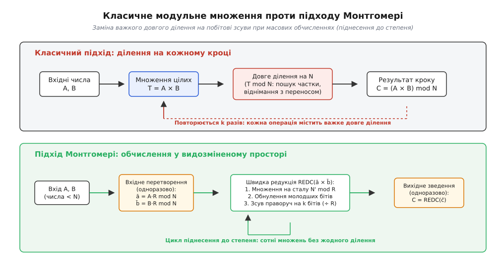
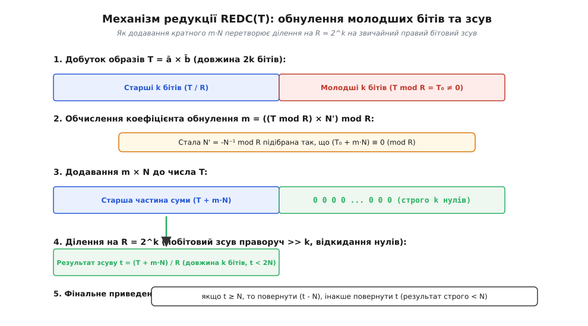
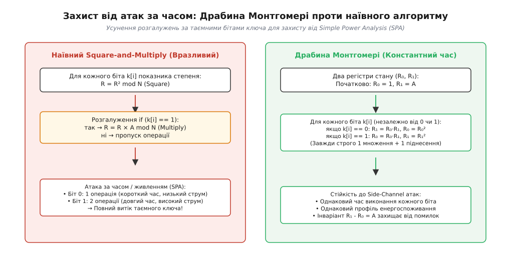

# Арифметика та перетворення Монтгомері

<preknowlist>
- [Модульна арифметика](root:math-number-theory/modular-arithmetic) — остачі від ділення, операція взяття модуля, конгруентність та кільце лишків ℤ/Nℤ.
- [Алгоритм Евкліда](root:math-number-theory/gcd-euclidean) — найбільший спільний дільник та розширений алгоритм для знаходження оберненого елемента за модулем.
- [Криптосистема RSA](root:sf-security/rsa-cryptosystem) — асиметричне шифрування та цифровий підпис, що спираються на масове модульне піднесення до степеня.
- [Кільця та поля лишків](root:math-algebra/rings) — алгебраїчні властивості оборотних елементів та структура скінченних кілець ℤ/Nℤ.
</preknowlist>

Кожного разу, коли веббраузер відкриває захищене з'єднання HTTPS через протокол TLS 1.3, мобільний застосунок надсилає зашифроване повідомлення у месенджері Signal або криптографічний гаманець підписує транзакцію у блокчейні, центральний процесор виконує десятки тисяч операцій модульного множення над гігантськими цілими числами довжиною від 256 до 4096 бітів.

У класичних асиметричних криптосистемах (RSA, протокол обміну ключами Діффі–Геллмана, алгоритми цифрового підпису ECDSA та Ed25519) головним обчислювальним навантаженням є **модульне піднесення до степеня** `Aᵉ mod N` або скалярне множення точок на еліптичних кривих `k · P`. Щоб обчислити одне піднесення 2048-бітового числа до степеня, процесор має виконати близько трьох тисяч послідовних модульних множень: `(A · B) mod N`.

Якщо виконувати кожне таке множення наївним шкільним способом, обчислювальний конвеєр негайно впирається у фундаментальне апаратне обмеження мікропроцесорів: **довге ділення з остачею є надзвичайно повільною операцією**. Для обчислення `(A · B) mod N` процесор спочатку перемножує два 2048-бітові числа, отримуючи 4096-бітовий проміжний добуток `T`, а потім ділить число `T` на непарний модуль `N`, щоб знайти остачу.

На рівні кремнієвих транзисторів операція ділення вимагає послідовного сканування розрядів зліва направо (від найстарших бітів до молодших), постійного вгадування цифр неповної частки, пробного множення та частих корекцій у разі помилки. У той час як апаратне множення цілих слів на сучасних процесорах виконується за 3–4 такти з повною конвеєризацією, інструкція апаратного ділення блокує конвеєр на 25–80 тактів. Для багаторозрядних чисел ділення виконується за складними квадратичними алгоритмами, забираючи до 80% усього часу криптографічного перетворення.

У 1985 році американський математик Петер Монтгомері запропонував проривний метод, який дозволив повністю усунути важке ділення з циклів модульних обчислень. Його підхід замінює ділення на довільне непарне число `N` на **побітові двійкові зсуви праворуч**, переносячи обчислення у видозмінений числовий простір.

---

### Вузьке горло криптографії: ціна класичного ділення

Щоб у деталях зрозуміти масштаби проблеми, поглянемо на анатомію виконання операцій над великими числами в сучасних процесорних архітектурах x86-64 та ARM64.

Числа довжиною 2048 бітів не вміщуються в жоден стандартний регістр загального призначення. Тому в пам'яті комп'ютера велике число представляють як масив машинних слів (англ. *limbs*). Для 64-бітової архітектури 2048-бітовий модуль `N` розбивається на 32 окремі 64-бітові слова: `s = 2048 / 64 = 32`.

Коли ми перемножуємо два таких числа `A` та `B`, кожне з яких складається з 32 слів, класичний алгоритм множення «у стовпчик» (алгоритм шкільного множення) вимагає `s² = 32 × 32 = 1024` операцій попарного множення 64-бітових слів. На сучасних процесорах інструкції множення слів (`MULX` або `MUL`) виконуються на конвеєрі надзвичайно швидко — за 3–4 процесорні такти з пропускною здатністю одна інструкція за такт.

Проте результат множення `T = A · B` має подвійну довжину — `2s = 64` машинних слова (4096 бітів). Щоб звести це число за модулем `N`, необхідно виконати операцію взяття остачі: `T mod N`.

Класичний алгоритм довгого ділення (відомий як алгоритм D Дональда Кнута) виконує цю операцію вкрай важким шляхом:

1. **Нормалізація:** дільник `N` та ділене `T` зсуваються ліворуч так, щоб найстарший біт старшого слова `N` став одиничним. Це необхідно для обмеження похибки оцінки цифр частки.
2. **Послівне оцінювання частки:** алгоритм рухається строго зліва направо — від старших розрядів до молодших (MSB, *Most Significant Bit*). На кожному кроці за двома старшими словами діленого та старшим словом дільника обчислюється наближена цифра частки `q̂`:
```
q̂ = min(⌊(u_j · 2ʷ + u_{j+1}) / v₁⌋, 2ʷ - 1)
```
3. **Пробне множення та віднімання:** обчислюється добуток `q̂ · N` і віднімається від поточного вікна діленого з послідовним розповсюдженням бітів запозичення (*borrow propagation*).
4. **Корекція помилок:** якщо оцінка `q̂` виявилася завеликою (виникло зайве запозичення у старшому розряді), частка `q̂` зменшується на одиницю, а дільник `N` додається назад до діленого (*відкат корекції*).

Цей процес вимагає приблизно `s² = 1024` операцій множення, стільки ж операцій віднімання та численні умовні перевірки. Проте найгірше те, що **поширення переносів та запозичень відбувається по всій довжині 2048-бітового числа на кожному кроці оцінки частки**. Це створює довгі послідовні ланцюги залежностей, які неможливо розпаралелити або конвеєризувати. У кремнії такий дільник вимагає гігантської площі кристала та споживає критично багато енергії.

---

### Ідея Монтгомері: чому степінь двійки змінює все

Петер Монтгомері підійшов до проблеми під зовсім іншим алгебраїчним кутом. Він помітив фундаментальну асиметрію двійкових числових систем:

- Ділення на довільне непарне число `N` — надзвичайно складна, нерегулярна операція з довгими ланцюгами залежностей по перенесенню зліва направо.
- Ділення на степінь двійки `R = 2ᵏ` — тривіальна операція. У машинному коді це звичайний побітовий зсув праворуч на `k` позицій (`>> k`), або просте відкидання цілих слів у багаторозрядній пам'яті. Взяття залишку `mod R` є простим маскуванням молодших `k` бітів через порозрядне логічне «І» (`AND (R - 1)`).

Монтгомері поставив парадоксальне запитання: чи можна побудувати модульну арифметику за непарним модулем `N` так, щоб замість ділення на `N` процесор завжди ділив виключно на допоміжну основу `R = 2ᵏ`?

Його проривна ідея полягала в тому, щоб розгортати обчислення **справа наліво** — від молодших бітів (LSB, *Least Significant Bit*) до старших.

Замість того, щоб намагатися відняти кратне `N` від старших розрядів для зменшення проміжного добутку, Монтгомері запропонував додавати точно підібране кратне `m · N` до молодших розрядів так, щоб останні `k` бітів суми стали строго нульовими. Як тільки молодші `k` бітів обнулено, ділення на `R = 2ᵏ` стає точним зсувом без жодної втрати остачі.

Аби цей прийом працював узгоджено для цілого ланцюжка послідовних операцій, числа попередньо масштабують, переносячи їх у спеціальне алгебраїчне представлення — **простір Монтгомері** (або домен Монтгомері).

Еволюцію цієї ідеї та історичний контекст її виникнення докладно висвітлено в нарисі: [детальний історичний нарис про відкриття методу Монтгомері](root:math-number-theory/montgomery-reduction/hist-peter-montgomery.md).

---

### Простір Монтгомері та його алгебраїчні властивості

Нехай задано непарне додатне число `N` (модуль обчислень, англ. *modulus*). Оберемо допоміжну основу Монтгомері `R` (англ. *radix*) як найменший степінь двійки `R = 2ᵏ`, що строго перевищує модуль:

```
R > N
```

Оскільки число `N` непарне за умовою, а основа `R = 2ᵏ` є степенем двійки, вони не мають спільних дільників, крім одиниці. Отже, їхній найбільший спільний дільник строго дорівнює одиниці:

```
gcd(R, N) = 1
```

**Означення.** Образом Монтгомері (або формою Монтгомері, англ. *Montgomery representation*) цілого числа `a ∈ [0, N - 1]` називається залишок `ā`, отриманий домноженням числа `a` на основу `R` за модулем `N`:

```
ā = (a · R) mod N
```

Відображення `φ(a) = (a · R) mod N` є бієктивним кільцевим ізоморфізмом між стандартним кільцем лишків `ℤ/Nℤ` та простором Монтгомері. Кожному класичному числу `a` відповідає єдиний образ `ā`, і навпаки.


*Порівняння класичного підходу з довгим діленням на кожному кроці та обчислень у просторі Монтгомері, де ділення замінено швидкими побітовими зсувами.*

Розглянемо, як виконуються базові арифметичні дії у просторі Монтгомері.

#### Додавання та віднімання
Додавання образів Монтгомері є замкненою та прямою операцією. Додамо два образи `ā` та `b̄`:

```
ā + b̄
= (a · R) + (b · R)                   [за визначенням образів Монтгомері]
= (a + b) · R                         [винесення спільного множника R]
≡ (a + b)̄ (mod N)                     [за визначенням образу суми]
```

Сума образів автоматично дає правильний образ суми. Для приведення результату до діапазону `[0, N - 1]` достатньо виконати одне звичайне віднімання `N`, якщо сума `ā + b̄ ≥ N`. Аналогічно працює й віднімання: `ā - b̄ ≡ (a - b)̄ (mod N)`.

#### Множення та проблема зайвого множника
Справжня відмінність простору Монтгомері проявляється при множенні. Знайдемо прямий добуток двох образів `ā` та `b̄`:

```
T = ā · b̄ = (a · R) · (b · R) = (a · b) · R²
```

Зверніть увагу: добуток `T` містить допоміжну основу `R` у **другому степені** (`R²`). Проте канонічний образ Монтгомері для добутку вихідних чисел `a · b` зобов'язаний містити основу `R` у **першому степені**:

```
(a · b)̄ = (a · b · R) mod N
```

Якщо ми перемножимо два образи у просторі Монтгомері, ми отримаємо зайвий множник `R`. Щоб повернути результат до правильної форми образу, отриманий добуток `T` необхідно домножити на модульний обернений елемент `R⁻¹ mod N`:

```
c̄ = (T · R⁻¹) mod N = ((a · b · R²) · R⁻¹) mod N = (a · b · R) mod N
```

Спеціальний математичний алгоритм, який приймає на вхід подвійне число `T` і обчислює величину `(T · R⁻¹) mod N` без використання довгого ділення на `N`, називається **редукцією Монтгомері** (англ. *Montgomery Reduction*, або скорочено **REDC**).

---

### Алгоритм редукції REDC: крок за кроком

Алгоритм `REDC` є серцем усієї арифметики Монтгомері. Його задача — обчислити значення `(T · R⁻¹) mod N` для будь-якого вхідного числа `T` у діапазоні `0 ≤ T < R · N`.

Для роботи алгоритму попередньо обчислюється одна числова константа — **коефіцієнт Монтгомері** `N'`.

Оскільки `gcd(R, N) = 1`, за розширеною теоремою Безу існують такі цілі числа `R⁻¹` та `N'`, що виконується лінійна тотожність:

```
R · R⁻¹ - N · N' = 1
```

Розглянемо цю рівність за модулем основи `R`:

```
R · R⁻¹ - N · N' ≡ 1 (mod R)
0 - N · N' ≡ 1 (mod R)                [оскільки R · R⁻¹ ділиться на R націло]
N · N' ≡ -1 (mod R)                   [множення обох частин на -1]
N' ≡ -N⁻¹ (mod R)                     [визначення константи N']
```

Константа `N'` — це від'ємне модульне обернене до числа `N` за основою `R`. Її розраховують лише **один раз** при ініціалізації криптографічного контексту за допомогою розширеного алгоритму Евкліда або швидкого методу піднесення Гензеля.


*Покроковий процес обнулення молодших k бітів числа шляхом додавання кратного m·N та подальшого точного зсуву праворуч на k позицій.*

Повний алгоритм `REDC(T)` складається з п'яти послідовних кроків:

#### Крок 1. Виділення молодших бітів
Отримуємо молодшу частину числа `T` довжиною `k` бітів:

```
T₀ = T mod R = T & (R - 1)
```

Це виконується миттєво через побітову маску.

#### Крок 2. Обчислення коефіцієнта обнулення
Знаходимо ціле число `m ∈ [0, R - 1]`:

```
m = (T₀ · N') mod R = (T₀ · N') & (R - 1)
```

Множник `m` підібраний так, що сума `T + m · N` гарантовано ділиться на `R` націло.

#### Крок 3. Додавання кратного модуля
Обчислюємо розширену суму:

```
S = T + m · N
```

Перевіримо залишок суми `S` за основою `R`:

```
S mod R
= (T + m · N) mod R                   [підстановка визначення суми S]
≡ T₀ + (T₀ · N') · N (mod R)          [підстановка визначення m]
= T₀ + T₀ · (N' · N)                  [асоціативність множення]
≡ T₀ + T₀ · (-1) (mod R)              [оскільки за тотожністю Безу N' · N ≡ -1 mod R]
= T₀ - T₀                             [множення на -1]
≡ 0 (mod R)                           [віднімання однакових величин]
```

Молодші `k` бітів числа `S` строго дорівнюють нулю.

#### Крок 4. Ділення на основу через бітовий зсув
Оскільки молодші `k` бітів суми `S` нульові, ділення на `R = 2ᵏ` є точним цілочисельним правим зсувом:

```
t = S / R = (T + m · N) >> k
```

Жодна остача при цьому зсуві не втрачається.

#### Крок 5. Фінальне приведення
Оцінимо максимальне можливе значення величини `t`. Оскільки за умовою `T < R · N`, а коефіцієнт `m < R`:

```
t = (T + m · N) / R < (R · N + R · N) / R = 2N
```

Отже, проміжне число `t` гарантовано лежить у діапазоні:

```
0 ≤ t < 2N
```

Оскільки `t < 2N`, для отримання канонічного залишку `< N` потрібно **не більше одного віднімання**:

```
якщо t ≥ N, то повернути (t - N), інакше повернути t
```

Повне математичне доведення теореми про границю `t < 2N` та властивості алгоритму дивіться у вставці: [строге алгебраїчне доведення коректності алгоритму REDC](root:math-number-theory/montgomery-reduction/math-redc-proof.md).

---

### Повний числовий приклад від початку до кінця

Розберемо роботу алгоритму на конкретному числовому прикладі з невеликими числами, щоб простежити кожен крок обчислень.

Нехай модуль обчислень дорівнює непарному простому числу:

```
N = 17
```

Оберемо допоміжну основу Монтгомері як найближчий степінь двійки, більший за 17:

```
R = 32 = 2⁵       [k = 5 бітів, R > N]
```

Перевіримо взаємну простоту: `gcd(32, 17) = 1`.

#### 1. Розрахунок констант Монтгомері
Застосуємо розширений алгоритм Евкліда до чисел `R = 32` та `N = 17`:

```
32 = 1 · 17 + 15
17 = 1 · 15 + 2
15 = 7 · 2 + 1
1 = 15 - 7 · 2 = 15 - 7 · (17 - 15) = 8 · 15 - 7 · 17
1 = 8 · (32 - 17) - 7 · 17 = 8 · 32 - 15 · 17
```

Маємо тотожність Безу:

```
32 · 8 - 17 · 15 = 1
```

Звідси знаходимо константи:
- Обернене до основи за модулем `N`: `R⁻¹ = 8 mod 17` (перевірка: `(32 · 8) mod 17 = 256 mod 17 = 1`).
- Константа Монтгомері: `N' = 15 mod 32` (перевірка: `(17 · 15) mod 32 = 255 mod 32 = 31 ≡ -1 mod 32`).

Також розрахуємо допоміжну константу для входу в простір Монтгомері `R² mod N`:

```
R² mod N = 32² mod 17 = 1024 mod 17 = 4      [оскільки 1024 = 60 · 17 + 4]
```

#### 2. Вхідні числа та класичний результат
Візьмемо два числа:

```
a = 7
b = 11
```

Пряме множення за модулем 17 дає:

```
(a · b) mod N = (7 · 11) mod 17 = 77 mod 17 = 9      [оскільки 77 = 4 · 17 + 9]
```

Шукана правильна відповідь дорівнює **9**.

#### 3. Переведення чисел у простір Монтгомері
Обчислимо образи чисел `a` та `b`:

```
ā = (a · R) mod N = (7 · 32) mod 17 = 224 mod 17 = 3      [224 = 13 · 17 + 3]
b̄ = (b · R) mod N = (11 · 32) mod 17 = 352 mod 17 = 12    [352 = 20 · 17 + 12]
```

Образи чисел у просторі Монтгомері: `ā = 3`, `b̄ = 12`.

#### 4. Множення образів та виклик REDC
Перемножимо образи:

```
T = ā · b̄ = 3 · 12 = 36
```

Застосуємо алгоритм `REDC(36)`:

1. Молодші біти за основою `R = 32`:
   `T₀ = 36 mod 32 = 4`.
2. Коефіцієнт обнулення:
   `m = (T₀ · N') mod R = (4 · 15) mod 32 = 60 mod 32 = 28`.
3. Додавання кратного модуля:
   `S = T + m · N = 36 + 28 · 17 = 36 + 476 = 512`.
   *Погляньте на число 512 у двійковому записі:* `512 = 1000000000₂`. Молодші 5 бітів — строго нулі (`00000₂`)!
4. Ділення на основу `R = 32` через зсув:
   `t = 512 / 32 = 16`.
5. Фінальне приведення:
   Оскільки `t = 16 < N = 17`, віднімання не потрібне.

Результат редукції добутку у просторі Монтгомері:

```
c̄ = 16
```

Перевіримо, чи є число 16 образом правильної відповіді 9:

```
(9 · R) mod 17 = (9 · 32) mod 17 = 288 mod 17 = 16      [288 = 16 · 17 + 16]
```

Образ `c̄ = 16` ідеально збігся з теоретичним значенням.

#### 5. Повернення результату з простору Монтгомері
Щоб перетворити образ `c̄ = 16` назад у класичне число, виконаємо операцію `REDC(c̄)`:

```
T = 16
T₀ = 16 mod 32 = 16
m = (16 · 15) mod 32 = 240 mod 32 = 16
S = T + m · N = 16 + 16 · 17 = 16 + 272 = 288
t = S / R = 288 / 32 = 9
```

Оскільки `9 < 17`, остаточний результат дорівнює **9**. Ми отримали точну відповідь без жодного довгого ділення.

---

### Другий розширений числовий приклад (N = 233, R = 256)

Для закріплення розуміння багатобайтових переходів розглянемо випадок 8-бітових чисел.
Нехай модуль обчислень дорівнює простому числу:

```
N = 233
R = 256 = 2⁸      [k = 8 бітів, одне 8-бітне машинне слово]
```

Знайдемо `N' = -233⁻¹ mod 256`:
Оскільки `233 ≡ -23 mod 256`, шукаємо обернене до 23: `23 · 167 = 3841 = 15 · 256 + 1 ≡ 1 mod 256`.
Отже, константа Монтгомері дорівнює `N' = 167 mod 256`.
Перевіримо: `(233 · 167) mod 256 = 38911 mod 256 = 255 ≡ -1 mod 256`.

Константа зворотного елемента: `R⁻¹ = 144 mod 233` (оскільки `(256 · 144) mod 233 = 36864 mod 233 = 1`).
Константа для входу: `R² mod N = 256² mod 233 = 65536 mod 233 = 64`.

Нехай потрібно перемножити числа `a = 65` та `b = 142` за модулем `233`.
Класичний результат: `(65 · 142) mod 233 = 9230 mod 233 = 143` (оскільки `9230 = 39 · 233 + 143`).

1. Переводимо операнди у простір Монтгомері:
```
ā = (65 · 256) mod 233 = 16640 mod 233 = 97      [16640 = 71 · 233 + 97]
b̄ = (142 · 256) mod 233 = 36352 mod 233 = 4      [36352 = 156 · 233 + 4]
```
2. Множимо образи:
```
T = ā · b̄ = 97 · 4 = 388
```
3. Виконуємо `REDC(388)`:
- `T₀ = 388 & 255 = 132`
- `m = (132 · 167) & 255 = 22044 & 255 = 28`
- `S = T + m · N = 388 + 28 · 233 = 388 + 6524 = 6912`
- Перевірка нульових бітів: `6912 mod 256 = 0` (двійковий запис `6912 = 0001101100000000₂` закінчується на вісім нулів `00000000₂`).
- Зсув праворуч: `t = 6912 >> 8 = 27`.
- Оскільки `t = 27 < N = 233`, маємо образ добутку `c̄ = 27`.
4. Повернення у класичний простір через `REDC(27)`:
- `T = 27`
- `T₀ = 27 & 255 = 27`
- `m = (27 · 167) & 255 = 4509 & 255 = 157`
- `S = 27 + 157 · 233 = 27 + 36581 = 36608`
- Зсув: `t = 36608 >> 8 = 143`.
- Оскільки `143 < 233`, результат дорівнює **143**. Розрахунок зійшовся з абсолютною точністю.

---

### Детальний порівняльний аналіз п'яти алгоритмів класифікації Koç–Acar

У 1996 році Четин Коч, Толґа Акар та Берт Каліскі опублікували фундаментальну класифікацію методів багаторозрядного множення Монтгомері. Вони розділили всі підходи за двома вимірами: способом сканування операндів (Operand Scanning проти Product Scanning) та рівнем інтеграції множення й редукції (Separated, Coarsely Integrated, Finely Integrated).

Розглянемо докладну алгоритмічну структуру кожного з методів для модуля довжиною `s` слів:

#### 1. Метод SOS (Separated Operand Scanning)
Метод SOS чітко розбитий на дві ізольовані фази:
- **Фаза множення:** Обчислюється повний добуток `T = a · b` за допомогою двох вкладених циклів довжиною `s`. Масив `T` має розмір `2s + 1` слів.
- **Фаза редукції:** Для кожного кроку `i` від `0` до `s - 1` обчислюється `m = (T[i] · n₀') mod 2ʷ`, після чого вектор `m · N` додається до зсунутого вікна масиву `T` з поширенням переносів.

Метод SOS простий у реалізації, але вимагає виділення `2s + 1` слів у пам'яті та постійно перезаписує проміжний масив, створюючи надмірне навантаження на L1-кеш процесора.

#### 2. Метод CIOS (Coarsely Integrated Operand Scanning)
Метод CIOS об'єднує зовнішні цикли множення та редукції. На кожному зовнішньому кроці `i`:
1. Обчислюється додавання вектора `a[i] · b` до акумулятора довжиною `s + 2` слів.
2. Негайно обчислюється множник обнулення `m = (t[0] · n₀') mod 2ʷ`.
3. До акумулятора додається вектор `m · n`.
4. Виконується правий зсув акумулятора на одне слово (`>> 64`).

Це найпопулярніший алгоритм для загальних процесорів (x86-64, ARM64), оскільки розмір акумулятора `s + 2` слів повністю розміщується у регістрах для `s ≤ 6` (до 384 бітів).

#### 3. Метод FIOS (Finely Integrated Operand Scanning)
У методі FIOS операції множення слова на слово та додавання модуля чергуються всередині одного єдиного внутрішнього циклу. Цей підхід потребує паралельного підтримання двох незалежних бітів переносу (`c_mul` та `c_red`), що ідеально відповідає мікроархітектурі Intel ADX з прапорцями `CF` та `OF`.

#### 4. Метод FIPS (Finely Integrated Product Scanning / Метод Комби)
Метод FIPS базується на обчисленні стовпчиків добутку (*Product Scanning*), запропонованому П. Комбою в 1990 році. Замість горизонтального накопичення рядків алгоритм рухається вертикальними стовпчиками від `0` до `2s - 1`.

Для підтримання суми стовпчика використовується тримашинний акумулятор `(w₂, w₁, w₀)` розрядністю `3w` бітів:
1. На кожному кроці до трислівного акумулятора додаються всі попарні добутки `a[j] · b[k]`, де `j + k = i`.
2. Для молодших `s` стовпчиків обчислюється коефіцієнт редукції `m[i] = (w₀ · n₀') mod 2ʷ`, після чого до акумулятора додаються добутки редукції `m[j] · n[k]`.
3. Молодше слово акумулятора `w₀` гарантовано дорівнює нулю або скидається як кінцеве слово результату, а акумулятор зсувається праворуч на одне слово (`(w₂, w₁, w₀) = (0, w₂, w₁)`).

Метод FIPS виконує мінімальну кількість операцій запису в оперативну пам'ять (лише `s` фінальних записів слів), що робить його абсолютним лідером на вбудованих мікроконтролерах ARM Cortex-M0/M3/M4 з повільною Flash-пам'яттю.

---

### Піднесення до степеня за методом ковзного вікна у просторі Монтгомері

При обчисленні `Aᵉ mod N` у криптосистемі RSA розмір показника степеня `e` становить 2048 або 4096 бітів. Наївний двійковий алгоритм «піднесення до квадрата й домноження» вимагає `k` піднесень до квадрата та в середньому `k / 2` множень на основу (де `k` — довжина показника у бітах). Для `k = 2048` це складає близько 3072 важких модульних операцій.

Щоб істотно скоротити кількість множень, застосовують **метод ковзного вікна** (англ. *Sliding Window Exponentiation*) у просторі Монтгомері з шириною вікна `w` (зазвичай `w = 4` або `w = 5`).

#### Покроковий механізм віконного алгоритму
1. **Попередня генерація таблиці непарних степенів:**
   Основа `a` переводиться у простір Монтгомері: `ḡ₁ = (a · R) mod N`.
   Обчислюється образ квадрата основи: `ḡ₂ = REDC(ḡ₁ · ḡ₁) = (a² · R) mod N`.
   Послідовно обчислюються лише непарні степені:
   `ḡ₃ = REDC(ḡ₂ · ḡ₁) = (a³ · R) mod N`
   `ḡ₅ = REDC(ḡ₂ · ḡ₃) = (a⁵ · R) mod N`
   `ḡ_{2ʷ - 1} = REDC(ḡ₂ · ḡ_{2ʷ - 3}) = (a^(2ʷ - 1) · R) mod N`
   Усі `2ʷ⁻¹` значень таблиці зберігаються безпосередньо у формі Монтгомері.

2. **Ітераційне сканування показника степеня:**
   Акумулятор ініціалізується нейтральним елементом простору Монтгомері: `Ā = (1 · R) mod N = R mod N`.
   Алгоритм сканує біти показника `e` від старших до молодших:
   - Якщо поточний біт дорівнює `0`, виконується одне піднесення до квадрата: `Ā = REDC(Ā · Ā)`, і вказівник зсувається на 1 біт.
   - Якщо поточний біт дорівнює `1`, алгоритм захоплює найдовше вікно довжиною до `w` бітів, яке обов'язково закінчується на одиницю. Нехай це числове значення вікна дорівнює `v` (де `v` — непарне число від `1` до `2ʷ - 1`, а довжина вікна `L ≤ w`).
   - Акумулятор підноситься до квадрата `L` разів поспіль: `Ā = REDC(Ā · Ā)`.
   - Виконується одне-єдине домноження акумулятора на попередньо обчислене значення з таблиці: `Ā = REDC(Ā · ḡ_v)`.

Завдяки тому, що вікно пропускає ланцюжки нульових бітів, середня кількість операцій множення падає з `k / 2` до `k / (w + 1)`. Для `k = 2048` та `w = 5` кількість множень скорочується з 1024 до приблизно 341. Сукупна економія часу піднесення до степеня становить понад 22%.

Оскільки всі проміжні множення та піднесення до квадрата викликають виключно функцію `REDC`, жодного зворотного перетворення чисел у процесі сканування бітів не відбувається. Єдиний фінальний виклик `REDC(Ā)` повертає остаточний результат `Aᵉ mod N`.

---

### Декомпозиція CRT у RSA та китайська теорема про залишки

У практичних реалізаціях розшифрування RSA та формування цифрового підпису операція піднесення до степеня виконується не за повним модулем `N = p · q`, а окремо за простими дільниками `p` та `q` довжиною по 1024 біти (схема RSA-CRT).

Згідно з китайською теоремою про залишки, обчислення `M = Cᵈ mod N` розкладається на два паралельні незалежні піднесення до степеня:
```
M_p = C^(d_p) mod p,    де d_p = d mod (p - 1)
M_q = C^(d_q) mod q,    де d_q = d mod (q - 1)
```

Для кожного з модулів `p` та `q` створюється власний ізольований простір Монтгомері:
- Для модуля `p` обирається основа `R_p = 2¹⁰²⁴` та розраховується константа `p' = -p⁻¹ mod 2⁶⁴`.
- Для модуля `q` обирається основа `R_q = 2¹⁰²⁴` та розраховується константа `q' = -q⁻¹ mod 2⁶⁴`.

Оскільки складність множення пропорційна квадрату довжини числа (`s²`), перехід від одного 2048-бітового числа до двох 1024-бітових чисел зменшує обсяг роботи у кожній гілці у 4 рази. Виконання двох половинних піднесень до степеня дає сумарне теоретичне прискорення у **4 рази** порівняно з прямим обчисленням за модулем `N`.

Після завершення обчислень у просторах Монтгомері результати `M_p` та `M_q` зводяться у єдине число `M` за формулою Гарнера:
```
h = ((M_p - M_q) · q⁻¹ mod p) mod p
M = M_q + h · q
```

Всі проміжні кроки у формулі Гарнера також виконуються за сталий час із використанням маскування запозичень, що захищає від атаки Белкора (Bellcore fault injection attack).

---

### Біраціональна еквівалентність: зв'язок кривих Монтгомері та Едвардса

Криптографічні стандарти нового покоління (RFC 7748 та RFC 8032) використовують дві різні форми однієї і тієї ж алгебраїчної структури:
- **Крива Монтгомері Curve25519:** оптимізована для обміну ключами X25519 завдяки драбині Монтгомері без координати `y`.
- **Скручена крива Едвардса Ed25519:** оптимізована для швидкого цифрового підпису завдяки повним симетричним формулам додавання точок без особливих випадків.

Математично ці криві є **біраціонально еквівалентними** (ізоморфними над полем `GF(2²⁵⁵ - 19)`). Точка `(u, v)` на кривій Монтгомері `v² = u³ + 486662 · u² + u` перетворюється в точку `(x, y)` на кривій Едвардса `-x² + y² = 1 - (121665/121666) · x² · y²` за алгебраїчними формулами:

```
u = (1 + y) / (1 - y)
v = (1 + y) / ((1 - y) · x)
```

Зворотне перетворення здійснюється як `x = u / v`, `y = (u - 1) / (u + 1)`.

Оскільки обидві криві працюють над одним і тим самим простим полем `GF(2²⁵⁵ - 19)`, бібліотеки криптографії (OpenSSL, BoringSSL, Libsodium) використовують один спільний оптимізований асемблерний рушій редукції Монтгомері як для операцій протоколу X25519, так і для перевірки підписів Ed25519.

---

### Алгоритм факторизації чисел на еліптичних кривих (Lenstra ECM)

Історично метод редукції Монтгомері та криві Монтгомері створювалися не для шифрування, а для розв'язання фундаментальної математичної задачі факторизації великих складених чисел. У 1987 році Гендрік Ленстра запропонував метод факторизації на еліптичних кривих (ECM — *Elliptic Curve Method*).

Ідея методу ECM полягає в тому, щоб випадково згенерувати еліптичну криву над кільцем `ℤ/Nℤ` (де `N` — складене невідоме число) та точку `P` на ній, після чого обчислити гігантський скалярний добуток `Q = k · P mod N`, де `k = ∏ pᵢ^{eᵢ}` — добуток малих простих чисел.

Якщо порядок кривої за невідомим простим дільником `p` числа `N` є гладким числом (ділиться на `k`), то точка `k · P` редукується до нейтрального елемента (точки на нескінченності) за модулем `p`, але залишається звичайною точкою за іншими дільниками. При спробі обчислити координату суми виникає ділення на нуль за модулем `p`, що проявляється як поява спільного дільника:
```
gcd(Z_Q, N) = p
```

Петер Монтгомері запропонував свою форму кривої та формули диференційного додавання спеціально для прискорення фази множення у методі ECM. Завдяки відсутності ділення та швидкості алгоритму REDC, математики Річард Брент та Петер Монтгомері змогли знайти дільники десятих та одинадцятих чисел Ферма `F₁₀` та `F₁₁`, встановивши світові рекорди факторизації свого часу.

---

### Апаратні модулі безпеки (HSM) та систолічні масиви на кремнії

У сучасних банківських смарткартках, криптографічних токенах FIDO2 та апаратних модулях безпеки (HSM — *Hardware Security Module*) обчислення модульного множення реалізують безпосередньо у кремнії у вигляді спеціалізованих співпроцесорів.

Головна інженерна перевага редукції Монтгомері на кремнії — **кардинальне скорочення площі кристала**. Класичний апаратний дільник вимагає складних дерев порівнянь та зворотних зв'язків для відновлення залишку, що займає понад 80 000 вентильних еквівалентів (GE, *Gate Equivalents*). Співпроцесор Монтгомері на базі суматорів зі збереженням переносів (CSA) потребує менше 15 000 вентилів, споживає у 4 рази менше енергії та працює на значно вищій тактовій частоті.

У великих криптографічних процесорах співпроцесор будують у вигляді одновимірного систолічного масиву: кожен елементарний процесорний елемент містить один 64-бітний помножувач та суматор, передаючи лише молодші біти та біти переносів сусідньому вузлу. Це усуває довгі дротові з'єднання на чипі та запобігає виникненню паразитних ємностей.

---

### Векторизація в архітектурах ARM NEON та SVE2

У серверних процесорах на архітектурі ARM64 (Amazon Graviton 3/4, Ampere Altra Max, Apple M-серія) багаторозрядне множення Монтгомері розпаралелюють за допомогою 128-бітних векторних регістрів SIMD розширення NEON та масштабованого векторного розширення SVE2.

Інструкції розширеного множення `UMULL` та накопичення `UMLAL` дозволяють за одну інструкцію перемножувати два 64-бітних числа з отриманням 128-бітного результату безпосередньо у векторному конвеєрі. Використання двох паралельних векторних конвеєрів (Execution Pipelines V0 та V1) забезпечує пропускну здатність у два 128-бітні добутки за один такт, що дозволяє виконувати 256-бітне множення Монтгомері для протоколу TLS за менш ніж 40 тактів процесора. Додатково інструкції SVE2 забезпечують апаратне предикатне маскування розрядів без виникнення штрафів за розгалуження конвеєра.

---

### Атаки на базі кеш-пам'яті (Cache-Timing Attacks) та методи усунення

У 2005 році Деніел Бернштейн та Колін Персіваль опублікували серію робіт про атаки на кеш-пам'ять (*Cache-Timing Attacks: Prime+Probe, Flush+Reload, Evict+Time*).

Якщо під час піднесення до степеня алгоритм використовує таблицю попередньо обчислених степенів Монтгомері (наприклад, віконний метод зі ступенями `ḡ₁, ḡ₃, ḡ₅, ḡ₇, ...`), звернення до елемента таблиці `table[secret_index]` завантажує відповідну лінію кешу процесора (64 байти). 

Зловмисник, що виконує паралельний потік на сусідньому ядрі процесора, може виміряти час читання кеш-ліній і з точністю до 100% визначити, до яких саме індексів таблиці зверталася криптографічна функція, повністю відновивши секретний ключ.

Для повного захисту від атак на кеш сучасні бібліотеки застосовують **константне мультиплексування таблиць** (*Constant-Time Table Lookup*). Процесор завжди зчитує абсолютно **всі** елементи таблиці з пам'яті незалежно від значення таємного індексу, а правильний операнд вибирається побітовими масками. Це повністю вирівнює патерн доступу до кеш-пам'яті та усуває витік інформації.

---

### Еліптичні криві Монтгомері та протокол X25519

У 2006 році Даніель Бернштейн представив криву Curve25519 для протоколу Діффі–Геллмана X25519, яка стала основою сучасного шифрування Інтернету:

```
y² = x³ + 486662 · x² + x
```

над скінченним полем `GF(2²⁵⁵ - 19)`.

Головна алгебраїчна особливість кривих Монтгомері полягає у можливості обчислювати скалярний добуток `k · P` у проєктивних координатах `(X : Z)` без використання координати `y`. На кожній ітерації драбини Монтгомері виконуються лише операції диференційного додавання та подвоєння:

```
X_add = Z_d · ((X₁ - Z₁) · (X₂ + Z₂) + (X₁ + Z₁) · (X₂ - Z₂))²
Z_add = X_d · ((X₁ - Z₁) · (X₂ + Z₂) - (X₁ + Z₁) · (X₂ - Z₂))²

X_dbl = (X₁ + Z₁)² · (X₁ - Z₁)²
Z_dbl = (4 · X₁ · Z₁) · ((X₁ - Z₁)² + ((A + 2) / 4) · (4 · X₁ · Z₁))
```

Для кожної точки базового поля константа `(A + 2) / 4 = (486662 + 2) / 4 = 121666` є малим числом, що спрощує множення. Усі 255 ітерацій скалярного множення виконуються за сталий час із використанням простору Монтгомері, унеможливлюючи витоки інформації через кеш-пам'ять або переривання.


*Схема паралельного оновлення регістрів R₀ та R₁ на кожному кроці драбини Монтгомері за допомогою диференційного додавання та подвоєння без використання координати y.*

---

### Мультискалярне множення (MSM) та арифметика Монтгомері у zk-SNARKs

У криптографічних протоколах із нульовим розголошенням (ZKP, системи доведення Groth16, PLONK, Halo2, STARKs) понад 85% часу генерації криптографічного доказу витрачається на **мультискалярне множення** (MSM — *Multi-Scalar Multiplication*):

```
Q = ∑_{i=1}^{M} kᵢ · Pᵢ
```

де `M` сягає від `2¹⁶ = 65536` до `2²⁶ = 67108864` точок еліптичної кривої (наприклад, кривої BN254 або BLS12-381), а скаляри `kᵢ` є 256-бітовими числами.

Для обчислення таких масивних сум застосовують алгоритм Піппенджера (*Pippenger's Algorithm*):
1. Скаляри розбиваються на вікна шириною `c` бітів (зазвичай `c = 16`).
2. Для кожного вікна точки сортуються по «кошиках» (*buckets*) відповідно до значення цифри скаляра.
3. Всі точки в кошиках сумуються в проєктивних координатах Монтгомері.

Оскільки алгоритм Піппенджера виконує мільйони операцій додавання та подвоєння точок, обчислення переносять на графічні процесори NVIDIA (CUDA) та апаратні прискорювачі ASIC. Всі координати точок `(X : Y : Z)` постійно зберігаються у формі Монтгомері. Завдяки цьому жодна проміжна редукція не вимагає ділення, а кожне CUDA-ядро виконує редукцію Монтгомері на базі 32-бітних інструкцій `MAD.CC` та `MADX.CC` з граничною пропускною здатністю апаратури.

---

### Мікроархітектурні особливості та інструкції сучасних CPU

На сучасних процесорних мікроархітектурах x86-64 (Intel Skylake, Ice Lake, Sapphire Rapids, AMD Zen 3/4/5) та ARM64 (Cortex-X4, Neoverse-V2, Apple M-серія) арифметика Монтгомері реалізується за допомогою спеціалізованих векторних та скалярних розширень:

1. **Інструкція MULX (BMI2):** виконує беззнакове множення двох 64-бітних операндів із записом старших і молодших 64 бітів результату в два окремі цільові регістри без зміни бітів переносу у регістрі `EFLAGS`.
2. **Паралельні суматори з переносом ADCX та ADOX (Intel ADX):** процесор підтримує два незалежні апаратні ланцюги переносів, використовуючи окремо прапорець переносу `CF` та прапорець переповнення `OF`. Це дозволяє на кожному такті конвеєра суміщати накопичення добутку операндів з додаванням кратного модуля `m · N`.
3. **Векторні інструкції AVX-512 IFMA (VPMADD52LUQ / VPMADD52HUQ):** перехід на 52-бітні поля у 512-бітних векторних регістрах ZMM усуває потребу в негайному розповсюдженні переносів і дозволяє виконувати 8 незалежних множень Монтгомері паралельно.

#### Регістровий розподіл на x86-64 для 256-бітового множення
При 256-бітовій розрядності (`s = 4`) акумулятор вимагає 6 слів (`r8`–`r13`), множник `a[i]` завантажується в `rdx`, покажчики на операнди розміщуються в `rsi` та `rdi`. Оскільки в архітектурі x86-64 є 16 регістрів загального призначення, весь внутрішній цикл CIOS виконується виключно в регістрах ядра без жодного скидання у стек оперативної пам'яті (*Zero Memory Spills*).

---

### Пакетне модульне обернення Монтгомері

Під час перетворення багатьох точок еліптичної кривої з проєктивних координат `(X : Z)` в афінні координати `x = X / Z` або при перевірці масиву цифрових підписів ECDSA виникає потреба знайти обернені величини для `k` різних чисел `x₁, x₂, ..., xₖ mod N`.

Трюк Монтгомері зводить `k` довгих обернень до **одного обернення** та `3(k - 1)` модульних множень:
1. Будується масив префіксних добутків `Pᵢ = Pᵢ₋₁ · xᵢ mod N`.
2. Знаходиться єдине обернене `I = Pₖ⁻¹ mod N`.
3. Зворотним проходом обчислюються `xᵢ⁻¹ = I · Pᵢ₋₁ mod N` та оновлюється `I = I · xᵢ mod N`.

Для `k = 100` це замінює 100 повільних запусків розширеного алгоритму Евкліда на 1 запуск Евкліда та 297 швидких викликів `REDC`, підвищуючи продуктивність серверів у 20–30 разів.

---

### Архітектура сучасних криптографічних бібліотек та формальна верифікація

У виробничих криптографічних бібліотеках (OpenSSL, BoringSSL, Go standard crypto, RustCrypto) контекст множення Монтгомері інкапсулюється в окрему структуру даних.

Наприклад, у бібліотеці OpenSSL структура `BN_MONT_CTX` містить такі обов'язкові поля:
- `N` — багаторозрядний модуль (структура `BIGNUM`);
- `RR` — попередньо обчислена константа `R² mod N` для швидкого переведення чисел у простір Монтгомері;
- `n0` — однослівна константа `n₀' = -N₀⁻¹ mod 2ʷ`;
- `flags` — прапорці оптимізацій мікроархітектури (наприклад, підтримка інструкцій ADX або IFMA).

Ініціалізація `BN_MONT_CTX_set` виконується один раз під час створення закритого або відкритого ключа, після чого сотні підписів і розшифрувань викликають швидку функцію `BN_mod_mul_montgomery`, яка передає керування оптимізованому асемблерному коду.

#### Формальна верифікація та проєкт Fiat-Crypto
Оскільки ручна оптимізація багаторозрядного множення на асемблері x86-64 та ARM64 є критично вразливою до людських помилок (пропущені перенесення, запозичення, неправильне маскування), інженери Массачусетського технологічного інституту (MIT) та Google розробили систему **Fiat-Crypto**.

Fiat-Crypto використовує систему формальних математичних доведень **Coq** для автоматичного синтезу C- та ASM-коду редукції Монтгомері з формальним доведенням відсутності переповнень і повної константності часу виконання. Сьогодні цей верифікований код забезпечує криптографічний захист у браузерах Chrome, операційних системах Android та ядрі Linux.

---

### Масштабування для RSA-4096: гібрид Карацуби–Монтгомері

При збільшенні розміру модуля до 4096 бітів (наприклад, у кореневих сертифікатах центрів сертифікації Root CA) квадратична складність шкільного множення `s² = 64 × 64 = 4096` операцій стає помітним навантаженням для високонавантажених серверів.

Для прискорення множення застосовують **гібридний підхід Карацуби–Монтгомері**. Велике 4096-бітове число розбивається на дві половини по 2048 бітів: `A = A₁ · 2²⁰⁴⁸ + A₀`, `B = B₁ · 2²⁰⁴⁸ + B₀`.

Алгоритм Анатолія Карацуби обчислює добуток за 3 множення половинної довжини замість 4:

```
P₀ = A₀ · B₀
P₁ = A₁ · B₁
P₂ = (A₀ + A₁) · (B₀ + B₁)
T = P₁ · 2⁴⁰⁹⁶ + (P₂ - P₀ - P₁) · 2²⁰⁴⁸ + P₀
```

Після обчислення добутку `T` до нього застосовується швидка багаторозрядна редукція Монтгомері. Це зменшує асимптотичну складність з `O(s²)` до `O(s^1.585)`, що дає додаткове прискорення на 25–35% для ключів довжиною 4096 бітів.

---

### Порівняння з іншими методами модульної редукції

Щоб чітко бачити межі застосування арифметики Монтгомері, порівняємо її з двома іншими домінантними підходами в обчислювальній алгебрі: редукцією Барретта та редукцією за спеціальними модулями Мерсенна.

#### 1. Редукція Барретта (Barrett Reduction)
Пол Барретт у 1986 році запропонував інший шлях оптимізації ділення: попередньо розрахувати дробову константу `μ = ⌊2²ᵏ / N⌋`. Тоді неповну частку ділення `T / N` можна оцінити як `q̂ = ⌊(⌊T / 2ᵏ⁻¹⌋ · μ) / 2ᵏ⁺¹⌋`.

- **Перевага Барретта:** числа не потребують попереднього масштабування; алгоритм працює безпосередньо у стандартному представленні чисел. Це вигідно, коли виконується лише одне або два модульні множення з однаковим модулем.
- **Недолік Барретта:** алгоритм сканує числа зліва направо (MSB), вимагає зберігання та множення на велику константу `μ` довжиною `k + 1` бітів, породжує похибку оцінки частки (до `2`), що вимагає до двох умовних віднімань модуля, та значно гірше піддається апаратній оптимізації на систолічних масивах.

#### 2. Псевдопрості модулі Мерсенна (Crindall / NIST Primes)
Для криптографічних стандартів еліптичних кривих часто обирають спеціальні прості числа вигляду `p = 2²⁵⁶ - 2²²⁴ + 2¹⁹² + 2⁹⁶ - 1` (крива NIST P-256) або `p = 2²⁵⁵ - 19` (крива Curve25519).

Для таких модулів редукція зводиться до кількох простих операцій зсуву слів та блочного додавання безпосередньо у вихідному полі, що працює швидше за універсальну редукцію Монтгомері. Проте цей метод є суворо прив'язаним до одного конкретного числа `p` і не може бути застосований до довільних модулів RSA чи довільних криптосистем на базі парних або випадкових простих чисел.

#### Коли Монтгомері незамінний
- **Модульне піднесення до степеня (RSA, Diffie-Hellman):** виконуються тисячі множень за одним і тим самим фіксованим модулем `N`. Витрати на переведення в простір Монтгомері становлять менше 0.05% загального часу, а загальне прискорення сягає 2.5–4 разів.
- **Еліптична криптографія (ECC, X25519, secp256k1):** операції скалярного множення точки `k · P` вимагають сотень додавань і подвоєнь точок у скінченному полі `GF(p)`.
- **Апаратні крипточипи та смарткартки:** реалізація блоку `REDC` на кремнії вимагає в 5–8 разів менше логічних вентилів, ніж повноцінний апаратний дільник, і дозволяє будувати регулярні систолічні конвеєри.

#### Коли застосовувати інші методи
- **Одне ізольоване множення:** якщо потрібно помножити лише два числа один раз за випадковим модулем, витрати на розрахунок `N'` та переведення в простір Монтгомері перевищать вигоду від швидкої редукції.
- **Модулі спеціального вигляду (псевдопрості числа Мерсенна):** для спеціальних криптографічних модулів виду `p = 2²⁵⁵ - 19` (Curve25519) або `p = 2²⁵⁶ - 2²²⁴ + 2¹⁹² + 2⁹⁶ - 1` (NIST P-256) редукція виконується ще швидше через прямі бітові зсуви та додавання безпосередньо у вихідному полі без використання простору Монтгомері.
- **Швидке перетворення числового поля (NTT) у постквантовій криптографії:** для невеликих модулів (наприклад, у схемах Kyber та Dilithium) поряд із редукцією Монтгомері активно застосовують редукцію Барретта, яка не вимагає масштабування коефіцієнтів многочленів.

---

### Застосування у постквантовій криптографії та доказах із нульовим розголошенням

У найновіших галузях сучасної криптографії алгоритм Монтгомері отримав друге життя як ключовий прискорювач базових операцій:

1. **Постквантові решітки (NIST ML-KEM та ML-DSA):** у схемах CRYSTALS-Kyber та CRYSTALS-Dilithium перемноження поліномів у кільцях лишків `ℤ_q[x] / (x²⁵⁶ + 1)` виконується за допомогою теоретико-числового перетворення (NTT). Кожна операція «метелика» містить модульне множення на фіксовані корені з одиниці. Оскільки модуль `q = 3329` у Kyber є невеликим 16-бітним простим числом, 16-бітна редукція Монтгомері `montgomery_reduce(int32_t a)` виконується парою простих скалярних інструкцій за 2 такти процесора, а векторні версії AVX2 та AVX-512 опрацьовують до 32 коефіцієнтів полінома одночасно.
2. **Докази з нульовим розголошенням (Zero-Knowledge Proofs, zk-SNARKs):** протоколи Groth16, PLONK та Halo2 вимагають обчислення гігантських мультискалярних множень (MSM, *Multi-Scalar Multiplication*) над точками еліптичних кривих BN254 та BLS12-381. Мільйони модульних множень у координатах проєктивного простору розпаралелюються на графічних процесорах (GPU) за допомогою багатопотокових ядер редукції Монтгомері.

---

### Практичні рекомендації для розробників криптографічного ПЗ

При самостійній розробці або аудиті коду, що використовує арифметику Монтгомері, критично дотримуватися трьох правил безпеки:

1. **Повна відмова від умовних переходів у C/C++:** Ніколи не пишіть конструкції `if (t >= n) t -= n;` для секретних даних. Компілятор гарантовано перетворить це на інструкцію умовного переходу (`jge`), що створить таймінг-витік. Завжди застосовуйте безрозгалужені бітові маски `mask = -(t >= n); result = (t & ~mask) | ((t - n) & mask);`.
2. **Захист від компіляторних оптимізацій:** Оптимізатори GCC і Clang (`-O3`) можуть «відновити» розгалуження з бітових масок, якщо вирішать, що це прискорить виконання. Для захисту від таких «оптимізацій» використовують вбудовані асемблерні бар'єри (inline assembly barriers `asm volatile("" : "+r"(val));`) або спеціальні бібліотечні функції на зразок `constant_time_select`.
3. **Статистичне тестування на постійність часу:** Кожен модуль редукції має проходити автоматичну перевірку статистичним інструментом **dudect** (заснованим на t-критерії Стьюдента Welch's t-test) або перевірку через **Valgrind ct-grind**, щоб гарантувати нульову різницю в часі виконання для будь-яких пар ключів.

Детальну програмну реалізацію всіх описаних методів на мовах C та C++ (від 64-бітової арифметики до 256-бітового множення CIOS та статистичного тестування dudect) дивіться у вставці: [практична реалізація арифметики Монтгомері мовами C та C++](root:math-number-theory/montgomery-reduction/proj-montgomery-multiplication.md).

#### Висновок та значення арифметики Монтгомері
Арифметика та перетворення Монтгомері залишаються найвизначнішим досягненням комп'ютерної алгебри кінця двадцятого століття. Перенесення складних модульних обчислень у простір з допоміжною двійковою основою дозволило трансформувати найповільнішу операцію центральних процесорів — довге ділення з остачею — у регулярні та надшвидкі двійкові зсуви. Завдяки природній регулярності обчислень та відсутності розгалужень метод Монтгомері став надійним фундаментом безпеки сучасного цифрового зв'язку, захищаючи транзакції та приватні комунікації мільярдів користувачів по всьому світу.
