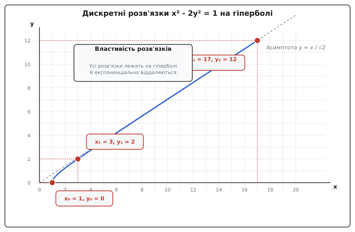
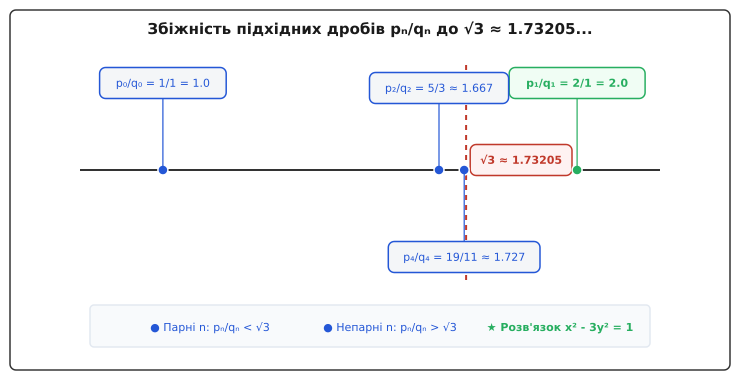
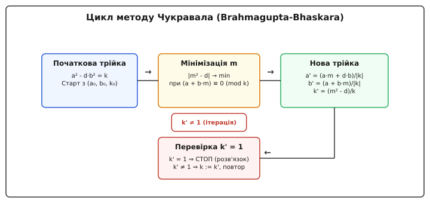

# Рівняння Пелля

<preknowlist>
- [Найбільший спільний дільник (НСД)](root:math-number-theory/gcd-euclidean) — алгоритм Евкліда та властивості подільності цілих чисел.
- [Лінійні діофантові рівняння](root:math-number-theory/linear-diophantine) — поняття цілочисельних рівнянь та умови існування розв'язків.
- [Ланцюгові дроби](root:math-number-theory/continued-fractions) — подання квадратних ірраціональностей та їхніх підхідних дробів.
- [Кільця та алгебраїчні структури](root:math-algebra/rings) — базові поняття кілець, норми та одиниць у розширеннях.
- [Квадратичний закон взаємності](root:math-number-theory/quadratic-reciprocity) — умові існування розв'язків негативного рівняння та квадратичні залишки.
</preknowlist>

> 🔧 **Навіщо це.**
> Рівняння Пелля `x² - d·y² = 1` є центральним об'єктом класичної теорії чисел, який поєднує алгебраїчні розширення кілець, геометрію діофантових наближень та теорію неперервних дробів. Воно є ключем до обчислення регуляторів та чисел класів дійсних квадратичних полів, розкладання великих цілих чисел на множники (алгоритм Shanks' SQUFOF) та побудови криптографічних протоколів на основі арифметики квадратичних кривих.

Якщо спробувати побудувати прямокутний трикутник з однаковими цілочисельними катетами `y` та `y`, то за теоремою Піфагора його гіпотенуза `x` має задовольняти співвідношення `x² = 2·y²`. Оскільки квадратний корінь `√2` є ірраціональним числом (числом, що не виражається точним відношенням двох цілих чисел), точного цілочисельного розв'язку цього рівняння у натуральних числах не існує. Однак, якщо послабити умову й шукати таку цілочисельну пару `(x, y)`, для якої квадрат гіпотенузи відрізняється від подвоєного квадрата катета лише на одиницю, ми отримуємо класичне квадратичне діофантове рівняння `x² - 2·y² = 1`.

Найменша позитивна пара `(3, 2)` дає значення `3² - 2·2² = 9 - 8 = 1`. Відношення цих чисел `3 / 2 = 1.5` слугує першим раціональним наближенням до значення `√2 ≈ 1.41421356`. Наступною цілочисельною парою є `(17, 12)`, для якої `17² - 2·12² = 289 - 288 = 1`, а відповідне раціональне число `17 / 12 ≈ 1.41666` дає значно точніше наближення. Послідовне знаходження таких пар дозволяє будувати якнайточніші раціональні наближення до ірраціональних квадратних коренів.

Узагальнення цієї проблеми для довільного заданого додатного цілого числа `d` (лат. *determinans* — визначник) задається класичним **рівнянням Пелля**:

```
x² - d·y² = 1
```

де невідомими є шукані цілі числа `x` та `y`.

Якщо параметр `d` є точним квадратом цілого числа (`d = k²` для деякого цілого числа `k`), рівняння легко розкладається на множники за формулою різниці квадратів:

```
(x - k·y)·(x + k·y) = 1
```

Оскільки єдиними цілими дільниками одиниці у кільці цілих чисел є `1` та `-1`, отримана система лінійних рівнянь має лише тривіальні розв'язки `x = ±1` та `y = 0`. Оскільки випадки точних квадратів є тривіальними й не несуть ірраціональної структури, надалі **параметр `d` завжди вважається додатним цілим числом, яке не є точним квадратом**.

## 1. Геометрична природа: Дискретні вузли на гіперболах та найкращі раціональні наближення

З точки зору аналітичної геометрії рівняння `x² - d·y² = 1` описує на декартовій площині дійсних чисел `R²` гладку двовіткову гіперболу (грец. *hyperbole* — надлишок, вихід за межі), яка симетрична відносно початку координат та осей координатної системи.


*Дискретні цілочисельні розв'язки (x, y) на ветві гіперболи x² - 2y² = 1 та їхнє віддалення уздовж асимптоти.*

Гіпербола складається з двох симетричних віток, які перетинають вісь абсцис `X` у вершинах з координатами `(1, 0)` та `(-1, 0)`. При прямуванні змінних `x` та `y` до нескінченності вітки гіперболи асимптотично наближаються до прямих асимптот, які задаються рівняннями:

```
y = ± x / √d
```

Задача пошуку цілочисельних розв'язків рівняння Пелля геометрично відповідає знаходженню вузлів цілочисельної решітки `Z²` (тобто точок на площині з цілими координатами `(x, y)`), які розташовані точно на поверхні цієї гіперболи.

Поділивши обидві частини рівняння `x² - d·y² = 1` на `y²` (при ненульовому `y ≠ 0`), отримуємо співвідношення:

```
(x / y)² - d = 1 / y²
```

Перенесши `d` у праву частину та добувши квадратний корінь, маємо:

```
x / y = √(d + 1 / y²) = √d · √(1 + 1 / (d·y²))
```

Застосовуючи формулу біноміального розкладу Тейлора для малої величини `1 / (d·y²)`, отримуємо наближення:

```
x / y ≈ √d · (1 + 1 / (2·d·y²)) = √d + 1 / (2·√d·y²)
```

Отже, різниця між раціональним дробом `x / y` та ірраціональним числом `√d` оцінюється як:

```
|x / y - √d| ≈ 1 / (2·√d·y²) < 1 / (2·y²)
```

Ця нерівність є фундаментальною: вона показує, що кожен цілочисельний розв'язок `(x, y)` рівняння Пелля дає надзвичайно точне раціональне наближення `x / y` до ірраціонального числа `√d`, причому похибка наближення спадає обернено пропорційно квадрату знаменника `y²`. Що далі дискретний розв'язок віддаляється вздовж гіперболи, то ближче точка підходить до асимптоти і то вищою є точність відповідного дробу.

### Теорема Лежандра про діофантові наближення

Зв'язок між рівнянням Пелля та раціональними наближеннями не є випадковим. Французький математик Адрієн-Марі Лежандр (Adrien-Marie Legendre, 1752–1833) довів фундаментальну теорему діофантових наближень:

> Якщо для дійсного ірраціонального числа `α` та нескоротного раціонального дробу `p / q` (де знаменник `q ≥ 1`) виконується нерівність:
>
> ```
> |α - p / q| < 1 / (2·q²)
> ```
>
> то раціональний дріб `p / q` обов'язково є одним із підхідних дробів розкладу числа `α` у неперервний (ланцюговий) дріб.

Перевіримо, чи задовольняють цілочисельні розв'язки рівняння Пелля критерій Лежандра для `α = √d`. Нехай пара `(x, y)` є додатним цілочисельним розв'язком рівняння `x² - d·y² = 1` при `d ≥ 2` та `y ≥ 1`. Розкладемо різницю квадратів:

```
(x - y·√d)·(x + y·√d) = 1
```

Звідси виражаємо модуль різниці:

```
|x / y - √d|
= 1 / (y·(x + y·√d))      [розклад різниці квадратів (x - y·√d)(x + y·√d) = 1 та ділення на y]
= 1 / (y²·(x / y + √d))    [винесення y зі знаменника за дужки]
```

Оскільки `x² = d·y² + 1 > d·y²`, маємо `x / y > √d`. Підставляючи цю оцінку у знаменник, отримуємо:

```
|x / y - √d| < 1 / (y²·(√d + √d)) = 1 / (2·√d·y²)
```

Оскільки для будь-якого неквадратного цілого числа `d ≥ 2` виконується нерівність `√d ≥ √2 ≈ 1.414 > 1`, ми маємо строгу нерівність:

```
|x / y - √d| < 1 / (2·√d·y²) ≤ 1 / (2·√2·y²) < 1 / (2·y²)
```

Цей висновок є вирішальним: **кожен додатний цілочисельний розв'язок `(x, y)` рівняння Пелля `x² - d·y² = 1` обов'язково утворює дріб `x / y`, який є підхідним дробом розкладу `√d` у ланцюговий дріб**. Жодних розв'язків поза множиною підхідних дробів існувати не може.

### Геометрія групи псевдоевклідових поворотів

Геометрично множина дійсних точок гіперболи `x² - d·y² = 1` утворює неперервну однопараметричну групу Лі, яка ізоморфна спеціальній ортогональній групі `SO⁺(1, 1)` псевдоевклідової площини з метрикою Мінковського `s² = x² - d·y²`.

Кожному цілочисельному розв'язку `(x, y)` відповідає лінійне перетворення координатної площини, яке зберігає значення форми `x² - d·y²`:

```
[x']   [x₁   d·y₁] [x]
[y'] = [y₁    x₁ ] [y]
```

Визначник матриці цього перетворення дорівнює точно `det = x₁² - d·y₁² = 1`. Дискретні цілочисельні розв'язки утворюють дискретну підгрупу цієї групи поворотів, яка породжується єдиним фундаментальним генератором — матрицею мінімального розв'язку.

## 2. Алгебраїчний фундамент: Норма, група одиниць та порядок дійсного квадратичного поля

Найбільш глибоке й математично строге пояснення внутрішньої структури розв'язків рівняння Пелля дає алгебраїчна теорія чисел.

Розглянемо квадратне розширення поля раціональних чисел `Q(√d) = {a + b·√d | a, b ∈ Q}` та його підкільце цілих чисел `Z[√d]`:

```
Z[√d] = {a + b·√d | a, b ∈ Z}
```

Кільце `Z[√d]` утворює комутативне кільце з одиницею відносно стандартних операцій додавання та множення дійсних чисел.

Для кожного елемента `α = a + b·√d` визначається алгебраїчно спряжений елемент `ᾱ = a - b·√d`. **Алгебраїчна норма** (лат. *norma* — косинець, норматив) елемента `α` визначається як добуток елемента на його спряжений:

```
N(α) = α·ᾱ = (a + b·√d)·(a - b·√d) = a² - d·b²
```

Норма володіє ключовою властивістю **мультиплікативності**: для будь-яких двох елементів `α, β ∈ Z[√d]` норма їхнього добутку дорівнює добутку їхніх норм:

```
N(α·β) = N(α)·N(β)
```

Перевіримо цю властивість безпосереднім розкриттям дужок. Для двох елементів `α = a₁ + b₁·√d` та `β = a₂ + b₂·√d` їхній добуток у кільці дорівнює:

```
α·β = (a₁·a₂ + d·b₁·b₂) + (a₁·b₂ + a₂·b₁)·√d
```

Обчислюючи норму добутку `N(α·β)`, маємо послідовні тотожні перетворення:

```
N(α·β)
= (a₁·a₂ + d·b₁·b₂)² - d·(a₁·b₂ + a₂·b₁)²                                    [визначення норми елемента]
= a₁²·a₂² + 2·d·a₁·a₂·b₁·b₂ + d²·b₁²·b₂² - d·(a₁²·b₂² + 2·a₁·a₂·b₁·b₂ + a₂²·b₁²) [розкриття квадратів]
= a₁²·a₂² + 2·d·a₁·a₂·b₁·b₂ + d²·b₁²·b₂² - d·a₁²·b₂² - 2·d·a₁·a₂·b₁·b₂ - d·a₂²·b₁² [раскриття дужок]
= a₁²·a₂² + d²·b₁²·b₂² - d·a₁²·b₂² - d·a₂²·b₁²                                [скорочення подвоєних добутків]
= a₁²·(a₂² - d·b₂²) - d·b₁²·(a₂² - d·b₂²)                                     [винесення спільних множників]
= (a₁² - d·b₁²)·(a₂² - d·b₂²)                                                [факторизація на множники]
= N(α)·N(β)                                                                  [підстановка початкових норм]
```

З цієї мультиплікативності випливає точний алгебраїчний зміст задачі: **пошук цілочисельних розв'язків (x, y) рівняння `x² - d·y² = 1` еквівалентний знаходженню елементів `α = x + y·√d` у кільці `Z[√d]`, алгебраїчна норма яких дорівнює одиниці (`N(α) = 1`)**.

### Теорема Діріхле про одиниці та порядки квадратичних полів

Множина всіх елементів кільця, які мають обернений елемент відносно операції множення, називається **групою одиниць** (або оборотних елементів) кільця і позначається `U(Z[√d])` або `Z[√d]ˣ`. Елемент `α ∈ Z[√d]` є оборотним тоді і тільки тоді, коли його норма дорівнює `±1`:

```
N(α) = ±1
```

Справді, якщо `N(α) = α·ᾱ = 1`, то оберненим елементом є `α⁻¹ = ᾱ = a - b·√d ∈ Z[√d]`. Якщо `N(α) = -1`, то `α⁻¹ = -ᾱ = -a + b·√d ∈ Z[√d]`.

Для повного опису структури групи одиниць звернемося до теорії кілець цілих алгебраїчних чисел. Поле `K = Q(√d)` є дійсним квадратичним числовим полем. Кільце всіх цілих алгебраїчних чисел цього поля позначається `O_K` (максимальний порядок поля). Його структура залежить від залишку від ділення `d` на 4:

1. Якщо `d ≡ 2 (mod 4)` або `d ≡ 3 (mod 4)`, то цілі числа поля мають вигляд `a + b·√d` з цілими `a, b ∈ Z`. У цьому випадку максимальний порядок збігається з нашим кільцем:
   ```
   O_K = Z[√d]
   ```
   Дискримінант поля дорівнює `D = 4·d`.

2. Якщо `d ≡ 1 (mod 4)`, то цілі числа поля мають ширший вигляд `(u + v·√d) / 2`, де `u` та `v` є цілими числами однакової парності (`u ≡ v mod 2`). У цьому випадку:
   ```
   O_K = Z[(1 + √d) / 2]
   ```
   Дискримінант поля дорівнює `D = d`. Кільце `Z[√d]` є підкільцем (порядком з кондуктором `f = 2`) індексу 2 у кільці `O_K`.

За загальною **теоремою Діріхле про одиниці** (Петер Густав Лежен Діріхле, 1805–1859), для будь-якого числового поля `K` з `r₁` дійсними вкладеннями та `r₂` парами комплексних вкладень мультиплікативна група одиниць `O_Kˣ` є абелевою групою рангу `r = r₁ + r₂ - 1`.

Для дійсного квадратичного поля `K = Q(√d)` обидва вкладення в поле дійсних чисел є дійсними (`r₁ = 2, r₂ = 0`). Тому алгебраїчний ранг групи одиниць дорівнює:

```
r = 2 + 0 - 1 = 1
```

Це означає, що група одиниць `O_Kˣ` ізоморфна прямому добутку групи коренів з одиниці `{±1}` (скінченна циклічна група порядку 2) та нескінченної циклічної групи:

```
O_Kˣ ≅ {±1} × Z
```

У кільці `O_K` існує єдина мінімальна одиниця `ε_K > 1`, яка називається **фундаментальною одиницею поля**.

Група одиниць підпорядку `Z[√d]ˣ` також має ранг 1:

```
Z[√d]ˣ ≅ {±1} × <ε₁>
```

де `ε₁ = x₁ + y₁·√d` — **фундаментальна одиниця кільця `Z[√d]`** з `x₁ > 0, y₁ > 0`.

Якщо `d ≡ 1 (mod 4)`, фундаментальна одиниця максимального порядку `ε_K` може містити дробові коефіцієнти зі знаменником 2. Наприклад, для `d = 5`:
- `O_K = Z[(1 + √5) / 2]`, фундаментальна одиниця поля `ε_K = (1 + √5) / 2`, її норма `N(ε_K) = (1 - 5) / 4 = -1`.
- Степені `ε_K`: `ε_K² = (3 + √5) / 2`, `ε_K³ = 2 + √5` (цілочисельний елемент з нормою `N(2 + √5) = 4 - 5 = -1`).
- Шостий степінь `ε_K⁶ = (2 + √5)² = 9 + 4·√5` дає перший цілочисельний елемент з нормою `+1`.
- Отже, фундаментальним розв'язком рівняння Пелля `x² - 5·y² = 1` є пара `(x₁, y₁) = (9, 4)`, а відповідна фундаментальна одиниця кільця `Z[√5]` дорівнює `ε₁ = 9 + 4·√5 = ε_K⁶`.

Величина `R_K = ln(ε_K)` називається **регулятором** дійсного квадратичного поля і характеризує щільність розподілу одиниць на логарифмічній шкалі.

Детальний аналіз історичної плутанини навколо назви рівняння, ролі Леонарда Ейлера, Джона Пелля та Вільяма Брункера наведено у вставці [Історичний екскурс про плутанину Ейлера та індійські корені рівняння Пелля](root:math-number-theory/pell-equation/hist-pell-name.md).

### Матричний ізоморфізм та генерування розв'язків

Множення елементів кільця `Z[√d]` точно ізоморфне множенню цілочисельних матриць розміру 2×2 спеціального виду. Зіставимо елементу `α = x + y·√d` матрицю:

```
M(x, y) = [x    d·y]
          [y     x ]
```

Визначник цієї матриці збігається з алгебраїчною нормою елемента:

```
det(M(x, y)) = x² - d·y² = N(α)
```

Перемножимо дві такі матриці для пар `(x₁, y₁)` та `(x₂, y₂)`:

```
M(x₁, y₁) · M(x₂, y₂)
= [x₁   d·y₁] · [x₂   d·y₂]            [підстановка матриць для елементів кільця]
  [y₁    x₁ ]   [y₂    x₂ ]
= [x₁·x₂ + d·y₁·y₂    d·(x₁·y₂ + x₂·y₁)] [множення рядків на стовпці матриць]
  [x₁·y₂ + x₂·y₁         x₁·x₂ + d·y₁·y₂]
= M(x₁·x₂ + d·y₁·y₂, x₁·y₂ + x₂·y₁)     [згортання за визначенням матриці M(x, y)]
```

Матричне множення повністю відтворює правило множення чисел у кільці `Z[√d]`. Тому обчислення `n`-го розв'язку рівняння Пелля еквівалентне піднесенню фундаментальної матриці `M(x₁, y₁)` до степеня `n`:

```
M(xₙ, yₙ) = (M(x₁, y₁))ⁿ
```

Це дозволяє обчислювати дуже далекі розв'язки рівняння Пелля (наприклад, для `n = 10¹²`) за логарифмічний час `O(log n)` за допомогою алгоритму швидкого бінарного зведення матриці до степеня.

### Явні рекурентні формули генерування розв'язків

Розкриваючи степінь `(xₙ + yₙ·√d) = (xₙ₋₁ + yₙ₋₁·√d)·(x₁ + y₁·√d)`, ми отримуємо явні рекурентні формули для послідовного обчислення всіх розв'язків:

```
xₙ = x₁·xₙ₋₁ + d·y₁·yₙ₋₁
yₙ = y₁·xₙ₋₁ + x₁·yₙ₋₁
```

з початковими базовими значеннями `x₀ = 1` та `y₀ = 0`.

Альтернативно, послідовності `xₙ` та `yₙ` задовольняють однакову лінійну однорідну рекурентність другого порядку з характеристичним рівнянням, коренями якого є `ε₁` та `ε₁̄`:

```
xₙ = 2·x₁·xₙ₋₁ - xₙ₋₂
yₙ = 2·x₁·yₙ₋₁ - yₙ₋₂
```

Проілюструємо це на конкретному числовому прикладі для `d = 2`.

Для `d = 2` найменшим нетривіальним розв'язком є `(x₁, y₁) = (3, 2)`, оскільки `3² - 2·2² = 9 - 8 = 1`. Відповідна фундаментальна одиниця дорівнює `ε₁ = 3 + 2·√2`.

Обчислимо наступні члени послідовності розв'язків:
1. `n = 1`: `(x₁, y₁) = (3, 2)`. Перевірка: `3² - 2·2² = 1`.
2. `n = 2`: `(3 + 2·√2)² = 9 + 8 + 12·√2 = 17 + 12·√2`  ⇒  `(x₂, y₂) = (17, 12)`.
   Перевірка: `17² - 2·12² = 289 - 288 = 1`.
   За формулою рекурентності другого порядку: `x₂ = 2·3·3 - 1 = 17`, `y₂ = 2·3·2 - 0 = 12`.
3. `n = 3`: `(17 + 12·√2)·(3 + 2·√2) = (17·3 + 2·12·2) + (17·2 + 12·3)·√2 = 99 + 70·√2`  ⇒  `(x₃, y₃) = (99, 70)`.
   Перевірка: `99² - 2·70² = 9801 - 9800 = 1`.
   За формулою рекурентності: `x₃ = 2·3·17 - 3 = 102 - 3 = 99`, `y₃ = 2·3·12 - 2 = 72 - 2 = 70`.

З алгебраїчної теореми випливає, що якщо знайдено хоча б один фундаментальний розв'язок `(x₁, y₁)`, то існує **нескінченна множина цілочисельних розв'язків**, значення яких зростають як геометрична прогресія зі знаменником `ε₁`.

## 3. Теорія неперервних дробів та теорема Лагранжа

Знаходження фундаментального розв'язку `(x₁, y₁)` вимагає ефективного та строгого обчислювального алгоритму. Простий послідовний перебір `y = 1, 2, 3, ...` з перевіркою, чи є значення `1 + d·y²` точним квадратом, є абсолютно практично непридатним: навіть для невеликих значень `d` (наприклад, `d = 61` або `d = 109`) мінімальний фундаментальний розв'язок містить багатозначні числа, до яких прямий перебір здійснюватиметься мільярди років.

Універсальним та вичерпним інструментом для знаходження фундаментального розв'язку для будь-якого `d` є **теорія неперервних (ланцюгових) дробів**.


*Послідовність підхідних дробів pₙ/qₙ для √3, які почергово перевершують та недооцінюють значення √3, утворюючи розв'язки рівняння Пелля.*

### Квадратичні ірраціональності та теорема Лагранжа про періодичність

Дійсне число `α` називається **квадратичною ірраціональністю**, якщо воно є ірраціональним коренем квадратного рівняння з цілими коефіцієнтами `A·α² + B·α + C = 0` (де `A ≠ 0`). Будь-яку квадратичну ірраціональність можна записати у канонічному вигляді:

```
α = (P + √D) / Q
```

де `P`, `Q`, `D` — цілі числа, `D > 0` не є точним квадратом, `Q ≠ 0`, а величина `(D - P²)` націло ділиться на `Q`.

У 1770 році Жозеф-Луї Лагранж опублікував фундаментальну теорему про структуру ланцюгових дробів:

> **Теорема Лагранжа про періодичні ланцюгові дроби:**
> Нескінченний ланцюговий дріб `[a₀; a₁, a₂, ...]` є періодичним (починаючи з деякого номера) тоді і тільки тоді, коли він представляє квадратичну ірраціональність.

### Зведені ірраціональності та теорема Галуа

Квадратична ірраціональність `α` називається **зведеною** (reduced), якщо виконуються дві одночасні нерівності:

```
α > 1   та   -1 < ᾱ < 0
```

де `ᾱ` — алгебраїчно спряжене число до `α` (тобто якщо `α = (P + √D) / Q`, то `ᾱ = (P - √D) / Q`).

Французький математик Еваріст Галуа (Évariste Galois, 1811–1832) у 1828 році довів красиву теорему:

> **Теорема Галуа:**
> Ланцюговий дріб числа `α` є **суто періодичним** (період починається з найпершого елемента `a₀`):
>
> ```
> α = [(a₀, a₁, ..., a_{k-1})]
> ```
>
> тоді і тільки тоді, коли квадратична ірраціональність `α` є **зведеною**. При цьому розклад спряженого числа `-1 / ᾱ` утворює обернений період `[(a_{k-1}, a_{k-2}, ..., a₀)]`.

Застосуємо теорему Галуа до квадратного кореня `√d`. Сам корінь `√d` не є зведеним, оскільки його спряжене `-√d < -1`. Однак розглянемо зміщене число:

```
α = √d + ⌊√d⌋ = √d + a₀
```

де `a₀ = ⌊√d⌋` — ціла частина `√d`. Перевіримо умови зведеності для `α`:
1. Оскільки `d ≥ 2`, маємо `a₀ ≥ 1` та `√d > 1`, звідки `α = √d + a₀ > 2 > 1`.
2. Алгебраїчно спряженим числом є `ᾱ = -√d + a₀ = a₀ - √d`. Оскільки за визначенням цілої частини `a₀ < √d < a₀ + 1`, різниця лежить у межах:
   ```
   -1 < a₀ - √d < 0
   ```

Обидві умови теореми Галуа виконані! Отже, число `√d + a₀` має **суто періодичний** розклад у ланцюговий дріб:

```
√d + a₀ = [(2a₀, a₁, a₂, ..., a_{k-1})]
```

Віднімаючи `a₀` від обох частин, ми отримуємо канонічну структуру розкладу будь-якого квадратного кореня `√d`:

```
√d = [a₀; (a₁, a₂, ..., a_{k-1}, 2a₀)]
```

де:
- `a₀ = ⌊√d⌋`;
- послідовність `(a₁, a₂, ..., a_{k-1}, 2a₀)` утворює період довжиною `k`;
- останній елемент періоду завжди дорівнює точно подвоєній цілій частині: `a_k = 2·a₀`;
- внутрішній блок періоду `(a₁, a₂, ..., a_{k-1})` володіє строгою **дзеркальною (паліндромною) симетрією**:
  ```
  a₁ = a_{k-1},   a₂ = a_{k-2},   a₃ = a_{k-3},   ...
  ```

### Точний цілочисельний алгоритм генерації розкладу

Для обчислення коефіцієнтів розкладу `aₙ` без використання наближеної арифметики з плаваючою комою (що запобігає будь-якій втраті точності) застосовується класичний рекурентний алгоритм трійок цілих чисел `(Pₙ, Qₙ, aₙ)`:

```
P₀ = 0,   Q₀ = 1,   a₀ = ⌊√d⌋
Pₙ₊₁ = aₙ·Qₙ - Pₙ
Qₙ₊₁ = (d - Pₙ₊₁²) / Qₙ
aₙ₊₁ = ⌊(a₀ + Pₙ₊₁) / Qₙ₊₁⌋
```

Доведемо, що значення `Qₙ₊₁` завжди є цілим числом. За індукцією припустимо, що `Qₙ` ділить `(d - Pₙ²)`. Тоді:

```
d - Pₙ₊₁²
= d - (aₙ·Qₙ - Pₙ)²                               [підстановка Pₙ₊₁]
= d - aₙ²·Qₙ² + 2·aₙ·Pₙ·Qₙ - Pₙ²                   [розкриття квадрата різниці]
= (d - Pₙ²) + 2·aₙ·Pₙ·Qₙ - aₙ²·Qₙ²                [групування доданків]
= Qₙ₋₁·Qₙ + 2·aₙ·Pₙ·Qₙ - aₙ²·Qₙ²                  [підстановка d - Pₙ² = Qₙ₋₁·Qₙ]
= Qₙ·(Qₙ₋₁ + 2·aₙ·Pₙ - aₙ²·Qₙ)                    [винесення Qₙ за дужки]
```

Отриманий вираз ділиться на `Qₙ` без остачі! Отже, усі величини `Pₙ`, `Qₙ`, `aₙ` є строго цілими числами на кожному кроці алгоритму.

Крім того, для всіх кроків `n ≥ 1` виконуються строгі нерівності:

```
0 < Pₙ < √d   та   0 < Qₙ < 2·√d
```

Оскільки кількість можливих цілих пар `(Pₙ, Qₙ)` не перевищує `(√d)·(2·√d) = 2·d`, послідовність пар неминуче зациклюється з довжиною періоду `k ≤ 2·d` (а в середньому за оцінками Шанкса `k = O(√d · ln d)`).

### Підхідні дроби та фундаментальний розв'язок рівняння Пелля

Зрізаючи неперервний дріб на кроці `n`, ми отримуємо раціональний дріб `pₙ / qₙ`, який називається **підхідним дробом** (convergent). Чисельники `pₙ` та знаменники `qₙ` обчислюються за рекурентними формулами:

```
p₋₂ = 0,   p₋₁ = 1,   pₙ = aₙ·pₙ₋₁ + pₙ₋₂
q₋₂ = 1,   q₋₁ = 0,   qₙ = aₙ·qₙ₋₁ + qₙ₋₂
```

Підхідні дроби пов'язані з цілочисельною послідовністю `Qₙ` чудовою тотожністю:

```
pₙ² - d·qₙ² = (-1)ⁿ⁺¹·Qₙ₊₁
```

Ця тотожність є ключем до знаходження розв'язку рівняння Пелля! Наприкінці кожного періоду довжиною `k` (при `n = k - 1`) послідовність повертається до початкового стану, і значення `Q_k` стає рівним точно `1`:

```
Q_k = 1
```

Підставляючи `n = k - 1` у фундаментальну тотожність, маємо:

```
p_{k-1}² - d·q_{k-1}² = (-1)^{(k-1)+1}·Q_k = (-1)^k·1 = (-1)^k
```

Звідси безпосередньо випливає **теорема Лагранжа про знаходження фундаментального розв'язку**:

1. **Випадок парного періоду (`k` — парне число, `(-1)^k = +1`):**
   Фундаментальний розв'язок класичного рівняння `x² - d·y² = 1` досягається на першому ж періоді на кроці `n = k - 1`:
   ```
   x₁ = p_{k-1},   y₁ = q_{k-1}
   ```
   У цьому випадку негативне рівняння `x² - d·y² = -1` не має жодного розв'язку.

2. **Випадок непарного періоду (`k` — непарне число, `(-1)^k = -1`):**
   На кроці `n = k - 1` досягається мінімальний розв'язок негативного рівняння Пелля:
   ```
   x̃₁ = p_{k-1},   ỹ₁ = q_{k-1}   ⇒   x̃₁² - d·ỹ₁² = -1
   ```
   Фундаментальний розв'язок класичного рівняння з `+1` досягається на подвоєному періоді на кроці `n = 2·k - 1`:
   ```
   x₁ = p_{2k-1},   y₁ = q_{2k-1}
   ```
   Алгебраїчно цей розв'язок збігається з квадратом негативного розв'язку:
   ```
   x₁ + y₁·√d = (x̃₁ + ỹ₁·√d)² = (x̃₁² + d·ỹ₁²) + 2·x̃₁·ỹ₁·√d
   ```

### Покроковий приклад 1: Парний період для d = 3 (k = 2)

Розкладемо `√3` у неперервний дріб:
1. `n = 0`: `P₀ = 0, Q₀ = 1`, `a₀ = ⌊√3⌋ = 1`.
   `p₀ = 1, q₀ = 1`. Перевірка: `1² - 3·1² = -2`.
2. `n = 1`: `P₁ = 1·1 - 0 = 1`, `Q₁ = (3 - 1²) / 1 = 2`, `a₁ = ⌊(1 + 1) / 2⌋ = 1`.
   `p₁ = 1·1 + 1 = 2`, `q₁ = 1·1 + 0 = 1`.
   Перевірка: `p₁² - 3·q₁² = 2² - 3·1² = 4 - 3 = +1`!
3. `n = 2`: `P₂ = 1·2 - 1 = 1`, `Q₂ = (3 - 1²) / 2 = 1`, `a₂ = ⌊(1 + 1) / 1⌋ = 2 = 2·a₀` (кінець періоду).

Розклад має період довжиною `k = 2`: `√3 = [1; (1, 2)]`.
Оскільки період парний, розв'язок досягнуто при `n = k - 1 = 1`:
**`(x₁, y₁) = (2, 1)`**.

### Покроковий приклад 2: Парний період для d = 7 (k = 4)

Розкладемо `√7` у неперервний дріб (`a₀ = ⌊√7⌋ = 2`):

| n | Pₙ | Qₙ | aₙ | pₙ | qₙ | pₙ² - 7·qₙ² |
|---|---|---|---|---|---|---|
| 0 | 0 | 1 | 2 | 2 | 1 | 4 - 7 = -3 |
| 1 | 2 | 3 | 1 | 3 | 1 | 9 - 7 = +2 |
| 2 | 1 | 2 | 1 | 5 | 2 | 25 - 28 = -3 |
| 3 | 1 | 3 | 1 | **8** | **3** | **64 - 63 = +1** |
| 4 | 2 | 1 | 4 | 37 | 14 | 1369 - 1372 = -3 |

Розклад: `√7 = [2; (1, 1, 1, 4)]`, довжина періоду `k = 4` (парне).
Фундаментальний розв'язок досягається при `n = 3 = k - 1`:
**`(x₁, y₁) = (8, 3)`**.

### Покроковий приклад 3: Непарний період для d = 13 (k = 5)

Розкладемо `√13` (`a₀ = ⌊√13⌋ = 3`):
Період розкладу: `√13 = [3; (1, 1, 1, 1, 6)]`, довжина `k = 5` (непарне).

Обчислюємо підхідні дроби:
- `n = 0`: `p₀ / q₀ = 3 / 1`, норма `3² - 13·1² = -4`.
- `n = 1`: `p₁ / q₁ = 4 / 1`, норма `4² - 13·1² = +3`.
- `n = 2`: `p₂ / q₂ = 7 / 2`, норма `7² - 13·2² = -3`.
- `n = 3`: `p₃ / q₃ = 11 / 3`, норма `11² - 13·3² = +4`.
- `n = 4` (`n = k - 1`): `p₄ / q₄ = 18 / 5`, норма `18² - 13·5² = 324 - 325 = -1` (розв'язок негативного рівняння!).

Продовжуємо обчислення до другого періоду `n = 2·k - 1 = 9`:
- `n = 5`: `p₅ / q₅ = 119 / 33`
- `n = 6`: `p₆ / q₆ = 137 / 38`
- `n = 7`: `p₇ / q₇ = 256 / 71`
- `n = 8`: `p₈ / q₈ = 393 / 109`
- `n = 9` (`n = 2k - 1`): `p₉ / q₉ = 649 / 180`.

Перевірка норми на кроці `n = 9`:
```
649² - 13·180² = 421201 - 13·32400 = 421201 - 421200 = +1
```

Фундаментальним розв'язком для `d = 13` є пара **`(x₁, y₁) = (649, 180)`**.
Зверніть увагу: `(18 + 5·√13)² = (18² + 13·5²) + 2·18·5·√13 = (324 + 325) + 180·√13 = 649 + 180·√13`. Алгебраїчний зв'язок квадрата негативного розв'язку виконується бездоганно!

## 4. Циклічний метод Чукравала та тотожність Брахмагупти

За п'ять століть до європейських праць Лагранжа, Воліса та Ейлера індійські математики Брахмагупта (628 н. е.), Джаядева (XI ст.) та Бхаскара II (1150 н. е.) розробили оригінальний алгебраїчний алгоритм знаходження фундаментального розв'язку рівняння Пелля, відомий як **метод Чукравала** (санскр. *Chakravala* — циклічний метод, від *Chakra* — колесо, цикл).


*Логіка ітераційного циклу Чукравала для мінімізації норми та побудови фундаментального розв'язку.*

### Тотожність Брахмагупти (Samasa)

В основі методу лежить відкрита Брахмагуптою у 628 році тотожність композиції квадратичних форм (санскр. *Samasa* — додавання, комбінування):

```
(a₁·a₂ + d·b₁·b₂)² - d·(a₁·b₂ + a₂·b₁)² = (a₁² - d·b₁²)·(a₂² - d·b₂²)
```

Якщо маємо два розв'язки допоміжних рівнянь `a₁² - d·b₁² = k₁` та `a₂² - d·b₂² = k₂`, тотожність дозволяє сконструювати новий розв'язок для добутку вільних членів `k₁·k₂`:

```
a₃ = a₁·a₂ + d·b₁·b₂
b₃ = a₁·b₂ + a₂·b₁
k₃ = k₁·k₂
```

### Ітераційний крок алгоритму Чукравала

Нехай на поточному кроці маємо трійку цілих чисел `(a, b, k)`, таку що `a² - d·b² = k`. Розглянемо очевидну тотожність для довільного цілого параметра `m`:

```
m² - d·1² = m² - d
```

Застосуємо тотожність Брахмагупти до трійок `(a, b, k)` та `(m, 1, m² - d)` і поділимо обидві частини на `k²`:

```
((a·m + d·b) / |k|)² - d·((a + b·m) / |k|)² = (m² - d) / k
```

Отримуємо нову трійку `(a', b', k')`:

```
a' = (a·m + d·b) / |k|
b' = (a + b·m) / |k|
k' = (m² - d) / k
```

### Лема Брахмагупти про цілочисельність

Щоб нові коефіцієнти `a'`, `b'`, `k'` були цілими числами, достатньо виконання лише **однієї умови порівняння**:

```
(a + b·m) ≡ 0 (mod |k|)
```

Якщо `(a + b·m)` ділиться на `|k|`, то й `(a·m + d·b)`, і `(m² - d)` автоматично діляться на `|k|`.

### Критерій вибору оптимального параметра m

Серед усіх цілих чисел `m`, які задовольняють лінійне порівняння `b·m ≡ -a (mod |k|)`, метод Чукравала вибирає значення `m`, яке мінімізує абсолютну величину:

```
|m² - d| → min
```

Це мінімізує модуль нового вільного члена `|k'| = |m² - d| / |k|`, завдяки чому алгоритм стрімко зменшує `|k'|` до 1, часто здійснюючи за один крок прогрес, еквівалентний багатьом крокам розкладу в ланцюговий дріб.

### Правила швидкого згортання Бхаскари II

Коли значення норми стає малим (`k' ∈ {±1, ±2, ±4}`), алгоритм миттєво зупиняється та генерує розв'язок за допомогою алгебраїчних тотожностей:

1. **Якщо досягнуто `k = -1`:** піднесення до квадрата у кільці `Z[√d]` дає фундаментальний розв'язок:
   ```
   x = a² + d·b²,   y = 2·a·b
   ```
2. **Якщо досягнуто `k = ±2`:** піднесення до квадрата та ділення на 2 дає цілочисельний розв'язок:
   ```
   x = (a² + d·b²) / 2,   y = a·b
   ```
3. **Якщо досягнуто `k = ±4`:**
   - якщо `a` є парним, ділимо трійку на 2 і отримуємо випадок `k = ±1`;
   - якщо `a` є непарним, підносимо елемент `a + b·√d` до куба та ділимо на 8:
   ```
   x = a·(a² + 3·d·b²) / 8,   y = b·(3·a² + d·b²) / 8
   ```

Детальний алгебраїчний вивід тотожності Брахмагупти та покроковий розбір методу Чукравала наведено у вставці [Математичний метод Чукравала та тотожність Брахмагупти](root:math-number-theory/pell-equation/math-chakravala.md).

### Розбір екстремальних випадків та швидкість росту розв'язків

Швидкість росту фундаментальних розв'язків рівняння Пелля не залежить монотонно від величини `d`: навіть для дуже невеликих значень `d` фундаментальні розв'язки можуть досягати гігантських чисел.

#### 1. Класичний виклик Ферма: d = 61

У 1657 році П'єр де Ферма запропонував європейським математикам знайти мінімальний розв'язок для `d = 61`.

Розклад `√61` у ланцюговий дріб має непарний період довжиною `k = 11`:
`√61 = [7; (1, 4, 3, 1, 2, 2, 1, 3, 4, 1, 14)]`.

Бхаскара II розв'язав цей випадок методом Чукравала всього за 3 ітерації:
1. Початок з найближчого квадрата: `8² - 61·1² = 3`  ⇒  `(a₀, b₀, k₀) = (8, 1, 3)`.
2. Крок 1: `8 + 1·m ≡ 0 (mod 3)`  ⇒  `m ≡ 1 (mod 3)`. Вибираємо `m = 7` (мінімізує `|7² - 61| = 12`).
   Нова трійка: `a₁ = (8·7 + 61·1) / 3 = 39`, `b₁ = (8 + 7) / 3 = 5`, `k₁ = (49 - 61) / 3 = -4`.
3. Оскільки досягнуто `k₁ = -4` з непарним `a₁ = 39` та `b₁ = 5`, застосовуємо правило куба Бхаскари:
   ```
   u = 39·(39² + 3·61·5²) / 8 = 39·(1521 + 4575) / 8 = 39·6096 / 8 = 29718
   v = 5·(3·39² + 61·5²) / 8 = 5·(4563 + 1525) / 8 = 5·6088 / 8 = 3805
   ```
   Пара `(29718, 3805)` є розв'язком негативного рівняння `u² - 61·v² = -1`!
4. Піднесення негативного розв'язку до квадрата дає фундаментальний розв'язок:
   ```
   x₁ = 29718² + 61·3805² = 883159524 + 883159525 = 1766319049
   y₁ = 2·29718·3805 = 226153980
   ```

Фундаментальний розв'язок для `d = 61`:
```
x = 1 766 319 049,   y = 226 153 980
```

#### 2. Випадок d = 109

Для `d = 109` розклад у ланцюговий дріб має період довжиною `k = 15`. Фундаментальний розв'язок становить:

```
x = 158 070 671 986 249,   y = 15 140 424 455 100
```

Число `x` містить 15 десяткових цифр!

#### 3. Античний рекорд: Задача Архімеда про биків

Найвідомішим екстремальним випадком в історії математики є **«Задача про биків»** (лат. *Problemata bovinum*), сформульована Архімедом з Сіракуз. У задачі вимагається знайти кількість биків і корів у стаді бога сонця Геліоса на Сицилії.

Після алгебраїчної формалізації умов задача зводиться до рівняння Пелля:

```
x² - 4729494·y² = 1
```

де параметр `d = 4729494 = 2 · 3 · 7 · 11 · 29 · 353`.

Розклад квадратного кореня `√4729494` у неперервний дріб має колосальну довжину періоду:

```
L = 203 254
```

Мінімальний фундаментальний розв'язок цього рівняння має астрономічні розміри: число `x` містить **206 545 десяткових знаків**, а загальна кількість худоби у стаді Геліоса виражається числом з приблизно `7.76 · 10²⁰⁶⁵⁴⁴` голів! Точний розв'язок був уперше повністю обчислений лише у 1965 році за допомогою ЕОМ CDC 3600 завдяки комбінації ланцюгових дробів та швидкого піднесення до степеня одиниць числового поля.

## 5. Негативне та узагальнене рівняння Пелля

### Негативне рівняння Пелля

Рівняння виду:

```
x² - d·y² = -1
```

називається **негативним рівнянням Пелля**. На відміну від класичного рівняння `x² - d·y² = 1`, яке обов'язково має нетривіальні цілочисельні розв'язки для будь-якого неквадратного `d`, негативне рівняння має розв'язки **лише для деяких значень `d`**.

Необхідні та достатні умови розв'язності рівняння `x² - d·y² = -1`:
1. Довжина періоду `k` розкладу `√d` у ланцюговий дріб має бути **непарною**.
2. Усі непарні прості дільники числа `d` виду `p ≡ 3 (mod 4)` повинні входити до канонічного розкладу `d` у **парних степенях**.
   Це випливає з теорії квадратичних залишків: якщо `x² + 1 = d·y²`, то для будь-якого простого дільника `p | d` маємо порівняння `x² ≡ -1 (mod p)`. За критерієм Ейлера число `-1` є квадратичним лишком за модулем простого `p` тоді і тільки тоді, коли `p = 2` або `p ≡ 1 (mod 4)`.
3. Число `d` не може ділитися на 4 (оскільки квадрати за модулем 4 приймають лише значення 0 або 1, рівняння `x² - 4k·y² ≡ -1 (mod 4)` зводиться до `x² ≡ 3 (mod 4)`, що неможливо).

Для простих чисел `d = p`:
- Якщо `p ≡ 1 (mod 4)` (наприклад, `p = 5, 13, 17, 29, 37, 41, 53, 61, 73, 89, 97`), негативне рівняння `x² - p·y² = -1` **завжди має цілочисельний розв'язок** (класична теорема Лагранжа-Гаусса).
- Якщо `p ≡ 3 (mod 4)` (наприклад, `p = 3, 7, 11, 19, 23, 31, 43, 47, 59, 67, 71, 79, 83`), негативне рівняння `x² - p·y² = -1` **не має жодного розв'язку**.

Якщо `(x̃₁, ỹ₁)` є мінімальним фундаментальним розв'язком негативного рівняння `x² - d·y² = -1`, то всі розв'язки негативного рівняння утворюються піднесенням фундаментального елемента `ε̃₁ = x̃₁ + ỹ₁·√d` до непарних степенів `2m + 1`, а розв'язки позитивного рівняння — піднесенням до парних степенів `2m`:

```
x₂ₘ + y₂ₘ·√d = (x̃₁ + ỹ₁·√d)²ᵐ       [розв'язки x² - d·y² = +1]
x₂ₘ₊₁ + y₂ₘ₊₁·√d = (x̃₁ + ỹ₁·√d)²ᵐ⁺¹ [розв'язки x² - d·y² = -1]
```

### Узагальнене рівняння Пелля

Рівняння виду:

```
x² - d·y² = n
```

де `n` — довільне фіксоване ціле число (`n ≠ 0, 1, -1`), називається **узагальненим рівнянням Пелля**.

Якщо узагальнене рівняння має хоча б один частковий розв'язок `(u, v)`, то множення елемента `u + v·√d` на всі можливі степені фундаментальної одиниці `(x₁ + y₁·√d)ᵏ` утворює нескінченний клас розв'язків:

```
uₖ + vₖ·√d = (u + v·√d)·(x₁ + y₁·√d)ᵏ
```

Однак узагальнене рівняння може мати **декілька взаємно нееквівалентних класів розв'язків** або не мати жодного. Для повного знаходження представників усіх класів використовують **межі Нагеля-Люнггрена** (Trygve Nagell, Wilhelm Ljunggren):

У кожному класі розв'язків рівняння `x² - d·y² = n` існує фундаментальний представник `(u, v)`, координати якого задовольняють нерівності:
- Якщо `n > 0`:
  ```
  0 ≤ u ≤ √((x₁ + 1)·n / 2)
  0 ≤ v ≤ √((x₁ - 1)·n / (2·d))
  ```
- Якщо `n < 0`:
  ```
  0 ≤ u ≤ √((x₁ - 1)·|n| / 2)
  1 ≤ v ≤ √((x₁ + 1)·|n| / (2·d))
  ```

де `(x₁, y₁)` — фундаментальний розв'язок відповідного класичного рівняння `x² - d·y² = 1`.

Якщо `|n| < √d`, то будь-який примітивний розв'язок `(u, v)` (з взаємно простими `gcd(u, v) = 1`) обов'язково є одним із підхідних дробів `u / v = pₘ / qₘ` розкладу `√d` у ланцюговий дріб.

## 6. Застосування у сучасній математиці та інженерії

Теорія рівняння Пелля має фундаментальні застосування у сучасній обчислювальній математиці, теорії чисел та криптографії.

### 1. Обчислення регуляторів та аналітична формула числа класів Діріхле

У теорії алгебраїчних чисел фундаментальний розв'язок `(x₁, y₁)` визначає **регулятор** `R_K = ln(x₁ + y₁·√d)` дійсного квадратичного поля `Q(√d)`. Регулятор входить до аналітичної формули числа класів Діріхле:

```
L(1, χ_D) = (2 · ln(ε_K) · h(D)) / √D
```

де `L(1, χ_D)` — значення ряду Діріхле для квадратичного характеру Кронекера-Якобі, `D` — фундаментальний дискримінант поля, а `h(D)` — **число класів ідеалів** поля (показник неоднозначності розкладу на прості ідеали).

Оскільки значення `L(1, χ_D)` обмежене зверху та знизу константами, між регулятором `R_K = ln(ε_K)` та числом класів `h(D)` існує обернена залежність: поля з малим числом класів (наприклад, `h(D) = 1`, де виконується однозначність факторизації) мають колосальні за величиною фундаментальні одиниці `ε_K`, що пояснює гігантські розв'язки рівняння Пелля для таких чисел, як `d = 61, 109, 991`.

### 2. Алгоритми факторизації великих чисел (Shanks' SQUFOF та метод CFRAC)

У 1975 році Деніел Шанкс (Daniel Shanks) розробив детермінований алгоритм розкладання цілих чисел на множники — SQUFOF (Square Forms Factorization). Алгоритм моделює рух уздовж головного циклу інфраструктури дійсного квадратичного поля `Q(√N)` за допомогою підхідних дробів неперервного дробу.

Метод CFRAC (Continued Fraction Factorization Method) Моррісона та Брілхарта використовує співвідношення `pₙ² - N·qₙ² = (-1)ⁿ⁺¹·Qₙ₊₁` для генерування чисел `Qₙ₊₁`, які розкладаються за малою фактор-базою простих чисел. Накопичення таких рівностей дозволяє методом лінійної алгебри побудувати конгруенцію квадратів `X² ≡ Y² (mod N)` та знайти нетривіальний дільник `gcd(X - Y, N)` за субекспоненціальний час `O(exp(√(ln N · ln ln N)))`. Цей алгоритм став прямим попередником сучасного квадратичного решета (QS).

### 3. Криптографія на основі пеллівських кривих

У сучасній асиметричній криптографії розглядаються так звані **криві Пелля** над скінченними полями Галуа `F_p`:

```
C: x² - d·y² ≡ 1 (mod p)
```

де `d` є квадратичним нелишком за модулем простого числа `p`.

Множина точок такої кривої утворює циклічну групу порядку `p + 1`. Групова операція на точках задається правилом множення Брахмагупти:

```
(x₁, y₁) ⊕ (x₂, y₂) = (x₁·x₂ + d·y₁·y₂, x₁·y₂ + x₂·y₁)  mod p
```

Криптосистеми на основі кривих Пелля реалізують аналоги протоколу обміну ключами Діффі-Геллмана та цифрового підпису Ель-Гамаля. Завдяки використанню послідовностей Люка:

```
Vₙ(2x₁, 1) = 2·xₙ,   Uₙ(2x₁, 1) = yₙ
```

піднесення точок до степеня `k ⊗ (x₁, y₁)` виконується за алгоритмом подвоєння та додавання (double-and-add) з регулярною структурою за логарифмічний час `O(log k)`. Така постійна за часом структура обчислень забезпечує природний захист від атак за сторонніми каналами (side-channel attacks) за часом виконання та енергоспоживанням процесора.

Детальну алгоритмічну реалізацію пошуку фундаментального розв'язку мовами C та C++ з аналізом 64-бітного переповнення наведено у вставці [Обчислювальний алгоритм розв'язання рівняння Пелля мовами C та C++](root:math-number-theory/pell-equation/proj-pell-solver.md).
