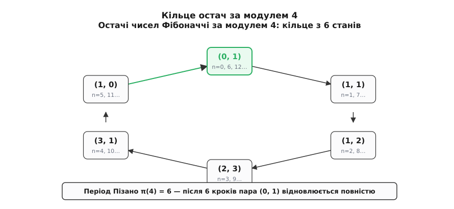
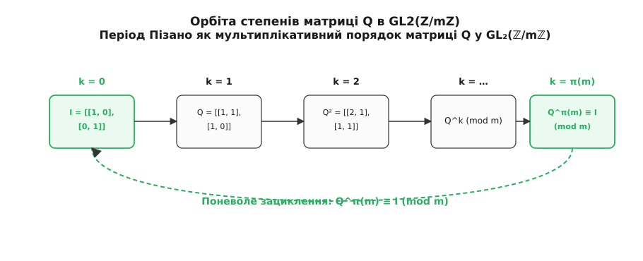
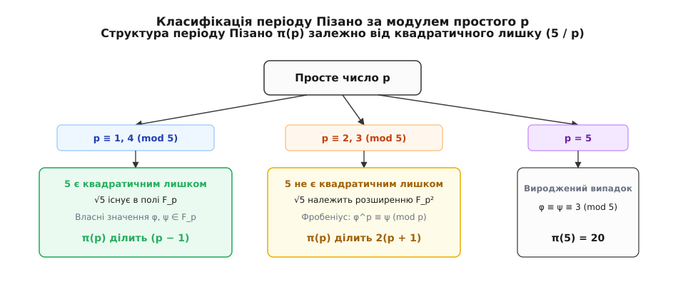

# Період Пізано π(m)

<preknowlist>
- [Числа Фібоначчі](root:math-number-theory/fibonacci-numbers) — послідовність F[n+1] = F[n] + F[n-1] із початковими умовами 0 і 1.
- [Модульна арифметика](root:math-number-theory/modular-arithmetic) — класи лишків, порівняння a ≡ b (mod m) та операції за модулем.
- [Принцип Діріхле](root:math-logic/pigeonhole-principle) — якщо N предметів розмістити в K комірках (N > K), то бодай одна комірка містить щонайменше два предмети.
- [НСД і алгоритм Евкліда](root:math-number-theory/gcd-euclidean) — найменше спільне кратне (НСК) та взаємна простота чисел.
- [Функція і теорема Ейлера](root:math-number-theory/euler-totient) — показник a^φ(m) ≡ 1 (mod m) та мультиплікативний порядок.
- [Закон взаємності квадратних лишків](root:math-number-theory/quadratic-reciprocity) — символ Лежандра (a / p) та існування квадратного кореня у скінченному полі.
</preknowlist>

Уявіть практичну інженерну ситуацію: криптографічний протокол або алгоритм контролю цілісності даних вимагає обчислити залишок від ділення трильйонного числа Фібоначчі `F[10¹⁸]` на модуль `m = 1000`. Якщо спробувати обчислювати цей член послідовності крок за кроком прямим додаванням у циклі, звичайному комп'ютеру знадобляться десятки років безперервної роботи, адже виконання `10¹⁸` ітерацій виходить далеко за межі реального процесорного часу.

Однак модульна арифметика перетворює цю, здавалося б, непідйомну задачу на обчислення за лічені мікросекунди. Причина криється у дивовижній властивості: варто замінити нескінченно зростаючі члени послідовності Фібоначчі на їхні остачі за довільним фіксованим модулем `m`, як уся числова пряма миттєво згортається у суворо повторюваний замкнений цикл.

Якщо виписати послідовність чисел Фібоначчі й замінити кожне значення його остачею від ділення на модуль 4, перед очима постає бездоганно впорядкована періодична вервечка:

```
n :    0  1  2  3  4  5 |  6  7  8  9 10 11 | 12 13 …
F[n]:  0  1  1  2  3  5 |  8 13 21 34 55 89 | 144 …
mod 4: 0  1  1  2  3  1 |  0  1  1  2  3  1 |  0  1 …
```

Остачі не розбігаються хаотично. Рівно після 6 кроків, на індексі `n = 6`, знову випадає початкова пара остач `(0, 1)`. Оскільки кожен наступний член лінійної рекурентності `F[n+1] ≡ F[n] + F[n-1] (mod m)` однозначно визначається парою своїх безпосередніх попередників, поява тієї самої пари неминуче змушує всю подальшу числову дорогу рухатися абсолютно однаковими колами.

Довжину найменшого непорожнього періоду повторення остач послідовності Фібоначчі за модулем `m` називають **періодом Пізано** і позначають через `π(m)` — на честь середньовічного італійського математика Леонардо Пізанського (більш відомого світові під прізвиськом Фібоначчі).

Для перших натуральних модулів періоди утворюють таку послідовність значень:
- Для модуля 2: остачі `0, 1, 1 | 0, 1, 1…` мають період `π(2) = 3`.
- Для модуля 3: остачі `0, 1, 1, 2, 0, 2, 2, 1 | 0, 1…` мають період `π(3) = 8`.
- Для модуля 4: остачі `0, 1, 1, 2, 3, 1 | 0, 1…` мають період `π(4) = 6`.
- Для модуля 5: остачі утворюють цикл довжини `π(5) = 20`.
- Для модуля 6: за мультиплікативністю `π(6) = НСК(π(2), π(3)) = НСК(3, 8) = 24`.
- Для модуля 7: остачі зациклюються через 16 кроків, отже `π(7) = 16`.
- Для модуля 8: зациклення відбувається через 12 кроків, тобто `π(8) = 12`.
- Для модуля 9: період дорівнює `π(9) = 24`.
- Для модуля 10: знаменитий період останніх десяткових цифр `π(10) = 60`.
- Для модуля 11: період дорівнює `π(11) = 10`.
- Для модуля 12: період складає `π(12) = НСК(π(4), π(3)) = НСК(6, 8) = 24`.
- Для модуля 13: період дорівнює `π(13) = 28`.
- Для модуля 16: період дорівнює `π(16) = 24`.

Період Пізано не є просто арифметичним курйозом. Це глибока числово-теоретична структура, яка поєднує лінійну алгебру матричних груп, теорію розширень скінченних піль Galois та класичний закон взаємності квадратних лишків Ґаусса. Знання властивостей `π(m)` дозволяє миттєво зводити астрономічні індекси `n` за формулою `F[n] ≡ F[n mod π(m)] (mod m)`, аналізувати період генераторів псевдовипадкових чисел та розв'язувати складні криптографічні рівняння.

---

## Чому зациклення неминуче і не має передперіодного «хвоста»

Досліджуючи довільну модулярну рекурентність, математик зобов'язаний відповісти на два фундаментальні структурні питання:
1. Чому послідовність остач обов'язково є періодичною, а не продовжує генерувати нові комбінації безкінечно?
2. Чому ця періодичність починається від самого першого елемента `(0, 1)`, тобто є **чисто періодичною**, не маючи передперіодного «хвоста» (як це відбувається, наприклад, у десятковому дробі `1/6 = 0.1666…`, де шістки починаються лише після першої одиниці)?

### Застосування принципу Діріхле до простору станів

Відповідь на перше питання випливає з комбінаторного [принципу Діріхле](root:math-logic/pigeonhole-principle).

Розглянемо впорядковану пару сусідніх остач на кожному кроці `n`:

```
s[n] = (F[n] mod m, F[n+1] mod m)
```

Кожен елемент пари належить скінченному кільцю остач `ℤ/mℤ = {0, 1, 2, …, m - 1}`. Кількість можливих значень для першої остачі дорівнює `m`, і для другої остачі також дорівнює `m`. Отже, повний простір станів пар остач містить рівно `m · m = m²` можливих різних комбінацій:

```
| (ℤ/mℤ)² | = m²
```

Ба більше, нульова пара `(0, 0)` ніколи не може зустрітися у послідовності Фібоначчі зі стартовими умовами `(0, 1)`. Справді, якби пара `(0, 0)` виникла на деякому кроці, усі наступні члени рекурентності `0 + 0 = 0` виявилися б нулями, що суперечить додаванню ненульових членів. Тому робочий простір досяжних станів містить щонайбільше `m² - 1` пар.

Якщо ми розглянемо перші `m² + 1` послідовних пар станів `s[0], s[1], s[2], …, s[m²]`, то за принципом Діріхле серед них обов'язково знайдуться принаймні два однакові стани. Інакше кажучи, існують такі два різні індекси часу `i` та `j` (де `0 ≤ i < j ≤ m²`), для яких пари остач повністю збігаються:

```
(F[i], F[i+1]) ≡ (F[j], F[j+1]) (mod m)
```

Оскільки кожна наступна пара повністю й однозначно обчислюється за правилом `(x, y) ↦ (y, (x + y) mod m)`, збіг станів на кроках `i` та `j` гарантує, що починаючи з індексу `i` послідовність рухатиметься по вже пройденому замкненому колу довжини `j - i`. Зациклення є абсолютно неминучим для будь-якого скінченного модуля `m`.

### Оборотність кроку назад і відсутність передперіоду

Чому ж період зобов'язаний замкнутися саме на початкову пару `(F[0], F[1]) ≡ (0, 1) (mod m)`, а не на якийсь проміжний внутрішній стан?

Причина полягає в **двосторонній оборотності лінійного рекурентного правила**. Формулу Фібоначчі можна розгортати не лише вперед у майбутнє, але й назад у минуле. Якщо відомі два сусідні члени `F[k+1]` та `F[k]`, то попередній член `F[k-1]` однозначно відновлюється операцією віднімання:

```
F[k-1] = F[k+1] − F[k]
```

У кільці остач `ℤ/mℤ` операція віднімання визначена завжди й однозначно для будь-якої пари елементів. Нехай стан повторився на кроках `i` та `j`, тобто `F[i] ≡ F[j] (mod m)` та `F[i+1] ≡ F[j+1] (mod m)` при `i < j`. Обчислимо попередні члени на обох позиціях:

```
F[i-1] ≡ F[i+1] − F[i] ≡ F[j+1] − F[j] ≡ F[j-1] (mod m)
```

Ми бачимо, що рівність пар зберігається при кожному кроці назад у часі. Якщо `(F[i], F[i+1]) ≡ (F[j], F[j+1]) (mod m)`, то й `(F[i-1], F[i]) ≡ (F[j-1], F[j]) (mod m)`.

Повторюючи цей крок назад рівно `i` разів, ми зменшуємо менший індекс `i` до нуля `0`. Відповідно, більший індекс `j` перетворюється на значення `j - i > 0`. У результаті отримуємо строгу рівність:

```
(F[0], F[1]) ≡ (F[j-i], F[j-i+1]) (mod m)
```

Але ж пара `(F[0], F[1])` — це саме стартова пара `(0, 1)`. Отже, першою парою, яка коли-небудь повториться у послідовності остач, обов'язково буде початковий стан `(0, 1)` на кроці `k = j - i`.

Це доводить, що послідовність остач Фібоначчі за будь-яким модулем `m` є **чисто періодичною**: вона не має жодного аперіодичного відрізка чи попереднього хвоста і одразу замкнена у суцільне кільце.


*Остачі за модулем 4 утворюють замкнений цикл із 6 станів. Після появи стартової пари (0, 1) увесь візерунок повністю відновлюється.*

### Граф простору станів як сукупність неперетинних циклів

Оскільки оператор переходу `(x, y) ↦ (y, (x + y) mod m)` є бієкцією (взаємно однозначним відображенням) на скінченній множині `(ℤ/mℤ)²`, у кожну точку графа станів входить рівно одне ребро і з кожної точки виходить рівно одне ребро.

З точки зору теорії графів це означає, що весь простір пар остач розпадається на сукупність неперетинних орієнтованих циклів. Послідовність чисел Фібоначчі відповідає циклу, що містить точку `(0, 1)`. Довжина саме цього виділеного циклу і є періодом Пізано `π(m)`.

---

## Період Пізано як порядок матриці в групі GL₂(ℤ/mℤ)

Щоб піднятися від комбінаторного перелічування остач до строгої алгебраїчної теорії, перепишемо крок генерації чисел Фібоначчі мовою лінійної алгебри.

Об'єднаємо два сусідні числа у вектор стану `v[n] = (F[n+1], F[n])ᵀ`. Тоді крок рекурентності виражається множенням на матрицю переходу другого порядку `Q`:

```
┌          ┐   ┌      ┐ ┌        ┐
│ F[n+1]   │ = │ 1  1 │ │ F[n]   │
│ F[n]     │   │ 1  0 │ │ F[n-1] │
└          ┘   └      ┘ └        ┘
```

де фундаментальна матриця Фібоначчі має вигляд:

```
Q = ┌      ┐
    │ 1  1 │
    │ 1  0 │
    └      ┘
```

Почавши зі стартового вектора `v[0] = (F[1], F[0])ᵀ = (1, 0)ᵀ` і застосувавши матрицю `Q` послідовно `n` разів, отримуємо матричний степінь:

```
┌          ┐       n   ┌   ┐
│ F[n+1]   │ =  Q   ·  │ 1 │
│ F[n]     │           │ 0 │
└          ┘           └   ┘
```

### Доведення формули для степеня матриці Qⁿ за індукцією

Доведемо за математичною індукцією, що для довільного натурального `n ≥ 1` степінь матриці `Q` виражається прямо через члени послідовності Фібоначчі:

```
       ┌               ┐
 Qⁿ =  │ F[n+1]   F[n]  │
       │ F[n]    F[n-1] │
       └               ┘
```

**База індукції (`n = 1`):**

```
Q¹ = ┌             ┐   ┌      ┐
     │ F[2]   F[1] │ = │ 1  1 │ = Q
     │ F[1]   F[0] │   │ 1  0 │
     └             ┘   └      ┘
```

База індукції виконується.

**Крок індукції (`n → n + 1`):**

Припустимо, що формула правильна для деякого `n ≥ 1`. Обчислимо `Q^(n+1) = Qⁿ · Q`:

```
Q^(n+1)
= ┌               ┐   ┌      ┐
  │ F[n+1]   F[n]  │ · │ 1  1 │
  │ F[n]    F[n-1] │   │ 1  0 │
  └               ┘   └      ┘
= ┌                                     ┐
  │ F[n+1]·1 + F[n]·1   F[n+1]·1 + F[n]·0  │   [правило множення матриць: рядок на стовпчик]
  │ F[n]·1 + F[n-1]·1   F[n]·1 + F[n-1]·0  │
  └                                     ┘
= ┌                       ┐
  │ F[n+1] + F[n]   F[n+1] │                  [спрощення добутків з одиницями та нулями]
  │ F[n] + F[n-1]   F[n]   │
  └                       ┘
= ┌                 ┐
  │ F[n+2]   F[n+1] │                         [використання рекурентного правила F[k+1] = F[k] + F[k-1]]
  │ F[n+1]   F[n]   │
  └                 ┘
```

Рівність доведена для всіх натуральних `n`.

### Мультиплікативний порядок матриці в групі GL₂(ℤ/mℤ)

Повернімося до розгляду матриці за модулем `m`. За означенням періоду Пізано, на кроці `k = π(m)` виконуються умови:
- `F[k] ≡ 0 (mod m)`
- `F[k+1] ≡ 1 (mod m)`
- `F[k-1] ≡ F[k+1] − F[k] ≡ 1 − 0 = 1 (mod m)`

Підставивши ці значення в явну формулу для `Q^k`, отримуємо:

```
        ┌              ┐   ┌      ┐
Q^k ≡   │ F[k+1]  F[k] │ ≡ │ 1  0 │ = I   (mod m)
        │ F[k]   F[k-1]│   │ 0  1 │
        └              ┘   └      ┘
```

де `I` — одинична матриця другого порядку.

Це дає фундаментальне алгебраїчне формулювання: **період Пізано `π(m)` — це мультиплікативний порядок матриці `Q` у загальній лінійній групі матриць другого порядку над кільцем остач `GL₂(ℤ/mℤ)`**:

```
π(m) = ord(Q)   у групі GL₂(ℤ/mℤ)
```


*Піднесення матриці Q до степеня за модулем m описує орбіту, яка повертається до одиничної матриці I точно на кроці k = π(m).*

### Тотожність Кассіні та парність періоду Пізано

Обчислимо визначник матриці `Q`:

```
det(Q) = 1 · 0 − 1 · 1 = -1
```

Оскільки визначник добутку матриць дорівнює добутку їхніх визначників, для `n`-го степеня матриці маємо `det(Qⁿ) = (det(Q))ⁿ = (-1)ⁿ`.

Обчислюючи визначник матриці `Qⁿ` за її елементами, ми отримуємо класичну **тотожність Кассіні** (вперше відкриту Жаном-Домініком Кассіні у 1680 році):

```
F[n+1] · F[n-1] − F[n]² = (-1)ⁿ
```

Розглянемо тотожність Кассіні на кроці зациклення `k = π(m)` за модулем `m`. Оскільки `Q^k ≡ I (mod m)`, визначник правої частини дорівнює `det(I) = 1`. Звідси випливає фундаментальне порівняння:

```
det(Q^k) = (-1)^k ≡ 1 (mod m)
```

Проаналізуємо це порівняння:
- Якщо період `k = π(m)` є парним числом, то `(-1)^k = 1 ≡ 1 (mod m)`, що виконується для будь-якого модуля `m`.
- Якщо ж припустити, що період `k = π(m)` є непарним числом, то `(-1)^k = -1`. Тоді порівняння набирає вигляду `-1 ≡ 1 (mod m)`, або після перенесення `2 ≡ 0 (mod m)`.

Це означає, що непарний період можливий **виключно тоді, коли модуль `m` ділить 2**, тобто лише при `m = 2` (де дійсно `π(2) = 3`).

**Фундаментальний наслідок:** Для всіх натуральних модулів `m > 2` період Пізано `π(m)` **завжди є парним числом**.

---

## Мультиплікативність і розклад за Китайською теоремою про остачі

Як обчислити період Пізано для великого складеного модуля (наприклад, `m = 360` або `m = 10⁶`), не виконуючи мільйони покрокових ітерацій? Відповідь полягає в дивовижній властивості мультиплікативності періоду Пізано за взаємно простими модулями.

### Алгебраїчне виведення через ізоморфізм кілець

Нехай модуль `m` розкладається у добуток двох взаємно простих множників: `m = a · b`, де `НСД(a, b) = 1`.

За [Китайською теоремою про остачі](root:math-number-theory/chinese-remainder-theorem), кільце остач розпадається у прямий добуток кілець:

```
ℤ/(a·b)ℤ ≅ ℤ/aℤ × ℤ/bℤ
```

Відповідно, група матриць `GL₂(ℤ/(a·b)ℤ)` є канонічно ізоморфною прямому добутку двох незалежних матричних груп:

```
GL₂(ℤ/(a·b)ℤ) ≅ GL₂(ℤ/aℤ) × GL₂(ℤ/bℤ)
```

Матричне рівняння `Q^k ≡ I (mod a·b)` рівносильне одночасному виконанню системи з двох незалежних порівнянь:

```
Q^k ≡ I (mod a)    та    Q^k ≡ I (mod b)
```

Перше порівняння `Q^k ≡ I (mod a)` виконується тоді й лише тоді, коли показник степеня `k` ділиться на порядок матриці за модулем `a`, тобто `k` ділиться на `π(a)`. Друге порівняння виконується тоді й лише тоді, коли `k` ділиться на `π(b)`.

Щоб обидві умови виконувалися одночасно, натуральне число `k` зобов'язане бути спільним кратним чисел `π(a)` та `π(b)`. Найменшим додатним числом із такою властивістю є [найменше спільне кратне](root:math-number-theory/gcd-euclidean) (НСК):

```
π(a · b) = НСК( π(a), π(b) )    при НСД(a, b) = 1
```

Для довільного натурального числа `m`, розкладеного на канонічні степені простих чисел:

```
m = p₁^(e₁) · p₂^(e₂) · … · p_r^(e_r)
```

обчислення повного періоду Пізано зводиться до обчислення періодів для кожного окремого простого степеня та їхнього об'єднання через операцію НСК:

```
π(m) = НСК( π(p₁^(e₁)), π(p₂^(e₂)), …, π(p_r^(e_r)) )
```

### Покрокові числові розбори обчислення для складених модулів

#### Приклад 1. Обчислення для m = 12
Розкладемо 12 на взаємно прості множники: `12 = 4 · 3`.
1. Для `a = 4`: період дорівнює `π(4) = 6`.
2. Для `b = 3`: період дорівнює `π(3) = 8`.
3. Обчислюємо найменше спільне кратне:
   ```
   π(12) = НСК(π(4), π(3)) = НСК(6, 8) = (6 · 8) / НСД(6, 8) = 48 / 2 = 24
   ```
Отже, остачі чисел Фібоначчі за модулем 12 повторюються з періодом 24.

#### Приклад 2. Обчислення для m = 60
Розкладемо 60 на взаємно прості блоки: `60 = 4 · 3 · 5`.
1. Знаходимо періоди компонентів: `π(4) = 6`, `π(3) = 8`, `π(5) = 20`.
2. Об'єднуємо поетапно:
   ```
   НСК(6, 8) = 24
   π(60) = НСК(24, 20) = (24 · 20) / НСД(24, 20) = 480 / 4 = 120
   ```
Період за модулем 60 дорівнює 120.

#### Приклад 3. Обчислення для m = 360
Розкладемо 360: `360 = 2³ · 3² · 5 = 8 · 9 · 5`.
1. Для `8 = 2³`: `π(8) = 12`.
2. Для `9 = 3²`: `π(9) = 24`.
3. Для `5`: `π(5) = 20`.
4. Об'єднуємо:
   ```
   π(360) = НСК(12, 24, 20) = НСК(24, 20) = 120
   ```
Зверніть увагу: хоча модуль збільшився у 6 разів (від 60 до 360), період Пізано залишився рівним 120, оскільки нові множники не додали нових простих дільників у довжину циклу.

Строге математичне доведення цієї та інших алгебраїчних властивостей подано у вставці [🧮 Строгі доведення властивостей періоду Пізано](root:math-number-theory/pisano-period/math-pisano-properties.md).

---

## Період за простим модулем p: квадратичні лишки та поля Galois

Оскільки період складеного числа розпадається на періоди простих степенів, центральним математичним вузлом усієї теорії є поведінка періоду за простим модулем `p`.

Для дослідження `π(p)` звернемося до аналітичної формули Біне для `n`-го числа Фібоначчі:

```
F[n] = (φⁿ − ψⁿ) / √5
```

де `φ = (1 + √5) / 2` та `ψ = (1 − √5) / 2` — корені характеристичного рівняння рекурентності:

```
x² − x − 1 = 0
```

Дискримінант цього квадратного рівняння дорівнює `D = (-1)² − 4·1·(-1) = 1 + 4 = 5`.

Поведінка розв'язків у скінченній арифметиці за модулем простого числа `p` повністю залежить від того, чи існує квадратний корінь `√5` у скінченному полі остач `𝔽[p] = ℤ/pℤ`. За критерієм Ейлера та [законом взаємності квадратних лишків](root:math-number-theory/quadratic-reciprocity), це визначається значенням символу Лежандра `(5 / p)`.

Усі прості числа розпадаються на три принципово різні класи:


*Залежно від квадратичного лишку (5 / p), корінь √5 або існує в самому полі 𝔽[p], або вимагає розширення 𝔽[p²], що визначає межу періоду π(p).*

---

### Клас 1. p ≡ ±1 (mod 5) — Квадратичний лишок

Якщо просте число `p` дає остачу 1 або 4 при діленні на 5 (тобто `p = 11, 19, 29, 31, 41, 59, 61, 71, 79, 89, 101…`), то за законом взаємності квадратних лишків:

```
(5 / p) = (p / 5) = +1
```

Це означає, що число 5 є квадратичним лишком за модулем `p`, і значення `√5` існує безпосередньо в базовому полі `𝔽[p]`.

*Числовий приклад:* Нехай `p = 11`. Знайдемо корінь з 5 за модулем 11:
```
4² = 16 ≡ 5 (mod 11)
```
Отже, `√5 ≡ 4 (mod 11)`. Оскільки `2⁻¹ ≡ 6 (mod 11)`, обчислюємо корені характеристичного полінома:
```
φ ≡ (1 + 4) · 6 = 30 ≡ 8 (mod 11)
ψ ≡ (1 − 4) · 6 = -18 ≡ 4 (mod 11)
```
Обидва корені `φ = 8` та `ψ = 4` є звичайними ненульовими елементами поля `𝔽[11]`.

Оскільки мультиплікативна група скінченного поля `𝔽[p]*` має порядок `p - 1`, за [малою теоремою Ферма](root:math-number-theory/fermat-little-theorem) піднесення будь-якого ненульового елемента до степеня `p - 1` дає 1:

```
φ^(p-1) ≡ 1 (mod p)    та    ψ^(p-1) ≡ 1 (mod p)
```

Підставивши ці значення у формулу Біне для індексу `n = p - 1`, маємо:

```
F[p-1] = (φ^(p-1) − ψ^(p-1)) / √5 ≡ (1 − 1) / √5 = 0 (mod p)
```

Аналогічно для індексу `n = p`:

```
F[p] = (φ^p − ψ^p) / √5 ≡ (φ − ψ) / √5 = √5 / √5 = 1 (mod p)
```

Пара `(F[p-1], F[p])` повністю дорівнює стартовій парі `(0, 1)` за модулем `p`.

**Фундаментальна теорема 1:** Якщо `p ≡ 1` або `4 (mod 5)`, період Пізано `π(p)` обов'язково **ділить число `p - 1`**:

```
π(p) | (p - 1)    при p ≡ ±1 (mod 5)
```

Перевіримо це правило на конкретних простих числах:
- Для `p = 11`: `p - 1 = 10`. Дільники 10: `{1, 2, 5, 10}`. Період `π(11) = 10` (ділить 10).
- Для `p = 19`: `p - 1 = 18`. Дільники 18: `{1, 2, 3, 6, 9, 18}`. Період `π(19) = 18` (ділить 18).
- Для `p = 29`: `p - 1 = 28`. Період `π(29) = 14`, що є дільником числа 28 (`14 · 2 = 28`).
- Для `p = 31`: `p - 1 = 30`. Період `π(31) = 30` (ділить 30).
- Для `p = 41`: `p - 1 = 40`. Період `π(41) = 40` (ділить 40).

---

### Клас 2. p ≡ ±2 (mod 5) — Квадратичний нелишок

Якщо просте число `p` дає остачу 2 або 3 при діленні на 5 (тобто `p = 3, 7, 13, 17, 23, 37, 43, 47…`), то символ Лежандра дорівнює:

```
(5 / p) = (p / 5) = -1
```

Число 5 не має квадратного кореня у полі `𝔽[p]`. Щоб працювати з коренями характеристичного рівняння, ми будуємо квадратичне розширення поля Galois `𝔽[p²] = 𝔽[p][√5]`. Елементи цього поля мають вигляд `u + v√5`, де `u, v ∈ 𝔽[p]` (це повний модулярний аналог поля комплексних чисел).

У цьому розширенні діє [автоморфізм Фробеніуса](root:math-number-theory/euler-totient) `σ(x) = x^p`. За малою теоремою Ферма та біномом Ньютона:

```
(√5)^p = 5^((p-1)/2) · √5 ≡ (5 / p) · √5 = -√5 (mod p)
```

Застосувавши автоморфізм Фробеніуса до золотого перетину `φ = (1 + √5) / 2`, отримуємо:

```
φ^p = ((1 + √5)/2)^p ≡ (1 + (√5)^p) / 2 = (1 − √5) / 2 = ψ (mod p)
```

Автоморфізм переводить корінь `φ` у спряжений корінь `ψ`.

Помножимо тепер `φ^p` на `φ`:

```
φ^(p+1) = φ^p · φ ≡ ψ · φ (mod p)
```

Але за теоремою Вієта для рівняння `x² − x − 1 = 0` добуток коренів дорівнює вільному члену: `φ · ψ = -1`. Звідси маємо:

```
φ^(p+1) ≡ -1 (mod p)
```

Підносячи обидві частини до квадрата, отримуємо:

```
φ^(2(p+1)) = (φ^(p+1))² ≡ (-1)² = 1 (mod p)
```

Аналогічна рівність виконується і для спряженого кореня `ψ^(2(p+1)) ≡ 1 (mod p)`.

Підставивши ці степені у формулу Біне, отримуємо `F[2(p+1)] ≡ 0 (mod p)` та `F[2(p+1)+1] ≡ 1 (mod p)`.

**Фундаментальна теорема 2:** Якщо `p ≡ 2` або `3 (mod 5)`, період Пізано `π(p)` обов'язково **ділить число `2(p + 1)`**:

```
π(p) | 2(p + 1)    при p ≡ ±2 (mod 5)
```

Перевіримо це правило на числових прикладах:
- Для `p = 3`: `2(p + 1) = 2 · 4 = 8`. Дільники 8: `{1, 2, 4, 8}`. Період `π(3) = 8` (ділить 8).
- Для `p = 7`: `2(p + 1) = 2 · 8 = 16`. Дільники 16: `{1, 2, 4, 8, 16}`. Період `π(7) = 16` (ділить 16).
- Для `p = 13`: `2(p + 1) = 2 · 14 = 28`. Період `π(13) = 28` (ділить 28).
- Для `p = 17`: `2(p + 1) = 2 · 18 = 36`. Період `π(17) = 36` (ділить 36).
- Для `p = 23`: `2(p + 1) = 2 · 24 = 48`. Період `π(23) = 48` (ділить 48).

---

### Клас 3. Вироджений випадок p = 5

Для простого числа `p = 5` дискримінант характеристичного полінома перетворюється на нуль:

```
D = 5 ≡ 0 (mod 5)
```

Квадратне рівняння `x² − x − 1 ≡ x² + 4x + 4 = (x + 2)² = (x − 3)² ≡ 0 (mod 5)` має єдиний кратний корінь:

```
φ ≡ ψ ≡ 3 (mod 5)
```

Оскільки корені збігаються, матриця `Q` не діагоналізується над полем `𝔽[5]`, а зводиться до жорданової клітини розміру 2×2. Мультиплікативний порядок діагональної частини дорівнює `p - 1 = 4`, а порядок уніпотентного зсуву дорівнює характеристиці поля `p = 5`. Повний порядок матриці дорівнює їхньому добутку:

```
π(5) = 4 · 5 = 20
```

Пряме виписування остач чисел Фібоначчі за модулем 5 підтверджує цей результат: цикл містить рівно 20 чисел і завершується парою `(0, 1)`.

---

## Верхня оцінка довжини періоду: нерівність π(m) ≤ 6m

Якою є максимальна теоретично можлива довжина періоду Пізано для довільного натурального числа `m`?

Тривіальна комбінаторна оцінка з принципу Діріхле стверджує лише, що `π(m) ≤ m² - 1`. Проте для великих модулів величина `m²` є велетенською (наприклад, для `m = 1000` вона дорівнює майже мільйону).

У 1960 році Дональд Волл довів значно точнішу й фундаментальну **лінійну верхню межу**:

```
π(m) ≤ 6m    для всіх натуральних чисел m ≥ 1
```

### Коли досягається точна рівність π(m) = 6m?

Рівність `π(m) = 6m` досягається не для довільних модулів, а лише для дуже вузького й специфічного сімейства чисел.

**Теорема Волла про максимум:** Рівність `π(m) = 6m` виконується тоді й лише тоді, коли модуль `m` має вигляд:

```
m = 2 · 5^k    для всіх цілих k ≥ 1
```

Перевіримо це твердження на перших представниках цього сімейства:
1. Для `k = 1`: `m = 2 · 5¹ = 10`.
   - За формулою мультиплікативності: `π(10) = НСК(π(2), π(5)) = НСК(3, 20) = 60`.
   - Обчислюємо співвідношення: `60 / 10 = 6`. Рівність `π(10) = 6 · 10 = 60` виконується абсолютно точно.
2. Для `k = 2`: `m = 2 · 5² = 50`.
   - За правилом степеня простого: `π(25) = 5 · π(5) = 5 · 20 = 100`.
   - Період для 50: `π(50) = НСК(π(2), π(25)) = НСК(3, 100) = 300`.
   - Обчислюємо співвідношення: `300 / 50 = 6`. Рівність `π(50) = 6 · 50 = 300` знову виконується точно.
3. Для `k = 3`: `m = 2 · 5³ = 250`.
   - `π(250) = НСК(π(2), π(125)) = НСК(3, 500) = 1500`.
   - Співвідношення: `1500 / 250 = 6`.

Для всіх інших модулів `m`, які не належать до форми `2 · 5^k`, період Пізано є суворо меншим за `6m`:

```
π(m) < 6m    при m ≠ 2 · 5^k
```

Ця нерівність має величезне значення для комп'ютерних алгоритмів: вона гарантує, що лінійний пошук періоду Пізано ніколи не перевищить `6m` ітерацій, забезпечуючи гарантовану часову складність `O(m)`.

---

## Степені простих чисел і гіпотеза Волла-Суна-Суна

Як поводиться період Пізано при переході від простого числа `p` до його вищих степенів `p², p³, …, p^k`?

### Піднесення конгруенцій та загальний закон зростання

Нехай `π(p)` — період за простим модулем `p`. Це означає, що матриця `Q^(π(p))` порівнянна з одиничною за модулем `p`:

```
Q^(π(p)) = I + p · A
```

де `A` — деяка цілочисельна матриця.

Піднесемо цю рівність до `p`-го степеня за біномом Ньютона для комутуючих матриць:

```
(Q^(π(p)))^p = (I + p · A)^p = I + p · (p · A) + (p(p-1)/2) · p² · A² + … ≡ I + p² · A (mod p³)
```

Звідси за [лемою Гензеля](root:math-number-theory/modular-arithmetic) випливає, що якщо матриця `A` не ділиться на `p` (тобто `Q^(π(p)) ≢ I (mod p²)`), то найменшим степенем, що перетворює матрицю на одиничну за модулем `p²`, є саме `p · π(p)`.

Продовжуючи за індукцією для довільного степеня `k ≥ 1`, отримуємо класичний закон піднесення періоду:

```
π(p^k) = p^(k-1) · π(p)
```

Перевіримо цей закон на конкретних степенях:
- Для `p = 2`: `π(2) = 3`, `π(4) = 2¹ · 3 = 6`, `π(8) = 2² · 3 = 12`, `π(16) = 2³ · 3 = 24`.
- Для `p = 3`: `π(3) = 8`, `π(9) = 3¹ · 8 = 24`, `π(27) = 3² · 8 = 72`, `π(81) = 3³ · 8 = 216`.
- Для `p = 5`: `π(5) = 20`, `π(25) = 5¹ · 20 = 100`, `π(125) = 5² · 20 = 500`.

### Гіпотеза Волла та прості числа Волла-Суна-Суна

Однак у цьому доведенні є прихована умова: рівність `π(p²) = p · π(p)` справедлива лише тоді, коли `π(p²) ≠ π(p)`.

Чи може існувати таке виняткове просте число `p`, для якого період за модулем `p²` взагалі не зростає і залишається рівним періоду за модулем `p`?

Таке гіпотетичне просте число називають **простим числом Волла-Суна-Суна** (Wall-Sun-Sun prime, або простим числом Фібоначчі-Вільсона).

У 1960 році Дональд Волл опублікував відкрите запитання: чи існують такі числа в природі?

У 1992 році китайські вчені-математики брати Чжи-Хун Сун та Чжи-Вей Сун встановили приголомшливий теоретичний результат: якби існував контрприклад до першого випадку Великої теореми Ферма (тобто якби знайшлися цілі числа `x, y, z`, не кратні `p`, для яких `x^p + y^p = z^p`), то це просте число `p` обов'язково мало б бути числом Волла-Суна-Суна, задовольняючи умову `F[p - (5/p)] ≡ 0 (mod p²)`.

Сучасні суперкомп'ютерні розподілені обчислення перевірили всі прості числа в діапазоні:

```
p < 3 · 10¹⁷
```

**Жодного простого числа Волла-Суна-Суна досі не виявлено.**

Усі відомі прості числа строго підкоряються правилу `π(p^k) = p^(k-1) · π(p)`. Для будь-яких практичних інженерних і криптографічних застосувань ця формула вважається беззаперечно істинною.

Детальний опис історії пошуків та обчислювальних експериментів наведено у вставці [📜 Історія відкриття періодів Пізано](root:math-number-theory/pisano-period/hist-pisano-period.md).

---

## Точка входження α(m) та підструктура періоду

Період Пізано володіє витонченою внутрішньою геометричною та алгебраїчною симетрією, яка виявляється при дослідженні нульових остач.

### Означення точки входження (рангу появи)

**Точкою входження (або рангом появи)** модуля `m` у послідовності Фібоначчі називають найменший додатний індекс `α(m) > 0`, для якого число Фібоначчі ділиться на `m` без остачі:

```
α(m) = min { k > 0 : F[k] ≡ 0 (mod m) }
```

Оскільки на повному періоді `k = π(m)` виконується умова `F[π(m)] ≡ 0 (mod m)`, період Пізано завжди є кратним точки входження:

```
π(m) = c · α(m)
```

де `c` — деякий натуральний коефіцієнт пропорційності.

### Теорема про трихотомію коефіцієнта c ∈ {1, 2, 4}

Яких значень може набувати множник `c`? Виявляється, його вибір строго обмежений лише трьома варіантами:

```
c ∈ {1, 2, 4}
```

Доведемо це алгебраїчно через структуру степеня матриці `Q^(α(m))`.

На індексі `α = α(m)` ми маємо `F[α] ≡ 0 (mod m)`. Позначимо через `s = F[α+1] mod m` наступний елемент. З тотожності Кассіні маємо:

```
F[α+1] · F[α-1] − F[α]² = s · F[α-1] − 0 = s · F[α-1] = (-1)^α (mod m)
```

Звідси попередній елемент дорівнює `F[α-1] ≡ (-1)^α · s⁻¹ (mod m)`.

Тоді матриця `Q^α` набирає строго діагонального вигляду:

```
        ┌              ┐   ┌                 ┐
Q^α ≡   │ F[α+1]  F[α] │ ≡ │ s             0 │   (mod m)
        │ F[α]   F[α-1]│   │ 0   (-1)^α · s⁻¹│
        └              ┘   └                 ┘
```

Оскільки `Q^(c·α) = (Q^α)^c ≡ I (mod m)`, на діагоналі повинна стояти 1. Звідси виникають три взаємовиключні випадки:

1. **Випадок c = 1 (`π(m) = α(m)`):**
   - Виникає, коли `s ≡ 1 (mod m)`.
   - Тоді `Q^α ≡ I (mod m)`, і період повністю завершується на першому ж нулі.
   - *Приклад:* Для `m = 2`: `F[3] = 2 ≡ 0 (mod 2)`, тому `α(2) = 3`. Оскільки `F[4] = 3 ≡ 1 (mod 2)`, маємо `π(2) = 1 · 3 = 3`.
   - *Приклад:* Для `m = 4`: `F[6] = 8 ≡ 0 (mod 4)`, тому `α(4) = 6`. Оскільки `F[7] = 13 ≡ 1 (mod 4)`, маємо `π(4) = 1 · 6 = 6`.

2. **Випадок c = 2 (`π(m) = 2α(m)`):**
   - Виникає, коли `s ≡ -1 (mod m)`.
   - Тоді матриця на першому нулі дорівнює `Q^α ≡ -I (mod m)`.
   - На проміжку від `α` до `2α` послідовність повторює першу половину з протилежним знаком: `F[n + α] ≡ -F[n] (mod m)`.
   - Піднесення до квадрата дає `Q^(2α) = (-I)² = I (mod m)`.
   - *Приклад:* Для `m = 3`: `F[4] = 3 ≡ 0 (mod 3)`, тому `α(3) = 4`. При цьому `F[5] = 5 ≡ 2 ≡ -1 (mod 3)`. Повний період дорівнює `π(3) = 2 · 4 = 8`.
   - *Приклад:* Для `m = 7`: `F[8] = 21 ≡ 0 (mod 7)`, тому `α(7) = 8`. При цьому `F[9] = 34 ≡ 6 ≡ -1 (mod 7)`. Період дорівнює `π(7) = 2 · 8 = 16`.

3. **Випадок c = 4 (`π(m) = 4α(m)`):**
   - Виникає, коли `s² ≡ -1 (mod m)` (це можливо лише тоді, коли індекс `α` непарний і `-1` є квадратичним лишком за модулем `m`).
   - Тоді `Q^α` діє як множення на уявну одиницю: `(Q^α)² ≡ -I (mod m)`, а `(Q^α)⁴ ≡ I (mod m)`.
   - Повний період складається з 4 симетричних чвертей.
   - *Приклад:* Для `m = 5`: `F[5] = 5 ≡ 0 (mod 5)`, тому `α(5) = 5`. Наступний член `F[6] = 8 ≡ 3 (mod 5)`. Перевіримо квадрат: `3² = 9 ≡ -1 (mod 5)`. Повний період дорівнює `π(5) = 4 · 5 = 20`.

Знання цієї структури дозволяє оптимізувати алгоритми: щоб знайти `π(m)`, достатньо добігти лише до першого нуля `α(m)` (що у 2 або 4 рази швидше), а потім перевірити лише елемент `F[α+1] mod m`.

---

## Десяткові цифри та періоди для степенів десятки π(10^k)

Найбільш наочним і популярним застосуванням періоду Пізано є спостереження за візерунком останніх десяткових цифр чисел Фібоначчі.

Остання цифра числа у десятковій системі числення — це залишок від ділення на 10. Застосуємо формулу мультиплікативності для `m = 10 = 2 · 5`:

```
π(10) = НСК( π(2), π(5) ) = НСК(3, 20) = 60
```

Це означає, що **остання десяткова цифра чисел Фібоначчі утворює суворо зациклену послідовність із періодом 60**:

```
0, 1, 1, 2, 3, 5, 8, 3, 1, 4, 5, 9, 4, 3, 7, 0, 7, 7, 4, 1,
5, 6, 1, 7, 8, 5, 3, 8, 1, 9, 0, 9, 9, 8, 7, 5, 2, 7, 9, 6,
5, 1, 9, 0, 9, 9, 8, 7, 5, 2, 7, 9, 6, 5, 1, 6, 7, 3, 0, 3,
(і далі знову 0, 1, 1, 2, 3, 5…)
```

Дві останні цифри відповідають залишку за модулем `100 = 2² · 5² = 4 · 25`:

```
π(100) = НСК( π(4), π(25) ) = НСК(6, 100) = 300
```

Три останні цифри відповідають залишку за модулем `1000 = 2³ · 5³ = 8 · 125`:

```
π(1000) = НСК( π(8), π(125) ) = НСК(12, 500) = (12 · 500) / НСД(12, 500) = 6000 / 4 = 1500
```

Для довільної кількості десяткових цифр `k ≥ 3` період Пізано підпорядковується точній аналітичній формулі:

```
π(10^k) = 1.5 · 10^k = 15 · 10^(k-1)    при k ≥ 3
```

Зведемо значення періодів для степенів десятки у зведену таблицю:

| Кількість останніх цифр `k` | Модуль `m = 10^k` | Період Пізано `π(10^k)` |
| :--- | :--- | :--- |
| **1 цифра** | `10` | `60` |
| **2 цифри** | `100` | `300` |
| **3 цифри** | `1000` | `1500` |
| **4 цифри** | `10 000` | `15 000` |
| **5 цифр** | `100 000` | `150 000` |
| **6 цифр** | `1 000 000` | `1 500 000` |
| **7 цифр** | `10 000 000` | `15 000 000` |
| **8 цифр** | `100 000 000` | `150 000 000` |

---

## Узагальнення на довільні лінійні рекурентності та послідовності Люка

Теорія періодів за модулем не обмежується виключно числами Фібоначчі. Вона є універсальним алгебраїчним інструментом для дослідження довільних лінійних рекурентних послідовностей другого порядку зі сталими цілими коефіцієнтами.

Розглянемо узагальнені послідовності Люка `U[n] = U[n](P, Q)` та `V[n] = V[n](P, Q)`, які визначаються параметрами `P` і `Q` за рекурентними правилами:

```
U[0] = 0,    U[1] = 1,    U[n+1] = P · U[n] − Q · U[n-1]
V[0] = 2,    V[1] = P,    V[n+1] = P · V[n] − Q · V[n-1]
```

Характеристичне рівняння для такої рекурентності має вигляд `x² − P·x + Q = 0` з дискримінантом `D = P² − 4·Q`.

Матриця переходу для послідовності `U[n]` записується як:

```
M = ┌          ┐
    │ P    -Q  │
    │ 1     0  │
    └          ┘
```

Визначник цієї матриці дорівнює `det(M) = P · 0 − (-Q) · 1 = Q`.

Поведінка періоду остач `π_(P,Q)(m)` повністю підпорядковується тим самим фундаментальним законам, що й класичний період Пізано, але з урахуванням значень `P`, `Q` та дискримінанта `D`:

1. **Оборотність і чистота періоду:** Якщо параметр `Q` є взаємно простим із модулем `m` (`НСД(Q, m) = 1`), визначник `det(M) = Q` є оборотним елементом кільця `ℤ/mℤ`. У цьому випадку матриця `M` належить групі `GL₂(ℤ/mℤ)`, і рекурентність `U[n] mod m` є суворо чисто періодичною без передперіоду. Якщо ж `НСД(Q, m) > 1`, виникає передперіод (аперіодичний вхідний хвіст), після якого послідовність зациклюється на меншому підпросторі.
2. **Квадратичні лишки за простим модулем p:** Якщо `p` не ділить `2·Q·D`, то:
   - Якщо символ Лежандра `(D / p) = +1`, то період `π_(P,Q)(p)` ділить `p - 1`.
   - Якщо символ Лежандра `(D / p) = -1`, то період `π_(P,Q)(p)` ділить `p² - 1` (а для симетричних послідовностей із `Q = ±1` — ділить `2(p + 1)` або `p + 1`).
3. **Числа Пелля:** При `P = 2, Q = -1` рекурентність `Pell[n+1] = 2·Pell[n] + Pell[n-1]` має характеристичний дискримінант `D = 2² − 4(-1) = 8`. Законом зациклення керує символ Лежандра `(8 / p) = (2 / p)`. Для простих чисел `p ≡ ±1 (mod 8)` корінь `√2` існує в `𝔽[p]`, і період ділить `p - 1`. Для `p ≡ ±3 (mod 8)` період ділить `2(p + 1)`.
4. **Числа Якобсталя:** При `P = 1, Q = -2` дискримінант дорівнює `D = 1² − 4(-2) = 9 = 3²`. Оскільки дискримінант є точним квадратом у полі дійсних чисел, корінь `√9 = 3` існує в будь-якому полі `𝔽[p]` при `p > 2`. Тому для чисел Якобсталя період за довільним непарним простим модулем `p` завжди ділить `p - 1`.

---

## Внутрішня анатомія періоду: таблиця структури для перших 20 модулів

Щоб наочно побачити тонку взаємодію між модулем `m`, точкою входження `α(m)`, множником розширення `c = π(m)/α(m)` та мультиплікативним значенням `s = F[α+1] mod m`, зведемо ці числові характеристики у єдину детальну систему:

| Модуль `m` | Точка входження `α(m)` | `F[α]` | `F[α+1] mod m` (`s`) | Множник `c` | Період Пізано `π(m)` | Тип симетрії |
| :--- | :--- | :--- | :--- | :--- | :--- | :--- |
| **2** | 3 | 2 ≡ 0 | 3 ≡ 1 | 1 | 3 | Повний збіг (`s ≡ 1`) |
| **3** | 4 | 3 ≡ 0 | 5 ≡ 2 ≡ -1 | 2 | 8 | Напівперіодна антисиметрія (`s ≡ -1`) |
| **4** | 6 | 8 ≡ 0 | 13 ≡ 1 | 1 | 6 | Повний збіг (`s ≡ 1`) |
| **5** | 5 | 5 ≡ 0 | 8 ≡ 3 | 4 | 20 | Чверть-період (`s² ≡ -1 mod 5`) |
| **6** | 12 | 144 ≡ 0 | 233 ≡ -1 | 2 | 24 | Напівперіодна антисиметрія (`s ≡ -1`) |
| **7** | 8 | 21 ≡ 0 | 34 ≡ 6 ≡ -1 | 2 | 16 | Напівперіодна антисиметрія (`s ≡ -1`) |
| **8** | 6 | 8 ≡ 0 | 13 ≡ 5 ≡ -3 | 2 | 12 | Напівперіодна антисиметрія |
| **9** | 12 | 144 ≡ 0 | 233 ≡ 8 ≡ -1 | 2 | 24 | Напівперіодна антисиметрія (`s ≡ -1`) |
| **10** | 15 | 610 ≡ 0 | 987 ≡ 7 | 4 | 60 | Чверть-період (`7² = 49 ≡ -1 mod 10`) |
| **11** | 10 | 55 ≡ 0 | 89 ≡ 1 | 1 | 10 | Повний збіг (`s ≡ 1`) |
| **12** | 12 | 144 ≡ 0 | 233 ≡ 5 | 2 | 24 | Напівперіодна антисиметрія |
| **13** | 7 | 13 ≡ 0 | 21 ≡ 8 | 4 | 28 | Чверть-період (`8² = 64 ≡ -1 mod 13`) |
| **14** | 24 | 46368 ≡ 0 | 75025 ≡ -1 | 2 | 48 | Напівперіодна антисиметрія (`s ≡ -1`) |
| **15** | 20 | 6765 ≡ 0 | 10946 ≡ -1 | 2 | 40 | Напівперіодна антисиметрія (`s ≡ -1`) |
| **16** | 12 | 144 ≡ 0 | 233 ≡ 9 ≡ -7 | 2 | 24 | Напівперіодна антисиметрія |
| **17** | 9 | 34 ≡ 0 | 55 ≡ 4 | 4 | 36 | Чверть-період (`4² = 16 ≡ -1 mod 17`) |
| **18** | 12 | 144 ≡ 0 | 233 ≡ 17 ≡ -1 | 2 | 24 | Напівперіодна антисиметрія (`s ≡ -1`) |
| **19** | 18 | 4181 ≡ 0 | 6765 ≡ 1 | 1 | 18 | Повний збіг (`s ≡ 1`) |
| **20** | 30 | 832040 ≡ 0 | 1346269 ≡ 9 | 2 | 60 | Напівперіодна антисиметрія |

Простеження цієї таблиці відкриває глибокі закономірності:
- Коли `s ≡ 1 (mod m)`, залишок одразу повертається у початковий стан, тому період завершується за один прохід (`c = 1`).
- Коли `s ≡ -1 (mod m)`, друга половина періоду є точним дзеркальним відображенням першої з протилежним знаком (`F[n+α] ≡ -F[n]`), тому повне повернення до `(0, 1)` вимагає подвоєння довжини (`c = 2`).
- Коли `s² ≡ -1 (mod m)`, значення `s` грає роль уявної одиниці `i = √(-1)` в арифметиці залишків. Проходження точки входження множить вектор стану на `s`, проходження двох точок дає множник `s² ≡ -1`, трьох точок — `s³ ≡ -s`, і лише чотирикратне проходження повертає одиницю `s⁴ ≡ 1 (mod m)`, формуючи період із 4 симетричних чвертей (`c = 4`).

---

## Застосування в алгоритмах та криптографії

Практична цінність періоду Пізано розкривається в сучасній комп'ютерній інженерії та алгоритмічному аналізі.

### 1. Експоненційне прискорення обчислення Fₙ mod m

Коли потрібно знайти `F[n] mod m` для гігантського індексу `n = 10¹⁸` або навіть `n = 10¹⁰⁰`, класичний алгоритм обчислення складається з двох швидких етапів:

1. Обчислюємо період Пізано `π(m)` за допомогою факторизації модуля або лінійної ітерації.
2. Зменшуємо велетенський показник:
   ```
   n' = n mod π(m)
   ```
3. Знаходимо `F[n'] mod m` методом бінарного піднесення матриці `Q` до степеня `n' - 1` за час `O(log n')`.

Оскільки `n' < 6m`, обчислення виконується за лічені мікросекунди, навіть якщо початкове число `n` мало тисячі десяткових знаків.

### 2. Аналіз генераторів псевдовипадкових чисел (PRNG)

У лінійних рекурентних генераторах псевдовипадкових чисел (зокрема Lagged Fibonacci Generators — LFG вида `X[n] = (X[n-r] + X[n-s]) mod m`) довжина періоду вихідного потоку псевдовипадкових бітів безпосередньо залежить від періоду Пізано базової послідовності. Знання `π(m)` дозволяє розробникам гарантувати відсутність коротких вироджених циклів у генераторі та будувати надійні симуляції методом Монте-Карло.

### 3. Тести простоти та криптографія

Поняття точки входження `α(m)` та періоду зациклення лежить в основі класичних криптографічних тестів простоти чисел Люка-Лемера (Lucas-Lehmer test для простих чисел Мерсенна) та тестів простоти Баї-Борвейна-Бредлі (Baillie-PSW primality test), які є стандартом перевірки великих чисел у бібліотеках OpenSSL та GNU MP.

Повний програмний комплекс для швидкого знаходження періоду `π(m)` та обчислення `F[n] mod m` мовами C та C++ подано у вставці [⚙️ Алгоритм обчислення періоду Пізано та Fₙ mod m](root:math-number-theory/pisano-period/proj-pisano-calculator.md).

---

## Підсумок: Скінченне дзеркало нескінченного росту

Період Пізано `π(m)` є яскравим свідченням дивовижної гармонії між неперервним ростом і дискретною симетрією.

У нескінченному світі дійсних чисел числа Фібоначчі експоненційно розлітаються до безмежності зі швидкістю золотого перетину `φ = (1 + √5)/2 ≈ 1.6180339887…`. Проте варто перенести ту саму лінійну рекурентність у скінченний світ остач за модулем `m`, як уся нескінченність миттєво згортається у витончене періодичне кільце станів.

Кожна структурна властивість періоду Пізано — від мультиплікативності за Китайською теоремою про остачі до класифікації через квадратичні поля Galois `𝔽[p²]` та закон взаємності квадратних лишків — є прямим алгебраїчним відображенням характеристичного рівняння `x² − x − 1 = 0`. Період Пізано наочно демонструє, як простий погляд на остачі перетворює шкільну задачу про додавання чисел на величний міст між лінійною алгеброю, геометрією просторів станів та сучасною теорією чисел.

