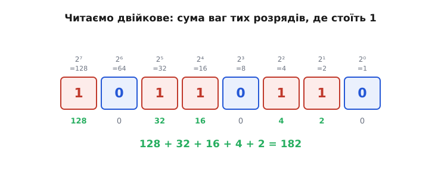
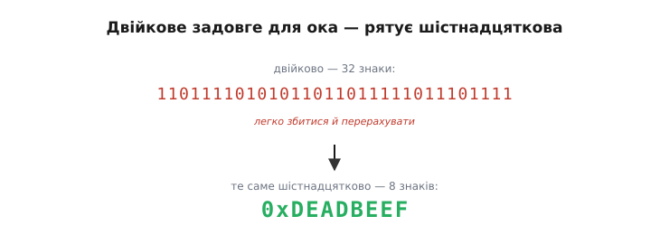
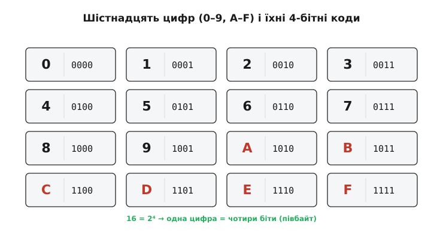
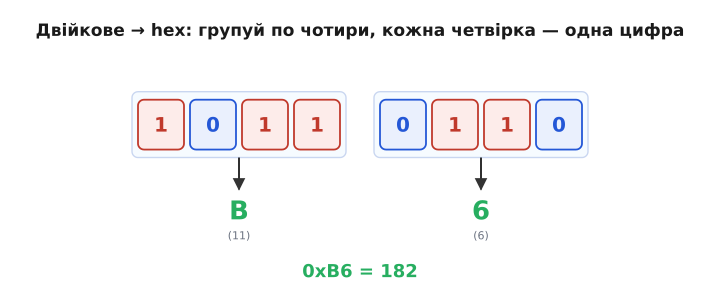
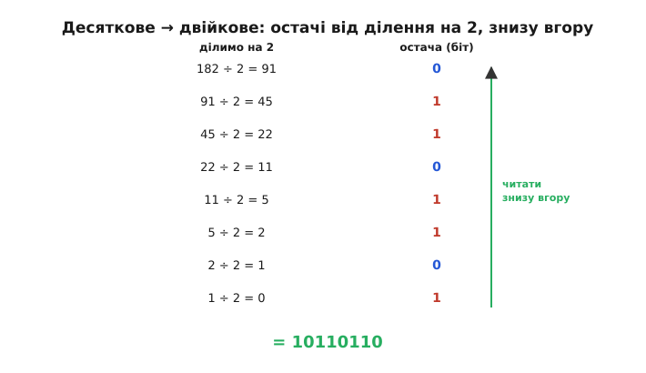

# Позиційні системи: основа, поліноміальний розклад і некласичні бази

<preknowlist>
- [Ділення з остачею](root:math-number-theory/floor-division) — розклад цілого числа на частку й остачу через евклідове ділення.
- [Чому двійкова](root:math-number-theory/why-binary) — фізична природа двох дискретних станів і булева логіка в обчислювальній техніці.
- [Звичайні та десяткові дроби](root:math-number-theory/fractions) — раціональні числа як відношення двох цілих і їхній розклад у спадні частки.
</preknowlist>

Запишіть число 235. Двійка тут означає не просто два, а двісті — тому що вона стоїть на місці сотень. Та сама двійка на місці одиниць важила б рівно два. Цифра одна й та сама, а її внесок у кінцеву величину кардинально різний, і визначає його виключно **місце** в записі. 

У цьому полягає фундаментальний винахід позиційної системи числення (від латинського *positio* — «положення, розташування»): значення кожної цифри дорівнює добутку її власного номіналу на **вагу її позиції**, а вага кожної позиції є степенем **основи** (*basis*, грецьке — «підставка, опора», або *radix*, латинське — «корінь»). У десятковій системі основою слугує число десять, тому розряди послідовно важать 1, 10, 100, 1000 — цілі степені десятки `10⁰, 10¹, 10², 10³`.

Обчислювальна машина оперує не десятьма, а двома стійкими фізичними станами електронного вентиля — наявністю або відсутністю потенціалу на затворі транзистора, тобто логічними нулем та одиницею. Тому її природна основа — два ([чому саме двійкова](root:math-number-theory/why-binary)), і вся логіка позиційності розгортається на базі степенів двійки. Розуміння алгебраїчної структури позиційного розкладу, алгоритмів перетворення між довільними основами, методів стиснення бітів у шістнадцяткові блоки та принципів некласичних систем числення є математичним фундаментом цифрової обробки даних.

### Поліноміальна структура цілих і дійсних чисел

Математично будь-яка класична позиційна система з цілою основою `b ≥ 2` є способом подання числа у вигляді полінома, обчисленого в точці `b`.

Нехай `b ∈ ℕ, b ≥ 2` — фіксована основа системи числення. Набір допустимих цифр складає множину `D_b = {0, 1, 2, ..., b - 1}`. Тоді довільне невід'ємне ціле число `N` однозначно розкладається в скінченну суму:

```
N = ∑_{i=0}^{n-1} d[i] · bⁱ = d[n-1]·bⁿ⁻¹ + d[n-2]·bⁿ⁻² + ... + d[1]·b¹ + d[0]·b⁰
```

де `d[i] ∈ D_b` — цифра `i`-го розряду, причому для старшого розряду виконується умова `d[n-1] ≠ 0` (за винятком самого числа `0`, що записується однією цифрою `0`). 

Існування та єдиність такого розкладу безпосередньо випливають з теореми про [ділення з остачею](root:math-number-theory/floor-division). Якщо поділити `N` на `b` націло:

```
N = q[0] · b + d[0],   де 0 ≤ d[0] < b
```

Остача `d[0]` є єдиною і визначає молодший розряд. Частку `q[0]` ділимо на `b` знову: `q[0] = q[1] · b + d[1]`, одержуючи розряд `d[1]`. Оскільки `b ≥ 2`, послідовність часток строго спадає `N > q[0] > q[1] > ... ≥ 0`, процес гарантовано завершується за `n = ⌊log_b N⌋ + 1` кроків, коли чергова частка стає нульовою.

Цю саму конструкцію розширюють на довільні дійсні додатні числа `x ∈ ℝ⁺` через уведення від'ємних степенів основи:

```
x = ∑_{i=-∞}^{n-1} d[i] · bⁱ = d[n-1]·bⁿ⁻¹ + ... + d[0]·b⁰ + d[-1]·b⁻¹ + d[-2]·b⁻² + ...
```

де розряди з індексами `i < 0` утворюють дробову частину, відокремлену від цілої позиційним роздільником (радікс-точкою, в українській традиції — комою або крапкою). Вага кожного дробового розряду дорівнює `b⁻ᵏ = 1 / bᵏ`. 

Ряд для дробової частини завжди збігається, оскільки мажорується нескінченною спадною геометричною прогресією:

```
∑_{i=1}^{∞} d[-i] · b⁻ⁱ
≤ (b - 1) · ∑_{i=1}^{∞} b⁻ⁱ       [максимальне значення кожної цифри d[-i] = b - 1]
= (b - 1) · (b⁻¹ / (1 - b⁻¹))    [сума нескінченної геометричної прогресії]
= (b - 1) · (1 / (b - 1))
= 1
```

Звідси виникає відомий крайовий ефект неоднозначності позиційного запису: якщо всі дробові розряди, починаючи з деякого місця, дорівнюють `b - 1`, дріб тотожно дорівнює скінченному числу. У десятковій системі `0.999... = 1`, а у двійковій `0.0111...₂ = 0.1000...₂ = 0.5₁₀`. Щоб гарантувати бієкцію між дійсними числами та їхніми позиційними послідовностями, за канонічну форму обирають запис, що не містить нескінченного хвоста з максимальних цифр `b - 1`.

Якщо розглянути позиційний розклад формально як степеневий ряд, стає помітним глибокий дуалізм між дійсними числами та `p`-адичним аналізом. У класичному позиційному записі дійсних чисел ряд розгортається вправо за від'ємними степенями основи `b⁻ᵏ`, збігаючись за архімедовою метрикою абсолютного значення `|x|`. Натомість у теорії `p`-адичних чисел ([лема Гензеля](root:math-number-theory/hensel-lemma)) розклад нескінченно поширюється вліво за додатними степенями простого числа `p`: `∑_{i=k}^{∞} a[i] · pⁱ`. За `p`-адичною ультраметрикою `|x|_p = p^{-v_p(x)}` вищі додатні степені `pⁱ` стають дедалі меншими за нормою, забезпечуючи збіжність зліва направо.

### Порозрядна позиційна арифметика: перенесення та позики

Позиційний поліноміальний розклад визначає алгоритми виконання базових арифметичних дій над багаторозрядними числами. Головна перевага позиційного кодування полягає в тому, що операції над довільно великими числами зводяться до послідовності елементарних дій над поодинокими цифрами з урахуванням міжрозрядного перенесення (*carry*) при додаванні або позики (*borrow*) при відніманні.

#### Алгебра міжрозрядного перенесення

Нехай додаються два `n`-розрядні числа `A` та `B`, записані в системі з основою `b`:

```
A = ∑_{i=0}^{n-1} a[i] · bⁱ,   B = ∑_{i=0}^{n-1} b[i] · bⁱ
```

На кожному `i`-му кроці (рухаючись від молодшого розряду `i = 0` до старшого) обчислюється проміжна сума `s[i]`:

```
s[i] = a[i] + b[i] + c[i]
```

де `c[0] = 0` — початкове перенесення, а `c[i] ∈ {0, 1}` — біт перенесення, що надійшов із попереднього `(i - 1)`-го розряду. Тоді цифра результату `d[i]` та вихідне перенесення `c[i+1]` визначаються однозначно через евклідове ділення:

```
d[i]   = s[i] mod b
c[i+1] = ⌊s[i] / b⌋
```

**Доведення універсального інваріанта перенесення `c[i+1] ∈ {0, 1}`:**
Доведемо за математичною індукцією, що для будь-якої основи `b ≥ 2` перенесення при додаванні двох чисел ніколи не перевищує одиниці.
1. База індукції: `c[0] = 0 ≤ 1`.
2. Індукційний перехід: припустимо, що `c[i] ≤ 1`. Максимально можливе значення проміжної суми досягається, коли обидві цифри набувають свого максимального значення `a[i] = b - 1`, `b[i] = b - 1`, а перенесення дорівнює `c[i] = 1`:
```
s_max = (b - 1) + (b - 1) + 1 = 2b - 1
```
Тоді вихідне перенесення дорівнює:
```
c[i+1] = ⌊(2b - 1) / b⌋ = ⌊2 - 1/b⌋
```
Оскільки `b ≥ 2`, величина `1/b` задовольняє умову `0 < 1/b ≤ 1/2`, звідки `1.5 ≤ 2 - 1/b < 2`. Отже, `⌊2 - 1/b⌋ = 1`. Перенесення завжди дорівнює або `0`, або `1`, що повністю усуває накопичення розрядів у суматорі.

**Числовий приклад стовпчикового додавання у шістнадцятковій системі (`0x7B9 + 0x8E5`):**

```
   Розряди:      16²   16¹   16⁰
   Перенесення:   1     1     0
   Доданок 1:     7     B     9      (0x7B9 = 1977₁₀)
   Доданок 2:     8     E     5      (0x8E5 = 2277₁₀)
   -----------------------------
   Сума:       1  0     9     E      (0x109E = 4254₁₀)
```

Покроковий розбір перенесень:
- Розряд 0 (`16⁰`): `9 + 5 + 0 = 14 = 0xE`. Оскільки `14 < 16`, вихідна цифра `E`, перенесення `c[1] = 0`.
- Розряд 1 (`16¹`): `B (11) + E (14) + 0 = 25`. Ділимо на 16: `25 = 1 · 16 + 9`. Вихідна цифра `9`, перенесення `c[2] = 1`.
- Розряд 2 (`16²`): `7 + 8 + 1 = 16`. Ділимо на 16: `16 = 1 · 16 + 0`. Вихідна цифра `0`, перенесення `c[3] = 1`.
- Розряд 3 (`16³`): `0 + 0 + 1 = 1`. Вихідна цифра `1`.
- Перевірка у десятковій системі: `1977 + 2277 = 4254`; `1 · 4096 + 0 · 256 + 9 · 16 + 14 = 4096 + 144 + 14 = 4254` ✓.

#### Алгебра порозрядного віднімання з позикою

При відніманні `A - B` (де `A ≥ B`) обчислюється різниця `r[i] = a[i] - b[i] - p[i]`, де `p[i] ∈ {0, 1}` — позика зі старшого розряду. Якщо `r[i] < 0`, із сусіднього старшого розряду `(i + 1)` позичається одиниця, що еквівалентно додаванню ваги основи `b` до поточного розряду:

```
d[i]   = (a[i] - b[i] - p[i] + b) mod b
p[i+1] = 1, якщо (a[i] - b[i] - p[i]) < 0, інакше 0
```

**Числовий приклад віднімання у вісімковій системі (`0732₈ - 0465₈`):**

```
   Розряди:       8²    8¹    8⁰
   Позики:        1     1     0
   Зменшуване:    7     3     2      (0732₈ = 474₁₀)
   Від'ємник:     4     6     5      (0465₈ = 309₁₀)
   -----------------------------
   Різниця:       2     4     5      (0245₈ = 165₁₀)
```

Покроковий розбір позик:
- Розряд 0 (`8⁰`): `2 - 5 - 0 = -3 < 0`. Позичаємо 1 із розряду `8¹`. Поточний розряд отримує вагу `8`: `2 + 8 - 5 = 5`. Вихідна цифра `5`, позика `p[1] = 1`.
- Розряд 1 (`8¹`): Враховуємо позику: зменшуване зменшилося до `3 - 1 = 2`. Обчислюємо: `2 - 6 = -4 < 0`. Позичаємо 1 із розряду `8²` (додається вага 8): `2 + 8 - 6 = 4`. Вихідна цифра `4`, позика `p[2] = 1`.
- Розряд 2 (`8²`): Враховуємо позику: зменшуване стало `7 - 1 = 6`. Обчислюємо: `6 - 4 = 2 ≥ 0`. Вихідна цифра `2`, позика `p[3] = 0`.
- Перевірка: `0245₈ = 2 · 64 + 4 · 8 + 5 = 128 + 32 + 5 = 165₁₀`; `474 - 309 = 165` ✓.

#### Поліноміальне множення: від стовпчика до алгоритму Карацуби

Множення двох позиційних чисел спирається на множення відповідних степеневих поліномів. Нехай `A = ∑_{i=0}^{n-1} a[i] · bⁱ` та `B = ∑_{j=0}^{n-1} b[j] · bʲ`. Добуток `C = A · B` формується як згортка коефіцієнтів:

```
C = A · B = ∑_{k=0}^{2n-2} ( ∑_{i+j=k} a[i] · b[j] ) · bᵏ
```

У класичному множенні «стовпчиком» кожен розряд першого числа множиться на кожен розряд другого, що вимагає `n²` елементарних операцій множення однорозрядних цифр та подальшого складання часткових добутків із врахуванням перенесень.

У 1960 році математик Анатоль Карацуба відкрив перший в історії алгоритм швидкого множення, який розриває квадратичний бар'єр складності `O(n²)`. Алгоритм застосовує стратегію «розділяй і володарюй». Розбиваємо кожне `n`-розрядне число на дві половини довжиною `m = ⌈n/2⌉` розрядів:

```
A = A[1] · bᵐ + A[0]
B = B[1] · bᵐ + B[0]
```

Прямий алгебраїчний добуток вимагає чотирьох множень половинних блоків:
`A · B = A[1]·B[1] · b^{2m} + (A[1]·B[0] + A[0]·B[1]) · bᵐ + A[0]·B[0]`.

Карацуба помітив, що середній коефіцієнт можна обчислити лише через **одне додаткове множення** замість двох:
1. `z[2] = A[1] · B[1]` (множення старших половин);
2. `z[0] = A[0] · B[0]` (множення молодших половин);
3. `z[1] = (A[1] + A[0]) · (B[1] + B[0]) - z[2] - z[0]` (середній коефіцієнт).

Тоді повний добуток збирається сумою трьох компонентів:
```
A · B = z[2] · b^{2m} + z[1] · bᵐ + z[0]
```

Завдяки скороченню кількості рекурсивних множень із чотирьох до трьох асимптотична часова складність алгоритму Карацуби падає до `O(n^{\log_2 3}) ≈ O(n^{1.585})`, що дає колосальне прискорення у криптографії та довгому множенні тисячорозрядних чисел.

**Числовий приклад розрахунку добутку `235 · 412` за методом Карацуби (`b = 10`, `m = 2`):**
- Розбиваємо числа: `A = 2 · 10² + 35` (`A[1] = 2, A[0] = 35`), `B = 4 · 10² + 12` (`B[1] = 4, B[0] = 12`).
- Крок 1: `z[2] = 2 · 4 = 8`.
- Крок 2: `z[0] = 35 · 12 = 420`.
- Крок 3: `(A[1] + A[0]) = 2 + 35 = 37`; `(B[1] + B[0]) = 4 + 12 = 16`.
  Обчислюємо допоміжний добуток: `37 · 16 = 592`.
  Знаходимо середній коефіцієнт: `z[1] = 592 - 8 - 420 = 164`.
- Крок 4 (збирання розкладу):
  `A · B = 8 · 10⁴ + 164 · 10² + 420 = 80000 + 16400 + 420 = 96820`.
- Перевірка: `235 · 412 = 96820` ✓.

### Читаємо двійкове: степені двійки

Двійкове число (*binarius*, латинське — «той, що з двох») читають за загальним поліноміальним правилом: кожен розряд множать на відповідний степінь двійки. Найправіший розряд (молодший значущий біт, LSB — *least significant bit*) важить `2⁰ = 1`, наступний ліворуч `2¹ = 2`, далі `2² = 4, 2³ = 8, 2⁴ = 16, 2⁵ = 32, 2⁶ = 64, 2⁷ = 128` — кожен розряд ліворуч рівно вдвічі важчий за свого правого сусіда. Оскільки цифрами є лише `0` та `1`, обчислення значення зводиться до арифметичної суми ваг тих позицій, де встановлено одиницю.


*Для 10110110 одиниці стоять на місцях ваги 128, 32, 16, 4 і 2; їхня сума і є число 182. Розряди з нулем нічого не додають, тож усе читання — це знайти одиниці й скласти їхні степені двійки.*

Перші степені двійки — 1, 2, 4, 8, 16, 32, 64, 128, 256, 512, 1024, 2048, 4096, 65536 — є базовими мірками цифрової схемотехніки. Вони визначають адресні простори процесорів, ширину шин даних, межі переповнення цілих типів та обсяги сторінок віртуальної пам'яті.

### Двійкове задовге для ока

Головна практична вада двійкового запису для людини — його надмірна довжина. Вісім бітів займають вісім знаків, а тридцятидвобітне машинне слово вимагає запису суцільного ланцюжка з тридцяти двох нулів та одиниць. Людське око не здатне надійно зчитувати такі послідовності без помилок розпізнавання розрядів.


*Те саме значення у двійковому — тридцять два знаки, у яких легко збитися, а шістнадцятково — лише вісім: 0xDEADBEEF (давня «налагоджувальна» позначка, якою заповнювали ще не використану пам'ять, щоб одразу впізнати її в дампі). Число одне, та читати незрівнянно легше.*

Щоб скоротити запис без втрати прямого зв'язку з бітовою структурою апаратного регістру, застосовують системи, чиї основи є степенями двійки: вісімкову (`8 = 2³`) та шістнадцяткову (`16 = 2⁴`).

### Шістнадцяткова основа: чотири біти на розряд

Шістнадцяткова система має шістнадцять цифр. Перші десять збігаються з десятковими `0–9`, а для значень від десяти до п'ятнадцяти за домовленістю використовують латинські літери: `A = 10, B = 11, C = 12, D = 13, E = 14, F = 15`. Назва поєднує грецький корінь *hexa* («шість») і латинський *decem* («десять»).

Чому саме шістнадцять стало інженерним стандартом? Відповідь дає рівність `16 = 2⁴`: один шістнадцятковий розряд точно вміщує в себе рівно чотири двійкові біти. Таку групу з чотирьох бітів в англомовній літературі називають півбайтом або ніблом (*nibble* — «кусник», гра слів із *byte/bite*).


*Кожній цифрі відповідає рівно чотири біти: 0 = 0000, 9 = 1001, A = 1010, F = 1111. Оскільки основа є 2⁴, одна шістнадцяткова цифра вкладає в себе точно чотири біти — таку четвірку звуть півбайтом (англійське nibble — «кусник», бо це половина байта, що співзвучний з bite, «укус»).*

Завдяки рівності степенів перетворення між двійковим і шістнадцятковим представленням не потребує операцій ділення чи множення: воно виконується суто комбінаторним групуванням.

### Двійкове ↔ hex: бієкція четвірок та узагальнене блокове групування

Щоб перевести двійкове число в шістнадцяткове, біти розбивають на групи по чотири в напрямку від молодшого розряду до старшого (за потреби дописуючи зліва нулі), після чого кожну четвірку замінюють відповідною hex-цифрою. У зворотний бік кожну шістнадцяткову цифру розгортають у фіксовану четвірку бітів.


*Перша четвірка 1011 — це 8 + 2 + 1 = 11, тобто цифра B; друга 0110 — це 4 + 2 = 6. Разом 0xB6, те саме число 182. Один байт — це завжди рівно дві шістнадцяткові цифри.*

**Алгебраїчне обґрунтування блокового групування:**
Нехай цільова основа `B` є цілим степенем вихідної основи `b`: `B = bᵏ` (де `k ∈ ℕ, k ≥ 1`). Довільне число `N`, записане `n = m · k` розрядами в системі з основою `b`, подається у вигляді:

```
N = ∑_{i=0}^{m·k - 1} d[i] · bⁱ
  = ∑_{j=0}^{m-1} ∑_{r=0}^{k-1} d[j·k + r] · b^{j·k + r}
  = ∑_{j=0}^{m-1} ( ∑_{r=0}^{k-1} d[j·k + r] · bʳ ) · (bᵏ)ʲ
  = ∑_{j=0}^{m-1} D[j] · Bʲ
```

де кожна укрупнена цифра `D[j] = ∑_{r=0}^{k-1} d[j·k + r] · bʳ` набуває значень у діапазоні від `0` до `bᵏ - 1 = B - 1`. Це строго доводить, що перетворення між основами `b` та `bᵏ` не породжує міжрозрядних перенесень і зводиться до незалежного паралельного перекодування блоків довжиною `k`.

Цей фундаментальний принцип визначає три ключові інженерні формати:
1. `b = 2, k = 3`: Двійкова ↔ вісімкова система (`8 = 2³`), де біти групуються трійками (`000`–`111` ↔ `0–7`).
2. `b = 2, k = 4`: Двійкова ↔ шістнадцяткова система (`16 = 2⁴`), де біти групуються четвірками (`0000`–`1111` ↔ `0–F`).
3. `b = 2, k = 6`: Двійкова ↔ Base64 (`64 = 2⁶`), де потік бітів розбивається на блоки по 6 бітів і відображається на 64 безпечні символи ASCII для передачі бінарних файлів у поштових протоколах та вебі.

**Перетворення байта 10110110 у hex та перевірка розкладом:**

```
1011 0110            [ділимо байт на дві четвірки бітів]
1011 = 8+2+1 = 11 = B
0110 =   4+2 =  6 = 6
                     → 0xB6
перевірка: B·16¹ + 6·16⁰ = 11·16 + 6 = 176 + 6 = 182   ✓
```

У вихідному коді програм шістнадцяткові константи позначають префіксом `0x` або `0X`. Оскільки стандартний байт складається з восьми бітів, він завжди записується рівно двома hex-цифрами:

:::tabs
```c
#include <stdint.h>
#include <stdio.h>

// Байт як дві шістнадцяткові цифри
uint8_t status = 0xB6;                 // 182 = 0b1011 0110
uint8_t high_nibble = (status >> 4) & 0x0F; // 0x0B = 11
uint8_t low_nibble  = status & 0x0F;        // 0x06 = 6
```
```cpp
#include <cstdint>
#include <format>
#include <iostream>

// Робота з півбайтами у C++
constexpr std::uint8_t status{0xB6};
constexpr std::uint8_t high_nibble{static_cast<std::uint8_t>((status >> 4) & 0x0F)};
constexpr std::uint8_t low_nibble{static_cast<std::uint8_t>(status & 0x0F)};

void print_status() {
    std::cout << std::format("0x{:02X}: старший = 0x{:X}, молодший = 0x{:X}\n",
                             status, high_nibble, low_nibble);
}
```
:::

У системному програмуванні шістнадцятковий запис застосовують для адресації пам'яті, бітових масок конфігурації апаратних портів, колірних палітр (формат `#RRGGBB`) та криптографічних гешів. Раніше для цього використовували [вісімкову систему](root:math-number-theory/octal-system) (`8 = 2³`), проте вісімкове групування по 3 біти не ділить 8-бітний байт націло, через що вона збереглася лише в окремих протоколах (маски прав доступу POSIX `0755`). Еволюцію запису та історичну боротьбу стандартів розкриває [коротка історія запису](root:math-number-theory/positional-systems/hist-hex-notation.md).

### Алгоритми взаємних перетворень між довільними основами

Перетворення довільного числа з позиційної системи з основою `a` в систему з основою `b` розв'язується двома універсальними методами залежно від того, в якій арифметиці (вихідній чи цільовій) виконуються розрахунки.

#### 1. Згортання за схемою Горнера (обчислення у цільовій системі)

Коли число задане послідовністю цифр `(d[n-1] d[n-2] ... d[1] d[0])_a`, його значення в іншій системі можна обчислити прямою підстановкою в поліном. Щоб мінімізувати кількість операцій множення та уникнути явного зведення основи `a` у степені, використовують схему Горнера (метод вкладених дужок):

```
N = (...((d[n-1] · a + d[n-2]) · a + d[n-3]) · a + ...) · a + d[0]
```

Алгоритм стартує зі значення `acc = 0` і послідовно виконує `n` ітерацій: `acc = acc · a + d[i]`, рухаючись від старшого розряду `d[n-1]` до молодшого `d[0]`. Це потребує лише `n - 1` множень та `n - 1` додавань, що є асимптотично оптимальним.

**Приклад: переведення числа `0x2FA` з шістнадцяткової системи в десяткову за схемою Горнера:**

```
Початкове значення: acc = 0
Крок 1 (старша цифра '2' = 2):
acc = 0 · 16 + 2 = 2

Крок 2 (наступна цифра 'F' = 15):
acc = 2 · 16 + 15 = 32 + 15 = 47

Крок 3 (молодша цифра 'A' = 10):
acc = 47 · 16 + 10 = 752 + 10 = 762

Результат: 0x2FA = 762₁₀
```

#### 2. Послідовне евклідове ділення (обчислення у вихідній системі)

Якщо розрахунки ведуться в тій системі, де число `N` уже представлене (наприклад, десяткове число переводиться в двійкове засобами десяткової арифметики), застосовують послідовне ділення на цільову основу `b`.


*Ділимо 182 навпіл, щоразу занотовуючи остачу: 182 дає 0, 91 дає 1, 45 дає 1 і так до одиниці. Остачі знизу вгору утворюють 10110110. Працює це тому, що остача від ділення на два — молодший біт, а ділення зсуває число на розряд.*

Кожен крок ділення виділяє залишок `r[k] = N mod b`, що стає черговою цифрою розряду, а частка `q[k] = ⌊N / b⌋` передається на наступну ітерацію. Оскільки першим обчислюється молодший розряд `d[0]`, цифри шуканого числа записують у зворотному порядку — знизу вгору.

**Приклад: переведення десяткового числа 182 у двійкову форму:**

```
182 ÷ 2 = 91, ост. 0   [молодший біт d[0]]
 91 ÷ 2 = 45, ост. 1   [біт d[1]]
 45 ÷ 2 = 22, ост. 1   [біт d[2]]
 22 ÷ 2 = 11, ост. 0   [біт d[3]]
 11 ÷ 2 =  5, ост. 1   [біт d[4]]
  5 ÷ 2 =  2, ост. 1   [біт d[5]]
  2 ÷ 2 =  1, ост. 0   [біт d[6]]
  1 ÷ 2 =  0, ост. 1   [старший біт d[7]]

Остачі, виписані знизу вгору: 10110110₂
Перевірка: 128 + 32 + 16 + 4 + 2 = 182   ✓
```

#### 3. Перетворення правильних дробів та аналіз періодичності

Для переведення дробової частини `f ∈ [0, 1)` у позиційну систему з основою `b` застосовують операцію послідовного множення на `b`.

На кожному кроці поточний залишок множать на `b`: ціла частина отриманого добутку стає черговим дробовим розрядом `d[-k] = ⌊f[k-1] · b⌋`, а дробова частина `f[k] = {f[k-1] · b}` передається на наступну ітерацію. Цифри формуються у прямому порядку — зліва направо від коми.

**Приклад скінченного дробу: `0.625₁₀` у двійкову систему:**

```
0.625 · 2 = 1.250   → ціла частина 1 (розряд d[-1] = 1), залишок 0.250
0.250 · 2 = 0.500   → ціла частина 0 (розряд d[-2] = 0), залишок 0.500
0.500 · 2 = 1.000   → ціла частина 1 (розряд d[-3] = 1), залишок 0.000 (зупинка)

Результат: 0.625₁₀ = 0.101₂
Перевірка: 1·2⁻¹ + 0·2⁻² + 1·2⁻³ = 0.5 + 0.125 = 0.625   ✓
```

**Теорія структури періодів раціонального дробу:**
Чому одні дроби мають скінченний запис, а інші стають нескінченними періодичними?
Нехай нескоротний дріб `x = p / q` (`0 < x < 1`, `НСД(p, q) = 1`) розкладається в системі з основою `b`. Представимо знаменник у вигляді добутку двох множників: `q = u · v`, де `u` містить лише прості множники, що ділять основу `b`, а `v` взаємно просте з основою (`НСД(v, b) = 1`).
1. **Критерій скінченності:** дріб `p / q` є скінченним тоді й лише тоді, коли `v = 1`. Довжина скінченного дробу дорівнює найменшому показнику степеня `k`, при якому `q | bᵏ`.
2. **Періодичний розклад:** якщо `v > 1`, дріб перетворюється на нескінченний періодичний:
   - довжина **передперіоду** `t` дорівнює найменшому показнику `t ≥ 0`, для якого `u | bᵗ`;
   - довжина **чистого періоду** `T` дорівнює мультиплікативному порядку основи `b` за модулем `v`:
     ```
     T = ord_v(b) = min { k ≥ 1 : bᵏ ≡ 1 (mod v) }
     ```

**Порівняльний числовий розбір дробу `1/14` у двох різних системах числення:**
Знаменник `q = 14 = 2 · 7`.
- **У десятковій системі (`b = 10 = 2 · 5`):**
  Множник `u = 2` (ділить 10), а `v = 7` (`НСД(7, 10) = 1`).
  Довжина передперіоду: `t = 1` (бо `2 | 10¹`).
  Довжина періоду: шукаємо порядок десятки за модулем 7:
  `10¹ ≡ 3`, `10² ≡ 2`, `10³ ≡ 6 ≡ -1`, `10⁴ ≡ 4`, `10⁵ ≡ 5`, `10⁶ ≡ 1 (mod 7)`.
  Отже, `T = ord_7(10) = 6`. Дріб має один знак передперіоду та шість знаків періоду:
  `1/14 = 0.0(714285)₁₀`.

- **У двійковій системі (`b = 2`):**
  Множник `u = 2` (ділить двійкову основу 2), а `v = 7` (`НСД(7, 2) = 1`).
  Довжина передперіоду: `t = 1` (бо `2 | 2¹`).
  Довжина періоду: шукаємо порядок двійки за модулем 7:
  `2¹ ≡ 2`, `2² ≡ 4`, `2³ = 8 ≡ 1 (mod 7)`.
  Отже, `T = ord_7(2) = 3`! Двійковий період становить лише 3 знаки замість 6:
  `1/14 = 0.0(001)₂`.

Перевіримо двійковий періодичний розклад сумою геометричного ряду:
```
0.0(001)₂
= 2⁻¹ · ∑_{k=1}^{∞} 1 · (2⁻³)ᵏ
= (1/2) · ((1/8) / (1 - 1/8))    [сума нескінченної спадної геометричної прогресії]
= (1/2) · ((1/8) / (7/8))
= (1/2) · (1/7)
= 1/14
```

Оскільки знаменник дробу `1/10` містить простий дільник `5`, що не ділить двійкову основу `2`, точний скінченний десятковий дріб `0.1` перетворюється на нескінченний періодичний двійковий дріб `0.0(0011)₂`. Саме це породжує ефект похибки заокруглення у форматах рухомої коми IEEE 754 (де вираз `0.1 + 0.2 != 0.3`). Детальний аналіз періодів подано в темі [двійкові дроби та точність представлення](root:math-number-theory/binary-fractions).

### Некласичні системи числення

Класичні позиційні системи використовують сталу цілу додатну основу `b ≥ 2` та фіксований базис ваг `bⁱ`. Проте концепція зваженого позиційного кодування є значно ширшою: ваги розрядів можуть утворювати негеометричні послідовності, основа може бути від'ємною, комплексною або знакозмінною.

#### Факторіальна система числення (Factoradic)

У факторіальній системі числення вагами позицій є послідовні факторіали натуральних чисел: `1!, 2!, 3!, 4!, ..., k!`. Будь-яке ціле число `N ≥ 0` однозначно записується у вигляді:

```
N = ∑_{k=1}^{m} d[k] · k! = d[m]·m! + d[m-1]·(m-1)! + ... + d[2]·2! + d[1]·1!
```

де на цифри кожного розряду накладається змінне обмеження: `0 ≤ d[k] ≤ k`. 

Єдиність представлення гарантується комбінаторною тотожністю суми зважених факторіалів:

```
∑_{k=1}^{m} k · k!
= ∑_{k=1}^{m} ((k + 1) - 1) · k!
= ∑_{k=1}^{m} ((k + 1)! - k!)       [телескопічна сума]
= (m + 1)! - 1
```

Максимальне число, яке можна записати `m` розрядами, рівно на одиницю менше за вагу наступного розряду `(m + 1)!`.

**Приклад розкладу числа `N = 463₁₀` у факторіальну систему:**

Розклад знаходять послідовним діленням на зростаючі дільники `2, 3, 4, 5, ...`:

```
463 ÷ 2 = 231,  остача d[1] = 1   (0 ≤ d[1] ≤ 1)
231 ÷ 3 =  77,  остача d[2] = 0   (0 ≤ d[2] ≤ 2)
 77 ÷ 4 =  19,  остача d[3] = 1   (0 ≤ d[3] ≤ 3)
 19 ÷ 5 =   3,  остача d[4] = 4   (0 ≤ d[4] ≤ 4)
  3 ÷ 6 =   0,  остача d[5] = 3   (0 ≤ d[5] ≤ 5)

Результат: 463₁₀ = 34101_{!}
Перевірка: 3·5! + 4·4! + 1·3! + 0·2! + 1·1! = 3·120 + 4·24 + 1·6 + 0·2 + 1·1 = 360 + 96 + 6 + 1 = 463   ✓
```

Факторіальна система слугує математичним інструментом у комбінаторних алгоритмах генерації перестановок: код Лемера (вектор інверсій перестановки) є факторіальним записом її порядкового номера в лексикографічному сортуванні.

#### Фібоначчієва система та теорема Цекендорфа

У фібоначчієвій системі числення вагами розрядів виступають числа Фібоначчі: `F_2 = 1, F_3 = 2, F_4 = 3, F_5 = 5, F_6 = 8, F_7 = 13, ...` (виключаючи `F_0 = 0` та першу `F_1 = 1`, щоб уникнути дублювання ваги 1).

Згідно з [теоремою Цекендорфа](root:math-number-theory/zeckendorf-theorem), кожне натуральне число `N` можна єдиним способом подати у вигляді суми несуміжних чисел Фібоначчі:

```
N = ∑_{k=2}^{m} c[k] · F_k,   де c[k] ∈ {0, 1}
```

за обов'язкової умови: `c[k] · c[k+1] = 0` для всіх `k`. Заборона мати дві одиниці поруч (`11`) усуває надлишковість, оскільки тотожність `F_{k+1} = F_k + F_{k-1}` дозволяє замінити пару одиниць `11` на одну одиницю вищого розряду.

**Приклад розкладу числа 43 жадібним алгоритмом:**

Знаходимо найбільше число Фібоначчі, що не перевищує залишок:
1. `43 - F_8 (34) = 9` (встановлюємо біт `F_8 = 1`)
2. Наступне `F_7 = 21 > 9` (`0`), `F_6 = 13 > 9` (`0`)
3. `9 - F_5 (8) = 1` (встановлюємо біт `F_5 = 1`)
4. `F_4 = 5 > 1` (`0`), `F_3 = 3 > 1` (`0`), `F_2 = 2 > 1` (`0`)
5. Оскільки залишок дорівнює 1, а вага `F_2 = 1`, маємо `1 - F_2 = 0`. Встановлюємо `F_2 = 1`.

```
43 = 34 + 8 + 1 = F_8 + F_5 + F_2 = 1001001_{F}
```

Фібоначчієве кодування застосовують для самосинхронізованої передачі даних: оскільки комбінація `11` математично неможлива всередині числа за Цекендорфом, послідовність `11` використовують як маркер кінця кодового слова змінної довжини в стійких до завад протоколах зв'язку.

#### Збалансована трійкова система (Balanced Ternary)

У збалансованій трійковій системі числення основою слугує число `b = 3`, але на відміну від класичної трійкової системи набір цифр обирається симетричним відносно нуля: `D = {-1, 0, +1}`. Цифру `-1` за домовленістю позначають знаком `T` (або `1̄`).

Будь-яке ціле число `N ∈ ℤ` (як додатне, так і від'ємне) однозначно розкладається у вигляді:

```
N = ∑_{i=0}^{n-1} t[i] · 3ⁱ,   де t[i] ∈ {-1, 0, +1}
```

**Визначні алгебраїчні властивості збалансованої трійкової системи:**
1. **Симетричне заперечення знаку:** операція зміни знаку `-N` зводиться до простої порозрядної інверсії знаків кожної цифри (`+1 ↔ -1`, `0 ↔ 0`). Немає потреби у складних операціях віднімання від модуля, як у доповняльному двійковому коді.
2. **Тривіальне округлення:** операція округлення дійсного числа до найближчого цілого виконується простим відкиданням дробової частини (без перевірки додаткових умов та без операцій додавання половини одиниці розряду), оскільки максимальний можливий дріб `0.111...₃ = 0.5₁₀`, а мінімальний `0.TTT...₃ = -0.5₁₀`.
3. **Знак числа:** знак усього числа визначається виключно знаком його старшої ненульової цифри.

**Числовий приклад представлення чисел `+20` та `-20` у збалансованій системі:**

```
+20 = 27 - 9 + 3 - 1 = 1·3³ + (-1)·3² + 1·3¹ + (-1)·3⁰ = 1 T 1 T₃
-20 = -27 + 9 - 3 + 1 = (-1)·3³ + 1·3² + (-1)·3¹ + 1·3⁰ = T 1 T 1₃
```

Перевірка розрахунком:
- `1 T 1 T₃ = 27 - 9 + 3 - 1 = 20` ✓
- `T 1 T 1₃ = -27 + 9 - 3 + 1 = -20` ✓

Ця система лягла в основу радянської ЕОМ «Сетунь» (МДУ, 1958, під керівництвом Миколи Брусенцова), де використання трійкових феритових елементів забезпечило рекордну на той час надійність і схемотехнічну простоту.

#### Нега-позиційні системи (від'ємна основа)

Якщо обрати від'ємну основу `b = -2` (нега-двійкова система) або `b = -10` (нега-десяткова), ваги позицій автоматично набувають знакозмінного характеру:

```
(-2)⁰ = 1,   (-2)¹ = -2,   (-2)² = 4,   (-2)³ = -8,   (-2)⁴ = 16,   (-2)⁵ = -32,   ...
```

Унікальна властивість нега-позиційних систем полягає в тому, що **будь-яке ціле число — як додатне, так і від'ємне — однозначно записується без окремого знакового розряду чи знака «мінус»**.

Для знаходження нега-двійкового коду числа `N` застосовують модифіковане евклідове ділення: залишок на кожному кроці зобов'язаний бути строго невід'ємним `r ∈ {0, 1}`:

```
N = q · (-2) + r,   де r ∈ {0, 1}
q = ⌈N / (-2)⌉      [якщо залишок від звичайного ділення від'ємний]
```

**Приклад 1: представлення від'ємного числа `-10` у нега-двійковій системі:**

```
-10 = (+5) · (-2) + 0   → частка  5, остача 0
  5 = (-2) · (-2) + 1   → частка -2, остача 1  [бо 5 = -2·(-2) + 1 = 4 + 1]
 -2 = (+1) · (-2) + 0   → частка  1, остача 0
  1 = ( 0) · (-2) + 1   → частка  0, остача 1

Остачі знизу вгору: 1010_{-2}
Перевірка: 1·(-2)³ + 0·(-2)² + 1·(-2)¹ + 0·(-2)⁰ = 1·(-8) + 0·4 + 1·(-2) + 0·1 = -8 - 2 = -10   ✓
```

**Приклад 2: представлення додатного числа `+10` у нега-двійковій системі:**

```
 10 = (-5) · (-2) + 0   → частка -5, остача 0
 -5 = (+3) · (-2) + 1   → частка  3, остача 1  [бо -5 = 3·(-2) + 1 = -6 + 1]
  3 = (-1) · (-2) + 1   → частка -1, остача 1  [бо 3 = -1·(-2) + 1 = 2 + 1]
 -1 = (+1) · (-2) + 1   → частка  1, остача 1  [бо -1 = 1·(-2) + 1 = -2 + 1]
  1 = ( 0) · (-2) + 1   → частка  0, остача 1

Остачі знизу вгору: 11110_{-2}
Перевірка: 1·16 + 1·(-8) + 1·4 + 1·(-2) + 0·1 = 16 - 8 + 4 - 2 + 0 = 10   ✓
```

**Алгебра додавання в нега-двійковій системі:**

Порозрядне додавання в системі з основою `b = -2` виконується без окремого знакового розряду, проте схема перенесення враховує від'ємну вагу основи. Для двох доданків `a[i], b[i] ∈ {0, 1}` та вхідного перенесення `c[i] ∈ {-1, 0, 1}` проміжна сума дорівнює `s[i] = a[i] + b[i] + c[i]`.

Значення поточної цифри `d[i]` та вихідного перенесення `c[i+1]` визначаються з фундаментальної рівності `s[i] = c[i+1] · (-2) + d[i]` за обов'язкової умови `d[i] ∈ {0, 1}`:
- Якщо `s[i] = 0`: `d[i] = 0, c[i+1] = 0`.
- Якщо `s[i] = 1`: `d[i] = 1, c[i+1] = 0`.
- Якщо `s[i] = 2`: оскільки `2 = (-1) · (-2) + 0`, маємо цифру `d[i] = 0`, перенесення `c[i+1] = -1`.
- Якщо `s[i] = 3`: оскільки `3 = (-1) · (-2) + 1`, маємо цифру `d[i] = 1`, перенесення `c[i+1] = -1`.
- Якщо `s[i] = -1`: оскільки `-1 = (+1) · (-2) + 1`, маємо цифру `d[i] = 1`, перенесення `c[i+1] = +1`.

**Числовий приклад: додавання `(-10) + (+10) = 0` у нега-двійковій формі:**
Число `-10 = 1010_{-2}`, число `+10 = 11110_{-2}`. Додаємо порозрядно від розряду 0 до розряду 4:
- Розряд 0 (`(-2)⁰`): `s[0] = 0 + 0 + 0 = 0` → цифра `0`, перенесення `c[1] = 0`.
- Розряд 1 (`(-2)¹`): `s[1] = 1 + 1 + 0 = 2` → цифра `0`, перенесення `c[2] = -1`.
- Розряд 2 (`(-2)²`): `s[2] = 0 + 1 + (-1) = 0` → цифра `0`, перенесення `c[3] = 0`.
- Розряд 3 (`(-2)³`): `s[3] = 1 + 1 + 0 = 2` → цифра `0`, перенесення `c[4] = -1`.
- Розряд 4 (`(-2)⁴`): `s[4] = 0 + 1 + (-1) = 0` → цифра `0`, перенесення `c[5] = 0`.

Одержуємо результат `00000_{-2} = 0₁₀` ✓. Нега-двійковий суматор природно зводить суму взаємно протилежних величин до нуля без спеціальних знакових прапорців.

Нега-позиційні коди повністю позбавляють апаратну логіку від необхідності обробляти знак числа як винятковий випадок, хоча ускладнюють ланцюги міжрозрядного переносу.

#### Канонічні системи в комплексній площині

Позиційний принцип працює і для комплексних чисел (гауссових цілих `ℤ[i]`). Якщо обрати комплексну основу `b = -1 + i`, норма якої дорівнює `|b|² = (-1)² + 1² = 2`, то як набір цифр достатньо взяти бінарну множину `D = {0, 1}`.

Степені основи `b = -1 + i`:
```
b⁰ = 1
b¹ = -1 + i
b² = (-1 + i)² = 1 - 2i - 1 = -2i
b³ = -2i · (-1 + i) = 2 + 2i
b⁴ = (-2i)² = -4
```

Ділення з остачею в кільці `ℤ[i]` на `b = -1 + i` дає залишок `r ∈ {0, 1}` за правилом парності: залишок дорівнює 0, якщо дійсна та уявна частини числа `x + iy` мають однакову парність (`x ≡ y (mod 2)`), і дорівнює 1, якщо парності різні.

**Приклад розкладу гауссового числа `z = 2 + i` за основою `-1 + i`:**

```
Крок 1: z = 2 + 1i. Парності 2 і 1 різні → залишок r[0] = 1.
(z - 1) / (-1 + i) = (1 + i) / (-1 + i) = (1 + i)² / (-2) = 2i / (-2) = -i.

Крок 2: z = 0 - 1i. Парності 0 і -1 різні → залишок r[1] = 1.
(-i - 1) / (-1 + i) = -(1 + i) / (-1 + i) = -(-i) = i.

Крок 3: z = 0 + 1i. Парності 0 і 1 різні → залишок r[2] = 1.
(i - 1) / (-1 + i) = (-1 + i) / (-1 + i) = 1.

Крок 4: z = 1 + 0i. Парності 1 і 0 різні → залишок r[3] = 1.
(1 - 1) / (-1 + i) = 0.

Крок 5: z = 0 → зупинка.

Результат: 2 + i = 1111_{(-1+i)}
Перевірка: b³ + b² + b¹ + b⁰ = (2 + 2i) + (-2i) + (-1 + i) + 1 = 2 + i   ✓
```

Комплексна позиційна система дозволяє записувати двовимірні вектори площини єдиним одновимірним двійковим рядком, а множина дробових чисел у цій системі утворює самоподібний фрактал — «Твіндрагон» (дракон Кнута).

#### Системи залишкових класів (RNS) та модульна позиційність

У системі числення залишкових класів (Residue Number System, RNS) ціле число `N` кодується кортежем залишків від ділення на набір попарно взаємно простих модулів `(m_1, m_2, ..., m_k)`:

```
N ↔ (r_1, r_2, ..., r_k),   де r_i = N mod m_i,   НСД(m_i, m_j) = 1 при i ≠ j
```

За [китайською теоремою про залишки](root:math-number-theory/chinese-remainder-theorem), таке представлення є взаємно однозначним для всіх чисел у діапазоні `0 ≤ N < M`, де `M = ∏_{i=1}^{k} m_i`.

Головна властивість модульної арифметики — **відсутність міжрозрядних перенесень** (*carry-free arithmetic*):
```
(A + B) ↔ ((a_1 + b_1) mod m_1, ..., (a_k + b_k) mod m_k)
(A · B) ↔ ((a_1 · b_1) mod m_1, ..., (a_k · b_k) mod m_k)
```
Операції над кожним модулем виконуються повністю паралельно й незалежно на окремих апаратних обчислювачах. Щоб відновити позиційне значення або виконати операцію порівняння чисел, модульний кортеж переводять у змішано-основну позиційну систему (Mixed-Radix System) за алгоритмом Гарнера. RNS широко використовується у цифрових сигнальних процесорах (DSP) для швидкої фільтрації та криптографічних прискорювачах алгоритмів RSA й еліптичних кривих.

### Апаратна інженерія: економічність основи та АЛП

Вибір основи системи числення безпосередньо диктує фізичну складність, енергоспоживання та швидкодію арифметико-логічних пристроїв (АЛП).

#### Економічність основи (Radix economy)

Скільки апаратних ресурсів (тригерів, транзисторів, рівнів напруги) потрібно для представлення цілих чисел від `0` до `N` в системі з основою `b`?

Кількість розрядів, необхідних для запису числа `N`, дорівнює `k = ⌈log_b N⌉ ≈ ln N / ln b`. Якщо припустити, що апаратна вартість зберігання одного розряду пропорційна кількості його станів `b`, функція апаратних витрат (інформаційна вартість) набуває вигляду:

```
E(b, N) = b · k = b · (ln N / ln b)
```

Щоб знайти основу, яка мінімізує апаратні витрати на одиницю інформації, дослідимо функцію `f(b) = b / ln b` на екстремум за допомогою диференціювання:

```
f'(b)
= (1 · ln b - b · (1 / b)) / (ln b)²
= (ln b - 1) / (ln b)²

Прирівнюємо похідну до нуля:
ln b - 1 = 0   ⇒   b = e ≈ 2.71828...
```

Ідеальною неперервною основою з точки зору мінімізації кількості компонентів є число Ейлера `e`. Для дискретних цілих основ значення функції `f(b)` становлять:

```
f(2) = 2 / ln 2 ≈ 2 / 0.6931 = 2.8854
f(3) = 3 / ln 3 ≈ 3 / 1.0986 = 2.7307   ← абсолютний цілочисловий мінімум!
f(4) = 4 / ln 4 = 2 / ln 2   = 2.8854
f(10) = 10 / ln 10 ≈ 10 / 2.3026 = 4.3429
```

Основа `b = 3` є на `5.4%` економічнішою за двійкову `b = 2` та на `37%` економічнішою за десяткову `b = 10`. Саме на цьому математичному факті базувалися розробки трійкових комп'ютерів (наприклад, ЕОМ «Сетунь», де використовувалася симетрична трійкова система з цифрами `{-1, 0, +1}`, детальніше розібрана в статті про [трійкові обчислення](root:math-number-theory/ternary-computing)). 

Однак у масовій напівпровідниковій електроніці переміг бінарний базис: перемикання транзистора між двома крайніми режимами (відсічки та насичення) забезпечує максимальний запас завадостійкості (*noise margin*) та гранично спрощує схемотехніку логічних вентилів.

#### Вплив позиційного групування на схемотехніку АЛП

В апаратних обчислювачах вибір позиційної основи визначає топологію схем складання та множення:

1. **Суматори з паралельним перенесенням (Carry-Lookahead Adder, CLA):**
   У найпростішому послідовному суматорі (Ripple-Carry Adder) перенесення поширюється послідовно через усі `n` бітів, створюючи затримку `O(n)`. Щоб розірвати цей ланцюг затримки, процесори групують розряди по 4 біти (один шістнадцятковий розряд) і формують функції генерації `G[i] = a[i] · b[i]` та транзиту `P[i] = a[i] ⊕ b[i]`. Це дозволяє паралельно обчислити всі перенесення на базі формули:
   ```
   c[i+1] = G[i] + P[i] · c[i]
   ```
   Чотирибітний CLA-блок збігається з шістнадцятковим півбайтом і скорочує апаратну затримку додавання з `O(n)` до `O(log n)`.

2. **Алгоритм множення Бута за основою 4 (Radix-4 Booth Multiplier):**
   У класичному порозрядному двійковому множенні для `n`-бітного числа формується `n` часткових добутків. Використання алгоритму Бута за основою 4 дозволяє аналізувати біти множника перекривними трійками (групами по 2 біти плюс 1 біт контексту). Множник перекодовується в набір цифр `{-2, -1, 0, +1, +2}`, завдяки чому кількість часткових добутків скорочується рівно вдвічі — з `n` до `n / 2`. Оскільки множення на 2 в двійковій системі є простим зсувом шини вліво на один біт, формування таких добутків не вимагає додаткових суматорів, що робить Radix-4 промисловим стандартом у сучасних процесорних ядрах.

#### Двійково-десяткове кодування (BCD): точність проти радікс-економіки

В інженерії касових апаратів, банківських терміналів та промислових контролерів виникає вимога: арифметичні операції не повинні створювати найменших похибок перетворення дробів (наприклад, перетворення десяткових центів у двійковий формат IEEE 754, де `0.1 + 0.2 ≠ 0.3`).

Для гарантії абсолютної десяткової точності застосовують **двійково-десяткове кодування (BCD — Binary-Coded Decimal)**: кожен десятковий розряд числа `0–9` кодується окремою 4-бітною двійковою тетрадою:
```
0 = 0000₂   1 = 0001₂   2 = 0010₂   3 = 0011₂   4 = 0100₂
5 = 0101₂   6 = 0110₂   7 = 0111₂   8 = 1000₂   9 = 1001₂
```

Комбінації від `1010₂` (`10`) до `1111₂` (`15`) є забороненими псевдотетрадами.

**Плата за точність (радікс-економіка):**
Оскільки 4 біти здатні кодувати 16 станів, а BCD використовує лише 10, коефіцієнт апаратного використання пам'яті становить лише `10 / 16 = 62.5%`. Тобто `37.5%` інформаційної ємності кожного байта втрачається на користь точного збереження десяткової форми.

**Механізм десяткової корекції (Decimal Adjust):**
Коли процесор виконує звичайне двійкове додавання двох BCD-тетрад, результат може вийти за межі `9` або згенерувати двійкове перенесення з вагою 16 замість 10. Різниця між шістнадцятковою та десятковою вагою тетради становить рівно `16 - 10 = 6` (`0110₂`).

Тому для відновлення валідного BCD-запису апаратна логіка виконує автоматичну корекцію додаванням числа `6`:
- Якщо сума тетради перевищує `9` (`> 1001₂`) або виникло перенесення між тетрадами (прапорець полуперенесення *Auxiliary Carry*), до результату тетради додається константа `0110₂` (`6`), а перенесення `+1` передається у старшу десяткову тетраду.

**Числовий приклад: додавання `28 + 35 = 63` в BCD:**
```
   Число 28₁₀:     0010 1000_{BCD}
 + Число 35₁₀:     0011 0101_{BCD}
 ---------------------------------
   Двійкова сума:  0101 1101
```
Молодша тетрада містить значення `1101₂ = 13 > 9` (неприпустима псевдотетрада).
Застосовуємо десяткову корекцію (додаємо `0110₂` до молодшої тетради):
```
   0101 1101
 + 0000 0110
 ---------------------------------
   0110 0011_{BCD}  =  63₁₀   ✓
```
Молодша тетрада стала `0011₂ = 3`, а одиниця перенесення збільшила старшу тетраду `0101 + 1 = 0110₂ = 6`. Одержано точний результат `63₁₀` без проміжних перетворень систем числення.

> 🔧 **Навіщо це.** Позиційна система числення — це не просто спосіб запису чисел, а оптимізаційна математична модель. Від того, яку основу обрано в системі, залежить: чи виникнуть похибки десяткового перетворення у фінансових розрахунках, скільки транзисторів знадобиться для побудови пам'яті (радікс-економіка), як компактно записати двійкові вектори апаратних конфігурацій (hex-нотація) та як ефективно побудувати АЛП без окремих блоків обробки знака (нега-позиційні та збалансовані коди). Розуміння поліноміальної природи чисел дає змогу бачити крізь синтаксис мов програмування фізичний рух бітів у машинному слові.

Для роботи з від'ємними величинами в сучасних процесорах замість некласичних основ закріпився математично бездоганний метод модульного кільця залишків `2ⁿ` — [доповняльний код](root:math-number-theory/twos-complement-algebra).

