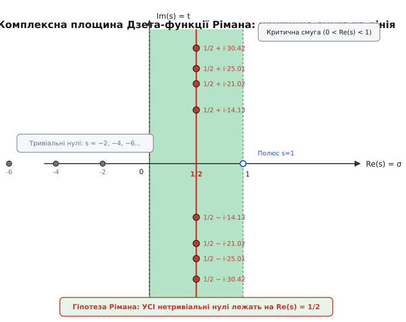
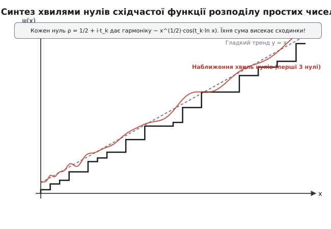

# Гіпотеза Рімана

<preknowlist>
- [Розподіл простих чисел](root:math-number-theory/prime-distribution) — лічильна функція π(x), інтегральний логарифм Li(x) та асимптотичний закон простих чисел.
- [Формула добутку Ейлера](root:math-number-theory/euler-product-formula) — тотожність, що пов'язує нескінченну суму обернених степенів з добутком по всіх простих числах.
- [Комплексні числа](root:math-analysis/complex-numbers) — комплексна площина, дійсна та уявна частини `s = σ + i·t`, комплексна показникові функція.
</preknowlist>

Коли алгоритм генерації ключів для захищеного з'єднання обчислює мільйонні прості числа, він покладається на прогноз ймовірності натрапити на просте число в заданому діапазоні. Формула Гаусса — інтегральний логарифм `Li(x)` — дає надзвичайно точну орієнтовну кількість простих чисел, але реальна лічильна функція `π(x)` постійно коливається навколо цього гладкого тренду. В одних інтервалах простих чисел виявляється трохи більше, в інших — трохи менше. Якщо відхилення між реальністю та моделлю випадково виявиться занадто великим, криптографічні алгоритми втратять оцінку обчислювальної складності, а перевірка чисел на простоту дасть збій. Задача контролю цих відхилень зводиться до одного з найглибших питань сучасної науки: яка сила утримує коливання простих чисел у суворо обмеженому коридорі?

## Проблема відхилення: чому гладка модель розходиться з дійсністю

Теорема про розподіл простих чисел доводить, що головний напрямок росту кількості простих чисел `π(x)` задається функцією `Li(x)`:

```
Li(x) = ∫ (1 / ln t) dt      [інтегрування від 2 до x]
```

Для макроскопічних значень `x` відношення `π(x) / Li(x)` прямує до ідеальної одиниці. Проте якщо ми обчислимо різницю `Δ(x) = π(x) - Li(x)` для конкретних значень `x`, ми побачимо складну хвильову картину:

- Для `x = 1 000`: точне число `π(x) = 168`, а `Li(x) ≈ 178`, що дає відхилення `Δ(x) = -10`.
- Для `x = 1 000 000`: точне `π(x) = 78 498`, а `Li(x) ≈ 78 627`, відхилення `Δ(x) = -129`.
- Для `x = 10⁹`: точне `π(x) = 50 847 534`, а `Li(x) ≈ 50 849 235`, відхилення `Δ(x) = -1 701`.
- Для `x = 10¹²`: точне `π(x) = 37 607 912 018`, а `Li(x) ≈ 37 607 950 280`, відхилення `Δ(x) = -38 262`.

Математики тривалий час спостерігали, що для всіх обчислених значень `x` інтегральний логарифм `Li(x)` систематично завищує точну кількість простих чисел, тобто `π(x) < Li(x)`. Це явище пов'язане з тим, що зважена сума простих чисел враховує також квадрати та куби простих чисел: внесок членів `(1/2)·Li(√x)` та `(1/3)·Li(x¹/³)` природно зсуває чисте значення `π(x)` нижче за `Li(x)`. Це навело Карла Фрідріха Гаусса та Адрієна-Марі Лежандра на припущення, що `Li(x)` завжди лежить строго вище за `π(x)`.

Проте у 1914 році британський математик Джон Еденсор Літтлвуд довів вражаючий результат: різниця `π(x) - Li(x)` змінює свій знак нескінченну кількість разів! Вона не просто коливається, а перетинає нуль знову і знову. Перша точка перетину знаків (відома як число Ск'юза) лежить надзвичайно високо — початкові оцінки Стенлі Ск'юза давали межу `10^(10^(10^34))`, яку пізніше уточнили до `x ≈ 10³¹⁶`.

Ці відхилення не є випадковими похибками вимірювання. Вони являють собою фундаментальний шум, породжений самою дискретною природою цілих чисел. Щоб зрозуміти джерело цього шуму з перших принципів, уявімо побудову натурального ряду. Кожне нове просте число `p` вносить у числову пряму свій власний "ритм" — періодичне викреслювання всіх чисел, кратних `p`. Оскільки ці ритми для різних простих чисел `p₁, p₂, p₃...` мають несумірні періоди, їхнє сумісне накладення створює складну інтерференційну картину.

У ймовірнісній моделі Гаральда Крамера кожне натуральне число `n` вважається простим із незалежною ймовірністю `1 / ln n`. За центральною граничною теоремою випадкові коливання такої суми незалежних випадкових величин мали б порядок `O(√x · √(ln x))`. Проте прості числа — не випадкові підкидання монети: вони абсолютно детерміновані. Математиків турбувало головне питання: наскільки великими можуть бути ці хвильові сплески у нескінченності? Чи може відхилення `|π(x) - Li(x)|` на якійсь віддаленій ділянці числової осі зрости до величини порядку `x⁰·⁸` чи навіть `x⁰·⁹⁹`, зруйнувавши передбачуваність розподілу? Відповідь прихована у структурі комплексної Дзета-функції, яку в 1859 році дослідив Бернхард Ріман.

## Аналітичне продовження ζ(s) на комплексну площину

Леонард Ейлер розглядав функцію `ζ(s)` для дійснозначних значень `s > 1` у вигляді нескінченного ряду:

```
ζ(s) = 1/1ˢ + 1/2ˢ + 1/3ˢ + 1/4ˢ + ... = ∑ (1 / nˢ)      [сума по n від 1 до ∞]
```

Цей ряд чудово збігається, коли `s > 1`. Проте якщо підставити `s = 1`, ми отримуємо розбіжний гармонічний ряд `1 + 1/2 + 1/3 + ... = ∞`. Для значень `s ≤ 1` сума повністю втрачає зміст у класичній арифметиці.

Ріман зробив вирішальний крок: він замінив дійсну змінну `s` на комплексне число `s = σ + i·t`, де `σ = Re(s)` — дійсна частина, а `t = Im(s)` — уявна частина. У комплексному просторі доданок `1 / nˢ` перетворюється на спіральну хвилю:

```
1 / nˢ
= 1 / nˢ⁺ⁱᵐᵗ
= (1 / nˢ) · e⁻ⁱᵐᵗᵐˡⁿ⁽ⁿ⁾
= (1 / nˢ) · [cos(t · ln n) - i · sin(t · ln n)]
```

Дійсна частина `σ` відповідає за затухання амплітуди (швидкість зменшення доданків), а уявна частина `t` визначає частоту обертання вектора на комплексній площині.

### Елементарне продовження через ряд Ета Діріхле

Щоб поширити функцію `ζ(s)` на область, де `Re(s) ≤ 1`, скористаємося альтернативним рядом — знакопочередним рядом Діріхле (Дзета-функцією Ета `η(s)`):

```
η(s) = ∑ ((-1)ⁿ⁺¹ / nˢ) = 1/1ˢ - 1/2ˢ + 1/3ˢ - 1/4ˢ + ...
```

Пов'язуючи суми `ζ(s)` та `η(s)` шляхом віднімання парних членів:

```
ζ(s) - η(s)
= 2 · (1/2ˢ + 1/4ˢ + 1/6ˢ + ...)      [виділили всі парні знаменники]
= 2 · (1/2ˢ) · (1/1ˢ + 1/2ˢ + 1/3ˢ + ...)
= 2¹⁻ˢ · ζ(s)
```

Звідси отримуємо тотожність:

```
η(s) = (1 - 2¹⁻ˢ) · ζ(s)  ⇒  ζ(s) = η(s) / (1 - 2¹⁻ˢ)
```

Знакопочередний ряд `η(s)` збігається для всіх комплексних чисел з дійсною частиною `Re(s) > 0` за ознакою Лейбніца–Діріхле. Це дозволяє негайно продовжити `ζ(s)` на всю півплощину `Re(s) > 0`, крім точок, де знаменник `1 - 2¹⁻ˢ` перетворюється на нуль. У точці `s = 1` функція `η(1) = ln 2`, а знаменник прямує до `(s - 1) · ln 2`, що дає простий полюс першого порядку з лишком `Res[ζ(s), s = 1] = 1`.

### Інтегральне представлення через Гамма-функцію Ейлера

Для продовження на всю комплексну площину пов'яжемо степеневі доданки з інтегралом Гамма-функції `Γ(s)`:

```
Γ(s) = ∫ (uˢ⁻¹ · e⁻ᵘ) du      [інтегрування від 0 до ∞ для Re(s) > 0]
```

Виконаємо заміну змінної `u = n · x` (де `n` — фіксоване натуральне число, `du = n · dx`):

```
Γ(s)
= ∫ ((n·x)ˢ⁻¹ · e⁻ⁿᵐˣ · n) dx
= nˢ · ∫ (xˢ⁻¹ · e⁻ⁿᵐˣ) dx      [інтегрування від 0 до ∞]
```

Ділячи обидві частини на `nˢ · Γ(s)`, виражаємо кожен доданок через експоненціальний інтеграл:

```
1 / nˢ = (1 / Γ(s)) · ∫ (xˢ⁻¹ · e⁻ⁿᵐˣ) dx
```

Підсумуємо цей вираз по всіх `n ≥ 1` при `Re(s) > 1`. Міняючи місцями суму й інтеграл за теоремою Лебега:

```
ζ(s)
= ∑ (1 / nˢ)
= (1 / Γ(s)) · ∫ (xˢ⁻¹ · ∑ e⁻ⁿᵐˣ) dx
= (1 / Γ(s)) · ∫ (xˢ⁻¹ / (eˣ - 1)) dx      [інтегрування від 0 до ∞]
```

Ядро `1 / (eˣ - 1)` (відоме у фізиці як розподіл Бозе–Ейнштейна) при `x → 0` має розклад Тейлора:

```
1 / (eˣ - 1) = 1/x - 1/2 + x/12 - x³/720 + ...
```

Полюс ядра `1/x` при `x = 0` точно породжує полюс Дзета-функції `1 / (s - 1)`.

### Тета-функція Якобі та Функціональне рівняння Рімана

Щоб розкрити повну симетрію, розглянемо тета-функцію Якобі `θ(t) = ∑_{n=-∞}^∞ e⁻ⁿ²ᵐᵖⁱᵐᵗ` для `t > 0`. За формулою підсумовування Пуассона тета-функція задовольняє модулярне співвідношення інверсії:

```
θ(1/t) = √t · θ(t)
```

Використовуючи це перетворення для інтеграла `π⁻ˢ/² · Γ(s/2) · ζ(s)` та розбиваючи область інтегрування на інтервали `(0, 1]` і `[1, ∞)`, Ріман вивів аналітичне представлення для модифікованої цілої функції Ксі `ξ(s)`:

```
ξ(s)
= (1/2) · s · (s - 1) · π⁻ˢ/² · Γ(s/2) · ζ(s)
= 1/2 + s · (s - 1) · ∫ ([t⁽ˢ/²⁾⁻¹ + t⁻⁽¹⁻ˢ⁾/²⁻¹] · ψ_θ(t)) dt      [від 1 до ∞]
```

де `ψ_θ(t) = ∑_{n=1}^∞ e⁻ⁿ²ᵐᵖⁱᵐᵗ`. Оскільки функція `ψ_θ(t)` експоненціально прямує до нуля при `t → ∞`, цей інтеграл абсолютно збігається для БУДЬ-ЯКОГО комплексного `s ∈ ℂ`. Таким чином, функція `ξ(s)` є **цілою аналітичною функцією** на всій комплексній площині без жодного полюса.

Погляньмо на підінтегральний вираз: при заміні `s` на `1 - s` сума `t⁽ˢ/²⁾⁻¹ + t⁻⁽¹⁻ˢ⁾/²⁻¹` лишається абсолютно незмінною. Звідси випливає фундаментальне **Функціональне рівняння Рімана**:

```
ξ(s) = ξ(1 - s)
```

Розгортаючи означення функції `ξ(s)` через властивість подвоєння Гамма-функції Лежандра `Γ(s/2) · Γ((1-s)/2) = π / sin(π·s / 2)`, отримуємо класичну форму рівняння для самої Дзета-функції:

```
ζ(s) = 2ˢ · πˢ⁻¹ · sin(π·s / 2) · Γ(1 - s) · ζ(1 - s)
```

### Геометрія нулів: тривіальні та нетривіальні

Аналіз функціонального рівняння розкриває чітку класифікацію нулів функції `ζ(s)`:

1. **Тривіальні нулі**: знаходяться на від'ємній дійсій осі в точках `s = -2, -4, -6, -8...`. Вони виникають через множник `sin(π·s / 2)`, який обертається на нуль для всіх від'ємних парних цілих чисел. У точці `s = 0` множник `sin(0) = 0` компенсує полюс Гамма-функції, даючи скінченне значення `ζ(0) = -1/2`.
2. **Відсутність нулів поза критичною смугою**: у півплощині `Re(s) > 1` добуток Ейлера `ζ(s) = ∏ (1 - p⁻ˢ)⁻¹ ≠ 0` не перетворюється на нуль, оскільки жоден множник не дорівнює нулю і добуток збігається абсолютно. Через функціональне рівняння `ζ(s)` також не має нетривіальних нулів у півплощині `Re(s) < 0`.
3. **Нетривіальні нулі**: нескінченний масив комплексних точок `ρ = σ + i·t`, які лежать виключно всередині **критичної смуги** `0 < Re(s) < 1`.


*Комплексна площина Дзета-функції: критична смуга 0 < Re(s) < 1, критична лінія Re(s) = 1/2, тривіальні нулі на від'ємній дійсій осі та нетривіальні нулі.*

Функціональна симетрія `ξ(s) = ξ(1 - s)` та комплексна спряженість `ζ(s̄) = ζ̄(s)` вимагають, щоб нетривіальні нулі розташовувалися строго симетрично відносно центральної осі `Re(s) = 1/2` та відносно дійсної осі `Im(s) = 0`. Якщо точка `ρ = σ + i·t` є нулем, то точки `1 - σ + i·t`, `σ - i·t` та `1 - σ - i·t` також обов'язково є нулями, утворюючи симетричний квартет у критичній смузі.

### Розклад Адамара: Дзета як нескінченний многочлен

За теоремою Адамара про факторизацію цілих функцій порядку росту 1, функція `ξ(s)` повністю визначається своїми нетривіальними нулями, подібно до того, як алгебраїчний многочлен задається своїми коренями:

```
ξ(s) = ξ(0) · ∏ (1 - s / ρ) · eˢ/ᵨ      [добуток по всіх нетривіальних нулях ρ]
```

Це рівняння показує: уся нескінченна структура розподілу цілих чисел повністю закодована в дискретному спектрі координат `ρ`.

## Спектральний синтез: Явна формула Рімана та хвилі нулів

Чому саме комплексні нулі `ρ` виявилися ключем до розподілу простих чисел? Відповідь дає виведена Ріманом та доопрацьована Гансом фон Мангольдтом **Явна формула** (*Explicit Formula*).

Замість безпосереднього підрахунку кількості простих чисел `π(x)` розіб'ємо задачу на два етапи. Розглянемо зважену лічильну функцію Чебишова `ψ(x)`, яка додає значення `ln(p)` для кожного простого числа `p` та його степенів `pᵏ ≤ x`:

```
ψ(x) = ∑ Λ(n)      [сума по n ≤ x]
```

Тут `Λ(n)` — функція фон Мангольдта, яка дорівнює `ln(p)`, якщо `n = pᵏ` для деякого простого `p` і цілого `k ≥ 1`, і `0` в інших випадках.

### Логарифмічна похідна та інтеграл Перрона

Візьмемо логарифмічну похідну від добутку Ейлера для `Re(s) > 1`:

```
ln ζ(s) = - ∑ ln(1 - p⁻ˢ) = ∑ ∑ (p⁻ᵏˢ / k)      [по p та по k ≥ 1]
```

Диференціюючи по `s`:

```
- (ζ'(s) / ζ(s)) = ∑ (Λ(n) / nˢ)      [сума по n від 1 до ∞]
```

Таким чином, логарифмічна похідна перетворює мультиплікативний добуток по простих числах у звичайний ряд Діріхле, коефіцієнтами якого є ваги фон Мангольдта `Λ(n)`.

Для виділення суми за умовою `n ≤ x` застосуємо розривний інтеграл Перрона вздовж вертикальної прямої `Re(s) = c > 1`:

```
(1 / (2·π·i)) · ∫ (xˢ / s) ds = 1  (якщо x > 1);   0  (якщо 0 < x < 1)
```

Підставляючи ряд для `-ζ'(s)/ζ(s)` у цей інтеграл, отримуємо точний вираз для функції Чебишова:

```
ψ(x) = (1 / (2·π·i)) · ∫ (- (ζ'(s) / ζ(s)) · (xˢ / s)) ds      [вздовж прямої Re(s) = c]
```

Застосовуючи теорему Коші про лишки до прямокутного контуру, що замикається у лівій напівплощині `Re(s) → -∞`, ми підсумовуємо лишки підінтегральної функції `F(s) = - (ζ'(s)/ζ(s)) · (xˢ / s)` у всіх її полюсах:

1. **Полюс у точці `s = 1`**: простий полюс `ζ(s)` дає полюс логарифмічної похідної з лишком `+1`. Лишок `F(s)` дорівнює `1 · (x¹ / 1) = x` — це головний тренд зростання.
2. **Полюс у точці `s = 0`**: множник `1/s` створює полюс з лишком `- (ζ'(0) / ζ(0)) = - ln(2·π)`.
3. **Тривіальні нулі `s = -2k`**: кожен нуль створює полюс з лишком `-1`, даючи суму `- ∑ (x⁻²ᵏ / (-2k)) = - (1/2) · ln(1 - x⁻²)`.
4. **Нетривіальні нулі `s = ρ`**: кожен нуль `ζ(ρ) = 0` створює полюс логарифмічної похідної з лишком `-1`, формуючи хвильовий член `- (xᵨ / ρ)`.

Збираючи лишки разом, отримуємо точну **Явну формулу Рімана–Мангольдта**:

```
ψ(x) = x - ∑ (xᵨ / ρ) - ln(2·π) - (1/2) · ln(1 - x⁻²)
```

Детальне математичне виведення аналітичного продовження, комплексної функції Ксі та явної формули Мангольдта наведено у вставці [Вивід явної формули та Дзета-функції](root:math-number-theory/riemann-hypothesis/math-explicit-formula.md).

Зв'язок між функцією Чебишова `ψ(x)` та стандартною лічильною функцією `π(x)` здійснюється через точкову функцію Рімана `J(x)`:

```
J(x) = π(x) + (1/2)·π(x¹/²) + (1/3)·π(x¹/³) + (1/4)·π(x¹/⁴) + ...
```

Застосовуючи обернення Мьобіуса, отримуємо точний вираз для `π(x)`:

```
π(x) = ∑ (μ(n) / n) · J(x¹/ⁿ) = J(x) - (1/2)·J(x¹/²) - (1/3)·J(x¹/³) - (1/5)·J(x¹/⁵) + ...
```

### Гармонійна декомпозиція хвиль

Розкриємо доданок від спряженої пари нулів `ρ = σ + i·t` та `ρ̄ = σ - i·t`:

```
(xᵨ / ρ) + (xᵖ̄ / ρ̄)
= (xˢ · eⁱᵐᵗᵐˡⁿ⁽ˣ⁾ / (σ + i·t)) + (xˢ · e⁻ⁱᵐᵗᵐˡⁿ⁽ˣ⁾ / (σ - i·t))
= (2 · xˢ / (σ² + t²)) · [σ · cos(t · ln x) + t · sin(t · ln x)]
```

Цей вираз показує акустичну структуру формули:
- **Частота коливань** по логарифмічній шкалі `u = ln x` задається уявною частиною нуля `t = Im(ρ)`. Перший нуль `t₁ ≈ 14.1347` задає основний тон коливань з періодом у логарифмічному просторі `Δ(ln x) = 2·π / 14.1347 ≈ 0.4445` (що відповідає масштабу зміни `x` у `e⁰·⁴⁴⁴⁵ ≈ 1.56` раза). Наступні нулі `t₂ ≈ 21.0220`, `t₃ ≈ 25.0108` додають вищі гармоніки.
- **Амплітуда коливань** визначається дійсною частиною нуля і строго дорівнює `xˢ / |ρ|`.


*Сума гармонік від нетривіальних нулів точно відтворює східчасту функцію розподілу простих чисел.*

Коли ми підсумовуємо нескінченну кількість таких плавно коливальних синусоїдальних хвиль, вершини і западини мільйонів неперервних хвиль зіштовхуються у просторі, взаємно гасять одна одну на пласких інтервалах між простими числами і різко резонують при проходженні через кожне просте число. У результаті гладкі синусоїди формують ідеально вертикальні сходинки, створюючи дискретні стрибки функції `ψ(x)` точно в точках `x = 2, 3, 4, 5, 7, 8, 9, 11...`!

Існує фундаментальна спектральна дуальність: прості числа є зосередженими дельта-імпульсами у просторі чисел `x`, а нулі Дзета-функції — це спектральні лінії у частотному просторі `t`. Фур'є-перетворення дискретного масиву простих чисел безпосередньо генерує частоти нулів Дзета-функції, і навпаки.

## Сутність Гіпотези Рімана: чому саме Re(s) = 1/2

Тепер ми підійшли до центрального ядра проблеми. Амплітуда кожної хвилі в явній формулі пропорційна `xˢ`, де `σ` — дійсна частина відповідного нуля.

Німецький математик Бернхард Ріман у 1859 році висловив припущення:

> **Гіпотеза Рімана:** Всі нетривіальні нулі Дзета-функції `ζ(s)` лежать строго на одній вертикальній прямій `Re(s) = 1/2`. Цю пряму називають **критичною лінією**.

Розглянемо два альтернативні сценарії:

### Сценарій А: Гіпотеза Рімана істинна (`σ = 1/2` для всіх нулів)

Якщо всі нулі лежать на критичній лінії, дійсна частина кожного нуля точно дорівнює `1/2`. Це означає, що амплітуда КОЖНОЇ хвилі в явній формулі обмежена величиною `x¹/² = √x`.

Об'єднаємо доданки для сопряженої пари нулів `ρ = 1/2 + i·t` та `ρ̄ = 1/2 - i·t`:

```
(x¹/²⁺ⁱᵐᵗ / (1/2 + i·t)) + (x¹/²⁻ⁱᵐᵗ / (1/2 - i·t))
= (2·√x / (1/4 + t²)) · [(1/2)·cos(t·ln x) + t·sin(t·ln x)]
```

Для великих значень `t` знаменник `1/4 + t² ≈ t²`, а чисельник росте як `t · √x`. Отже, кожен окремий доданок спадає як `√x / t`.

Оскільки кількість нулів до висоти `T` зростає за законом Рімана–фон Мангольдта:

```
N(T) = (T / (2·π)) · ln(T / (2·π·e)) + 7/8 + O(ln T)
```

сума ряду `∑ 1/|ρ|²` збігається абсолютно, а сума `∑ (xᵨ / ρ)` для зрізаного контуру висоти `T` дає загальне відхилення:

```
| ψ(x) - x | ≤ C · √x · ln²(x)
```

Переходячи до стандартної лічильної функції простих чисел `π(x)` за допомогою формули підсумовування Абеля (інтегрування за частинами):

```
π(x)
= ∫ (1 / ln t) dθ(t)
= (θ(x) / ln x) + ∫ (θ(t) / (t · ln² t)) dt      [інтегрування від 2 до x]
```

ми отримуємо найтісніший з усіх можливих коридорів похибки:

```
| π(x) - Li(x) | = O(√x · ln x)
```

У 1901 році шведський математик Гельге фон Кох строго довів, що оцінка `π(x) - Li(x) = O(√x · ln x)` є **строго еквівалентною** Гіпотезі Рімана. У 1976 році Ловелл Шенфельд встановив точну константу для цієї нерівності: за умови істинності Гіпотези Рімана для всіх `x ≥ 2657` виконується нерівність:

```
| π(x) - Li(x) | < (1 / (8·π)) · √x · ln(x)
```

Це математичний еквівалент ідеально збалансованого шуму. Прості числа розподілені настільки рівномірно і регулярно, наскільки це взагалі дозволяє їхній дискретний характер. Пряма `Re(s) = 1/2` є єдиною віссю симетрії, де енергетичний потік функціонального рівняння `ξ(s) = ξ(1-s)` перебуває у стані точної рівноваги.

### Сценарій Б: Гіпотеза Рімана хибна (існує нуль з `σ > 1/2`)

Припустимо на мить, що існує бодай один "аномальний" нуль, дійсна частина якого дорівнює, наприклад, `σ = 0.8`.

Через симетрію функціонального рівняння поруч із ним виникне четвірка аномальних нулів з координатами `0.8 + i·t`, `0.2 + i·t`, `0.8 - i·t`, `0.2 - i·t`.

Доданок від цього нуля в явній формулі згенерує хвилю з амплітудою `x⁰·⁸`. При великих значеннях `x` (скажімо, `x = 10²⁰`) величина `x⁰·⁸ = 10¹⁶` у мільйон разів перевищить стандартний шум `√x = 10¹⁰`. Ця аномальна хвиля розгойдуватиме графік `π(x)`, утворюючи гігантські прогалини та непередбачувані скупчення простих чисел. Бездоганна гармонія розподілу розпадеться, а похибка наближення зросте до `O(x⁰·⁸)`.

### Еквівалентні формулювання Гіпотези Рімана

Гіпотеза Рімана має глибокі еквівалентні форми в інших розділах теорії чисел:

1. **Функція Мертенса та випадковість знаків Мьобіуса**: Функція Мертенса `M(x) = ∑_{n≤x} μ(n)` підсумовує значення функції Мьобіуса `μ(n)`. Оскільки `1 / ζ(s) = ∑ (μ(n) / nˢ)`, полюси функції `1/ζ(s)` відповідають нулям `ζ(s)`. Гіпотеза Рімана **строго еквівалентна** твердженню, що для будь-якого `ε > 0`:
   ```
   M(x) = O(x¹/²⁺ᵋ)
   ```
   Це означає, що функція Мьобіуса веде себе як ідеально збалансована послідовність випадкових знаків `+1` та `-1` без будь-якої систематичної асиметрії.
2. **Дроби Фарея та теорема Франеля–Ландау**: Нехай `γᵥ` — елементи послідовності нескоротних дробів Фарея порядку `N`, розташовані за зростанням від 0 до 1. Гіпотеза Рімана еквівалентна твердженню, що середньоквадратичне відхилення дробів Фарея від рівномірної сітки `v / |F_N|` спадає як `O(N⁻¹/²⁺ᵋ)`.
3. **Критерій Робіна (1984)**: Для суми дільників числа `σ(n) = ∑_{d|n} d` нерівність Робіна стверджує:
   ```
   σ(n) < eᵞ · n · ln(ln n)      [для всіх n > 5040]
   ```
   де `γ ≈ 0.577215` — стала Ейлера–Маскероні. Ця нерівність виконується для всіх `n > 5040` тоді і тільки тоді, коли Гіпотеза Рімана є істинною.

Історію відкриття 1859 року, 8-му проблему Гільберта та столітній шлях чисельної перевірки описано у вставці [Історія Гіпотези Рімана](root:math-number-theory/riemann-hypothesis/hist-riemann-hypothesis.md).

## Квантовий хаос і матриці GUE: спектральне відчуття теорії чисел

Тривалий час Гіпотеза Рімана вважалася чисто арифметичною сухістю. Проте у другій половині XX століття з'ясувалося, що нулі Дзета-функції приховують у собі закони квантової фізики та статистичної механіки.

### Гіпотеза Гільберта–Поя

У 1910-х роках Давид Гільберт та Йозеф Поя висловили припущення: нетривіальні нулі `ρ = 1/2 + i·t` можуть бути пов'язані з власними значеннями деякого лінійного самоспряженого (ермітового) оператора `H` у Гільбертовому просторі:

```
H · Ψₙ = tₙ · Ψₙ
```

Оскільки власні значення будь-якого самоспряженого оператора у квантовій механіці строго ДІЙСНІ (`tₙ ∈ ℝ`), це автоматично означало б, що всі нулі мають вигляд `1/2 + i·tₙ`, тобто лежать строго на критичній лінії!

### Парна кореляція Монтгомері та випадкові матриці GUE

У 1972 році Г'ю Монтгомері досліджував розподіл відстаней між сусідніми нетривіальними нулями Дзета-функції. Оскільки середня локальна густина нулів на висоті `T` дорівнює `(1 / 2·π) · ln(T / (2·π))`, нормуємо відстані так, щоб середня відстань між нулями дорівнювала 1.

Монтгомері обчислив парну кореляційну функцію `R₂(x)`, яка описує ймовірність знайти два нулі на нормованій відстані `x`:

```
R₂(x) = 1 - (sin(π·x) / (π·x))²
```

Поглянемо на поведінку цієї функції при малих `x`:
- Коли відстань `x → 0`, вираз `sin(π·x) / (π·x) → 1`, тому кореляція `R₂(x) → 0`.
- При розкладі Тейлора: `R₂(x) ≈ (π²·x²) / 3`.

Це явище називається **квантовим відштовхуванням рівнів** (*level repulsion*). Ймовірність виявити два нулі Дзета-функції на дуже близькій відстані спадає як квадрат дистанції `x²`. Нулі Дзета-функції не утворюють випадкових скупчень, а підтримують регулярний просторовий інтервал.


*Нулі Дзета-функції демонструють рівномірне відштовхування, тотожне спектрам квантових хаотичних систем.*

Під час зустрічі в Принстоні фізик Фрімен Дайсон миттєво впізнав у формулі Монтгомері парну кореляцію власних значень великих випадкових ермітових матриць **Гаусового унітарного ансамблю** (*Gaussian Unitary Ensemble*, GUE). У теорії випадкових матриць Вігнера–Дайсона:
1. **Пуассонівський процес** (випадкові незалежні точки, наприклад радіоактивний розпад): функція розподілу відстаней `P(s) = e⁻ˢ`, відштовхування відсутнє (`P(0) = 1`). Точки часто падають в одну точку.
2. **Гаусовий ортогональний ансамбль (GOE)** (системи з часовою реверсивністю): лінійне відштовхування `P(s) ~ s` при `s → 0`.
3. **Гаусовий унітарний ансамбль (GUE)** (квантові хаотичні системи без симетрії обернення часу): квадратичне відштовхування `P(s) ~ s²` при `s → 0`.

Нулі Рімана демонструють ідеальний GUE-розподіл!

### Чисельні підтвердження Одлижка та модель Беррі–Кітінга

Наприкінці 1980-х років Ендрю Одлижко провів обчислення мільйонів нулів Дзета-функції в околі астрономічних висот `t ≈ 10²⁰` та `t ≈ 10²²`. Статистичний розподіл відстаней між мільйонами обчислених нулів з точністю до десяти знаків після коми збігся з теоретичною кривою GUE Дайсона.

Фізики Майкл Беррі та Джонатан Кітінг запропонували фізичну модель: Гамільтоніан Гільберта–Поя є квантовим аналогом класичної одновимірної хаотичної системи `H = (1/2) · (x·p + p·x)`. 

Застосовуючи **формулу сліду Ґуцвіллера** для квантових хаотичних систем, густину квантових рівнів енергії `d(E) = ∑ δ(E - Eₙ)` можна виразити через суму по замкнених періодичних траєкторіях класичної частинки:

```
d(E) = d̄(E) - (1/π) · ∑ ∑ (ln p / (pᵏ/² - p⁻ᵏ/²)) · cos(k · E · ln p)
```

де сума ведеться по всіх простих періодичних орбітах `p` та їхніх повторах `k ≥ 1`.

Порівняння цієї формули з Явною формулою Рімана–Мангольдта демонструє разючу відповідність:
- Логарифми простих чисел `ln p` відповідають періодам класичних періодичних орбіт частинки.
- Прості числа `p` відіграють роль первинних замкнених траєкторій.
- Уявні частини нулів `tₙ` — це точні квантові рівні енергії (спектр зв'язаних станів) хаотичної системи!

## Чисельні обчислення та перевірка мільярдних нулів

Оскільки строге математичне доведення Гіпотези Рімана залишається невирішеним, розроблено потужні аналітичні та обчислювальні алгоритми для її експериментальної перевірки.

### Функція Харді Z(t) та формула Рімана–Зігеля

Головний інструмент пошуку нулів на критичній лінії — дійснозначна **функція Харді `Z(t)`**:

```
Z(t) = eⁱᵐθ⁽ᵗ⁾ · ζ(1/2 + i·t)
```

Де `θ(t)` — фазовий кут Рімана–Зігеля:

```
θ(t) = arg(Γ(1/4 + i·t/2)) - (t/2) · ln(π)
```

Для практичних обчислень фазовий кут наближається асимптотичним рядом Стирлінга:

```
θ(t) ≈ (t/2) · ln(t / (2·π)) - (t/2) - (π / 8) + 1 / (48·t) + 7 / (5760·t³)
```

Функція `Z(t)` є строго дійсною для дійсних `t`, а її модуль дорівнює модулю Дзета-функції: `|Z(t)| = |ζ(1/2 + i·t)|`. Зміна знаку функції `Z(t)` (коли `Z(t₁) · Z(t₂) < 0`) за теоремою Больцано–Коші строго гарантує наявність нетривіального нуля на критичній лінії між точками `t₁` та `t₂`.

Для обчислення `Z(t)` використовується **формула Рімана–Зігеля**:

```
Z(t) = 2 · ∑ (1 / √n) · cos(θ(t) - t · ln n) + R(t)      [сума по n від 1 до N = ⌊√(t / (2·π))⌋]
```

де `R(t) = O(t⁻¹/⁴)` — асимптотичний залишковий член. Кількість доданків у головній сумі дорівнює лише `N ≈ √(t / (2·π))`, що робить обчислення надзвичайно швидким порівняно з прямими рядами.

### Точки Ґрама та метод Тюрінга

Точки Ґрама `gₙ` визначаються умовою `θ(gₙ) = n·π`. Згідно з **Законом Ґрама**, нулі функції зазвичай чергуються з точками Ґрама: між `gₙ` та `gₙ₊₁` лежить рівно один нуль.

Перше порушення Закону Ґрама виникає при `n = 126`, де два нулі опиняються в одному інтервалі Ґрама. Для того щоб гарантувати, що в дослідженому діапазоні не було пропущено жодного нуля і жоден нуль не зійшов з критичної лінії у критичну смугу, використовують **метод Тюрінга** (1953). Метод базується на інтегруванні функції `ln |ζ(s)|` вздовж контуру та обчисленні фазового зсуву `S(T) = (1/π) · arg ζ(1/2 + i·T)`.

Практичний алгоритм пошуку нулів та його оптимізовану реалізацію мовами Python, C і C++ наведено у вставці [Обчислення нулів Дзета-функції на критичній лінії](root:math-number-theory/riemann-hypothesis/proj-riemann-zeros.md).

Перші три нетривіальні нулі на критичній лінії мають координати:
- `ρ₁ = 1/2 + i·14.134725...`
- `ρ₂ = 1/2 + i·21.022040...`
- `ρ₃ = 1/2 + i·25.010858...`

Завдяки алгоритму Одлижка–Схюнгаге на основі Швидкого Перетворення Фур'є (ШПФ), що знижує складність обчислення відрізка нулів до `O(t¹/⁶⁺ᵋ)`, на сьогодні чисельно перевірено понад **10 трильйонів (`10¹³`) перших нетривіальних нулів**. Усі вони без жодного винятку лежать строго на критичній лінії `Re(s) = 1/2`.

## Узагальнена гіпотеза Рімана (GRH) та L-функції Діріхле

Класична Гіпотеза Рімана описує розподіл простих чисел у всьому натуральному ряді. Проте для криптографії та алгебраїчної теорії чисел критично важливим є розподіл простих чисел у підмножинах — **арифметичних прогресіях** `a, a + q, a + 2q, a + 3q...` для взаємно простих `a` та `q` (`НСД(a, q) = 1`).

### Характери та L-функції Діріхле

Для розділення класів залишків Петер Густав Лежен Діріхле ввів **характери Діріхле** `χ(n)` за модулем `q` — періодичні мультиплікативні функції:
1. `χ(n + q) = χ(n)` (періодичність).
2. `χ(m · n) = χ(m) · χ(n)` (повна мультиплікативність).
3. `χ(n) = 0`, якщо `НСД(n, q) > 1`.
4. Для головного характеру `χ₀(n) = 1`, якщо `НСД(n, q) = 1`.

Кожному характеру `χ` відповідає своя комплексна **L-функція Діріхле**:

```
L(s, χ) = ∑ (χ(n) / nˢ) = ∏ (1 - χ(p) · p⁻ˢ)⁻¹      [для Re(s) > 1]
```

Повністю аналогічно Дзета-функції Рімана, L-функція Діріхле продовжується на всю комплексну площину і задовольняє функціональне рівняння, що пов'язує `L(s, χ)` та `L(1 - s, χ̄)`.

> **Узагальнена гіпотеза Рімана (GRH, *Generalized Riemann Hypothesis*):** Для кожного примітивного характеру Діріхле `χ` за будь-яким модулем `q` всі нетривіальні нулі його L-функції `L(s, χ)` у критичній смузі `0 < Re(s) < 1` лежать строго на критичній лінії `Re(s) = 1/2`.

### Розподіл простих чисел в арифметичних прогресіях

Нехай `π(x; q, a)` — кількість простих чисел `p ≤ x`, таких що `p ≡ a (mod q)`. Теорема Діріхле стверджує, що в кожному з `φ(q)` взаємно простих класів лежить асимптотично однакова частка простих чисел: `π(x; q, a) ~ Li(x) / φ(q)`.

Без GRH найкраща безумовна теорема Зігеля–Вальфіша гарантує лише слабку похибку `O(x · e⁻ᶜ ᵛˡⁿ ˣ)`, причому оцінка ламається через можливе існування так званих **нулів Зігеля** — гіпотетичних дійсних нулів `L(s, χ)`, розташованих вкрай близько до точки `s = 1`.

Якщо ж **Узагальнена гіпотеза Рімана (GRH) істинна**, то похибка набуває найсильнішої рівномірної форми:

```
π(x; q, a) = (1 / φ(q)) · Li(x) + O(√x · ln(q · x))
```

Це означає, що прості числа розподіляються між різними арифметичними прогресіями з ідеальною рівномірністю, а відхилення жорстко обмежені кореневим шумом.

### Наслідки для поліноміальних тестів простоти та криптографії

Істинність GRH має прямі практичні наслідки для алгоритмічної теорії чисел і комп'ютерної безпеки:

1. **Детермінований тест простоти Міллера–Рабіна**:
   Класичний імовірнісний тест Міллера–Рабіна перевіряє випадкові основи `a`. У 1976 році Гарі Міллер довів, що за умови істинності GRH будь-яке складене непарне число `n` обов'язково має свідка складеності `a`, що не перевищує межі Баха:
   ```
   a ≤ 2 · ln²(n)
   ```
   Таким чином, за умови GRH перевірка лише перших `⌊2 · ln² n⌋` основ робить алгоритм Міллера строго детермінованим поліноміальним тестом простоти зі складністю `O(ln⁴ n)`.
2. **Обчислення дискретного логарифма та породжувальних елементів**:
   У криптографічних протоколах типу Діффі–Геллмана потрібно знаходити первісні корені (генератори) мультиплікативної групи `(ℤ/pℤ)*`. За теоремою Анкіні за умови GRH найменший генератор групи не перевищує `C · ln² p`, що гарантує його миттєве знаходження простим перебором.
3. **Алгоритми факторизації та решета**:
   Оцінки гладких чисел у методах факторизації (квадратичне решето, загальне решето числового поля NFS) та алгоритмах розв'язання дискретного логарифма (Index Calculus) спираються на межі GRH для розкладу простих ідеалів.
4. **Еліптичні криві та гіпотези Вейля**:
   Для L-функцій еліптичних кривих аналог Гіпотези Рімана — гіпотеза Гассе — стверджує, що кількість точок еліптичної кривої `E` над скінченним полем `𝔽_q` обмежена інтервалом `|#E(𝔽_q) - (q + 1)| ≤ 2·√q`. Це твердження було строго доведено Гельмутом Гассе у 1930-х роках для еліптичних кривих і узагальнено П'єром Делінем у 1974 році у доведенні знаменитих гіпотез Вейля для алгебраїчних многовидів над скінченними полями.

## Наслідки для фундаментальної математики та Проблема тисячоліття

Чому доведення класичної Гіпотези Рімана є найбажанішим результатом сучасної науки?

1. **Інтервали між послідовними простими числами**:
   Доведення Гіпотези Рімана гарантує, що відстань між двома послідовними простими числами `pₙ` та `pₙ₊₁` задовольняє оцінку:
   ```
   pₙ₊₁ - pₙ = O(√pₙ · ln pₙ)
   ```
   Це виключає можливість існування аномально великих "пустель" без простих чисел на числовій осі.
2. **Тернарна та бінарна проблеми Ґольдбаха**:
   Оцінки тригонометричних сум кругового методу Гарді–Літтлвуда–Виноградова спираються на нульову структуру Дзета-функції. Істинність GRH дозволяє оцінювати щільність розв'язків рівняння `p₁ + p₂ = 2n`.
3. **Програма Ленґлендса та некомутативна теорія чисел**:
   Сучасна математика розглядає Дзета-функцію Рімана як найпростіший одновимірний випадок автоморфних L-функцій. Велика гіпотеза Рімана (Grand Riemann Hypothesis) формулюється для всіх L-функцій, асоційованих з автоморфними представленнями груп Лі над аделями, пов'язуючи теорію чисел, теорію груп та квантову топологію.

У 2000 році Математичний інститут Клея (*Clay Mathematics Institute*) оголосив Гіпотезу Рімана однією з семи Проблем тисячоліття (*Millennium Prize Problems*), встановивши нагороду в **1 мільйон доларів США** за її розв'язання.

Гіпотеза Рімана — це більше ніж математичне припущення. Це фундаментальний закон гармонії цілих чисел. Вона доводить, що за позірним хаосом простих чисел приховано найтонший, ідеально збалансований квантово-хвильовий порядок, партитура якого записана нулями Дзета-функції на критичній лінії `Re(s) = 1/2`.

