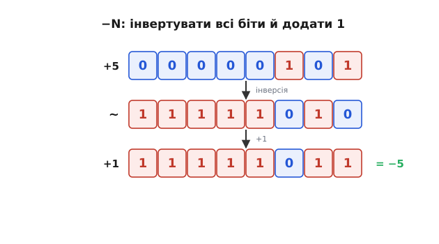
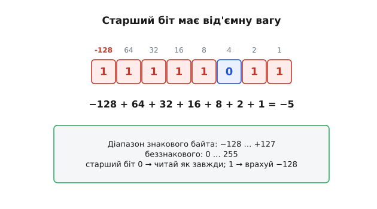
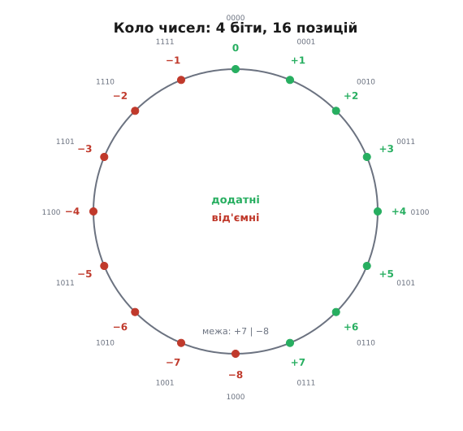
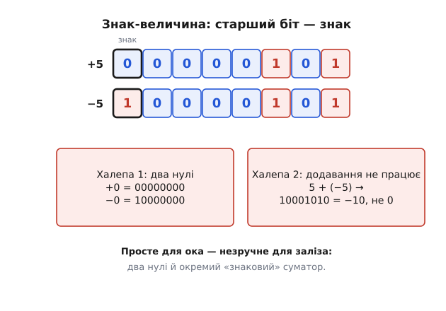
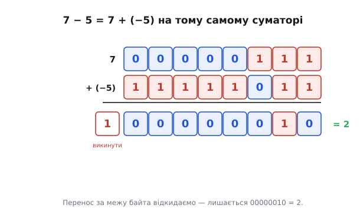

# Доповняльний код

<preknowlist>
- [Модульна арифметика](root:math-number-theory/modular-arithmetic) — порівняння a ≡ b (mod m), класи лишків і властивість вільного додавання та множення за модулем.
- [Комбінаційні цифрові схеми](root:hw-digital/combinational-circuits) — базові логічні вентилі (AND, OR, XOR), напівсуматор і повний суматор розрядів.
- [Двійкові дроби та позиційний запис](root:math-number-theory/binary-fractions) — розкладання числа за вагами степенів двійки.
</preknowlist>

Маємо фундаментальну проблему заліза: серед нулів і одиниць немає окремого фізичного знака «мінус». А комп'ютеру конче потрібні **від'ємні** числа — без них неможливо ні відняти величини, ні виміряти баланс, ні полічити координати нижче нуля. Як закодувати від'ємне число, маючи в розпорядженні лише фіксовану смужку з `n` бітів?

Відповідь, до якої цифрова інженерія прийшла через спроби й помилки ранніх комп'ютерів, виявилася бездоганною: **доповняльний код** (англ. *two's complement* — «доповнення до двійки», тобто до повного оберту степеня двійки `2ⁿ`). Він не лише вміщує від'ємні числа в бітову сітку без додаткового знакового дроту, а й перетворює **віднімання на звичайне додавання**. Завдяки цьому один і той самий [суматор](root:hw-digital/combinational-circuits) без змін обчислює і суми, і різниці для знакових та беззнакових типів даних. Як саме годинникові циферблати й конгруенції Ґаусса лягли в основу перших процесорів, можна простежити у вставці про [📜 історію розвитку модульної лічби та виникнення доповняльного коду](root:math-number-theory/twos-complement-algebra/hist-modular-arithmetic.md).

### Де взяти мінус? Знак-величина та обернений код

Найперша думка здається очевидною: віддамо **старший біт** під знак. 0 угорі означає, що число додатне, 1 — від'ємне; решта бітів кодує звичайну абсолютну величину (модуль числа). Це формат **знак-величина** (англ. *sign-magnitude*).


*У знак-величині +5 = 00000101, а −5 = 10000101 — той самий «5», лише старший біт-знак піднято. Зрозуміло й людяно — та з двома халепами. Перша: виходить аж два нулі, +0 (00000000) і −0 (10000000); «мінус нуль» безглуздий, марнує одне значення й плутає схеми. Друга, гірша: не можна просто додати. 5 + (−5) мало б дати 0, але побітове додавання дає 10001010 = −10 — повну нісенітницю. Тобто арифметика потребує окремої, хитрої логіки.*

Знак-величина гарна для людського ока, та незручна для заліза: два нулі й потреба будувати складний «знаковий» суматор із розгалуженнями. Був і проміжний винахід — **обернений код** (англ. *ones' complement* — «доповнення до одиниць»), де від'ємне число утворюється побітовою інверсією (запереченням) усіх розрядів додатного. Обернений код теж мав два нулі (+0 як `00000000` і −0 як `11111111`) та вимагав спеціального «циклічного переносу» (*end-around carry*) — повернення вихідного переносу у молодший розряд. Інженери шукали спосіб, де **звичайне двійкове додавання просто працювало б без жодних винятків** — і знайшли його в алгебрі лишків.

### Доповняльний код: алгоритм інверсії та додавання одиниці

Рецепт побудови доповняльного коду на вигляд дуже простий. Щоб дістати запис **−N** для заданого числа N у розрядній сітці з `n` бітів, треба:
1. Узяти прямий двійковий запис числа N.
2. **Перевернути всі біти** на протилежні (побітова інверсія, логічне заперечення NOT).
3. **Додати одиницю** (+1) до молодшого розряду.


*Як дістати −5 із +5. Беремо 00000101, інвертуємо кожен біт → 11111010, додаємо 1 → 11111011. Оце й є −5 у доповняльному коді. Той самий рецепт повертає назад: інвертуй 11111011 → 00000100, +1 → 00000101 = +5. І головне — нуль тепер один-єдиний: інверсія 00000000 дає 11111111, +1 = 00000000 (перенос за межу байта викидаємо). Жодного «мінус нуля».*

**Закодуймо −5 на 8 бітах і перевірмо, що рецепт є строго оборотним.**

```
+5:        00000101
інверсія:  11111010
+1:        11111011   ← це −5 у доповняльному коді

назад:     інверсія(11111011) = 00000100,  +1 = 00000101 = +5  ✓
```

Чому цей рецепт вимагає загадкової **«+1»**? Відповідь випливає з точної тотожності двійкових розрядів. Якщо взяти будь-яке `n`-бітне число `x` і скласти його з його побітовою інверсією `~x`, то в кожній позиції зустрінуться протилежні біти (0 + 1 або 1 + 0). У результаті вийде рядок з одних одиниць — число `2ⁿ − 1` (для 8 бітів це `11111111₂ = 255 = 2⁸ − 1`).

Випишемо це алгебраїчне виведення крок за кроком:

```
x + ~x
= 2ⁿ − 1            [у кожному розряді сума бітів 0 + 1 = 1, тобто всі n одиниць]

~x
= (2ⁿ − 1) − x      [виразили побітову інверсію через віднімання від усіх одиниць]

~x + 1
= (2ⁿ − 1 − x) + 1  [додали одиницю до обох частин]
= 2ⁿ − x            [скоротили одиниці: дістали точне доповнення числа x до 2ⁿ]
```

Інверсія `~x` дає число, якому до повного оберту `2ⁿ` бракує рівно одиниці. Додавання 1 закриває цей розрив, утворюючи точне значення `2ⁿ − x`. А оскільки в розрядній сітці доданок `2ⁿ` викидається через переповнення розрядної сітки, величина `2ⁿ − x` стає невідрізненною від `−x`. Детальний алгебраїчний розбір цих властивостей наведено у вставці про [🧮 строге математичне виведення властивостей кільця лишків](root:math-number-theory/twos-complement-algebra/math-modular-arithmetic.md).

### Алгебраїчна основа: ізоморфізм із кільцем лишків ℤ/2ⁿℤ

Доповняльний код — це не просто хитрий інженерний фокус, а строге втілення фундаментальної структури вищої алгебри: **кільця лишків ℤ/2ⁿℤ** (факторкільця цілих чисел за ідеалом, породженим степенем двійки `2ⁿ`).

Нехай маємо простір двійкових слів довжини `n`: `B_n = {0, 1}ⁿ`. Кожне двійкове слово `B = (b_{n-1}, b_{n-2}, …, b_1, b_0)` можна інтерпретувати двома способами:

1. **Беззнакове декодування (Unsigned):** функція `U_n: B_n → {0, 1, …, 2ⁿ − 1}`, що розглядає всі біти як додатні ваги:

```
U_n(B) = ∑_{i=0}^{n-1} b_i · 2ⁱ = b_{n-1} · 2^{n-1} + ∑_{i=0}^{n-2} b_i · 2ⁱ
```

2. **Знакове декодування доповняльного коду (Two's complement):** функція `T_n: B_n → {−2^{n-1}, …, 2^{n-1} − 1}`, де старший біт отримує **від'ємну вагу** `−2^{n-1}`:

```
T_n(B) = −b_{n-1} · 2^{n-1} + ∑_{i=0}^{n-2} b_i · 2ⁱ
```

Знайдемо різницю між цими двома інтерпретаціями для одного й того самого бітового вектора:

```
U_n(B) − T_n(B)
= (b_{n-1} · 2^{n-1} + ∑_{i=0}^{n-2} b_i · 2ⁱ) − (−b_{n-1} · 2^{n-1} + ∑_{i=0}^{n-2} b_i · 2ⁱ)   [підставили явні формули]
= 2 · b_{n-1} · 2^{n-1}                                                                            [скоротили молодші n−1 розрядів]
= b_{n-1} · 2ⁿ                                                                                     [згрупували двійки у степінь]
≡ 0 (mod 2ⁿ)                                                                                       [величина кратна модулю 2ⁿ]
```

Звідси отримуємо головну теорему арифметики доповняльного коду:

```
T_n(B) ≡ U_n(B) (mod 2ⁿ)
```

Це означає, що як беззнакове число `U_n(B)`, так і знакове число `T_n(B)` належать до **одного й того самого класу лишків** у кільці `ℤ/2ⁿℤ`. Обидва відображення є бієкціями на повні системи лишків:
- Беззнаковий код `U_n` відображає біти на канонічну невід'ємну систему лишків `[0, 2ⁿ − 1]`.
- Доповняльний код `T_n` відображає біти на центровану (симетричну) систему лишків `[−2^{n-1}, 2^{n-1} − 1]`.

Оскільки додавання й множення в кільці `ℤ/2ⁿℤ` залежать лише від класу лишку, а не від обраного представника, апаратний двійковий суматор обчислює дію в кільці `ℤ/2ⁿℤ`. Кремнієвим транзисторам абсолютно байдуже, яку систему представників обрав програміст: один і той самий ланцюг бітових переносів безпомилково обслуговує обидва світи.

### Чому це працює: коло чисел (одометр)

Геометрично роботу кільця `ℤ/2ⁿℤ` найлегше уявити через **одометр** автомобіля чи стрілочний годинник. Розрядна сітка з `n` бітів не може рости нескінченно праворуч: дійшовши до значення з усіх одиниць, наступне додавання переповнює розрядний лічильник і скидає його в чистий нуль. Числа замикаються в нерозривне коло на `2ⁿ` поділок.


*4-бітне коло на 16 значень. Від нуля вгору йдуть додатні: 0, 1, …, 7 (0111). А далі, замість «8», коло перевалює — і верхню половину читаємо як від'ємні: 1000 = −8 (найменше), 1001 = −7, …, 1111 = −1 (рівно «на крок не дійшли» до нуля). Тобто −N лежить там, куди впираєшся, відступивши N назад від нуля по колу. Старший біт 1 завжди означає «ми у від'ємній половині».*

На цьому колі «відступити на N кроків назад від нуля» означає потрапити в ту саму точку, що й «пройти вперед на `2ⁿ − N` кроків». Обидва шляхи приводять у ту саму точку кільця. Тому позиція `2ⁿ − N` є точним геометричним двійником числа `−N`.

Коли ми додаємо від'ємне число, суматор просто робить крок уперед на величину його доповнення, а природне замикання кола відкиданням старшого біта автоматично повертає стрілку на правильне значення різниці.

### Віднімання через додавання на залізі

Головний практичний тріумф доповняльного коду полягає в тому, що операція **віднімання тотожно зводиться до додавання**:

```
A − B = A + (−B) ≡ A + (2ⁿ − B) (mod 2ⁿ)
```

Для обчислення `A − B` процесору не потрібен окремий блок віднімання. Достатньо інвертувати біти операнда `B` і подати одиницю на вхідний перенос суматора.


*Порахуймо 7 − 5 як 7 + (−5). Беремо 7 = 00000111 і −5 = 11111011, подаємо на звичайний суматор і додаємо. Виходить 1 00000010 — дев'ятий, «зайвий» біт переносу просто викидаємо (коло замкнулось), і лишається 00000010 = 2. А 7 − 5 справді 2. Жодної окремої схеми віднімання — той самий суматор.*

**Обчислімо різницю 7 − 5 у 8-бітному доповняльному коді:**

```
  00000111   (число 7)
+ 11111011   (число −5, тобто 256 − 5 = 251)
-----------
1 00000010   ← дев'ятий біт (вага 2⁸ = 256) відкидається за межі регістра
= 00000010 = 2     (7 − 5 = 2  ✓)
```

В архітектурі процесора це втілюється за допомогою керованих інверторів на вентилях XOR. Якщо на один вхід елемента XOR подати біт числа `bᵢ`, а на другий — сигнал керування `SUB` (0 для додавання, 1 для віднімання), то:
- При `SUB = 0`: `bᵢ ⊕ 0 = bᵢ` (вхід проходить без змін), а вхідний перенос суматора `C₀ = 0`. Суматор обчислює `A + B`.
- При `SUB = 1`: `bᵢ ⊕ 1 = ¬bᵢ` (усі біти інвертуються), а вхідний перенос `C₀ = 1`. Суматор обчислює `A + ~B + 1 = A + (2ⁿ − B) ≡ A − B (mod 2ⁿ)`.

Одна універсальна схема без жодного зайвого транзистора виконує і додавання, і віднімання.

### Асиметрія діапазону та аномалія INT_MIN

Розглянемо вагову структуру розрядів знакового байта. Старший біт має вагу `−2^{n-1}` (для 8 бітів це `−128`), а решта `n−1` бітів несуть звичайні додатні ваги:


*Найшвидший спосіб читати доповняльний код: вважати, що старший біт має від'ємну вагу (−128 для байта), а решта — звичайні додатні. Тоді 11111011 = −128 + 64 + 32 + 16 + 8 + 2 + 1 = −5. Діапазон 8-бітного знакового — від −128 до +127: від'ємних на одне більше, бо нуль «займає місце» серед додатних. Правило читання: старший біт 0 → число додатне (читай як завжди); 1 → від'ємне (врахуй вагу −128).*

Прочитаймо, наприклад, двійкове слово `11111110₂`:

```
читаємо 11111110₂ як знакове число:
  −128 + 64 + 32 + 16 + 8 + 4 + 2 = −2       (старший біт дав −128)

перевірка рецептом:
  ~11111110₂ = 00000001₂,  +1 = 00000010₂ = 2  →  отже, це було число −2  ✓
```

Діапазон представлення `n`-бітного числа в доповняльному коді становить:

```
[−2^{n-1},  2^{n-1} − 1]
```

Для 8 бітів це `[−128, +127]`, для 16 бітів — `[−32768, +32767]`, для 32 бітів — `[−2147483648, +2147483647]`.

Зверніть увагу на фундаментальну **асиметрію діапазону**: від'ємних чисел рівно на одне більше, ніж додатних!
- Стан `000...000₂` позначає нуль. Оскільки його старший біт дорівнює 0, нуль потрапляє до невід'ємної половини, залишаючи для строго додатних чисел лише `2^{n-1} − 1` комбінацію (від `+1` до `+2^{n-1} − 1`).
- Усі `2^{n-1}` комбінацій зі старшим бітом 1 відповідають строго від'ємним числам (від `−1` до `−2^{n-1}`).

Через це виникає особливе граничне число — **мінімальне від'ємне число** `INT_MIN = −2^{n-1}` (у двійковому записі `1000...0000₂`). Воно не має парного додатного двійника: числа `+128` у знаковому 8-бітному форматі просто не існує.

Спробуємо застосувати стандартний алгоритм взяття протилежного числа (`−x = ~x + 1`) до значення `INT_MIN = −128` (`10000000₂`):

```
x = −128:   10000000
інверсія:   01111111   (+127, тобто INT_MAX)
+1:         10000000   ← знову −128!
```

Виходить парадоксальна рівність:

```
−INT_MIN = INT_MIN
```

Мовою теорії груп це пояснюється тим, що елемент `2^{n-1}` у групі `(ℤ/2ⁿℤ, +)` є **самоспряженим елементом порядку 2**:

```
2^{n-1} + 2^{n-1} = 2ⁿ ≡ 0 (mod 2ⁿ)  ⟹  −(2^{n-1}) ≡ 2^{n-1} (mod 2ⁿ)
```

Ця аномалія є джерелом небезпечних системних помилок:
1. У мовах C та C++ вираз `-INT_MIN` або виклик `abs(INT_MIN)` призводить до **невизначеної поведінки** (*Undefined Behavior*), оскільки коректний математичний результат `+2147483648` не вміщується у 32-бітний знаковий тип `int`.
2. Операція цілочисельного ділення `INT_MIN / -1` на процесорах архітектури x86 (інструкція `IDIV`) викликає апаратне переривання `#DE` (*Divide Error exception*). В операційній системі Linux це негайно завершує процес аварійним сигналом `SIGFPE` (*Floating Point Exception*), попри те, що ділення виконувалося над цілими числами й ділення на нуль не було.

### Арифметичне переповнення: Carry Flag проти Overflow Flag

Оскільки арифметика в регістрі замкнена в коло, результат операції може вийти за межі допустимого діапазону. Необхідно чітко розрізняти два абсолютно різних види виходу за межі:

1. **Беззнаковий перенос (Carry Flag, CF):** виникає, коли результат виходить за межі `[0, 2ⁿ − 1]`. Сигналом про це є перенос зі старшого розряду суматора: `CF = C_n`.
2. **Знакове переповнення (Overflow Flag, OF / V):** виникає, коли справжній математичний результат операції виходить за межі знакового інтервалу `[−2^{n-1}, 2^{n-1} − 1]`.

Розглянемо, коли саме виникає знакове переповнення при додаванні `S = A + B`:
- Якщо доданки мають **різні знаки** (`A ≥ 0, B < 0`), результат гарантовано лежить у безпечних межах:

```
−2^{n-1} ≤ A + B ≤ 2^{n-1} − 2
```

Знакове переповнення при додаванні чисел з різними знаками **математично неможливе**.

- Якщо додаються два **додатні числа** (`A ≥ 0, B ≥ 0`, старші біти `a_{n-1} = 0, b_{n-1} = 0`), а сума випадково досягає або перевищує `2^{n-1}`, старший біт результату стає рівним 1. Додатні числа дали від'ємну суму.
- Якщо додаються два **від'ємні числа** (`A < 0, B < 0`, старші біти `a_{n-1} = 1, b_{n-1} = 1`), а їхня сума стає меншою за `−2^{n-1}`, коло перескакує назад у додатну область: старший біт результату стає рівним 0. Від'ємні числа дали додатну суму.

Звідси отримуємо булевий вираз знакового переповнення через знакові біти аргументів і суми:

```
OF = (¬a_{n-1} ∧ ¬b_{n-1} ∧ s_{n-1}) ∨ (a_{n-1} ∧ b_{n-1} ∧ ¬s_{n-1})
```

В апаратному суматорі для обчислення прапорця `OF` застосовують дивовижне за елегантністю спрощення: **порівняння вхідного й вихідного переносів старшого біта**:

```
OF = C_{n-1} ⊕ C_n
```

де `C_{n-1}` — перенос, що прийшов у старший розряд `n−1` із молодших розрядів, а `C_n` — перенос, що вийшов зі старшого розряду назовні.

Доведемо цю тотожність аналізом трьох випадків для старшого двійкового розряду:

```
s_{n-1} = a_{n-1} ⊕ b_{n-1} ⊕ C_{n-1}
C_n     = (a_{n-1} ∧ b_{n-1}) ∨ (C_{n-1} ∧ (a_{n-1} ⊕ b_{n-1}))
```

1. **Додаємо два додатні числа (`a_{n-1} = 0, b_{n-1} = 0`):**
   Вихідний перенос `C_n = 0`. Знаковий біт суми `s_{n-1} = C_{n-1}`.
   Переповнення настає тоді й лише тоді, коли `s_{n-1} = 1`, тобто коли `C_{n-1} = 1`.
   Тоді: `C_{n-1} ⊕ C_n = 1 ⊕ 0 = 1` (переповнення зафіксовано).
   Якщо ж `C_{n-1} = 0`, то `C_{n-1} ⊕ C_n = 0 ⊕ 0 = 0` (переповнення немає).

2. **Додаємо два від'ємні числа (`a_{n-1} = 1, b_{n-1} = 1`):**
   Вихідний перенос `C_n = 1`. Знаковий біт суми `s_{n-1} = 1 ⊕ 1 ⊕ C_{n-1} = C_{n-1}`.
   Переповнення настає, коли сума хибно стала додатною (`s_{n-1} = 0`), тобто коли `C_{n-1} = 0`.
   Тоді: `C_{n-1} ⊕ C_n = 0 ⊕ 1 = 1` (переповнення зафіксовано).
   Якщо ж `C_{n-1} = 1`, то `C_{n-1} ⊕ C_n = 1 ⊕ 1 = 0` (переповнення немає).

3. **Додаємо числа різних знаків (`a_{n-1} ⊕ b_{n-1} = 1`):**
   Вихідний перенос `C_n = C_{n-1}`.
   Тоді `C_{n-1} ⊕ C_n = C_{n-1} ⊕ C_{n-1} = 0` завжди. Переповнення неможливе, і прапорець завжди скинутий у 0.

Таким чином, один-єдиний логічний вентиль XOR над лініями `C_{n-1}` та `C_n` миттєво й абсолютно точно сигналізує процесору про знакове переповнення.

### Розширення знаку та арифметичний зсув

Практична робота з доповняльним кодом вимагає двох важливих операцій: переведення числа у ширший тип даних та швидкого масштабування через бітові зсуви.

#### Алгебра розширення знаку (Sign Extension)

Коли потрібно перетворити `n`-бітне знакове число у ширший формат з `m` бітів (наприклад, з 8-бітного `int8_t` у 16-бітний `int16_t` або 32-бітний `int32_t`, як це роблять інструкції `MOVSX` в x86), застосовують **розширення знаку**: значення старшого знакового біта копіюють у всі новостворені старші розряди.

- Додатне число `+5` (`00000101₂`) розширюється нулями: `00000000 00000101₂` (`+5`).
- Від'ємне число `−5` (`11111011₂`) розширюється одиницями: `11111111 11111011₂` (`−5`).

Чому заповнення старших розрядів одиницями не змінює числового значення від'ємного числа? Доведемо це алгебраїчно для розширення на один розряд (з `n` до `n+1` бітів) при `b_{n-1} = 1`:

```
T_{n+1}(B')
= −1 · 2ⁿ + 1 · 2^{n-1} + ∑_{i=0}^{n-2} b_i · 2ⁱ    [розписали значення (n+1)-бітного числа з новим старшим бітом 1]
= (−2ⁿ + 2^{n-1}) + ∑_{i=0}^{n-2} b_i · 2ⁱ         [згрупували два найстарші розряди]
= (−2 · 2^{n-1} + 2^{n-1}) + ∑_{i=0}^{n-2} b_i · 2ⁱ [винесли спільний степінь двійки]
= −2^{n-1} + ∑_{i=0}^{n-2} b_i · 2ⁱ                 [значення тотожно збіглося з вихідним T_n(B)]
= T_n(B)
```

За індукцією це твердження поширюється на будь-яку кількість доданих розрядів: нова від'ємна вага старшого біта `−2^{m-1}` і сума ваг проміжних одиниць `2^{m-2} + … + 2^{n-1} = 2^{m-1} − 2^{n-1}` у сумі дають рівно вихідну вагу `−2^{n-1}`.

#### Арифметичний зсув (ASR) проти логічного (LSR)

Зсув двійкового числа праворуч на `k` позицій відповідає діленню на `2ᵏ`. Проте спосіб заповнення звільнених старших розрядів визначає сутність операції:

1. **Логічний зсув праворуч (LSR — Logical Shift Right, інструкція `SHR`):** завжди заповнює старші біти нулями. Він коректно ділить націло беззнакові числа `U_n(B)`. Якщо застосувати LSR до від'ємного числа, його старший знаковий біт стане 0, перетворивши число на велетенське додатне значення.
2. **Арифметичний зсув праворуч (ASR — Arithmetic Shift Right, інструкція `SAR`):** копіює значення старшого знакового біта `b_{n-1}` у всі звільнені розряди, зберігаючи знак числа.

Дослідимо алгебру арифметичного зсуву для від'ємного числа `X = −2^{n-1} + R`, де `R = ∑_{i=0}^{n-2} b_i · 2ⁱ`:

```
ASR(X, 1)
= −2^{n-1} + 2^{n-2} + ⌊R / 2⌋   [старший біт лишився 1, біт n−2 отримав вагу +2^{n-2}, молодша частина зсунулась]
= −2^{n-2} + ⌊R / 2⌋             [бо −2^{n-1} + 2^{n-2} = −2^{n-2}]
= ⌊(−2^{n-1} + R) / 2⌋           [внесли цілу частину під знак округлення донизу]
= ⌊X / 2⌋                        [округлення до мінус нескінченності (floor)]
```

#### Пастка округлення: зсув проти цілочисельного ділення

Тут криється найтонша пастка низькорівневого програмування. Арифметичний зсув `ASR(X, k)` реалізує **ділення з округленням до мінус нескінченності** (англ. *floor division*, `⌊X / 2ᵏ⌋`). 

Перевіримо це на непарному числі `−5` (`11111011₂`):

```
−5 >> 1 = ASR(11111011₂, 1) = 11111101₂ = −3
```

Дійсно, `⌊−5 / 2⌋ = ⌊−2.5⌋ = −3`.

Проте стандарт мов програмування C, C++, Rust та Java вимагає, щоб оператор цілочисельного ділення `/` виконував **округлення до нуля** (*truncation towards zero*):

```
−5 / 2 == −2
```

Отже, для непарних від'ємних чисел **арифметичний зсув НЕ еквівалентний діленню націло**: `−5 >> 1 ≠ −5 / 2`.

Щоб оптимізувати ділення на степінь двійки через швидкий зсув без повільної інструкції `IDIV`, компілятори додають корекцію (зсув бази, *bias* `2ᵏ − 1`) перед виконанням операції зсуву:

```
(X < 0) ? (X + (2ᵏ − 1)) >> k : X >> k
```

Для ділення на 2 (`k = 1`) вираз `(−5 + 1) >> 1 = −4 >> 1 = −2` дає результат, що точно збігається з вимогами стандарту мови.

> 🔧 **Навіщо це.** Доповняльний код — це фундаментальний стандарт представлення цілих чисел у всіх цифрових процесорах. Винесіть п'ять головних правил:
> 1. **Алгоритм заперечення:** `−x = ~x + 1` (побітова інверсія плюс один).
> 2. **Універсальність заліза:** операція `A − B` виконується на тому самому суматорі як `A + ~B + 1`. Біти додаються однаково для знакових і беззнакових типів, бо вони є лишками одного кільця `ℤ/2ⁿℤ`.
> 3. **Асиметрія та INT_MIN:** діапазон `n` бітів становить `[−2^{n-1}, 2^{n-1} − 1]`. Число `INT_MIN = −2^{n-1}` є самоспряженим (`−INT_MIN = INT_MIN`), а спроба його заперечення чи ділення на `-1` веде до невизначеної поведінки або апаратного збою процесора.
> 4. **Два прапорці:** `Carry Flag` (`CF = C_n`) фіксує переповнення для беззнакових чисел, а `Overflow Flag` (`OF = C_{n-1} ⊕ C_n`) — для знакових чисел.
> 5. **Зсуви:** логічний зсув `LSR` обнуляє старші біти, арифметичний зсув `ASR` копіює знаковий біт і виконує округлення донизу (`⌊X / 2ᵏ⌋`), що для непарних від'ємних чисел відрізняється від оператора ділення `/`.

---

### Підсумок

Доповняльний код розв'язує проблему подання від'ємних чисел без додаткового знакового біта, будуючи ізоморфізм між двійковими регістрами та кільцем лишків **ℤ/2ⁿℤ**. Від'ємне число `−N` подається як доповнення до повного оберту модуля `2ⁿ − N`, що апаратно обчислюється побітовою інверсією та додаванням одиниці (`~N + 1`). Старший біт має **від'ємну вагу** `−2^{n-1}`, задаючи асиметричний діапазон `[−2^{n-1}, 2^{n-1} − 1]` з особливою точкою `INT_MIN`, для якої `−INT_MIN = INT_MIN`. Віднімання перетворюється на звичайне додавання `A + ~B + 1` на єдиному суматорі, а знакове переповнення миттєво обчислюється вентилем `OF = C_{n-1} ⊕ C_n`. При зміні розрядності застосовується розширення знаку, а при зсувах — арифметичний зсув `ASR`, що зберігає знак і реалізує ділення з округленням до мінус нескінченності.
