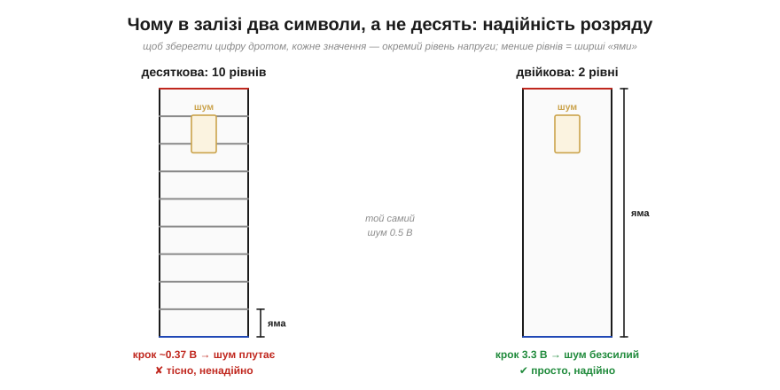
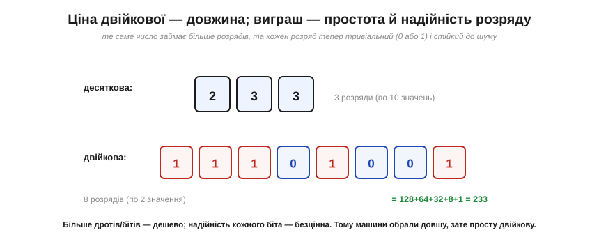
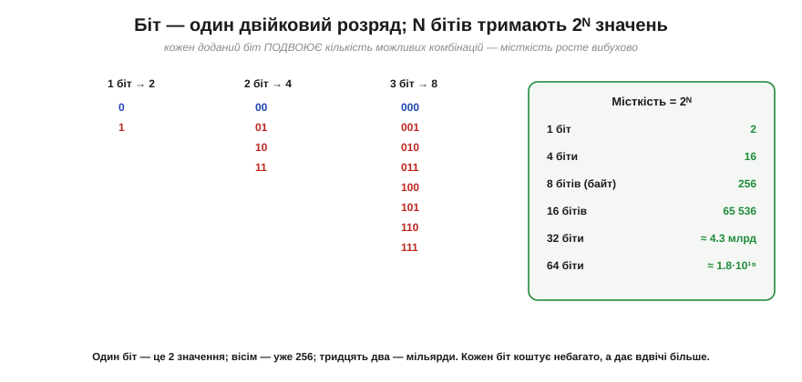
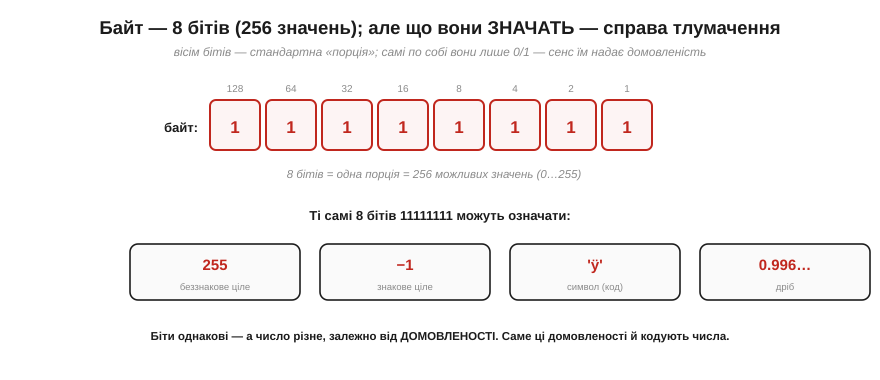
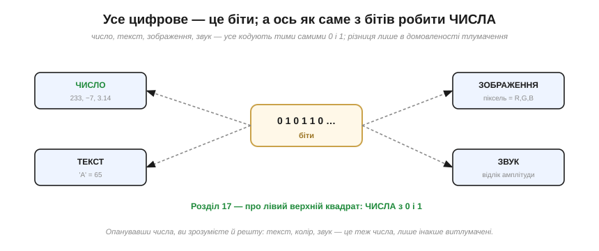

<preknowlist>
- [Позиційні системи числення](root:math-number-theory/positional-systems)
- [Чому цифрова техніка: дискретизація та логічні рівні](root:hw-digital/why-digital)
</preknowlist>

# Чому двійкова: фізичні причини вибору двох станів

Записати будь-яке число за допомогою лише двох символів **можливо** — ще 1703 року [Лейбніц виклав двійкову арифметику](root:math-number-theory/why-binary/hist-leibniz.md) як завершену математичну систему. Проте виникає закономірне питання: чому практично всі цифрові комп'ютери побудовані виключно на двійковій логіці, а не на звичній для людини десятковій чи математично привабливій трійковій? Відповідь криється у фундаментальній фізиці твердотільної електроніки: два стани забезпечують найвищий [запас завадостійкості](root:hw-digital/noise-margin), перетворюючи неідеальні, зашумлені аналогові транзистори на бездоганні логічні перемикачі.

> 🔧 **Навіщо це.**
> Розуміння фізичних першопричин двійкової логіки позбавляє ілюзії, що комп'ютер є абстрактною математичною сутністю. Кожен біт у пам'яті чи на шині — це розподіл електричного заряду, рівень напруги або струм через напівпровідниковий p-n перехід. Двійкова дискретизація — це головний інженерний компроміс: ми свідомо погоджуємося на довші числа та ширші шини заради того, щоб обчислення не руйнувалися тепловим шумом, перепадами живлення та старінням кремнію.

---

## Десяткова в залізі — небезпека аналогової деградації

Уявімо спробу побудувати обчислювальну машину, яка зберігає та обробляє числа безпосередньо в десятковій системі найпрямолінійнішим способом: **одна десяткова цифра відповідає одному з десяти дискретних рівнів напруги** на одному провіднику. (Перші лампові машини на кшталт ENIAC насправді уникали цього підходу, використовуючи кільцеві десяткові лічильники на десятках тригерів або двійково-десяткове кодування BCD, де кожна цифра формувалася комбінацією двійкових елементів. Пряма модель десяти рівнів на одному дроті найкраще демонструє фізичний глухий кут багатозначної аналогової логіки.)


*Зберігаючи десяткову цифру одним дротом, ми мусимо втиснути **десять** рівнів напруги — крок між ними мізерний (~0.37 В на 3.3 В), і навіть невеликий шум плутає сусідні цифри. У двійковій рівнів **два**, між ними зяє вся напруга — і той самий шум безсилий. Це точнісінько та сама [«яма Шеннона»](root:hw-digital/why-digital), застосована не до логіки, а до **зберігання числа**.*

Головна причина краху аналогових обчислювальних машин у середині XX століття полягала в **незворотній деградації сигналу в каскадах підсилювачів**. Будь-який електронний провідник має власний тепловий шум (шум Джонсона — Найквіста), спричинений хаотичним тепловим рухом електронів, а також зазнає електромагнітних наводок від сусідніх ліній зв'язку та коливань напруги живлення.

В аналоговому ланцюзі, де напруга передає неперервне значення, кожен підсилювальний каскад не лише підсилює корисний сигнал, а й додає до нього власну похибку та посилює шум попереднього каскаду:

```
V_вих = k · (V_вх + V_шум) + V_дрейф
```

Якщо обчислення складається із сотень послідовних операцій, похибки неминуче накопичуються. Сигнал швидко тоне в шумі, і точність результату катастрофічно падає.

### Нелінійність CMOS і регенерація рівнів

Двійкова цифрова техніка розв'язує цю проблему за допомогою **дискретизації** (від лат. *discretus* — розділений, перервний) та **регенеративного підсилення**.

Основою сучасних цифрових мікросхем є технологія CMOS (Complementary Metal-Oxide-Semiconductor — комплементарна структура метал-оксид-напівпровідник). Базовий логічний елемент — CMOS-інвертор — складається з пари польових транзисторів: верхнього p-канального (pMOS) та нижнього n-канального (nMOS).

Коли на вхід подається низька напруга (близька до 0 В), nMOS-транзистор надійно закритий, а pMOS-транзистор повністю відкритий і з'єднує вихід із шиною живлення `V_DD`. Коли ж на вхід подається висока напруга (близька до `V_DD`), навпаки, pMOS закривається, а nMOS відкривається, стягуючи вихід до землі `GND` (0 В).

Передавальна характеристика за напругою (Voltage Transfer Characteristic, VTC) такого інвертора є вкрай нелінійною:

1. У крайніх областях (біля 0 В та біля `V_DD`) коефіцієнт передачі за напругою `dV_вих / dV_вх` прямує до нуля. Це означає, що будь-які флуктуації чи шум на вході повністю придушуються й не проходять на вихід.
2. У вузькій центральній зоні перемикання коефіцієнт підсилення дуже високий (за модулем значно більший за одиницю).

Завдяки цьому кожен двійковий логічний вентиль працює як **регенератор сигналу**: навіть якщо на вхід надійшла спотворена шумом одиниця (наприклад, замість 3.3 В прийшло 2.6 В), на виході інвертора сформується ідеальний нуль (0.0 В). Наступний інвертор перетворить цей нуль назад на ідеальну одиницю (3.3 В). Шум не накопичується крізь мільйони логічних вентилів — він знищується на кожному кроці.

### Статичний запас завадостійкості

Стійкість цифрової схеми до завад кількісно виражається через **статичний запас завадостійкості** (Static Noise Margin). Для будь-якого сімейства логіки визначаються чотири критичні порогові напруги:

- `V_OH` (*Voltage Output High*) — мінімальна гарантована вихідна напруга для логічної одиниці;
- `V_OL` (*Voltage Output Low*) — максимальна гарантована вихідна напруга для логічного нуля;
- `V_IH` (*Voltage Input High*) — мінімальна вхідна напруга, яку приймач гарантовано розпізнає як одиницю;
- `V_IL` (*Voltage Input Low*) — максимальна вхідна напруга, яку приймач гарантовано розпізнає як нуль.

Діапазон між `V_IL` та `V_IH` є **забороненою зоною**. Якщо напруга потрапляє в цю смугу, логічний стан вважається невизначеним, що може призвести до збою або [метастабільності](root:hw-digital/metastability-timing).

Запаси завадостійкості для високого та низького рівнів обчислюються за формулами:

```
NM_H = V_OH - V_IH    [статичний запас завадостійкості для логічної одиниці]
NM_L = V_IL - V_OL    [статичний запас завадостійкості для логічного нуля]
```

**Числовий приклад.** Розглянемо стандартну 3.3-вольтову логіку LVTTL:
- `V_OH = 2.4 В`, `V_IH = 2.0 В` ⇒ `NM_H = 2.4 - 2.0 = 0.4 В`;
- `V_IL = 0.8 В`, `V_OL = 0.4 В` ⇒ `NM_L = 0.8 - 0.4 = 0.4 В`.

Схема витримує шум амплітудою до 400 мВ без жодної помилки в обчисленнях.

Якби ми спробували розмістити 10 рівнів напруги в тому самому діапазоні 3.3 В, відстань між сусідніми рівнями становила б лише `3.3 / 9 ≈ 0.367 В`. Якщо врахувати технологічний розкид параметрів транзисторів і заборонені смуги, допустимий запас завадостійкості для кожного рівня впав би до мізерних 10–20 мВ. Найменша високочастотна завада від перемикання сусідньої шини або пульсація стабілізатора живлення миттєво перетворила б цифру 4 на цифру 5.

---

## Булева алгебра: Шеннон і перемикальні схеми

Двійкова система виявилася ідеальною не лише через стійкість до шумів, а й тому, що під неї вже існував потужний математичний апарат — **булева алгебра** (алгебра логіки), розроблена англійським математиком Джорджем Булем 1854 року.

1937 року 21-річний американський інженер і математик Клод Шеннон у своїй магістерській дисертації *«Символьний аналіз релейних і перемикальних схем»* (*A Symbolic Analysis of Relay and Switching Circuits*) довів фундаментальний факт: **між двійковими електричними перемикачами та булевою алгеброю існує точний математичний ізоморфізм** (від грец. *isos* — однаковий та *morphe* — форма).

Шеннон показав, що базові логічні операції реалізуються найпростішими фізичними з'єднаннями контактів або ключів:

1. **Кон'юнкція (Логічне І, AND):** послідовне з'єднання двох ключів `A` та `B`. Струм протікає через ланцюг тоді й лише тоді, коли замкнені обидва ключі: `Y = A ∧ B` (або `Y = A · B`).
2. **Диз'юнкція (Логічне АБО, OR):** паралельне з'єднання двох ключів `A` та `B`. Струм протікає, якщо замкнений хоча б один із ключів: `Y = A ∨ B` (або `Y = A + B`).
3. **Заперечення (Логічне НЕ, NOT):** нормально замкнений контакт, який розмикається при активації сигналу `A`: `Y = ¬A` (або `Y = Ā`).

```
Послідовне з'єднання (AND):     Паралельне з'єднання (OR):
       A       B                              ┌─── A ───┐
───○───/ ───○───/ ───○───              ───○───┤         ├───○───
                                              └─── B ───┘
```

### Функціональна повнота й алгебраїчна оптимізація

Булева алгебра довела властивість **функціональної повноти базисів**: будь-яку логічну функцію будь-якої складності (а отже, суматори, мультиплексори, декодери, регістри та цілі процесори) можна скласти з комбінації всього трьох операцій `{AND, OR, NOT}` або навіть з одного універсального вентиля — NAND (штрих Шеффера) чи NOR (стрілка Пірса).

Ба більше, булева алгебра дала інженерам інструмент для суто математичної оптимізації заліза. Замість інтуїтивного підбору контактів схеми можна мінімізувати за законами склеювання та правилами де Моргана:

```
A·B + A·B̄
= A·(B + B̄)      [дистрибутивність: винесення спільного множника]
= A·1            [доповнення: B + B̄ = 1]
= A              [нейтральний елемент]
```

Одне алгебраїчне перетворення скорочує кількість потрібних транзисторів на кристалі, зменшуючи площу мікросхеми, енергоспоживання та час поширення сигналу.

---

## Чому не трійкова: теорема економічності та урок «Сетуні»

Якщо десяткова система програє двійковій у завадостійкості, то як щодо найближчого сусіда — **трійкової системи числення**? Чи є двійкова система абсолютно найкращою з погляду теорії інформації?

Відповідь дає математична концепція [економічності систем числення](root:math-number-theory/radix-economy) (*radix economy*).

### Теорема про оптимальну основу числення

Припустимо, що нам потрібно зберегти ціле додатне число `N` у позиційній системі числення з основою `b`. Для запису цього числа знадобиться кількість розрядів `w`, яка дорівнює:

```
w = log_b(N)
```

Кожен розряд повинен фізично розпізнавати `b` різних станів. Припустимо, що апаратна складність (вартість, кількість компонентів або рівнів) одного розряду пропорційна числу станів `b`. Тоді сумарні апаратні витрати `E(b, N)` на представлення числа `N` описуються формулою:

```
E(b, N) = b · log_b(N)
        = b · (ln(N) / ln(b))    [перехід до натурального логарифма]
        = ln(N) · (b / ln(b))
```

Оскільки `ln(N)` є фіксованою константою для заданого числа, мінімум функції апаратних витрат визначається поведінкою функції однієї змінної:

```
f(b) = b / ln(b)
```

Знайдемо екстремум функції `f(b)` за допомогою похідної за змінною `b`:

```
f'(b) = (1 · ln(b) - b · (1 / b)) / (ln(b))²
      = (ln(b) - 1) / (ln(b))²
```

Прирівнявши похідну до нуля `f'(b) = 0`, отримуємо умову:

```
ln(b) - 1 = 0
ln(b) = 1
b = e ≈ 2.71828...
```

Математично найекономічнішою основою для збереження інформації є основа натуральних логарифмів — ірраціональне **число Ейлера `e`**.

Оскільки фізичний розряд повинен мати цілу кількість станів, обчислимо значення `f(b)` для найближчих цілих кандидатів:

```
f(2)  = 2 / ln(2)  ≈ 2 / 0.69315 ≈ 2.8854    [двійкова основа]
f(3)  = 3 / ln(3)  ≈ 3 / 1.09861 ≈ 2.7307    [трійкова основа]
f(4)  = 4 / ln(4)  ≈ 4 / 1.38629 ≈ 2.8854    [четвіркова основа]
f(10) = 10 / ln(10) ≈ 10 / 2.30259 ≈ 4.3429   [десяткова основа]
```

Трійкова основа (`b = 3`) математично ефективніша за двійкову (`b = 2`):

```
(f(2) - f(3)) / f(2) = (2.8854 - 2.7307) / 2.8854 ≈ 0.0536  (5.36%)
```

Трійкова система дає теоретичну економію близько 5.36% апаратних витрат порівняно з двійковою, тоді як десяткова система вимагає на `(4.3429 - 2.8854) / 2.8854 ≈ 50.5%` більше апаратних ресурсів.

### Збалансована трійкова логіка та машина «Сетунь»

Трійкова система стає ще привабливішою, якщо використати [збалансовану трійкову систему](root:math-number-theory/ternary-computing) (*balanced ternary*), де цифрами розрядів є не `{0, 1, 2}`, а симетрична трійка `{-1, 0, +1}` (значення `-1` традиційно позначають як `T` або `1̄`).

Збалансована трійкова арифметика має унікальні математичні переваги:

- **Знак числа без окремого біта знака:** знак усього числа визначається виключно знаком його старшого ненульового трита. Якщо перший трит — `+1`, число додатне; якщо `T` (`-1`) — від'ємне.
- **Віднімання без спеціальних кодів:** для зміни знака числа на протилежний достатньо інвертувати всі його трити (`+1 ↔ T`, а `0` лишається `0`). Операція віднімання `A - B` перетворюється на звичайне додавання `A + (-B)` без потреби у складному апараті [доповняльного коду](root:math-number-theory/twos-complement-algebra).
- **Симетричне округлення:** відкидання молодших розрядів автоматично відповідає округленню до найближчого цілого без систематичного зсуву в бік нуля чи нескінченності.

1958 року в Московському державному університеті під керівництвом Миколи Брусенцова було створено реальний трійковий комп'ютер — **«Сетунь»**. Машина продемонструвала вражаючу надійність, простоту архітектури та високу продуктивність для свого часу.

### Чому трійкова логіка програла в кремнії

Чому ж сучасний світ не будує трійкові процесори?

Причина — у **фізичній реалізації напівпровідникової елементної бази**. Елементи комп'ютера «Сетунь» базувалися на магнітних динамічних підсилювачах — мініатюрних ферит-діодних сердечниках. Магнітний матеріал мав природну петлю гістерезису з двома напрямками намагніченості та нульовим станом, що дозволяло елегантно кодувати три стани.

Але коли обчислювальна техніка перейшла на кремнієві транзистори, ситуація кардинально змінилася:

1. **Природна бістабільність польового транзистора:** Транзистор у ключовому режимі має лише два природні стани — або повністю закритий (опір гігаоми, струм не тече), або повністю відкритий (опір частки ома, напруга падає до нуля).
2. **Складність тристабільних комірок:** Щоб створити напівпровідникову схему з трьома стабільними станами, доводиться або з'єднувати щонайменше 4–6 транзисторів на один розряд, або формувати три рівні напруги (наприклад, 0 В, 1.65 В, 3.3 В).
3. **Падіння запасу завадостійкості:** Поділ діапазону напруги на три зони вдвічі знижує статичний запас завадостійкості `NM`.
4. **Статичне енергоспоживання:** У середньому стані (1.65 В) обидва транзистори CMOS-пари (pMOS та nMOS) частково відкриті, утворюючи наскрізний струм короткого замикання від `V_DD` до `GND`, що викликає колосальний нагрів кристала.

Теоретичний виграш у 5.3% апаратної економічності був миттєво перекреслений тим, що двійковий кремнієвий транзистор виявився на порядки простішим, надійнішим, холоднішим і дешевшим у масовому літографічному виробництві.

---

## Ціна — довжина, виграш — надійність

За неперевершену завадостійкість двійкової системи доводиться платити єдиною ціною — **довжиною запису чисел**: одне й те саме число в двійковому поданні вимагає значно більшої кількості розрядів, ніж у десятковому чи шістнадцятковому.


*Число 233 у десятковій — це три розряди; у двійковій — аж вісім (11101001 = 128+64+32+8+1). Двійковий запис **утричі** довший. Та погляньте, чим ми заплатили й що отримали: кожен десятковий розряд мусив би розрізняти десять станів, а кожен двійковий — лише два. Розрядів більше, зате кожен — тривіальний і стійкий до шуму.*

Співвідношення довжини запису між основами `b_1` та `b_2` для однакового числа `N` задається відношенням їхніх логарифмів:

```
w_двійкова / w_десяткова = log_2(10) ≈ 3.322
```

Двійковий запис у середньому в 3.32 раза довший за десятковий. Число 1 000 000 у десятковій системі займає 7 знаків, а в двійковій — 20 бітів (`11110100001001000000_2`).

В епоху планарної напівпровідникової технології цей обмін виявився найвигіднішою угодою в історії інженерії. Додати на кристал ще 32 чи 64 транзистори коштує лічені долі цента завдяки закону Мура. Натомість спроба змусити один розряд надійно зберігати 10 станів вимагала б надпрецизійних аналогових компонентів, термокомпенсації та постійного калібрування.

---

## Пам'ять і фізика комірок: бістабільність проти витоку

Принцип двійкової дискретизації визначає конструкцію та фізику всіх сучасних типів запам'ятовувальних пристроїв: від надшвидких регістрів процесора до енергонезалежних твердотільних накопичувачів.

### SRAM: Регенеративна бістабільність

Статична оперативна пам'ять (Static RAM, SRAM) реалізує найчистішу форму двійкової бістабільності. Стандартна комірка 6T складається з шести транзисторів: двох перехресно з'єднаних CMOS-інверторів (утворюють бістабільний тригер-засувку) та двох ключів доступу для ліній зчитування/запису.

```
       V_DD                 V_DD
        │                    │
     ┌──┴──┐              ┌──┴──┐
     │ pM1 │              │ pM2 │
     └──┬──┘              └──┬──┘
 Q ─────┼─────────┬──────────┤
        │         │          │
     ┌──┴──┐      │       ┌──┴──┐
     │ nM1 │      └───────┤ nM2 │───── Q_bar
     └──┬──┘              └──┬──┘
        │                    │
       GND                  GND
```

Завдяки сильному позитивному зворотному зв'язку між двома інверторами комірка має лише два стійкі енергетичні мінімуми: стан `(Q = 1, Q_bar = 0)` та стан `(Q = 0, Q_bar = 1)`. Якщо зовнішній шум спробує змістити потенціал вузла `Q`, інвертори миттєво повернуть його назад. Комірка тримає біт нескінченно довго, поки подається живлення, не потребуючи оновлення.

### DRAM: Компроміс заряду й необхідність регенерації

Динамічна оперативна пам'ять (Dynamic RAM, DRAM) жертвує активною регенерацією заради щільності. Її комірка 1T1C містить лише один польовий транзистор доступу та один мікроскопічний накопичувальний конденсатор ємністю всього 20–30 фемтофарад (`20–30 · 10⁻¹⁵ Ф`).

- Логічна `1` — конденсатор заряджений до напруги `V_DD`;
- Логічний `0` — конденсатор розряджений до `0 В`.

Фізична проблема DRAM полягає у **струмах витоку**: через зворотні струми p-n переходу транзистора та тунелювання крізь діелектрик заряд конденсатора витікає за лічені мілісекунди.

Тому контролер DRAM змушений виконувати **цикли регенерації** (refresh cycles) кожні 32–64 мс: спеціальні підсилювачі зчитування (Sense Amplifiers) аналізують мізерний залишковий заряд, відновлюють його до повного `V_DD` і записують назад у конденсатор. Зчитування в DRAM є руйнівним (*destructive read*), тому регенерація виконується щоразу після кожного звернення до рядка пам'яті.

### Flash-пам'ять і повернення до багаторівневих компромісів

Енергонезалежна Flash-пам'ять зберігає інформацію у вигляді електричного заряду на повністю ізольованому провідному плаваючому затворі (Floating Gate) або в шарі пастки заряду (Charge Trap) польового транзистора.

Заряд інжектується крізь тонкий діелектрик за допомогою квантовомеханічного тунелювання Фаулера — Нордгейма або інжекції гарячих електронів при подачі високої напруги програмування (~15–20 В). Замкнені електрони створюють електростатичне поле, яке змінює порогову напругу відкриття транзистора `V_th`.

В еволюції Flash-пам'яті відбулося показове повернення до багаторівневого кодування:

- **SLC (Single-Level Cell):** 1 біт на комірку (2 рівні заряду, 1 поріг зчитування). Величезний запас завадостійкості, ресурс понад 100 000 циклів стирання, затримка зчитування ~25 мкс.
- **MLC (Multi-Level Cell):** 2 біти на комірку (4 рівні заряду, 3 пороги). Ресурс ~3 000–10 000 циклів.
- **TLC (Triple-Level Cell):** 3 біти на комірку (8 рівнів заряду, 7 порогів). Ресурс ~1 000–3 000 циклів.
- **QLC (Quad-Level Cell):** 4 біти на комірку (16 дискретних рівнів напруги, 15 порогів у вікні всього ~3–4 В).

У випадку QLC крок між сусідніми рівнями напруги становить менше 0.2 В. Найменший дрейф заряду внаслідок деградації діелектрика після багаторазових циклів перезапису призводить до зміщення порогової напруги та помилок зчитування. Ресурс QLC падає до всього ~500–1 000 циклів, а контролер SSD змушений застосовувати складні алгоритми корекції помилок (LDPC — Low-Density Parity-Check).

Приклад Flash-пам'яті наочно демонструє, що перехід від двійкового стану (SLC) до багаторівневого (QLC) драматично знижує надійність і ресурс комірок, підтверджуючи фундаментальну перевагу простої двійкової логіки.

---

## Лінії зв'язку, тепло та динамічне споживання

Вибір двійкової системи визначає також топологію міжз'єднань на друкованих платах і всередині кристалів мікросхем.

Оскільки двійкові слова довгі (32, 64 чи 128 бітів), паралельна передача вимагає розведення великої кількості провідників. Це породжує інженерні виклики:

1. **Паразитна ємність та індуктивність:** Кожна паралельна доріжка шини має паразитну ємність до сусідніх ліній та землі, а також індуктивність виводів корпусу.
2. **Перехресні завади (Crosstalk):** Швидке перемикання напруги на одній лінії створює наведену напругу на сусідніх провідниках через ємнісний та індуктивний зв'язок.

### Динамічна потужність перемикання CMOS

У статичному стані (коли біти не змінюються) ідеальна CMOS-схема майже не споживає енергії: один із транзисторів пари завжди закритий, і через схему протікає лише незначний струм витоку `I_leak`.

Енергія витрачається головним чином під час **перемикання станів**, коли паразитні ємності затворів і ліній зв'язку заряджаються від джерела живлення, а потім розряджаються на землю:

```
P_дин = α · C_L · V_dd² · f
```

- `α` — коефіцієнт активності (ймовірність перемикання за такт);
- `C_L` — сумарна ємність навантаження (затвори транзисторів + паразитна ємність ліній зв'язку);
- `V_dd` — напруга живлення схеми;
- `f` — тактова частота перемикання.

Квадратична залежність потужності від напруги живлення `V_dd²` стала головною причиною зниження напруги живлення мікропроцесорів з 5.0 В у 1980-х роках до 3.3 В, 1.8 В і менше 1.0 В у сучасних нанометрових техпроцесах. Проте зі зниженням `V_dd` пропорційно зменшується і статичний запас завадостійкості `NM`, що знову й знову вимагає суворого дотримання суто двійкових рівнів сигналу.

---

## Біт і місткість 2ᴺ

Кожен двійковий розряд називається **бітом** (*bit*, скорочення від *binary digit*; термін запропонував математик Джон Тьюкі 1947 року, а популяризував Клод Шеннон у праці з теорії зв'язку 1948 року).

Біт — атом цифрової інформації: він набуває рівно одного з двох значень, 0 або 1.


*Кожен доданий біт **подвоює** кількість можливих комбінацій: 1 біт — це 2 значення (0, 1), 2 біти — 4 (00, 01, 10, 11), 3 біти — 8, і так далі. Загальне правило: **N бітів тримають 2ᴺ різних значень**. Місткість росте вибухово: 8 бітів — уже 256, 16 — понад 65 тисяч, 32 — більш як 4 мільярди, 64 — близько 1.8·10¹⁹.*

Загальне комбінаторне правило стверджує: **`N` незалежних бітів здатні закодувати рівно `2ᴺ` різних станів чи чисел**.

```
Кількість станів для N бітів:
N = 1  ──>  2¹ = 2
N = 2  ──>  2² = 4
N = 3  ──>  2³ = 8
N = 8  ──>  2⁸ = 256
N = 16 ──>  2¹⁶ = 65 536
N = 32 ──>  2³² = 4 294 967 296
N = 64 ──>  2⁶⁴ ≈ 1.844 · 10¹⁹
```

Експоненційне зростання місткості `2ᴺ` компенсує більшу довжину двійкового запису: додавання кожного наступного фізичного дроту до паралельної шини не просто збільшує діапазон на сталу величину, а **подвоює** його.

Саме тому розрядність процесорних архітектур історично зростала ступенями двійки: 8-бітні процесори адресували до 256 байтів безпосередньо, 16-бітні — 64 кілобайти, 32-бітні — 4 гігабайти, а 64-бітні архітектури мають адресний простір у 16 ексабайтів, якого вистачає для адресації всієї пам'яті сучасних дата-центрів.

---

## Байт — і «те саме, та різне»

Серед усіх можливих комбінацій бітів одна стала загальноприйнятим стандартом квантування інформації — **байт** (*byte*, термін ввів Вернер Бухгольц 1956 року під час розробки комп'ютера IBM Stretch). Сучасний байт складається з **восьми бітів** (октет) і має місткість `2⁸ = 256` різних значень.


*Байт — вісім бітів, 256 можливих комбінацій. Та ось ключова думка: самі по собі біти — це лише 0 і 1, **без жодного вродженого сенсу**. Ті самі вісім одиниць 11111111 можуть означати 255 (беззнакове ціле), [−1 (знакове)](root:math-number-theory/twos-complement-algebra), якийсь символ або [дріб 0.996…](root:hw-arch/fixed-point) — залежно від **домовленості**, як їх тлумачити. Біти однакові, а число різне.*

Фізичний байт — це просто 8 напівпровідникових комірок або рівнів напруги. **Біти самі по собі позбавлені будь-якого вродженого змісту.**

Один і той самий набір бітів `11111111_2` у пам'яті машини може інтерпретуватися процесором абсолютно по-різному залежно від виконуваної машинної інструкції та домовленості про тип даних:

- як **беззнакове ціле число** `unsigned uint8_t`: `255`;
- як **знакове ціле число** у [доповняльному коді](root:math-number-theory/twos-complement-algebra) `int8_t`: `-1`;
- як **число з фіксованою комою** `UQ0.8` ([fixed-point](root:hw-arch/fixed-point)): `255 / 256 ≈ 0.99609375`;
- як **символ кодування ASCII / ISO 8859-1**: нерозривний пробіл або специфічний символ `ÿ`;
- як **код операції процесора (Opcode)** або 8 окремих прапорців конфігурації апаратного регістру.

Усі математичні формати представлення даних — [позиційні двійкові числа](root:math-number-theory/positional-systems), дроби з [плаваючою комою](root:hw-arch/floating-point) IEEE 754, коди символів UTF-8 — це системи правил та конвенцій про те, як інтерпретувати послідовність фізичних нулів та одиниць.

---

## Усе цифрове — це біти

Універсальність двійкового кодування полягає в тому, що абсолютно будь-який тип інформації фізичного світу — текст, аудіосигнал, векторне чи растрове зображення, просторові координати чи алгоритми штучного інтелекту — неперервно перетворюється на числа, а числа — на послідовності двійкових бітів.


*Число, текст, зображення, звук — усе це послідовності бітів; різниця лише в **домовленості тлумачення**. Текст — це числа-коди букв; піксель — це числа яскравості кольорів; звук — це числа-відліки амплітуди. У глибині все зводиться до чисел, а числа — до 0 і 1. Опанувавши, як із бітів постають **числа**, ви тримаєте ключ до решти.*

- **Текст:** кожному графічному символу зіставляється число (кодова точка Unicode), яке записується послідовністю байтів.
- **Зображення:** простір розбивається на сітку пікселів, де кожен піксель кодується числами яскравості трьох базових кольорових каналів (Red, Green, Blue).
- **Звук:** неперервна звукова хвиля дискретизується за часом (наприклад, 44 100 разів на секунду у форматі Audio CD) та квантується за амплітудою в 16- або 24-бітні цілі числа за допомогою аналого-цифрового перетворювача (АЦП).

Усе різноманіття сучасних цифрових технологій зводиться до маніпуляції зарядами в напівпровідникових затворах. Двійкова логіка стала фундаментом цивілізації не тому, що вона єдина можлива, а тому, що вона представляє ідеальну точку рівноваги між математичною виразністю та фізичною реалізацією в кремнії.
