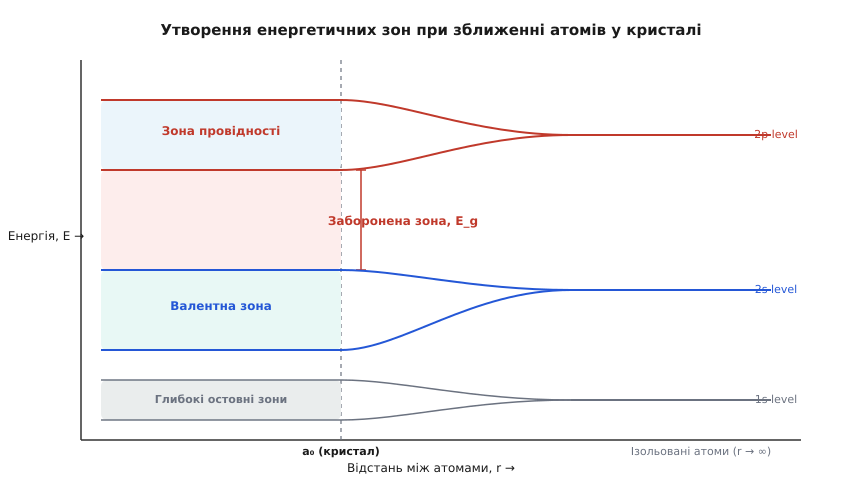
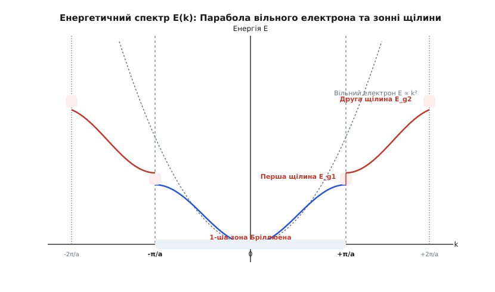
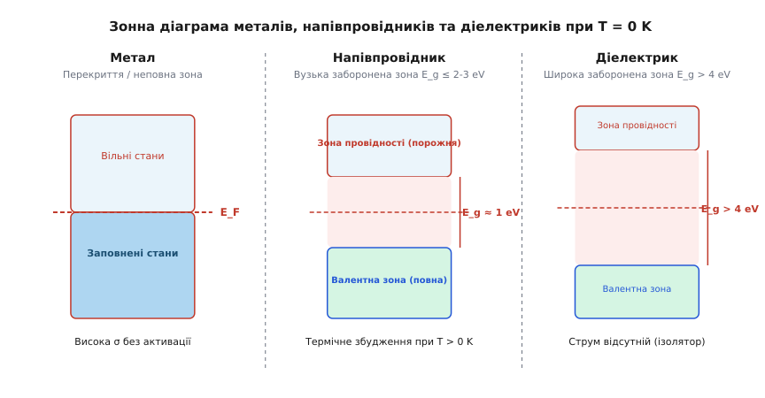
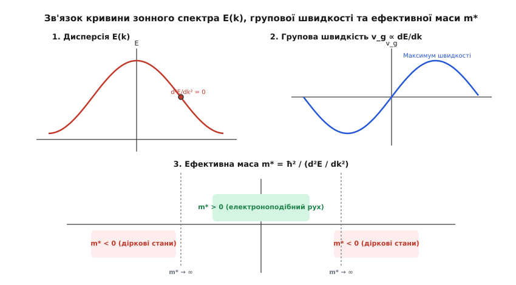

# Зонна теорія твердого тіла

<preknowlist>
- [Одновимірне стаціонарне рівняння Шредінгера](root:ph-quantum/stationary-schrodinger-equation) — хвильова функція та стаціонарні рівні енергії в потенціальному полі.
- [Принцип заборони Паулі](root:ph-quantum/pauli-exclusion) — ферміони не можуть займати один і той самий квантовий стан.
- [Квантове тунелювання](root:ph-quantum/quantum-tunnelling) — проходження частинки через потенціальний бар'єр.
- [Модель Друде](root:ph-condensed/drude-model) — класичне уявлення про газ вільних електронів та його межі.
</preknowlist>

Зіставлення двох звичайних речовин — кристалічної міді та діелектричного алмазу — виявляє глибоку фізичну загадку. Обидва кристали мають високу густину речовини та порівнянну концентрацію електронів порядку `10²³ см⁻³`. Проте мідь демонструє колосальну електропровідність, вільно пропускаючи електричний струм, тоді як алмаз є майже ідеальним прозорим ізолятором, питомий опір якого більший у `10²⁴` разів. Класична фізика, яка вважала всі валентні електрони однаковими вільними носіями заряду, виявилася принципово нездатною пояснити цю фундаментальну відмінність.

Розгадку дає зонна теорія твердого тіла — квантовомеханічне вчення про енергетичний спектр електронів, що рухаються у періодичному потенційному полі кристалічної ґратки. Вона доводить, що електричні, оптичні та магнітні властивості твердих тіл визначаються не просто наявністю електронів, а характером розподілу квантових станів за енергіями та ступенем заповнення цих станів згідно з принципом заборони Паулі. [Історія виникнення зонної теорії](root:ph-condensed/band-theory/hist-band-theory.md) показує, як відкрито прозорість кристала для електронних хвиль.

## Провал класичного наближення та квантовий парадокс провідності

У класичній моделі Друде — Зоммерфельда електрони у металі розглядалися як електронний газ, що рухається у внутрішньому просторі кристала з постійним потенціалом `V = 0`. Іони кристалічної ґратки вважалися жорсткими кулями, на яких електрони хаотично розсіюються, подібно до молекул газу.

Ця картина містила нездоланний парадокс. Експерименти при низьких температурах показують, що у надчистих монокристалах довжина вільного пробігу електронів `l` сягає кількох міліметрів, що відповідає проходженню понад `10⁶` міжатомних періодів ґратки без жодного зіткнення. З погляду класичної механіки електрон, який є точковою частинкою, обов'язково мав би врізатися у найближчий іон на відстані перших декількох ангстремів.

Квантова механіка усуває цей парадокс через корпускулярно-хвильовий дуалізм. Електрон у кристалі описується де Бройлівською хвилею, довжина якої `λ = h / p` є співмірною з міжатомною відстанню `a` (порядку `0.1–0.5 нм`). Коли хвиля поширюється у строго періодичній структурі іонів, відбиті від окремих атомів хвилі когерентно інтерферують.

У результаті цієї інтерференції **ідеальна періодична ґратка не викликає розсіяння електронної хвилі**. Хвиля вільно поширюється крізь кристал, а електричний опір виникає виключно на порушеннях періодичності — дефектах, домішках або теплових коливаннях іонів (фононах).

Проте періодичний потенціал іонів `V(r + R) = V(r)` докорінно змінює самий енергетичний спектр електрона: замість неперервної параболи вільного руху `E = ħ²k² / (2m)` виникає складна зонна структура з чергуванням дозволених та заборонених інтервалів енергії.

## Фізичний механізм формування енергетичних зон: метод LCAO та сильний зв'язок

Щоб зрозуміти, як виникає зонний спектр, розглянемо уявний експеримент: збирання кристала з `N` ізольованих атомів, які спочатку знаходяться на нескінченно великій відстані один від одного.

Коли атоми ізольовані, електрони кожного з них займають чітко визначені дискретні атомні рівні енергії (`1s, 2s, 2p, ...`), що є однаковими для всіх `N` атомів. Спіновий фактор та принцип Паулі дозволяють кожному такому стану містити строго визначену кількість електронів.

Коли атоми наближаються на рівноважну міжатомну відстань кристала `a₀`, електронні хмари (орбіталі) сусідніх атомів починають перекриватися. Внаслідок хвильової взаємодії та перекриття потенціальних ям виникає квантовомеханічна зсувна взаємодія:

1. **Розщеплення рівнів**: кожен дискретний атомний рівень розщеплюється на `N` близьких квантових станів, утворюючи енергетичний колектив системи.
2. **Формування зони**: оскільки кількість атомів у реальному кристалі макроскопічно велика (`N ≈ 10²³`), відстань між сусідніми розщепленими рівнями стає мізерно малою (`ΔE ≈ 10⁻²² еВ`). Сукупність цих `N` станів утворює квазінеперервну **дозволену енергетичну зону** (зона від грец. *ζώνη* — «пояс, смуга»).
3. **Заборонені зони**: між дозволеними зонами залишаються інтервали енергій, у яких немає жодного квантового стану. Ці інтервали називаються **забороненими енергетичними зонами** або зонними щілинами (bandgap, `E_g`).


*Залежність енергетичного спектра електронів від міжатомної відстані r. При зближенні ізольованих атомів до рівноважної відстані кристала a₀ дискретні рівні розщеплюються у дозволені енергетичні зони, розділені забороненими щілинами E_g.*

Величина розщеплення залежить від того, наскільки сильно перекриваються хвильові функції електронів сусідніх атомів:
- **Глибокі остовні електрони** (наприклад, `1s`-орбіталі внутрішніх оболонок) міцно зв'язані зі своїми ядрами, а їхні хвильові функції майже не перекриваються. Тому остовні рівні розщеплюються слабко і перетворюються на дуже вузькі зони.
- **Валентні електрони** зовнішніх оболонок мають великий радіус орбіталей та сильно перекриваються. Їхні рівні розщеплюються у широкі валентні зони шириною в кілька електронвольт (`2–10 еВ`).

### Квантовомеханічний розрахунок у наближенні сильного зв'язку (Tight-Binding)

Кількісний опис формування зон із атомних станів дає метод сильного зв'язку або лінійної комбінації атомних орбіталей (LCAO, Linear Combination of Atomic Orbitals). Нехай `φ(r - R_n)` — хвильова функція електрона на ізольованому атомі у вузлі `R_n`, яка задовольняє атомне рівняння Шредінгера `H_at · φ = E_at · φ`.

Хвильова функція електрона у кристалі шукається у вигляді блохівської суперпозиції атомних орбіталей:

```
ψ_k(r) = (1 / √N) · ∑_n e^(i · k · R_n) · φ(r - R_n)
```

Гамільтоніан кристала дорівнює сумі атомного гамільтоніана та додаткового періодичного потенціалу сусідніх вузлів: `H = H_at + ΔV(r)`.

Обчислимо середнє значення енергії стану `ψ_k(r)`:

```
⟨ψ_k | H | ψ_k⟩
= (1/N) · ∑_n ∑_m e^(i·k·(R_m - R_n)) · ⟨φ(r - R_n) | H_at + ΔV(r) | φ(r - R_m)⟩    [підстановка розкладу хвильової функції у базисі LCAO]
= E_at + ⟨φ(r) | ΔV(r) | φ(r)⟩ + ∑_(m ≠ n) e^(i·k·(R_m - R_n)) · ⟨φ(r - R_n) | ΔV(r) | φ(r - R_m)⟩ [виділення діагональних та недіагональних матричних елементів]
= ε₀ - ∑_(m ≠ n) e^(i·k·(R_m - R_n)) · t_(nm)                                      [введення кулонівського зсуву ε₀ та резонансних інтегралів перескоку t_(nm)]
```

де `ε₀ = E_at - α` — зсунута енергія атомного рівня під дією кристалічного поля сусідніх вузлів (`α = -∫ |φ(r)|² ΔV(r) dr > 0`), а `t_(nm) = -∫ φ*(r - R_n) ΔV(r) φ(r - R_m) dr` — **резонансний інтеграл перескоку (hopping integral)** між вузлами `n` та `m`.

Для одновимірного ланцюжка з періодом `a`, обмежуючись перескоками лише між найближчими сусідами (`R_m - R_n = ±a`, `t_(nm) = t`), отримуємо дисперсійне рівняння зонного спектра:

```
E(k)
= ε₀ - t · e^(i·k·a) - t · e^(-i·k·a)                                             [підстановка взаємодії з двома найближчими сусідніми вузлами]
= ε₀ - 2·t · cos(k·a)                                                            [перехід до тригонометричної форми через формулу Ейлера]
```

З цього виразу прямо випливає фундаментальний результат: дискретний атомний рівень `E_at` розгортається у неперервну синусоїдальну енергетичну зону з шириною `W`:

```
W = E_max - E_min = (ε₀ + 2·t) - (ε₀ - 2·t) = 4·t
```

Для тривимірної простої кубічної ґратки з координаційним числом `z = 6` дисперсійне співвідношення набуває вигляду:

```
E(k) = ε₀ - 2·t · [cos(k_x · a) + cos(k_y · a) + cos(k_z · a)]
```

Повна ширина дозволеної зони у тривимірному кристалі визначається координаційним числом `z` (кількістю найближчих сусідів) та інтегралом перекриття:

```
W = 2 · z · t
```

Цей висновок пояснює, чому валентні зони завжди ширші за зони остовних електронів: оскільки зовнішні валентні орбіталі перекриваються значно сильніше, інтеграл перескоку `t` для них становить кілька електронвольт, формуючи зони шириною `W ≈ 5–12 еВ`. Для остовних `1s`-орбіталей перекриття експоненціально мале (`t ≈ 10⁻⁴ еВ`), тому їхні зони практично вироджуються у нерозщеплені горизонтальні лінії.

### Формування зв'язуючих та антизв'язуючих молекулярних орбіталей

Фізична природа розщеплення стає наочною при розгляді найпростішої системи — двох зближених атомів (димера). 

Коли два однакові атоми з хвильовими функціями `φ_A` та `φ_B` зближуються, їхня взаємодія утворює дві молекулярні орбіталі:

1. **Симетрична (зв'язуюча) орбіталь `ψ_b = (1/√2) · (φ_A + φ_B)`**:
   Густина ймовірності `|ψ_b|² = (1/2) · (|φ_A|² + |φ_B|² + 2·φ_A·φ_B)` має додатний інтерференційний член між ядрами. Електронна густина концентрується між двома позитивними ядрами, ефективно екрануючи їхнє взаємне кулонівське відштовхування та забезпечуючи мінімум потенціальної енергії притягання. Енергія цього стану опускається нижче вихідного атомного рівня: `E_b = ε₀ - t`.

2. **Антисиметрична (антизв'язуюча) орбіталь `ψ_a = (1/√2) · (φ_A - φ_B)`**:
   Густина ймовірності `|ψ_a|² = (1/2) · (|φ_A|² + |φ_B|² - 2·φ_A·φ_B)` перетворюється на нуль у площині симетрії посередині між ядрами. Електрон виштовхується з міжатомного простору на периферію, оголюючи позитивні заряди ядер, що різко збільшує кулонівську енергію відштовхування. Енергія цього стану зростає: `E_a = ε₀ + t`.

При переході від двох атомів до макроскопічного ансамблю з `N` атомів дискретний дублет `{E_b, E_a}` розмножується на `N` квантових рівнів, заповнюючи весь інтервал між `ε₀ - 2·z·t` та `ε₀ + 2·z·t`.

## Теорема Блоха та геометрія квазіімпульсу

Математичним фундаментом зонної теорії є доведення того, які саме хвильові функції описують електрони у періодичному полі. Нехай `V(r)` — потенціальна енергія електрона у кристалі, що має просторову періодичність стосовно будь-якого вектора трансляції ґратки `R`:

```
V(r + R) = V(r)
```

Оператор трансляції `T_R`, дія якого на довільну функцію полягає в зсуві аргументу на вектор `R` (`T_R ψ(r) = ψ(r + R)`), комутує з гамільтоніаном системи `H = -[ħ²/(2m)]∇² + V(r)`:

```
[H, T_R] = H·T_R - T_R·H = 0
```

Оскільки оператори комутують, вони мають спільну систему власних функцій. Враховуючи умову нормування та властивість послідовних трансляцій `T_R1 · T_R2 = T_(R1+R2)`, власні значення оператора трансляції мають вигляд фазового множника `e^(i · k · R)`.

Звідси випливає **теорема Блоха**: власні функції рівняння Шредінгера для електрона в періодичному полі є блохівськими хвилями — плоскими хвилями, модульованими періодичною функцією ґратки `u_k(r)`:

```
ψ_k(r) = u_k(r) · e^(i · k · r)
```

де амплітудна функція `u_k(r)` має таку саму періодичність, як і кристалічна ґратка: `u_k(r + R) = u_k(r)`.

Вектор `k` називається **хвильовим вектором електрона у кристалі**, а величина `p = ħ·k` — **квазіімпульсом** (від лат. *quasi* — «майже, якби» та *impulsus* — «поштовх»).

### Чому квазіімпульс не є справжнім імпульсом

Відмінність між звичайним імпульсом і квазіімпульсом є фундаментальною:
1. **Звичайний імпульс** збережується внаслідок однорідності простору (неперервна трансляційна симетрія). У кристалі неперервна симетрія порушена і зведена до дискретної трансляційної симетрії. Тому справжній імпульс електрона у кристалі **не збережується** — електрон безперервно обмінюється імпульсом із ґраткою як цілим. При дії оператора імпульсу `p̂ = -i·ħ·∇` на блохівську хвилю маємо `p̂ ψ_k = ħ·k·ψ_k + e^(i·k·r)·(-i·ħ·∇ u_k(r)) ≠ \text{const} · ψ_k`, що підтверджує: блохівський стан не є власним станом звичайного імпульсу.
2. **Квазіімпульс** збережується з точністю до вектора оберненої ґратки `G`. Зсув хвильового вектора на вектор оберненої ґратки `k' = k + G` не змінює блохівську хвильову функцію, оскільки множник `e^(i · G · r)` можна включити в періодичну функцію `u_k(r)`.

Закони збереження при взаємодії частинок у кристалі записуються через квазіімпульси:

```
k₁ + k₂ = k₃ + G
```

Якщо вектор оберненої ґратки `G = 0`, такий процес називається **нормальним процесом (N-процесом)**. Якщо ж сумарний квазіімпульс виходить за межі першої зони Бріллюена і `G ≠ 0`, процес називається **процесом перекидання (U-процесом, від нім. Umklapp)**. Саме процеси перекидання відповідають за передачу надлишкового імпульсу всій ґратці та створюють скінченний тепловий і електричний опір при взаємодії носіїв.

### Граничні умови Борна — Кармана та дискретизація k-простору

Для макроскопічного кристала об'ємом `V = L₁ · L₂ · L₃`, що містить `N = N₁ · N₂ · N₃` елементарних комірок з базисними векторами трансляції `a₁, a₂, a₃`, накладаються періодичні граничні умови Борна — Кармана:

```
ψ(r + N_j · a_j) = ψ(r)       [j = 1, 2, 3]
```

Підставляючи блохівську функцію, отримуємо умову для хвильового вектора: `e^(i · N_j · k · a_j) = 1`, звідки випливає квантування хвильового вектора:

```
k = (n₁ / N₁) · b₁ + (n₂ / N₂) · b₂ + (n₃ / N₃) · b₃
```

де `n_j` — цілі числа, а `b_j` — базисні вектори оберненої ґратки, що задовольняють співвідношення ортогональності `a_i · b_j = 2π · δ_(ij)`.

Кожен квантовий стан займає у `k`-просторі елементарний фазовий об'єм:

```
Δk_vol = (2π / L₁) · (2π / L₂) · (2π / L₃) = (2π)³ / V
```

Відповідно, кількість дозволених значень `k` у межах першої зони Бріллюена строго дорівнює кількості елементарних комірок `N` у кристалі. З урахуванням двох можливих проєкцій спіну електрона (`s = ±1/2`), **кожна дозволена енергетична зона вміщує рівно `2·N` електронів**.

Повний математичний розв'язок рівняння Шредінгера для одновимірного періодичного потенціалу детально виведено у вставці [Математична модель Кроніґа — Пенні](root:ph-condensed/band-theory/math-kronig-penney.md).

## Зони Бріллюена та схеми представлення зонного спектра

Оскільки стани з векторами `k` та `k + G` є фізично тотожними, вектор `k` достатньо розглядати лише у межах однієї комірки оберненої ґратки.

**Перша зона Бріллюена (1BZ)** — це комірка Вігнера — Зайтца оберненої ґратки, тобто область простору квазіімпульсів, яка лежить ближче до початку координат `k = 0`, ніж до будь-якого іншого вузла оберненої ґратки.

Для одновимірного ланцюжка з періодом `a` перша зона Бріллюена відповідає симетричному інтервалу:

```
-π/a ≤ k ≤ +π/a
```

### Схеми зонного спектра

Для зображення зонного спектра кристала використовують три еквівалентні графічні схеми:

1. **Розгорнута схема зон (Extended zone scheme)**:
   Кожна наступна енергетична зона зображується у відповідній за номером зоні Бріллюена. Перша зона займає `[-π/a, +π/a]`, друга — інтервали `[-2π/a, -π/a]` та `[+π/a, +2π/a]`, третя — `[-3π/a, -2π/a]` та `[+2π/a, +3π/a]`. Ця схема найзручніша для зіставлення зонного спектра зі спектром вільного електрона `E = ħ²k²/(2m)`.

2. **Приведена схема зон (Reduced zone scheme)**:
   Усі енергетичні зони за допомогою векторів оберненої ґратки `G` зсуваються (транслюються) всередину першої зони Бріллюена `[-π/a, +π/a]`. Спектр описується сукупністю гілок `E_n(k)`, де `n = 1, 2, 3, ...` — номер зони (зонний індекс). Це стандартне представлення у фізиці твердого тіла.

3. **Повторювана схема зон (Periodic / repeated zone scheme)**:
   Приведена схема зон періодично розмножується вздовж усього нескінченного `k`-простору з періодом `G = 2π/a`. Вона найбільш наочно демонструє рух електронів під дією зовнішніх полів та проходження частинкою меж зон.

### Високосиметричні точки зон Бріллюена реальних ґраток

У тривимірних кристалах перша зона Бріллюена являє собою опуклий багатогранник. Властивості кристала визначаються поведінкою зонного спектра вздовж спеціальних високосиметричних напрямків та в особливих точках зони:

1. **Центр зони Бріллюена (`k = 0`)** позначається грецькою літерою **`Γ` (Гамма)** у всіх типах кристалічних ґраток.
2. **Гранецентрована кубічна ґратка (ГЦК / FCC: кремній, германій, GaAs, алюміній, мідь)**:
   Перша зона Бріллюена є зрізаним октаедром (14 граней: 8 шестикутних та 6 квадратних).
   - Точка `X`: центр квадратної грані на межі зони вздовж осі `⟨100⟩`, координати `(2π/a) · (1, 0, 0)`.
   - Точка `L`: центр шестикутної грані вздовж осі `⟨111⟩`, координати `(2π/a) · (1/2, 1/2, 1/2)`.
   - Точка `W`: кутова вершина перетину квадратних та шестикутних граней, координати `(2π/a) · (1, 1/2, 0)`.
   - Точка `K` зони ГЦК: середина ребра між двома шестикутними гранями, координати `(2π/a) · (3/4, 3/4, 0)`.
3. **Об'ємноцентрована кубічна ґратка (ОЦК / BCC: залізо, вольфрам, натрій)**:
   Зона Бріллюена являє собою ромбододекаедр (12 ромбічних граней).
   - Точка `H`: вершина сходження 4 граней вздовж `⟨100⟩`, координати `(2π/a) · (0, 1, 0)`.
   - Точка `P`: вершина сходження 3 граней вздовж `⟨111⟩`, координати `(2π/a) · (1/2, 1/2, 1/2)`.
   - Точка `N`: центр ромбічної грані вздовж `⟨110⟩`, координати `(2π/a) · (1/2, 1/2, 0)`.
4. **Гексагональна щільноупакована ґратка (ГЩУ / HCP, графен, нітрид галію GaN)**:
   Зона Бріллюена має форму прямої шестикутної призми.
   - Вершина шестикутної основи призми позначається як точка `K` (координати `(4π / (3a), 0, 0)`).
   - Точка `M`: середина прямокутної бічної грані призми, координати `(0, 2π / (√3·a), 0)`.
   - Точка `A`: центр верхньої шестикутної грані вздовж осі `c`, координати `(0, 0, π/c)`.

## Модель майже вільних електронів (NFE): дифракція Бреґґа та утворення забороненої зони

Щоб отримати наочне фізичне уявлення про те, чому саме на межах зон Бріллюена утворюються заборонені енергетичні щілини, скористаємося **моделлю майже вільних електронів (NFE, Nearly Free Electrons)**.

Розглянемо електрон, який вільно рухається вздовж одновимірного кристала з періодичним потенціалом, що є слабким збуренням: `V(x) = ∑_G V_G · e^(i·G·x)`. 

Коли хвильовий вектор електрона віддалений від меж зони Бріллюена, його хвильова функція є майже чистою плоскою хвилею `e^(i·k·x)`, а енергія описується параболою `E ≈ ħ²k² / (2m)`.

Проте коли хвильовий вектор `k` наближається до межі першої зони Бріллюена `k = ±π/a`, довжина хвилі де Бройля дорівнює `λ = 2π / k = 2a`.

Ця умова збігається з **умовою дифракції Бреґґа** для відбиття хвилі від періодичної системи площин ґратки: хвиля, що біжить праворуч `e^(i·(π/a)·x)`, піддається бреґґівському відбиттю і породжує однакову за амплітудою хвилю, що біжить ліворуч `e^(-i·(π/a)·x)`.

Інтерференція цих двох зустрічних хвиль утворює не падаючу біжучу хвилю, а **дві можливі стоячі хвилі**:

1. **Симетрична стояча хвиля `ψ₊`**:
   ```
   ψ₊(x) = (1/√a) · [e^(i·(π/a)·x) + e^(-i·(π/a)·x)] = √(2/a) · cos(π·x / a)
   ```
   Густина ймовірності виявлення електрона для цього стану дорівнює:
   ```
   |ψ₊(x)|² = (2/a) · cos²(π·x / a)
   ```
   Ця функція має максимуми у точках `x = 0, ±a, ±2a, ...`, тобто **безпосередньо на позитивних іонах ґратки**. Оскільки негативний електрон локалізується поблизу позитивних ядер, його середня потенціальна енергія притягання є мінімальною (нижчий рівень).

2. **Антисиметрична стояча хвиля `ψ₋`**:
   ```
   ψ₋(x) = (i/√a) · [e^(i·(π/a)·x) - e^(-i·(π/a)·x)] = -√(2/a) · sin(π·x / a)
   ```
   Густина ймовірності для цього стану дорівнює:
   ```
   |ψ₋(x)|² = (2/a) · sin²(π·x / a)
   ```
   Ця функція має максимуми у точках `x = ±a/2, ±3a/2, ...`, тобто **у міжвузлях, посередині між іонами**. Електрон віддалений від позитивних ядер, тому його потенціальна енергія є вищою (вищий рівень).


*Дисперсійне співвідношення E(k) для електронів у періодичному полі. На межах зон Бріллюена (k = ±π/a, ±2π/a) виникають розриви неперервності спектра та розщеплення енергій на дозволені зони і заборонені щілини E_g.*

### Кількісний вивід забороненої щілини з теорії збурень

Математично розщеплення на межі зони отримується розв'язанням світського (характеристичного) рівняння для двох вироджених станів `|k⟩` та `|k - G⟩`. При `k = G/2 = π/a` незбурені енергії цих станів збігаються: `E₀(G/2) = E₀(-G/2) = ħ²·(G/2)² / (2m)`.

Світський визначник для змішування двох хвиль має вигляд:

```
| E₀(k) - E     V_G    |
| V_G*     E₀(k-G) - E | = 0
```

Розкриваючи визначник, отримуємо точний аналітичний розв'язок для енергетичних гілок:

```
(E₀(k) - E)·(E₀(k - G) - E) - |V_G|² = 0                                         [розкриття матричного визначника 2×2]
E² - [E₀(k) + E₀(k-G)]·E + E₀(k)·E₀(k-G) - |V_G|² = 0                           [зведення до квадратного рівняння відносно енергії E]
E_±(k) = (1/2)·[E₀(k) + E₀(k-G)] ± √[(1/4)·(E₀(k) - E₀(k-G))² + |V_G|²]         [знаходження коренів квадратного рівняння]
```

Підставляючи значення точно на межі зони Бріллюена `k = G/2`, де `E₀(k) = E₀(k-G)`, знаходимо величини розщеплених рівнів:

```
E_+(G/2) = E₀(G/2) + |V_G|                                                       [верхній енергетичний край забороненої зони]
E_-(G/2) = E₀(G/2) - |V_G|                                                       [нижній енергетичний край забороненої зони]
E_g = E_+(G/2) - E_-(G/2) = 2 · |V_G|                                            [величина забороненої енергетичної щілини]
```

### Теорія псевдопотенціалу та ортогоналізація

Виникає фундаментальне питання: чому наближення майже вільних електронів настільки точно описує валентні електрони металів, якщо справжній кулонівський потенціал атомного ядра `V(r) = -Z·e² / (4π·ε₀·r)` поблизу центру є надзвичайно глибоким і сингулярним?

Розв'язок дає **теорема компенсації Філліпса — Клейнмана** у теорії псевдопотенціалу.

Хвильова функція валентного електрона `|ψ_v⟩` повинна бути строго ортогональною до хвильових функцій усіх глибоких остовних станів `|ψ_c⟩` того самого іона (`⟨ψ_c | ψ_v⟩ = 0`).

Представимо валентну хвильову функцію у вигляді псевдохвильової функції `|φ_v⟩`, із якої вилучено остовні компоненти:

```
|ψ_v⟩ = |φ_v⟩ - ∑_c |ψ_c⟩ · ⟨ψ_c | φ_v⟩
```

Підставляючи цей вираз у стаціонарне рівняння Шредінгера `H |ψ_v⟩ = E_v |ψ_v⟩`, отримуємо ефективне рівняння для гладкої псевдохвильової функції:

```
[ -(ħ² / (2m_e))·∇² + V_pseudo(r) ] |φ_v⟩ = E_v |φ_v⟩
```

де **псевдопотенціал (pseudopotential)** дорівнює:

```
V_pseudo(r) = V_Coulomb(r) + ∑_c (E_v - E_c) · |ψ_c⟩⟨ψ_c|
```

Оскільки енергія валентного електрона `E_v` завжди вища за енергію зв'язаних остовних рівнів `E_c` (`E_v - E_c > 0`), другий доданок є **потужним відштовхувальним квантовим потенціалом Паулі**.

У внутрішній області іонного остова відштовхувальний потенціал майже точно компенсує сильне кулонівське притягання ядра. 

У результаті результуючий псевдопотенціал `V_pseudo(r)` виявляється дуже слабким і неглибоким у всьому просторі кристала, що повністю виправдовує використання теорії збурень та наближення майже вільних електронів.

## Класифікація матеріалів: метали, напівпровідники та діелектрики

Зонна теорія дає вичерпне квантове пояснення ділення всіх твердих тіл на макроскопічні класи за електричною провідністю. Заповнення дозволених зон електронами відбувається при `T = 0 K` послідовно від найнижчих енергій до рівня **енергії Фермі `E_F`** відповідно до розподілу Фермі — Дірака та принципу заборони Паулі:

```
f(E) = 1 / [e^((E - E_F) / (k_B · T)) + 1]
```

Залежно від взаємного розташування рівня Фермі та дозволених зон, речовини поділяються на чотири основні класи: метали, напівпровідники, діелектрики та напівметали.


*Розподіл заповнення енергетичних зон електронами у металах, напівпровідниках та діелектриках при температурі T = 0 K. Штриховою лінією позначено рівень Фермі E_F.*

### 1. Метали

Металевий стан реалізується у двох фундаментальних випадках:
- **Частково заповнена зона**: найвища дозволена зона, що містить електрони, заповнена лише частково. Рівень Фермі `E_F` проходить безпосередньо всередині цієї зони.
  Прикладом є одновалентні лужні метали (`Li, Na, K, Rb, Cs` з конфігурацією `s¹`) та благородні метали (`Cu, Ag, Au` з `(n-1)d¹⁰ ns¹`). У цих матеріалах зона заповнена рівно наполовину.
- **Перекриття зон**: верхня заповнена зона та наступна порожня зона просторово та енергетично перекриваються в оберненому просторі, створюючи спільну неповну зону.
  Прикладом є двовалентні лужноземельні метали (`Be, Mg, Ca, Sr, Ba` з конфігурацією `ns²`). Хоча `s`-зона формально заповнена двома електронами на атом, вона перекривається з незаповненою вищою `p`-зоною, утворюючи відкриту поверхню Фермі.

Оскільки безпосередньо над рівнем Фермі у металах знаходяться вільні квантові стани, розділені нескінченно малою енергією `δE ≈ 10⁻²² еВ`, навіть найслабше зовнішнє електричне поле переводить електрони у вищі енергетичні стани, викликаючи впорядкований дрейф носіїв. Метали мають високу провідність `σ ≈ 10⁴–10⁶ Ом⁻¹·см⁻¹`, яка не потребує термічної активації, а опір металів лінійно зростає з температурою внаслідок розсіяння електронів на фононах.

### 2. Діелектрики (Ізолятори)

У діелектриках при `T = 0 K` найвища дозволена зона, що містить електрони (**валентна зона**), заповнена повністю, а наступна вища зона (**зона провідності**) є абсолютно порожньою. Вони відокремлені широкою забороненою зоною (`E_g > 4–5 еВ`, наприклад, у алмазу `E_g = 5.47 еВ`, у кварцу `SiO₂` — `9.0 еВ`, у корунду `Al₂O₃` — `8.8 еВ`, у хлориду натрію `NaCl` — `8.5 еВ`).

Повністю заповнена зона не може давати внеску в електричний струм: під дією зовнішнього поля кількість електронів, що рухаються у напрямку поля та проти нього, залишається суворо однаковою через відсутність вільних станів для переходу (будь-який стан заповнений рівно двома електронами з протилежними спінами).

Для виклику струму електрон має загартувати енергію, не меншу за `E_g`, щоб стрибнути через зонну щілину у зону провідності. Власна концентрація термічно збуджених носіїв у нелегованому кристалі описується законом:

```
n_i = √(N_c · N_v) · e^(-E_g / (2 · k_B · T))
```

При кімнатній температурі (`k_B·T ≈ 0.0259 еВ`) експоненційний фактор `exp[-E_g / (2·k_B·T)]` для алмазу становить фантастично малу величину порядку `10⁻⁴⁶`. Концентрація вільних електронів у алмазі становить менш як один електрон на кубічний кілометр речовини, що робить діелектрики ідеальними ізоляторами з питомим опором `ρ > 10¹⁶–10²⁰ Ом·см`.

### 3. Напівпровідники

Напівпровідники мають зонну структуру, якісно аналогічну діелектрикам: при `T = 0 K` валентна зона повністю заповнена, зона провідності порожня, а рівень Фермі розташований посередині забороненої зони.

Головна відмінність полягає у **помірній ширині забороненої зони** (`0.1 еВ < E_g ≤ 3–4 еВ`). При кімнатній температурі `300 K` ширина щілини кремнію `Si` становить `1.12 еВ`, германію `Ge` — `0.67 еВ`, арсеніду галію `GaAs` — `1.42 еВ`, антимоніду індію `InSb` — `0.17 еВ`, карбіду кремнію `4H-SiC` — `3.26 еВ`, нітриду галію `GaN` — `3.4 еВ`.

Завдяки помірній щілині при `T > 0 K` частина електронів з верхніх станів валентної зони дістає достатню теплову енергію `k_B·T` і переходить у зону провідності. У результаті виникає два типи носіїв струму:
- **Електрони провідності** у зоні провідності (концентрація `n`).
- **Дірки** — вакантні квантові стани, що залишилися у валентній зоні (концентрація `p`).

На відміну від металів, електрична провідність власних напівпровідників експоненціально зростає зі зростанням температури за законом `σ(T) ∝ exp[-E_g / (2·k_B·T)]`.

### 4. Напівметали

Окремий унікальний клас твердих тіл утворюють **напівметали (semimetals)**. У напівметалах дно зони провідності лежить дещо нижче вершини валентної зони, але ці екстремуми розташовані у різних точках зони Бріллюена (непряме перекриття зон на кілька десятків міліелектронвольт). 

До напівметалів належать вісмут (`Bi`), стибій (`Sb`), миш'як (`As`), графіт та сіре олово (`α-Sn`).

У вісмуті, наприклад, максимум валентної зони знаходиться в `T`-точці зони Бріллюена, а мінімуми зони провідності — у трьох еквівалентних `L`-точках. Величина енергетичного перекриття зон становить близько `38 меВ`. 

Через це перекриття частина електронів стікає з верхівки валентної зони на дно зони провідності навіть при абсолютному нулі температури `T = 0 K`. У кристалі виникають однакові концентрації електронів та дірок (`n = p ≈ 3·10¹⁷ см⁻³` у вісмуті, `n = p ≈ 3·10¹⁸ см⁻³` у графіті). 

Хоча концентрація носіїв у напівметалах у `10⁴–10⁵` разів менша, ніж у звичайних металів, вони мають надзвичайно високу рухливість носіїв і демонструють яскраво виражені квантові магнітотранспортні явища.

## Густина квантових станів D(E) та особливості Ван Хова

Для визначення термодинамічних та кінетичних властивостей системи принципове значення має не лише дисперсія `E(k)`, але й **густина квантових станів `D(E)`** — кількість доступних квантових станів в інтервалі енергій від `E` до `E + dE` на одиницю об'єму матеріалу.

Математично густина станів обчислюється як інтеграл за ізоенергетичною поверхнею у `k`-просторі:

```
D(E) = [2 / (2π)ᵈ] · ∫ [ dS_k / |∇_k E(k)| ]
```

де `d` — розмірність простору (`d = 1, 2, 3`), множник `2` враховує виродження за спіном електрона, а `dS_k` — елемент площі ізоенергетичної поверхні `E(k) = E`.

### Розмірна залежність густини станів: 3D, 2D, 1D та 0D

Характер залежності `D(E)` фундаментально залежить від просторової розмірності системи:

1. **Тривимірний масивний кристал (3D)**:
   Для ізотропної параболічної зони `E = E_c + ħ²k² / (2m*)` ізоенергетичні поверхні є сферами радіуса `k = √[2m*(E - E_c)] / ħ`.
   Кількість станів усередині сфери об'ємом `(4/3)·π·k³` дорівнює:
   ```
   N_3D(E) = 2 · [V / (2π)³] · (4/3)·π·k³ = [V / (3π²)] · [2m*·(E - E_c) / ħ²]^(3/2) [повна кількість станів з енергією, меншою за E]
   D_3D(E) = (1/V) · (dN_3D / dE)                                                   [диференціювання кількості станів за енергією]
   = [1 / (2π²)] · (2m* / ħ²)^(3/2) · √(E - E_c)                                    [коренева залежність тривимірної густини станів]
   ```

2. **Двовимірний квантовий шар (2D, квантова яма)**:
   При обмеженні руху електрона вздовж осі `z` товщиною `L_z` енергія квантується на підзони розмірного квантування `E_n = ħ²·π²·n² / (2m*·L_z²)`. Для кожної підзони густина станів є константою:
   ```
   D_2D(E) = [m* / (π·ħ²)] · ∑_n θ(E - E_n)
   ```
   де `θ(x)` — сходинкова функція Гевісайда. Густина станів має вигляд драбини зі сходинками висотою `m* / (π·ħ²)`.

3. **Одновимірний квантовий дріт (1D, нанонитка)**:
   При квантуванні руху у двох напрямках густина станів має сингулярний обернено-кореневий характер на дні кожної підзони:
   ```
   D_1D(E) = [1 / (π·ħ)] · √(m* / 2) · ∑_n [ 1 / √(E - E_n) ] · θ(E - E_n)
   ```

4. **Нульвимірна квантова точка (0D, штучний атом)**:
   Рух квантований у всіх трьох просторових напрямках, тому неперервний спектр повністю зникає, перетворюючись на набір дискретних дельта-функціональних піків:
   ```
   D_0D(E) = 2 · ∑_n δ(E - E_n)
   ```

### Особливості Ван Хова та міжзонні оптичні переходи

Особливі точки у `k`-просторі, де градієнт енергії перетворюється на нуль (`∇_k E(k) = 0`), називаються **критичними точками** або **особливостями Ван Хова (Van Hove singularities)**. Оскільки знаменник у формулі для `D(E)` прямує до нуля, похідна `dD/dE` або сама густина станів зазнає математичного зламу чи сингулярності.

У тривимірному кристалі існує 4 топологічні типи критичних точок Ван Хова:
- **`M₀` (локальний мінімум)**: усі три кривини додатні (`∂²E/∂k_i² > 0`). Густина станів має вигляд `D(E) ∝ √(E - E₀) · θ(E - E₀)` (стандартне дно зони).
- **`M₁` (сідлова точка першого типу)**: дві кривини додатні, одна від'ємна (`+ + -`). Густина станів має спадний корінь нижче порогу: `D(E) = D₀ - C · √(E₀ - E) · θ(E₀ - E)`.
- **`M₂` (сідлова точка другого типу)**: одна кривина додатна, дві від'ємні (`+ - -`). Густина станів має висхідний корінь вище порогу: `D(E) = D₀ - C · √(E - E₀) · θ(E - E₀)`.
- **`M₃` (локальний максимум)**: усі три кривини від'ємні (`∂²E/∂k_i² < 0`). Густина станів спадає як `D(E) ∝ √(E₀ - E) · θ(E₀ - E)` (вершина зони).

Особливості Ван Хова визначають оптичні властивості матеріалу. Спільна густина станів (Joint Density of States, JDOS) для оптичних міжзонних переходів між валентною зоною `v` та зоною провідності `c` задається формулою:

```
JDOS(ħ·ω) = [2 / (2π)³] · ∫ [ dS_k / |∇_k (E_c(k) - E_v(k))| ]
```

Уявна частина діелектричної проникності `ε₂(ω)`, що описує фундаментальне оптичне поглинання, прямо пропорційна спільній густині станів: `ε₂(ω) ∝ (1/ω²) · |M_(cv)|² · JDOS(ħ·ω)`. 

Критичні точки, де `∇_k E_c(k) = ∇_k E_v(k)` (паралельні зонні поверхні), породжують різкі резонансні піки та злами в спектрах оптичного відбиття й спектроскопічної еліпсометрії (переходи `E₀, E₀+Δ₀, E₁, E₁+Δ₁, E₂` у спектрах кремнію, германію та GaAs).

## Динаміка електрона у ґратці та ефективна маса

Коли на електрон у кристалі діє зовнішнє електричне поле `E_ext` або магнітне поле `B`, його рух описується динамікою квантового хвильового пакета, складеного з блохівських хвиль з близькими значеннями хвильового вектора навколо середнього значення `k`.

Групова швидкість хвильового пакета `v_g` дорівнює градієнту енергії у `k`-просторі:

```
v_g = (1/ħ) · ∇_k E(k)
```

Для одновимірного руху групова швидкість визначається першою похідною: `v_g = (1/ħ) · (dE / dk)`.

Під дією зовнішньої сили `F_ext = q · (E_ext + v_g × B)` зміна квазіімпульсу описується квантовим аналогом другого закону Ньютона:

```
ħ · (dk / dt) = F_ext
```

Диференціюючи групову швидкість за часом, отримуємо прискорення хвильового пакета:

```
a = dv_g / dt = (1/ħ) · d/dt (dE / dk) = (1/ħ) · (d²E / dk²) · (dk / dt)           [диференціювання групової швидкості за часом]
= (1/ħ²) · (d²E / dk²) · F_ext                                                   [підстановка рівняння руху для квазіімпульсу ħ·dk/dt = F_ext]
= F_ext / m*                                                                     [визначення ефективної маси за аналогією з другим законом Ньютона]
```

Звідси отримуємо фундаментальну **формулу ефективної маси**:

```
m* = ħ² / (d²E / dk²)
```

У тривимірному анізотропному кристалі ефективна маса стає симетричним тензором другого рангу — **тензором оберненої ефективної маси**:

```
(m*⁻¹)_(ij) = (1/ħ²) · (∂²E / ∂k_i ∂k_j)
```


*Співвідношення між дисперсійною кривою E(k), груповою швидкістю електрона v_g та його ефективною масою m*. Зміна знака кривини вгорі зони призводить до від'ємних ефективних мас і виникнення діркових станів.*

### Фізичний зміст та аномалії ефективної маси

Ефективна маса `m*` — це не зміна справжньої маси спокою електрона `m_e`, а параметр, що повністю інкапсулює внутрішні квантові сили взаємодії електрона з періодичним потенціалом іонів ґратки `F_lat = ⟨-∇V(r)⟩`:

```
m_e · a = F_ext + F_lat   ⇒   m* · a = F_ext
```

Кривина дисперсійної кривої `E(k)` задає характер реакції електрона на зовнішнє поле:

1. **Біля дна зони провідності**: кривина є додатною (`d²E/dk² > 0`), тому `m* > 0`. Електрон прискорюється у напрямку дії сили, але його маса може бути у десятки разів меншою за масу вільного електрона завдяки сильній взаємодії з ґраткою (в арсеніді галію `GaAs` `m* ≈ 0.067 · m_e`, в антимоніді індію `InSb` `m* ≈ 0.014 · m_e`).
2. **У точці інфлексії зони**: кривина дорівнює нулю (`d²E/dk² = 0`), тому ефективна маса прямує до нескінченності `m* → ∞`. Зовнішнє поле взагалі не прискорює електрон, оскільки сила поля повністю компенсується квантовим блокуванням ґратки.
3. **Біля верху валентної зони**: кривина є від'ємною (`d²E/dk² < 0`), тому ефективна маса електрона стає **від'ємною** (`m* < 0`). При дії зовнішньої сили бреґґівське відбиття від площин ґратки передає електрону імпульс у протилежний бік, прискорюючи його проти прикладеної сили!

### Квазікласичний рух у магнітному полі та орбіти Ландау

У постійному магнітному полі `B` сила Лоренца діє перпендикулярно до швидкості: `ħ · (dk/dt) = -e · (v_g × B)`. 

Це означає, що енергія електрона залишається постійною (`dE/dt = ∇_k E · dk/dt = 0`), а проєкція хвильового вектора вздовж магнітного поля `k_z` зберігається.

Траєкторія руху електрона у `k`-просторі є лінією перетину ізоенергетичної поверхні `E(k) = \text{const}` площиною, перпендикулярною до вектора магнітного поля `B` (`k_z = \text{const}`).

Електрон обертається по циклотронній орбіті з **циклотронною частотою**:

```
ω_c = e · B / m_c*
```

де циклотроння ефективна маса `m_c*` визначається швидкістю зміни площі орбіти `S(E)` у `k`-просторі за енергією:

```
m_c* = (ħ² / 2π) · (∂S(E) / ∂E)_(k_z)
```

### Концепція дірок

Рух майже заповненої валентної зони з електронами від'ємної ефективної маси математично й фізично еквівалентний руху кількох фіктивних квазічастинок з позитивним електричним зарядом та додатною масою.

Нехай у валентній зоні відсутній один електрон у квантовому стані з хвильовим вектором `k_e` та енергією `E_e(k_e)`.

Сумарний електричний струм такої зони дорівнює:

```
J = -e · ∑_(k ≠ k_e) v(k) = -e · [ ∑_(all k) v(k) - v(k_e) ] = -e · [ 0 - v(k_e) ] = +e · v(k_e)
```

Цей вакантний стан поводиться як квазічастинка — **дірка (hole)**, яка має:
- Електричний заряд: `q_h = +e`
- Хвильовий вектор: `k_h = -k_e`
- Енергію: `E_h(k_h) = -E_e(k_e)` (відлічується вниз від верхівки валентної зони)
- Додатну ефективну масу: `m_h* = -m_e* = -ħ² / [d²E_e / dk²] > 0`

Введення дірок кардинально спрощує аналіз напівпровідників: замість відстеження `10²³` електронів у майже заповненій валентній зоні достатньо розрахувати динаміку кількох вільних позитивних дірок.

## Прямі та непрямі міжзонні переходи

За взаємним розташуванням мінімуму зони провідності та максимуму валентної зони у просторі квазіімпульсів всі напівпровідники поділяються на дві фундаментальні групи:

```
Прямозонний напівпровідник (GaAs, InP, GaN):    k_min(E_c) = k_max(E_v) = 0   (Г-точка)
Непрямозонний напівпровідник (Si, Ge, GaP):     k_min(E_c) ≠ k_max(E_v)
```

### 1. Прямозонні напівпровідники

У прямозонних матеріалах (арсенід галію `GaAs`, фосфід індію `InP`, нітрид галію `GaN`, антимонід індію `InAs`, телурид кадмію `CdTe`) найглибший мінімум зони провідності та найвища точка валентної зони розташовані в одній і тій самій точці простору квазіімпульсів (у центрі зони Бріллюена `k = 0`, `Γ`-точка).

Фотон з енергією `h·ν ≥ E_g` має хвильовий вектор `q_phot = 2π/λ ≈ 10⁵ см⁻¹`, що є мізерно малим порівняно з розміром першої зони Бріллюена `π/a ≈ 10⁸ см⁻¹` (`q_phot ≪ π/a`).

Тому оптичний перехід електрона у `k`-просторі є строго **вертикальним** (`k_final ≈ k_initial`), зберігаючи квазіімпульс частинки.

Коефіцієнт оптичного поглинання прямозонного напівпровідника поблизу краю фундаментальної смуги описується кореневим законом:

```
α_dir(h·ν) = A_dir · √(h·ν - E_g) · θ(h·ν - E_g)
```

Оптичне поглинання наростає дуже стрімко, досягаючи величин `α ≈ 10⁴–10⁵ см⁻¹` вже при перевищенні енергії фотона на `0.1 еВ` над `E_g`. Це означає, що світло повністю поглинається в найтоншому шарі товщиною лише `1–2 мкм`.

Час життя випромінювальної рекомбінації електрона й дірки в прямозонних напівпровідниках надзвичайно малий (`τ_rad ≈ 1–10 нс`), а квантовий вихід випромінювання наближається до 100%. Саме прямозонні напівпровідники є основою для світлодіодів (LED), напівпровідникових лазерів, лазерних діодів VCSEL та високошвидкісних оптоелектронних модуляторів.

### 2. Непрямозонні напівпровідники

У непрямозонних напівпровідниках максимум валентної зони знаходиться в центрі зони Бріллюена (`k = 0`, `Γ`), тоді як абсолютний мінімум зони провідності зміщений на периферію зони:
- У кремнію `Si`: 6 еквівалентних мінімумів розташовані вздовж напрямків `⟨100⟩` на відстані `k_min ≈ 0.85 · (2π/a)`.
- У германію `Ge`: 4 мінімуми розташовані на межі зони Бріллюена в `L`-точках вздовж напрямків `⟨111⟩`.
- У фосфіду галію `GaP`: мінімуми розташовані в `X`-точках.

Прямий оптичний перехід з випромінюванням або поглинанням лише фотона з найнижчого стану провідності у валентну зону суворо заборонений законом збереження квазіімпульсу (`Δk = k_c - k_v ≠ 0`).

Міжзонний перехід можливий лише як **процес другого порядку теорії збурень**, у якому одночасно беруть участь три квазічастинки: електрон, фотон (який передає енергію `h·ν`) та **фонон** (квант коливань ґратки), який передає або забирає необхідний імпульс `q_phon = ±(k_c - k_v)`.

Закони збереження для непрямого переходу мають вигляд:

```
h·ν = E_g ± ħ·Ω_phon                                                             [закон збереження енергії: + поглинання фонона, - випускання]
k_final = k_initial + q_phot ± q_phon ≈ k_initial ± q_phon                       [закон збереження квазіімпульсу з точністю до фононного імпульсу]
```

Коефіцієнт поглинання непрямозонного напівпровідника складається з двох компонент (поглинання та випускання фонона з енергією `ħ·Ω_phon`):

```
α_indir(h·ν)
= A_abs · [ (h·ν - E_g + ħ·Ω_phon)² / (e^(ħ·Ω_phon / (k_B·T)) - 1) ] · θ(h·ν - E_g + ħ·Ω_phon)
+ A_em  · [ (h·ν - E_g - ħ·Ω_phon)² / (1 - e^(-ħ·Ω_phon / (k_B·T))) ] · θ(h·ν - E_g - ħ·Ω_phon)
```

Оскільки тричастинковий процес вимагає одночасного квантового зіткнення і має малу ймовірність, поглинання поблизу краю наростає плавно за квадратичним законом (`α ≈ 10²–10³ см⁻¹`). Для повного поглинання сонячного світла кремнієвим фотоелементам потрібні пластини товщиною `150–300 мкм` (у 100 разів товщі, ніж для прямозонного GaAs).

Час життя випромінювальної рекомбінації у непрямозонному кремнії є гігантським і становить `τ_rad ≈ 1–10 мс`. За цей час нерівноважні носії майже гарантовано рекомбінують безвипромінювально на дефектах (рекомбінація Шоклі — Ріда — Холла) або через тричастинкову Оже-рекомбінацію. Через це кремній є вкрай неефективним джерелом світла, що обумовлює необхідність використання гетероструктур на основі `A^III B^V` сполук у волоконній оптиці.

### Екситони та екситонні спектри поглинання

При оптичному збудженні електрон, переведений у зону провідності, та залишена у валентній зоні дірка відчувають взаємне кулонівське притягання. Вони можуть утворювати електрично нейтральний зв'язаний квантовий стан — **екситон (exciton)**.

Існує два граничні типи екситонів:

1. **Екситони Ванньє — Мотта (Wannier — Mott excitons)**:
   Характерні для напівпровідників із високою діелектричною проникністю (`ε_r ≈ 10–16`) та малими ефективними масами. Кулонівське поле сильно екранується, тому радіус екситона у багато разів перевищує сталу ґратки:
   ```
   a_exc* = a_B · ε_r · (m_e / μ_exc)
   ```
   де `μ_exc = (m_e* · m_h*) / (m_e* + m_h*)` — зведена маса екситона. Для GaAs радіус екситона сягає `14 нм`, охоплюючи понад 20 елементарних комірок.
   
   Енергія зв'язку екситона Ванньє — Мотта становить:
   ```
   E_b = 13.6 еВ · (μ_exc / m_e) / ε_r²
   ```
   Для кремнію `E_b ≈ 14.7 меВ`, для GaAs `E_b ≈ 4.2 меВ`. 
   
   В оптичних спектрах поглинання екситони утворюють воднеподібну серію вузьких резонансних піків безпосередньо під краєм забороненої зони:
   ```
   ħ·ω_n = E_g - E_b / n²       [n = 1, 2, 3, ...]
   ```

2. **Екситони Френкеля (Frenkel excitons)**:
   Характерні для широкозонних діелектриків (`NaCl, LiF`), молекулярних кристалів та органічних напівпровідників з низькою діелектричною проникністю (`ε_r ≈ 2–4`). Екситон локалізований у межах одного атомного вузла чи молекули (`a_exc* ≈ a₀`), а його енергія зв'язку сягає `0.5–1.5 еВ`.

## Зонна структура реальних 3D напівпровідників

У реальних кристалах зонна структура істотно ускладнюється тривимірною симетрією кристалічної ґратки, релятивістською спін-орбітальною взаємодією та багатодолинністю.

### Спін-орбітальне розщеплення валентної зони

Вершина валентної зони у напівпровідниках зі структурою алмазу (`Si, Ge`) та цинкової обманки (`GaAs, InP, InSb, CdTe`) утворюється атомними `p`-орбіталями валентних електронів (`p_x, p_y, p_z`, орбітальний кутовий момент `L = 1`, спін `S = 1/2`).

Без урахування спін-орбітальної взаємодії валентна зона у центрі зони Бріллюена (`k = 0`, `Γ`) є шестикратно виродженою (три просторові орбіталі помножити на 2 проєкції спіну).

Релятивістський оператор спін-орбітальної взаємодії знімає це виродження:

```
H_so = (ħ / (4·m_e²·c²)) · [ ∇V(r) × p ] · σ = λ_so · (L · S)
```

де `σ` — матриці Паулі, а `λ_so` — константа спін-орбітального зв'язку.

Повний кутовий момент `J = L + S` розщеплює стани на два мультиплети:
1. **Стан із `J = 3/2`** (чотирикратно вироджений у `Γ`-точці):
   - **Зона важких дірок (Heavy Holes, hh)**: відповідає проєкціям `m_J = ±3/2`. Характеризується слабкою кривиною `E(k)` та великою ефективною масою (у Si `m_hh* ≈ 0.49 · m_e`, у GaAs `m_hh* ≈ 0.51 · m_e`).
   - **Зона легких дірок (Light Holes, lh)**: відповідає проєкціям `m_J = ±1/2`. Характеризується високою кривиною `E(k)` та малою ефективною масою (у Si `m_lh* ≈ 0.16 · m_e`, у GaAs `m_lh* ≈ 0.082 · m_e`).
2. **Стан із `J = 1/2`** (двократно вироджений у `Γ`-точці):
   - **Спін-орбітально відщеплена зона (Split-off band, so)**: осаджена вниз на енергію спін-орбітального розщеплення `Δ_so` відносно вершини валентної зони (`m_so* ≈ 0.24 · m_e` у Si, `0.15 · m_e` у GaAs).

Величина розщеплення `Δ_so` стрімко зростає зі збільшенням атомного номера ядер:
- Кремній (`Si`, Z = 14): `Δ_so = 0.044 еВ` (44 меВ)
- Германій (`Ge`, Z = 32): `Δ_so = 0.290 еВ` (290 меВ)
- Арсенід галію (`GaAs`): `Δ_so = 0.340 еВ` (340 меВ)
- Антимонід індію (`InSb`): `Δ_so = 0.810 еВ` (810 меВ)

Математичний опис форми валентних зон поблизу `Γ`-точки дає `k·p`-гамільтоніан Латтінжера — Кона через безрозмірні параметри Латтінжера `γ₁, γ₂, γ₃`:

```
E_(hh,lh)(k) = -(ħ² / (2m_e)) · [ γ₁·k² ± √(4·γ₂²·k⁴ + 12·(γ₃² - γ₂²)·(k_x²·k_y² + k_y²·k_z² + k_z²·k_x²)) ]
```

Наявність члена `(γ₃² - γ₂²)` призводить до **гофрування (warping)** ізоенергетичних поверхонь важких дірок — вони мають вигляд не ідеальних сфер, а кубічних гофрованих поверхонь з виступами вздовж осей `⟨110⟩`.

### Модель Кейна та вузькозонні напівпровідники

Для прямозонних напівпровідників (`GaAs, InAs, InSb`) взаємодія між зоною провідності `s`-типу та валентними зонами `p`-типу точно описується `8×8` **моделлю Кейна (Kane model)**. 

Матричний елемент оператора імпульсу між `s`- та `p`-станами позначається як `P = -i·(ħ/m_e) · ⟨s | p_z | p_z⟩` (енергія Кейна `E_P = 2·m_e·P² / ħ² ≈ 20–25 еВ`).

Ефективна маса електрона на дні зони провідності задається формулою Кейна:

```
m_e* / m_e = 1 / [ 1 + (E_P / 3) · (2 / E_g + 1 / (E_g + Δ_so)) ]
```

З цієї формули випливає фундаментальний закон: **чим вужча заборонена зона `E_g`, тим меншою є ефективна маса електрона**:
- У `GaAs` (`E_g = 1.42 еВ`): `m* ≈ 0.067 · m_e`.
- У `InAs` (`E_g = 0.35 еВ`): `m* ≈ 0.023 · m_e`.
- У `InSb` (`E_g = 0.17 еВ`): `m* ≈ 0.014 · m_e`.

При збільшенні енергії електрона в зоні провідності виникає сильна **непараболічність спектра**: парабола розпрямляється у квазілінійний закон дисперсії `ħ²k² / (2m*) = E · (1 + α_np · E)`, де коефіцієнт непараболічності `α_np ≈ 1 / E_g`.

### Багатодолинна структура зони провідності кремнію та германію

Внаслідок кубічної симетрії екстремуми зони провідності у непрямозонних напівпровідниках багаторазово розмножуються:

1. **Кремній (`Si`)**:
   У кремнії зона провідності має **6 еквівалентних долин (мінімумів)** вздовж осей симетрії `⟨100⟩` на відстані `k_0 = 0.85 · (2π/a)` від центру зони.
   Ізоенергетичні поверхні кожної долини є витягнутими еліпсоїдами обертання:
   ```
   E(k) = E_c + (ħ² / 2) · [ (k_x - k_0)² / m_l* + k_y² / m_t* + k_z² / m_t* ]
   ```
   де `m_l* = 0.98 · m_e` — **поздовжня ефективна маса** вздовж осі еліпсоїда, а `m_t* = 0.19 · m_e` — **поперечна ефективна маса** у перпендикулярній площині.
   
   Анізотропія еліпсоїдів визначає різницю між густинною та провіднісною масами:
   - **Густинна ефективна маса зони провідності** (входить у статистику носіїв та густину станів `D(E)` для `M_c = 6` долин):
     ```
     m_dos* = (M_c)^(2/3) · (m_l* · m_t*²)^(1/3) = 6^(2/3) · (0.98 · 0.19²)^(1/3) · m_e ≈ 1.08 · m_e
     ```
   - **Провіднісна маса (маса провідності)**, що визначає дрейфову рухливість електронів `μ = e·τ / m_cond*`:
     ```
     1 / m_cond* = (1/3) · (1/m_l* + 2/m_t*)   ⇒   m_cond* = 3 / (1/0.98 + 2/0.19) · m_e ≈ 0.26 · m_e
     ```

2. **Германій (`Ge`)**:
   У германії зона провідності має **4 еквівалентні долини**, розташовані в `L`-точках на межі зони Бріллюена вздовж осей `⟨111⟩`. Еліпсоїди сильно витягнуті: `m_l* = 1.64 · m_e`, `m_t* = 0.082 · m_e` (коефіцієнт анізотропії маси `m_l* / m_t* = 20`).

3. **Арсенід галію (`GaAs`)**:
   В арсеніді галію основний мінімум зони провідності є сферичним та ізотропним, розташованим у `Γ`-точці (`m* = 0.067 · m_e`). 
   Проте на `0.29 еВ` вище основного мінімуму лежать додаткові побічні долини в `L`-точках з великою масою `m_L* ≈ 0.56 · m_e`, а на `0.48 еВ` вище — долини в `X`-точках. 
   
   При прикладанні сильного електричного поля (`E > 3.5 кВ/см`) гарячі електрони розігріваються і перекидаються з легкого `Γ`-мінімуму у важкі `L`-мінімуми. Рухливість носіїв різко падає, породжуючи ділянку **від'ємної диференціальної провідності** та високочастотну генерацію мікрохвильових коливань (**ефект Ганна** у діодах Ганна на частотах до 100 ГГц).

## Температурна та тискова залежність забороненої зони

Ширина забороненої зони `E_g` не є абсолютно незмінною константою матеріалу — вона залежить від температури та механічного напруження:

### 1. Температурна залежність: формула Варшні

Зі зростанням температури ширина забороненої зони майже всіх напівпровідників монотонно зменшується. Це явище описується напівемпіричною **формулою Варшні (Varshni equation)**:

```
E_g(T) = E_g(0) - [α · T²] / (T + β)
```

де `E_g(0)` — ширина щілини при `T = 0 K`, `α` — температурний коефіцієнт, а `β` — характеристична константа, близька до температури Дебая матеріалу `Θ_D`.

Емпіричні параметри Варшні для основних напівпровідників:
- Для кристалічного кремнію (`Si`): `E_g(0) = 1.170 еВ`, `α = 4.73·10⁻⁴ еВ/К`, `β = 636 К` (`E_g(300 К) = 1.125 еВ`).
- Для монокристалічного германію (`Ge`): `E_g(0) = 0.744 еВ`, `α = 4.77·10⁻⁴ еВ/К`, `β = 235 К` (`E_g(300 К) = 0.663 еВ`).
- Для прямозонного арсеніду галію (`GaAs`): `E_g(0) = 1.519 еВ`, `α = 5.41·10⁻⁴ еВ/К`, `β = 204 К` (`E_g(300 К) = 1.424 еВ`).

Фізично зменшення `E_g` із температурою зумовлене дією двох незалежних квантових механізмів:
1. **Теплове розширення ґратки**: зі зростанням амплітуди коливань збільшується рівноважна стала ґратки `a(T)`, що зменшує кулонівські потенціали іонних остовів та інтеграли перекриття орбіталей (дає близько 20–30% повного зсуву).
2. **Електрон-фононна взаємодія (самоенергетичний зсув Фана та Дебая — Валлера)**: віртуальне поглинання та перевипромінювання фононів електронами та дірками приводить до квантового розмиття і перенормування країв зон (забезпечує 70–80% повного температурного звуження).

### 2. Тискові коефіцієнти та технологія напруженого кремнію (Strained Silicon)

Гідростатичний тиск `P` стискає об'єм кристала, зменшуючи міжатомну відстань `a`, що змінює величину забороненої зони зі швидкістю `dE_g / dP`:
- Для прямої зони GaAs у `Γ`-точці: `dE_g^Γ / dP = +12.6 меВ/кбар` (зона розширюється).
- Для непрямої долини GaAs у `X`-точці: `dE_g^X / dP = -1.5 меВ/кбар` (зона опускається).
При тисках понад `40 кбар` (`4 ГПа`) арсенід галію зазнає фазового переходу зонного спектра, перетворюючись із прямозонного на непрямозонний напівпровідник.

Одноосьові та двовісні деформації (Uniaxial and Biaxial Strain) знімають просторову кубічну симетрію ґратки згідно з теорією деформаційних потенціалів Біра — Пікуса. 

Цей ефект став проривом у сучасній наноелектроніці:
- **Двовісне розтягнення кремнію (n-MOS)**: при вирощуванні тонкого шару `Si` на підкладці з кремній-германію `Si_(1-x)Ge_x` шар кремнію розтягується. Це розщеплює 6 еквівалентних долин провідності кремнію на дві нижні долини `Δ₂` (орієнтовані перпендикулярно площині) та чотири верхні долини `Δ₄`. Електрони стікають у нижні долини `Δ₂`, де їхня маса у площині каналу дорівнює малій поперечній масі `m_t* = 0.19 · m_e`, а міждолинне розсіяння пригнічується. Рухливість електронів у каналі зростає на `70–100%`.
- **Одноосьове стиснення кремнію (p-MOS)**: впровадження атомів германію в області витоку та стоку створює одноосьовий стиск кремнієвого каналу транзистора. Деформація знімає виродження зон важких і легких дірок у `Γ`-точці, опускаючи підзону важких дірок на `50–100 меВ`. Дірки переходять у підзону з малою ефективною масою у напрямку струму, що збільшує рухливість дірок на `150–200%`. Ця технологія напруженого кремнію застосовується у всіх процесорах FinFET та GAAFET.

## Легування та домішкові рівні в зонній картині

Введення сторонніх атомів заміщення (легування) додає у зонну картину локалізовані дискретні рівні енергії всередині забороненої зони:

### 1. Донорні домішки (n-тип)

Атоми V групи періодичної таблиці (фосфор `P`, миш'як `As`, стибій `Sb`), заміщуючи чотиривалентний кремній `Si`, віддають чотири електрони на утворення ковалентних зв'язків з оточенням. П'ятий валентний електрон стає надлишковим і утримується біля позитивного іона донора `P⁺` слабким кулонівським полем, екранованим діелектричною проникністю кристала `ε_r`.

Рух цього електрона описується **водородоподібною моделлю мілкого донора**:

```
H_donor = -[ħ² / (2·m*)] · ∇² - e² / (4π·ε₀·ε_r · r)
```

Ефективний борівський радіус орбіти донорного електрона становить:

```
a_B* = a_B · ε_r · (m_e / m*)
```

Для кремнію (`ε_r = 11.9`, `m_cond* ≈ 0.26 · m_e`) борівський радіус донора сягає `a_B* ≈ 0.053 нм · 11.9 / 0.26 ≈ 2.4 нм`, що перекриває понад `10` міжатомних періодів кристалічної ґратки.

Енергія іонізації мілкого донора (відстань від рівня донора `E_d` до дна зони провідності `E_c`) дорівнює:

```
E_c - E_d = 13.6 еВ · (m* / m_e) / ε_r²
```

Для кремнію розрахунок дає `E_c - E_d ≈ 25–45 меВ` (експеримент: `P` — `45 меВ`, `As` — `54 меВ`, `Sb` — `43 меВ`). Оскільки теплова енергія при кімнатній температурі становить `k_B·T ≈ 26 меВ`, практично всі донори є повністю термічно іонізованими, заповнюючи зону провідності електронами: `n ≈ N_d`.

### 2. Акцепторні домішки (p-тип)

Атоми III групи (бор `B`, алюміній `Al`, галій `Ga`, індій `In`), заміщуючи кремній, мають лише три валентні електрони. Для завершення чотирьох ковалентних зв'язків атом захоплює електрон із валентної зони, утворюючи негативно заряджений іон `B⁻` та породжуючи вільну дірку у валентній зоні.

Цей процес відповідає утворенню **мілкого акцепторного рівня `E_a`** безпосередньо над вершиною валентної зони: `E_a - E_v ≈ 45 меВ` для бору в кремнію. При кімнатній температурі акцептори термічно іонізуються, створюючи діркову провідність: `p ≈ N_a`.

### 3. Глибокі домішкові рівні (пастки та рекомбінаційні центри)

Домішки перехідних металів (золото `Au`, залізо `Fe`, мідь `Cu`, платина `Pt`) утворюють сильно локалізовані неподібні до водню рівні поблизу середини забороненої зони (`E_t ≈ E_g / 2`). 

Такі рівні називаються **глибокими рівнями (deep levels)**. Вони діють як високоефективні пастки та рекомбінаційні центри Шоклі — Ріда — Холла, захоплюючи електрони та дірки і викликаючи їхню безвипромінювальну анігіляцію. Легування золотом або опромінення швидкими протонами використовують у технології для керування часом перемикання силових діодів та тиристорів.

### 4. Фазовий перехід Мотта та звуження забороненої зони (BGN)

При надвисоких рівнях легування (`N_d > 10¹⁸ см⁻³`) хвильові функції донорних електронів сусідніх атомів починають безпосередньо перекриватися, оскільки середня відстань між донорами `r_d = (3 / (4π·N_d))^(1/3)` стає меншою за борівський радіус `a_B*`.

Згідно з **критерієм переходу Мотта**:

```
N_c^(1/3) · a_B* ≈ 0.25
```

Для кремнію критична концентрація становить `N_c ≈ 3·10¹⁸ см⁻³`. При перевищенні цієї концентрації ізольовані рівні домішок розмиваються у суцільну домішкову зону, яка енергетично зливається з дном зони провідності. 

Рівень Фермі входить усередину дозволеної зони провідності, перетворюючи напівпровідник на **вироджений напівпровідник** (металоподібний стан, провідність якого не замерзає при `T → 0 K`). Одночасно кулонівська міжелектронна взаємодія та кореляційні ефекти викликають **звуження ширини забороненої зони (Bandgap Narrowing, BGN)**: `ΔE_g ∝ N_d^(1/3)`.

## Топологічна зонна теорія: фаза Беррі, топологічні ізолятори та поверхневі стани

У традиційній зонній теорії енергетичний спектр описувався лише власними значеннями енергії `E_n(k)`. Проте хвильові функції Блоха `|u_n(k)⟩` несуть у собі геометричну фазову інформацію, яка визначає топологічну класифікацію твердих тіл.

### Фаза Беррі, векторний потенціал та кривина Беррі

При адіабатичному проходженні хвильового вектора `k` вздовж замкненого контуру `C` у зоні Бріллюена хвильова функція набуває додаткової геометричної фази — **фази Беррі**:

```
γ_C = ∮_C A(k) · dk
```

де `A(k)` — **векторний потенціал Беррі (Berry connection)** у `k`-просторі:

```
A_n(k) = i · ⟨u_n(k) | ∇_k | u_n(k)⟩
```

Ротор векторного потенціалу Беррі визначає локальне калібрувально-інваріантне квантове поле — **кривину Беррі (Berry curvature)** `Ω(k)`:

```
Ω_n(k) = ∇_k × A_n(k) = i · ⟨∇_k u_n(k)| × |∇_k u_n(k)⟩
```

Кривина Беррі відіграє роль ефективного магнітного поля у просторі квазіімпульсів. Під дією зовнішнього електричного поля `E_ext` рівняння руху електрона набуває додаткового топологічного доданку — **аномальної швидкості (anomalous velocity)**:

```
v_n(k) = (1/ħ) · ∇_k E_n(k) - (e/ħ) · [ E_ext × Ω_n(k) ]
```

Аномальна швидкість спрямована перпендикулярно до електричного поля. Інтегрування аномальної швидкості по заповнених станах валентної зони пояснює природу **внутрішнього аномального ефекту Холла (AHE)** у феромагнетиках навіть за повної відсутності зовнішнього магнітного поля:

```
σ_(xy) = -(e² / ħ) · ∑_n ∫_(1BZ) [ d³k / (2π)³ ] · f(E_n(k)) · Ω_(n,z)(k)
```

### Топологічні інваріанти Чена та квантовий аномальний ефект Холла

Для двовимірного діелектрика інтеграл від кривини Беррі по всій замкненій двовимірній зоні Бріллюена (яка топологічно є тором `T²`) є строго квантованим цілим числом — **числом Чена (Chern invariant)** `C`:

```
C = (1 / 2π) · ∫_(1BZ) Ω_z(k) · d²k ∈ ℤ
```

Це співвідношення лежить в основі топологічної теорії ТКНН (Таулесс, Комото, Найтінгейл, ден Нійс, 1982). Якщо заповнена валентна зона має ненульове число Чена `C ≠ 0`, такий матеріал називається **чернівським діелектриком (Chern insulator)**. Його холлівська провідність суворо квантується без будь-якого зовнішнього магнітного поля:

```
σ_(xy) = C · (e² / h)
```

Модель Холдейна (1988) вперше довела можливість існування чернівського ізолятора на двовимірній стільниковій ґратці з чергуванням локальних магнітних потоків при збереженні нульового сумарного магнітного поля на комірку.

### Цілочисельний квантовий ефект Холла (QHE)

У двовимірному електронному газі (2DEG) у сильному перпендикулярному магнітному полі `B` неперервний спектр розпадається на дискретні **рівні Ландау**:

```
E_N = (N + 1/2) · ħ·ω_c       [N = 0, 1, 2, ...]
```

Виродження кожного рівня Ландау на одиницю площі дорівнює `n_L = e·B / h`. 

При наявності безладу (домішок) рівні Ландау розширюються: стани на периферії смуги стають локалізованими, а в центрі смуги залишаються делокалізовані (прохідні) стани.

Коли рівень Фермі потрапляє в область локалізованих станів між рівнями Ландау, холлівський опір утворює ідеально плоскі квантовані плато:

```
R_(xy) = h / (ν · e²)
```

де `ν` — ціле число заповнених рівнів Ландау (фактор заповнення). Одночасно поздовжній опір строго зникає: `R_(xx) = 0`. Точність квантування холлівського опору перевищує `10⁻⁹`, що робить квантовий ефект Холла міжнародним метрологічним стандартом електричного опору (стала фон Клітцинга `R_K = h/e² ≈ 25812.807 Ом`).

### Двовимірні топологічні ізолятори та квантовий спіновий ефект Холла (QSHE)

Концептуальним мостом між квантовим ефектом Холла та тривимірними топологічними ізоляторами стала модель Кейна — Меле (2005) для графена зі спін-орбітальною взаємодією та модель Берневіга — Хьюза — Чжана (BHZ, 2006) для квантових ям `HgTe/CdTe`.

У квантовому спіновому ефекті Холла (Quantum Spin Hall Effect, QSHE) електрони зі спіном «вгору» мають число Чена `C_↑ = +1` і рухаються вздовж краю зразка за годинниковою стрілкою, тоді як електрони зі спіном «вниз» мають `C_↓ = -1` і рухаються проти годинникової стрілки. 

Сумарна електрична холлівська провідність дорівнює нулю (`σ_(xy) = (C_↑ + C_↓) · e²/h = 0`), але виникає строго квантована **спінова холлівська провідність**:

```
σ_(xy)^spin = (ħ / 2e) · (σ_(xy)↑ - σ_(xy)↓) = e / (2π)
```

На межах 2D кристала виникає пара зустрічних **спін-фільтрованих (спіральних, helical) крайових станів**. Якщо товщина квантової ями `HgTe` перевищує критичну величину `d_c ≈ 6.3 нм`, у системі відбувається релятивістська інверсія зон, що переводить напівпровідникову гетероструктуру у двовимірний топологічний стан.

### Тривимірні топологічні ізолятори та інверсія зон

У немагнітних матеріалах із симетрією відносно обернення часу (`T = -i·σ_y·K`, `T² = -1` для ферміонів) числа Чена перетворюються на нуль, але виникає новий топологічний інваріант — **`Z₂`-інваріант** `(ν₀; ν₁, ν₂, ν₃)`.

Матеріали з `ν₀ = 1` називаються **сильними топологічними ізоляторами** (наприклад, халькогеніди вісмуту та стибію `Bi₂Se₃`, `Bi₂Te₃`, `Sb₂Te₃`).

Механізм формування топологічного ізолятора полягає в **інверсії зон (band inversion)** під дією гігантського спін-орбітального розщеплення у важких атомах (вісмут, телур). 

У звичайному діелектрику зона провідності у центрі зони Бріллюена `Γ` формується парними `s`-орбіталями, а валентна зона — непарними `p`-орбіталями. У `Bi₂Se₃` релятивістська спін-орбітальна взаємодія опускає парні рівні нижче непарних, вивертаючи порядок заповнення зон біля `Γ`-точки.

Згідно з принципом **об'ємно-поверхневої відповідності (Bulk-Boundary Correspondence)**, зміна топологічного інваріанта `Z₂` на межі між топологічним діелектриком (`ν₀ = 1`) та звичайним вакуумом (`ν₀ = 0`) робить неможливим неперервний перехід без закриття забороненої зони. 

Тому на поверхні топологічного ізолятора гарантовано виникають безщілинні **топологічні поверхневі стани (Topological Surface States, TSS)**.

Поверхневі стани описуються двовимірним релятивістським гамільтоніаном Дірака:

```
H_surf = ħ · v_F · (σ_x · k_y - σ_y · k_x) = ħ · v_F · (σ × k)_z
```

Ці стани мають лінійний конічний спектр (конус Дірака) та унікальну властивість — **спін-імпульсне зачеплення (spin-momentum locking)**: спін електрона жорстко зафіксований перпендикулярно до напрямку його хвильового вектора `k`. Електрон, що рухається вперед, має спін «вгору», а електрон, що рухається назад — спін «вниз».

Внаслідок спін-імпульсного зачеплення пружне розсіяння електрона точно назад (`k → -k`) вимагає одночасного перевороту спіну частинки на 180°. Для немагнітних дефектів та домішок матричний елемент такого перевороту строго дорівнює нулю через крамерсівське виродження, що робить поверхневий струм захищеним від розсіяння на шорсткостях поверхні.

## Безмасові ферміони Дірака та напівметали Вейля

### Графен як двовимірний напівметал Дірака

Графен — моноатомний шар вуглецю з двовимірною гексагональною ґраткою, що складається з двох еквівалентних підґраток `A` та `B`. Валентні `2p_z`-орбіталі атомів утворюють заповнену `π`-зону та порожню `π*`-зону.

Дисперсійне рівняння для графена у наближенні сильного зв'язку має вигляд:

```
E_±(k) = ± t · √[ 1 + 4·cos²(k_x · a / 2) + 4·cos(k_x · a / 2)·cos(√3 · k_y · a / 2) ]
```

На межах зони Бріллюена у кутових точках `K = (4π / (3a), 0)` та `K' = (-4π / (3a), 0)` вираз під коренем перетворюється строго на нуль: зона провідності та валентна зона торкаються в шести ізольованих точках без утворення щілини.

Розкладаючи хвильовий вектор поблизу точок `K` та `K'` за малим відхиленням `q = k - K`, отримуємо лінійний спектр безмасового рівняння Дірака — Вейля:

```
E_±(q) = ± ħ · v_F · |q|
```

де `v_F = (3/2)·t·a / ħ ≈ 10⁶ м/с` — швидкість Фермі (близько `c / 300`).

Ефективний гамільтоніан має вигляд:

```
H = ħ · v_F · (σ_x · q_x + σ_y · q_y) = ħ · v_F · (σ · q)
```

де матриці Паулі `σ` діють не на справжній спін електрона, а в просторі підґраток `A` та `B` (**псевдоспін**). 

Електрони у графені поводяться як безмасові релятивістські ферміони Дірака. Навколо діраківської точки фаза Беррі дорівнює `γ = π`, що призводить до відсутності зворотного розсіяння та **парадоксу Клейна**: релятивістський електрон проходить крізь будь-які високі електростатичні потенціальні бар'єри при нормальному падінні зі 100% коефіцієнтом проходження (без відбиття).

### Тривимірні напівметали Вейля та дуги Фермі

Тривимірні напівметали Дірака (`Cd₃As₂`, `Na₃Bi`) мають ізольовані чотирикратно вироджені точки дотику зони провідності та валентної зони, захищені одночасною симетрією інверсії простору `P` та обернення часу `T`.

Якщо у тривимірному кристалі порушити симетрію просторової інверсії `P` (наприклад, у фосфіді танталу `TaAs`, `NbAs`) або симетрію обернення часу `T` (у магнітних напівметалах `Co₃Sn₂S₂`), кожна чотирикратна діраківська точка розщеплюється на пару двократно вироджених **вузлів Вейля (Weyl nodes)** з протилежною кіральністю `χ = ±1`.

Поблизу вузла Вейля гамільтоніан має вигляд:

```
H_W = ± ħ · v_F · (σ · q)
```

Вузли Вейля є **монополями кривини Беррі** у тривимірному `k`-просторі:

```
∇_k · Ω(k) = ± 2π · δ(k - k_W)
```

Топологічний заряд монополя (число Чена на сфері, що охоплює вузол) дорівнює `C = ±1`. Вузли Вейля не можуть бути знищені малими збуреннями — вони можуть анігілювати лише при зіткненні пари вузлів з протилежними кіральностями `χ = +1` та `χ = -1`.

На поверхні напівметалів Вейля виникають унікальні відкриті ізоенергетичні траєкторії — **дуги Фермі (Fermi arcs)**, які з'єднують проєкції об'ємних вейлівських вузлів протилежного знака.

При одночасному прикладанні паралельних електричного та магнітного полів (`E · B ≠ 0`) у напівметалах Вейля спостерігається фундаментальний квантовий релятивістський ефект — **кіральна аномалія (chiral anomaly)**: електрони перетікають з вузлів однієї кіральності у вузли протилежної кіральності зі швидкістю:

```
dn_χ / dt = χ · [ e² / (4π²·ħ²) ] · (E · B)
```

Це викликає гігантську нерівноважну кіральну поляризацію та призводить до екзотичного явища — **від'ємного поздовжнього магнітоопору (NLMR)**, коли електричний опір матеріалу різко падає при зростанні поздовжнього магнітного поля.

## Експериментальні методи дослідження зонного спектра

### 1. Фотоелектронна спектроскопія з кутовим розділенням (ARPES)

ARPES (Angle-Resolved Photoemission Spectroscopy) є прямим експериментальним методом візуалізації дисперсійних кривих `E(k)` та поверхонь Фермі у твердих тілах.

Зразок опромінюється монохроматичним вакуумним ультрафіолетовим або м'яким рентгенівським випромінюванням з енергією фотонів `h·ν` (зазвичай `10–100 еВ`). Внаслідок фотоефекту електрони вибиваються з кристала у вакуум.

Енергоаналізатор вимірює кінетичну енергію `E_kin` та кути вильоту фотоелектрона `(θ, φ)`:
- З закону збереження енергії визначається початкова енергія зв'язку електрона у валентній зоні:
  ```
  E_B = h·ν - E_kin - Φ
  ```
  де `Φ` — робота виходу спектрометра.
- З закону збереження паралельної компоненти імпульсу при перетині поверхні кристала визначається квазіімпульс електрона у кристалі:
  ```
  ħ · k_∥ = √(2·m_e · E_kin) · sin(θ)
  ```

ARPES будує двовимірні карти інтенсивності фотоемісії `I(E_B, k_∥)`, які безпосередньо відображають одночастинкову спектральну функцію `A(k, ω) = -(1/π) · \text{Im} G(k, ω)` заповнених зон. 

Спін-роздільний ARPES (Spin-ARPES) додатково вимірює вектор поляризації спіну фотоелектронів, що дозволило експериментально довести наявність спін-імпульсного зачеплення на поверхні топологічних ізоляторів.

### 2. Квантові магнітні осциляції (де Гааза — ван Альфена та Шубнікова — де Гааза)

У потужних магнітних полях `B` при гелієвих температурах квазінеперервний спектр електронів квантується на **циліндричні трубки Ландау** з енергіями:

```
E_n(k_z) = (n + 1/2) · ħ·ω_c + ħ²·k_z² / (2m*)
```

Площа перерізу трубки Ландау у `k`-просторі квантована:

```
S_n = (2π·e·B / ħ) · (n + 1/2)
```

Зі збільшенням магнітного поля `B` трубки Ландау розширюються. Щоразу, коли чергова трубка Ландау перетинає екстремальний переріз поверхні Фермі `S_F`, густина квантових станів на рівні Фермі `D(E_F)` зазнає сингулярного сплеску.

Це породжує строго періодичні за оберненим магнітним полем `1/B` осциляції фізичних властивостей кристала:
- **Ефект де Гааза — ван Альфена (dHvA)**: квантові осциляції магнітної сприйнятливості та намагніченості `M(1/B)`.
- **Ефект Шубнікова — де Гааза (SdH)**: квантові осциляції електричного опору `ρ_(xx)(1/B)`.

Період осциляцій `Δ(1/B)` визначається **формулою Онсагера**:

```
Δ(1/B) = (2π · e) / (ħ · S_F)
```

Вимірюючи частоту осциляцій `F = 1 / Δ(1/B) = (ħ / 2π·e) · S_F` при різних кутах нахилу магнітного поля, експериментатори з субпроцентною точністю відновлюють повну тривимірну топологію поверхні Фермі металів та напівметалів. 

Температурне згасання амплітуди осциляцій (фактор Ліфшиця — Косевича `R_T = X / \text{sinh}(X)`, де `X = 2π²·k_B·T / (ħ·ω_c)`) дозволяє безпосередньо визначити циклотронну ефективну масу носіїв `m_c*`.

### Магнітний пробій (Magnetic Breakdown)

У надсильних магнітних полях електрон під дією сили Лоренца може квантово тунелювати через вузьку заборонену зону `E_g` між двома сусідніми замкненими орбітами у `k`-просторі.

Ймовірність такого міжзонного тунелювання описується формулою Блаунта:

```
P_MB = e^(-B_0 / B)
```

де характеристичне поле магнітного пробою дорівнює `B_0 ∝ m* · E_g² / (ħ · e · E_F)`.

Магнітний пробій кардинально змінює топологію руху електронів: замкнені локальні орбіти об'єднуються у відкриті гігантські мережі, що породжує додаткові високочастотні гармоніки у квантових осциляціях та аномалії магнітоопору.

### 3. Циклотронний резонанс

Циклотронний резонанс полягає у резонансному поглинанні високочастотної електромагнітної енергії (мікрохвильового діапазону або далекого ІЧ `10–300 ГГц`) електронами або дірками, що рухаються по циклотронних орбітах у постійному магнітному полі `B`.

Резонансне поглинання спостерігається при збігу частоти випромінювання `ω` з циклотронною частотою:

```
ω = ω_c = e · B / m*
```

Для чіткого спостереження резонансу електрон повинен зробити принаймні один повний оберт по орбіті без зіткнення, що вимагає виконання умови чистоти: `ω_c · τ > 1` (де `τ` — час релаксації імпульсу). 

Циклотронний резонанс є еталонним прямим методом вимірювання компонент тензора ефективної маси `m*` у напівпровідниках.

## Методи розрахунку зонної структури з перших принципів (Ab Initio)

Сучасна зонна інженерія та дизайн нових квантових матеріалів спираються на квантовомеханічні розрахунки електронної структури з перших принципів (Ab Initio), які не потребують підгоночних експериментальних параметрів:

### 1. Теорія функціонала густини (DFT)

Теорія функціонала густини (Density Functional Theory, DFT) базується на двох фундаментальних теоремах Гогенберґа — Кона (1964):
1. Усі властивості основного стану багатоелектронної системи однозначно визначаються просторовим розподілом електронної густини `n(r)`.
2. Справжня густина основного стану мінімізує функціонал повної енергії системи `E[n]`.

Метод Кона — Шема (1965) зводить нерозв'язну задачу взаємодіючих електронів до системи самоузгоджених одноелектронних рівнянь у фіктивному локальному ефективному потенціалі:

```
[ -(ħ² / (2m_e)) · ∇² + V_ext(r) + V_Hartree(r) + V_xc[n](r) ] · ψ_i(r) = ε_i · ψ_i(r)
```

де `V_Hartree(r) = e² · ∫ [ n(r') / |r - r'| ] dr'` — класичний електростатичний потенціал Гартрі, а `V_xc[n](r) = δE_xc / δn(r)` — обмінно-кореляційний потенціал.

Для апроксимації невідомого функціонала `E_xc[n]` використовують:
- **LDA (Local Density Approximation)**: обмін і кореляція розраховуються з моделі однорідного електронного газу локальної густини `n(r)`.
- **GGA (Generalized Gradient Approximation, функціонал PBE)**: враховує як локальну густину `n(r)`, так і її просторовий градієнт `∇n(r)`.

**Проблема недооцінки забороненої зони (The Bandgap Problem)**: стандартні функціонали LDA/GGA систематично занижують ширину забороненої зони напівпровідників на 30–50% (кремній розраховується як `0.5–0.6 еВ` замість `1.12 еВ`, германій розраховується як безщілинний напівметал `0.0 еВ` замість `0.67 еВ`, а GaAs — як `0.5 еВ` замість `1.42 еВ`). 

Ця помилка зумовлена фіктивною самодією електрона (Self-Interaction Error) та відсутністю похідного стрибка точного функціонала DFT при зміні числа частинок.

### 2. Гібридні функціонали (HSE06)

Для подолання проблеми недооцінки забороненої зони розроблено **гібридні функціонали (Hybrid Functionals)**, які замішують частку точного нелокального обміну Гартрі — Фока `E_x^HF` у функціонал DFT:

```
E_xc^hybrid = α · E_x^HF + (1 - α) · E_x^DFT + E_c^DFT
```

Функціонал **HSE06 (Heyd — Scuseria — Ernzerhof)** використовує екранований кулонівський потенціал для розділення обмінної взаємодії на короткодіючу (з 25% вмістом фоківського обміну `α = 0.25`) та далекодіючу компоненти. HSE06 дозволяє розраховувати зонні щілини більшості напівпровідників та діелектриків з точністю до `0.1 еВ`.

### 3. Багаточастинкова теорія збурень: метод GW

Метод **GW-наближення** базується на розрахунку одночастинкової функції Гріна `G` та динамічно екранованої кулонівської взаємодії `W = ε⁻¹ · v`.

Масова операторна самоенергія квазічастинки розраховується як:

```
Σ = i · G · W
```

Квазічастинкові рівняння GW визначають справжні спектри додавання (обернена фотоемісія) та видалення електрона (пряма фотоемісія), розраховуючи зонні щілини `E_g` з перших принципів без будь-яких емпіричних параметрів.

### 4. Рівняння Бете — Солпітера (BSE)

Для точного моделювання оптичних спектрів поглинання збуджених станів метод GW доповнюється **рівнянням Бете — Солпітера (Bethe — Salpeter Equation, BSE)**. 

BSE враховує пряме кулонівське притягання між створеним електроном у зоні провідності та діркою у валентній зоні, описуючи утворення зв'язаних квантових станів — **екситонів (excitons)**, енергія зв'язку яких у двовимірних матеріалах (наприклад, у моношарах `MoS₂`, `WSe₂`) сягає `0.3–0.5 еВ`.

## Межі застосовності та сильнокорельовані системи

Класична зонна теорія побудована на **одноелектронному наближенні** (наближенні Hartree — Fock чи теорії функціонала густини DFT), у якому кожен електрон розглядається як незалежна частинка, що рухається в усередненій самоузгодженій періодичній потенційній ямі, створеній іонами та рештою електронів.

Це наближення блискуче працює для більшості простих металів, напівпровідників та широкощілинних діелектриків. Проте існують важливі класи матеріалів, де зонна теорія у своєму одночастинковому вигляді зазнає повного краху:

### 1. Мотовські діелектрики та модель Хаббарда

За канонічною зонною теорією будь-який кристал із непарною кількістю електронів на елементарну комірку повинен мати наполовину заповнену зону і бути металом. 

Проте численні оксиди перехідних `3d`-металів (`NiO, FeO, CoO, V₂O₃`) та батьківські сполуки високотемпературних надпровідників (`La₂CuO₄`) мають частково заповнену `d`-оболонку, але на практиці є прозорими діелектриками з гігантською забороненою зоною `E_g ≈ 2–4 еВ`.

Ці матеріали називаються **мотовськими діелектриками (Mott Insulators)**. Їхня природа описується **моделлю Хаббарда**:

```
H = -t · ∑_(⟨i,j⟩, σ) ( c_(i,σ)† · c_(j,σ) + h.c. ) + U · ∑_i n_(i,↑) · n_(i,↓)
```

де `t` — інтеграл перескоку між сусідніми вузлами (задає ширину одночастинкової зони `W = 2·z·t`), а `U` — енергія локального кулонівського відштовхування двох електронів при посадці на один і той самий атомний вузол.

Коли кулонівська енергія значно перевищує зонну ширину (`U ≫ W`), посадка другого електрона на вузол стає енергетично забороненою. Електрони локалізуються кожен на своєму вузлі, блокуючи рух заряду.

Внаслідок сильних кореляцій єдина напівзаповнена зона розщеплюється на дві мотовські підзони:
- **Нижня хаббардівська зона (Lower Hubbard Band, LHB)**: однократно зайняті вузли.
- **Верхня хаббардівська зона (Upper Hubbard Band, UHB)**: двократно зайняті вузли.

Енергетичний зазор між ними дорівнює щілині Мотта — Хаббарда: `E_g ≈ U - W`.

У **діелектриках із переносом заряду (Charge-Transfer Insulators)** за класифікацією Заанена — Савацкі — Аллена (ZSA, наприклад у купратах `La₂CuO₄`) заповнена киснева `2p`-зона лежить вище нижньої хаббардівської зони. Заборонена щілина утворюється між кисневою `2p`-зоною та верхньою хаббардівською `3d`-зоною: `Δ = ε_d - ε_p < U`.

### 2. Поларони та електрон-фононна взаємодія

У сильно полярних іонних кристалах (`TiO₂, SrTiO₃`, лужногалоїдні кристали) електричне поле електрона поляризує навколишню кристалічну ґратку, викликаючи локальне зміщення позитивних та негативних іонів.

Електрон виявляється затиснутим у самоіндукованій потенціальній ямі і рухається крізь кристал разом із хмарою віртуальних фононів як єдина квазічастинка — **поларон (polaron)**:
- **Поларон великого радіуса (поларон Фреліха)**: радіус деформації значно перевищує сталу ґратки `r_pol ≫ a`. Ефективна маса поларона перенормується помірно: `m_pol* ≈ m* · (1 + α_ep / 6)`, де `α_ep` — безрозмірна константа електрон-фононної взаємодії.
- **Поларон малого радіуса (поларон Голстейна)**: деформація ґратки локалізована в межах однієї елементарної комірки (`r_pol ≈ a`). Електрон самозахоплюється (self-trapping), а його рух перетворюється на термічно активовані перескоки між вузлами з гігантською ефективною масою `m_pol* ≈ 100–1000 · m_e`.

### 3. Важкі ферміони та решітки Кондо

У інтерметалічних сполуках рідкісноземельних елементів та актинідів (наприклад, `CeAl₃, CeCu₆, UPt₃, UBe₁₃`) локалізовані електрони глибоких `4f`- або `5f`-оболонок гібридизуються з делокалізованими електронами зони провідності (ефект Кондо).

У результаті квантової багаточастинкової когерентності поблизу рівня Фермі формується аномально вузька резонансна зона Абрикосова — Сула шириною лише `1–2 меВ`. 

Квазічастинки у цій зоні дістають велетенську ефективну масу `m* ≈ 100–1000 · m_e`, що проявляється у гігантській електронній теплоємності `C = γ·T` та колосальній магнітній сприйнятливості. Такі матеріали отримали назву **систем з важкими ферміонами (Heavy Fermion systems)**.

> 🔧 **Навіщо це.**
> Зонна теорія є прямим робочим інструментом розробників сучасної мікро-, нано- та квантової електроніки:
> - **Зонна інженерія гетероструктур (Bandgap Engineering)**: чергування напівпровідникових шарів різного складу (наприклад, `Al_x Ga_(1-x) As` та `GaAs`, `In_x Ga_(1-x) N` та `GaN`) дозволяє створювати потрібний профіль дна зони провідності `E_c(z)` та валентної зони `E_v(z)`. Це основа для створення синіх та білих світлодіодів, напівпровідникових лазерів для волоконно-оптичних магістралей інтернету та багатокаскадних сонячних елементів із ККД понад 47%.
> - **Транзистори з високою рухливістю електронів (HEMT)**: у гетероструктурі `AlGaAs/GaAs` застосовують модуляційне легування (донори розташовані в широкозонному AlGaAs, а електрони переходять у нелегований чистий GaAs). Це повністю відокремлює носії від іонізованих домішок, усуваючи кулонівське розсіяння та забезпечуючи рухливість електронів понад `10⁶ см²/(В·с)` при `4.2 К` у радарах та супутниковому зв'язку.
> - **Квантові каскадні лазери (QCL)**: випромінювання генерується не міжзонними переходами через `E_g`, а оптичними міжпідзонними переходами електронів між рівнями розмірного квантування у складній багатоямній наноструктурі. Це дозволяє генерувати когерентне випромінювання у середньому та далекому ІЧ і терагерцовому діапазонах (`3–100 мкм`) для газоаналізаторів та медичної діагностики.
> - **Сучасні процесори FinFET та GAAFET**: у процесорах за нормами 3 нм та 2 нм товщина наношарів становить лише 3–5 нм. Розрахунок квантового розмірного квантування підзон, деформаційного розщеплення долин та тунельного витоку крізь заборонену зону є необхідним кроком проектування кожного сучасного комп'ютерного чіпа.
