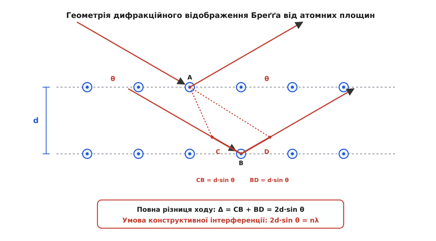
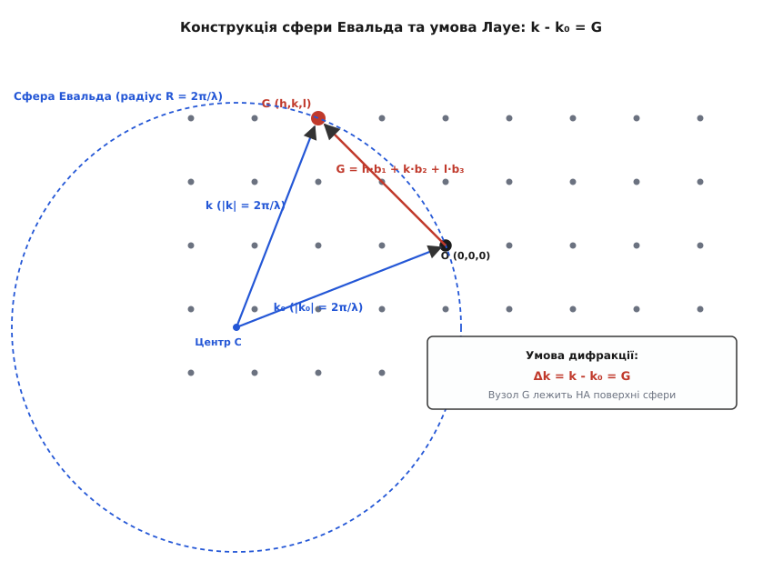
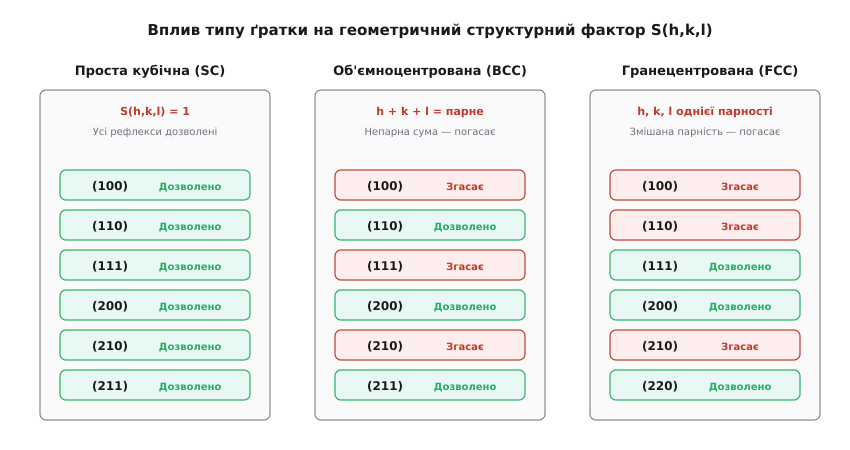
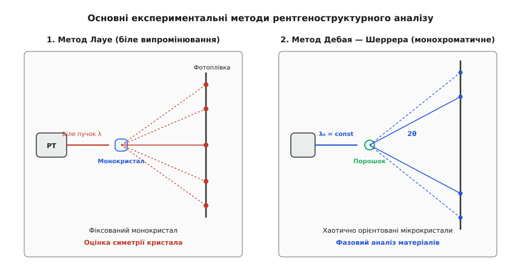

# Дифракція Бреґґа

<preknowlist>
- [Хвильова оптика та дифракція](root:ph-waves/diffraction) — інтерференція хвиль, різниця ходу та умови конструктивних максимумів.
- [Обернена ґратка та зони Бріллюена](root:ph-condensed/reciprocal-lattice) — періодичність кристалів, індекси Міллера (h, k, l) та трансляційна симетрія.
</preknowlist>

Дифракція Бреґґа розв'язує фундаментальну задачу експериментального визначення міжплощинних відстаней і розшифрування тривимірної атомарної будови кристалів за кутовим розподілом розсіяних хвиль. Ця задача виникла через фізичну неможливість дослідити внутрішнє впорядкування атомів у твердих тілах за допомогою класичної оптики: коли видиме світло з довжиною хвилі від 400 до 700 нанометрів проходить крізь прозорий кристал, воно зазнає лише звичайного заломлення і не демонструє жодних дифракційних візерунків чи спектрального розщеплення. Причина полягає у макроскопічному масштабі світлових хвиль: період кристалічної ґратки більшості твердих тіл становить від `0.1` до `0.5` нанометра, що в тисячі разів менше за довжину хвилі оптичного діапазону.

Згідно з критерієм роздільної здатності Релея та дифракційною границею Аббе, мінімальна просторова відстань між двома об'єктами `δr`, яку можна оптично розрізнити за допомогою хвилі з довжиною `λ`, обмежена співвідношенням:

```
δr = 0.61 · λ / NA                   [критерій Релея для круглої апертури]
d_min = λ / (2 · n · sin α)          [границя дифракційної межі Аббе]
```

де `NA = n · sin α` — числова апертура оптичної системи. Для видимого світла з довжиною хвилі `λ = 500 нм` і навіть найкращих масляно-імерсійних об'єктивів із числовою апертурою `NA = 1.4` роздільна здатність становить приблизно `d_min ≈ 180 нм`. Оскільки відстані між сусідніми атомами у кристалічній ґратці твердих тіл мають порядок `0.2...0.3 нм`, оптична хвиля просто усереднює дискретний періодичний потенціал середовища, сприймаючи кристал як суцільне однорідне діелектричне середовище з ефективною діелектричною проникністю. Без дифракційного розсіювання кристал залишався для фізиків «чорною скринькою», а точні координати атомів у ґратці неможливо було виміряти жодним прямим інструментом.

Щоб кристал спрацював як тривимірна дифракційна ґратка, довжина падаючої хвилі мусить бути співмірною з відстанями між атомами. У 1912 році фізики виявили, що рентгенівські промені мають довжину хвилі порядка `0.05...0.25 нм`. Коли когерентний рентгенівський пучок падає на кристал під певними кутами, вторинні хвилі, розсіяні електронами окремих атомів, інтерферують між собою і формують гострі кутові максимуми інтенсивності. Це явище отримало назву дифракції Бреґґа (лат. *diffractus* — розламаний, переломлений).

Дифракція Бреґґа має подвійну теоретичну природу. З одного боку, її можна наочно розглядати у прямому просторі як напівдзеркальне відбивання хвильових фронтів від паралельних кристалографічних площин. З іншого боку, у просторі оберненої ґратки вона є тривимірним пружним розсіюванням на фур'є-компонентах електронної густини кристала, що описується умовами Лауе та геометричною побудовою сфери Евальда.

Оптичні властивості кристалічного середовища в рентгенівському діапазоні визначаються тим, що частота електромагнітного поля `ω ~ 10¹⁸ с⁻¹` набагато перевищує власні резонансні частоти зв'язаних електронів більшості атомних оболонок. Внаслідок цього комплексний показник заломлення рентгенівських променів у речовині дещо менший за одиницю:

```
n_r = 1 - δ - i · β
```

де декремент заломлення `δ` та коефіцієнт екстинкційного поглинання `β` є малими додатними величинами:

```
δ = (n_e · r_e · λ²) / (2π) ≈ 10⁻⁵...10⁻⁶
β = (μ · λ) / (4π) ≈ 10⁻⁷...10⁻⁸
```

де `n_e` — середня об'ємна концентрація електронів у кристалі, `r_e` — класичний радіус електрона, а `μ` — лінійний коефіцієнт фотоелектричного поглинання.

Оскільки дійсна частина показника заломлення строго менша за одиницю (`Re(n_r) < 1`), фазова швидкість рентгенівських хвиль у кристалі перевищує швидкість світла у вакуумі. Це зумовлює два важливі фізичні наслідки:
1. **Повне зовнішнє відбивання**: коли рентгенівський промінь падає з вакууму або повітря на гладку поверхню кристала під кутом ковзання, меншим за критичний кут `θ_c = √(2δ) ≈ 0.2°...0.5°`, хвиля повністю відбивається від межі розділу, проникаючи у кристал лише на глибину кількох нанометрів у вигляді згасаючої (еванесцентної) хвилі.
2. **Дифракційне заломлення (зсув Дарвіна)**: усередині кристалічного середовища кут поширення хвилі трохи відрізняється від кута падіння у вакуумі за законом Снеліуса. Це вносить малу систематичну поправку у формулу Бреґґа:

```
2 · d · sin θ · √(1 - 2δ / sin² θ) = n · λ
sin θ_corr ≈ sin θ · (1 + δ / sin² θ)
```

Хоча у стандартній лабораторній практиці цією поправкою зазвичай нехтують, у прецизійній дифрактометрії монокристалів із точністю до п'ятого знака після коми врахування зсуву Дарвіна є строго обов'язковим.

## 1. Фізичний механізм та розрахунок умови Бреґґа

У класичній оптиці дифракційна ґратка складається з паралельних прорізів або штрихів на плоскій поверхні. У кристалічному тілі атоми впорядковані у тривимірній періодичній решітці Браве. Англійські фізики Вільям Генрі Бреґґ (англ. *Bragg*) та його син Вільям Лоренс Бреґґ у 1912 році запропонували наочну модель: уявити кристал як сімейство паралельних атомних площин, віддалених одна від одної на міжплощинну відстань `d`.

Падаючий паралельний пучок монохроматичних хвиль з довжиною `λ` спрямовується на кристал під кутом ковзання `θ` (англ. *glancing angle*). Зверніть увагу: на відміну від класичної оптики, де кут падіння відраховується від нормалі до поверхні, у рентгенівській кристалографії кут Бреґґа `θ` вимірюється між напрямком пучка та самою атомною площиною.


*Геометрія відображення Бреґґа: плоский хвильовий фронт падає під кутом ковзання θ на паралельні атомні площини з інтервалом d. Різниця ходу між променями 1 та 2 дорівнює CB + BD = 2d sin θ.*

### Фізичний механізм когерентного розсіювання площиною
Чому відображення від атомної площини є дзеркальним (кут падіння дорівнює куту відбивання)?
Згідно з принципом Гюйгенса — Френеля, кожен атом у площині перевипромінює сферичну хвилю під дією змінної електричної напруженості падаючого поля. Усі атоми, що лежать в одній і тій самій атомній площині, омиваються плоским хвильовим фронтом під кутом `θ`. Вторинні хвилі, розсіяні різними атомами **у межах однієї площини**, інтерферують конструктивно виключно під кутом відображення, що дорівнює куту падіння `θ`. За будь-якого іншого кута фазовий зсув між сусідніми атомами у площині взаємно погашає амплітуду.

Таким чином, кожна окрема атомна площина діє як частково прозоре напівдзеркало, яке відбиває невеличку частку випромінювання (порядку `10⁻⁴...10⁻⁵` від інтенсивності падаючого променя) під кутом `θ`, а решту енергії пропускає углиб кристала.

### Інтерференція між послідовними площинами
Розглянемо когерентне розсіювання двох паралельних променів від двох сусідніх атомних площин:
1. Промінь 1 відбивається від атома `A`, розташованого на першій (верхній) площині.
2. Промінь 2 проходить углиб кристала і відбивається від атома `B`, розташованого на другій площині прямо під атомом `A`.

З точок `A` на площині опускаються два перпендикуляри `AC` та `AD` на траєкторію другого променя (до і після відображення). Відрізки `CB` та `BD` становлять додатковий шлях, який долає другий промінь порівняно з першим. З прямокутних трикутників `ABC` та `ABD` довжина кожного з цих відрізків дорівнює:

```
CB = d · sin θ
BD = d · sin θ
```

Повна геометрична різниця ходу `Δ` між двома розсіяними променями дорівнює сумі двох відрізків:

```
Δ = CB + BD = 2 · d · sin θ
```

Щоб розсіяні хвилі підсилили одна одну у результаті конструктивної інтерференції, різниця ходу `Δ` мусить дорівнювати цілому числу довжин хвиль `n · λ`. Це дає фундаментальне **рівняння Бреґґа**:

```
2 · d · sin θ = n · λ
```

де:
- `d` — міжплощинна відстань для даного сімейства кристалографічних площин із індексами Міллера `(h, k, l)` (м);
- `θ` — кут Бреґґа (кут ковзання падаючого променя);
- `n` — ціле число (`n = 1, 2, 3...`), яке називається порядком дифракційного відображення;
- `λ` — довжина хвилі падаючого випромінювання (м).

У сучасній кристалографії порядок відбивання `n` зазвичай поглинають у визначення індексів Міллера. Замість того, щоб говорити про відображення `n`-го порядку від площин `(h, k, l)` із відстанню `d`, розглядають відображення першого порядку (`n = 1`) від фіктивних кристалографічних площин із індексами `(n·h, n·k, n·l)` та міжплощинною відстанню `d' = d / n`. Наприклад, відображення другого порядку від площин `(100)` еквівалентне відображенню першого порядку від площин `(200)`.

Якщо умова Бреґґа не виконується хоча б на малу величину, хвилі, що відбиваються від сотень і тисяч послідовних глибинних атомних площин, виявляються у протифазі та повністю гасять одна одну руйнівною інтерференцією. Саме тому дифракційне відображення спостерігається виключно при суворо визначених дискретних кутах `θ`.

З рівняння Бреґґа безпосередньо випливає фундаментальне фізичне обмеження: оскільки тригонометрична функція `sin θ` не може перевищувати одиницю (`sin θ ≤ 1`), дифракція можлива лише тоді, коли довжина хвилі задовольняє умову:

```
λ ≤ 2 · d
```

Якщо довжина хвилі випромінювання перевищує подвійну максимальну міжплощинну відстань кристала (`λ > 2 d_max`), конструктивна інтерференція стає математично неможливою під жодним кутом ковзання. Максимальна кількість доступних порядків дифракції для фіксованої міжплощинної відстані `d` і довжини хвилі `λ` дорівнює:

```
n_max = ⌊ 2 · d / λ ⌋
```

### Зв'язок міжплощинних відстаней із параметрами елементарної комірки
Міжплощинна відстань `d_{hkl}` залежить від кристалографічної сингонії кристала та індексів Міллера `(h, k, l)`. У загальному векторному формулюванні відстань `d_{hkl}` визначається через метричний тензор прямої ґратки `g_{ij} = a_i · a_j` та обернений тензор `g^{ij}`:

```
1 / d_{hkl}² = ∑_{i=1}^{3} ∑_{j=1}^{3} g^{ij} · h_i · h_j
```

Аналітичні формули для основних сингоній:
1. **Кубічна сингонія** (`a = b = c`, `α = β = γ = 90°`):

```
1 / d² = (h² + k² + l²) / a²
d = a / √(h² + k² + l²)
```

2. **Тетрагональна сингонія** (`a = b ≠ c`, `α = β = γ = 90°`):

```
1 / d² = (h² + k²) / a² + l² / c²
```

3. **Гексагональна сингонія** (`a = b ≠ c`, `α = β = 90°`, `γ = 120°`):

```
1 / d² = (4/3) · (h² + h·k + k²) / a² + l² / c²
```

4. **Орторомбічна сингонія** (`a ≠ b ≠ c`, `α = β = γ = 90°`):

```
1 / d² = h² / a² + k² / b² + l² / c²
```

5. **Моноклінна сингонія** (`a ≠ b ≠ c`, `α = γ = 90°`, `β ≠ 90°`):

```
1 / d² = (1 / sin² β) · [ h² / a² + (k² · sin² β) / b² + l² / c² - (2·h·l·cos β) / (a·c) ]
```

### Поляризаційний фактор Томсона
Взаємодія електромагнітного поля рентгенівської хвилі з електронами атомів описується класичним розсіюванням Томсона. Падаюча плоска хвиля з амплітудою електричного поля `E₀` змушує електрон коливатися вздовж вектора поляризації з прискоренням `a = e · E₀ / m_e`. Згідно з класичною електродинамікою, коливний заряд випромінює вторинну сферичну електромагнітну хвилю.

Диференціальний переріз розсіювання неполяризованого випромінювання на одному вільному електроні визначається формулою Томсона:

```
dσ_T / dΩ = r_e² · ((1 + cos² 2θ) / 2)
```

де класичний радіус електрона дорівнює:

```
r_e = e² / (4π · ε₀ · m_e · c²) ≈ 2.8179 × 10⁻¹⁵ м
```

Повний інтегральний переріз розсіювання Томсона отримується інтегруванням по всьому тілесному куту:

```
σ_T = (8π / 3) · r_e² ≈ 0.6652 × 10⁻²⁸ м² = 0.6652 барн
```

Множник `P`, що залежить від кута дифракції `2θ`, називається **поляризаційним фактором**:

```
P = (1 + cos² 2θ) / 2
```

Фізична природа поляризаційного фактора пов'язана з діаграмою спрямованості дипольного випромінювання:
- Для розсіювання під нульовим кутом (`2θ = 0°`, напрямок вперед) обидва компоненти поляризації випромінюють однаково, тому `P = 1`.
- Для розсіювання під прямим кутом (`2θ = 90°`) компонента електричного поля, що лежить у площині розсіювання, спрямована паралельно до напрямку спостереження. Оскільки диполь не випромінює вздовж осі своїх коливань, ця компонента повністю зникає, залишаючи лише перпендикулярну складову, і фактор інтенсивності спадає рівно вдвічі (`P = 0.5`).
- Для зворотного розсіювання (`2θ = 180°`) інтенсивність знову зростає до вихідного значення (`P = 1`).

Якщо у дифрактометрі встановлено попередній кристал-монохроматор із кутом Бреґґа `θ_M`, первинний пучок стає частково поляризованим ще до взаємодії зі зразком. У цьому випадку узагальнений поляризаційний фактор набуває вигляду:

```
P_M = (1 + cos² 2θ_M · cos² 2θ) / (1 + cos² 2θ_M)
```

Для синхротронного випромінювання, яке є лінійно поляризованим у площині електронної орбіти практично на `100%`, поляризаційний фактор залежить від орієнтації площини дифракції:
- Якщо площина дифракції збігається з площиною орбіти накопичувального кільця: `P_syn = cos² 2θ`.
- Якщо площина дифракції перпендикулярна до площини орбіти: `P_syn = 1`.

### Фактор Лоренца та інтегральна інтенсивність рефлексів
В експериментальних вимірюваннях дифракційний пік має скінченну кутову ширину, і детектор реєструє інтегральну інтенсивність (площу під піком) при скануванні кута `2θ`. Геометричний час перебування вузла оберненої ґратки в положенні дифракції описується **фактором Лоренца** `L(θ)`.

1. **Для обертового монокристала**: швидкість перетину сфери Евальда вузлом оберненої ґратки пропорційна швидкості обертання, що дає множник:

```
L_mono = 1 / sin 2θ
```

2. **Для порошкової дифрактометрії (дебаєграми або Бреґґ — Брентано)**: необхідно враховувати як імовірність орієнтації кристалітів у просторі (пропорційна `cos θ`), так і геометрію перетину дифракційного конуса з приймальною щілиною детектора (пропорційна `1 / sin 2θ`), що дає повний порошковий фактор Лоренца:

```
L_powder = 1 / (sin² θ · cos θ) = 2 / (sin θ · sin 2θ)
```

Об'єднання поляризаційного фактора та фактора Лоренца дає комбінований **фактор Лоренца — поляризації** `LP(θ)`:

```
LP(θ) = (1 + cos² 2θ) / (sin² θ · cos θ)
```

Фактор `LP(θ)` має характерну U-подібну форму: він різко зростає при малих кутах `2θ → 0°` та при великих кутах зворотного розсіювання `2θ → 180°`, досягаючи глибокого мінімуму в діапазоні `2θ ≈ 70°...90°`. Цей геометричний фактор обов'язково враховують при розрахунку інтенсивностей дифракційних рефлексів.

### Лабораторні джерела рентгенівського випромінювання
У лабораторній практиці генерація рентгенівських квантів відбувається при гальмуванні швидких електронів на металевій мішені (аноді) у вакуумній трубці Куліджа:
1. **Трубки зі стаціонарним анодом**: теплове навантаження обмежене теплопровідністю міді та температурою плавлення мішені. Максимальна електрична потужність становить `1...3 кВт`.
2. **Трубки з обертовим анодом (англ. *rotating anode*)**: масивний мідний циліндр з водяним охолодженням обертається зі швидкістю до `6000 об/хв`, що дозволяє розсіювати теплову потужність до `18 кВт` і збільшувати яскравість пучка в 5–10 разів.
3. **Мікрофокусні джерела з багатошаровою рентгенівською оптикою (дзеркала Монтеля / Гебеля)**: електронний пучок фокусується у пляму діаметром менше `50 мкм` на тонкому шарі металу. Завдяки високій питомій щільності потужності та параболічним дзеркалам повного відбивання формується високоінтенсивний паралельний пучок із кутовою розбіжністю менше `1 мрад`.

### Когерентне розсіювання проти некогерентного розсіювання Комптона
Окрім когерентного (пружного) розсіювання Томсона, рентгенівське випромінювання зазнає в атомах кристала некогерентного (непружного) розсіювання Комптона. При комптонівському розсіюванні падаючий рентгенівський квант передає частину своєї енергії та імпульсу електрону, вибиваючи його з атома.

Довжина хвилі розсіяного комптонівського фотона `λ'` збільшується на величину `Δλ`:

```
Δλ = λ' - λ = λ_C · (1 - cos 2θ)
λ_C = h / (m_e · c) ≈ 0.002426 нм = 2.426 пм
```

де `λ_C` — комптонівська довжина хвилі електрона.

Оскільки комптонівське розсіювання супроводжується квантовими змінами енергії кожного розсіяного фотона, між вторинними хвилями від різних атомів руйнується стала фазова когерентність. Внаслідок цього комптонівські кванти не беруть участі у формуванні гострих бреґґівських дифракційних піків. Вони формують неперервний плавний дифракційний фон (шум), який монотонно зростає зі збільшенням кута розсіювання `2θ` та зменшенням атомного номера елемента `Z`.

### Фільтрація вищих гармонік випромінювання
У дифракційному експерименті з монокристалом або на синхротроні рефлекс `n`-го порядку для довжини хвилі `λ` відбувається під тим самим геометричним кутом `θ`, що й рефлекс першого порядку для гармонійної довжини хвилі `λ / n`, оскільки умова Бреґґа виконується одночасно:

```
2 · d · sin θ = 1 · λ = 2 · (λ / 2) = 3 · (λ / 3)
```

Це явище називається **гармонійним забрудненням пучка**. Якщо у спектрі джерела присутня паразитна напівхвиля `λ / 2` (виникає від подвоєної напруги трубки або вищих порядків синхротронного ондулятора), вона відбивається під тим самим кутом і спотворює виміряні інтенсивності. Для її усунення використовують:
1. **Дзеркала повного зовнішнього відбивання**: критичний кут відбивання пропорційний довжині хвилі `θ_c ∝ λ`. Якщо встановити дзеркало під кутом `θ_m`, таким що `θ_c(λ/2) < θ_m < θ_c(λ)`, основна гармоніка `λ` повністю відіб'ється від дзеркала, а паразитна коротка хвиля `λ/2` проникне вглиб і поглинеться.
2. **Енергодисперсійні детектори**: напівпровідникові детектори з високою енергетичною роздільною здатністю (SDD) вимірюють амплітуду зарядового імпульсу від кожного фотона і відкидають кванти з подвоєною енергією `2E₀`.

### Чисельний розрахунок кутів Бреґґа
Розглянемо практичний розрахунок кутів дифракції для найпоширеніших у кристалографії матеріалів при використанні характеристичного випромінювання мідного анода `Cu Kα₁` (`λ = 0.154056 нм`) та молібденового анода `Mo Kα₁` (`λ = 0.070930 нм`):

**Приклад 1: Монокристал кремнію `Si` (кубічна ґратка типу алмазу, `a = 0.54309 нм`)**
Міжплощинна відстань для найсильнішого сімейства площин `(111)` становить:

```
d₁₁₁ = a / √(1² + 1² + 1²)           [міжплощинна відстань для кубічної ґратки]
     = 0.54309 / √3                  [підстановка параметра a = 0.54309 нм]
     = 0.31355 нм                    [обчислене значення d₁₁₁]
```

Розрахунок кута ковзання `θ` та кута реєстрації детектора `2θ` для `Cu Kα₁`:

```
sin θ₁₁₁ = λ / (2 · d₁₁₁)            [закон Бреґґа для першого порядку n = 1]
         = 0.154056 / (2 · 0.31355)  [підстановка довжини хвилі та d₁₁₁]
         = 0.24566                   [обчислене значення синуса]
θ₁₁₁ = arcsin(0.24566) ≈ 14.22°
2θ₁₁₁ ≈ 28.44°
```

Для площин `(220)` кремнію (`d₂₂₀ = a / √8 = 0.19201 нм`):

```
sin θ₂₂₀ = 0.154056 / (2 · 0.19201) = 0.40117
θ₂₂₀ = arcsin(0.40117) ≈ 23.65°
2θ₂₂₀ ≈ 47.30°
```

Якщо ж використати короткохвильове молібденове випромінювання `Mo Kα₁` (`λ = 0.070930 нм`), кути суттєво стискаються до менших значень:

```
sin θ₁₁₁(Mo) = 0.070930 / (2 · 0.31355) = 0.11311
θ₁₁₁(Mo) ≈ 6.50°
2θ₁₁₁(Mo) ≈ 12.99°
```

**Приклад 2: Кухонна сіль `NaCl` (гранецентрована кубічна ґратка, `a = 0.56402 нм`)**
Для сімейства площин `(200)` міжплощинна відстань дорівнює `d₂₀₀ = a / 2 = 0.28201 нм`.

```
sin θ₂₀₀(Cu) = 0.154056 / (2 · 0.28201) = 0.27314
θ₂₀₀(Cu) = arcsin(0.27314) ≈ 15.85°
2θ₂₀₀(Cu) ≈ 31.70°
```

**Приклад 3: Металеве залізо `α-Fe` (об'ємноцентрована кубічна ґратка, `a = 0.28665 нм`)**
Для головного рефлексу `(110)` міжплощинна відстань дорівнює `d₁₁₀ = a / √2 = 0.20269 нм`:

```
sin θ₁₁₀(Cu) = 0.154056 / (2 · 0.20269) = 0.38003
θ₁₁₀(Cu) ≈ 22.34°
2θ₁₁₀(Cu) ≈ 44.67°
```

Детальний історичний екскурс про відкриття рентгенівської дифракції Максом фон Лауе та батьком і сином Бреґґами винесено у вставку [📜 Історія відкриття дифракції рентгенівських променів та електронів](root:ph-condensed/bragg-diffraction/hist-bragg-discovery.md).

## 2. Умови Лауе та векторний опис у просторі оберненої ґратки

Геометрична модель Бреґґа зручна для наочного сприйняття, проте для аналізу складних кристалографічних симетрій використовують строго векторний підхід, розроблений Максом фон Лауе.

Розглянемо пружне розсіювання хвилі, коли падаючий хвильовий вектор `k₀` перетворюється у розсіяний вектор `k`. Оскільки енергія фотона при пружному розсіюванні не змінюється, модулі векторів однакові:

```
|k| = |k₀| = 2π / λ
```

Вектор розсіювання (переданий імпульс) визначається як різниця векторів:

```
q = k - k₀
```

Модуль вектора розсіювання `|q|` пов'язаний із кутом ковзання Бреґґа `θ` через трикутник розсіювання:

```
|q| = 2 · |k₀| · sin θ = (4π / λ) · sin θ
```

Нехай кристалічна ґратка утворена періодичним повторенням примітивних векторів прямої ґратки `a₁, a₂, a₃`. Положення довільного `n`-го вузла задається вектором трансляції:

```
R_n = n₁ · a₁ + n₂ · a₂ + n₃ · a₃
```

Фазовий зсув вторинної хвилі, розсіяної атомом у вузлі `R_n`, відносно атома у початку координат `0` дорівнює скалярному добутку:

```
Δφ_n = (k - k₀) · R_n = q · R_n
```

Сумарна амплітуда розсіяної хвилі від масиву з `N = N₁ · N₂ · N₃` однакових атомів є сумою фазових експонент:

```
A(q) = A₀ · ∑_{n₁=0}^{N₁-1} exp(-i · q · n₁ a₁) · ∑_{n₂=0}^{N₂-1} exp(-i · q · n₂ a₂) · ∑_{n₃=0}^{N₃-1} exp(-i · q · n₃ a₃)
```

Підсумовуючи геометричні прогресії для кожного з трьох просторових напрямків, отримуємо аналітичний вираз для тривимірної **функції інтерференції Лауе** `I_Laue(q) = |A(q)|²`:

```
I_Laue(q) = I₀ · (sin²(N₁ · a₁ · q / 2) / sin²(a₁ · q / 2)) · (sin²(N₂ · a₂ · q / 2) / sin²(a₂ · q / 2)) · (sin²(N₃ · a₃ · q / 2) / sin²(a₃ · q / 2))
```

Функція інтерференції Лауе має надзвичайно гострі та високі головні максимуми, коли знаменники всіх трьох дробів одночасно обертаються на нуль. Це відбувається за умови, що фазовий зсув на кожному трансляційному кроці кристала є цілим кратним `2π`. Звідси випливають три фундаментальні скалярні **рівняння Лауе**:

```
a₁ · (k - k₀) = 2π · m₁
a₂ · (k - k₀) = 2π · m₂
a₃ · (k - k₀) = 2π · m₃
```

де `m₁, m₂, m₃` — довільні цілі числа.


*Конструкція сфери Евальда у просторі оберненої ґратки. Умова дифракції Лауе k - k₀ = G виконується тоді, коли вузол оберненої ґратки G(h,k,l) перетинає поверхню сфери радіуса R = 2π/λ.*

### Властивості функції інтерференції Лауе
1. **Висота головного максимуму**: у центрі резонансу кожен дріб прямує до `N_i²`, тому пікова інтенсивність пропорційна квадрату повного числа атомів у кристалі: `I_max ∝ (N₁ · N₂ · N₃)² = N²`.
2. **Кутова ширина головного піка**: перший нуль функції інтерференції виникає при зміщенні аргументу `a_i · q / 2 = π / N_i`, що відповідає ширині піка `δq ≈ 2π / (N_i · a_i) = 2π / L_i`, де `L_i` — макроскопічний лінійний розмір кристала у відповідному напрямку. Для кристала розміром `L ≈ 1 мкм` ширина піка у просторі хвильових векторів становить лише `~10⁻³ Å⁻¹`.
3. **Побічні нулі та максимуми**: між кожними двома сусідніми головними максимумами розташовується `N_i - 1` нулів і `N_i - 2` слабких побічних максимумів, інтенсивність яких не перевищує `5%` від головного піка і швидко згасає зі збільшенням `N`.

### Зв'язок із простором оберненої ґратки
Вектори оберненої ґратки `b₁, b₂, b₃` визначаються через вектори прямої ґратки `a₁, a₂, a₃` співвідношеннями:

```
b₁ = 2π · (a₂ × a₃) / V_c
b₂ = 2π · (a₃ × a₁) / V_c
b₃ = 2π · (a₁ × a₂) / V_c
```

де `V_c = a₁ · (a₂ × a₃)` — об'єм елементарної комірки прямої ґратки.

Вектори оберненої ґратки задовольняють фундаментальну умову ортонормованості: `a_i · b_j = 2π · δ_ij` (де `δ_ij` — символ Кронекера). Будь-який вузол оберненої ґратки описується дискретним вектором `G_{hkl}` із цілими індексами Міллера `(h, k, l)`:

```
G_{hkl} = h · b₁ + k · b₂ + l · b₃
```

Порівнюючи три рівняння Лауе з визначенням векторів оберненої ґратки, бачимо, що три умови Лауе виконуються одночасно тоді й тільки тоді, коли вектор розсіювання `q = k - k₀` точно збігається з вектором оберненої ґратки `G`:

```
k - k₀ = G_{hkl}
```

Це векторне рівняння є найлаконічнішим виразом умов дифракції у фізиці конденсованого стану.

### Доведення еквівалентності умови Лауе та закону Бреґґа
Доведемо, що векторне рівняння `k - k₀ = G` повністю тотожне скалярній формулі Бреґґа `2d sin θ = n λ`.

```
k = k₀ + G
k² = (k₀ + G)² = k₀² + 2 · k₀ · G + G²   [піднесення до скалярного квадрата]
k² = k₀²                                  [умова пружного розсіювання |k| = |k₀|]
2 · k₀ · G + G² = 0                       [скасування квадратів хвильових векторів]
-2 · |k₀| · |G| · cos(90° + θ) + G² = 0   [кути: кут між k₀ та G дорівнює 90° + θ]
2 · |k₀| · |G| · sin θ = G²               [оскільки cos(90° + θ) = - sin θ]
2 · (2π / λ) · sin θ = |G|                [підстановка |k₀| = 2π / λ та скорочення на |G|]
```

З кристалографічного визначення оберненої ґратки довжина вектора `|G_{hkl}|` пов'язана з міжплощинною відстанню `d_{hkl}` співвідношенням:

```
|G_{hkl}| = 2π / d_{hkl}
```

Підставляючи це значення, отримуємо:

```
2 · (2π / λ) · sin θ = 2π / d_{hkl}
2 · d_{hkl} · sin θ = λ
```

Якщо вектор `G` містить кратний цілочисельний множник `n` (`G = n · G₀`), де `G₀` — примітивний найкоротший вектор, перпендикулярний до даних площин, отримуємо загальне рівняння Бреґґа для `n`-го порядку:

```
2 · d₀ · sin θ = n · λ
```

### Геометрична конструкція сфери Евальда
Пауль Петер Евальд у 1913 році запропонував наочну геометричну інтерпретацію векторної умови Лауе у просторі оберненої ґратки:
1. У просторі оберненої ґратки вибирається початок координат — вузол `O(0, 0, 0)`.
2. Від точки `O` відкладається вектор падаючого променя `k₀` у напрямку, протилежному напрямку поширення пучка (тобто хвильовий вектор закінчується у точці `O`). Початок цього вектора задає точку `C` — центр сфери Евальда.
3. Навколо точки `C` будується сфера радіуса `R = |k₀| = 2π / λ`. Оскільки відстань від `C` до `O` дорівнює `2π / λ`, сфера завжди строго проходить через початок координат оберненої ґратки `O`.
4. Якщо будь-який інший вузол оберненої ґратки `G_{hkl}` опиняється **точно на поверхні сфери Евальда**, вектор `k = C -> G_{hkl}` має довжину `2π / λ` і відповідає пружно розсіяному хвильовому вектору, а вектор розсіювання `q = k - k₀ = O -> G_{hkl}` точно дорівнює вектору оберненої ґратки `G_{hkl}`.

### Обмежувальна сфера відбивання
Якщо обертати кристал навколо довільних осей у монохроматичному пучку, сфера Евальда повертається у просторі оберненої ґратки навколо початку координат `O`. Максимальна відстань від точки `O`, якої може досягти поверхня сфери Евальда радіуса `R = 2π / λ`, дорівнює її діаметру:

```
|G|_max = 2 · R = 4π / λ
```

Сфера з центром у початку координат `O` і радіусом `2R = 4π / λ` називається **обмежувальною сферою відбивання (сферою граничних відображень)**. Усі вузли оберненої ґратки, що лежать усередині цієї сфери, можуть за певних кутів орієнтації кристала потрапити на поверхню сфери Евальда та породити дифракційний рефлекс. Вузли, розташовані за межами обмежувальної сфери (`|G| > 4π / λ`), не можуть дати дифракції за даної довжини хвилі за жодної просторової орієнтації зразка.

### Стрижні обрізання кристалічної ґратки (Crystal Truncation Rods, CTR)
У реальному напівнескінченному кристалі з плоскою поверхнею тривимірна нескінченна періодичність порушується вздовж нормалі до поверхні `z`. Внаслідок цього вузли оберненої ґратки перестають бути точковими дельта-функціями і витягуються у неперервні дифузні стрижні інтенсивності, перпендикулярні до поверхні зразка (стрижні CTR).

Математичний вираз для інтенсивності CTR-стрижня вздовж нормальної компоненти вектора розсіювання `q_z` задається формулою:

```
I_CTR(q_z) ∝ 1 / (4 · sin²(q_z · c / 2))
```

Інтенсивність CTR-стрижнів плавно спадає між основними бреґґівськими максимумами, але залишається ненульовою на всій протяжності оберненого простору. Вимірювання інтенсивності CTR на синхротронних джерелах дозволяє досліджувати атомарну релаксацію поверхневих шарів, шорсткість межі розділу та адсорбцію моношарів сторонніх атомів із субпікометровою просторовою роздільною здатністю.

### Зони Бріллюена та електронні енергетичні щілини
Концепція бреґґівського відбивання у просторі оберненої ґратки є наріжним каменем зонної теорії твердих тіл. Межі першої зони Бріллюена утворені площинами, які проходять перпендикулярно через середини найкоротших векторів оберненої ґратки `G`.

Коли хвильовий вектор електрона провідності `k` у кристалі наближається до межі зони Бріллюена, для нього виконується умова:

```
k · (G / 2) = (G / 2)²
2 · k · G = G²
```

Це рівняння тотожне умові Бреґґа `(k + G)² = k²`. Електронна хвиля з вектором `k` зазнає сильного бреґґівського зворотного розсіювання у стан `k' = k - G`. Суперпозиція двох біжучих хвиль протилежного напрямку утворює дві стаціонарні стоячі хвилі з різним просторовим розподілом імовірності:
- Стояча хвиля `ψ₊ ∝ cos(G · r / 2)` має максимуми густини заряду на позитивних атомних остовах, що знижує її потенціальну енергію.
- Стояча хвиля `ψ₋ ∝ sin(G · r / 2)` має максимуми густини між атомами, що збільшує її енергію.

Внаслідок бреґґівської інтерференції на межі зони Бріллюена утворюється розрив енергетичного спектра — заборонена зона (енергетична щілина) `E_g = 2 |V_G|`, де `V_G` — фур'є-компонента періодичного потенціалу кристалічної ґратки.

Строге математичне виведення еквівалентності умови Лауе `k - k₀ = G` та закону Бреґґа `2d sin θ = n λ` наведено у вставці [🧮 Виведення умов Лауе, сфери Евальда та структурного фактора](root:ph-condensed/bragg-diffraction/math-structure-factor.md).

## 3. Атомний та геометричний структурний фактор: Систематичні згасання

Рівняння Бреґґа та векторна умова Лауе визначають лише геометрію розташування можливих дифракційних піків у просторі на основі форми та розмірів елементарної комірки. Проте вони нічого не говорять про те, які саме хімічні елементи містяться у кристалі, де саме розташовані атоми всередині комірки та якою є інтенсивність розсіяних пучків.

### Атомний фактор розсіювання
Рентгенівські промені розсіюються не на точкових ядрах, а на просторово розподілених електронних хмарах атомів. Якщо електронна густина атома описується функцією `ρ(r)`, то амплітуда розсіювання хвилі всім атомом відносно амплітуди розсіювання на одному вільному електроні Томсона визначається **атомним фактором розсіювання (формфактором)** `f(q)`:

```
f(q) = ∫ ρ(r) · exp(-i · q · r) d³r
```

Для сферично-симетричного розподілу електронної густини `ρ(r) = ρ(|r|)` просторовий інтеграл спрощується до одновимірного:

```
f(q) = ∫₀^∞ 4π · r² · ρ(r) · (sin(q · r) / (q · r)) dr
```

Властивості атомного формфактора:
1. **Нульовий кут розсіювання (`q = 0`, кут `θ = 0°`)**: фазовий зсув між хвилями від усіх ділянок електронної хмари дорівнює нулю (`sin(q r) / (q r) → 1`). Атомний фактор точно дорівнює повній кількості електронів в атомі, тобто його атомному номеру `Z`:

```
f(0) = ∫₀^∞ 4π · r² · ρ(r) dr = Z
```

2. **Зростання кута розсіювання (`q > 0`)**: через скінченні розміри електронної хмари (порядку `0.05...0.2 нм`), що порівнянні з довжиною хвилі `λ`, хвилі від протилежних країв одного й того самого атома мають взаємний фазовий зсув і частково гасять одна одну. Тому `f(q)` монотонно спадає зі зростанням кута розсіювання `θ` та зменшенням довжини хвилі `λ`.

В аналітичних розрахунках атомні фактори табулюють за допомогою дев'ятипараметричної апроксимації Кромера — Манна:

```
f₀(s) = ∑_{i=1}^{4} a_i · exp(-b_i · s²) + c
```

де `s = sin θ / λ`, а `a_i, b_i, c` — емпіричні коефіцієнти, обчислені за допомогою самоузгоджених квантовомеханічних методів Гартрі — Фока для кожного хімічного елемента та його іонів.

### Резонансне (аномальне) розсіювання
Коли енергія падаючих рентгенівських квантів наближається до енергії зв'язку внутрішніх електронів атома (`K`- або `L`-країв поглинання), виникає резонансна взаємодія. Атомний фактор набуває комплексної форми:

```
f(q, ω) = f₀(q) + f'(ω) + i · f''(ω)
```

де:
- `f₀(q)` — класичний нерезонансний атомний формфактор;
- `f'(ω)` — дійсна дисперсійна поправка, яка описує фазовий зсув вимушених коливань електронів біля резонансу;
- `f''(ω)` — уявна абсорбційна поправка, яка прямо пропорційна лінійному коефіцієнту фотоелектричного поглинання атома `μ(ω)`.

Аномальне розсіювання приводить до порушення закону Фріделя. У нерезонансній кристалографії інтенсивності протилежних рефлексів завжди строго однакові: `I(h, k, l) = I(-h, -k, -l)`. Проте при наявності аномального поглинання у нецентросиметричних кристалах закон Фріделя порушується:

```
I(h, k, l) ≠ I(-h, -k, -l)           [пари Бійвута]
```

Вимірювання різниці інтенсивностей пар Бійвута дозволяє експериментально розрізняти дзеркальні оптичні ізомери (енантіоморфи) у хімії та біології, а також визначати абсолютну конфігурацію хіральних молекул. Цей ефект широко використовують у біомолекулярній кристалографії в методах MAD (багатохвильова аномальна дифракція) та SAD (однохвильова аномальна дифракція) для прямого визначення фаз рефлексів і розшифрування просторових структур білків без внесення важких ізоморфних міток.

### Структурний фактор елементарної комірки
Амплітуда когерентно розсіяної хвилі від усієї елементарної комірки, що містить `M` атомів із координатами `(x_j, y_j, z_j)` (у частках ребер комірки `a, b, c`), визначається **комплексним структурним фактором** `F(h, k, l)`:

```
F(h, k, l) = ∑_{j=1}^{M} f_j(q) · exp(-2π i · (h·x_j + k·y_j + l·z_j))
```

Інтенсивність дифракційного максимуму `I(h, k, l)` пропорційна квадрату модуля структурного фактора:

```
I(h, k, l) ∝ |F(h, k, l)|² = (Re F)² + (Im F)²
```

Якщо всі атоми в комірці хімічно однакові (`f_j = f`), структурний фактор факторизується на добуток атомного фактора `f` та **геометричного структурного фактора** `S(h, k, l)`:

```
F(h, k, l) = f(q) · S(h, k, l)
S(h, k, l) = ∑_{j=1}^{M} exp(-2π i · (h·x_j + k·y_j + l·z_j))
```


*Систематичні згасання (погасання) рефлексів у кубічних ґратках. У BCC ґратці рефлекси з непарною сумою (h+k+l) повністю гасяться через руйнівну інтерференцію від центрального атома.*

### Систематичні згасання для типових кристалічних ґраток
Через внутрішньокоміркову деструктивну інтерференцію хвилі від додаткових атомів у базисі можуть повністю погасити певні просторові відображення. Це фундаментальне явище називається **систематичним згасанням (погасанням)**.

#### 1. Проста кубічна ґратка (SC / Primitive Cubic)
Елементарна комірка містить 1 атом у позиції `(0, 0, 0)`.

```
S(h, k, l) = exp(-2π i · (0)) = 1
|S(h, k, l)|² = 1
```

Усі можливі цілочисельні комбінації `(h, k, l)` дозволені. Дифракційний спектр містить піки: `(100), (110), (111), (200), (210), (211)...`

#### 2. Об'ємноцентрована кубічна ґратка (BCC)
Комірка містить 2 атоми: `(0, 0, 0)` та `(1/2, 1/2, 1/2)`.

```
S(h, k, l) = 1 + exp(-2π i · (h/2 + k/2 + l/2))   [сума по двох вузлах BCC]
           = 1 + exp(-i π · (h + k + l))           [спрощення показника степеня]
           = 1 + (-1)^(h + k + l)                  [формула Ейлера для цілих чисел]
```

- Якщо сума `h + k + l` є **парною** (`2n`): `S = 1 + 1 = 2`, `|S|² = 4`. Рефлекс **дозволений**.
- Якщо сума `h + k + l` є **непарною** (`2n + 1`): `S = 1 - 1 = 0`, `|S|² = 0`. Рефлекс **повністю погашений**.

Дозволені рефлекси BCC: `(110), (200), (211), (220), (310), (222)...` Заборонені: `(100), (111), (210), (300)...`

#### 3. Гранецентрована кубічна ґратка (FCC)
Комірка містить 4 атоми: `(0, 0, 0)`, `(1/2, 1/2, 0)`, `(1/2, 0, 1/2)`, `(0, 1/2, 1/2)`.

```
S(h, k, l) = 1 + exp(-i π (h+k)) + exp(-i π (h+l)) + exp(-i π (k+l))
           = 1 + (-1)^(h+k) + (-1)^(h+l) + (-1)^(k+l)
```

- Якщо індекси `h, k, l` мають **однакову парність** (усі три парні або усі три непарні): кожен показник степеня `(h+k)`, `(h+l)`, `(k+l)` є парним, тому `S = 1 + 1 + 1 + 1 = 4`, `|S|² = 16`. Рефлекс **дозволений**.
- Якщо індекси `h, k, l` мають **змішану парність** (наприклад, два парних і один непарний): дві суми будуть непарними, а одна парною, тому `S = 1 + 1 - 1 - 1 = 0`, `|S|² = 0`. Рефлекс **повністю погашений**.

Дозволені рефлекси FCC: `(111), (200), (220), (311), (222), (400)...` Заборонені: `(100), (110), (210), (211)...`

#### 4. Ґратка типу алмазу (C, Si, Ge)
Ґратка алмазу складається з FCC ґратки з двоатомним базисом: один атом у `(0, 0, 0)`, другий зміщений на чверть просторової діагоналі у `(1/4, 1/4, 1/4)`. Повний структурний фактор є добутком FCC-множника та множника базису:

```
F_diamond(h, k, l) = f · S_FCC(h, k, l) · (1 + exp(-i π (h + k + l) / 2))
```

Правила згасання для алмазної ґратки:
1. Якщо індекси мають змішану парність: `S_FCC = 0`, `F = 0` (заборонено).
2. Якщо індекси `h, k, l` **усі непарні** (наприклад, `(111), (311), (331)`):
   `|1 + exp(-i π (2n + 1) / 2)|² = |1 ± i|² = 2`.
   `|F|² = 16 · 2 · f² = 32 · f²` (рефлекс дозволений).
3. Якщо індекси `h, k, l` **усі парні**: сума `h + k + l` є парною (`2m`). Множник базису дорівнює `1 + exp(-i π m) = 1 + (-1)^m`.
   - Якщо `h + k + l = 4n` (кратне 4, наприклад `(220), (400), (422)`): `m = 2n` — парне, `1 + 1 = 2`, `|F|² = 16 · 4 · f² = 64 · f²` (рефлекс дозволений).
   - Якщо `h + k + l = 4n + 2` (не кратне 4, наприклад `(200), (222), (420)`): `m = 2n + 1` — непарне, `1 - 1 = 0`, `|F|² = 0` (**рефлекс згасає**).

Цей додатковий тип згасання для `h + k + l = 4n + 2` обумовлений наявністю площин ковзного відбивання у просторовій групі алмазу `Fd-3m`.

#### 5. Структура сфалериту (ZnS, GaAs, InP)
Структура цинкової обманки (цинкосульфіду) має ту саму геометрію, що й алмаз, але у позиціях `(0, 0, 0)` розташовані атоми елемента A (наприклад, `Ga`), а в `(1/4, 1/4, 1/4)` — атоми елемента B (наприклад, `As`):

```
F_zb(h, k, l) = S_FCC · (f_A + f_B · exp(-i π (h + k + l) / 2))
```

- Для рефлексів з `h + k + l = 4n + 2` (таких як `(200)`):
  `F_zb(200) = 4 · (f_Ga - f_As)`.

На відміну від кремнію, де рефлекс `(200)` строго дорівнює нулю, у арсеніду галію `GaAs` пік `(200)` спостерігається з ненульовою інтенсивністю, яка прямо пропорційна різниці атомних формфакторів `|f_Ga - f_As|²`. Це дає потужний експериментальний метод вимірювання ступеня хімічного порядку та стехіометрії у напівпровідникових твердих розчинах.

#### 6. Структура перовськіту (SrTiO₃, BaTiO₃, CaTiO₃)
Ідеальна кубічна комірка перовськіту `ABO₃` містить:
- Катіон `A` (`Sr`) у вершинах куба: `(0, 0, 0)`;
- Катіон `B` (`Ti`) у центрі куба: `(1/2, 1/2, 1/2)`;
- Аніони кисню `O` у центрах граней: `(1/2, 1/2, 0)`, `(1/2, 0, 1/2)`, `(0, 1/2, 1/2)`.

Структурний фактор перовськіту записується у вигляді:

```
F_perov(h, k, l) = f_A + f_B · (-1)^(h + k + l) + f_O · [(-1)^(h+k) + (-1)^(h+l) + (-1)^(k+l)]
```

Аналіз рефлексів перовськіту:
- **Головні (фундаментальні) рефлекси** (усі індекси `h, k, l` парні, наприклад `(200), (220)`):
  `F = f_A + f_B + 3 f_O`. Усі атоми розсіюють у фазі, що дає максимальну інтенсивність.
- **Надструктурні рефлекси** (усі індекси непарні, наприклад `(111)`):
  `F = f_A - f_B + 3 f_O · (+1) = f_A - f_B + 3 f_O`.
- **Змішані рефлекси** (наприклад, `(100), (110)`):
  Для `(100)`: `F = f_A - f_B - f_O`.

При фазових переходах (наприклад, сегнетоелектричному переході `BaTiO₃` із кубічної фази у тетрагональну) виникає спонтанна поляризація з витягуванням комірки вздовж осі `c` (`c / a > 1`). Внаслідок зняття виродження кубічний пік `(200)` розщеплюється на симетричний дуплет `(200)` та `(002)`, що слугує індикатором фазового переходу.

#### 7. Гексагональна щільноупакована ґратка (HCP)
Базис містить 2 атоми: `(0, 0, 0)` та `(1/3, 2/3, 1/2)`.

```
S_HCP(h, k, l) = 1 + exp(-2π i · (h/3 + 2k/3 + l/2))
```

- Якщо `h + 2k = 3n` (кратне 3):
  - при `l` парному: `exp(-i π l) = 1`, тому `S = 1 + 1 = 2`, `|S|² = 4` (рефлекс дозволений: `(002), (004), (110)`).
  - при `l` непарному: `exp(-i π l) = -1`, тому `S = 1 - 1 = 0`, `|S|² = 0` (рефлекс **повністю погашений**: `(001), (003), (111)`).
- Якщо `h + 2k = 3n ± 1`:
  - при `l` непарному: `|S|² = 3` (рефлекси дозволені: `(101), (103)`).
  - при `l` парному: `|S|² = 1` (рефлекси дозволені: `(100), (102)`).

#### 8. Згасання, зумовлені елементами просторової симетрії
Окрім центрування ґраток Браве, систематичні згасання виникають під дією неточкових симетрій:
- **Гвинтові осі (англ. *screw axes*)**: поворот із трансляцією вздовж осі. Наприклад, подвійна гвинтова вісь `2₁` вздовж осі `c` призводить до згасання усіх рефлексів `(0, 0, l)` із непарним індексом `l` (`l = 2n + 1`).


*Ілюстрація: Bragg Law Geometry.*



*Ілюстрація: Reciprocal Lattice Laue.*



*Ілюстрація: Structure Factor Absences.*



*Ілюстрація: Diffraction Methods.*

- **Площини ковзного відбивання (англ. *glide planes*)**: дзеркальне відбивання з трансляцією на половину або чверть ребра. Наприклад, площина ковзання `a`, перпендикулярна до осі `b`, гасить усі рефлекси типу `(h, 0, l)` із непарним `h` (`h = 2n + 1`).

Аналіз цих погасань дозволяє однозначно визначити просторову групу симетрії кристала з 230 можливих груп Федорова.

## 4. Кінематична та динамічна теорії дифракції

У кристалографії розрізняють два принципово різних теоретичних підходи до опису дифракції рентгенівських променів: кінематичний та динамічний.

### Кінематична теорія дифракції
Кінематична теорія розглядає дифракцію у наближенні слабкої однократної взаємодії. Вона базується на трьох спрощувальних припущеннях:
1. Амплітуда падаючої хвилі залишається постійною по всій товщині кристала (нехтують послабленням падаючого пучка внаслідок перекачування енергії у дифракційні промені).
2. Дифрагована хвиля виходить із кристала без повторного (вторинного) розсіювання на атомних площинах.
3. Взаємодія між розсіяними променями та падаючим полем відсутня.

Інтегральна інтенсивність дифракційного піка в кінематичній теорії пропорційна **квадрату модуля структурного фактора**:

```
I_kin ∝ |F(h, k, l)|² · λ³ · V_cryst
```

Кінематична модель є справедливою для:
- Дрібнодисперсних порошків із розміром кристалітів `L < 1 мкм`;
- Мозаїчних кристалів із високою густиною дислокацій;
- Біологічних макромолекулярних монокристалів із великим об'ємом комірки та слабкою відбивною здатністю.

Проте для ідеальних товстих монокристалів кінематична теорія приводить до фізичного парадоксу: при збільшенні товщини кристала розрахований коефіцієнт відбивання перевищував би `100%`, що грубо порушує закон збереження енергії.

### Динамічна теорія дифракції (Дарвіна — Евальда — Лауе)
Для великих, структурно ідеальних монокристалів без дислокацій (таких як монокристалічні злитки й пластини кремнію, германію, арсеніду галію або кварцу високої чистоти) кінематичне наближення повністю порушується.

Щойно падаючий пучок утворює дифраговану хвилю під бреґґівським кутом `θ`, ця вторинна хвиля під час поширення крізь ідеальну ґратку падає на ті самі атомні площини з протилежного боку під кутом `-θ`. Відповідно, вона зазнає повторної когерентної дифракції й повертається назад у напрямок прямого падаючого пучка, але з фазовим зсувом `π`.

Динамічна теорія дифракції розв'язує самоузгоджену систему хвильових рівнянь Максвелла у тривимірному середовищі з просторово-періодичною комплексною діелектричною проникністю:

```
ε(r) = 1 + χ(r) = 1 + ∑_G χ_G · exp(i · G · r)
```

де фур'є-компоненти поляризовності `χ_G` прямо пропорційні структурному фактору:

```
χ_G = - (r_e · λ² / (π · V_c)) · F(G)
```

### Ключові ефекти динамічної теорії:

#### 1. Довжина екстінкції (згасання)
Через швидке когерентне перекачування енергії падаючий пучок повністю відбивається приповерхневим шаром кристала. Характерна глибина, на якій інтенсивність падаючої хвилі спадає в `e` разів виключно внаслідок дифракційного відбивання (навіть у кристалі без жодного фотоелектричного поглинання), називається **довжиною первинної екстінкції** `Λ_ext`:

```
Λ_ext = (π · V_c · cos θ) / (r_e · λ · |F_{hkl}| · C)
```

де `C` — поляризаційний множник (`C = 1` для `σ`-поляризації, `C = |cos 2θ|` для `π`-поляризації).

Для типових відбивань кремнію `Si (111)` при випромінюванні `Cu Kα` довжина екстінкції становить лише `Λ_ext ≈ 1.5 мкм`. Це означає, що у бездефектному монокристалі вся дифракційна картина формується тонким шаром завтовшки кілька мікрометрів, а не всім міліметровим об'ємом зразка.

#### 2. Крива відбивання Дарвіна (крива хитання)
Для ідеального напівнескінченного кристала коефіцієнт відбивання `R(θ)` у вузькому кутовому інтервалі біля кута Бреґґа становить майже `100%`. Ця ділянка повної відбивної здатності називається **плато Дарвіна**.

Кутова напівширина кривої Дарвіна (англ. *Darwin width*) `ω_D` для кристала без поглинання визначається виразом:

```
ω_D = (2 · r_e · λ² · |F_{hkl}| · C) / (π · V_c · sin 2θ)
```

Для монокристала кремнію кутова ширина бреґґівського піка `Si (111)` становить лише `ω_D ≈ 7.4` кутових секунд (`~0.002°`). За межами цього вузького діапазону коефіцієнт відбивання різко падає пропорційно `1 / (Δθ)²`.

Інтегральна інтенсивність у динамічній теорії пропорційна **першому степеню модуля структурного фактора**, а не квадрату:

```
I_dyn ∝ |F(h, k, l)| · λ²
```

Це пояснює, чому виміряні дифракційні піки від досконалих монокристалів кремнію мають набагато меншу інтегральну інтенсивність, ніж передбачає проста кінематична теорія.

#### 3. Багатохвильова дифракція та ефект Реннінгера (Umweganregung)
Коли монокристал орієнтують так, що геометрія Бреґґа налаштована на заборонений рефлекс (наприклад, `Si (222)` у ґратці алмазу), у кристалі може випадково виникнути додатковий дозволений рефлекс на іншому сімействі площин `G₁` (наприклад, `(111)`). Промінь, відбитий площиною `G₁`, зазнає вторинної дифракції на площинах `G₂ = G - G₁` (наприклад, `(111)`), повертаючись у напрямок забороненого рефлексу `G`:

```
k₀ -> k₁ -> k₂
k₁ - k₀ = G₁
k₂ - k₁ = G₂
k₂ - k₀ = G₁ + G₂ = G
```

Цей процес непрямого збудження заборонених рефлексів називається **ефектом Реннінгера (Umweganregung)**. Вимірювання інтенсивності при азимутальному обертанні зразка навколо вектора дифракції `G` (сканування за кутом `ψ`) дає спектр гострих піків Реннінгера. Аналіз цих піків дозволяє експериментально визначати фази структурних амплітуд та інваріанти фазових трійок у квантовій кристалографії.

#### 4. Рентгенівські стоячі хвилі (XSW — X-ray Standing Waves)
У режимі динамічного бреґґівського відбивання інтерференція падаючої та відбитої когерентних хвиль утворює стаціонарну стоячу хвилю як усередині кристала, так і над його поверхнею:

```
I_XSW(z, θ) = |E₀|² · [ 1 + |R(θ)|² + 2 · |R(θ)| · cos(2π · z / d - v(θ)) ]
```

де `v(θ)` — фаза коефіцієнта динамічного відбивання, яка при кутовому проходженні кривої хитання Дарвіна плавно змінюється на `π`.

Внаслідок зміни фази вузли стоячої хвилі зміщуються вздовж нормалі до площин рівно на половину міжплощинної відстані `d / 2`. Якщо на поверхні кристала адсорбовані сторонні атоми, вимірювання виходу їхньої вторинної рентгенівської флуоресценції дозволяє визначити висоту розташування адсорбованих атомів (когерентну позицію) із субпікометровою точністю (`~0.001 нм`).

#### 5. Маятниковий ефект (Pendellösung)
У геометрії дифракції на проходження (випадок Лауе) всередині плоскопаралельної пластинки монокристала формуються два когерентні хвильові поля. Інтерференція між ними спричиняє періодичне маятникове перекачування електромагнітної енергії між прямим прохідним пучком і дифрагованим пучком із просторовим просторовим періодом `T_p`:

```
T_p = Λ_ext / cos θ
```

Якщо товщина кристалічної пластинки змінюється (наприклад, у клиноподібному кристалі), на рентгенівських топограмах спостерігається система паралельних інтерференційних смуг рівної товщини — **маятникові смуги (смуги Пендельльозунга)**. Цей ефект лежить в основі рентгенівської інтерферометрії Бонзе — Гарта, здатної вимірювати механічні зміщення ґратки з субпікометровою точністю.

#### 6. Аномальне проходження рентгенівських променів (ефект Бормана)
При точній орієнтації товстого монокристала у бреґґівське положення у кристалі утворюються дві взаємно перпендикулярні стоячі електромагнітні хвилі:
- **Поле типу I**: пучності електричного поля стоячої хвилі розташовуються точно у площинах атомних ядер. Електрони сильно взаємодіють із полем, що спричиняє аномально сильне фотоелектричне поглинання з коефіцієнтом `μ_eff ≫ μ₀`.
- **Поле типу II**: вузли електричного поля (точки нульової напруженості) розташовуються строго на атомних площинах, а пучності — у міжвузловому вакуумному просторі між атомами. Оскільки в положеннях пучностей практично немає електронів, фотоелектричне поглинання падає майже до нуля (`μ_eff ≪ μ₀`).

Внаслідок цього рентгенівський пучок здатний без перешкод проходити крізь монокристал германію завтовшки до кількох сантиметрів, який у недовільному (недифракційному) положенні повністю послаблює рентгенівське випромінювання у мільярди разів. Це явище аномальної прозорості називається **ефектом Бормана**.

## 5. Корпускулярно-хвильовий дуалізм: Дифракція електронів та нейтронів

Формула Бреґґа описує дифракцію будь-яких фізичних хвиль, незалежно від їхньої природи. Відповідно до квантової гіпотези Луї де Бройля (1924 р.), будь-яка матеріальна частинка з масою `m` та імпульсом `p` демонструє хвильові властивості з довжиною хвилі:

```
λ = h / p = h / (m · v)
```

де `h ≈ 6.626 × 10⁻³⁴ Дж·с` — стала Планка.

### Дифракція електронів
Електрони мають електричний заряд `e` і прискорюються електричною напругою `V` (вольт). Їхня кінетична енергія дорівнює `E_k = e · V`.

У нерелятивістському наближенні зв'язок між прискорювальною напругою та довжиною хвилі має вигляд:

```
p = √(2 · m_e · e · V)
λ_e = h / √(2 · m_e · e · V) = √(h² / (2 · m_e · e · V))
```

Підставляючи числові значення фундаментальних констант (`m_e ≈ 9.109 × 10⁻³¹ кг`, `e ≈ 1.602 × 10⁻¹⁹ Кл`), отримуємо зручну практичну формулу:

```
λ_e ≈ 1.226 / √V  (нанометрів)
```

Для високих напруг (`V > 50 кВ`), типових для сучасних просвічувальних електронних мікроскопів (TEM), необхідно враховувати релятивістські ефекти зростання маси електрона:

```
λ_e = h · c / √(2 · m_e · c² · e · V + (e · V)²)
    = 1.226 / √(V · (1 + 0.978 × 10⁻⁶ · V))  (нанометрів)
```

| Прискорювальна напруга V | Нерелятивістська λ, нм | Релятивістська λ, нм | Швидкість електрона v / c | Галузь застосування |
| :--- | :--- | :--- | :--- | :--- |
| **50 В** | 0.1734 | 0.1734 | 0.014 | Дифракція повільних електронів (LEED) |
| **150 В** | 0.1001 | 0.1001 | 0.024 | Поверхневий аналіз монокристалів |
| **10 кВ** | 0.01226 | 0.01220 | 0.195 | Дифракція швидких електронів на відбивання (RHEED) |
| **100 кВ** | 0.003878 | 0.003701 | 0.548 | Просвічувальна електронна мікроскопія (TEM) |
| **200 кВ** | 0.002742 | 0.002508 | 0.695 | Високороздільна TEM (HRTEM) |
| **300 кВ** | 0.002239 | 0.001969 | 0.777 | Атомарне картування ґратки |

#### Особливості взаємодії електронів із кристалом:
1. **Кулонівська взаємодія**: електрони взаємодіють з усім електростатичним потенціалом кристала `V(r)`, створеним як позитивними зарядами ядер, так і негативними електронними хмарами. Атомний фактор розсіювання для електронів `f_e(q)` описується формулою Мотта — Бете:

```
f_e(q) = (m_e · e² / (2 · ℏ² · q²)) · (Z - f_x(q))
```

2. **Величезний переріз розсіювання**: переріз взаємодії електронів із речовиною приблизно у `10⁴...10⁵` разів перевищує переріз для рентгенівських променів. Завдяки цьому довжина вільного пробігу становить лише `1...100 нм`. Це робить електронну дифракцію винятково чутливою до надтонких плівок, двовимірних матеріалів (графен) та поверхневих реконструкцій (LEED/RHEED).
3. **Форма сфери Евальда**: при енергії `200 кВ` довжина хвилі електрона `λ ≈ 0.0025 нм` є на два порядки меншою за рентгенівську. Відповідно, радіус сфери Евальда `R = 2π / λ ≈ 2500 нм⁻¹` є гігантським порівняно з міжвузловими відстанями оберненої ґратки (`~2...5 нм⁻¹`). Сфера Евальда локально є практично плоскою пластиною. Вона перетинає одразу цілу площину вузлів оберненої ґратки, даючи прямий двовимірний дифракційний зріз оберненого простору в одному мікродифракційному кадрі.
4. **Лінії Кікучі та дифракція збіжного пучка (CBED)**: у товстіших зразках непружно розсіяні електрони зазнають повторної бреґґівської дифракції, утворюючи пари паралельних світлих і темних смуг (лінії Кікучі). Вони слугують високоточною картою кристалографічних орієнтацій і дозволяють визначати локальні псевдодеформації ґратки з роздільною здатністю до одиниць нанометрів.

### Дифракція нейтронів
Вільні нейтрони мають масу `m_n ≈ 1.675 × 10⁻²⁷ кг` і нульовий електричний заряд. Для кристалографічних досліджень використовують теплові нейтрони з ядерних реакторів або імпульсних джерел спалахування (англ. *spallation sources*), які перебувають у термодинамічній рівновазі з сповільнювачем при температурі `T ≈ 300 K`.

Середня кінетична енергія теплового нейтрона становить:

```
E_k = (3/2) · k_B · T ≈ 25...40 меВ = 0.025...0.040 еВ
```

Довжина хвилі де Бройля для теплових нейтронів дорівнює:

```
λ_n = h / √(2 · m_n · E_k) ≈ 0.15...0.20 нм
```

Це точно відповідає типовим міжплощинним відстаням у кристалах.

#### Фундаментальні відмінності нейтронної дифракції:
1. **Ядерне розсіювання**: оскільки нейтрони не мають заряду, вони вільно проникають крізь електронні оболонки й розсіюються виключно на атомних ядрах за рахунок короткодіючих сильних ядерних сил. Довжина ядерного розсіювання Фермі `b` має порядок радіуса ядра (`10⁻¹⁵ м = 1 фм`) і не спадає зі зростанням кута розсіювання `θ` (ядро є точковим розсіювачем, тому формфактор `f_n(θ) = const`).
2. **Чутливість до легких атомів**: довжина розсіювання `b` не залежить монотонно від атомного номера `Z`, а хаотично змінюється від елемента до елемента та навіть між ізотопами одного елемента. Наприклад, довжина розсіювання для легкого водню `¹H` становить `b = -3.74 фм`, для дейтерію `²D` — `b = +6.67 фм`, тоді як для важкого свинцю `Pb` — `b = +9.40 фм`. Це дозволяє нейтронній дифракції з високою точністю визначати позиції атомів водню, літію та вуглецю у присутності важких атомів металів (у гідридах, акумуляторних матеріалах Li-ion та ферментах).
3. **Магнітна дифракція та магнітний формфактор**: нейтрон має власний спін `s = 1/2` та магнітний дипольний момент `μ_n = -1.913` ядерного магнетона. Магнітний момент нейтрона когерентно розсіюється на неспарених d- та f-електронах магнітних іонів кристала. Оскільки d- та f-електрони просторово розмиті по електронній оболонці, магнітне розсіювання описується магнітним формфактором `f_mag(q)`, який спадає зі зростанням кута:

```
f_mag(q) = ⟨j₀(q)⟩ + (1 - 2/g) · ⟨j₂(q)⟩
```

де `⟨j₀⟩, ⟨j₂⟩` — сферичні інтеграли бесселівського типу від густини неспарених електронів.

Упорядкування магнітних моментів в антиферомагнетиках (наприклад, `MnO`, `NiO`, `FeO`) приводить до подвоєння періоду магнітної комірки порівняно з кристалохімічною. Внаслідок цього нижче температури Нееля `T_N` на нейтронограмах з'являються додаткові надструктурні бреґґівські піки (наприклад, рефлекс `(111)` у `MnO` при `T < 116 K`), що є прямим доказом існування протилежно напрямлених магнітних підґраток.
4. **Резонансна рентгенівська магнітна дифракція (RXMD)**: на відміну від нейтронів, рентгенівські промені зазвичай слабо взаємодіють зі спінами електронів. Проте при налаштуванні енергії фотонів синхротрона на резонансні краї поглинання важких елементів (наприклад, `L_{II,III}`-краї рідкісноземельних металів або `M_{IV,V}`-краї актиноїдів) виникає потужне резонансне підсилення магнітного розсіювання. RXMD дозволяє розділяти спінові та орбітальні магнітні моменти окремих хімічних елементів у багатокомпонентних магнітних сплавах.
5. **Непружне розсіювання нейтронів (INS)**: оскільки кінетична енергія теплових нейтронів (`~25 меВ`) точно збігається з енергіями фононів і магнонів у кристалах, вимірювання зміни енергії розсіяних нейтронів `ℏω = E_i - E_f` на триосьових спектрометрах дозволяє прямо будувати повні дисперсійні криві коливань ґратки `ω(q)` та спінових хвиль у всій зоні Бріллюена.
6. **Висока проникна здатність**: через слабку взаємодію з речовиною нейтрони проникають углиб металів на глибину до `5...10 см`, що дозволяє безруйнівно досліджувати внутрішні механічні напруження всередині масивних інженерних виробів (рейки, зварні шви реакторів, деталі авіадвигунів).

### Порівняльна характеристика випромінювань

| Властивість | Рентгенівські фотони | Електрони | Теплові нейтрони |
| :--- | :--- | :--- | :--- |
| **Природа зонда** | Електромагнітні кванти | Заряджені лептони | Нейтральні адрони (баріони) |
| **Енергія випромінювання** | `5...20 кВ` (`~10⁴ еВ`) | `50...300 кВ` (`~10⁵ еВ`) | `0.01...0.1 еВ` (`~10⁻² еВ`) |
| **Маса спокою** | `0` | `9.109 × 10⁻³¹ кг` | `1.675 × 10⁻²⁷ кг` |
| **Довжина хвилі λ** | `0.05...0.25 нм` | `0.002...0.004 нм` | `0.1...0.2 нм` |
| **Механізм розсіювання** | Електронні хмари `ρ(r)` | Електростатичний потенціал `V(r)` | Атомні ядра + спіни електронів |
| **Залежність від Z** | Пропорційно `Z` | Пропорційно `(Z - f_x) / q²` | Хаотична ізотопна залежність |
| **Глибина проникнення** | `10...1000 мкм` (об'ємний метод) | `1...100 нм` (поверхня, ультратонкий) | `1...10 см` (глибокий об'єм) |
| **Чутливість до водню** | Вкрай низька (`Z = 1`) | Помірна | Дуже висока (контраст `H/D`) |
| **Магнітна чутливість** | Дуже слабка (резонансна) | Відсутня | Пряма та потужна |
| **Радіаційне пошкодження** | Помірне (іонізація) | Високе (розрив зв'язків) | Мінімальне (без іонізації) |

## 6. Основні експериментальні методи кристалографії

Залежно від фізичного стану зразка (великий монокристал, тонкодисперсний полікристалічний порошок чи епітаксійна плівка) та спектрального складу пучка (неперервний білий чи монохроматичний) використовують чотири класичні методи дифракції.


*Принципові схеми двох основних експериментальних методів: метод Лауе (використовує монокристал і біле випромінювання) та метод Дебая — Шеррера (використовує полікристалічний порошок і монохроматичний пучок).*

### 1. Метод Лауе (поліхроматичне випромінювання на нерухомому монокристалі)
Нерухомий монокристал опромінюється неперервним (білим) рентгенівським випромінюванням із діапазоном довжин хвиль від `λ_min` до `λ_max`.

Оскільки положення кристала та міжплощинні відстані `d` зафіксовані, кут `θ` для кожного сімейства площин є постійним. Умова Бреґґа `2d sin θ = n λ` задовольняється автоматично за рахунок вибору потрібної довжини хвилі `λ` із неперервного білого спектра.
- **Геометрія Лауе на проходження**: фотодетектор розміщується позаду тонкого зразка.
- **Геометрія зворотного Лауе (на відбивання)**: первинний пучок проходить крізь центральний отвір у детекторі, а відбиті дифракційні промені реєструються від товстого непрозорого монокристала.

Плями на лауеграмі розташовуються уздовж кривих другого порядку (еліпсів або гіпербол), які проходять через центр первинного пучка. Кожна крива відповідає дифракції від площин, що належать одній кристалографічній зоні (мають спільну зонову вісь). Метод Лауе є експрес-методом визначення точкової групи симетрії монокристалів та їхньої просторової орієнтації з точністю до десятих часток градуса.

### 2. Метод обертового кристала
Монокристал закріплюється у триосьовій гоніометричній головці та рівномірно обертається навколо певної кристалографічної осі (наприклад, `[001]`) у вузькому монохроматичному пучку `λ₀`.

Під час обертання кут ковзання `θ` для різних сімейств площин неперервно змінюється від `0°` до `90°`. Коли кут `θ` досягає значення, що задовольняє закон Бреґґа, виникає дифракційний промінь. На циліндричному детекторі розсіяні промені утворюють паралельні горизонтальні лінії — **шарові лінії**. Відстань між шаровими лініями `y_n` дозволяє точно виміряти період трансляції ґратки `I` вздовж осі обертання:

```
I = (n · λ) / sin(arctan(y_n / R_det))
```

де `R_det` — радіус циліндричного детектора, а `n` — номер шарової лінії.

### 3. Порошковий метод Дебая — Шеррера
Зразок є тонко подрібненим порошком із мільйонів хаотично орієнтованих мікрокристалітів розміром `1...10 мкм`, що опромінюється монохроматичним пучком `λ₀`.

Оскільки серед велетенської кількості кристалітів завжди знайдуться частинки, орієнтовані під точним кутом Бреґґа `θ_{hkl}` до падаючого променя за всіма можливими азимутальними кутами `φ`, дифраговані промені формують суцільні співвісні дифракційні конуси з кутом розхилу `4θ` при вершині. На плоскому або стрічковому детекторі ці конуси утворюють серію концентричних кілець — **дебаєграму**.

### 4. Дифрактометрія Бреґґа — Брентано (порошкова геометрія `θ - 2θ`)
Найпоширеніша лабораторна дифрактометрична схема для фазового аналізу. Плоский порошковий зразок або тонка плівка розміщується у центрі гоніометра. Зразок обертається з кутовою швидкістю `ω`, а детектор синхронно рухається з подвійною кутовою швидкістю `2ω` вздовж кола гоніометра радіуса `R_g`.

Завдяки фокусуванню Бреґґа — Брентано розбіжний пучок від рентгенівської трубки після відбивання від плоскої поверхні зразка знову фокусується у вузьку приймальну щілину перед детектором, забезпечуючи високу кутову роздільну здатність (до `0.02°`) та високу світлосилу.

### 5. Високороздільна рентгенівська дифрактометрія (HRXRD) та картування оберненого простору (RSM)
Для дослідження напівпровідникових епітаксійних плівок (наприклад, `SiGe/Si`, `InGaN/GaN`) стандартної геометрії недостатньо через близькість піків шару й підкладки. У HRXRD використовують триосьові дифрактометри з багатократними кристалами-монохроматорами `Ge (220)` або `Ge (440)` із чотирикратним відбиванням (схема Бартельса).

Вимірювання включають:
- **Криві хитання (`ω`-скани)**: сканування кута нахилу зразка при фіксованому положенні детектора. Дозволяє виміряти мозаїчну розорієнтацію та густину дислокацій.
- **Картування оберненого простору (Reciprocal Space Mapping, RSM)**: вимірювання двовимірної сітки інтенсивностей `I(ω, 2θ)` навколо симетричних та асиметричних вузлів оберненої ґратки. Дозволяє строго розділити внески пружної деформації (зсув вузла по радіусу) та мозаїчного нахилу (зсув по дузі), а також розрахувати ступінь пластичної релаксації епітаксійного шару `R`:

```
R = (a_parallel - a_substrate) / (a_relaxed - a_substrate) · 100%
```

### 6. Дифрактометрія ковзного падіння (GIXRD) та рентгенівська рефлектометрія (XRR)
Для аналізу надтонких плівок завтовшки від `1` до `50 нм` звичайний симетричний `θ - 2θ` скан непридатний, оскільки пучок проникає на десятки мікрометрів углиб підкладки, повністю забиваючи слабкий сигнал від плівки.

- **GIXRD (Grazing Incidence XRD)**: кут падіння первинного пучка фіксується під малим ковзним кутом `α_i ≈ 0.3°...1.0°`, який лише дещо перевищує критичний кут повного зовнішнього відбивання `θ_c`. При цьому шлях пучка в плівці збільшується в десятки разів, а глибина проникнення обмежується кількома десятками нанометрів. Детектор сканує площину `2θ`, реєструючи рефлекси виключно від тонкого приповерхневого шару.
- **XRR (X-Ray Reflectivity)**: вимірювання дзеркального коефіцієнта відбивання при надмалих кутах `2θ` від `0°` до `5°`. На кривій рефлектометрії виникають інтерференційні осциляції Кіссіга, період яких `Δθ` безпосередньо пов'язаний із товщиною плівки `t`:

```
t ≈ λ / (2 · Δθ)
```

Критичний кут `θ_c` дає точну масову густину плівки `ρ`, а швидкість згасання амплітуди осциляцій — середньоквадратичну шорсткість межі розділу `σ_rms` за моделлю Нево — Кроксе.

### 7. Малокутове рентгенівське та нейтронне розсіювання (SAXS / SANS)
Коли об'єктом дослідження є наноструктури, колоїдні розчини, полімери або біологічні макромолекули з характерними розмірами `D ~ 1...100 нм`, бреґґівські кути розсіювання зміщуються в область надмалих кутів `2θ < 3°` (`q ~ 0.01...1.0 нм⁻¹`).

Для аналізу малокутових кривих розсіювання `I(q)` використовують два фундаментальні закони:
1. **Наближення Гіньє**: в області малих хвильових векторів (`q · R_g < 1.3`) інтенсивність розсіювання описується експонентою:

```
I(q) = I(0) · exp(- (q² · R_g²) / 3)
ln I(q) = ln I(0) - (R_g² / 3) · q²
```

де `R_g` — радіус інерції розсіювальної наночастинки або білкової глобули. Побудова графіка Гіньє (`ln I` від `q²`) дозволяє безпосередньо визначати просторовий розмір молекул у розчині без їхньої кристалізації.
2. **Закон Порода**: в асимптотичній області великих переданих імпульсів (`q · R_g ≫ 1`) для частинок із гладкими різкими межами інтенсивність спадає обернено пропорційно четвертому степеню `q`:

```
I(q) ≈ 2π · (Δρ)² · S / q⁴
```

де `S` — повна питома площа міжфазної поверхні, а `Δρ` — контраст електронної або ядерної густини між наночастинками та матрицею.

### 8. Сучасні детектори прямого підрахунку фотонів
Революція в рентгенівській кристалографії пов'язана із заміною фотопластинок та сцинтиляційних CCD-камер гібридними піксельними детекторами прямого підрахунку фотонів (англ. *Hybrid Photon Counting Detectors*, такі як Pilatus, Eiger та Medipix).
Кожен піксел кремнієвого сенсора має власний мікроелектронний підсилювач і компаратор, що дозволяє:
- Реєструвати поодинокі рентгенівські кванти з абсолютно нульовим шумом зчитування та нульовим темновим струмом;
- Забезпечувати динамічний діапазон понад `10⁶...10⁷` на кадр без насичення детектора сильними бреґґівськими рефлексами;
- Збирати повноцінні дифракційні картини у режимі неперервного безперервного обертання зразка (англ. *shutterless continuous framing*) зі швидкістю до кількох сотень або тисяч кадрів на секунду.

### 9. Синхротронні джерела та лазери на вільних електронах (XFEL)
Сучасна структурна кристалографія дедалі частіше використовує спеціалізовані джерела випромінювання:
- **Синхротронні джерела 3-го та 4-го поколінь**: забезпечують яскравість пучка на 10–12 порядків вищу за лабораторні трубки з обертовим анодом. Неперервна перебудова довжини хвилі дозволяє реалізувати резонансні методи anomalous scattering (MAD/SAD).
- **Рентгенівські лазери на вільних електронах (XFEL)**: генерують когерентні фемтосекундні імпульси (`10...50 фс`) із гігаватною піковою потужністю. Це започаткувало метод серійної фемтосекундної кристалографії (SFX): кристал опромінюється настільки коротким імпульсом, що дифракційна картина встигає сформуватися до того, як кулонівський вибух зруйнує молекулу (концепція «дифракція до руйнування», англ. *diffraction before destruction*).

Повний довідник експериментальних параметрів анодів, таблиці розрахунку `d(h,k,l)` для різних сингоній та формулу Шеррера наведено у вставці [📋 Довідник методів дифрактометрії: Лауе, обертовий кристал та дебаєграми](root:ph-condensed/bragg-diffraction/api-diffraction-methods.md).

Практичний програмний модуль для чисельного розрахунку бреґґівських кутів та перевірки систематичних згасань доступний у вставці [⚙️ Симуляція дифракційної картини та геометричного структурного фактора](root:ph-condensed/bragg-diffraction/proj-diffraction-simulation.md).

## 7. Вплив температури та дефектів кристалічної ґратки

У реальних умовах кристали не є абсолютно нерухомими та ідеальними періодичними структурами. Теплові коливання та дефекти змінюють інтенсивність, ширину та форму дифракційних піків.

### Теплові коливання атомів: Фактор Дебая — Валлера
Атоми у вузлах кристалічної ґратки здійснюють безперервні квантові та теплові коливання навколо положень рівноваги з середньоквадратичним зміщенням `⟨u²⟩`. Навіть при абсолютному нулі температур (`T = 0 K`) атоми мають нульові квантові коливання з амплітудою `⟨u₀²⟩ > 0`, зумовлені принципом невизначеності Гейзенберга.

Внаслідок теплового хаосу фази розсіяних хвиль флуктують, що призводить до часткового деструктивного гасіння когерентного бреґґівського сигналу. Інтенсивність дифракційного максимуму при температурі `T` зменшується за експоненційним законом:

```
I(T) = I₀ · exp(-2M) = I₀ · exp(-2 · B · (sin θ / λ)²)
```

де `exp(-2M)` — **фактор Дебая — Валлера**, а `B` — ізотропний температурний параметр (має розмірність площі, `Ų`):

```
B = 8π² · ⟨u²⟩
```

У наближенні теорії теплоємності Дебая температурний параметр `B` пов'язаний із температурою Дебая кристала `Θ_D`:

```
B = (6 · h² · T) / (m_a · k_B · Θ_D²) · [Φ(Θ_D / T) + (Θ_D / (4T))]
```

де `m_a` — маса атома, а `Φ(x)` — інтегральна функція Дебая.

Наслідки теплового руху:
1. **Згасання далеких піків**: оскільки показник експоненти пропорційний `(sin θ / λ)²`, інтенсивність рефлексів при великих кутах дифракції `2θ > 60°` падає у десятки разів швидше, ніж при малих кутах.
2. **Теплове дифузне розсіювання (TDS)**: енергія, втрачена когерентними бреґґівськими максимумами, не зникає, а переходить у плавний непружний фон теплового дифузного розсіювання на фононах кристала, що утворює широкі гало навколо вузлів оберненої ґратки.

### Мозаїчність кристала
Реальні кристали зазвичай складаються з величезної кількості мікроскопічних бездефектних блоків (доменів) розміром `0.1...10 мкм`, які злегка розорієнтовані один відносно одного на малі кути `η ~ 1'...15'` (модель мозаїчного кристала Дарвіна).

Мозаїчність послаблює динамічні ефекти первинної екстінкції, наближаючи поведінку кристала до передбачень кінематичної теорії. Поширення рентгенівського променя крізь мозаїчний кристал супроводжується **вторинною екстінкцією** — екрануванням глибших блоків верхніми блоками з тією самою орієнтацією.

### Текстура та прямі полюсні фігури
У деформованих металах (після прокатки, волочіння або кування) кристалічні зерна набувають переважної орієнтації (текстури). Внаслідок цього інтенсивності дифракційних кілець перестають бути рівномірними за азимутальним кутом `φ`.

Для дослідження переважних орієнтацій використовують чотириосьові гоніометри (колиску Ейлера) і будують **прямі полюсні фігури** — стереографічні проекції густини нормалей до заданого сімейства площин `(h, k, l)` залежно від кута нахилу зразка `χ` та азимутального кута обертання `φ`. Математичне відновлення тривимірної функції розподілу орієнтацій зерен (ODF) у просторі ейлерових кутів `(φ₁, Φ, φ₂)` дозволяє кількісно розраховувати анізотропію пружних, магнітних та пластичних властивостей конструкційних матеріалів.

### Дефекти пакування шарів (Stacking Faults)
У кристалічних структурах із щільним пакуванням шарів атомів (FCC з чергуванням `...ABCABC...` та HCP з чергуванням `...ABABAB...`) часто виникають локальні збої послідовності накладання атомних площин — **дефекти пакування (деформаційні та двійникові)**.

Вплив дефектів пакування на дифракційний профіль має строго анізотропний характер:
- Рефлекси, для яких індекси задовольняють умову `h - k = 3N` (де `N` — ціле число), залишаються гострими і не зазнають додаткового розширення.
- Рефлекси з `h - k = 3N ± 1` (наприклад, `(111)` та `(200)` у FCC) зазнають асиметричного розширення та кутового зсуву в протилежні боки: пік `(111)` зміщується в бік більших кутів `2θ`, а пік `(200)` — в бік менших кутів на величину:

```
Δ(2θ)_{hkl} = (90 · √3 · α) / (π² · (h² + k² + l²)) · tan θ_B · ∑_b (± L_0)
```

де `α` — імовірність виникнення деформаційного дефекту пакування на один атомний шар. Аналіз взаємного зміщення піків дозволяє визначати щільність дефектів пакування у пластично деформованих металах та наноматеріалах.

### Розширення дифракційних піків: Розмір кристалітів та мікронапруження
Ширина експериментального дифракційного піка на половині висоти (FWHM) `β` визначається трьома незалежними фізичними факторами:

```
β_obs = β_inst + β_size + β_strain
```

1. **Приладове розширення (`β_inst`)**: обумовлене скінченною оптичною шириною щілин гоніометра, коліматорів Соллера та спектральною шириною лінії рентгенівської трубки `Kα₁,₂`.
2. **Розмірний ефект кристалітів (формула Шеррера)**: якщо розмір областей когерентного розсіювання (ОКР) `D` стає меншим за `200 нм`, бреґґівський пік розширюється через неповне взаємне гасіння хвиль від обмеженої кількості атомних площин:

```
β_size = (K · λ) / (D · cos θ)
```

де `K ≈ 0.89...0.94` — коефіцієнт форми частинок (фактор Шеррера).
3. **Мікронапруження ґратки (формула Вільсона)**: локальні варіації міжплощинних відстаней `ε = Δd / d`, спричинені точковими дефектами, дислокаціями або границями зерен, приводять до кутового розкиду бреґґівських максимумів:

```
β_strain = 4 · ε · tan θ
```

### Метод Вільямсона — Голла
Для експериментального розділення розмірного та деформаційного внесків будують лінійну залежність у спеціальних координатах (англ. *Williamson-Hall plot*):

```
β_struct · cos θ = (K · λ) / D + 4 · ε · sin θ
```

де `β_struct = √(β_obs² - β_inst²)` — фізичне розширення піка (для гауссового профілю).

Графік залежності `Y = β_struct · cos θ` від `X = 4 · sin θ` є прямою лінією:
- **Точка перетину прямої з віссю Y** (`X = 0`) визначає середній розмір областей когерентного розсіювання `D`:

```
D = (K · λ) / Y_intercept
```

- **Тангенс кута нахилу прямої** дає величину залишкових мікродеформацій кристалічної ґратки `ε`.

У матеріалах із високою густиною дислокацій (деформовані метали) нахил ліній для різних родин площин стає анізотропним. У цьому випадку застосовують **модифікований метод Вільямсона — Голла**, де замість `4 sin θ` використовують параметр `(4 sin θ) · √C_{hkl}`, де `C_{hkl}` — середній контрастний фактор дислокацій для даного сімейства кристалографічних площин.

## 8. Повнопрофільний аналіз дифрактометричних даних

У сучасному матеріалознавстві та фазовому аналізі замість вимірювання окремих піків застосовують аналіз усього цифрового дифракційного профілю `I(2θ)` методом Рітвельда (англ. *Rietveld refinement*).

Метод Рітвельда мінімізує суму квадратів відхилень між експериментально виміряною інтенсивністю `Y_obs,i` у кожній точці `2θ_i` та розрахованою теоретичною моделлю `Y_calc,i`:

```
Φ = ∑_{i} w_i · (Y_obs,i - Y_calc,i)² → min
```

де `w_i = 1 / Y_obs,i` — статистична вага `i`-ї точки вимірювання.

Теоретична модель профілю розраховується за формулою:

```
Y_calc,i = S_scale · ∑_k M_k · |F_k|² · Φ(2θ_i - 2θ_k) · P_k · A_corr + y_bg,i
```

де:
- `S_scale` — масштабний множник фази;
- `M_k` — фактор повторюваності даного сімейства площин (множинність);
- `|F_k|²` — структурний фактор рефлексу з урахуванням фактора Дебая — Валлера;
- `Φ(2θ_i - 2θ_k)` — аналітична функція профілю піка (зазвичай Псевдо-Войгт або розширений Пірсон VII);
- `P_k` — фактор переважної орієнтації кристалітів (текстурна функція Марча — Доллаза);
- `A_corr` — поправка на геометрію поглинання та шорсткість поверхні зразка;
- `y_bg,i` — фонова інтенсивність, апроксимована ортогональними поліномами Чебишова.

### Функції профілю піка та формула Кальйоті
В експериментальних дифрактограмах форма піка є згорткою гауссового внеску (від приладової оптичної геометрії та мікродеформацій) і лоренцевого внеску (від скінченного розміру ОКР та дисперсії джерела). Найчастіше використовують лінійну комбінацію — функцію Псевдо-Войгта:

```
PV(2θ) = η · L(2θ) + (1 - η) · G(2θ)
```

де `η` (`0 ≤ η ≤ 1`) — параметр змішування, `L(2θ)` — лоренціан, а `G(2θ)` — гауссіан із однаковою шириною на половині висоти `H`.

Залежність кутової ширини піка `H` від кута Бреґґа `θ` описується поліномом Кальйоті:

```
H² = U · tan² θ + V · tan θ + W
```

де `U, V, W` — параметри гоніометра, які калібрують за допомогою стандартного зразка без деформацій і з великим розміром зерен (наприклад, порошку гексабориду лантану `LaB₆` або кремнію `NIST SRM 640`).

### Асиметрія піків та осьова розбіжність пучка
В області малих кутів дифракції (`2θ < 25°`) піки набувають вираженої низькокутової асиметрії (хвіст піка розтягується в бік менших кутів). Цей ефект спричинений скінченною висотою щілин гоніометра та вертикальною (осьовою) розбіжністю рентгенівського пучка вздовж щілин Соллера.

Для точного моделювання асиметрії застосовують поправку Фінгера — Кокса — Джефкоута:

```
Φ_asym(2θ) = ∫_{-H/2}^{+H/2} ∫_{-H/2}^{+H/2} Φ_sym(2θ - Δ(z₁, z₂)) dz₁ dz₂
```

Ігнорування осьової розбіжності при уточненні призводить до систематичного заниження міжплощинних відстаней і штучної появи фіктивних від'ємних теплових параметрів Дебая — Валлера.

### Критерії якості уточнення
Якість уточнення контролюється статистичними факторами узгодження:
- Профільний фактор `R_p`:

```
R_p = (∑ |Y_obs,i - Y_calc,i|) / (∑ Y_obs,i)
```

- Зважений профільний фактор `R_wp`:

```
R_wp = √[ (∑ w_i (Y_obs,i - Y_calc,i)²) / (∑ w_i Y_obs,i²) ]
```

- Очікуваний фактор за пуассонівською статистикою `R_exp`:

```
R_exp = √[ (N_points - P_parameters) / (∑ w_i Y_obs,i²) ]
```

- Критерій відповідності «хі-квадрат» (Goodness-of-Fit, GoF):

```
χ² = (R_wp / R_exp)²
```

Ідеальне уточнення кристалічної структури відповідає `χ² → 1.0...1.5`. Метод Рітвельда дозволяє проводити кількісний фазовий аналіз багатофазних сумішей із точністю до `0.1%`, розшифровувати структури нових сполук із порошкових даних без вирощування монокристалів та контролювати катіонний розподіл у складних оксидах і надпровідниках.

## 9. Практичний розбір лабораторних завдань

### Кейс 1: Повна індексація дифрактограми невідомого металу (FCC)
Розглянемо покроковий алгоритм розшифрування експериментальних дифракційних даних для невідомого металевого зразка, виміряного на лабораторному дифрактометрі з анодом `Cu Kα` (`λ = 0.15418 нм`).

**Експериментальні дані кутів дифракційних піків:**
1. `2θ₁ = 38.47°` (`θ₁ = 19.235°`)
2. `2θ₂ = 44.72°` (`θ₂ = 22.360°`)
3. `2θ₃ = 65.10°` (`θ₃ = 32.550°`)
4. `2θ₄ = 78.23°` (`θ₄ = 39.115°`)
5. `2θ₅ = 82.44°` (`θ₅ = 41.220°`)

#### Крок 1: Розрахунок квадратів синусів
Обчислюємо `sin² θ` для кожного піка:
- `sin² θ₁ = sin²(19.235°) = (0.32946)² ≈ 0.10854`
- `sin² θ₂ = sin²(22.360°) = (0.38044)² ≈ 0.14473`
- `sin² θ₃ = sin²(32.550°) = (0.53804)² ≈ 0.28949`
- `sin² θ₄ = sin²(39.115°) = (0.63087)² ≈ 0.39800`
- `sin² θ₅ = sin²(41.220°) = (0.65895)² ≈ 0.43421`

#### Крок 2: Знаходження відношень квадратів синусів
Для кубічних кристалів квадрати синусів пропорційні сумі квадратів індексів Міллера:

```
sin² θ = (λ² / (4 · a²)) · (h² + k² + l²) = A · s_k
```

де `s_k = h² + k² + l²` — цілі числа.

Нормуємо всі значення `sin² θ` на перше значення `sin² θ₁`:
- `sin² θ₁ / sin² θ₁ = 1.000`
- `sin² θ₂ / sin² θ₁ = 0.14473 / 0.10854 ≈ 1.333 = 4 / 3`
- `sin² θ₃ / sin² θ₁ = 0.28949 / 0.10854 ≈ 2.667 = 8 / 3`
- `sin² θ₄ / sin² θ₁ = 0.39800 / 0.10854 ≈ 3.667 = 11 / 3`
- `sin² θ₅ / sin² θ₁ = 0.43421 / 0.10854 ≈ 4.000 = 12 / 3`

#### Крок 3: Визначення типу ґратки Браве та індексація
Помноживши всі відношення на спільний знаменник `3`, отримуємо цілочисельний ряд сум `(h² + k² + l²)`:

```
s_k = 3, 4, 8, 11, 12
```

Зіставляємо ці суми з дозволеними послідовностями сум квадратів для кубічних ґраток:
- Проста кубічна (SC): `s_k = 1, 2, 3, 4, 5, 6, 8...` (не відповідає);
- Об'ємноцентрована (BCC): `s_k = 2, 4, 6, 8, 10, 12...` (не відповідає);
- Гранецентрована (FCC): `s_k = 3, 4, 8, 11, 12, 16, 19, 20...` (**ідеальний збіг!**).

Таким чином, зразок має **гранецентровану кубічну ґратку (FCC)**.

Індекси Міллера піків:
1. `s₁ = 3 = 1² + 1² + 1²` → площина `(111)`
2. `s₂ = 4 = 2² + 0² + 0²` → площина `(200)`
3. `s₃ = 8 = 2² + 2² + 0²` → площина `(220)`
4. `s₄ = 11 = 3² + 1² + 1²` → площина `(311)`
5. `s₅ = 12 = 2² + 2² + 2²` → площина `(222)`

#### Крок 4: Прецизійний розрахунок параметра ґратки `a`
Розраховуємо параметр комірки `a` для кожного піка за формулою `a = (λ / 2) · √(h² + k² + l²) / sin θ`:

```
a₁ = (0.15418 / 2) · √3 / 0.32946 ≈ 0.40502 нм
a₂ = (0.15418 / 2) · √4 / 0.38044 ≈ 0.40527 нм
a₃ = (0.15418 / 2) · √8 / 0.53804 ≈ 0.40523 нм
a₄ = (0.15418 / 2) · √11 / 0.63087 ≈ 0.40518 нм
a₅ = (0.15418 / 2) · √12 / 0.65895 ≈ 0.40519 нм
```

Для виключення систематичних приладових похибок (зсуву зразка та поглинання) будують лінійну екстраполяцію параметра `a` до значення функції Нельсона — Райлі `F(θ) → 0`:

```
F(θ) = (cos² θ / sin θ + cos² θ / θ) / 2
```

Екстрапольоване значення періоду ґратки при `θ → 90°` дає `a₀ = 0.40495 ± 0.00005 нм`.
За таблицями фізичних констант матеріалів цей період кристалічної ґратки точно відповідає чистому **алюмінію** (`Al`, FCC, `a = 0.40495 нм`).

---

### Кейс 2: Аналіз епітаксійної напівпровідникової гетероструктури методом HRXRD
Розглянемо зразок епітаксійного шару `In_{x}Ga_{1-x}As`, вирощеного методом молекулярно-променевої епітаксії (MBE) на монокристалічній підкладці фосфіду індію `InP (001)`.

На високороздільній кривій хитання (HRXRD rocking curve) біля симетричного рефлексу `(004)` при випромінюванні `Cu Kα₁` (`λ = 0.154056 нм`, кут Бреґґа підкладки `θ_sub = 31.668°`, `a_InP = 0.58687 нм`) спостерігаються два піки та періодичні маятникові осциляції:
1. Гострий інтенсивний пік підкладки `InP` при `θ_sub = 31.668°`.
2. Пік епітаксійного шару `InGaAs`, зміщений на кутовий інтервал `Δθ = -340` кутових секунд (`-0.09444°`).
3. Чіткі маятникові осциляції (Pendellösung fringes) з кутовим періодом `Δθ_osc = 42.5` кутових секунд (`0.01181°`).

#### Крок 1: Розрахунок перпендикулярної деформації шару
Кутове зміщення піка `Δθ` пов'язане з відносною зміною міжплощинної відстані `(Δd/d)_⊥` вздовж нормалі до поверхні:

```
(Δd / d)_⊥ = - Δθ / tan θ_sub
```

Підставляючи числові значення (`Δθ` у радіанах: `-340" = -0.001648 рад`):

```
(Δd / d)_⊥ = - (-0.001648) / tan(31.668°)   [підстановка кутового зсуву в радіанах]
           = 0.001648 / 0.61685            [обчислення тангенса кута Бреґґа]
           = +0.002671 (+0.267%)           [відносна перпендикулярна деформація]
```

Перпендикулярний період ґратки епітаксійного шару становить:

```
a_perp = a_InP · (1 + (Δd / d)_⊥)          [формула перпендикулярного періоду]
       = 0.58687 · (1 + 0.002671)          [підстановка a_InP = 0.58687 нм]
       = 0.58844 нм                        [розрахований період ґратки шару]
```

#### Крок 2: Визначення хімічного складу шару (молярної частки In)
Оскільки епітаксійний шар вирощений псевдоморфно (без утворення дислокацій невідповідності), у площині росту його період ґратки затиснутий підкладкою: `a_parallel = a_InP`.

Згідно з теорією пружності анізотропних кубічних кристалів, перпендикулярна тетрагональна деформація `ε_perp` пов'язана з релаксованим періодом вільної ґратки `a_relax` через коефіцієнт Пуассона `ν` (для `(001)` площини `ν / (1 - ν) = 2 C₁₂ / C₁₁ ≈ 1.05`):

```
(a_perp - a_relax) / a_relax = - (2 C₁₂ / C₁₁) · (a_InP - a_relax) / a_relax
```

Звідси розраховуємо релаксований параметр ґратки `a_relax`:

```
a_relax = (a_perp + 1.05 · a_InP) / 2.05   [пружне співвідношення для орієнтації (001)]
        = (0.58844 + 1.05 · 0.58687) / 2.05 [підстановка параметрів ґратки]
        = 0.58764 нм                       [релаксований період вільної ґратки]
```

Закон Вегарда для твердого розчину `In_{x}Ga_{1-x}As` (де `a_GaAs = 0.56533 нм`, `a_InAs = 0.60583 нм`):

```
a_relax = x · a_InAs + (1 - x) · a_GaAs
0.58764 = x · 0.60583 + (1 - x) · 0.56533
0.58764 - 0.56533 = x · (0.60583 - 0.56533)
0.02231 = x · 0.04050
x = 0.02231 / 0.04050 ≈ 0.551
```

Таким чином, епітаксійний шар має хімічний склад `In_{0.551}Ga_{0.449}As`.

#### Крок 3: Прецизійне визначення товщини епітаксійного шару
Кутовий період маятникових осциляцій `Δθ_osc = 42.5"` (`0.000206 рад`) пов'язаний із товщиною шару `t` формулою:

```
t = λ / (2 · Δθ_osc · cos θ_sub)
```

Підставляючи числові значення:

```
t = 0.154056 / (2 · 0.000206 · cos(31.668°)) [період осциляцій у радіанах]
  = 0.154056 / (2 · 0.000206 · 0.85112)       [обчислення косинуса кута]
  = 0.154056 / 0.0003507                      [перемноження знаменника]
  ≈ 439 нм                                    [результуюча товщина шару]
```

Цей розрахунок демонструє, як за допомогою одного рентгенівського вимірювання дифракції Бреґґа можна одночасно визначити товщину шару з точністю до нанометра, його хімічний склад із точністю до десятих часток відсотка та величину залишкових пружних напружень.

---

> 🔧 **Навіщо це.**
> Дифракція Бреґґа є головним безруйнівним методом діагностики матеріалів у фізиці конденсованого стану, хімії та матеріалознавстві:
> 1. **Ідентифікація фазового складу (XRD)**: Кожна кристалічна речовина має унікальну «дактилоскопічну карту» дифракційних піків `I(2θ)`. За міжнародними базами кристалографічних даних (ICDD PDF, ICSD, COD) автоматично розпізнають фазовий склад мінералів, технічної кераміки, композитів та металургійних сплавів.
> 2. **Напівпровідникова мікроелектроніка**: Вимірювання залишкових деформацій, пружних напружень та товщин у нанорозмірних епітаксійних гетероструктурах кремній-германію (`SiGe`) та нітриду галію (`GaN/AlGaN`) на кремнієвих і сапфірових підкладках для створення високочастотних транзисторів і світловипромінювальних діодів.
> 3. **Фармацевтика та структурна біологія**: Розшифровка просторової будови білкових молекул, вірусних капсидів та мембранних каналів за допомогою рентгеноструктурного аналізу на синхротронах, а також суворий контроль поліморфних модифікацій діючих лікарських речовин.
