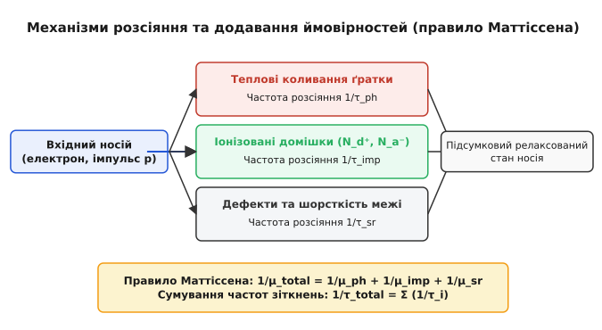
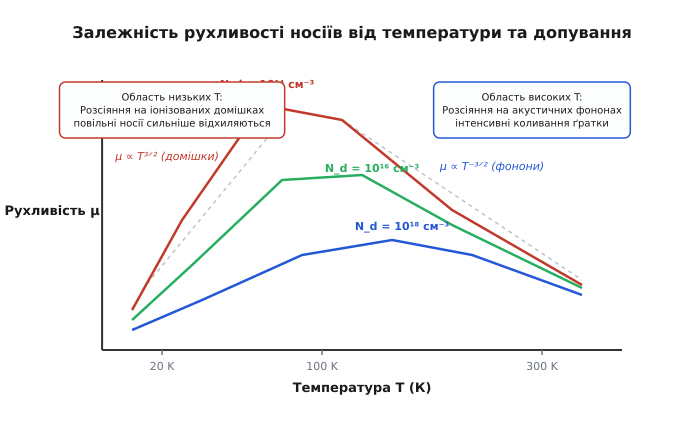
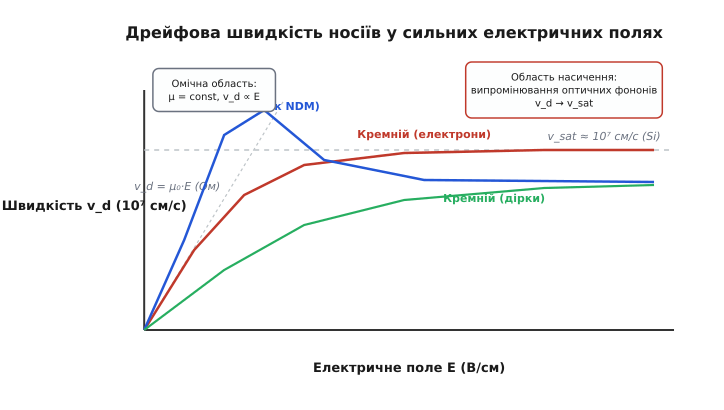
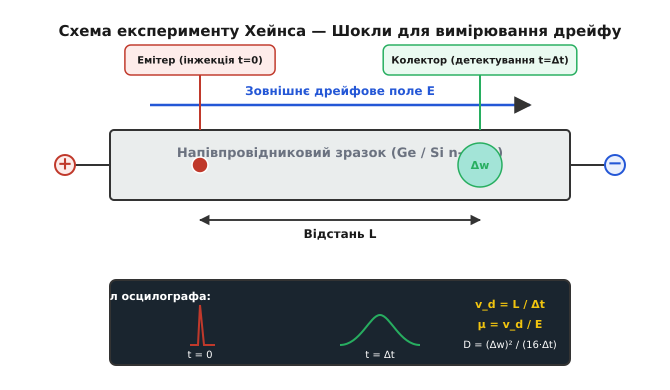

# Рухливість носіїв заряду

<preknowlist>
- [Модель Друде](root:ph-condensed/drude-model) — час релаксації, дрейфова швидкість та середня довжина вільного пробігу.
- [Зонна теорія твердого тіла](root:ph-condensed/band-theory) — ефективна маса носіїв, енергетичні зони та долони.
- [Напівпровідник](root:ph-condensed/semiconductor) — власна та домішкова провідність, електрони й дірки.
- [Легування](root:ph-condensed/doping) — донори, акцептори, іонізована та нейтральна домішка.
</preknowlist>

Коли до кристала напівпровідника з питомим опором у кілька Ом-сантиметрів прикладають зовнішнє електричне поле напруженістю `100 В/см`, електрони у зоні провідності не прискорюються нескінченно. Замість безперервного розгону носії досягають постійної середньої швидкості дрейфу всього у кілька тисяч сантиметрів за секунду. Причина полягає у тому, що кожні `10⁻¹³ секунди` електрон хаотично змінює свій напрямок у результаті зіткнень із тепловими коливаннями атомів та іонами домішок.

Здатність носіїв заряду маневрувати крізь кристалічні ґрати під дією електричного поля визначає коефіцієнт пропорційності між напруженістю цього поля та набутою середньою дрейфовою швидкістю. Цю фізичну величину називають **рухливістю носіїв заряду** (лат. *mobilitas* — здатність до руху, грец. *κίνησις* — дрейфовий рух). Вона є фундаментальним параметром, що зв'язує мікроскопічні квантові зіткнення частинок із макроскопічним струмом напівпровідникових приладів.

## 1. Фізична природа дрейфового транспорту та означення рухливості

У відсутності зовнішнього електричного поля вільні електрони та дірки перебувають у стані безперервного хаотичного теплового руху. Середня швидкість цього хаотичного руху при кімнатній температурі підкоряється розподілу Максвелла — Больцмана або Фермі — Дірака і становить величину порядку `10⁷ см/с` (близько `100 км/с`). Проте векторна сума всіх швидкостей дорівнює нулю, тому результуючий електричний струм у кристалі відсутній.

При накладанні зовнішнього електричного поля `E` на хаотичний тепловий рух накладається слабкий спрямований зсув — **дрейф**. Між двома послідовними зіткненнями електрична сила `F = q · E` надає носію прискорення `a = q · E / m*`, де `m*` — ефективна маса носія заряду у кристалічній ґратці. За час вільного пробігу `τ` (час релаксації імпульсу) носій набуває додаткової дрейфової швидкості `v_d = a · τ`.

Динаміку ансамблю носіїв у квазікласичному наближенні описують рівнянням балансу імпульсу з дисипативним членом загасання:

```
m* · (d v_d / dt) + (m* · v_d) / τ = q · E
```

У стаціонарному стані при постійному електричному полі прискорення припиняється (`d v_d / dt = 0`), оскільки швидкість передачі імпульсу від зовнішнього поля точно врівноважується швидкістю втрати імпульсу під час розсіяння на дефектах та фононах. Звідси випливає вираз для стаціонарної швидкості:

```
v_d = (q · ⟨τ⟩ / m*) · E
```

Коли електрон зіштовхується з дефектом ґратки або фононом, накопичений напрямлений імпульс практично повністю розсіюється, і процес прискорення починається знову. Коефіцієнт пропорційності між дрейфовою швидкістю `v_d` та напруженістю електричного поля `E` називають **рухливістю** `μ`:

```
v_d = μ · E
```

У системі SІ рухливість вимірюється в `м²/(В·с)`, однак у фізиці напівпровідників традиційно та загальноприйнято використовують позасистемну одиницю **`см²/(В·с)`** (`1 м²/(В·с) = 10⁴ см²/(В·с)`). Векторний зв'язок між мікроскопічним дрейфом та густиною струму `j` задається формулою:

```
j = q · n · v_dn + q · p · v_dp = q · (n · μ_n + p · μ_p) · E
```

де `n` та `p` — об'ємні концентрації електронів та дірок, `μ_n` та `μ_p` — їхні відповідні рухливості. Звідси випливає фундаментальний зв'язок між рухливістю та питомою електричною провідністю напівпровідника `σ`:

```
σ = q · (n · μ_n + p · μ_p)
```

Зв'язок рухливості з мікроскопічними параметрами ґратки виражається класичною формулою Друде — Ланжевена:

```
μ = q · ⟨τ⟩ / m*
```

Ця формула розкриває двояку природу рухливості:
1. Вона **прямо пропорційна середньому часу релаксації імпульсу** `⟨τ⟩` — що рідше носій зазнає зіткнень, то вища його рухливість.
2. Вона **обернено пропорційна ефективній масі** `m*` — легкі носії швидше відгукуються на прискорювальне поле.

### Кінетичне рівняння Больцмана та функція розподілу
У суворій статистичній фізиці стан ансамблю носіїв описується функцією розподілу `f(r, k, t)`, яка визначає ймовірність заповнення квантового стану з хвильовим вектором `k` у точці `r`. Під дією зовнішнього поля функція розподілу відхиляється від рівноважного стану Фермі — Дірака `f_0(E)`:

```
f(k) = f_0(E) + f_1(k)
```

У наближенні часу релаксації (RTA, Relaxation Time Approximation) анізотропна поправка `f_1(k)` знаходиться лінеаризацією кінетичного рівняння Больцмана:

```
f_1(k) = - q · τ(E) · (v(k) · E) · (∂f_0 / ∂E)
```

Густина електричного струму обчислюється інтегруванням за першою зоною Бріллюена:

```
j = - (q / 4π³) · ∫ v(k) · f_1(k) · d³k
```

Підставляючи вираз для `f_1(k)` та враховуючи, що для параболічної зони швидкість носія пов'язана з квазіімпульсом як `v(k) = ℏk / m*`, отримуємо пряме підтвердження закону Ома `j = σ · E`, де провідність виражається через статистично усереднений час релаксації імпульсу:

```
⟨τ⟩ = (2 / (3 k_B T)) · ( ∫₀^∞ τ(E) · E^(3/2) · exp(- E / (k_B T)) · dE ) / ( ∫₀^∞ E^(1/2) · exp(- E / (k_B T)) · dE )
```

### Ієрархія характерних часів релаксації
У фізиці кінетичних явищ розрізняють три принципово різні часи релаксації:
- **Час релаксації імпульсу `τ_m` (або `τ_p`)**: середній час, за який носій втрачає пам'ять про початковий напрямок свого руху. Саме цей час входить у вираз для рухливості та електропровідності. Оскільки розсіяння на акустичних фононах та домішках часто є анізотропним, час релаксації імпульсу пов'язаний із квантовим часом життя стану `τ_q` через ваговий фактор розсіяння на кут `θ`:
```
1 / τ_m = ∫ (1 - cos θ) · W(θ) · dΩ
```
Множник `(1 - cos θ)` показує, що розсіяння вперед на малий кут (`θ ≈ 0`) практично не гальмує струм, тоді як розсіяння назад (`θ ≈ π`) дає подвійний внесок.
- **Час релаксації енергії `τ_E`**: характерний час, за який гарячий носій передає накопичену надлишкову кінетичну енергію кристалічній ґратці. Оскільки акустичні зіткнення є квазіпружними (носій втрачає лише малу частку енергії `~ 2 m* v_s / p ≪ 1` за один акт), для повної релаксації енергії потрібно від десятків до сотень зіткнень. Тому час релаксації енергії значно довший за час релаксації імпульсу: `τ_E ≈ (10–100) · τ_m`.
- **Час фазової когерентності `τ_φ`**: час, протягом якого зберігається фаза квантової хвильової функції електрона. Він визначає квантові інтерференційні ефекти та довжину фазової когерентності `L_φ = √(D · τ_φ)`. Будь-яке непружне зіткнення руйнує квантову фазу, тому при підвищенні температури `τ_φ` стрімко падає.

### Зонна анізотропія та тензор ефективної маси
У багатьох напівпровідниках зонна структура має анізотропні (еліпсоїдальні) ізоенергетичні поверхні. Тензор зворотної ефективної маси визначається кривиною дисперсійного співвідношення `E(k)` у просторі хвильових векторів:

```
(1 / m*)_{ij} = (1 / ℏ²) · (∂²E(k) / ∂k_i ∂k_j)
```

Наприклад, у кремнії зона провідності має шість еквівалентних `X`-долин, розташованих на осях симетрії `⟨100⟩` на відстані `k_0 ≈ 0.85 · (2π / a)` від центру зони Бріллюена. Ізоенергетичні поверхні кожної долини є еліпсоїдами обертання з поздовжньою масою `m_l* ≈ 0.98 m_0` (уздовж осі еліпсоїда) та поперечною масою `m_t* ≈ 0.19 m_0` (у перпендикулярній площині).

У кожній окремій долині рухливість є анізотропною тензорною величиною:

```
μ_l = q · ⟨τ⟩ / m_l*    [поздовжня рухливість вздовж осі долини]
μ_t = q · ⟨τ⟩ / m_t*    [поперечна рухливість перпендикулярно до осі]
```

Для кубічного кристала кутова сума за всіма шістьма еквівалентними долинами рівномірно усереднюється, утворюючи скалярну провідну рухливість з усередненою **тензорною ефективною масою провідності** `m_c*`:

```
1 / m_c*
= (1 / 3) · (1 / m_l* + 1 / m_t* + 1 / m_t*)
= (1 / 3) · (1 / m_l* + 2 / m_t*)    [усереднення для трьох взаємно перпендикулярних пар долин]
```

Підставляючи параметри кремнію, отримуємо значення маси провідності електронів:

```
1 / m_c*
= (1 / 3) · (1 / 0.98 + 2 / 0.19)    [підстановка поздовжньої та поперечної мас кремнію]
= (1 / 3) · (1.020 + 10.526)         [обчислення компонентів тензора]
= (1 / 3) · 11.546                   [підсумовування парціальних внесків]
= 3.849 m_0⁻¹                        [ділення на три для кубічної симетрії]
```

Звідси `m_c* = 1 / 3.849 ≈ 0.26 m_0`.

У германії зона провідності має чотири еквівалентні `L`-долини вздовж осей `⟨111⟩` на межі зони Бріллюена з сильною анізотропією: `m_l* ≈ 1.64 m_0` та `m_t* ≈ 0.082 m_0`. Усереднена маса провідності германію становить:

```
1 / m_c*
= (1 / 3) · (1 / 1.64 + 2 / 0.082)   [підстановка анізотропних мас германію]
= (1 / 3) · (0.610 + 24.390)         [обчислення парціальних внесків долин]
= 8.333 m_0⁻¹                        [усереднення за чотирма L-долинами]
```

Звідси `m_c* = 1 / 8.333 ≈ 0.12 m_0`.

Слід суворо відрізняти масу провідності `m_c*` від **маси густини станів** `m_dos*`, яка використовується при термодинамічному розрахунку ефективної густини станів `N_c` та концентрації носіїв. Для `M` еквівалентних еліпсоїдальних долин маса густини станів враховує повний фазовий об'єм:

```
m_dos* = M^(2/3) · (m_l* · m_t*²)^(1/3)
```

Для кремнію (`M = 6`): `m_dos* = 6^(2/3) · (0.98 · 0.19²)^(1/3) ≈ 3.302 · 0.328 ≈ 1.08 m_0`.

### Валентна зона та ефективні маси дірок
Вершина валентної зони більшості алмазоподібних напівпровідників та сполук `III-V` розташована в центрі зони Бріллюена (`k = 0`) і утворена трьома гілками через спін-орбітальну взаємодію:
1. **Зона важких дірок (HH, Heavy Holes)**: має малу кривину і велику ефективну масу (`m_hh* ≈ 0.49 m_0` у кремнії).
2. **Зона легких дірок (LH, Light Holes)**: має круту дисперсію і малу масу (`m_lh* ≈ 0.16 m_0` у кремнії).
3. **Спін-орбітально відщеплена зона (SO, Split-Off)**: опущена вниз на величину енергії спін-орбітального розщеплення `Δ_so` (`44 меВ` у Si, `290 меВ` у Ge, `340 меВ` у GaAs).

Ізоенергетичні поверхні важких та легких дірок не є сферичними, а мають складну гофровану (warped) форму, яка описується параметрами Латтінжера:

```
E(k) = - (ℏ² / 2 m_0) · [ A · k² ± √( B² · k⁴ + C² · (k_x² k_y² + k_y² k_z² + k_z² k_x²) ) ]
```

Анізотропія валентної зони призводить до різкої залежності ефективної маси дірок від кристалографічного напрямку. У кремнії вздовж головних осей маси важких та легких дірок дорівнюють:
- Вздовж напрямку `⟨100⟩`:
```
m_hh*(100) = m_0 / (A - B) = m_0 / (4.22 - 0.78) ≈ 0.29 m_0
m_lh*(100) = m_0 / (A + B) = m_0 / (4.22 + 0.78) ≈ 0.20 m_0
```
- Вздовж напрямку `⟨111⟩`:
```
m_hh*(111) = m_0 / [ A - √(B² + C² / 3) ] = m_0 / [ 4.22 - √(0.608 + 7.680) ] ≈ 0.74 m_0
m_lh*(111) = m_0 / [ A + √(B² + C² / 3) ] = m_0 / [ 4.22 + 2.879 ] ≈ 0.14 m_0
```

Ця виражена орієнтаційна анізотропія діркової маси пояснює, чому швидкодія p-канальних транзисторів сильно залежить від площини вирощування пластини та орієнтації струмопровідного каналу.

Сумарна провідність дірок формується паралельним рухом легких та важких дірок. Оскільки важкі дірки мають значно більшу густину станів (`g_hh(E) ∝ m_hh*^(3/2)`), більшість дірок заселяє важку підзону (`~90%`), проте легкі дірки мають у кілька разів вищу швидкість і дають значний внесок у струм. Ефективна маса провідності дірок обчислюється як:

```
m_p,c* = (m_hh*^(3/2) + m_lh*^(3/2)) / (m_hh*^(1/2) + m_lh*^(1/2))
```

Для чистого кремнію це дає `m_p,c* ≈ 0.37 m_0`.

### Порівняльна характеристика рухливості у ключових напівпровідниках

Завдяки суттєво меншій ефективній масі електронів порівняно з дірками у більшості напівпровідників (`m_n* < m_p*`), електронна рухливість `μ_n` майже завжди перевищує діркову рухливість `μ_p`.

| Матеріал | Ширина зони `E_g` (еВ) | `m_n,c* / m_0` | `μ_n` (см²/(В·с)) | `m_p,c* / m_0` | `μ_p` (см²/(В·с)) | Відношення `μ_n / μ_p` |
| :--- | :--- | :--- | :--- | :--- | :--- | :--- |
| **Кремній (`Si`)** | `1.12` | `0.260` | `1400` | `0.370` | `470` | `3.0 : 1` |
| **Германій (`Ge`)** | `0.66` | `0.120` | `3900` | `0.280` | `1900` | `2.1 : 1` |
| **Арсенід галію (`GaAs`)** | `1.42` | `0.067` | `8500` | `0.450` | `400` | `21.2 : 1` |
| **Фосфід індію (`InP`)** | `1.34` | `0.077` | `5400` | `0.640` | `200` | `27.0 : 1` |
| **Антимонід індію (`InSb`)** | `0.17` | `0.014` | `77 000` | `0.400` | `850` | `90.6 : 1` |
| **Нітрид галію (`GaN`)** | `3.40` | `0.200` | `1250` | `0.800` | `30` | `41.7 : 1` |
| **Карбід кремнію (`4H-SiC`)** | `3.26` | `0.360` | `950` | `0.900` | `115` | `8.3 : 1` |
| **Алмаз (`C`)** | `5.47` | `0.480` | `4500` | `0.360` | `3800` | `1.2 : 1` |

В арсеніді галію `GaAs` через пряму зонну структуру та екстремально легку центральну `Γ`-долину (`m_n* ≈ 0.067 m_0`) електронна рухливість досягає `8500 см²/(В·с)`, що у `21` раз перевищує діркову рухливість. В антимоніді індію `InSb` надлегка маса (`0.014 m_0`) забезпечує рекордну кімнатну рухливість `77 000 см²/(В·с)`.

### Розрахунковий приклад: визначення мікроскопічних параметрів дрейфу
**Умова:** Кристал кремнію `n`-типу з рухливістю електронів `μ_n = 1400 см²/(В·с)` та ефективною масою провідності `m_c* = 0.26 m_0` перебуває при кімнатній температурі `T = 300 К` під дією електричного поля `E = 200 В/см`. Необхідно визначити середню теплову швидкість електронів `v_th`, середній час релаксації імпульсу `⟨τ⟩`, середню довжину вільного пробігу `l_mfp`, набуту дрейфову швидкість `v_d` та відношення швидкостей.

**Покроковий розрахунок:**

1. Обчислюємо теплову швидкість електронів за теоремою про рівнорозподіл енергії:
```
v_th
= √( (3 · k_B · T) / m_c* )                                                                 [теорема про рівнорозподіл теплової енергії]
= √( (3 · 1.381 × 10⁻²³ Дж/К · 300 К) / (0.26 · 9.109 × 10⁻³¹ кг) )                         [підстановка фундаментальних сталих та маси провідності]
= √( (1.243 × 10⁻²⁰ Дж) / (2.368 × 10⁻³¹ кг) )                                              [обчислення чисельника та знаменника під коренем]
= √( 5.249 × 10¹⁰ м²/с² )                                                                   [ділення енергії на ефективну масу]
≈ 2.29 × 10⁵ м/с = 2.29 × 10⁷ см/с                                                         [добування квадратного кореня]
```

2. Визначаємо середній час релаксації імпульсу з формули Друде (`μ = q · ⟨τ⟩ / m*`):
```
⟨τ⟩
= (μ_n · m_c*) / q                                                    [формула Друде для часу релаксації імпульсу]
= (0.14 м²/(В·с) · 0.26 · 9.109 × 10⁻³¹ кг) / (1.602 × 10⁻¹⁹ Кл)      [підстановка рухливості кремнію в одиницях SI]
= (3.316 × 10⁻³¹ кг·м²/(В·с)) / (1.602 × 10⁻¹⁹ Кл)                    [обчислення добутку імпульсу]
≈ 2.07 × 10⁻¹³ с = 0.207 пс                                           [знаходження середнього часу між зіткненнями]
```

3. Обчислюємо середню довжину вільного пробігу між зіткненнями:
```
l_mfp
= v_th · ⟨τ⟩                                                          [визначення довжини вільного пробігу через швидкість і час]
= 2.29 × 10⁵ м/с · 2.07 × 10⁻¹³ с                                     [підстановка теплової швидкості та часу релаксації]
≈ 4.74 × 10⁻⁸ м = 47.4 нм                                             [обчислення середньої дистанції прольоту]
```

4. Обчислюємо набуту середню дрейфову швидкість у полі `200 В/см`:
```
v_d
= μ_n · E                                                             [лінійний закон омічного дрейфу носіїв]
= 1400 см²/(В·с) · 200 В/см                                           [підстановка рухливості та напруженості поля]
= 2.80 × 10⁵ см/с = 2.80 × 10³ м/с                                    [обчислення результуючої швидкості дрейфу]
```

5. Порівнюємо дрейфову швидкість із тепловою:
```
v_d / v_th
= (2.80 × 10⁵ см/с) / (2.29 × 10⁷ см/с)
≈ 0.0122 = 1.22%
```

**Висновок:** Навіть при помітному електричному полі `200 В/см` спрямована швидкість дрейфу складає трохи більше одного відсотка від швидкості хаотичного теплового руху. Електрон пролітає в середньому близько `47 нм` (понад `80` постійних ґратки кремнію `a = 0.543 нм`) між двома послідовними розсіяннями.

## 2. Мікроскопічні канали розсіяння та температурна динаміка

Ідеальний періодичний потенціал нескінченного кристала не створює жодного опору руху квантової електронної хвилі Блоха. Опір виникає виключно через порушення трансляційної симетрії потенціалу. Головними мікроскопічними механізмами розсіяння в об'ємі напівпровідника є:

1. **Розсіяння на теплових коливаннях ґратки (акустичних та оптичних фононах)**.
2. **Розсіяння на іонізованих домішках (донорах та акцепторах)**.
3. **Розсіяння на нейтральних домішках та точкових дефектах**.
4. **Міждолинне розсіяння (intervalley scattering)**.
5. **П'єзоелектричне розсіяння** (у полярних кристалах `III-V` та `II-VI`).
6. **Розсіяння на статистичному безладі твердого розчину (alloy scattering)**.
7. **Розсіяння на протяжних дефектах та дислокаціях**.
8. **Міжносійне розсіяння (електрон-електронне та електрон-діркове)**.

Детальне квантово-механічне виведення інтенсивностей квантового розсіяння на основі рівняння Больцмана та золотого правила Фермі наведено у вставці [Квантово-механічна теорія розсіяння носіїв](root:ph-condensed/carrier-mobility/math-scattering-mechanisms.md).


*Залежність рухливості носіїв у кремнії від температури при різних рівнях легування донорами.*

### Внутрішньодолинне розсіяння на акустичних фононах
При температурах, відмінних від абсолютного нуля, атоми кристалічної ґратки здійснюють теплові коливання навколо положень рівноваги. Квантами цих коливань є **фонони**. Зсув атомів у поздовжній акустичній хвилі створює локальне стиснення або розрідження кристала `ΔV / V = ∇ · u(r)`. Це модулює край зони провідності на величину деформаційного потенціалу `δE_c = E_d · ∇ · u(r)`.

У багатодолинних напівпровідниках деформація описується тензором Геррінга — Фогта з двома константами: константою всебічного стиску `Ξ_d` та константою зсувної деформації `Ξ_u`:

```
δE_c = Ξ_d · Tr(S) + Ξ_u · (e_valley · S · e_valley)
```

Для кремнію `Ξ_d ≈ 1.1 еВ`, а `Ξ_u ≈ 10.5 еВ`. Для германію `Ξ_d ≈ -12.3 еВ`, а `Ξ_u ≈ 16.3 еВ`. Наявність зсувної складової означає, що електрони в анізотропних долинах інтенсивно розсіюються не лише поздовжніми (LA), а й поперечними акустичними фононами (TA).

Оскільки швидкість звуку в кристалі `v_s ≈ 5–9 × 10⁵ см/с` на два порядки менша за теплову швидкість електронів `v_th ≈ 10⁷ см/с`, енергія акустичного фонона `ℏω_q = ℏ v_s q ≈ 1–3 меВ` є набагато меншою за середню теплову енергію електрона `k_B T ≈ 25.9 меВ` при кімнатній температурі. Тому зіткнення з акустичними фононами є **квазіпружними** (`E(k') ≈ E(k)`).

Згідно з квантовою статистикою, число акустичних фононів описується законом Релея — Джинса: `N_q ≈ k_B T / (ℏω_q) ∝ T`. Ймовірність розсіяння пропорційна числу фононів та квантовій густині кінцевих станів `g(E) ∝ m*^(3/2) · √E`:

```
1 / τ_ac(E) ∝ E_d² · k_B T · m*^(3/2) · √E
```

Отже, час релаксації імпульсу падає з енергією як `τ_ac(E) ∝ E^(-1/2) · T⁻¹`. Швидші електрони мають більшу густину станів для розсіяння і зіштовхуються частіше. Усереднення за максвеллівським розподілом `⟨E⟩ = (3/2) k_B T` дає інтегральну залежність:

```
⟨τ_ac⟩ ∝ m*^(-3/2) · (k_B T)^(-3/2)
```

Підставляючи це у формулу Друде `μ = q · ⟨τ⟩ / m*`, отримуємо класичний температурний закон для акустичної фононної рухливості невиродженого напівпровідника:

```
μ_ac ∝ m*^(-5/2) · T^(-3/2)
```

Сильна залежність від ефективної маси `m*^(-5/2)` пояснює, чому матеріали з малою масою електрона демонструють колосально вищу фононну рухливість.

### Розсіяння на оптичних фононах (неполярне та полярне)
Оптичні фонони відповідають коливанням сусідніх атомів у протилежних фазах і мають високу квантову енергію `ℏω_opt` (`~63 меВ` у кремнії, `~36 меВ` у `GaAs`, `~92 меВ` у `GaN`). Їхнє поглинання або випромінювання супроводжується значною зміною енергії носія, тому оптичне розсіяння є суттєво **непружним**.

Розрізняють два типи оптичного розсіяння залежно від хімічного зв'язку:
1. **Неполярне оптичне розсіяння (Non-polar Optical Scattering)**: діє у ковалентних кристалах з однаковими атомами (`Si`, `Ge`). Відносний зсув підґраток створює локальний потенціал оптичної деформації `D_opt`.
2. **Полярне оптичне розсіяння (Polar Optical Phonon, POP / взаємодія Фрьоліха)**: домінує у сполуках з частково іонним зв'язком (`GaAs`, `InP`, `GaN`, `ZnO`). Зсув протилежно заряджених катіонів та аніонів створює макроскопічні поляризаційні електричні поля. Потенціал взаємодії спадає як `1/q`, що робить полярне розсіяння переважно розсіянням на малі кути.

Інтенсивність оптичного розсіяння визначається числом заповнення фононних мод за розподілом Бозе — Ейнштейна `N_LO = 1 / (exp(ℏω_LO / (k_B T)) - 1)`:
- При низьких температурах (`k_B T ≪ ℏω_LO`) оптичні фонони «виморожені» (`N_LO ≈ exp(- ℏω_LO / k_B T) ≪ 1`), і носії не мають достатньої енергії для їхнього випромінювання.
- При кімнатних та високих температурах поглинання та випромінювання LO-фононів стає головним каналом гальмування носіїв у полярних напівпровідниках, обмежуючи теоретичну межу кімнатної рухливості в `GaAs` на рівні `~8500–9000 см²/(В·с)`.

У полярних кристалах сильна взаємодія електрона з поляризаційними коливаннями ґратки формує квазічастинку — **полярон**. Безрозмірна константа зв'язку Фрьоліха дорівнює:

```
α_P = (q² / ℏ) · √( m* / (2 ℏ ω_LO) ) · (1 / ε_∞ - 1 / ε_s) / (4π · ε₀)
```

Для арсеніду галію `GaAs` константа `α_P ≈ 0.06` є малою (полярон слабкого зв'язку), а поляронне перенормування збільшує ефективну масу лише на `1%`: `m_polaron* = m* · (1 + α_P / 6)`. У нітриді галію `GaN` через вищу іонність зв'язку `α_P ≈ 0.49`, що збільшує масу на `8%` і суттєво посилює поляронне гальмування при високих температурах.

### Міждолинне розсіяння (Intervalley Scattering)
У багатодолинних напівпровідниках (кремній, германій) важливим каналом є розсіяння з перекиданням носія з однієї екстремальної долини зони провідності в іншу. Оскільки мінімуми долин розділені у `k`-просторі великим хвильовим вектором `Δk ≈ 1 / a`, для збереження квазіімпульсу під час переходу електрон мусить поглинути або випромінити короткохвильовий фонон із межі зони Бріллюена з великим імпульсом `q ≈ Δk`.

У кремнії розрізняють два типи міждолинних процесів:


*Ілюстрація: Matthiessen Scattering Schematic.*

- **`g`-процеси (g-type scattering)**: розсіяння між протилежними долинами, розташованими на одній кристалографічній осі (наприклад, перехід із `[100]` у `[-100]`). Зміна імпульсу `Δk = 2 k_0 ≈ 1.70 · (2π / a)`, що через вектор зворотної ґратки еквівалентно фонону з `q ≈ 0.30 · (2π / a)`. Здійснюється поздовжніми оптичними фононами з енергією `ℏω_g ≈ 62 меВ`.
- **`f`-процеси (f-type scattering)**: розсіяння між взаємно перпендикулярними долинами (наприклад, перехід із `[100]` у `[010]` або `[001]`). Зміна імпульсу `Δk = √2 · k_0 ≈ 1.20 · (2π / a)`. Здійснюється поперечними акустичними (TA, `ℏω_f ≈ 47 меВ`) та поперечними оптичними фононами (TO, `ℏω_f ≈ 59 меВ`).

Оскільки міждолинні фонони мають високу порогову енергію активації (`47–62 меВ`), міждолинне розсіяння вмикається експоненційно при нагріванні вище `150 К`. Додатковий канал розсіяння призводить до того, що сумарна решіткова рухливість у кремнії спадає з температурою значно швидше за класичний закон `T^(-1.5)`:

```
μ_ph ∝ T^(-2.42)    [для електронів у кремнії]
μ_ph ∝ T^(-2.20)    [для дірок у кремнії]
```

### П'єзоелектричне розсіяння
У напівпровідниках без центру інверсії (`GaAs`, `GaN`, `ZnO`, `CdS`) акустичні деформації викликають електричну поляризацію через прямий п'єзоелектричний ефект: `P_i = e_ijk · S_jk`. Виникаюче внутрішнє п'єзоелектричне поле розсіює носії заряду.

Час релаксації для п'єзоелектричного розсіяння має залежність `τ_pe(E) ∝ E^(1/2) · T⁻¹`, а температурна залежність рухливості підкоряється закону:

```
μ_pe ∝ m*^(-3/2) · T^(-1/2)
```

П'єзоелектричне розсіяння є слабшим за акустичне при високих температурах, однак в інтервалі `20–80 К` у чистих кристалах `GaAs` та `GaN` воно відіграє помітну роль.

### Розсіяння на іонізованих домішках (Брукс — Геррінг та Конуелл — Вайспкопф)
Коли у напівпровідник вводять легуючі домішки (наприклад, фосфор або бор у кремній), атоми домішок іонізуються, перетворюючись на нерухомі позитивні `N_d⁺` або негативні `N_a⁻` іони. Електрон, пролітаючи поблизу іона, зазнає кулонівського відхилення (квантовий аналог резерфордівського розсіяння).

Ключова фізична особливість кулонівського розсіяння полягає у сильній залежності від швидкості носія: **повільні носії зазнають значно сильнішого відхилення, ніж швидкі**. Сила Кулона діє протягом часу прольоту `Δt ≈ b / v`, де `b` — прицільний параметр. Імпульс сили, переданий електрону, дорівнює `Δp = ∫ F dt ∝ 1 / v`. Кут відхилення `θ ≈ Δp / p ∝ 1 / v² ∝ 1 / E`. Швидкі електрони з високою кінетичною енергією пролітають повз іон практично без відхилення.

Час релаксації імпульсу для кулонівського розсіяння зростає з кінетичною енергією як `τ_imp(E) ∝ E^(3/2) / N_i`. При підвищенні температури середня теплова швидкість носіїв зростає (`v_th ∝ √T`), тому усереднений час релаксації збільшується:

```
⟨τ_imp⟩ ∝ (k_B T)^(3/2) / N_i
```

Формула Брукса — Геррінга, що враховує екранування кулонівського потенціалу хмарою вільних носіїв за радіусом Дебая `λ_D`, дає залежність:

```
μ_imp = [ 2^(7/2) · (4π · ε)² · (k_B T)^(3/2) ] / [ π^(3/2) · q³ · m*^(1/2) · N_i · g(b) ]
```

де функція екранування `g(b) = ln(1 + b) - b / (1 + b)`, а параметр екранування дорівнює `b = (8 m* · E · λ_D²) / ℏ²`.

Таким чином, розсіяння на іонізованих домішках має **прямо протилежну температурну залежність** порівняно з фононним розсіянням: при охолодженні напівпровідника домішково-обмежена рухливість падає, а при нагріванні — зростає.

У сильнолегованих матеріалах застосовують модель Конуелл — Вайспкопфа, де екранування задається відсіканням прицільного параметра на половині середньої відстані між домішками `d = 1 / (2 N_i^(1/3))`:

```
μ_CW = [ 64 · π² · ε² · (2 k_B T)^(3/2) ] / [ q³ · m*^(1/2) · N_i · ln( 1 + (12π · ε · k_B T / (q² · N_i^(1/3)))² ) ]
```

### Розсіяння на нейтральних домішках та дефектах
При глибокому охолодженні (`T < 30 К` для Si) теплової енергії недостатньо для іонізації домішок, і вільні носії «виморожуються» назад на донорні та акцепторні рівні. Іонізоване розсіяння зникає, поступаючись місцем **розсіянню на нейтральних атомах домішок**.

Нейтральний донор можна розглядати як воднеподібний атом з діелектричною проникністю середовища `ε` та ефективним радіусом Бора `a_B* = (4π · ε · ℏ²) / (m* · q²)`. Ергінсой (Erginsoy) на основі квантової теорії розсіяння електронів на атомах водню отримав точний аналітичний вираз:

```
μ_neut = (m* · q³) / (20 · ε · ℏ³ · N_neut)
```

Головна особливість розсіяння на нейтральних домішках полягає у тому, що час релаксації `τ_neut` **не залежить від кінетичної енергії електрона**, а отже, рухливість `μ_neut` **не залежить від температури**.

### Розсіяння на статистичному безладі сплаву (Alloy Scattering)
У напівпровідникових твердих розчинах (бінарних та потрійних сплавах `Al_x Ga_{1-x} As`, `In_x Ga_{1-x} As`, `Si_{1-x} Ge_x`) атоми різних сортів статистично хаотично розподілені по вузлах підґратки. Флуктуації локального кристалічного потенціалу `ΔU_alloy` викликають додаткове розсіяння носіїв.

Час релаксації для розсіяння на безладі сплаву описується виразом Брукса:

```
1 / τ_alloy(E) = (3π³ / 8) · [ x · (1 - x) · (ΔU_alloy)² · m*^(3/2) · √E · Ω_0 ] / ℏ⁴
```

де `Ω_0` — об'єм елементарної комірки. Температурна залежність рухливості підкоряється закону `μ_alloy ∝ T^(-1/2) / [ x(1-x) ]`. Це розсіяння суттєво обмежує рухливість у гетероструктурах на основі `InGaAs` при низьких температурах.

### Розсіяння на дислокаціях у гетероструктурах
У гетероструктурах із неузгодженими параметрами кристалічної ґратки (наприклад, плівки `GaN` на сапфірі або `SiC`) утворюються проростаючі дислокації з густиною `N_dis ≈ 10⁸–10¹⁰ см⁻²`. Крайові дислокації мають обірвані хімічні зв'язки вздовж лінії дефекту, які захоплюють електрони і перетворюються на негативно заряджені циліндричні стрижні з лінійною густиною заряду `λ_dis = q / c`.

Розсіяння носіїв на екранованому кулонівському потенціалі зарядженої лінії дислокації описується моделлю Пьодьора (Pödör):

```
μ_dis = [ 32 · ε² · c² · (k_B T)^(3/2) ] / [ N_dis · q³ · m*^(1/2) · λ_D · (1 + 4 · b_dis)^(3/2) ]
```

де `b_dis = (8 m* · E · λ_D²) / ℏ²`. Рухливість на дислокаціях зростає з температурою як `μ_dis ∝ T^(3/2)` і обмежує кріогенну рухливість у широкозонних матеріалах.

### Міжносійне розсіяння (електрон-електронне та електрон-діркове)
Прямі кулонівські зіткнення між носіями заряду поділяють на два класи:
1. **Електрон-електронні зіткнення (`e-e`)**: зберігають сумарний квазіімпульс електронної підсистеми (`p_1 + p_2 = p_1' + p_2'`). Тому в ізотропній параболічній зоні вони не змінюють сумарний електричний струм безпосередньо. Проте вони інтенсивно перерозподіляють енергію між електронами, формуючи зміщену максвеллівську функцію розподілу з ефективною електронною температурою `T_e`.
2. **Електрон-діркові зіткнення (`e-h`, ефект захоплення носіїв / carrier drag)**: оскільки електрони та дірки під дією електричного поля рухаються у протилежних напрямках, кулонівські зіткнення між ними передають імпульс у протилежний бік, діючи як взаємне тертя. При високих рівнях інжекції (у силових біполярних транзисторах, тиристорах та напівпровідникових лазерах) електрон-діркове тертя суттєво знижує рухливість обох типів носіїв.


*Паралельне додавання частот зіткнень різних механізмів розсіяння за правилом Маттіссена.*

### Правило Маттіссена та результуюча крива рухливості
Якщо в кристалі одночасно діють кілька незалежних механізмів розсіяння, ймовірності квантових переходів за одиницю часу для кожного фіксованого енергетичного стану `E` додаються адитивно:

```
1 / τ_total(E) = 1 / τ_ph(E) + 1 / τ_imp(E) + 1 / τ_neut(E) + 1 / τ_alloy(E) + 1 / τ_dis(E) + 1 / τ_sr(E)
```

Звідси випливає макроскопічне наближене **правило Маттіссена**: зворотна величина підсумкової рухливості дорівнює сумі зворотних величин парціальних рухливостей для кожного механізму:

```
1 / μ_total ≈ 1 / μ_ph + 1 / μ_imp + 1 / μ_neut + 1 / μ_alloy + 1 / μ_dis + 1 / μ_sr
```

Аналіз сумарної температурної кривої `μ(T)` розкриває три характерні області:
1. **Область низьких температур (`T < 50 К`)**: домінує розсіяння на іонізованих домішках, рухливість зростає за законом `μ ∝ T^(3/2)`.
2. **Максимум рухливості (`T ≈ 50–100 К`)**: інтенсивності домішкового та фононного розсіяння порівнюються, досягається пікове значення рухливості (у чистому кремнії — понад `10⁴ см²/(В·с)`).
3. **Область високих температур (`T > 150 К`)**: домінує розсіяння на фононах ґратки, рухливість падає за законом `μ ∝ T^(-2.42)`.

### Межі застосовності правила Маттіссена
Точне кінетичне усереднення вимагає спочатку підсумувати мікроскопічні частоти зіткнень для кожного енергетичного рівня `E`, а вже потім взяти інтеграл за енергіями:

```
μ_exact = (q / m*) · ⟨ [ 1 / τ_ph(E) + 1 / τ_imp(E) ]⁻¹ ⟩
```

Макроскопічне правило Маттіссена виконує усереднення кожного доданка окремо: `1 / μ_Matthiessen = 1 / μ_ph + 1 / μ_imp`. Оскільки залежності `τ_ph(E) ∝ E^(-1/2)` та `τ_imp(E) ∝ E^(3/2)` мають протилежні енергетичні нахили, точна інтеграція показує, що просте правило Маттіссена занижує реальну рухливість на `10–15%` у перехідній області (`T ≈ 70 К`), де обидва механізми мають однакову силу.

### Розрахунковий приклад: розрахунок рухливості за правилом Маттіссена
**Умова:** У кристалі кремнію при температурі `T = 300 К` парціальна рухливість, зумовлена розсіянням на фононах ґратки, становить `μ_ph = 1400 см²/(В·с)`, а парціальна рухливість на іонізованих домішках при даній концентрації дорівнює `μ_imp = 700 см²/(В·с)`. Визначити сумарну рухливість електронів за правилом Маттіссена та знайти частку внеску кожного механізму.

**Покроковий розрахунок:**

1. Записуємо правило Маттіссена для двох механізмів:
```
1 / μ_total
= 1 / μ_ph + 1 / μ_imp                                                [правило Маттіссена для двох механізмів]
= 1 / 1400 + 1 / 700                                                  [підстановка парціальних рухливостей]
= 0.000714 + 0.001429                                                 [обчислення зворотних величин]
= 0.002143 (В·с)/см²                                                  [сумування частот розсіяння]
```

2. Обчислюємо сумарну рухливість:
```
μ_total
= 1 / 0.002143
≈ 466.7 см²/(В·с)
```

3. Визначаємо відносний внесок кожного механізму в загальний опір:
```
Внесок фононів = (1 / μ_ph) / (1 / μ_total) = 0.000714 / 0.002143 ≈ 33.3%
Внесок домішок = (1 / μ_imp) / (1 / μ_total) = 0.001429 / 0.002143 ≈ 66.7%
```

**Висновок:** Домішкове розсіяння дає дві третини від загального гальмування, знижуючи результуючу рухливість кристала втричі порівняно з чистим матеріалом.

## 3. Залежність від концентрації домішок та ефекти екранування

У слаболегованому напівпровіднику (`N < 10¹⁴ см⁻³`) середня відстань між іонами домішок перевищує `200 нм`. Домішкове розсіяння при кімнатній температурі є нехтовно малим, і рухливість виходить на решіткове плато (`μ_n ≈ 1400 см²/(В·с)` у `Si`).

Зі зростанням концентрації домішок понад `10¹⁶ см⁻³` середня відстань між іонами стає меншою за `40 нм`, і кулонівське розсіяння починає стрімко деградувати рухливість. При концентраціях `N > 10¹⁸ см⁻³` рухливість електронів у кремнії падає більш ніж у `5` разів — до величин нижче `250 см²/(В·с)`.

### Фізика кулонівського екранування Дебая та Томаса — Фермі
У напівпровідниках кулонівське поле домішкового іона послаблюється рухомою хмарою вільних носіїв. Ефективний радіус дії кулонівського потенціалу Юкави `V(r) = (Z q / 4πε r) · exp(- r / λ)` визначається характером квантового виродження електронного газу:

1. **Невироджений електронний газ (`E_F` нижче дна зони провідності на `> 3 k_B T`)**: екранування описується класичною **довжиною Дебая**:
```
λ_D = √( (ε · k_B · T) / (q² · n) )
```

2. **Вироджений електронний газ (`E_F` всередині зони провідності)**: носії підкоряються статистиці Фермі — Дірака, і тепловий рух замінюється квантовим тиском Фермі. Екранування описується моделлю **Томаса — Фермі**:
```
λ_TF = √( (2 · ε · E_F) / (3 · q² · n) ) = √( (ε · ℏ² · π^(4/3)) / (q² · m* · (3 n)^(1/3)) )


*Ілюстрація: Mobility Vs Temperature.*

```

Зі збільшенням концентрації вільних носіїв `n` радіус екранування зменшується, що частково пригнічує далекодіюче кулонівське розсіяння, однак висока густина самих іонів компенсує цей ефект і призводить до монотонного падіння рухливості.

### Діапазони легування та квантовий перехід Мотта
Фізику домішкового транспорту поділяють на три характерні області концентрацій:
1. **Слабке легування (`N < 10¹⁵ см⁻³`)**: радіус Дебая великий, домішкові центри ізольовані.
2. **Середнє легування (`10¹⁵–10¹⁸ см⁻³`)**: застосовується теорія Брукса — Геррінга з дебаївським екрануванням.
3. **Сильне легування та перехід Мотта (`N > 3 × 10¹⁸ см⁻³` у Si)**: хвильові функції сусідніх донорних електронів перекриваються (`n_c^(1/3) · a_B* ≈ 0.25`). Відбувається квантовий фазовий перехід метал-діелектрик (перехід Мотта). Дискретні донорні рівні розширюються в домішкову зону, яка зливається з дном зони провідності.

При сильному легуванні спостерігається ефект звуження забороненої зони (Bandgap Narrowing, BGN), що описується законом:

```
ΔE_g = A_BGN · (N_total / 10¹⁸)^(1/3)
```

де для кремнію `A_BGN ≈ 22.5 меВ`. У цій області іони починають утворювати нейтральні пари та кластери, що описується емпіричною моделлю Масетті.

### Неповна іонізація домішок та виморожування носіїв
Концентрація іонізованих донорів підкоряється статистиці Фермі — Дірака з фактором виродження `g_d = 2` (для спіну `1/2`):

```
N_d⁺ = N_d / [ 1 + g_d · exp( (E_F - E_d) / (k_B T) ) ]
```

При зниженні температури рівень Фермі наближається до донорного рівня `E_d`, і більшість електронів захоплюється назад на домішкові центри. Енергія активації іонізації `ΔE_d = E_c - E_d` падає зі зростанням концентрації домішок через екранування і зникає при досягненні критичної щільності Мотта:

```
ΔE_d(N_d) = ΔE_{d0} - α_d · N_d^(1/3)
```

Для фосфору в кремнії `ΔE_{d0} ≈ 45 меВ`, а при `N_d > 3.7 × 10¹⁸ см⁻³` енергія активації перетворюється на нуль, і провідність зберігає металевий характер аж до абсолютного нуля.

### Компенсація домішок та деградація провідності
У реальних технологічних процесах напівпровідник часто містить одночасно донори `N_d` та акцептори `N_a`. Такий матеріал називають **компенсованим**.

Концентрація вільних електронів у зоні провідності для `n`-типу визначається різницею:

```
n = N_d⁺ - N_a⁻
```

Однак загальна кількість центрів кулонівського розсіяння дорівнює **сумі всіх іонізованих іонів**:

```
N_i = N_d⁺ + N_a⁻
```

Ступінь компенсації визначається безрозмірним коефіцієнтом `K = N_a / N_d`.

У сильно компенсованому напівпровіднику (`K → 1`) вільна концентрація електронів `n` може бути низькою, тоді як кількість розсіювальних іонів `N_i` — надзвичайно високою. Наприклад, якщо `N_d = 10¹⁸ см⁻³` та `N_a = 9.9 × 10¹⁷ см⁻³`, то результуюча концентрація носіїв становить всього `n = 10¹⁶ см⁻³`. Проте рухливість у такому зразку визначається повною концентрацією іонів `N_i ≈ 2 × 10¹⁸ см⁻³` і складатиме лише `~150 см²/(В·с)` замість `1200 см²/(В·с)` для некомпенсованого кремнію з тією ж концентрацією вільних електронів.

Таблиці емпіричних коефіцієнтів та стандартних параметрів для чисельного розрахунку концентраційної залежності рухливості за моделями Коугі — Томаса та Масетті наведено у вставці [Довідник емпіричних моделей та параметрів рухливості носіїв](root:ph-condensed/carrier-mobility/api-mobility-models.md).

## 4. Динаміка у сильних електричних полях та насичення швидкості

У слабких електричних полях (`E < 10³ В/см`) середня енергія, яку носій отримує від поля за час вільного пробігу, є незначною порівняно з середньою тепловою енергією `(3/2) k_B T`. Електронний газ перебуває у термодинамічній рівновазі з кристалічною ґраткою, а дрейфова швидкість зростає строго лінійно з полем: `v_d = μ₀ · E` (Омічний режим).

При збільшенні напруженості поля динаміка носіїв проходить через три виражені енергетичні режими:

```
1. Омічний режим (E < 10³ В/см):
   v_d = μ₀ · E,  T_e ≈ T_lattice

2. Режим теплих носіїв (10³ < E < 10⁴ В/см):
   v_d ∝ √E,      T_e > T_lattice (акустичне нагрівання)

3. Режим гарячих носіїв та насичення швидкості (E > 10⁴ В/см):
   v_d → v_sat,   T_e ≫ T_lattice (випромінювання оптичних фононів)
```

У режимі теплих носіїв потужність, що надходить від поля `P_in = q · v_d · E`, перевищує швидкість тепловіддачі до акустичних фононів. Ефективна температура електронного газу `T_e` стає вищою за температуру ґратки:

```
T_e = T_lattice · [ 1 + (E / E_warm)² ]
```

Оскільки хаотична теплова швидкість гарячих електронів зростає (`v_th ∝ √T_e`), частота зіткнень з акустичними фононами збільшується, і диференційна рухливість `μ_diff = dv_d / dE` починає знижуватися.


*Залежність дрейфової швидкості електронів та дірок від напруженості електричного поля.*

### Фізичний механізм насичення швидкості `v_sat`
Коли кінетична енергія носія під дією сильного поля досягає порогової енергії оптичного фонона `ℏω_opt` (`~63 меВ` у кремнії), відкривається надзвичайно інтенсивний квантовий канал дисипації — **спонтанне випромінювання оптичних фононів**.

Час випромінювання оптичного фонона є надзвичайно малим (`τ_opt ≈ 10⁻¹³ с = 0.1 пс`). Як тільки електрон прискорюється полем до енергії `E = ℏω_opt`, він практично миттєво випромінює оптичний фонон, втрачає майже всю накопичену кінетичну енергію, зупиняється, і процес розгону повторюється знову.

Фізична межа максимальної швидкості дрейфу визначається балансом між кінетичною енергією та квантом оптичного фонона `(1/2) m* v_sat² ≈ ℏω_opt / 4`:

```
v_sat = √( ℏω_opt / (2 m*) )
```

Температурна залежність швидкості насичення описується спадною функцією:

```
v_sat(T) = v_sat(300 K) / [ (1 - A_v) + A_v · (T / 300) ]
```

При кріогенному охолодженні кремнію до `77 К` швидкість насичення зростає від `1.07 × 10⁷ см/с` до `1.30 × 10⁷ см/с`.

| Матеріал | Носій | Швидкість насичення `v_sat` (см/с) | Критичне поле `E_c` (кВ/см) | Показник `β` Коугі — Томаса |
| :--- | :--- | :--- | :--- | :--- |
| **Кремній (`Si`)** | Електрони | `1.07 × 10⁷` | `10.0` | `1.11` |
| **Кремній (`Si`)** | Дірки | `8.37 × 10⁶` | `20.0` | `1.21` |
| **Германій (`Ge`)** | Електрони | `6.00 × 10⁶` | `4.0` | `1.00` |
| **Арсенід галію (`GaAs`)** | Електрони | `1.20 × 10⁷` (пік `2.2 × 10⁷`) | `3.5` (пік NDM) | `2.00` |
| **Нітрид галію (`GaN`)** | Електрони | `2.50 × 10⁷` | `150.0` | `1.00` |
| **Карбід кремнію (`4H-SiC`)** | Електрони | `2.20 × 10⁷` | `200.0` | `1.00` |
| **Алмаз (`C`)** | Електрони | `2.70 × 10⁷` | `10.0` | `1.00` |

Емпірична формула Коугі — Томаса для розрахунку польової залежності швидкості має вигляд:

```
v_d(E) = (μ₀ · E) / [ 1 + (μ₀ · E / v_sat)^β ]^(1 / β)
```

де `β ≈ 1.1` для електронів у кремнії та `β ≈ 1.2` для дірок.

### Негативна диференційна рухливість та ефект Ганна
В арсеніді галію `GaAs` та фосфіді індію `InP` залежність `v_d(E)` має немонотонний характер із ділянкою **негативної диференційної рухливості** (NDM, Negative Differential Mobility, де `dv_d / dE < 0`). Це явище називають механізмом Рідлі — Воткінса — Хілсама (RWH) або **ефектом Ганна**.

Зонна структура `GaAs` складається з трьох наборів долин зони провідності:
1. **Центральна `Γ`-долина**: лежить при `k = 0`, має дуже малу ефективну масу `m_Γ* = 0.067 m_0` та високу рухливість `μ_Γ ≈ 8500 см²/(В·с)`.
2. **Бічні `L`-долини**: чотири долини вздовж осей `⟨111⟩`, розташовані вище за енергією на `ΔE = 0.29 еВ`. Вони мають велику ефективну масу `m_L* = 0.55 m_0` та низьку рухливість `μ_L ≈ 100 см²/(В·с)`.

У слабких електричних полях усі електрони перебувають на дні легкої `Γ`-долини і дрейфують з високою швидкістю. Коли напруженість поля перевищує порогове значення `E_th ≈ 3.5 кВ/см`, електрони розігріваються полем до енергії, що перевищує `0.29 еВ`, і починають масово перекидатися в бічні важкі `L`-долини (міждолинний перехід за рахунок поглинання або випромінювання фонона).

Оскільки в `L`-долинах маса електрона у `8` разів більша, а рухливість у `80` разів менша, середня дрейфова швидкість ансамблю стрімко падає від пікового значення `v_peak ≈ 2.2 × 10⁷ см/с` до насиченого рівня `v_sat ≈ 1.0 × 10⁷ см/с`.

```
v_d(E) = [ μ_Γ + μ_L · (n_L / n_Γ) ] · E / [ 1 + n_L / n_Γ ]
```

де співвідношення концентрацій підкоряється експоненційному закону перекидання:

```
n_L / n_Γ = 4 · (m_L* / m_Γ*)^(3/2) · exp( - ΔE / (k_B · T_e) )
```

Виникнення негативної диференційної провідності робить однорідний просторовий розподіл поля нестійким. У зразку формуються рухомі **домени Ганна** — вузькі області надвисокого електричного поля та збагаченого просторового заряду, які дрейфують від катода до анода зі швидкістю `v_sat`. Коли домен досягає анода і розчиняється, на катоді зароджується новий домен, що генерує періодичний високочастотний струм. Цей ефект використовується в діодах Ганна для генерації та підсилення мікрохвильових сигналів на частотах від `10` до `100 ГГц`.

### Квазібалістичний транспорт та сплеск швидкості (Velocity Overshoot)
У сучасних нанорозмірних транзисторах із довжиною каналу менше `50 нм` електрони пролітають канал за час, менший за час релаксації енергії `τ_E ≈ 1 пс`.

Коли холодний електрон влітає з витоку в область екстремально високого електричного поля затвора (`E > 10⁵ В/см`), він миттєво прискорюється із низькопольовою рухливістю `μ₀`. Оскільки для нагрівання електронного газу та активації випромінювання оптичних фононів потрібен скінченний час `τ_E`, протягом перших кількох десятків фемтосекунд електрон не відчуває оптичного гальмування.


*Ілюстрація: Velocity Vs Electric Field.*


У результаті на відстанях до `20–30 нм` виникає **сплеск дрейфової швидкості (velocity overshoot)**: локальна швидкість електронів може сягати значень `(3–4) × 10⁷ см/с` у кремнії та понад `6 × 10⁷ см/с` у `InGaAs`, що у 3–5 разів перевищує стаціонарну швидкість насичення `v_sat`. Це явище забезпечує високу швидкодію сучасних FinFET та нанострічкових (GAAFET) процесорів.

### Метод статистичного моделювання Монте-Карло
Для детального розрахунку високопольового транспорту застосовують чисельний метод ансамблевого Монте-Карло. Програма відстежує рух десятків тисяч псевдоелектронів у фазовому просторі:
1. **Вільний прискорювальний політ**: між зіткненнями хвильовий вектор змінюється лінійно: `k(t) = k(0) + (q · E / ℏ) · t`.
2. **Стохастичний розіграш зіткнення**: тривалість вільного прольоту визначається випадковим числом `r ∈ (0, 1]` за алгоритмом саморозсіяння Ріса: `t_flight = - ln(r) / Γ_max`, де `Γ_max` — максимальна сумарна частота всіх механізмів розсіяння.
3. **Вибір каналу розсіяння**: після польоту випадковим чином обирається один із фізичних каналів (акустичний фонон, полярний фонон, міждолинний `f`- або `g`-перехід), перераховується новий вектор `k'`, і цикл повторюється.

### Ударна іонізація та лавинний пробій у надсильних полях
Коли напруженість електричного поля перевищує `E > 3 × 10⁵ В/см` у кремнії або `E > 3 × 10⁶ В/см` у карбіді кремнію, кінетична енергія гарячих носіїв досягає порогового значення енергії ударної іонізації `E_th ≈ (1.5–1.8) · E_g`.

При зіткненні такого високоенергетичного електрона з атомом ґратки електрон вибиває зв'язаний електрон із валентної зони в зону провідності, генеруючи нову електронно-діркову пару. Інтенсивність генерації описується коефіцієнтом ударної іонізації `α(E)` за законом Чиновета (Chynoweth):

```
α(E) = α_∞ · exp( - E_0 / E )
```

Ударна іонізація встановлює граничну межу робочої напруги польових та біполярних транзисторів і є робочим механізмом у лавинних фотодіодах (APD) та лавинно-пролітних діодах (IMPATT).

## 5. Методи експериментального вимірювання рухливості

Для точного вимірювання кінетичних параметрів у фізичних лабораторіях застосовують прямі та непрямі експериментальні методи.

### Метод ефекту Холла та фактор Холла
Найпоширенішим непрямим методом є вимірювання ефекту Холла у комбінації з вимірюванням питомої провідності на прямокутній структурі (мостик Холла) або за методом чотиризондової геометрії Ван дер Пау (Van der Pauw).

При пропущенні струму `I` через зразок товщиною `d` у перпендикулярному магнітному полі `B` сила Лоренца відхиляє носії заряду до бічної грані. Накопичений поверхневий заряд створює поперечне холлівське поле, що врівноважує силу Лоренца. Холлівська напруга дорівнює:

```
V_H = (R_H · I · B) / d
```

де `R_H` — коефіцієнт Холла. Для одного типу носіїв коефіцієнт Холла пов'язаний з концентрацією через безрозмірний **Холл-фактор `r_H`**:

```
R_H = - r_H / (q · n)    [для електронів]
R_H = + r_H / (q · p)    [для дірок]
```

Добуток коефіцієнта Холла на питому провідність `σ` визначає **холлівську рухливість** `μ_H`:

```
μ_H = |R_H| · σ = r_H · μ_d
```

Холл-фактор `r_H = ⟨τ²⟩ / ⟨τ⟩²` враховує статистичний розподіл швидкостей та залежність часу релаксації від кінетичної енергії `τ(E) ∝ E^s`:

```
r_H = [ Γ(5/2 + 2s) · Γ(5/2) ] / [ Γ(5/2 + s) ]²
```

Точні квантово-статистичні значення Холл-фактора залежать від домінуючого механізму розсіяння:
- **Розсіяння на акустичних фононах (`s = -1/2`)**:
```
r_H
= [ Γ(3/2) · Γ(5/2) ] / [ Γ(2) ]²    [підстановка s = -1/2 у загальну формулу Холл-фактора]
= [ (√π / 2) · (3√π / 4) ] / 1       [значення гамма-функцій напівцілих аргументів]
= 3π / 8 ≈ 1.178                     [точний Холл-фактор для акустичних фононів]
```
- **Розсіяння на іонізованих домішках (`s = +3/2`)**:
```
r_H
= [ Γ(11/2) · Γ(5/2) ] / [ Γ(4) ]²   [підстановка s = +3/2 для іонізованих домішок]
= [ (945√π / 32) · (3√π / 4) ] / 36  [обчислення факторіалів та гамма-функцій]
= 315π / 512 ≈ 1.933                 [точний Холл-фактор для кулонівського розсіяння]
```
- **У сильному магнітному полі (`μ · B ≫ 1`) або у виродженому електронному газі**: циклотронне обертання усереднює розкид за енергіями, і `r_H → 1.000`.

Для вимірювання низькорухливих матеріалів (органічні напівпровідники, оксиди) застосовують **метод змінного холлівського поля (AC Hall Measurement)**, де зразок поміщають у змінне магнітне поле частотою `0.1–1 Гц`. Синхронне детектування за допомогою lock-in підсилювача усуває паразитні постійні напруги термоелектричного зміщення та асиметрії контактів.

### Чотиризондовий метод Ван дер Пау
Метод Ван дер Пау дозволяє вимірювати питомий опір та коефіцієнт Холла на плоских зразках довільної геометричної форми за умови однорідної товщини `d` та відсутності ізольованих отворів.

На периметрі зразка розміщують чотири точкові омічні контакти (1, 2, 3, 4). Пропускаючи струм через сусідні контакти 1 та 2 і вимірюючи напругу між контактами 4 та 3, визначають опір `R_A = V_{43} / I_{12}`. Аналогічно вимірюють опір `R_B = V_{14} / I_{23}`. Питомий опір знаходиться з фундаментального рівняння Ван дер Пау:

```
exp( - π · R_A · d / ρ ) + exp( - π · R_B · d / ρ ) = 1
```

Листовий опір шару обчислюється як:

```
R_sq = ρ / d = (π / ln 2) · [ (R_A + R_B) / 2 ] · f_geom
```

де `f_geom` — поправочний коефіцієнт форми.

Далі, прикладаючи перпендикулярне магнітне поле `B` та подаючи струм по діагоналі (контакти 1 і 3), вимірюють холлівську зміну діагональної напруги між контактами 2 і 4: `V_H = ΔV_{24}(B)`. Холлівський коефіцієнт дорівнює `R_H = (d / B) · (ΔV_{24} / I_{13})`, а результуюча холлівська рухливість знаходиться прямо з виміряних опорів:

```
μ_H = |R_H| / (R_sq · d)
```

### Двозонний ефект Холла та інверсія знака
У власних або вузькозонних напівпровідниках (`InSb`, `InAs`), де присутні одночасно електрони та дірки, коефіцієнт Холла враховує внесок обох типів носіїв:

```
R_H = (1 / q) · [ (p · μ_p² - n · μ_n²) / (p · μ_p + n · μ_n)² ]
```

Оскільки електронна рухливість у вузькозонних матеріалах у `50–100` разів перевищує діркову (`μ_n ≫ μ_p`), навіть у матеріалах `p`-типу за наявності невеликої кількості електронів множник `n · μ_n²` може перевищити `p · μ_p²`. Це викликає аномальну **інверсію знака коефіцієнта Холла** при нагріванні зразка, коли коефіцієнт Холла стає негативним попри переважання дірок.

### Квантові осциляції Шубнікова — де Гааза
У сильних магнітних полях (`B > 1 Тл`) при низьких температурах (`T < 4.2 К`) неперервний енергетичний спектр двовимірного електронного газу квантується на дискретні рівні Ландау: `E_n = (n + 1/2) ℏ ω_c`, де `ω_c = q B / m*` — циклотронна частота.

При зміні магнітного поля рівні Ландау послідовно перетинають рівень Фермі `E_F`, що викликає періодичні осциляції поздовжнього магнетопідпору — **осциляції Шубнікова — де Гааза (SdH)**. Період осциляцій за зворотною величиною магнітного поля визначає двовимірну концентрацію носіїв:

```
Δ(1 / B) = 2 q / (ℏ · n_2D)
```

Аналіз амплітуди осциляцій дозволяє незалежно визначити:
1. **Циклотронну ефективну масу `m_c*`** — за температурним затуханням амплітуди.
2. **Квантовий час життя `τ_q` (температуру Дінгла `T_D = ℏ / (2π k_B τ_q)`)** — за магнітним затуханням.

Відношення транспортного часу до квантового `τ_tr / τ_q` досягає значень `10–50` у модуляційно-легованих гетероструктурах, що підтверджує домінування далекодіючого малокутового розсіяння, яке руйнує квантову фазу, але практично не змінює спрямований імпульс струму.

### Метод геометричного магнеторезистивного ефекту (GMR)
На зразках геометрії диска Корбіно (Corbino disk) або коротких транзисторних структурах холлівське поле не може скомпенсувати силу Лоренца через закорочення бічних меж. Під дією магнітного поля траєкторії носіїв закручуються, збільшуючи довжину шляху і опір зразка. Відносна зміна опору прямо визначає рухливість:

```
(R(B) - R(0)) / R(0) = (μ_GMR · B)²
```

Цей метод широко застосовують для прямого вимірювання рухливості в каналах субмікронних польових транзисторів без необхідності створення спеціальних холлівських контактів.

### Метод часу прольоту (Time-of-Flight, ToF)
Для високоомних напівпровідників, алмазів, органічних кристалів та галогенідних перовськітів застосовують методику прямого вимірювання часу прольоту (ToF).

Зразок товщиною `L_sample` поміщають між двома металевими контактами, один з яких є напівпрозорим. Короткий спалах лазера крізь прозорий контакт збуджує тонку пластинку вільних електронно-діркових пар біля поверхні. Прикладена постійна напруга `V` створює однорідне поле `E = V / L_sample`, що витягує один тип носіїв углиб кристала.

Дрейфуючи крізь зразок, пакет носіїв індукує у зовнішньому колі постійний струм зміщення:

```
I(t) = (q · N_carriers · v_d) / L_sample = (q · N_carriers · μ · V) / L_sample²
```

Струм залишається сталим до моменту, коли хмара носіїв досягає протилежного електрода через час прольоту `t_tr`. Реєструючи момент спаду струму на осцилографі, обчислюють рухливість:

```
μ = L_sample² / (V · t_tr)
```

### Метод Хейнса — Шокли (Haynes — Shockley Experiment)
Прямим та найдемонстративнішим методом вимірювання дрейфової рухливості неосновних носіїв є класичний експеримент Хейнса — Шокли (1949).



*Ілюстрація: Haynes Shockley Experiment.*

*Схема експерименту Хейнса — Шокли для прямого вимірювання дрейфової швидкості та коефіцієнта дифузії неосновних носіїв.*

У даному експерименті напівпровідниковий брусок перебуває у поздовжньому розпірному полі `E`. За допомогою короткого світлового спалаху або емітерного інжектора в зразок локально впорскується згусток неосновних носіїв `Δp(x, t)`. Під дією поля хмара носіїв дрейфує вздовж зразка на відстань `L` і одночасно розмивається за рахунок дифузії:

```
Δp(x, t) = [ N₀ / √(4π · D · t) ] · exp[ - (x - μ_d · E · t)² / (4 · D · t) ] · exp(- t / τ_rec)
```

Дрейфуючи на відстань `L`, хмара досягає колекторного зонда через час затримки `Δt`. Дрейфова рухливість обчислюється безпосередньо:

```
μ_d = L / (E · Δt)
```

Одночасно з півширини імпульсу на осцилографі `Δw` вимірюють коефіцієнт дифузії `D = (Δw)² / (16 · Δt · ln 2)`, що дає пряме експериментальне підтвердження **співвідношення Ейнштейна**:

```
D / μ_d = (k_B · T) / q
```

Детальний історичний нарис розвитку експериментальних методів вимірювання від перших дослідів Друде до інжекційних методів Шокли висвітлено у вставці [Історія вимірювання рухливості](root:ph-condensed/carrier-mobility/hist-haynes-shockley.md).

### Методи польової та ефективної рухливості у MOSFET транзисторах
У каналах транзисторів рухливість визначають за характеристиками провідності інверсійного шару:
1. **Ефективна рухливість `μ_eff`**: визначається через вихідну диференційну провідність каналу `g_d` при малій напрузі стоку `V_ds → 0`:
```
g_d = (∂I_d / ∂V_ds) |_{V_ds → 0} = (W / L) · μ_eff · Q_inv
```
Інверсійний заряд `Q_inv(V_gs)` вимірюють методом **роздільного вольт-фарадного профілювання (Split C-V)** шляхом інтегрування ємності затвор-канал `C_gc(V_gs)`:
```
Q_inv(V_gs) = ∫_{-∞}^{V_gs} C_gc(V) · dV
```
2. **Польова рухливість `μ_FE` (Field-Effect Mobility)**: визначається через крутизну передавальної характеристики `g_m = ∂I_d / ∂V_gs`:
```
μ_FE = (g_m · L) / (W · C_ox · V_ds)
```
Польова рухливість пов'язана з ефективною рухливістю співвідношенням `μ_FE = μ_eff + Q_inv · (∂μ_eff / ∂Q_inv)`. При сильних полях затвора через деградацію рухливості похідна `∂μ_eff / ∂Q_inv < 0`, тому `μ_FE` виявляється помітно меншою за реальну фізичну рухливість `μ_eff`.

### Термоелектричні та термомагнітні ефекти (Зеєбек та Нернст — Еттінгсгаузен)
Додатковим інструментом є термоелектричний аналіз. У градієнті температур `∇T` виникає термоерс Зеєбека `S = (k_B / q) · [ (s + 5/2) - (E_F - E_c) / (k_B T) ]`, де `s` — показник степеня у залежності часу релаксації `τ(E) ∝ E^s`.

Поперечний термомагнітний ефект Нернста — Еттінгсгаузена (виникнення поперечного електричного поля `E_y` при наявності поздовжнього градієнта температури `∇_x T` у магнітному полі `B_z`) дає коефіцієнт Нернста `Q_N`:

```
Q_N = (k_B / q) · μ_H · (1 - 2s) · r_H
```

Знак та амплітуда коефіцієнта `Q_N` дозволяють безпосередньо виміряти параметр `s`, ідентифікуючи домінуючий мікроскопічний механізм розсіяння без використання контактів.

## 6. Особливості транспортних властивостей у перспективних напівпровідниках

За межами класичного кремнію сучасна фізика конденсованого стану досліджує нові класи матеріалів із рекордними або специфічними кінетичними характеристиками.

### Широкозонні та надширокозонні напівпровідники (`4H-SiC`, `GaN`, `Ga₂O₃`, Алмаз)
У силовій електроніці високих напруг і температур фундаментальну роль відіграє комбінація високої рухливості, швидкості насичення та критичного поля пробою `E_br`.

| Параметр | Кремній (`Si`) | Карбід кремнію (`4H-SiC`) | Нітрид галію (`GaN`) | Оксид галію (`β-Ga₂O₃`) | Алмаз (`C`) |
| :--- | :--- | :--- | :--- | :--- | :--- |
| **Ширина зони `E_g` (еВ)** | `1.12` | `3.26` | `3.40` | `4.85` | `5.47` |
| **Критичне поле `E_br` (МВ/см)** | `0.30` | `3.00` | `3.30` | `8.00` | `10.00` |
| **Електронна рухливість `μ_n` (см²/(В·с))** | `1400` | `950` | `1250` | `200` | `4500` |
| **Діркова рухливість `μ_p` (см²/(В·с))** | `470` | `115` | `30` | `< 1` (самозахоплення) | `3800` |
| **Швидкість насичення `v_sat` (см/с)** | `1.07 × 10⁷` | `2.20 × 10⁷` | `2.50 × 10⁷` | `1.50 × 10⁷` | `2.70 × 10⁷` |
| **Теплопровідність `κ` (Вт/(м·К))** | `150` | `490` | `230` | `20` | `2200` |
| **Фактор якості Баліги (BFOM, до Si)** | `1.0` | `840` | `2400` | `3200` | `25 000` |

Фактор якості Баліги (Baliga Figure of Merit) для оцінки питомого опору у відкритому стані силового ключа пропорційний кубу критичного поля: `BFOM = ε · μ · E_br³`.

В **алмазі** рекордна твердість та висока температура Дебая (`θ_D ≈ 2230 К`) сильно пригнічують фононне розсіяння при кімнатній температурі. У поєднанні з симетричною зонною структурою це забезпечує найвищі показники рухливості як для електронів (`4500 см²/(В·с)`), так і для дірок (`3800 см²/(В·с)`).

В **оксиді галію (`β-Ga₂O₃`)** надширока заборонена зона забезпечує колосальне поле пробою (`8 МВ/см`), проте сильне полярне розсіяння на низькочастотних оптичних фононах обмежує електронну рухливість на рівні `150–200 см²/(В·с)`, а дірки зазнають поляронного самозахоплення і практично нерухомі.

### Низькорозмірні та 2D матеріали (Графен, TMD, Фосфорен)
У двовимірному безщілинному напівметалі — **графені** — закон дисперсії біля точок Дірака `K` та `K'` є лінійним:

```
E(k) = ± ℏ · v_F · |k|
```

де `v_F ≈ 10⁸ см/с` — ферміївська швидкість. Електрони поводяться як безмасові релятивістські діраківські ферміони. Збереження псевдоспіну повністю забороняє розсіяння назад на кут `θ = π` на гладких потенціалах. У результаті балістична довжина вільного пробігу перевищує кілька мікрометрів, а рухливість на підкладках з гексагонального нітриду бору (`h-BN`) при кімнатній температурі сягає `140 000 см²/(В·с)`, а при кріогенних температурах перевищує `3 000 000 см²/(В·с)`.

У моношарах **дихалькогенідів перехідних металів (TMD, таких як `MoS₂`, `WS₂`)** виникає пряма заборонена зона `1.8–2.0 еВ`. Ефективна маса електронів є відносно великою (`m* ≈ 0.45–0.60 m_0`), а рухливість обмежена гомополярними оптичними фононами та пастками діелектрика на рівні `50–200 см²/(В·с)`.

У **чорному фосфорі (фосфорені)** гофрована структура створює різку транспортну анізотропію: рухливість дірок уздовж крісельного напрямку (armchair) сягає `1000–4000 см²/(В·с)`, тоді як у зигзагоподібному напрямку (zigzag) вона у `5–10` разів менша через важку ефективну масу.

### Галогенідні перовськіти для фотовольтаїки
У металоорганічних перовськітах (наприклад, `CH₃NH₃PbI₃` та `CsPbBr₃`) рухливість електронів та дірок має помірні значення `μ ≈ 20–100 см²/(В·с)` через динамічний структурний безлад молекулярних катіонів та сильне поляронне розсіяння.

Проте перовськіти мають унікальну особливість — **дефектну толерантність (defect tolerance)**. Точкові дефекти не утворюють глибоких рекомбінаційних рівнів у забороненій зоні. У поєднанні з великим часом життя носіїв (`τ_rec > 1 мкс`) це забезпечує гігантську дифузійну довжину `L_D = √( (k_B T / q) · μ · τ_rec ) > 1–3 мкм`, що дозволяє досягати коефіцієнта корисної дії сонячних елементів понад `26%`.

### Одновимірні системи (Вуглецеві нанотрубки та нанодроти)
У напівпровідникових одностінкових **вуглецевих нанотрубках (SWCNT)** та квантових нанодротах фазовий простір імпульсів зведений до однієї осі. Будь-яке розсіяння вимагає точної зміни імпульсу на `Δk = 2 k_F`. Квантова заборона розсіяння на малі кути забезпечує довжину вільного пробігу понад `1 мкм` при кімнатній температурі, що еквівалентно польовій рухливості понад `100 000 см²/(В·с)`.

### Органічні напівпровідники та поляронний транспорт
В органічних напівпровідниках (монокристали пентацену, рубрену, фулерени `C60`, провідні полімери) молекулярні кристали тримаються на слабких ван-дер-ваальсових зв'язках. Внесений носій заряду викликає локальну поляризацію та деформацію геометрії молекули, утворюючи **полярон**.

Транспорт описується не зонним розсіянням хвиль Блоха, а термоактивованими стрибками полярона між сусідніми локалізованими станами у гауссовому розподілі густини станів за теорією Бесслера (Gaussian Disorder Model):

```
μ(T, E) = μ₀ · exp[ - ( 2 · σ_g / (3 · k_B · T) )² ] · exp[ C · ( (σ_g / (k_B · T))² - Σ² ) · √E ]
```

де `σ_g` — енергетичний безлад, `Σ` — просторовий безлад, `C` — емпірична стала.

Рухливість в органічних напівпровідниках є низькою (`μ ≈ 0.1–20 см²/(В·с)`) і, на відміну від неорганічних кристалів, **зростає при нагріванні** за експоненційним законом `μ ∝ exp(- E_act / k_B T)`, оскільки теплова енергія допомагає полярону долати енергетичні бар'єри між молекулами.

## 7. Інженерія рухливості у сучасній мікроелектроніці

У сучасній нанорозмірній мікроелектроніці (технопроцеси FinFET та GAAFET) рухливість носіїв заряду стала об'єктом спрямованої інженерної модифікації.

### Модуляційне легування та двовимірний електронний газ (2DEG)
Головне протиріччя класичних напівпровідників полягає у тому, що для підвищення провідності матеріал необхідно легувати, проте введені іони домішок неминуче знижують рухливість через сильне кулонівське розсіяння.

Цю проблему вирішує **модуляційне легування** у гетероструктурах `AlGaAs/GaAs` або `AlGaN/GaN`.

```
          AlGaAs (широкозонний)          |         GaAs (вузькозонний)
----------------------------------------|----------------------------------
 Донори Si⁺ | Нелегований спейсер (d_sp) | Потенціальна яма 2DEG (E_0)
   (N_d)    |          (d ≈ 5–15 нм)    |    (чистий, без домішок)
----------------------------------------|----------------------------------
                 Іони Si⁺ залишаються тут -> Електрони стікають у яму
```

Електрони з донорів у шарі `AlGaAs` переходять через гетероперехід у вузькозонний шар `GaAs`, де утворюють двовимірний електронний газ (2DEG) у трикутній квантовій ямі. Енергетичні рівні розмірного квантування описуються наближеним розв'язком рівняння Шредінгера для трикутної ями:

```
E_n ≈ ( (ℏ² / (2 m_z*)) · ( (9π / 8) · q · E_eff · (n + 3/4) )² )^(1/3)
```

Нелегований спейсерний шар `AlGaAs` товщиною `d_sp ≈ 3–15 нм` просторово відсуває позитивні іони від рухомих електронів. Кулонівський потенціал віддалених іонів спадає експоненційно з відстанню `V_imp(q) ∝ exp(- 2 q · d_sp)`.

У гетероструктурах на основі нітридів (`AlGaN/GaN`) двовимірний електронний газ формується навіть **без навмисного введення донорів (поляризаційне легування)** завдяки колосальному розриву спонтанної та п'єзоелектричної поляризацій на межі розділу. Густина 2DEG у нітридних HEMT сягає `10¹³ см⁻²` при рухливості `1500–2200 см²/(В·с)` при кімнатній температурі.

Завдяки просторовому розділенню носіїв та іонів розсіяння на іонізованих домішках пригнічується на кілька порядків. При охолодженні до рідкого гелію (`T = 4.2 К`), коли фонони повністю вимерзають, рухливість 2DEG у структурах `AlGaAs/GaAs` досягає рекордних значень:

```
μ_2DEG > 3.5 × 10⁷ см²/(В·с) = 35 000 000 см²/(В·с)
```

Це дозволяє створювати надшвидкодіючі польові транзистори з високою рухливістю електронів (HEMT, High Electron Mobility Transistors), що працюють у радіоастрономічних приймачах та супутникових радарах на частотах понад `100–300 ГГц`.

### Поверхневе розсіяння в інверсійних каналах MOSFET
У кремнієвих транзисторах електрони рухаються у приповерхневому шарі товщиною `2–4 нм`. Поперечне електричне поле затвора `E_eff` притискає носії безпосередньо до межі розділу `Si/SiO₂` або `Si/HfO₂`.

Універсальна крива деградації рухливості Сабніса — Клеменса описується трьома послідовними ділянками:

```
1 / μ_eff = 1 / μ_coulomb + 1 / μ_acoustic + 1 / μ_roughness
```

1. **Область слабкого поля (`E_eff < 0.2 МВ/см`)**: домінує кулонівське розсіяння на фіксованому заряді оксиду `Q_ox` та поверхневих пастках `N_it`. Зі збільшенням напруги на затворі інверсійні електрони екранують ці заряди, і рухливість зростає: `μ_coul ∝ (E_eff)^0.5`.
2. **Область середнього поля (`0.2 < E_eff < 0.8 МВ/см`)**: домінує розсіяння на поверхневих акустичних фононах. Поперечне поле сильніше стискає хвильову функцію електрона біля поверхні, посилюючи перекриття з фононами: `μ_ac ∝ E_eff^(-1/3) · T⁻¹`.
3. **Область сильного поля (`E_eff > 0.8 МВ/см`)**: домінує **розсіяння на геометричній шорсткості поверхні (Surface Roughness Scattering)**. Атомні тераси та флуктуації товщини діелектрика висотою `Δ ≈ 0.3–0.5 нм` створюють квантові потенційні бар'єри. Частота розсіяння пропорційна квадрату сили притискання:
```
μ_sr ∝ 1 / (Δ² · L_cor² · E_eff²)
```

Через це ефективна рухливість у каналі кремнієвого транзистора при високих напругах на затворі падає до `250–350 см²/(В·с)` для електронів та `80–120 см²/(В·с)` для дірок.

Застосування `High-k` діелектриків (`HfO₂`) викликає додатковий канал деградації — розсіяння на м'яких оптичних поверхневих фононах (Remote Soft Phonon Scattering), для екранування якого між кремнієм і оксидом гафнію залишають ультратонкий шар `SiO₂` товщиною `~0.5 нм`.

### Інженерія деформацій (Strained Silicon) від планарних структур до CFET
Починаючи з 90-нанометрового вузла технології CMOS, індустрія використовує механічні напруження кристалічної ґратки для керування зонною структурою:

```
          n-MOSFET (Осьовий розтяг)            |         p-MOSFET (Осьовий стиск)
----------------------------------------------|----------------------------------------------
 Вуглецева нітридна плівка SiN розтягує канал | Вбудовані стоки SiGe стискають канал
 Зняття виродження X-долин: 4 вище, 2 нижче   | Зняття виродження важких і легких дірок
 Електрони переходять у долини з m_t* = 0.19  | Верхня зона отримує легку масу вздовж каналу
 Пригнічення міждолинних f-процесів           | Пригнічення міжзонного розсіяння дірок
 Підвищення рухливості електронів: +50–80%    | Підвищення рухливості дірок: +150–250%
```

1. **Осьове розтягнення каналу n-MOSFET**: вздовж напрямку `⟨110⟩` розщеплює шість вироджених `X`-долин кремнію на дві нижні долини `Δ₂` (із поперечною легкою масою `m_t* = 0.19 m_0` у площині каналу) та чотири верхні долини `Δ₄`. Електрони перерозподіляються у нижні долини, що зменшує ефективну провідну масу. Одночасно енергетичний розрив `ΔE ≈ 100 меВ` перевищує енергію фононів, вимикаючи міждолинні `f`-процеси розсіяння.
2. **Осьове стиснення каналу p-MOSFET**: вирощування витоку та стоку зі сплаву кремній-германій `Si_{1-x} Ge_x` (де параметр ґратки більший, ніж у Si) створює деформацію стиснення. Це знімає виродження зон важких та легких дірок у точці `k = 0`. Верхня підзона набуває сильної анізотропії з малою ефективною масою вздовж напрямку струму. Це підвищує діркову рухливість більш ніж у `2.5` рази, зрівнюючи швидкодію p-канальних та n-канальних транзисторів.

У тривимірних транзисторах наступних поколінь оптимізація орієнтацій набула нової форми:
- **FinFET**: бічні вертикальні стінки ребра мають кристалографічну орієнтацію `(110)`, а верхня грань — `(100)`. Для n-каналів переважання площини `(100)` забезпечує найвищу рухливість електронів, тоді як для p-каналів вертикальні стінки `(110)` забезпечують рекордне підвищення діркового струму.
- **GAAFET (Nanosheet)**: горизонтальне розташування кремнієвих нанострічок відновлює домінування плоских граней `(100)` з низькою поверхневою шорсткістю для електронів, що у поєднанні з напруженням дозволяє масштабувати струм насичення `I_on` при зниженні напруги живлення до `0.7 В`.
- **CFET (Complementary FET)**: тривимірна вертикальна інтеграція, де n-канальний нанострічковий транзистор вирощується безпосередньо над p-канальним транзистором. Це усуває компроміс вибору єдиної площини пластини і дозволяє індивідуально оптимізувати напрямки деформацій для кожного типу носіїв.

Обчислювальний двигун для автоматизованого розрахунку температурних, концентраційних та польових залежностей рухливості реалізовано у вставці [Обчислювальний двигун моделювання рухливості носіїв заряду](root:ph-condensed/carrier-mobility/proj-mobility-calculator.md).

> 🔧 **Навіщо це.**
> Знання та оптимізація рухливості носіїв заряду лежить в основі проектування напівпровідникових приладів:
> 1. **Гранична частота перемикання транзисторів**: для польових транзисторів гранична частота одиничного підсилення струму становить `f_T ≈ v_sat / (2π · L_g)` у насиченому режимі та `f_T ≈ (μ · V_ds) / (2π · L_g²)` у квазістатичному режимі. Підвищення рухливості дозволяє зменшити час затримки сигналу `τ_delay = C_gate · V_dd / I_on`.
> 2. **Крутизна вольт-амперної характеристики**: крутизна транзистора `g_m = μ · C_ox · (W / L) · V_ds` прямо пропорційна рухливості, що визначає коефіцієнт підсилення аналогових та радіочастотних мікросхем.
> 3. **Омічні втрати силових перетворювачів**: опір силового транзистора у відкритому стані `R_ds(on) = L / (q · μ_n · n · W · d)` формує теплові втрати потужності `P_loss = I_rms² · R_ds(on)`. Застосування матеріалів із високою рухливістю (`GaN`, `SiC`) скорочує статичні втрати енергії у перетворювачах електромобілів та серверних блоках живлення.
> 4. **Фотовольтаїка та світлодіоди**: дифузійна довжина збору неосновних фотоносіїв `L_D = √( (k_B T / q) · μ · τ_rec )` визначає квантову ефективність сонячних батарей та сонячних датчиків. Висока рухливість забезпечує збір електронів до їхньої рекомбінації.
