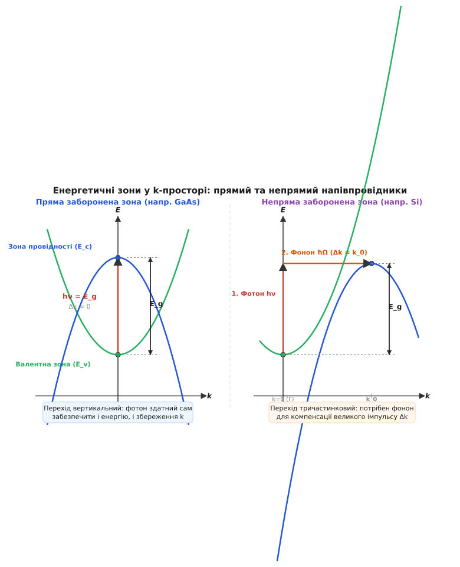
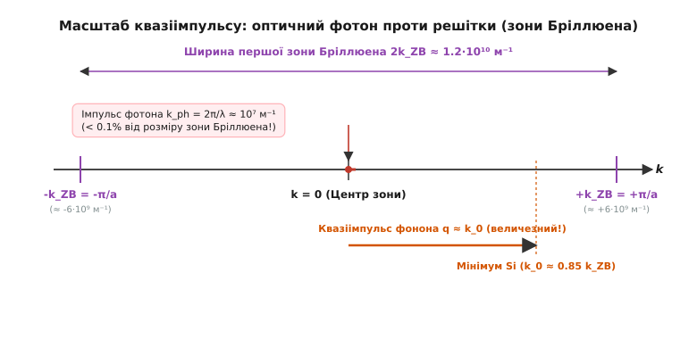
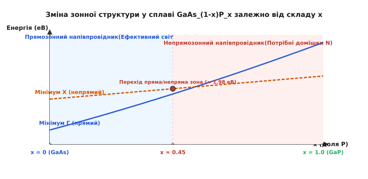
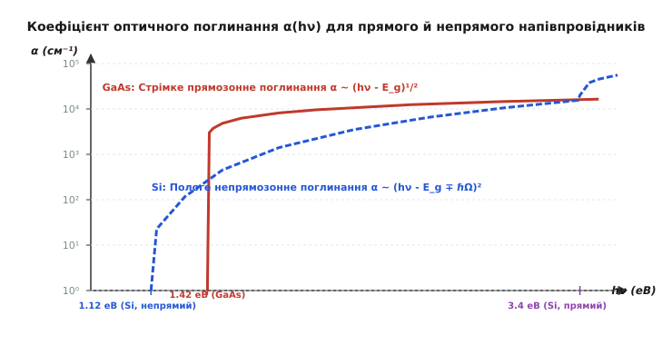

# Пряма і непряма заборонена зона

<preknowlist>
- [Енергетичні зони](root:ph-condensed/conductors-insulators) — валентна зона, зона провідності та заборонена зона E_g у твердому тілі.
- [Напівпровідники](root:ph-condensed/semiconductor) — власна та домішкова провідність, носії заряду та ефективна маса.
- [Лазерні діоди](root:ph-condensed/laser-diode-physics) — рекомбінація та підсилення світла в напівпровідникових гетероструктурах.
</preknowlist>

Спроба зробити світлодіод із звичайного чистісінького кремнію завершується невдачею: напівпровідниковий `p-n`-перехід пропускає струм, нагрівається, але практично не випромінює світла. Тим часом кристал арсеніду галію (`GaAs`), який має майже таку саму ширину забороненої зони, яскраво спалахує інфрачервоним або червоним випромінюванням. Причина цієї фундаментальної відмінності лежить не в хімічному складі чи чистоті матеріалу, а в квантово-механічній геометрії енергетичних зон у просторі квазіімпульсів.

У напівпровідниковій фізиці недостатньо знати лише різницю енергій між краями дозволених зон. Оптичний перехід електрона є взаємодією хвильових пакетів, для якої одночасно діють два строгі закони збереження: збереження енергії та збереження кристалічного квазіімпульсу. Якщо мінімум зони провідності та максимум валентної зони розташовані в різних точках простору квазіімпульсів, випромінювання або поглинання одного лише фотона стає квантово забороненим, оскільки світловий квант не здатний передати кристалу необхідний імпульс.

### Дисперсія електронних станів та квантова геометрія k-простору

Електрон у періодичному потенціалі кристалічної решітки описується блохівською хвилею, а його стан визначається не просто енергією `E`, а й хвильовим вектором `k` — квазіімпульсом `p = ℏk` (лат. *quasi* — ніби, як, бо квазіімпульс зберігається з точністю до вектора оберненої решітки). Залежність енергії від хвильового вектора `E(k)` називається законом дисперсії (лат. *dispersio* — розсіяння).

Згідно з теоремою Блоха (Bloch theorem), хвильова функція електрона в періодичному кристалічному потенціалі `V(r + R) = V(r)` записується як добуток плоскої хвилі на модулюючу амплітуду з періодом решітки:

```
ψ_(n, k)(r) = u_(n, k)(r) · exp(i k · r)
```

де `u_(n, k)(r + R) = u_(n, k)(r)` — блохівська амплітуда (періодична функція кристала), `R` — вектор прямої кристалічної решітки, `n` — дискретний номер енергетичної зони, а `k` — хвильовий вектор.

Квазіімпульс `p = ℏk` відрізняється від класичного імпульсу вільної частинки тим, що він не є інваріантом відносно неперервних просторових трансляцій. Оскільки потенціал кристала володіє лише дискретною трансляційною симетрією, закон збереження імпульсу в твердому тілі виконується з точністю до довільного вектора оберненої решітки `G`:

```
k_кінцевий = k_початковий + Δk + G
```

Якщо `G = 0`, процес розсіяння або переходу називається нормальним (`N`-процес, англ. *normal process*). Якщо `G ≠ 0`, процес називається процесом перекидання або процесом Умклаппа (`U`-процес, нім. *Umklappprozess*).

#### 1. Зона Бріллюена та симетрія напівпровідникових кристалів
У трьохвимірному кристалі `E(k)` утворює складну тривимірну зонну структуру всередині першої зони Бріллюена (фр. *Léon Brillouin*), яка є елементарною коміркою Вігнера — Зейтца в оберненому просторі. Для кристалів з кубічною решіткою типу алмазу (кремній `Si`, германій `Ge`) та цинкової обманки (арсенід галію `GaAs`, фосфід індію `InP`, антимонід індію `InSb`) обернена решітка є об'ємноцентрованою кубічною (`BCC`), а перша зона Бріллюена являє собою усічений октаедр.

У цій зоні виділяють точки та напрямки високої просторової симетрії:
- **Точка `Γ` (Гамма):** центр зони Бріллюена (`k = (0, 0, 0)`), точка найвищої симетрії кристала.
- **Точка `X`:** центр квадратної грані на межі зони Бріллюена вздовж кристалографічного напрямку `[100]` (`k = (2π / a) · (1, 0, 0)`).
- **Точка `L`:** центр шестикутної грані на межі зони Бріллюена вздовж напрямку головної діагоналі куба `[111]` (`k = (2π / a) · (1/2, 1/2, 1/2)`).
- **Точка `K` / `U`:** центр ребра зони вздовж напрямку `[110]`.
- **Напрямок `Δ` (Дельта):** вісь симетрії, що з'єднує точку `Γ` з точкою `X` вздовж напрямку `⟨100⟩`.
- **Напрямок `Λ` (Лямбда):** вісь симетрії, що з'єднує точку `Γ` з точкою `L` вздовж напрямку `⟨111⟩`.

Для електронних і оптичних процесів найважливішими є дві енергетичні зони:
1. **Валентна зона (`E_v`):** найвища заповнена зона за абсолютного нуля температур. Її максимум описує енергетичний стан найменш зв'язаних валентних електронів. У більшості напівпровідників валентна зона утворена `p`-орбіталями і складається з трьох субзон: важких дірок (`hh`, англ. *heavy holes*), легких дірок (`lh`, англ. *light holes*) та спін-орбітально відщепленої зони (`so`, англ. *spin-orbit split-off*).
2. **Зона провідності (`E_c`):** найнижча порожня зона, куди електрон потрапляє після збудження. Її мінімум описує стан з найменшою енергією вільного електрона.

Різниця між мінімумом зони провідності та максимумом валентної зони визначає ширину забороненої зони `E_g = E_c,min - E_v,max`. Проте критично важливим для оптичних переходів є те, **у яких саме точках `k`-простору** розташовані ці екстремуми.

#### 2. Тонка структура валентної зони та спін-орбітальне розщеплення
У центрі зони Бріллюена (точка `Γ`) валентна зона напівпровідників груп IV та III-V формується з трикратно вироджених за орбітальним моментом атомних `p`-станів (`p_x, p_y, p_z`, орбітальний квантовий момент `L = 1`). З урахуванням власного спіну електрона (`S = 1/2`) цей стан є шестикратно виродженим.

Релятивістська спін-орбітальна взаємодія, що описується гамільтоніаном `H_so = (ℏ / 4m_0² c²) · (∇V × p) · σ`, знімає це виродження і розщеплює стани валентної зони на два мультиплети:
1. **Чотирикратно вироджений стан з повним моментом `J = 3/2`:** утворює вершину валентної зони при `k = 0`. При відхиленні від центра зони (`k ≠ 0`) цей стан розпадається на дві незалежні параболічні підзони:
   - **Підзона важких дірок (`hh`):** проєкція моменту `m_j = ±3/2`. Характеризується малою кривиною `E(k)` і великою ефективною масою (наприклад, `m*_hh ≈ 0.45 m_0` у `GaAs`, `m*_hh ≈ 0.49 m_0` у `Si`).
   - **Підзона легких дірок (`lh`):** проєкція моменту `m_j = ±1/2`. Має круту дисперсію та малу ефективну масу (`m*_lh ≈ 0.082 m_0` у `GaAs`, `m*_lh ≈ 0.16 m_0` у `Si`).
2. **Двократно вироджений стан з повним моментом `J = 1/2` (`m_j = ±1/2`):** утворює спін-орбітально відщеплену зону (`so`), яка опущена нижче вершини валентної зони на енергетичний інтервал `Δ_so` (величина спін-орбітального розщеплення).

Величина спін-орбітального розщеплення `Δ_so` зростає пропорційно четвертому степеню заряду ядра `Z⁴` складових атомів. У легких напівпровідниках вона мала: у кремнії `Si` (`Z = 14`) `Δ_so = 0.044 еВ`, у нітриді галію `GaN` `Δ_so = 0.017 еВ`. У важчих сполуках вона сягає значних величин: у германії `Ge` (`Z = 32`) `Δ_so = 0.29 еВ`, в арсеніді галію `GaAs` `Δ_so = 0.34 еВ`, у фосфіді індію `InP` `Δ_so = 0.11 еВ`, а в антимоніді індію `InSb` — `Δ_so = 0.81 еВ`.

#### 3. Метод k·p-збурень та ефективна маса електрона
Біля своїх екстремумів зони можна апроксимувати параболами, де кривина визначає тензор ефективної маси носіїв заряду `m*`:

```
(1 / m*)_ij = (1 / ℏ²) · (∂²E / ∂k_i ∂k_j)
```

Згідно з квантово-механічним методом `k·p`-збурень (k-dot-p perturbation theory), розробленим Джоном Бардіном та Чарльзом Кіттелем і узагальненим Еваном Кейном (Evan Kane), взаємодія між зоною провідності та валентною зоною через матричний елемент оператора імпульсу `P = -(iℏ / m_0) ⟨s| p_z |p_z⟩` визначає ефективну масу електрона біля точки `Γ`:

```
1 / m*_e = 1 / m_0 + (2 P² / 3 ℏ² m_0²) · [2 / E_g + 1 / (E_g + Δ_so)]
```

де `m_0` — маса вільного електрона.

З цієї фундаментальної формули випливає прямий фізичний висновок: **що вужча заборонена зона `E_g`, то меншою є ефективна маса електрона `m*_e`** і то крутішою є парабола зони провідності в центрі зони Бріллюена:
- У вузькозонному антимоніді індію (`InSb`, `E_g = 0.17 еВ`): `m*_e ≈ 0.014 m_0`.
- В арсеніді індію (`InAs`, `E_g = 0.35 еВ`): `m*_e ≈ 0.023 m_0`.
- В арсеніді галію (`GaAs`, `E_g = 1.42 еВ`): `m*_e ≈ 0.067 m_0`.
- У широкозонному нітриді галію (`GaN`, `E_g = 3.44 еВ`): `m*_e ≈ 0.20 m_0`.

Мала ефективна маса прямозонних матеріалів зумовлює гігантську рухливість електронів (наприклад, у чистому `GaAs` рухливість електронів при кімнатній температурі досягає `μ_e ≈ 8500 см²/(В·с)`, а в `InSb` — понад `77 000 см²/(В·с)`, тоді як у кремнії вона становить лише `1400 см²/(В·с)`).

#### 4. Багатодолинна структура зони провідності
У прямозонних напівпровідниках (`GaAs`, `InP`) дно зони провідності являє собою єдину сферично-симетричну долину в точці `Γ` (`k = 0`). Ізоенергетичні поверхні в просторі хвильових векторів є сферами.

У непрямозонних напівпровідниках зона провідності має багатодолинну структуру (англ. *multi-valley conduction band*), а ізоенергетичні поверхні являють собою сильно витягнуті еліпсоїди обертання:
- **Кремній (`Si`):** зона провідності має 6 еквівалентних абсолютних мінімумів, розташованих на осях симетрії `⟨100⟩` (напрямок `Δ`) на відстані `k_0 ≈ 0.85 · (2π / a)` від центра зони. Кожен мінімум описується двома різними ефективними масами: важкою поздовжньою масою `m*_l ≈ 0.98 m_0` (вздовж осі еліпсоїда) та двома легкими поперечними масами `m*_t ≈ 0.19 m_0` (перпендикулярно осі).
- **Германій (`Ge`):** зона провідності має 4 еквівалентних мінімуми на межі зони Бріллюена в точках `L` уздовж осей `⟨111⟩` (насправді 8 половин еліпсоїдів на протилежних гранях). Поздовжня маса вздовж головної діагоналі становить `m*_l ≈ 1.64 m_0`, а поперечна — `m*_t ≈ 0.082 m_0`.

### Пряма заборонена зона: двочастинковий вертикальний перехід

Напівпровідник називається **прямозонним** (англ. *direct bandgap*), якщо максимум валентної зони `E_v,max` та мінімум зони провідності `E_c,min` досягаються при **одному й тому самому значенні квазіімпульсу** `k`. Здебільшого цей спільний мінімум лежить у центрі зони Бріллюена — в точці `k = 0` (так званій точці `Γ`).

Типовими представниками прямозонних напівпровідників є сполуки `A^(III)B^(V)` та `A^(II)B^(VI)`: арсенід галію (`GaAs`), фосфід індію (`InP`), нітрид галію (`GaN`), нітрид алюмінію (`AlN`), сульфід кадмію (`CdS`), теллурид кадмію (`CdTe`), селенід цинку (`ZnSe`), а також галогенідні свинцеві перовськіти (`CH_3NH_3PbI_3`, `CsPbBr_3`).


*Зонна структура у k-просторі. Ліворуч: у прямозонному напівпровіднику (GaAs) мінімум E_c і максимум E_v збігаються при k=0, що дозволяє вертикальний оптичний перехід без зміни імпульсу. Праворуч: у непрямозонному напівпровіднику (Si) мінімум E_c зміщений у точку k_0, тому оптичний перехід вимагає участі фонона.*

Під час міжзонного оптичного переходу (поглинання або випромінювання фотона) мусять одночасно виконуватися два фундаментальні закони збереження — енергії та квазіімпульсу:

```
1) Збереження енергії:   E_c(k_f) - E_v(k_i) = ℏω   [де ℏω — енергія фотона]
2) Збереження імпульсу:  k_f = k_i + k_ph          [де k_ph — хвильовий вектор фотона]
```

Оптичний фотон (гр. *phōs* — світло) з енергією порядку `ℏω ≈ 1...2 еВ` має довжину хвилі `λ ≈ 600...1000 нм`. Йому відповідає хвильовий вектор `k_ph = 2π / λ ≈ 10⁷ м⁻¹`. Водночас розмір першої зони Бріллюена становить `k_ZB = π / a ≈ 6·10⁹ м⁻¹` (де `a ≈ 0.5 нм` — період кристалічної решітки).

Отже, імпульс оптичного фотона становить **менше 0.1%** від розміру зони Бріллюена! На діаграмі `E(k)` вектор фотона практично непомітний, тому оптичний перехід електрона виглядає як **строго вертикальна лінія** (`Δk ≈ 0`).

У прямозонному напівпровіднику електрон із максимуму валентної зони при `k = 0` після поглинання фотона потрапляє безпосередньо в мінімум зони провідності при `k = 0`. І навпаки: електрон із мінімуму зони провідності рекомбінує з діркою у валентній зоні, віддаючи всю надлишкову енергію безпосередньо у вигляді кванта світла.

Оскільки в переході беруть участь лише дві частинки (електрон та фотон), ймовірність випромінювальної рекомбінації описується першим порядком теорії збурень. Детальний математичний розрахунок ймовірностей таких переходів за Золотим правилом Фермі винесено в [квантово-механічний розрахунок міжзонного поглинання](root:ph-condensed/direct-indirect-bandgap/math-bandgap-transition.md).

#### 1. Матричний елемент дипольного переходу та правила добору
Гамільтоніан взаємодії електрона зі світловою електромагнітною хвилею в дипольному наближенні має вигляд `H_int = -(e / m_0) · A · p`, де `A` — векторний потенціал світлової хвилі з вектором поляризації `e_pol`, а `p` — оператор квантово-механічного імпульсу електрона.

Імовірність переходу пропорційна квадрату модуля міжзонного матричного елемента імпульсу:

```
M_(cv) = ⟨u_c| e_pol · p |u_v⟩ = ∫_cell u*_(c, 0)(r) · [e_pol · (-iℏ ∇)] · u_(v, 0)(r) d³r
```

Оскільки зона провідності у точці `Γ` утворена сферично-симетричними `s`-орбіталями атомів (парна функція координати `u_c(-r) = u_c(r)`), а валентна зона сформована з `p`-орбіталей (непарні функції координати `u_v(-r) = -u_v(r)`), дія непарного оператора градієнта `∇` перетворює непарну підінтегральну функцію на парну. Інтеграл по елементарній комірці не дорівнює нулю:

```
⟨s| p_x |p_x⟩ ≠ 0   [дипольний дозволений перехід]
```

Цей перехід називається **прямим дозволеним переходом** (англ. *direct allowed transition*). Сила осцилятора такого переходу близька до одиниці, що забезпечує надзвичайно інтенсивну взаємодію напівпровідника зі світлом.

#### 2. Зведена густина станів та спектр поглинання
Для прямого дозволеного переходу збереження квазіімпульсу фіксує енергію переходу між станами з однаковим хвильовим вектором `k`:

```
E_cv(k) = E_c(k) - E_v(k) = E_g + (ℏ² k² / 2 m*_e) + (ℏ² k² / 2 m*_h) = E_g + (ℏ² k² / 2 m_r)
```

де `m_r = (m*_e · m*_h) / (m*_e + m*_h)` — зведена ефективна маса пари електрон-дірка (reduced effective mass).

Інтегрування ймовірності переходу по всій зоні Бріллюена зводиться до зведеної оптичної густини станів `ρ_red(ℏω)`:

```
ρ_red(ℏω) = (1 / 2π²) · (2 m_r / ℏ²)^(3/2) · (ℏω - E_g)^(1/2)
```

У результаті спектральний коефіцієнт оптичного поглинання `α_dir(ℏω)` прямозонного напівпровідника біля фундаментального краю зростає як квадратний корінь із перевищення енергії кванта над шириною забороненої зони:

```
α_dir(ℏω) = A_dir · (ℏω - E_g)^(1/2)   [для ℏω ≥ E_g]
```

де константа зв'язку `A_dir` визначається фундаментальними константами та параметрами матеріалу:

```
A_dir = [e² · (2 m_r)^(3/2) · |e_pol · p_(cv)|²] / [3 π · n_r · c · ε_0 · m_0² · ℏ² · ℏω]
```

Для більшості прямозонних напівпровідників (`GaAs`, `InP`, `CdTe`) величина `A_dir` лежить у діапазоні `(3...6) · 10⁴ см⁻¹ еВ⁻¹/²`. Це означає, що вже при перевищенні порогу всього на `0.1 еВ` коефіцієнт поглинання сягає `α ≈ (1...2) · 10⁴ см⁻¹`, а при енергіях на `0.5 еВ` вище краю перевищує `10⁵ см⁻¹`.

#### 3. Екситонні ефекти Ванньє — Мотта та фактор Зоммерфельда
У реальних прямозонних кристалах при поглинанні фотона фотозгенерований електрон і дірка не є абсолютно незалежними вільними частинками: між ними діє далекодійна кулонівська сила притягання, екранована статичною діелектричною проникністю середовища `ε_r`. Ця взаємодія утворює воднеподібний зв'язаний квантовий стан — **екситон Ванньє — Мотта** (Wannier-Mott exciton).

Енергетичний спектр зв'язаних станів екситона лежить у забороненій зоні нижче краю провідності на величину енергії зв'язку:

```
E_n = E_g - E_b / n²   [де n = 1, 2, 3...]
```

де `E_b` — енергія зв'язку екситона (екситонний Рідберг):

```
E_b = R_y · (m_r / m_0) / ε_r² = (m_r · e⁴) / (2 · (4 π ε_0 ε_r)² · ℏ²)
```

Ефективний борівський радіус екситона становить `a_exc = a_0 · ε_r · (m_0 / m_r)`.

Параметри екситонів кардинально різняться для різних прямозонних кристалів:
- **Арсенід галію (`GaAs`):** `ε_r ≈ 12.9`, `m_r ≈ 0.058 m_0`. Енергія зв'язку становить лише `E_b ≈ 4.2 меВ`, а радіус екситона досягає гігантських розмірів `a_exc ≈ 14 нм` (понад 25 періодів кристалічної решітки). Оскільки теплова енергія при кімнатній температурі (`k_B T ≈ 25.9 меВ`) значно перевищує `4.2 меВ`, у `GaAs` при `300 К` екситони термічно іонізовані на вільні електрони й дірки, а окремі екситонні піки спостерігаються лише при кріогенних температурах (`T < 50 К`).
- **Нітрид галію (`GaN`):** `ε_r ≈ 9.5`, `m_r ≈ 0.16 m_0`. Енергія зв'язку сягає `E_b ≈ 25 меВ`, що збігається з кімнатною тепловою енергією. Екситонні піки поглинання чітко видно навіть за кімнатної температури.
- **Оксид цинку (`ZnO`):** `ε_r ≈ 8.5`, `m_r ≈ 0.24 m_0`. Енергія зв'язку становить `E_b ≈ 60 меВ`, забезпечуючи надзвичайно стійкі екситонні стани аж до температур `500 К`.

Кулонівська взаємодія модифікує і неперервний спектр поглинання при `ℏω > E_g`. Коефіцієнт поглинання домножується на **фактор кулонівського підсилення Зоммерфельда** (Sommerfeld enhancement factor):

```
F_S(ℏω) = (2 π / √( (ℏω - E_g) / E_b )) / [1 - exp(-2 π / √( (ℏω - E_g) / E_b ))]
```

Завдяки фактору Зоммерфельда біля самого порогу (`ℏω → E_g`) спектр поглинання прямозонного напівпровідника починається не з нульового значення, як передбачає проста одночастинкова модель `(ℏω - E_g)^(1/2)`, а має форму чіткої крутої сходинки або гострого резонансного екситонного піка.

### Непряма заборонена зона: тричастинковий фононний перехід

Напівпровідник називається **непрямозонним** (англ. *indirect bandgap*), якщо максимум валентної зони знаходиться в одній точці `k`-простору (зазвичай при `k = 0`, у точці `Γ`), а мінімум зони провідності зміщений у дещо іншу точку `k_0 ≠ 0`.

Класичними непрямозонними напівпровідниками є найважливіші матеріали мікроелектроніки:
- **Кремній (`Si`):** `E_g = 1.12 еВ` (при 300 К), мінімум зони провідності розташований уздовж кристалографічного напрямку `[100]` на відстані `k_0 ≈ 0.85 k_ZB` від центра зони.
- **Германій (`Ge`):** `E_g = 0.66 еВ`, мінімум зони провідності лежить на межі зони Бріллюена в точці `L` уздовж напрямку `[111]`.
- **Карбід кремнію (`4H-SiC`, `6H-SiC`):** широкозонні політипи з мінімумами провідності на межі гексагональної зони Бріллюена (`E_g = 3.26 еВ` для 4H-SiC та `3.02 еВ` для 6H-SiC).
- **Фосфід галію (`GaP`):** `E_g = 2.26 еВ`, мінімум лежить у точці `X` на межі зони Бріллюена.
- **Алмаз (`C`):** `E_g = 5.47 еВ`, мінімум на осі `⟨100⟩` при `0.76 k_ZB`.

Якщо електрон перебуває в дні зони провідності непрямого напівпровідника (при `k = k_0`), він не може просто випромінити фотон і впасти у валентну зону (при `k = 0`). Для цього йому потрібно змінити свій квазіімпульс на величезну величину `Δk = k_0 - 0 = k_0 ≈ 10⁹...10¹⁰ м⁻¹`. Оптичний фотон не здатний забрати такий імпульс.


*Порівняння масштабів імпульсів. Хвильовий вектор оптичного фотона k_ph становить менше 0.1% від ширини зони Бріллюена, тоді як квазіімпульс фонона q перекриває більшу частину зони, забезпечуючи збереження імпульсу під час непрямого переходу.*

Щоб перехід відбувся, у процесі **мусить взяти участь третя частинка** — квант коливань кристалічної решітки, тобто **фонон** (гр. *phōnē* — звук). Фонони мають низькі енергії (`ℏΩ ≈ 10...60 меВ`), проте величезні квазіімпульси `q = π / a`, що легко перекривають усю зону Бріллюена.

#### 1. Квантова природа двостадійного переходу та віртуальні стани
Непрямий оптичний перехід є **тричастинковим двостадійним процесом** і розраховується за другим порядком теорії збурень. Перехід відбувається через проміжний короткоживучий **віртуальний квантовий стан** `|m⟩`:

Можливі дві квантові траєкторії непрямого переходу:
1. **Електронна траєкторія:** електрон у валентній зоні `|v, 0⟩` поглинає фотон `ℏω` і вертикально переходить у віртуальний стан зони провідності в центрі зони `|c, 0⟩`. Потім електрон розсіюється на фононі з хвильовим вектором `q ≈ k_0`, віддаючи або приймаючи фонон, і потрапляє в реальний стан дна долини `|c, k_0⟩`.
2. **Діркова траєкторія:** електрон поглинає або випромінює фонон `q ≈ k_0`, здійснюючи перехід у віртуальний стан валентної зони на краю зони `|v, k_0⟩`, після чого поглинає фотон `ℏω` і переходить вертикально у дно зони провідності `|c, k_0⟩`.

Матричний елемент другого порядку теорії збурень записується як сума по всіх проміжних віртуальних станах `|m⟩`:

```
M_(fi)^(ind) = ∑_m [ (⟨f| H_phon |m⟩ · ⟨m| H_opt |i⟩) / (E_i - E_m ± ℏΩ) + (⟨f| H_opt |m⟩ · ⟨m| H_phon |i⟩) / (E_i - E_m') ]
```

Знаменник `(E_i - E_m)` являє собою енергетичне відхилення віртуального стану від реального (дефект енергії). У кремнії відстань від максимуму валентної зони до прямого дна зони провідності в точці `Γ` становить `E(Γ_15) - E(Γ'_25) ≈ 3.4 еВ`, тоді як непряма заборонена зона дорівнює `E_g = 1.12 еВ`. Енергетичний дефект становить `ΔE = 3.4 - 1.12 = 2.28 еВ`.

Оскільки ймовірність переходу пропорційна `|M_(fi)|² ∝ 1 / (ΔE)²`, цей величезний енергетичний знаменник пригнічує ймовірність непрямого оптичного процесу на **3–4 порядки** порівняно з прямим вертикальним переходом.

#### 2. Спектр фононів та правила добору у кремнії та германії
У непрямому переході можуть брати участь різні гілки фононної дисперсії кристала:
- **Акустичні фонони:** поперечні акустичні (`TA`, англ. *transverse acoustic*) та поздовжні акустичні (`LA`, англ. *longitudinal acoustic*).
- **Оптичні фонони:** поперечні оптичні (`TO`, англ. *transverse optical*) та поздовжні оптичні (`LO`, англ. *longitudinal optical*).

Завдяки правилам просторової симетрії (теорема Вігнера — Еккарта для точкової групи кристала) різні фононні моди мають різну ефективність взаємодії:

У **кремнії (`Si`)** мінімум зони провідності розташований поблизу точки `X` на осі `Δ`. Квантові правила добору дозволяють участь фононів з такими дискретними енергіями:
- `TO`-фонон: `ℏΩ_TO = 57.5 меВ` (найсильніша взаємодія, домінує у поглинанні та випромінюванні).
- `TA`-фонон: `ℏΩ_TA = 18.4 меВ` (слабша взаємодія).
- `LA`-фонон: `ℏΩ_LA = 43.5 меВ`.
- `LO`-фонон: `ℏΩ_LO = 55.0 меВ`.

У **германії (`Ge`)** мінімум лежить у точці `L` на межі зони. Тут симетрія дозволяє такі фононні моди:
- `LA`-фонон: `ℏΩ_LA = 27.7 меВ` (основний внесок у германії).
- `TO`-фонон: `ℏΩ_TO = 36.0 меВ`.
- `LO`-фонон: `ℏΩ_LO = 30.5 меВ`.
- `TA`-фонон: `ℏΩ_TA = 8.0 меВ`.

#### 3. Подвійний поріг та квадратичний закон поглинання
Для непрямого переходу закони збереження енергії мають вигляд:

```
ℏω = E_c(k_f) - E_v(k_i) ∓ ℏΩ = E_g + E_kin ∓ ℏΩ
```

де знак `-` відповідає процесу з **поглинанням фонона** з решітки, а знак `+` — процесу з **випромінюванням фонона** в решітку.

Імовірність поглинання фонона пропорційна середньому числу теплових фононів у кристалі, що описується статистикою Бозе — Айнштайна:

```
N_q = 1 / [exp(ℏΩ / k_B T) - 1]
```

Імовірність випромінювання фонона пропорційна фактору спонтанного та вимушеного народження:

```
1 + N_q = 1 / [1 - exp(-ℏΩ / k_B T)]
```

На відміну від прямого переходу, де хвильовий вектор кінцевого стану однозначно зафіксований `k_f = k_i`, при непрямому переході фонон може передати будь-який імпульс `q = k_f - k_i`. Це знімає жорстку прив'язку хвильових векторів, і інтегрування ймовірності переходу здійснюється незалежно по густині початкових станів валентної зони `ρ_v(E) ∝ E^(1/2)` та густині кінцевих станів зони провідності `ρ_c(E) ∝ E^(1/2)`. Подвійний інтеграл від згортки двох квадратних коренів дає суворо **квадратичну залежність**:

```
α_ind(ℏω) = α_abs(ℏω) + α_em(ℏω)
```

де дві складові дорівнюють:

```
α_abs(ℏω) = B_ind · (ℏω - E_g + ℏΩ)² / [exp(ℏΩ / k_B T) - 1]   [поріг: ℏω ≥ E_g - ℏΩ]
α_em(ℏω)  = B_ind · (ℏω - E_g - ℏΩ)² / [1 - exp(-ℏΩ / k_B T)]   [поріг: ℏω ≥ E_g + ℏΩ]
```


*Коефіцієнт оптичного поглинання α(hν). У прямозонному GaAs поглинання починається стрибкоподібно при hν = 1.42 еВ і досягає 10⁴ см⁻¹. У непрямозонному Si поглинання біля краю (1.12 еВ) є пологим і лише при енергії hν > 3.4 еВ (де вмикаються прямі переходи) стрімко зростає.*

Як видно зі спектра, поглинання у непрямозонному напівпровіднику має два характерних пороги:
1. **Перший поріг при `ℏω = E_g - ℏΩ`:** починається поглинання світла з одночасним поглинанням фононів решітки. При низьких температурах (`T → 0 К`) число фононів `N_q → 0`, і цей поріг повністю зникає.
2. **Другий поріг при `ℏω = E_g + ℏΩ`:** вмикається процес із генерацією (випромінюванням) фононів. Цей процес можливий за будь-якої температури, включно з абсолютним нулем.

#### 4. Прямі критичні точки у непрямих матеріалах при високих енергіях
Непрямозонний кристал є непрямим лише поблизу мінімальної забороненої зони. Якщо збільшувати енергію падаючого фотона, електрон дістає змогу здійснювати прямі вертикальні переходи без участі фононів між глибшими підзонами або у вищі долини:
- **Кремній (`Si`):** при енергії фотона `ℏω ≥ 3.4 еВ` (ультрафіолетова область спектра) починаються прямі дозволені переходи між валентною зоною `Γ'_25` та прямим мінімумом зони провідності `Γ_15` (критична точка `E_0' ≈ 3.4 еВ`), а також уздовж напрямку `⟨111⟩` (точка `E_1 ≈ 3.45 еВ`). При `ℏω ≥ 4.2 еВ` (точка `E_2`) коефіцієнт поглинання кремнію стрибкоподібно зростає від `10³ см⁻¹` до колосальних значень `α ≈ 10⁶ см⁻¹`.
- **Германій (`Ge`):** прямий мінімум зони провідності в точці `Γ` лежить лише на `140 меВ` вище непрямого дна в точці `L` (`E_g,dir = 0.80 еВ` проти `E_g,ind = 0.66 еВ`). Тому вже при енергії фотона `ℏω ≥ 0.80 еВ` у германії вмикається потужне пряме міжзонне поглинання, і коефіцієнт `α` різко зростає на два порядки.

### Оптична спектроскопія та метод графіків Тауца (Tauc Plots)

Експериментальне визначення природи міжзонних переходів (прямий чи непрямий) та точного значення забороненої зони `E_g` здійснюється за допомогою спектроскопії оптичного пропускання `T(λ)` та відбивання `R(λ)`.

Для плоскопаралельної напівпровідникової пластини товщиною `d` з урахуванням багаторазового внутрішнього відбивання світла від передньої та задньої граней оптичне пропускання описується формулою:

```
T_opt = (1 - R)² · exp(-α · d) / [1 - R² · exp(-2α · d)]
```

де `R = (n_r - 1)² / (n_r + 1)²` — коефіцієнт відбивання Френеля для нормального падіння.

Знаючи виміряне пропускання `T_opt` та відбивання `R`, розраховують спектральну залежність коефіцієнта поглинання `α(ℏω)`:

```
α(ℏω) = (1 / d) · ln[ ((1 - R)² + √((1 - R)⁴ + 4 T_opt² R²)) / (2 T_opt) ]
```

#### 1. Універсальне співвідношення Тауца — Девіса — Мотта
Ян Тауц (Jan Tauc) разом із Невіллом Моттом та Едвардом Девісом встановив, що спектральна залежність коефіцієнта поглинання біля краю фундаментальної смуги описується узагальненим співвідношенням:

```
(α · ℏω)^(1/n) = B_T · (ℏω - E_g)
```

де параметр ступеня `n` однозначно визначається квантовою природою міжзонного переходу:
- `n = 1/2`: **прямий дозволений перехід** (GaAs, InP, GaN, CdTe, ZnO).
- `n = 3/2`: **прямий квантово заборонений перехід** (Cu2O, де матричний елемент у центрі зони дорівнює нулю через симетрію станів).
- `n = 2`: **непрямий дозволений перехід** (Si, Ge, 4H-SiC, GaP, алмаз).
- `n = 3`: **непрямий квантово заборонений перехід**.

#### 2. Побудова та аналіз графіків Тауца
Для аналізу експериментальних даних будують залежність `(α · ℏω)^(1/n)` від енергії фотона `ℏω`:

1. **Для прямозонного матеріалу (`n = 1/2`):**
   Будують графік у координатах `(α · ℏω)²` від `ℏω`. Експериментальні точки утворюють чітку пряму лінію. Екстраполяція цієї лінійної ділянки до перетину з віссю абсцис `(α · ℏω)² = 0` дає безпосереднє значення ширини прямої забороненої зони `E_g`.

2. **Для непрямозонного матеріалу (`n = 2`):**
   Будують графік у координатах `(α · ℏω)^(1/2)` від `ℏω`. Оскільки поглинання складається з двох компонент (поглинання та випромінювання фонона), на графіку спостерігаються **два послідовних лінійних відрізки** з різними кутами нахилу:
   - Нижній лінійний відрізок екстраполюють до осі енергій і знаходять точку перетину `E_1 = E_g - ℏΩ`.
   - Верхній лінійний відрізок екстраполюють і знаходять точку перетину `E_2 = E_g + ℏΩ`.

Знаючи дві експериментальні точки перетину `E_1` та `E_2`, обчислюють фундаментальні параметри напівпровідника:

```
E_g = (E_1 + E_2) / 2      [ширина непрямої забороненої зони]
ℏΩ = (E_2 - E_1) / 2       [характеристична енергія фонона решітки]
```

Цей елегантний метод дозволяє суто оптичним шляхом, без використання нейтронної спектроскопії, виміряти частоту коливань кристалічної решітки на межі зони Бріллюена.

#### 3. Хвіст Урбаха (Urbach Tail)
При енергіях фотона, дещо менших за заборонену зону (`ℏω < E_g`), поглинання не спадає миттєво до нуля, а демонструє експоненційний спад, відкритий Францем Урбахом (Franz Urbach):

```
α(ℏω) = α_0 · exp( (ℏω - E_0) / E_U )
```

де `E_U` — **енергія Урбаха** (характеристична ширина урбахівського хвоста густини станів).

Фізична природа хвоста Урбаха зумовлена двома факторами:
1. **Динамічний безлад:** локальні флуктуації кристалічного потенціалу через теплові коливання решітки (електрон-фононна взаємодія).
2. **Статичний структурний безлад:** наявність точкових дефектів, дислокацій, домішок або випадкових флуктуацій складу у твердих розчинах.

У високочистих монокристалах прямозонного `GaAs` та монокристалічного `Si` енергія Урбаха надзвичайно мала (`E_U ≈ 5...8 меВ`), що свідчить про високу досконалість кристалічної решітки. В аморфному кремнії (`a-Si:H`) та розупорядкованих полікристалічних плівках `E_U` зростає до `40...80 меВ`, утворюючи глибокі хвости локалізованих станів у забороненій зоні.

### Випромінювальна та безвипромінювальна рекомбінація

Швидкість зміни концентрації нерівноважних носіїв заряду (електронів `n` та дірок `p`) визначається балансом між швидкістю їх генерації `G` та сумарною швидкістю рекомбінації `R_rec`:

```
dn / dt = G - R_rec
```

Сумарна рекомбінація складається з трьох незалежних квантових каналів, які конкурують між собою:

```
R_rec = R_rad + R_SRH + R_Auger
```

#### 1. Міжзонна випромінювальна рекомбінація (Radiative Recombination)
Пряме об'єднання електрона з зони провідності та дірки з валентної зони з випромінюванням фотона:

```
R_rad = B_rad · (n · p - n_i²)
```

де `B_rad` — коефіцієнт випромінювальної міжзонної рекомбінації, а `n_i` — власна концентрація носіїв.

Коефіцієнт `B_rad` безпосередньо відображає квантову ймовірність оптичного переходу:
- **У прямозонному `GaAs`:** `B_rad ≈ 7.2 · 10⁻¹⁰ см³/с`.
- **У прямозонному `InGaAsP`:** `B_rad ≈ (2...4) · 10⁻¹⁰ см³/с`.
- **У непрямозонному `Si`:** `B_rad ≈ 1.8 · 10⁻¹⁵ см³/с`.
- **У непрямозонному `Ge`:** `B_rad ≈ 5.0 · 10⁻¹⁴ см³/с`.

Різниця між `GaAs` та `Si` становить **понад 400 000 разів**!

Для напівпровідника `p`-типу з рівнем легування акцепторами `N_A = 10¹⁷ см⁻³` час життя надлишкових електронів відносно випромінювальної рекомбінації становить `τ_rad = 1 / (B_rad · N_A)`:
- В арсеніді галію (`GaAs`): `τ_rad = 1 / (7.2·10⁻¹⁰ · 10¹⁷) ≈ 14 нс`.
- У кремнії (`Si`): `τ_rad = 1 / (1.8·10⁻¹⁵ · 10¹⁷) ≈ 5.5 мс` (5 500 000 нс!).

#### 2. Рекомбінація Шокли — Ріда — Холла (SRH) через глибокі дефекти
Рекомбінація носіїв через локалізовані енергетичні рівні у забороненій зоні, утворені дефектами решітки або домішками важких металів (золото `Au`, залізо `Fe`, мідь `Cu`):

```
R_SRH = (n · p - n_i²) / [ τ_p0 · (n + n_1) + τ_n0 · (p + p_1) ]
```


*Ілюстрація: Direct Vs Indirect Band.*



*Ілюстрація: K Momentum Conservation.*



*Ілюстрація: Gaasp Band Tuning.*



*Ілюстрація: Absorption Spectrum.*


де `τ_n0` та `τ_p0` — мінімальні часи захоплення електронів і дірок пастками, а `n_1, p_1` — концентрації носіїв, коли рівень Фермі збігається з рівнем пастки `E_t`.

У типовому кремнії електронної якості час життя `τ_SRH` становить від `10 мкс` до `1 мс`.

#### 3. Тричастинкова Оже-рекомбінація (Auger Recombination)
Безипромінювальний тричастинковий процес, під час якого електрон і дірка рекомбінують, але вся виділена енергія `E_g` не перетворюється на світло, а передається третьому вільному носію заряду (електрону або дірці), який вилітає високо в зону, а потім термалізується, розсіюючи енергію на фононах (у тепло):

```
R_Auger = C_n · n² p + C_p · n p²
```

де `C_n` та `C_p` — коефіцієнти Оже-рекомбінації (`C_n ≈ 2.8 · 10⁻³¹ см⁶/с`, `C_p ≈ 1.0 · 10⁻³¹ см⁶/с` для кремнію).

Оскільки швидкість Оже-рекомбінації пропорційна кубу концентрації носіїв (`∝ n³`), вона починає домінувати при високих рівнях інжекції (`n > 10¹⁸ см⁻³`), обмежуючи максимальну яскравість світлодіодів (ефект падіння ефективності, англ. *efficiency droop*) та граничну потужність напівпровідникових лазерів.

#### 4. Внутрішній та зовнішній квантовий вихід
Внутрішній квантовий вихід випромінювання (Internal Quantum Efficiency, IQE, `η_int`) визначається як відношення швидкості випромінювальної рекомбінації до повної швидкості всіх рекомбінаційних процесів:

```
η_int = R_rad / (R_rad + R_SRH + R_Auger) = τ_nonrad / (τ_rad + τ_nonrad)
```

де `1 / τ_nonrad = 1 / τ_SRH + 1 / τ_Auger`.

Підставимо реальні часові параметри:
1. **Прямозонний `GaAs` чи `InGaN`:**
   `τ_rad ≈ 5...15 нс`, `τ_nonrad ≈ 100...500 нс`.
   ```
   η_int = 100 / (10 + 100) ≈ 90...99%
   ```
   Практично кожен інжектований електрон перетворюється на фотон світла!

2. **Непрямозонний `Si`:**
   `τ_rad ≈ 5...10 мс` (`5000...10000 мкс`), `τ_nonrad ≈ 50...200 мкс`.
   ```
   η_int = 100 мкс / (5000 мкс + 100 мкс) ≈ 0.02% (0.0002)
   ```
   У кремнії **99.98% усіх інжектованих електронів рекомбінують безипромінювально**, перетворюючи електричну енергію на тепло. Саме тому з чистого кремнію фізично неможливо створити ефективний світлодіод чи інжекційний лазер.

#### 5. Зовнішній квантовий вихід та виведення світла
Зовнішній квантовий вихід (External Quantum Efficiency, EQE, `η_ext`) визначає частку фотонів, які не просто народилися всередині кристала, а змогли вийти назовні в повітря:

```
η_ext = η_int · η_extraction · η_inj
```

де `η_inj` — коефіцієнт інжекції носіїв у активну область, а `η_extraction` — коефіцієнт оптичного виведення світла з напівпровідника.

Головною перепоною для виведення світла є високий показник заломлення напівпровідникових кристалів (`n_r ≈ 3.4...3.6` для `GaAs` та `Si`, `n_r ≈ 2.5` для `GaN`). За законом Снелліуса кут повного внутрішнього відбивання на межі напівпровідник-повітря надзвичайно малий:

```
θ_c = arcsin(1 / n_r) = arcsin(1 / 3.5) ≈ 16.6°
```

Тілесний кут конуса виходу світла становить лише мізерну частку повної півсфери:

```
Ω_esc / 4π ≈ (1 - cos θ_c) / 2 ≈ 1 / (4 n_r²) ≈ 1 / (4 · 3.5²) ≈ 2.0%
```

Решта 98% випромінених фотонів зазнають повного внутрішнього відбивання, залишаються замкненими всередині кристала, багаторазово відбиваються від стінок і зрештою поглинаються вільними носіями заряду або контактами.

Для підвищення коефіцієнта виведення світла застосовують спеціальні технологічні рішення:
- **Мікротекстурування поверхні кристала:** створення шорсткої хаотичної текстури, яка розсіює промені під випадковими кутами, дозволяючи їм потрапити в конус виходу після кількох відбивань.
- **Купольна герметизація оптичними полімерами:** використання прозорих епоксидних або силіконових компаундів з проміжним показником заломлення `n_poly ≈ 1.5`, що розширює конус виходу та збільшує виведення світла в 2–3 рази.
- **Формування зворотних дзеркал (DBR):** використання бреггівських дзеркал або металевих відбивачів на задній грані чіпа для спрямування світла у верхню півсферу.

### Непрямозонні сонячні елементи та фотовольтаїка

Хоча непрямозонні напівпровідники непридатні для випромінювання світла, у процесах **поглинання світла** (фотоелектричні перетворювачі, сонячні батареї, фотодіоди) кремній займає понад 95% усього світового ринку сонячної енергетики.

#### 1. Спектр AM1.5G та фундаментальна межа Шоклі — Квайссера
Сонячне випромінювання на поверхні Землі описується стандартизованим спектром `AM1.5G` (Air Mass 1.5 Global) з сумарною інтегральною потужністю `P_sun ≈ 1000 Вт/м²`.

Згідно з термодинамічною теорією Вільяма Шоклі та Ганса-Йоахіма Квайссера (Shockley-Queisser limit), граничний теоретичний ККД одноперехідного сонячного елемента визначається шириною забороненої зони:
- Якщо `E_g` надто велика (`E_g > 2.0 еВ`), сонячний елемент не поглинає фотони інфрачервоного та червоного діапазонів, втрачаючи значну частину сонячного спектра.
- Якщо `E_g` надто мала (`E_g < 0.8 еВ`), елемент поглинає всі фотони, але енергія високоенергетичних фотонів втрачається через швидку термалізацію гарячих електронів на фононах, що призводить до низької вихідної напруги холостого ходу `V_oc`.

Максимум теоретичного ККД (`~33.7%`) досягається при оптичній ширині зони `E_g ≈ 1.34 еВ`. Заборонена зона кремнію `E_g = 1.12 еВ` лежить дуже близько до цього оптимуму, що забезпечує кремнієвим елементам теоретичну межу ефективності `~29.4%` (практичний світовий рекорд монокристалічних кремнієвих елементів перевищує `26.8%`).

#### 2. Оптична глибина поглинання: Si проти GaAs
Ключова фізична відмінність між прямозонними та непрямозонними поглиначами полягає в **довжині оптичного поглинання** `L_abs(λ) = 1 / α(λ)` (глибині, на якій інтенсивність світла згасає в `e ≈ 2.718` раза):

- **Прямозонний `GaAs` (`E_g = 1.42 еВ`):**
  - Для фотонів з довжиною хвилі `λ = 600 нм` (`ℏω = 2.07 еВ`): `α ≈ 5 · 10⁴ см⁻¹` ⇒ `L_abs ≈ 0.2 мкм`.
  - Для фотонів `λ = 800 нм` (`ℏω = 1.55 еВ`): `α ≈ 1.5 · 10⁴ см⁻¹` ⇒ `L_abs ≈ 0.67 мкм`.
  - Увесь сонячний спектр повністю поглинається у тонкій плівці товщиною всього `1...2 мкм`.

- **Непрямозонний `Si` (`E_g = 1.12 еВ`):**
  - Для синього світла `λ = 450 нм` (`ℏω = 2.75 еВ`): `α ≈ 2 · 10⁴ см⁻¹` ⇒ `L_abs ≈ 0.5 мкм`.
  - Для зеленого світла `λ = 600 нм` (`ℏω = 2.07 еВ`): `α ≈ 4 · 10³ см⁻¹` ⇒ `L_abs ≈ 2.5 мкм`.
  - Для червоного світла `λ = 800 нм` (`ℏω = 1.55 еВ`): `α ≈ 1 · 10³ см⁻¹` ⇒ `L_abs ≈ 10 мкм`.
  - Для інфрачервоного світла біля краю зони `λ = 1050 нм` (`ℏω = 1.18 еВ`): `α ≈ 10 см⁻¹` ⇒ `L_abs ≈ 1000 мкм (1 мм!)`.

Щоб поглинути слабопоглинальне інфрачервоне випромінювання сонячного спектра, кремнієвий сонячний елемент фізично мусить мати товщину пластини щонайменше `150...200 мкм`.

Чисельний розрахунок спектральних коефіцієнтів поглинання, розрахунок товщин шарів та облік оптичного відбивання для різних напівпровідникових матеріалів наведено в [програмі розрахунку поглинання та товщини напівпровідника](root:ph-condensed/direct-indirect-bandgap/proj-bandgap-calc.md).

#### 3. Дифузійна довжина носіїв та чистота матеріалу
Велика товщина кремнієвої пластини висуває надзвичайно жорсткі вимоги до чистоти матеріалу. Електрон, згенерований поглинанням інфрачервоного фотона на глибині `150 мкм`, повинен встигнути додифундувати до збирального `p-n`-переходу без рекомбінації.

Дифузійна довжина неосновних носіїв заряду дорівнює:

```
L_diff = √(D · τ)
```

де `D = (k_B T / e) · μ` — коефіцієнт дифузії, а `τ` — час життя носіїв.

Щоб забезпечити `L_diff > 300...500 мкм`, кремній сонячних батарей мусить мати гігантський час життя носіїв `τ > 1...3 мс`. Це вимагає використання надчистого монокристалічного або мультикристалічного кремнію електронної або сонячної якості (концентрація металевих домішок менше одного атома на мільярд).

Водночас у прямозонних тонкоплівкових елементах (`GaAs`, `CdTe`, перовськіти `MAPbI_3`) товщина шару становить лише `1...2 мкм`. Носіям потрібно подолати дистанцію менше мікрона, тому достатньо скромної дифузійної довжини `L_diff ≈ 1...3 мкм` і малого часу життя `τ ≈ 5...20 нс`. Це дозволяє використовувати значно дешевші методи полікристалічного осадження плівок.

#### 4. Світлопастки (Light Trapping) та межа Яблоновича
Для зменшення товщини кремнієвих пластин (економія дорогого очищеного кремнію) у фотовольтаїці використовують ефект **захоплення світла** (світлопастки, англ. *light trapping*).

Поверхню кремнієвої пластини з кристалографічною орієнтацією `(100)` піддають анізотропному хімічному травленню у розчині лугу `KOH` з додаванням ізопропілового спирту. Оскільки швидкість травлення площини `(100)` у 50–100 разів вища за швидкість травлення щільноупакованої площини `(111)`, на поверхні кристала утворюються мільйони хаотичних чотиригранних мікропірамід з гранями `(111)`.

Мікропіраміди виконують дві найважливіші функції:
1. **Зменшення первинного відбивання:** падаючий промінь світла, відбившись від грані піраміди, не повертається назад у повітря, а потрапляє на сусідню грань піраміди, отримуючи другий шанс увійти в напівпровідник (відбивання падає з `35%` до `< 10%`).
2. **Заломлення променів під великим кутом:** світло входить у кристал під косим кутом `θ ≈ 40°...60°` до нормалі, поширюючись зигзагоподібно.

Елі Яблонович (Eli Yablonovitch) довів фундаментальну статистичну теорему для ергодичного розсіяння світла в середовищі з показником заломлення `n_r`: граничний коефіцієнт збільшення оптичного шляху фотона всередині текстурованої пластини з ідеальним заднім дзеркалом становить:

```
F_Yablonovitch = 4 · n_r²
```

Для кремнію (`n_r ≈ 3.5`):

```
F_path = 4 · (3.5)² ≈ 49
```

Завдяки текстуруванню та світлопасткам ефективний оптичний шлях слабкопоглинального інфрачервоного світла у кремнієвій пластині товщиною `130 мкм` зростає майже в 50 разів і сягає `6 мм`! Це дозволило сучасній індустрії зменшити товщину кремнієвих сонячних пластин з `350 мкм` до `110...130 мкм` без втрати коефіцієнта корисної дії.

### Деформаційна інженерія зонної структури (Strain Engineering)

Чи можна за допомогою зовнішніх механічних впливів або штучних напружень змінити зонну структуру напівпровідника: підвищити рухливість носіїв, зменшити заборонену зону чи навіть **перетворити непрямозонний кристал на прямозонний**?

Фізичною основою деформаційної інженерії є зміна міжатомних відстаней та симетрії кристалічної решітки при її пружній деформації.

Пружна деформація кристала описується симетричним тензором деформації другого рангу `ε_ij` (`i, j = x, y, z`). Деформацію можна розділити на два принципово різні типи:
1. **Гідростатична деформація (Hydrostatic strain):** ізотропна зміна об'єму елементарної комірки без зміни її симетрії (`ΔV / V = ε_xx + ε_yy + ε_zz = Tr(ε)`). Вона зсуває енергетичні зони як ціле вгору або вниз.
2. **Зсувна та одновісна/двовісна деформація (Shear / Uniaxial / Biaxial strain):** порушує кубічну симетрію кристала, знімаючи квантове виродження енергетичних зон і розщеплюючи їх на окремі підзони.

Зміна зонної структури при деформації описується гамільтоніаном Пікуса — Біра (Pikus-Bir deformation Hamiltonian).

#### 1. Деформаційне розщеплення валентної зони
У ненапруженому кубічному кристалі підзони важких (`hh`) та легких (`lh`) дірок вироджені в точці `k = 0`. Двовісна або одновісна деформація знімає це виродження:

- **Двовісний розтяг (Biaxial tensile strain, `ε_xx = ε_yy > 0, ε_zz < 0`):**
  Вершина підзони легких дірок (`lh`) піднімається вище вершини підзони важких дірок на величину `ΔE_v = 2 |b| · (1 + 2 C_12 / C_11) · ε_xx`, де `b` — тетрагональний потенціал деформації Пікуса — Біра, а `C_11, C_12` — модулі пружності кристала. В результаті вільні дірки переходять у зону легких дірок з малою ефективною масою `m*_lh` у площині шару.
- **Двовісне стиснення (Biaxial compressive strain, `ε_xx = ε_yy < 0`):**
  Вгору піднімається зона важких дірок (`hh`), проте її ефективна маса у площині деформації стає малою через сильну непараболічність та змішування хвильових функцій.

Це явище широко використовується у сучасній наноелектроніці: у кремнієвих польових транзисторах `p-MOSFET` створення напружень стиснення в каналі за рахунок вбудовування в області стоку й витоку епітаксійних вставок зі сплаву `Si_(1-x)Ge_x` дозволяє підвищити рухливість дірок у 2–3 рази.

#### 2. Напружений кремній (Strained Silicon) у CMOS-технології
У зоні провідності кремнію 6 еквівалентних долин розташовані вздовж осей `[100], [010], [001]`.

Під час створення двовісного розтягу в площині `(001)` (наприклад, шляхом вирощування тонкої плівки кремнію на буферному шарі `Si_(1-x)Ge_x` з більшим періодом решітки):
- Дві долини на осі `[001]`, перпендикулярній до площини (так звані долини `Δ_2`), опускаються вниз по енергії на `ΔE_c = (2/3) · Ξ_u · (1 + 2 C_12 / C_11) · ε_xx` (де `Ξ_u ≈ 8.6 еВ` — деформаційний потенціал долин).
- Чотири долини в площині `[100]` та `[010]` (долини `Δ_4`) піднімаються вгору по енергії.

Цей енергетичний розкол дає два колосальних практичних ефекти:
1. **Перерозподіл електронів:** усі провідні електрони стікають у дві опущені долини `Δ_2`. Для руху в площині каналу `(x-y)` ці долини мають малу поперечну ефективну масу `m*_t = 0.19 m_0` (замість важкої маси `0.98 m_0`).
2. **Придушення міждолинного розсіяння:** енергетичний розрив між долинами `Δ_2` та `Δ_4` перевищує енергію теплових коливань `k_B T`, що повністю блокує розсіяння електронів між різними долинами на фононах.

Рухливість електронів у напруженому кремнії зростає на **70–100%**, що стало ключовим технологічним фактором масштабування процесорів починаючи з 90-нм техпроцесу Intel (2003 рік) і аж до сучасних транзисторів FinFET та GAAFET (Gate-All-Around).

#### 3. Перетворення Германію на прямозонний напівпровідник
Найдивовижнішим тріумфом деформаційної інженерії стало перетворення непрямозонного германію (`Ge`) на справжній прямозонний випромінювач.

Зонна структура ненапруженого германію має унікальну рису: непрямий мінімум у точці `L` має енергію `E_g,ind = 0.664 еВ`, а прямий мінімум у точці `Γ` розташований на енергії `E_g,dir = 0.800 еВ`. Енергетичний зазор між ними становить лише `ΔE = 0.800 - 0.664 = 0.136 еВ (136 меВ)`.

Гідростатичні потенціали деформації для цих двох долин кардинально відрізняються:
- Для прямого мінімуму в точці `Γ`: `a_c(Γ) ≈ -8.24 еВ`.
- Для непрямого мінімуму в точці `L`: `a_c(L) ≈ -2.78 еВ`.

Оскільки за абсолютною величиною `|a_c(Γ)|` майже втричі більший за `|a_c(L)|`, при виникненні **двовісного розтягу** (tensile strain) енергія прямого мінімуму `Γ` падає набагато швидше, ніж енергія непрямого мінімуму `L`!

При досягненні критичної деформації розтягу:

```
ε_crit ≈ 1.7...2.0%
```

прямий мінімум `Γ` опускається нижче непрямого мінімуму `L`. **Германій стає повноцінним прямозонним напівпровідником**!

#### 4. Тверді розчини GeSn: прямозонні матеріали IV групи
Оскільки створення постійної механічної деформації розтягу `~2%` є складним технологічним завданням через ризик утворення дислокацій розриву, іншим шляхом є створення потрійних та бінарних твердих розчинів германію з оловом (`Ge_(1-x)Sn_x`).

Олово (`α-Sn`, сіре олово) є напівметалом з нульовою забороненою зоною та від'ємним прямим зазором `E_g(Γ) = -0.41 еВ`. Введення більших атомів олова в решітку германію одночасно розширює решітку (хімічний розтяг) та змінює релятивістські потенціали зон:
- Уже при вмісті олова `x ≥ 6...9%` сплав `Ge_(1-x)Sn_x` зазнає фундаментального переходу: пряма заборонена зона в точці `Γ` стає меншою за непряму зону в точці `L`.
- Сплав стає **прямозонним напівпровідником без будь-якої зовнішньої механічної деформації**.

У 2015 році дослідницька група Forschungszentrum Jülich продемонструвала перший у світі оптично накачуваний прямозонний інфрачервоний лазер на основі `GeSn`, вирощений безпосередньо на кремнієвій підкладці, що відкрило шлях до створення монолітних оптичних трансиверів та лазерів безпосередньо на мікропроцесорах кремнієвої фотоніки.

### Зонна інженерія у низьковимірних матеріалах (2D, 1D, 0D)

Зменшення геометричних розмірів напівпровідника до величин, порівнянних з де-бройлівською довжиною хвилі електрона (`L ≤ 10...20 нм`), кардинально трансформує електронну густину станів `g(E)` та правила квантового добору.

| Розмірність | Система | Густина станів g(E) | Характер оптичного переходу |
| :--- | :--- | :--- | :--- |
| **3D (Об'єм)** | Об'ємний монокристал | `g(E) ∝ E^(1/2)` (неперервна парабола) | Об'ємні прямі або непрямі переходи |
| **2D (Площина)** | Квантова яма, моношар | `g(E) ∝ ∑ Θ(E - E_n)` (сходинки) | Дискретні міжпідзонні переходи |
| **1D (Нитка)** | Квантова нитка, нанотрубка | `g(E) ∝ ∑ (E - E_n)^(-1/2)` (піки Ван Хова) | Сингулярне резонансне поглинання |
| **0D (Точка)** | Квантова точка, нанокристал | `g(E) ∝ ∑ δ(E - E_n)` (атомні дельта-піки) | Атомноподібне монохроматичне випромінювання |

#### 1. Двовимірні дихалькогеніди перехідних металів (TMD)
Найбільш вражаючим відкриттям 2D-фізики став перехід між непрямою та прямою забороненою зоною при зменшенні кількості шарів у кристалах дихалькогенідів перехідних металів (TMD, Transition Metal Dichalcogenides: `MoS_2`, `WS_2`, `MoSe_2`, `WSe_2`).

Об'ємний кристал дисульфіду молібдену (`MoS_2`) є тривимірним шаруватим матеріалом, де моношари `S-Mo-S` зв'язані між собою слабкими ван-дер-ваальсовими силами:
- **Об'ємний `MoS_2` — непрямозонний напівпровідник** з `E_g,ind ≈ 1.29 еВ`. Максимум його валентної зони розташований у точці `Γ`, а мінімум зони провідності лежить у проміжній точці `Q` (на половині шляху між `Γ` та `K`). Квантовий вихід його люмінесценції становить мізерні `10⁻⁵` (0.001%).
- **Моношар `MoS_2` (товщина 0.65 нм) — прямозонний напівпровідник** з `E_g,dir ≈ 1.85...1.90 еВ`.

Фізичний механізм цього переходу полягає в орбітальній природі хвильових функцій:
- Електронні стани біля точок `Γ` та `Q` утворені `d_z²`-орбіталями атомів Молібдену та `p_z`-орбіталями атомів Сірки, які виступають перпендикулярно до площини моношару. У багатошаровому кристалі міжшарове ван-дер-ваальсове перекриття цих орбіталей розщеплює зони, опускаючи дно зони провідності в точці `Q` та піднімаючи вершину валентної зони в точці `Γ`.
- Коли кристал розщеплюють до одного моношару, міжшарова взаємодія повністю зникає: підзона в точці `Q` злітає високо вгору, а підзона в точці `Γ` падає глибоко вниз.
- Водночас електронні стани в кутах гексагональної зони Бріллюена (точки `K` та `K'`) утворені площинними орбіталями `d_xy` та `d_x²-y²`, які повністю локалізовані всередині моношару і взагалі не відчувають наявності чи відсутності сусідніх шарів. Їхня енергія залишається незмінною.

У результаті в моношарі `MoS_2` абсолютний мінімум зони провідності та максимум валентної зони опиняються в точках `K` та `K'`. Відбувається перехід до прямої забороненої зони, що супроводжується **зростанням інтенсивності фотолюмінесценції у 10 000 разів**!

Крім того, відсутність центру просторової інверсії в моношарі `MoS_2` у поєднанні з сильним спін-орбітальним розщепленням валентної зони (`Δ_so ≈ 150 меВ`) призводить до явища **спін-долинного зв'язку** (Valleytronics): долина `K` поглинає та випромінює виключно правополяризоване по колу світло `σ⁺`, а долина `K'` — лівополяризоване `σ⁻`.

#### 2. Квантові точки та нанокристали кремнію
Якщо розмір непрямозонного кремнію зменшити до величини менше борівського радіуса екситона (`d ≤ 2...4 нм`, пористий кремній або колоїдні нанокристали `Si`), просторове обмеження хвильової функції електрона в об'ємі `Δx` згідно зі співвідношенням невизначеностей Гейзенберга `Δx · Δk ≥ 1/2` викликає сильне розмиття хвильового вектора:

```
Δk ≈ π / d
```

Для нанокристала діаметром `d = 2 нм` розмиття становить `Δk ≈ 1.5 · 10⁹ м⁻¹`, що становить понад чверть розміру зони Бріллюена. Хвильова функція електрона з непрямої долини розмазується по всьому простору квазіімпульсів, набуваючи значної амплітуди в точці `k = 0`. Це дозволяє електрону рекомбінувати з діркою квазіпрямим шляхом, завдяки чому нанокристали кремнію починають яскраво люмінесціювати у видимому діапазоні (від червоного до синього кольору залежно від розміру частинки).

### Інженерія зонної структури у твердих розчинах та ізоелектронні домішки

Чи можна плавно змінювати ширину забороненої зони та положення енергетичних мінімумів, змішуючи різні напівпровідники?

#### 1. Тверді розчини та закон Вегарда
При утворенні потрійних та четвертинних твердих розчинів заміщення період кристалічної решітки змінюється лінійно відповідно до правила Вегарда (Vegard's law):

```
a(A_(1-x)B_x C) = (1 - x) · a(AC) + x · a(BC)
```

Ширина забороненої зони змінюється нелінійно з характерним квадратичним прогином (bowing parameter `b_bow`):

```
E_g(x) = (1 - x) · E_g(AC) + x · E_g(BC) - b_bow · x · (1 - x)
```

Найвідомішим прикладом переходу між прямою та непрямою зонами є твердий розчин `GaAs_(1-x)P_x`.


*Зсув енергетичних мінімумів Γ та X у сплаві GaAs_(1-x)P_x. При x < 0.45 мінімум Γ лежить нижче за X, матеріал є прямозонним і ефективно випромінює червоне світло. При x > 0.45 матеріал стає непрямозонним.*

Чистий `GaAs` (`x = 0`) має прямозонний мінімум в точці `Γ` (`E_g = 1.42 еВ`). Чистий `GaP` (`x = 1.0`) є непрямозонним з мінімумом у точці `X` (`E_g = 2.26 еВ`). При збільшенні частки фосфору `x`:
- Енергія прямого мінімуму `Γ` стрімко зростає: `E_Γ(x) = 1.42 + 1.15 x + 0.21 x²`.
- Енергія непрямого мінімуму `X` зростає значно повільніше: `E_X(x) = 1.90 + 0.36 x`.

При критичній концентрації `x_c ≈ 0.45` ці енергетичні рівні перетинаються в точці з енергією `E_cross ≈ 1.98 еВ` (`λ ≈ 625 нм`):
- При `x < 0.45`: матеріал є **прямозонним**, квантовий вихід близький до 100%, випромінюється яскраве червоне світло.
- При `x > 0.45`: матеріал стає **непрямозонним**, випромінювальна рекомбінація різко згасає.

Аналогічний перехід спостерігається в системі `Al_x Ga_(1-x)As`: при `x < 0.45` сплав є прямозонним, а при `x > 0.45` стає непрямозонним з абсолютним мінімумом у точці `X`.

Детальний процес розробки перших світлодіодів висвітлено в [історії відкриття світлодіодів та боротьби з непрямозоністю](root:ph-condensed/direct-indirect-bandgap/hist-led-discovery.md).

#### 2. Ізоелектронні домішки: зняття заборони за імпульсом
Щоб змусити непрямозонний `GaP` (`x = 1.0`, `E_g = 2.26 еВ`, зелений діапазон) або непрямозонний `GaAs_0.15 P_0.85` (жовтий діапазон) ефективно випромінювати світло, застосовують метод **ізоелектронного легування**.

До кристала додають домішку Азоту (`N`), який заміщує атоми Фосфору в аніонній підрешітці. Оскільки Азот і Фосфор належать до однієї V групи періодичної системи, Азот має ту саму валентність і не створює вільних електронів чи дірок (тому називається ізоелектронним).

Проте атом Азоту має значно менший ковалентний радіус і значно вищу електронегативність, ніж заміщений Фосфор. Він створює глибокий локалізований короткодіючий потенціал атомного масштабу (`Δx ≈ 0.3...0.5 нм`), який захоплює вільний електрон.

За принципом невизначеності Гейзенберга надзвичайно сильна просторова локалізація електрона в атомній потенціальній ямі (`Δx → 0`) призводить до гігантського розмиття його хвильового вектора в просторі квазіімпульсів:

```
Δk ≈ ℏ / Δx ≈ π / a_lat ≈ k_ZB
```

Хвильова функція захопленого Азотом електрона розтягується на всю першу зону Бріллюена, набуваючи великої амплітуди як у точці `X` (`k = k_0`), так і в точці `Γ` (`k = 0`). Електрон дістає змогу рекомбінувати з діркою у центрі зони без допомоги фононів. Додавання всього `0.1%` азоту в непрямозонний `GaP` збільшує квантовий вихід зеленої люмінесценції у сотні разів!

### Широкозонні напівпровідники та політипізм карбіду кремнію (SiC)

Широкозонні напівпровідники (Wide Bandgap Semiconductors, WBG) з `E_g > 2.5 еВ` становлять основу сучасної силової електроніки, високотемпературних приладів та твердотільного освітлення.

#### 1. Карбід кремнію (SiC) та його кристалічні політипи
Карбід кремнію (`SiC`) володіє унікальним явищем **політипізму** (одновимірний поліморфізм): матеріал складається з однакових стехіометричних шарів `Si-C`, але шари можуть упаковуватися в різній періодичній послідовності вздовж осі росту:

- **`3C-SiC` (кубічний, структура цинкової обманки `ABC...`):** непрямозонний напівпровідник з `E_g = 2.36 еВ`. Мінімум зони провідності лежить у точці `X`.
- **`4H-SiC` (гексагональний, упаковка `ABAC...`):** непрямозонний напівпровідник з `E_g = 3.26 еВ`. Мінімум зони провідності лежить у точці `M` на межі гексагональної зони Бріллюена.
- **`6H-SiC` (гексагональний, упаковка `ABCACB...`):** непрямозонний напівпровідник з `E_g = 3.02 еВ`. Мінімум лежить у точці `U` (між `M` та `L`).
- **`15R-SiC` (ромбоедричний):** непрямозонний напівпровідник з `E_g = 2.98 еВ`.

Усі основні політипи карбіду кремнію є **непрямозонними напівпровідниками**.

Ця обставина зумовила поділ сфер застосування:
- Спроби створення синіх світлодіодів на основі `6H-SiC` у 1970–1980-х роках забезпечували зовнішній квантовий вихід менше `0.02%`, тому карбід кремнію повністю програв оптичний ринок прямозонному нітриду галію (`GaN`).
- Водночас непряма зона та широка заборонена зона забезпечують `4H-SiC` гігантську критичну напруженість електричного пробою (`E_crit ≈ 3.0...3.5 МВ/см` проти `0.3 МВ/см` у кремнію) та високу теплопровідність (`4.9 Вт/(см·К)`). Це робить `4H-SiC` абсолютним лідером у силових високовольтних транзисторах (MOSFET та діоди Шотткі на 650–3300 В) для тягових інверторів електромобілів, сонячних електростанцій та швидкісних залізниць.

#### 2. Прямозонні нітриди III групи: GaN, InN, AlN
На відміну від карбіду кремнію, усі напівпровідники родини нітридів III групи з кристалічною структурою вюрциту є **прямозонними матеріалами**:
- **Нітрид індію (`InN`):** прямозонний напівпровідник з `E_g = 0.7 еВ` (ближній інфрачервоний діапазон).
- **Нітрид галію (`GaN`):** прямозонний напівпровідник з `E_g = 3.44 еВ` (межа фіолетового та ультрафіолетового світла).
- **Нітрид алюмінію (`AlN`):** прямозонний напівпровідник з `E_g = 6.2 еВ` (глибокий ультрафіолет, UVC).

Тверді розчини `In_x Ga_(1-x)N` та `Al_x Ga_(1-x)N` утворюють неперервний прямозонний ряд заборонених зон від `0.7 еВ` до `6.2 еВ`, що дозволяє генерувати світло будь-якої довжини хвилі — від інфрачервоного телекомунікаційного діапазону через увесь видимий спектр (сині та зелені LED) до бактерицидного ультрафіолету (`λ ≈ 260...280 нм`).

#### 3. Алмаз (Diamond)
Алмаз (`C`, вуглець) має непряму заборонену зону `E_g = 5.47 еВ`. Мінімум зони провідності розташований на осі `⟨100⟩` при `0.76 k_ZB`. Через непряму зону міжзонна люмінесценція алмазу вкрай слабка. Проте алмаз має рекордну теплопровідність (`22 Вт/(см·К)`), рекордну напруженість пробою (`10 МВ/см`) та високу рухливість електронів і дірок.

У квантових технологіях алмаз використовується не завдяки міжзонним переходам, а завдяки оптичним переходам на глибоких точкових дефектах — **азотно-вакансійних центрах** (NV-центри, Nitrogen-Vacancy centers), які є стабільними джерелами одиночних фотонів та надчутливими квантовими магнітометрами при кімнатній температурі.

### Температурна залежність та ефекти сильного легування

Ширина забороненої зони `E_g` не є абсолютно постійною константою матеріалу — вона змінюється під впливом температури, деформації кристалічної решітки та високої концентрації домішок.

#### 1. Фізичні механізми температурного звуження зони
З підвищенням температури ширина забороненої зони більшості напівпровідників зменшується. Це явище зумовлене двома незалежними фізичними процесами:
1. **Теплове розширення кристалічної решітки:** при нагріванні амплітуда ангармонічних коливань атомів зростає, міжатомні відстані збільшуються, що зменшує кулонівське перекриття орбіталей і розширює або стискає дозволені зони. Термодинамічний внесок теплового розширення описується через коефіцієнт об'ємного розширення `α_V` та ізотермічну стисливість `κ_T`:
   ```
   (∂E_g / ∂T)_dil = -(α_V / κ_T) · (∂E_g / ∂P)_T
   ```
2. **Електрон-фононна взаємодія (поправка Фана та фактор Дебая — Уоллера):** взаємодія електронів і дірок з тепловими коливаннями решітки перенормовує їхні власні енергії (самоенергетичний зсув Фана, англ. *Fan term*) та розмиває кристалічний потенціал (дебаївський внесок, англ. *Debye-Waller term*). Цей механізм відповідає за `60...80%` повного температурного звуження забороненої зони.

#### 2. Емпірична модель Варшні
Температурний зсув ширини забороненої зони у широкому діапазоні температур (`0...1000 К`) з високою точністю описується формулою Ішвара Варшні (Y. P. Varshni):

```
E_g(T) = E_g(0) - (α_V · T²) / (T + β_V)
```

де `E_g(0)` — ширина забороненої зони при абсолютному нулі температур (`0 К`), `α_V` — температурний коефіцієнт (граничний нахил `dE_g / dT` при високих температурах), а `β_V` — характеристичний параметр матеріалу, близький до температури Дебая `θ_D`.

| Напівпровідник | Тип зони | E_g(0) (еВ) | E_g(300 К) (еВ) | α_V (меВ/К) | β_V (К) |
| :--- | :--- | :--- | :--- | :--- | :--- |
| **Кремній (Si)** | Непряма (Δ) | 1.170 | 1.125 | 0.473 | 636 |
| **Германій (Ge)** | Непряма (L) | 0.744 | 0.664 | 0.477 | 235 |
| **Арсенід галію (GaAs)** | Пряма (Γ) | 1.519 | 1.424 | 0.541 | 204 |
| **Фосфід індію (InP)** | Пряма (Γ) | 1.424 | 1.344 | 0.450 | 327 |
| **Нітрид галію (GaN)** | Пряма (Γ) | 3.510 | 3.440 | 0.909 | 830 |
| **4H-SiC** | Непряма (M) | 3.300 | 3.260 | 0.330 | 0 |

При нагріванні приладу край оптичного поглинання зміщується в довгохвильову (червону) область, а довжина хвилі випромінювання лазерів і світлодіодів зростає (наприклад, для `GaAs`-лазера спектральний зсув становить `dλ / dT ≈ 0.3 нм/К`, що вимагає застосування термоелектричних охолоджувачів Пельтьє для стабілізації довжини хвилі в оптичних лініях зв'язку).

#### 3. Ефект Бурштейна — Мосса (Moss-Burstein Shift)
При дуже високому рівні домішкового легування напівпровідника `n`-типу (коли концентрація вільних електронів перевищує ефективну густину станів `N_c`, тобто `n > 10¹⁸...10¹⁹ см⁻³`) електронний газ стає виродженим, і рівень Фермі `E_F` заходить усередину зони провідності на глибину `ξ_n = E_F - E_c > 0`.

Згідно з принципом заборони Паулі, всі квантові стани в зоні провідності з енергіями нижче рівня Фермі повністю заповнені електронами. Оптичний перехід електрона з валентної зони можливий лише у вільні квантові стани, розташовані **вище рівня Фермі**:

```
ℏω_поріг = E_g,0 + ΔE_BM
```

Оптичне розширення забороненої зони (зсув Бурштейна — Мосса) визначається виразом:

```
ΔE_BM = (1 + m*_e / m*_h) · (ℏ² / 2 m*_e) · (3 π² n)^(2/3)
```

Цей ефект особливо сильно виражений у напівпровідниках з надзвичайно малою ефективною масою електрона `m*_e` (де густина станів мала і рівень Фермі швидко піднімається при легуванні):
- В антимоніді індію (`InSb`, `m*_e = 0.014 m_0`): при концентрації `n = 5 · 10¹⁸ см⁻³` оптичний край поглинання зсувається від `0.17 еВ` до `0.5 еВ` (збільшення майже втричі!).
- **Прозорі провідні оксиди (TCO):** оксид індію, легований оловом (`ITO`, `In_2O_3:Sn`), та оксид цинку, легований алюмінієм (`AZO`, `ZnO:Al`). Завдяки ефекту Бурштейна — Мосса сильнолеговані плівки `ITO` розширюють свою оптичну зону до `E_g,opt > 3.8 еВ`, стаючи абсолютно прозорими для видимого світла (`400...700 нм`), одночасно володіючи високою металевою електропровідністю. Вони слугують прозорими електродами для дисплеїв, сенсорних екранів та сонячних батарей.

### Порівняльний синтез характеристик

Для остаточного закріплення фізичних та інженерних розбіжностей зведемо кількісні параметри ключових напівпровідників у порівняльну матрицю.

| Параметр | GaAs | InP | GaN | Si | Ge | 4H-SiC |
| :--- | :--- | :--- | :--- | :--- | :--- | :--- |
| **Тип зони** | **Пряма** | **Пряма** | **Пряма** | **Непряма** | **Непряма** | **Непряма** |
| **Точка мінімуму E_c** | `Γ (k=0)` | `Γ (k=0)` | `Γ (k=0)` | `Δ [100] (0.85 k_ZB)` | `L [111] (межа)` | `M (межа)` |
| **Ширина E_g (300 К)** | 1.424 еВ | 1.344 еВ | 3.440 еВ | 1.125 еВ | 0.664 еВ | 3.260 еВ |
| **Ефективна маса m*_e** | 0.067 `m_0` | 0.077 `m_0` | 0.20 `m_0` | `m_l=0.98, m_t=0.19` | `m_l=1.64, m_t=0.08` | `m_l=0.48, m_t=0.36` |
| **Ефективна маса m*_hh** | 0.45 `m_0` | 0.60 `m_0` | 0.80 `m_0` | 0.49 `m_0` | 0.28 `m_0` | 1.75 `m_0` |
| **Спін-орбітальне Δ_so** | 0.340 еВ | 0.110 еВ | 0.017 еВ | 0.044 еВ | 0.290 еВ | 0.007 еВ |
| **Коефіцієнт B_rad** | `7.2·10⁻¹⁰ см³/с` | `4.0·10⁻¹⁰ см³/с` | `1.1·10⁻¹⁰ см³/с` | `1.8·10⁻¹⁵ см³/с` | `5.0·10⁻¹⁴ см³/с` | `~10⁻¹⁵ см³/с` |
| **Час життя τ_rad (10¹⁷)** | 14 нс | 25 нс | 90 нс | 5.5 мс | 200 мкс | ~10 мс |
| **Поглинання α (біля краю)** | `10⁴...10⁵ см⁻¹` | `10⁴...10⁵ см⁻¹` | `10⁵ см⁻¹` | `10¹...10³ см⁻¹` | `10²...10⁴ см⁻¹` | `10¹...10³ см⁻¹` |
| **Товщина 95% поглинання** | `~1 мкм` | `~1 мкм` | `< 1 мкм` | `150...300 мкм` | `10...50 мкм` | `200...400 мкм` |
| **Внутрішній ККД (IQE)** | `90...99%` | `85...95%` | `80...95%` | `< 0.02%` | `< 0.1%` | `< 0.01%` |
| **Головне призначення** | Лазери, LED, GaAs MMIC | Оптоволоконні лазери 1.55 мкм | Сині LED, UVC, силові HEMT | Процесори, пам'ять, сонячні батареї | Інфрачервона оптика, SiGe CMOS | Силові MOSFET, електромобілі |

> 🔧 **Навіщо це.** Фізика прямої та непрямої забороненої зони диктує архітектуру всієї сучасної інформаційної інфраструктури людства. Обчислення, цифрова логіка та зберігання гігабайтів даних зосереджені на **непрямозонному кремнії (`Si`)**, оскільки він дешевий, утворює бездоганний оксид `SiO_2` і дозволяє розмістити десятки мільярдів транзисторів на одному кристалі. Водночас передача даних оптичними магістралями (лазери на `InP/InGaAsP`), бездротовий зв'язок 5G/6G (швидкі транзистори на `GaAs`), дисплеї смартфонів та енергозберігаюче освітлення (світлодіоди на `InGaN/GaN`) реалізуються виключно на **прямозонних напівпровідниках**. Опанування деформаційної інженерії (`GeSn`, напружений германій) та 2D-матеріалів поступово стирає цю межу, наближаючи епоху монолітної кремнієвої фотоніки з прямими лазерами на обчислювальному чіпі.

---

### Підсумковий огляд

Коротко: Фізична відмінність між прямозонними та непрямозонними напівпровідниками полягає в **збігу або просторовому розходженні квазіімпульсів** мінімуму зони провідності та максимуму валентної зони в `k`-просторі зони Бріллюена:
1. **Прямозонні напівпровідники (`GaAs`, `InP`, `GaN`, `CdTe`, моношар `MoS_2`):** екстремуми зон збігаються при `k = 0` (точка `Γ`). Оскільки імпульс оптичного фотона мізерний порівняно з розмірами решітки (`k_ph < 0.1% k_ZB`), перехід є двочастинковим, строго вертикальним (`Δk = 0`) і описується першим порядком теорії збурень. Це зумовлює стрімкий підкореневий край поглинання `α ∝ (ℏω - E_g)^(1/2)` з високими значеннями `α ≈ 10⁴...10⁵ см⁻¹`, короткий випромінювальний час життя носіїв (`τ_rad ≈ 1...10 нс`) та високий внутрішній квантовий вихід випромінювання (`η_int > 90%`). Вони є основою лазерів, світлодіодів та тонкоплівкових фотоприймачів.
2. **Непрямозонні напівпровідники (`Si`, `Ge`, `4H-SiC`, `GaP`, алмаз):** мінімум зони провідності зміщений убік (`k_0 ≠ 0`), утворюючи багатодолинну структуру (6 долин у Si, 4 у Ge). Оптичний перехід є тричастинковим і вимагає одночасної участі фонона решітки (`TA`, `LA`, `TO`) для виконання закону збереження квазіімпульсу `Δk ≈ k_0`. Описуваний другим порядком теорії збурень через проміжні віртуальні стани з великим енергетичним знаменником, процес має на 4–5 порядків нижчу ймовірність (`B_rad ≈ 10⁻¹⁵ см³/с`). Поглинання є пологим і квадратичним `α ∝ (ℏω - E_g ∓ ℏΩ)²`, час випромінювального життя сягає мілісекунд, а безвипромінювальні процеси (SRH та Оже) повністю пригнічують генерацію світла (`η_int < 0.02%`). Вони домінують у мікропроцесорах та масивній кремнієвій фотовольтаїці (де товщина пластин `150...200 мкм` компенсується світлопастками з підсиленням шляху `4n² ≈ 50`).
3. **Методи інженерії зонної структури (Bandgap Engineering):** деформація кристалічної решітки (двовісний розтяг `~2%` перетворює германій на прямозонний кристал), створення твердих розчинів (`GeSn` з вмістом олова `>6%` є прямим напівпровідником, `GaAsP` при `x < 0.45`), введення ізоелектронних домішок (`N` у `GaP` з розмиттям імпульсу `Δk ≈ π/Δx`) та перехід до 2D-моношарів (моношар `MoS_2` стає прямозонним із зростанням люмінесценції у `10⁴` разів) дозволяють цілеспрямовано змінювати тип забороненої зони для потреб сучасної оптоелектроніки.
