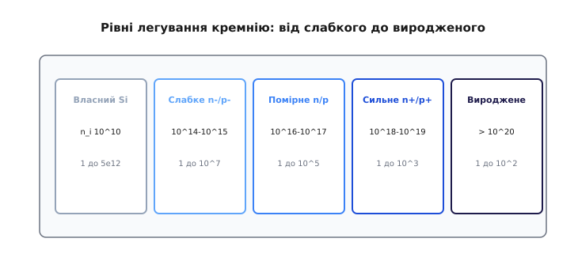
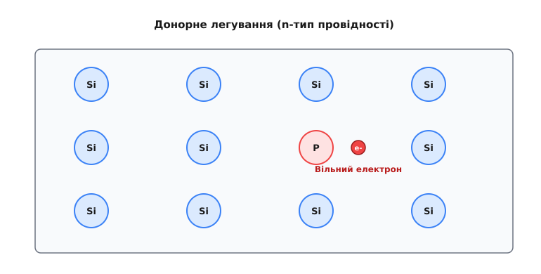
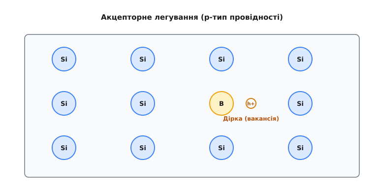
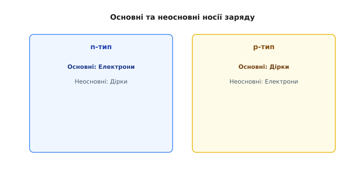
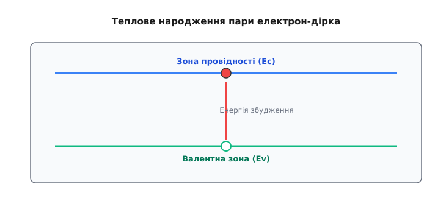

# Легування: n- і p-тип (донори/акцептори)

<preknowlist>
- [Напівпровідники](root:ph-condensed/semiconductor) — власна провідність, генерація пар носіїв, валентна зона та зона провідності.
- [Зонна теорія твердих тіл](root:ph-condensed/energy-bands) — заборонена зона, дисперсійні криві, квазіімпульс та ефективна маса носіїв.
- [Рівень Фермі](root:ph-condensed/fermi-level) — електрохімічний потенціал ферміонів, статистика Фермі — Дірака та нейтральність заряду.
- [Рухливість носіїв заряду](root:ph-condensed/carrier-mobility) — механізми розсіювання на фононах ґратки та іонізованих домішках.
</preknowlist>

Провідністю [чистого кремнію](root:ph-condensed/semiconductor) керують тепло і світло — але є ще один важіль, набагато потужніший: **домішки**. Дрібка чужих атомів міняє все, і саме завдяки їй кремній перетворюється з «цікавого каменю» на матеріал, придатний для діодів і транзисторів. Ця ідея — **легування** (*doping*, від нід. *doopen* — занурювати, просочувати). А щоб її зрозуміти, спершу треба розібратися з другим носієм струму в напівпровіднику — **діркою**: тією самою порожнечею, що лишається від розірваного зв'язку.

### Дірка: носій, якого «немає»

Уявімо розірваний [ковалентний зв'язок](root:ph-condensed/semiconductor) у ґратці кремнію. Електрон вискочив і полетів — а що лишилося на його місці? Порожнє місце у зв'язку. Спокуса сказати «нічого» — і помилитися. Бо сусідній зв'язаний електрон може **перестрибнути** в цю порожнечу й заповнити її — але тоді порожнеча з'явиться вже там, звідки він прийшов. Перестрибне наступний — і порожнеча знову переїде. Виходить, що **порожнеча мандрує кристалом**, хоча жоден окремий електрон далеко не йде.

А оскільки порожнеча — це брак однієї негативної частинки, поводиться вона як рухливий **позитивний** заряд. Їй дали власне ім'я — **дірка** (*hole*). Це другий повноправний носій струму поряд із вільним електроном.


*«Парковка» з електронів. Усі місця зайняті, крім одного (дірка). Коли електрон перестрибує праворуч у вільне місце, сама порожнеча зсувається ліворуч. Електрони рухаються в один бік — дірка ніби пливе в протилежний, як рухливий позитивний заряд.*

Класична аналогія — заповнена парковка з одним порожнім місцем. Машини (електрони) по черзі зсуваються в порожнечу — і та «їде» в протилежний бік, хоч жодна машина не проїхала через увесь паркінг. Дірка — це і є та порожнеча: зручний спосіб говорити про рух багатьох електронів як про рух однієї «частинки» з плюсом.

З погляду квантової теорії твердого тіла, дірка виникає як незаповнений одноелектронний квантовий стан у майже заповненій валентній зоні. Якщо повна хвильова функція повністю заповненої валентної зони володіє нульовим сумарним квазіімпульсом і нульовим сумарним електричним зарядом, то видалення одного електрона зі станом `(k_e, s_e, E_e)` залишає колективний стан багатьох електронів з результуючим квазіімпульсом `k_h = - k_e`, спіном `s_h = - s_e`, позитивним елементарним зарядом `q_h = + e` та додатною енергією збудження `E_h(k_h) = - E_e(k_e)`. 

Оскільки поблизу верхівки валентної зони кривина дисперсійної кривої від'ємна (`∂²E/∂k² < 0`), електронний тензор маси від'ємний; перехід до квазічастинки-дірки з енергією `E_h` відновлює строгу додатність ефективної маси дірки `m*_h > 0`. Таким чином, дірка прискорюється зовнішнім електричним полем `E` у напрямку вектора напруженості поля:

```
a_h = (e · E) / m*_h
```

Як саме дірка переносить струм? Прикладімо поле. Зв'язані електрони перестрибують у бік «плюса», заповнюючи дірки, — а отже, самі дірки дрейфують у бік «мінуса», поводячись як справжні позитивні заряди. Тому в напівпровіднику струм складається з **двох** потоків: вільні електрони пливуть в один бік, дірки — у протилежний. І, що цікаво, обидва потоки **додають** струм в одному й тому самому напрямку — бо протилежні заряди, рухаючись у протилежні боки, дають однаково спрямований струм. Звичка тримати в голові обидва носії — електрони й дірки — і є ключем до роботи [діода](root:ph-condensed/pn-junction) та транзистора.

Отже, у напівпровіднику **два** типи носіїв: вільні **електрони** (заряд −) і **дірки** (заряд +). У чистому кремнії вони народжуються строго **парами**: один розірваний зв'язок дає рівно один вільний електрон і рівно одну дірку.


*У чистому кремнії носії з'являються парами: тепло розриває зв'язок — і водночас народжуються вільний електрон (−) і дірка (+). Тому в чистому матеріалі електронів і дірок порівну.*

### Замало носіїв — додаймо домішки навмисне

У [чистому кремнії](root:ph-condensed/semiconductor) пар обмаль — один вільний носій на десятки трильйонів атомів, — і електронів та дірок порівну, тож матеріал кепський і «безхарактерний». Щоб зробити з нього прилад, треба керувати **двома** речами: **скільки** носіїв і **якого знаку** вони переважно. Саме це й робить легування — заміна крихітної частки атомів кремнію на атоми з **іншим** числом валентних електронів. Дивовижно, як мало їх треба; та спершу подивімося, що саме вони роблять.

Сама ідея гідна подиву: щоб змінити електричний характер речовини, у неї не вливають струм і не прикладають напругу — у неї лише **підселяють** кілька чужих атомів, і кристал назавжди стає «електронним» або «дірковим». Саме цей здогад — що домішки не ворог, а інструмент — Рассел Ол і перетворив на ключ до всієї подальшої електроніки. Подивімося, як працюють два сорти таких «підселенців».

### n-тип: зайвий електрон (донор)

Підмішаймо в кремній атом із **п'ятьма** валентними електронами — наприклад, **фосфор** (*phosphorus*, P) чи **миш'як** (*arsenic*, As) (V група). Чотири його електрони акуратно вбудуються в зв'язки з чотирма сусідами-кремнієм, як і годиться в ґратці. А **п'ятий** — зайвий: йому немає пари, немає зв'язку, де сісти. Він тримається кволо й за кімнатної температури легко відривається, стаючи **вільним електроном** — причому **без** парної дірки.

Атом, що «подарував» кристалові вільний електрон, називають **донором** (*donor*, від лат. *donare* — дарувати), а кремній із такими домішками — **n-тип** (n — від *negative*, бо переважають негативні носії, електрони).


*Атом фосфору (5 валентні електрони) серед кремнію: чотири електрони йдуть у зв'язки, п'ятий лишається зайвим і легко стає вільним носієм (−). Дірки при цьому не виникає. Так роблять n-тип — кремній із надлишком вільних електронів.*

Важлива тонкість: чи не з'являється тут зайвий заряд? Ні. Віддавши електрон, атом донора сам стає **нерухомим позитивним іоном**, замкненим у ґратці. Його «плюс» точно врівноважує «мінус» відірваного електрона, тож кристал **загалом лишається нейтральним** — просто тепер у ньому є вільні електрони, готові переносити струм. Запам'ятаймо це: легування додає рухливі носії, але **не** додає сумарного заряду.

Чому ж n-тип проводить набагато краще за чистий кремній? Бо звільнити «зайвий» п'ятий електрон донора куди легше, ніж розірвати міцний зв'язок Si–Si: йому й так немає де сісти. Тому вже за кімнатної температури майже **кожен** донор віддає свій електрон — і вільних носіїв стає рівно стільки, скільки ми поклали донорів. Це вже не теплова випадковість, як у чистому кремнії, а кероване, передбачуване число: скільки домішки додав — стільки приблизно й носіїв дістав. Ось чому концентрацією домішки задають провідність наперед.

### p-тип: бракує електрона (акцептор)

Тепер навпаки — підмішаймо атом із **трьома** валентними електронами, наприклад **бор** (*boron*, B) (III група). Він може утворити лише три зв'язки з сусідами; на четвертий зв'язок електрона **не вистачає** — там одразу сидить **дірка**. Сусідній зв'язаний електрон легко перестрибує туди, добудовуючи зв'язок (атом ніби «приймає» електрон), — а дірка переїздить далі й мандрує кристалом.

Атом, що «приймає» електрон, називають **акцептором** (*acceptor*, від лат. *acceptare* — приймати), а такий кремній — **p-тип** (p — від *positive*, бо переважають позитивні носії, дірки).


*Атом бору (3 валентні електрони) серед кремнію: на четвертий зв'язок електрона бракує — лишається дірка (+), яка може мандрувати. Вільного електрона при цьому не додається. Так роблять p-тип — кремній із надлишком дірок.*

І знову нейтральність: прийнявши електрон, акцептор стає **нерухомим негативним іоном**; його «мінус» урівноважує «плюс» дірки. Матеріал нейтральний — просто з рухливими дірками напоготові.

Дзеркально до донора: «недобудований» четвертий зв'язок бору так і проситься, щоб сусідній електрон його заповнив, тож майже кожен атом бору вже за кімнатної температури породжує одну рухливу дірку. Скільки акцепторів поклали — стільки приблизно дірок і дістали, і струм у p-типі несуть переважно вони. Зверніть увагу на симетрію двох випадків: донор дає електрон без дірки, акцептор дає дірку без електрона — кожен додає носій лише **одного** знаку, на відміну від теплової пари в чистому кремнії.

### Більшість, меншість — і обидва нейтральні

Звівши все докупи, отримуємо чіткий поділ:

```
n-тип:  основні носії — електрони (−),  неосновні — дірки (+)
p-тип:  основні носії — дірки (+),       неосновні — електрони (−)
```

Слово **основні** (*majority*) — про тих, кого легування дало вдосталь; **неосновні** (*minority*) — про нечисленних носіїв протилежного знаку, що все одно з'являються від [теплових пар](root:ph-condensed/semiconductor). У n-типі дірок мало, у p-типі мало електронів — але вони є, і саме вони згодом виявляються несподівано важливими.

Наскільки нерівний цей поділ? Дуже. У типово легованому кремнії основних носіїв буває в **мільярди** разів більше за неосновних. Саме ця кричуща перевага одного знаку й надає матеріалові «електронного» (n) чи «діркового» (p) характеру. Та крихітна меншість нікуди не зникає — і, хоч як це дивно, саме неосновні носії визначають, як поводиться [діод під зворотною напругою](root:hw-components/diode-iv-curve). Тож не варто списувати їх з рахунку завчасно: у напівпровідниках навіть «меншість» уміє зіграти ключову роль.


*Ліворуч n-тип: багато вільних електронів (−), нерухомі іони-донори (+) у ґратці, дірок — одиниці. Праворуч p-тип: багато дірок (+), нерухомі іони-акцептори (−), електронів — одиниці. Рухливі носії врівноважені нерухомими іонами, тож кожен шматок нейтральний як ціле.*

Зверніть увагу на головне непорозуміння, якого варто уникати: «n» і «p» кажуть про знак **основних носіїв**, а не про заряд матеріалу. І n-, і p-кремній **електрично нейтральні** — у руках ви тримаєте звичайний нейтральний кристал. Просто в одному напоготові негативні носії, у другому — позитивні. Ця нейтральність кожного боку окремо — наріжний камінь для розуміння [PN-переходу](root:ph-condensed/pn-junction).

Образно: n-кремній — це нейтральний натовп, у якому багато людей готові побігти ліворуч (електрони), а p-кремній — натовп, де багато готових побігти праворуч (дірки). Але загалом обидва натовпи стоять на місці й нікуди не зміщені — рівно доти, доки ми не зведемо їх докупи.

> 🔧 **Навіщо це.** Легування дає інженерові подвійний важіль: задати **скільки** носіїв (концентрацією домішки — від цього залежить провідність) і **якого знаку** вони переважно (вибором донора чи акцептора). Це і є та «настройка» матеріалу, якої не має ні мідь, ні скло. Створивши на одному кристалі сусідні n- і p-ділянки потрібної форми, ми дістаємо діоди, транзистори, а зрештою — цілі мікросхеми. Уся напівпровідникова техніка — це, по суті, мистецтво вчасно покласти потрібну домішку в потрібне місце.

І ще одна важлива різниця. [Тепло й світло](root:ph-condensed/semiconductor) крутять провідність **тимчасово**: прибрав вплив — і кремній повернувся до вихідного стану. Легування ж — **назавжди**: домішкові атоми вбудовані в ґратку, тож n- чи p-характер задано раз і назавжди, ще на заводі. Саме ця сталість і дозволяє будувати надійні, повторювані прилади — а не примхливі «котячі вуса» ранніх детекторів, де чутливу точку щоразу шукали навпомацки.

### Як мало домішки треба

Наскільки дрібна та «дрібка»? Часто досить **одного атома домішки на мільйон** (а то й на сто мільйонів) атомів кремнію, щоб провідність зросла в тисячі разів. Звідси й одержимість **чистотою**, до якої свого часу дійшов і Рассел Ол: якщо хочеш керувати домішкою на рівні «один на мільйон», то фоновий бруд має бути ще менший — інакше випадкові домішки заглушать навмисні. Спершу кремній очищають майже до ідеалу, а вже потім додають рівно стільки потрібного, скільки треба.

Щоб відчути цю дрібку: один атом на мільйон — це наче одна-єдина особлива піщинка на повне відро піску або один підмінений гравець серед повного стадіону глядачів. І попри таку мізерність, ця «піщинка» змінює провідність кристала в тисячі разів. Ось чому напівпровідникове виробництво — це передусім боротьба за чистоту вихідного матеріалу й за точність дозування домішки.


*Лише один чужий атом на мільйон атомів кремнію — і провідність підскакує в тисячі разів. Тому спершу домагаються майже ідеальної чистоти, а тоді дозовано вводять домішку (нагріванням — дифузією, або «встрілюванням» іонів).*

Технічно домішки вводять або **дифузією** (розігрітий кремній «всотує» їх із пари), або **іонною імплантацією** («встрілюванням» іонів). А головне — це можна робити **візерунком**: тут n, поряд p, у точно заданих місцях однієї пластини. Саме так на одному кристалі вибудовують мільярди приладів.

### Сам по собі — лише півсправи

Отже, маємо два різновиди кремнію: **n-тип** із надлишком вільних електронів і **p-тип** із надлишком дірок — кожен сам по собі нейтральний і доволі нудний. Уся магія починається, коли їх **з'єднати** в одному кристалі: n з одного боку, p — з іншого. Тоді головне відбувається не в товщі кремнію, а на **межі** між двома його сортами — бо саме там, а не всередині однорідного шматка, і живе клапан. На цій межі — у [PN-переході](root:ph-condensed/pn-junction) — і станеться дещо несподіване, що є серцем діода.

---

## Мікроскопічна природа донорних і акцепторних центрів

Щоб зрозуміти, чому атом домішки поводиться саме як джерело носіїв, необхідно розглянути його положення в кристалічній ґратці та конфігурацію хімічних зв'язків. У напівпровідниках зі структурою алмазу (`Si`, `Ge`) чи цинкової обманки (`GaAs`, `InP`, `GaN`, `SiC`) кожен атом матриці перебуває в стані `sp³`-гібридизації і утворює чотири ковалентні зв'язки з найближчими сусідами, розташованими у вершинах правильного тетраедра.

Домішкові атоми можуть займати в кристалі два принципово різні положення:

1. **Домішки заміщення** (*substitutional impurities*) — атом домішки виштовхує атом матриці з вузла кристалічної ґратки і займає його місце. Це термодинамічно найбільш стабільна конфігурація для елементів з атомними радіусами, близькими до ковалентного радіуса матриці (наприклад, ковалентний радіус `Si` становить 0.117 нм, `P` — 0.110 нм, `As` — 0.118 нм, `B` — 0.088 нм).
2. **Домішки проникнення (міжвузлові)** (*interstitial impurities*) — домішковий атом розташовується у вільному просторі між вузлами ґратки (у тетраедричних `T_d` або октаедричних `O_h` міжвузлях). Таке положення займають атоми з малим іонним радіусом або елементи перехідних груп (`Li`, `Na`, `Cu`, `Fe`, `Cr`, `Ni`).

```
Вузол заміщення (Substitutional):         Міжвузля (Interstitial):
      Si ——— Si ——— Si                         Si ——— Si ——— Si
      |      |      |                          |   \  |  /   |
      Si ——— P⁺ ——— Si                         Si — (Fe) ——— Si
      |      |      |                          |   /  |  \   |
      Si ——— Si ——— Si                         Si ——— Si ——— Si
   (електрон іде в зону)                   (глибокий центр / спотворення)
```

### Позначення дефектів за Крегером — Вінком

У сучасній фізиці твердого тіла та хімії дефектів для точного опису квазіхімічних реакцій між домішками, вузлами та вакансіями використовують нотацію Крегера — Вінка (*Kröger-Vink notation*):
- Основний символ вказує на хімічний елемент домішки (`P`, `B`, `Fe`) або вакансію `V`.
- Нижній індекс позначає позицію в ґратці: `Si` — вузол кремнію, `i` — міжвузля (*interstitial*).
- Верхній індекс позначає **ефективний електричний заряд** відносно ідеальної нейтральної ґратки:
  * Крапка `•` позначає позитивний заряд `+1e`.
  * Штрих `′` позначає негативний заряд `-1e`.
  * Хрестик `×` позначає нейтральний стан відносно ґратки.

У цих позначеннях іонізація донора фосфору записується як:
```
P_{Si}^× ⇄ P_{Si}^• + e′
```
Іонізація акцептора бору:
```
B_{Si}^× ⇄ B_{Si}^′ + h^•
```

### Донори заміщення в елементарних напівпровідниках

Коли атом V групи періодичної таблиці (`P`, `As`, `Sb`, `Bi`) заміщує чотиривалентний кремній або германій, п'ять його валентних електронів розподіляються так: чотири електрони утворюють міцні ковалентні зв'язкі з чотирма сусідніми атомами кремнію, повністю замикаючи валентну оболонку кристала.

П'ятий електрон не може розміститися у валентній зоні, оскільки всі її квантові стани заповнені за принципом Паулі. Водночас атомне ядро домішки має позитивний заряд `+5e`, тоді як у вузлі заміщеного кремнію було ядро `+4e`. Отже, у вузлі утворюється надлишковий точковий позитивний заряд `+1e` (`P_{Si}^•`). П'ятий валентний електрон рухається в кулонівському полі цього позитивного іонного остова, що за квантовою структурою нагадує атом водню.

### Акцептори заміщення в елементарних напівпровідниках

Коли тривалентний атом III групи (`B`, `Al`, `Ga`, `In`) заміщує чотиривалентний вузол `Si`, для формування чотирьох тетраедричних зв'язків бракує одного електрона. Система мінімізує вільну енергію шляхом захоплення електрона з найближчого ковалентного зв'язку `Si—Si`. 

У результаті захоплення ковалентні зв'язки навколо атома домішки стають замкненими, а сам домішковий атом перетворюється на негативно заряджений іонний кістяк `B_{Si}^′` із зарядом `-1e`. Водночас у валентній зоні залишається вільний квантовий стан — дірка із зарядом `+1e` (`h^•`). Ця дірка утримується кулонівським притяганням негативного іона `B⁻`, формуючи квазіатомну зв'язану систему, дзеркальну до донорного стану.

### Амфотерне легування у бінарних напівпровідниках III-V

У складних напівпровідниках типу `GaAs` поведінка домішки залежить від того, яку саме підґратку займає домішковий атом:

- Якщо атом IV групи (наприклад, `Si` чи `Ge`) заміщує атом галію в підґратці III групи (`Si_{Ga}^•`), він має на один валентний електрон більше за оточення і діє як **донор**.
- Якщо той самий атом кремнію заміщує атом миш'яку в підґратці V групи (`Si_{As}^′`), йому бракує одного валентного електрона і він діє як **акцептор**.

Така властивість називається **амфотерністю** (*amphoterism*). Керуючи парціальним тиском пари миш'яку та температурою росту кристала під час епітаксії, можна спрямувати кремній переважно в підґратку `Ga` (отримуючи високоякісний n-GaAs) або в підґратку `As` (отримуючи p-GaAs).

Елементи II групи (`Be`, `Mg`, `Zn`, `Cd`) у `GaAs` заміщують виключно підґратку галію і є акцепторами (`Be_{Ga}^′`, `Zn_{Ga}^′`), а елементи VI групи (`S`, `Se`, `Te`) заміщують миш'як і виступають донорами (`Te_{As}^•`).

### Ізоелектронні домішки

Якщо атом домішки належить до тієї ж хімічної групи, що й заміщуваний атом матриці (наприклад, азот `N` або вісмут `Bi`, що заміщує фосфор у фосфіді галію `GaP`), він не створює надлишкового чи дефіцитного заряду ядра (`ΔZ = 0`, стан `N_{P}^×`). Такі домішки називають **ізоелектронними** (*isoelectronic impurities*).

Через суттєву різницю в електронегативності та ковалентних радіусах між `N` та `P`, атом азоту створює потужний короткодіючий потенціал деформації, здатний захопити вільний електрон, утворюючи негативно заряджений комплекс, який потім кулонівськи притягує дірку. Утворюється локалізований **зв'язаний екситон** (*bound exciton*). Саме ізоелектронне легування азотом уможливило створення ефективних зелених світлодіодів на непрямозонному `GaP:N`.

### Міжвузлові домішки та механізми переходу вузол-міжвузля

Міжвузлові атоми (`A_i`) володіють надзвичайно високим коефіцієнтом дифузії, оскільки для переходу між сусідніми міжвузлями не потрібно розривати міцні ковалентні зв'язки матриці (енергія активації міграції для `Fe_i`, `Cu_i`, `Li_i` становить лише `0.4-0.8 еВ`, тоді як для домішок заміщення `P_{Si}`, `B_{Si}` вона сягає `3.5-4.0 еВ`).

Перехід домішки між швидким міжвузловим станом `A_i` та стабільним вузлом заміщення `A_s` відбувається за двома класичними механізмами:

1. **Механізм Франка — Тернбулла (дисоціативний механізм):**
   Міжвузловий атом зустрічає термічну вакансію кремнію `V_{Si}` і займає її:
   ```
   A_i + V_{Si} ⇄ A_s
   ```
2. **Механізм Кік-ауту (виштовхування):**
   Швидкий міжвузловий атом вибиває атом кремнію з вузла, займаючи його місце і генеруючи міжвузловий атом кремнію `I_{Si}`:
   ```
   A_i ⇄ A_s + I_{Si}
   ```

Саме механізм Кік-ауту є домінуючим при високотемпературній дифузії золота, платини та цинку в кремнії.

### Домішково-дефектні комплекси та деградація матеріалів

У реальних напівпровідниках домішки заміщення утворюють комплекси з точковими дефектами та залишковими технологічними домішками:

- **E-центр (комплекс фосфор–вакансія, `V—P`):** Утворюється при радіаційному опроміненні кремнію n-типу. Створює глибокий акцепторний рівень `E_c - 0.44 еВ`, що призводить до деградації біполярних транзисторів і сонячних елементів у космічних апаратах.
- **A-центр (комплекс кисень–вакансія, `V—O`):** Утворюється у вирощеному за Чохральським кремнії (`Cz-Si`, де вміст кисню сягає `10¹⁸ см⁻³`). Має рівень `E_c - 0.17 еВ`.
- **Комплекс бор–кисень (`B_s—O_{2i}`):** Відповідальний за ефект світлової деградації (*Light-Induced Degradation, LID*) у сонячних батареях на основі p-кремнію, де під дією сонячного світла утворюються метастабільні рекомбінаційні центри, що знижують ККД фотоелементів на 1–2% за перші години роботи.

---

## Воднеподібна модель мілких рівнів (наближення ефективної маси)

Чому донори й акцептори іонізуються за кімнатної температури, хоча енергія іонізації вільного атома водню у вакуумі становить велетенські `13.606 еВ`? Відповідь дає квантовомеханічна теорія мілких домішкових станів, розроблена Гансом Бете, Хоакіном Латтінджером та Волтером Коном — **наближення ефективної маси** (*Effective Mass Approximation, EMA*).

У напівпровідниковому кристалі на кулонівську взаємодію між зайвим електроном і додатним іонним остовом діють два фундаментальні чинники:

1. **Діелектричне екранування кристалічної ґратки.** Електрон рухається не у вакуумі, а в діелектричному середовищі, поляризованому електронами внутрішніх оболонок та зміщенням іонів ґратки. На відстанях `r`, що перевищують сталу ґратки `a_lat` (`r >> a_lat`), потенціал взаємодії послаблюється у `ε_r` разів:
   ```
   V(r) = - e² / (4 · π · ε₀ · ε_r · r)
   ```
   де `ε_r` — статична відносна діелектрична проникність напівпровідника (для кремнію `ε_r = 11.7`, для германію `ε_r = 16.0`, для арсеніду галію `ε_r = 12.9`).

2. **Періодичний потенціал ґратки та ефективна маса.** Замість складної взаємодії з усіма атомами ґратки рух електрона описується його тензором ефективної маси `m*` біля дна зони провідності.

```
Вільний атом водню (вакуум):             Донор у кремнії (воднеподібний стан):
           -e                                             -e
            o                                              o
            | r ≈ 0.053 nm                                 | r ≈ 2.4 nm
            |                                              |
           (+e) Протон                                   (+e) Іон P⁺
      Енергія: 13.6 еВ                              Енергія: 0.045 еВ
     (тримає намертво)                             (відриває тепло кімнати)
```

### Рівняння Шредінгера для обвідної функції

Повна хвильова функція домішкового стану в рамках EMA розкладається за блохівськими хвилями мінімуму зони провідності `ψ_{k0}(r) = u_{k0}(r) · exp(i · k₀ · r)` з повільно змінною обвідною функцією `F(r)`:

```
Ψ(r) = F(r) · ψ_{k0}(r)
```

Для обвідної функції `F(r)` одноелектронне рівняння Шредінгера набуває воднеподібного вигляду:

```
[- (ℏ² / (2 · m*)) · ∇² - e² / (4 · π · ε₀ · ε_r · r)] F(r) = E · F(r)
```

Розв'язок цього рівняння повністю аналітичний і збігається з розв'язком для атома водню з перенормованими фундаментальними константами.

### Ефективний борівський радіус домішки

Радіус першої борівської орбіти зв'язаного електрона донора `a_B*` визначається виразом:

```
a_B* = a₀ · ε_r · (m₀ / m*)
```

де `a₀ = (4 · π · ε₀ · ℏ²) / (m₀ · e²) ≈ 0.0529177 нм` — борівський радіус вільного атома водню.

Виведемо покроковий розрахунок радіуса для домішки в кремнії (`m*_ce ≈ 0.26 · m₀`, `ε_r = 11.7`):

```
a_B*(Si)
= 0.0529177 нм · 11.7 · (1 / 0.26)    [підстановка параметрів Si]
= 0.0529177 нм · 45.00                [обчислення перенормованого множника]
≈ 2.38 нм                             [результуючий радіус домішкової хвильової функції]
```

Оскільки стала ґратки кремнію становить `a_lat = 0.543 нм`, об'єм сфери з радіусом `a_B* ≈ 2.4 нм` охоплює сотні елементарних комірок кристала (понад 2500 атомів `Si`!). Це повністю виправдовує використання макроскопічної діелектричної проникності `ε_r` та наближення ефективної маси: електрон дійсно бачить ґратку як однорідне діелектричне середовище.

Для прямозонного `GaAs` з малою ефективною масою електрона (`m*_e = 0.067 · m₀`, `ε_r = 12.9`):

```
a_B*(GaAs)
= 0.0529177 нм · 12.9 · (1 / 0.067)   [підстановка параметрів GaAs]
= 0.0529177 нм · 192.54               [обчислення множника]
≈ 10.19 нм                            [радіус орбіти перевищує 100 ангстрем]
```

### Енергія зв'язку (іонізації) домішки

Енергія основного стану `1s` відраховується від краю зони провідності `E_c` (для донорів `E_d = E_c - E_{1s}`) і становить:

```
E_d = E_H · (m* / m₀) · (1 / ε_r²)
```

де `E_H = (m₀ · e⁴) / (32 · π² · ε₀² · ℏ²) ≈ 13.606 еВ` — енергія Рідберга (іонізація атома водню).

Виведемо розрахунок теоретичної енергії іонізації в `GaAs`:

```
E_d(GaAs)
= 13.606 еВ · 0.067 · (1 / 12.9²)     [підстановка m* та ε_r]
= 13.606 еВ · 0.067 · 0.006009        [обчислення знаменника 166.41]
= 0.9116 еВ · 0.006009
≈ 0.00548 еВ = 5.48 меВ               [теоретична енергія зв'язку]
```

Експериментальне значення для кремнієвого донора в `GaAs` становить `5.7 меВ`. Збіг теорії Бете — Кона з експериментом вражає — похибка менше 4%!

Для кремнію теоретична модель EMA дає:

```
E_d(Si, EMA)
= 13.606 еВ · 0.26 · (1 / 11.7²)      [підстановка m*_ce та ε_r]
= 3.5376 еВ · (1 / 136.89)
≈ 0.02584 еВ = 25.84 меВ              [воднеподібна оцінка без урахування хімічного зсуву]
```

### Квантова теорія акцепторних рівнів у валентній зоні

Для акцепторних станів ситуація є складнішою через виродження валентної зони в центрі зони Бріллюена `k = 0`. Валентна зона напівпровідників зі структурою алмазу та сфалериту складається з трьох підзон:
1. Зона важких дірок (*heavy holes, hh*) з ефективною масою `m*_hh ≈ 0.49 m₀` у Si.
2. Зона легких дірок (*light holes, lh*) з ефективною масою `m*_lh ≈ 0.16 m₀` у Si.
3. Спін-орбітально розщеплена зона (*split-off, so*), віддалена на енергію `Δ_{so}` (`0.044 еВ` для Si, `0.29 еВ` для Ge, `0.34 еВ` для GaAs).

Гамільтоніан Латтінджера — Кона для акцептора містить матричні оператори кутового моменту `J = 3/2`:

```
H_A = (ℏ² / 2m₀) · [(γ₁ + (5/2) γ₂) · ∇² - 2 γ₂ · (∇ · J)²] - e² / (4 · π · ε₀ · ε_r · r)
```

де `γ₁, γ₂, γ₃` — параметри Латтінджера, що описують анізотропію та дисперсію валентних зон.

Через кулонівське змішування хвильових функцій важких і легких дірок акцепторний стан набуває складного кутового моменту `j = 3/2` і є чотирикратно виродженим (`g_a = 4`).

Оскільки хвильова функція дірки біля вершини валентної зони формується p-орбіталями зв'язку кремнію, її квантова густина ймовірності на самому центрі ядра домішки дорівнює нулю (`|Ψ(0)|² = 0`). Як наслідок, акцептори в кремнії значно менше чутливі до хімічної природи остова (для B: `E_a = 44.5 меВ`, для Al: `68.5 меВ`, для Ga: `72.3 меВ`), ніж донори.

---

## Центральний комірковий зсув і долинно-орбітальне розщеплення

Як видно з експериментальних даних, енергії іонізації різних донорів V групи у кремнії помітно різняться між собою: для сурми `Sb` це `42.7 меВ`, для фосфору `P` — `45.5 меВ`, для миш'яку `As` — `53.7 меВ`, а для вісмуту `Bi` — аж `70.6 меВ`. Усі вони істотно глибші за теоретичне значення наближення ефективної маси (`25.8 меВ`). 

Ця розбіжність має назву **центральний комірковий зсув** (*central cell correction* або *chemical shift*, хімічний зсув) і зумовлена крахом двох фундаментальних припущень EMA на малих відстанях від ядра:

1. **Некулонівський потенціал остова.** На відстанях `r < a_lat` електрон проникає крізь замкнені електронні оболонки іонного кістяка домішки. Тут діелектричне екранування спадає (`ε_r(r) → 1`), а потенціал визначається індивідуальною будовою ядра та псевдопотенціалом іона, що залежить від його електронегативності та радіуса остова.
2. **Локальна деформація ґратки.** Різниця ковалентних радіусів призводить до пружного зміщення сусідніх атомів матриці, що створює локальне поле напружень.

```
Потенціал V(r)
  0 ─────────────────────────────── r (відстань від ядра)
    \  Центральна комірка
     \ (некулонівська яма)
      \       /
       |     |  Макроскопічний екранований кулон: -e² / (4πεε_r r)
       |     \__________________________________
       |
       |  Справжній хімічний потенціал іона (P, As, Sb)
```

### Багатодолинна зонна структура та долинно-орбітальне розщеплення

У кремнії зона провідності має 6 еквівалентних мінімумів (долин), розташованих уздовж кристалографічних напрямків `[100]`, `[-100]`, `[010]`, `[0-10]`, `[001]`, `[00-1]` на відстані `0.85 · (2π / a_lat)` від центру зони Бріллюена.

У чистому наближенні ефективної маси основний `1s`-стан донора є 6-кратно виродженим за числом долин:

```
Ψ_n(r) = ∑_{j=1..6} α_j · F_j(r) · ψ_{kj}(r)
```

Короткодіючий збурюючий потенціал центральної комірки має симетрію точкової групи тетраедра `T_d`. Згідно з теорією груп, 6-кратно вироджене представлення розкладається на незвідні представлення групи `T_d`:

```
Γ_{6-valley} = A₁ ⊕ E ⊕ T₂
```

Це призводить до розщеплення 6-кратного рівня на три підрівні:

1. **Синглет `A₁` (1 стан):** Повністю симетрична лінійна комбінація обвідних функцій з усіх шести долин:
   ```
   α(A₁) = (1 / √6) · (1, 1, 1, 1, 1, 1)
   ```
   Хвильова функція стану `A₁` має конструктивну інтерференцію і максимальну амплітуду на ядрі домішки (`r = 0`). Тому стан `A₁` зазнає найсильнішого притягання до неекранованого іонного остова і зміщується найглибше в заборонену зону. Саме енергія рівня `A₁` визначає експериментальну енергію іонізації основного стану.

2. **Триплет `T₂` (3 стани):** Антисиметричні комбінації протилежних долин, наприклад `(1/√2) · (1, -1, 0, 0, 0, 0)`. Хвильова функція має вузлову площину на ядрі, через що амплітуда на центрі дорівнює нулю. Стан `T₂` слабко реагує на хімічну природу остова і лежить значно ближче до значення EMA (`E(T₂) ≈ 31-34 меВ`).

3. **Дублет `E` (2 стани):** Комбінації типу `(1/2) · (1, 1, -1, -1, 0, 0)`. Також має вузол на ядрі й мінімальний хімічний зсув (`E(E) ≈ 32-33 меВ`).

```
Зонна схема долинно-орбітального розщеплення у Si:P:
  ─────────────────────────────── Край зони провідності E_c
       -31.3 меВ ─── ───          Дублет E (2 стани)
       -33.9 меВ ─── ─── ───      Триплет T₂ (3 стани)
       (Долинно-орбітальне розщеплення Δ_vo ≈ 13 меВ)
       -45.5 меВ ───────────      Синглет A₁ (1 стан, основний)
```

Експериментальні значення енергетичних рівнів долинно-орбітального розщеплення у кремнії:

| Донор | Основний стан `A₁`, меВ | Триплет `T₂`, меВ | Дублет `E`, меВ | Долинно-орбітальне розщеплення `Δ_{VO}`, меВ |
|---|---|---|---|---|
| Сурма (`Sb`) | 42.7 | 32.9 | 30.6 | 9.8 |
| Фосфор (`P`) | 45.5 | 33.9 | 31.3 | 11.6 |
| Миш'як (`As`)| 53.7 | 32.6 | 31.2 | 21.1 |
| Вісмут (`Bi`) | 70.6 | 32.9 | 31.1 | 37.7 |

---

## Статистика носіїв заряду та розрахунок положення рівня Фермі

Поведінка електронів і дірок у легованому напівпровіднику підпорядковується квантовій статистиці Фермі — Дірака. Електрохімічний потенціал системи носіїв струму називають **рівнем Фермі** `E_F`.

### Концентрація вільних носіїв у дозволених зонах

Для невиродженого напівпровідника (коли рівень Фермі віддалений від країв дозволених зон щонайменше на `3 · k_B T`, тобто `E_c - E_F ≥ 3 k_B T` та `E_F - E_v ≥ 3 k_B T`), квантовий розподіл Фермі — Дірака переходить у класичний розподіл Максвелла — Больцмана.

Концентрація електронів у зоні провідності `n` та дірок у валентній зоні `p` виражається формулами:

```
n = N_c · exp(- (E_c - E_F) / (k_B · T))
p = N_v · exp(- (E_F - E_v) / (k_B · T))
```

де `N_c` та `N_v` — ефективні густини квантових станів у зоні провідності та валентній зоні відповідно:

```
N_c = 2 · [(2 · π · m*_de · k_B · T) / h²]^(3/2)
N_v = 2 · [(2 · π · m*_dh · k_B · T) / h²]^(3/2)
```

де `m*_de` та `m*_dh` — ефективні маси густини станів для електронів і дірок.

Добуток концентрацій електронів та дірок за термодинамічної рівноваги є фундаментальним інваріантом матеріалу при заданій температурі — **закон діючих мас** (*law of mass action*):

```
n · p
= N_c · N_v · exp(- (E_c - E_v) / (k_B · T))    [множення концентрацій n та p]
= N_c · N_v · exp(- E_g / (k_B · T))            [означення ширини зони E_g = E_c - E_v]
= n_i²(T)                                       [закон діючих мас: добуток є інваріантом]
```

де `n_i` — власна концентрація носіїв заряду, `E_g = E_c - E_v` — ширина забороненої зони.

Для кремнію за температури `T = 300 K`:
- `N_c ≈ 2.86 × 10¹⁹ см⁻³`
- `N_v ≈ 2.66 × 10¹⁹ см⁻³`
- `E_g = 1.12 еВ`
- `n_i(300 K) ≈ 1.0 × 10¹⁰ см⁻³`

### Квантове виродження та наближення Джойса — Діксона

Коли концентрація носіїв наближається до `N_c` чи перевищує її, больцманівське наближення ламається. Точна концентрація визначається інтегралом Фермі — Дірака порядку 1/2:

```
n = N_c · F_{1/2}(η_c) = N_c · (2 / √π) · ∫_{0..∞} [x^(1/2) / (1 + exp(x - η_c))] dx
```

де `η_c = (E_F - E_c) / (k_B · T)` — безрозмірний хімічний потенціал.

Для аналітичного знаходження рівня Фермі у виродженому режимі використовують точне **наближення Джойса — Діксона** (*Joyce-Dixon approximation*):

```
E_F - E_c = k_B · T · [ln(n / N_c) + A₁ · (n / N_c) + A₂ · (n / N_c)² + A₃ · (n / N_c)³ + A₄ · (n / N_c)⁴]
```

де універсальні коефіцієнти розкладу становлять:
- `A₁ = 1 / √8 ≈ 0.353553`
- `A₂ = - 3/16 + √3/9 ≈ - 0.004950`
- `A₃ = 1.48385 × 10⁻⁴`
- `A₄ = - 4.42563 × 10⁻⁶`

### Статистика заповнення домішкових рівнів

При обчисленні ймовірності заповнення домішкового рівня електроном необхідно враховувати квантове спінове та орбітальне виродження, а також сильне внутрішньовузлове кулонівське відштовхування Габбарда `U_{Hubbard}`.

Донорний атом може перебувати в трьох станах:
1. Іонізований стан (порожній рівень) — 0 електронів, кратність виродження `g₀ = 1`.
2. Нейтральний стан — 1 електрон зі спіном «вгору» (`s = +1/2`) або «вниз» (`s = -1/2`), кратність виродження `g₁ = 2`.
3. Двічі зайнятий стан — 2 електрони з протилежними спінами. Через велике кулонівське відштовхування двох електронів на одній орбіталі радіусом `~2 нм` енергія цього стану підвищується на `U ≈ 0.2-0.5 еВ`, що виштовхує рівень далеко в зону провідності. Тому за звичайних умов донор не може зв'язати два електрони.

Концентрація нейтральних (заповнених електроном) донорів `N_d⁰` та іонізованих донорів `N_d⁺` визначається формулою Гіббса для великого канонічного ансамблю:

```
N_d⁺ = N_d / [1 + g_d · exp((E_F - E_d) / (k_B · T))]
N_d⁰ = N_d - N_d⁺ = N_d / [1 + (1 / g_d) · exp((E_d - E_F) / (k_B · T))]
```

де `g_d = 2` — фактор виродження донорного рівня в елементарних напівпровідниках.

Для акцепторних рівнів, утворених дірками біля вершини валентної зони (де валентна зона двократно вироджена за орбітальним моментом `j = 3/2` — важкі та легкі дірки, плюс подвійне спінове виродження), фактор виродження становить `g_a = 4`:

```
N_a⁻ = N_a / [1 + g_a · exp((E_a - E_F) / (k_B · T))]
```

### Рівняння електронейтральності

У макроскопічному об'ємі однорідного напівпровідника густина сумарного просторового заряду тотожно дорівнює нулю:

```
ρ = q · (p - n + N_d⁺ - N_a⁻) = 0
```

Звідси отримуємо фундаментальне **рівняння електронейтральності**:

```
n + N_a⁻ = p + N_d⁺
```

Підставляючи вирази для `n(E_F)`, `p(E_F)`, `N_d⁺(E_F)` та `N_a⁻(E_F)`, отримуємо замкнене алгебраїчне рівняння щодо рівня Фермі `E_F(T, N_d, N_a)`:

```
N_c · exp(- (E_c - E_F) / (k_B T)) + N_a / [1 + g_a · exp((E_a - E_F) / (k_B T))]
= N_v · exp(- (E_F - E_v) / (k_B T)) + N_d / [1 + g_d · exp((E_F - E_d) / (k_B T))]
```

---

## Температурні режими провідності та кінетика розсіювання

Залежність концентрації вільних носіїв `n(T)` та положення рівня Фермі `E_F(T)` від температури в n-напівпровіднику ділиться на три виразні фізичні діапазони:

```
Концентрація n (log масштаб)
  ^
  |        Власний режим (Intrinsic)
  |       / (термічний розрив зв'язків Si-Si)
  |      /
  |  ───/──────────────────── Режим виснаження (Saturation/Exhaustion): n ≈ N_d - N_a
  |    /
  |   /  Виморожування носіїв (Freeze-out): іонізація домішок
  |  /
  +───────────────────────────────────────────────────> 1/T (обернена температура)
   (Висока T)                     (Кімнатна T)           (Низька T / гелій)
```

### 1. Низькотемпературний режим виморожування (Freeze-out)

При низьких температурах (`k_B · T << E_c - E_d`, для кремнію `T < 100 K`) теплової енергії недостатньо для повної іонізації донорів. Концентрація вільних дірок нехтовно мала (`p ≈ 0`).

**Випадок А: Некомпенсований напівпровідник (`N_a = 0`):**
Рівняння нейтральності набуває вигляду `n = N_d⁺ << N_d`.

```
n = N_c · exp(- (E_c - E_F) / (k_B T))
N_d⁺ ≈ N_d / [g_d · exp((E_F - E_d) / (k_B T))]
```

Прирівнюючи `n = N_d⁺`, знаходимо точне аналітичне положення рівня Фермі:

```
E_F(T) = (E_c + E_d) / 2 + (k_B · T / 2) · ln(N_d / (g_d · N_c))
```

Підставляючи `E_F` у вираз для концентрації `n(T)`:

```
n(T) = √((N_c · N_d) / g_d) · exp(- (E_c - E_d) / (2 · k_B · T))
```

Зверніть увагу на дільник 2 у показнику експоненти: енергія активації провідності на графіку Арреніуса `ln(n)` від `1/T` становить рівно **половину** енергії іонізації донора `ΔE = E_d / 2`. При `T → 0 K` рівень Фермі прямує рівно посередині між дном зони провідності `E_c` та донорним рівнем `E_d`.

**Випадок Б: Компенсований напівпровідник (`N_a > 0`, `N_d > N_a`):**
У реальних кристалах завжди присутня фонова концентрація протилежної домішки `N_a`. За низьких температур усі `N_a` акцепторів безумовно забирають електрони з донорів, тому `N_d⁺ ≈ N_a >> n`.
Рівняння нейтральності дає:

```
n = (N_d - N_a) / N_a · (N_c / g_d) · exp(- (E_c - E_d) / (k_B · T))
```

Рівень Фермі при цьому фіксується безпосередньо на енергії донорного рівня:

```
E_F(T) = E_d + k_B · T · ln((N_d - N_a) / (g_d · N_a))
```

Показник експоненти в компенсованому матеріалі містить **повну** енергію іонізації `E_d` (без коефіцієнта 1/2). Це дає експериментальний інструмент розрізнення компенсованих і некомпенсованих кристалів.

### 2. Режим виснаження / насичення домішок (Exhaustion / Saturation)

У діапазоні температур від `~100 K` до `~450 K` (для `Si` з помірним легуванням `N_d = 10¹⁵ - 10¹⁷ см⁻³`) теплової енергії вистачає для іонізації практично 100% донорних атомів (`N_d⁺ ≈ N_d`), але вона ще недостатня для подолання широкої забороненої зони кремнію (`n_i << N_d`).

Концентрація основних носіїв виходить на константу («поличку» насичення):

```
n ≈ N_d - N_a = const
p = n_i²(T) / n ≈ n_i²(T) / (N_d - N_a) << n
```

Рівень Фермі в режимі виснаження плавно опускається зі зростанням температури:

```
E_F(T) = E_c - k_B · T · ln(N_c(T) / (N_d - N_a))
```

Оскільки `N_c(T) ∝ T^(3/2)`, рівень Фермі монотонно віддаляється від зони провідності вглиб забороненої зони.

### 3. Високотемпературний власний режим (Intrinsic)

При подальшому нагріванні (`T > 450-500 K` для кремнію, `T > 350 K` для германію) термічна генерація пар електрон–дірка через заборонену зону стрімко зростає і перевищує концентрацію введених домішок:

```
n_i(T) >> N_d - N_a
```

Концентрація електронів і дірок вирівнюється:

```
n ≈ p ≈ n_i(T) = √(N_c · N_v) · exp(- E_g / (2 · k_B · T))
```

Рівень Фермі виходить на рівень власного напівпровідника `E_i`:

```
E_F(T) → E_i = (E_c + E_v) / 2 + (3/4) · k_B · T · ln(m*_dh / m*_de)
```

Матеріал втрачає свій n- чи p-тип, а напівпровідникові прилади (діоди, транзистори) втрачають працездатність через колапс p-n бар'єрів. Це встановлює фундаментальну верхню робочу температурну межу для кремнієвої електроніки (150–200 °C). Для широкозонних напівпровідників (`SiC` з `E_g = 3.2 еВ`, `GaN` з `E_g = 3.4 еВ`) власний режим настає лише при температурах вище 600–800 °C, що робить їх незамінними для силової та високотемпературної електроніки.

### Температурна кінетика рухливості та питомого опору

Електропровідність напівпровідника визначається як концентрацією носіїв, так і їхньою рухливістю:

```
σ(T) = q · (n(T) · μ_n(T) + p(T) · μ_p(T))
```

Рухливість `μ = (q · τ) / m*` лімітується двома основними механізмами розсіювання носіїв заряду з характерним часом релаксації імпульсу `τ`:

1. **Розсіювання на іонізованих домішках за теорією Брукса — Геррінга:**
   Кулонівське поле іонізованого домішкового центру екранується дебаєвською хмарою рухливих носіїв заряду з радіусом екранування Дебая `L_D = √((ε₀ · ε_r · k_B · T) / (q² · n))`. Квантовомеханічний розрахунок за борнівським наближенням дає:
   ```
   μ_{BH}(T) = [2^(7/2) · (ε₀ · ε_r)² · (k_B · T)^(3/2)] / [π^(3/2) · q³ · √m* · N_I · (ln(1 + b) - b / (1 + b))]
   ```
   де безрозмірний параметр екранування `b = (24 · m* · k_B · T · ε₀ · ε_r · L_D²) / ℏ²`.
   При підвищенні температури теплова швидкість електронів зростає (`v_{th} ∝ T^(1/2)`), час взаємодії з іоном зменшується, і кулонівське розсіювання спадає: `μ_{ii} ∝ T^(3/2) / N_I`.

2. **Розсіювання на акустичних фононах ґратки `μ_ph`:**
   Зі зростанням температури амплітуда теплових коливань атомів ґратки зростає, число фононів збільшується пропорційно `T`, а густина кінцевих станів пропорційна `T^(1/2)`:
   ```
   μ_ph(T) ∝ T^(-3/2)
   ```

Згідно з правилом додавання ймовірностей розсіювання Маттіссена:

```
1 / μ_total(T) = 1 / μ_ii(T) + 1 / μ_ph(T)
```

```
Рухливість μ (log масштаб)
  ^
  |          Максимум рухливості (T ≈ 100-150 K)
  |             /\
  |  μ_ii ∝ T^(3/2) /  \  μ_ph ∝ T^(-3/2)
  |          /    \
  |         /      \ (розсіювання на фононах гратки)
  |   (розсіювання  \
  |   на іонах)      \
  +──────────────────────────────────────────> Температура T
   (Низька T)                                 (Кімнатна / Висока T)
```

Внаслідок цього результуюча рухливість має виразний куполоподібний максимум при температурах `100-150 K`. При кімнатній температурі (`300 K`) домінує фононне розсіювання, і рухливість монотонно падає з ростом `T`.

---

## Низькотемпературний транспорт у компенсованих напівпровідниках і стрибкова провідність

Коли температура прямує до абсолютного нуля (`T < 20 K`), вільні носії повністю виморожуються із зони провідності на домішкові рівні (`n → 0`), і класична зонна провідність зникає. Проте в компенсованих напівпровідниках електричний струм продовжує текти.

Фізичний механізм цього явища відкрили Невілл Мотт та Філіп Андерсон — це **стрибкова провідність** (*hopping conduction*).

### Механізм стрибків за найближчими сусідами (NNH)

У компенсованому напівпровіднику (`N_d > N_a`) частина донорів іонізована (`N_d⁺ = N_a`), а частина нейтральна (`N_d⁰ = N_d - N_a`). Електрон з нейтрального атома донора може квантовомеханічно тунелювати на сусідній вільний (іонізований) атом донора без переходу в зону провідності:

```
P⁰ + P⁺ ──[квантове тунелювання]──> P⁺ + P⁰
```

Оскільки випадково розташовані іони акцепторів `N_a⁻` створюють неоднорідний флуктуаційний кулонівський потенціал, енергетичні рівні різних донорів не збігаються. Для стрибка електрон повинен поглинути або випромінити акустичний фонон відповідної енергії `ε₃`.

Провідність стрибків за найближчими сусідами (*Nearest-Neighbor Hopping, NNH*) описується активаційним законом:

```
σ_{NNH}(T) = σ₃ · exp(- ε₃ / (k_B · T))
```

де енергія активації `ε₃ ≈ (e² / (4 · π · ε₀ · ε_r)) · N_d^(1/3)` відповідає середньому розкиду кулонівського потенціалу між сусідніми домішковими центрами.

```
Стрибки між сусідніми центрами (NNH):    Стрибки змінної довжини (Mott VRH):
      E                                        E
      ^                                        ^  Рівень Фермі E_F
      |     ε₃                                 |  ──────o────────────o───
      |    o───>──o                            |         \  ΔE_opt  /
      |   /        \                           |          \___>____/
      +───────────────> r                      +─────────────────────────> r
     (стрибок на відстань R_nn)               (стрибок на далеку відстань R_opt)
```

### Стрибкова провідність зі змінною довжиною стрибка Мотта (VRH)

При наднизьких (гелієвих) температурах (`T < 4.2 K`) енергія теплових фононів `k_B T` стає замалою навіть для подолання енергетичного бар'єра сусіднього вузла `ε₃`. Електрону стає енергетично вигідніше тунелювати не на найближчий просторовий атом, а на більш віддалений донор, рівень якого випадково виявився набагато ближчим за енергією до рівня Фермі.

Виникає фундаментальний компроміс між двома ймовірностями:
1. Ймовірність квантового тунелювання спадає експоненційно з просторовою відстанню стрибка `R`:
   ```
   P_tunnel ∝ exp(- 2 · R / a_B*)
   ```
2. Ймовірність знайти в смузі енергій `W` відповідний стан у кулі радіусом `R` вимагає активаційного фактора:
   ```
   W ≈ 3 / (4 · π · R³ · g(E_F))
   P_thermal ∝ exp(- W / (k_B · T))
   ```

Повна ймовірність стрибка на відстань `R`:

```
P(R) ∝ exp[- 2 · R / a_B* - 3 / (4 · π · R³ · g(E_F) · k_B · T)]
```

Мінімізуючи показник експоненти за радіусом `R`, знаходимо оптимальну довжину стрибка `R_opt(T)`:

```
R_opt(T) = [(9 · a_B*) / (8 · π · g(E_F) · k_B · T)]^(1/4) ∝ T^(-1/4)
```

Підставляючи `R_opt` назад, отримуємо знаменитий **закон Мотта для провідності зі змінною довжиною стрибка** (*Variable-Range Hopping, VRH*):

```
σ(T) = σ₀ · exp[- (T₀ / T)^(1/4)]
```

де характеристична температура Мотта `T₀`:

```
T₀ = C / (k_B · g(E_F) · (a_B*)³)
```

де `g(E_F)` — густина квантових станів на рівні Фермі, `C ≈ 21.2` — безрозмірний коефіцієнт.

### Кулонівська щілина Ефроса — Шкловського

У 1975 році Олексій Ефрос та Борис Шкловський показали, що міжелектронне кулонівське відштовхування між однократно зайнятими домішковими станами призводить до утворення так званої «м'якої» **кулонівської щілини** (*Coulomb gap*) у густині станів безпосередньо на рівні Фермі:

```
g(E) = (3 / π) · ((4 · π · ε₀ · ε_r) / e²)³ · (E - E_F)²
```

Через те, що густина станів прямує до нуля при `E → E_F` за квадратичним законом, закон Мотта при ще нижчих температурах модифікується в **закон Ефроса — Шкловського (ES-VRH)**:

```
σ(T) = σ₀ · exp[- (T_{ES} / T)^(1/2)]
```

де характеристична температура `T_{ES} = C_{ES} · e² / (4 · π · ε₀ · ε_r · k_B · a_B*)`.

### Андерсонівська локалізація та межа рухливості

При хаотичному просторовому розподілі домішок випадковий потенціал призводить до фундаментального квантового явища — **локалізації Андерсона** (*Anderson localization*).

Згідно з теоремою Філіпа Андерсона (Нобелівська премія 1977 р.), якщо величина безладу `W` (розкид енергій домішкових рівнів) перевищує енергетичну напівширину зони `B` (критерій Андерсона `W / B > (W / B)_c ≈ 2-3`), хвильові функції носіїв втрачають вигляд делокалізованих блохівських хвиль і стають експоненційно локалізованими в просторі:

```
|Ψ(r)| ∝ exp(- |r - r₀| / ξ)
```

де `ξ` — радіус локалізації Андерсона.

У спектрі домішкової зони виникає чітка межа, що відділяє локалізовані стани від делокалізованих станів неперервного спектра — **межа рухливості** (*mobility edge* `E_mob`). Якщо рівень Фермі лежить нижче межі рухливості (`E_F < E_mob`), провідність при `T = 0 K` строго дорівнює нулю (діелектрик), а за `E_F > E_mob` — відмінна від нуля (метал).

---

## Сильне легування, квантовий перехід Мотта та звуження забороненої зони

Зі збільшенням концентрації домішки середня відстань між сусідніми домішковими атомами `R_{imp} ≈ N_d^(-1/3)` зменшується і стає порівнянною з радіусом їхньої хвильової функції `a_B*`. Це призводить до якісно нових квантовомеханічних явищ.

```
Слабке легування:             Помірне легування:            Сильне легування (перехід Мотта):
     _             _                ___           ___            ================== (Зона E_c)
    (_)           (_)              (   )         (   )           ~~~~~~~~~~~~~~~~~~ (Злиття зон)
(ізольовані рівні)             (перекриття, домішкова зона)     (квазіметал, виродження)
```

### Формування домішкової зони та критерій переходу Мотта

Коли хвильові функції сусідніх атомів домішки починають перекриватися, дискретний домішковий рівень розширюється в енергетичну **домішкову зону** (*impurity band*). Ширина цієї зони зростає зі збільшенням концентрації `N_d`.

За певної критичної концентрації `n_c` ширина домішкової зони стає рівною енергії іонізації зв'язаного стану `E_d`. Відбувається квантовий фазовий перехід першого роду при `T = 0 K` — **перехід метал-діелектрик Мотта** (*Mott Metal-Insulator Transition*). 

Сер Невілл Мотт вивів універсальний безрозмірний критерій цього переходу:

```
n_c^(1/3) · a_B* ≈ 0.25
```

Звідси критична концентрація металізації:

```
n_c ≈ (0.25 / a_B*)³
```

Розрахуємо критичну концентрацію переходу Мотта для фосфору в кремнії (`a_B* ≈ 2.38 нм = 2.38 × 10⁻⁷ см`):

```
n_c(Si:P)
= (0.25 / (2.38 × 10⁻⁷ см))³          [підстановка борівського радіуса Si]
= (1.0504 × 10⁶ см⁻¹)³                [обчислення оберненої величини]
≈ 3.7 × 10¹⁸ см⁻³                     [критична концентрація переходу Мотта]
```

Експериментально виміряна точка переходу метал-діелектрик для `Si:P` становить `3.74 × 10¹⁸ см⁻³` — феноменальне підтвердження теорії!

Для `GaAs:Si` (`a_B* ≈ 10.2 нм = 1.02 × 10⁻⁶ см`):

```
n_c(GaAs:Si)
= (0.25 / (1.02 × 10⁻⁶ см))³          [підстановка борівського радіуса GaAs]
= (2.451 × 10⁵ см⁻¹)³
≈ 1.5 × 10¹⁶ см⁻³                     [критична концентрація для GaAs]
```

Для вузькозонного `InSb` (`a_B* ≈ 68 нм`): `n_c ≈ 5.0 × 10¹³ см⁻³` — `InSb` стає металом уже за мінімальних рівнів фонового легування!

Вище точки Мотта (`N_d > n_c`):
- Енергія активації провідності стає строго рівною нулю (`E_d → 0`).
- Електропровідність напівпровідника залишається скінченною навіть при охолодженні до абсолютного нуля (`T → 0 K`).
- Матеріал стає напівпровідником з металічним типом провідності (**вироджений напівпровідник**, позначається як `n⁺` або `p⁺`).

### Вироджений напівпровідник та поверхня Фермі

У сильно легованому `n⁺`-напівпровіднику рівень Фермі занурюється безпосередньо всередину зони провідності (`E_F > E_c`). Електрони заповнюють стани зони провідності аж до енергії Фермі, формуючи вироджений квантовий фермі-газ із чіткою поверхнею Фермі.

Хвильовий вектор Фермі `k_F` та енергія Фермі `E_F - E_c` визначаються формулами Зоммерфельда:

```
k_F = (3 · π² · n)^(1/3)
E_F - E_c = (ℏ² / (2 · m*)) · (3 · π² · n)^(2/3)
```

### Ефект звуження забороненої зони (Bandgap Narrowing, BGN)

При високих концентраціях носіїв (`n > 10¹⁸ см⁻³`) багаточастинкові квантові взаємодії суттєво деформують фундаментальну зонну структуру кристала:
1. **Обмінна та кореляційна енергія електронів:** Електрони з однаковим спіном уникають один одного за принципом Паулі, що знижує повну енергію електронного газу та опускає дно зони провідності `E_c` вниз.
2. **Екранування дірок та іонів:** Кулонівське притягання електронів до іонізованих домішок зміщує верхівку валентної зони `E_v` вгору.

У результаті фундаментальна ширина забороненої зони зменшується на величину `ΔE_g`:

```
E_{g,eff} = E_{g0} - ΔE_g
```


*Ілюстрація: Doping Amount.*


*Ілюстрація: Hole Motion.*



*Ілюстрація: N Type.*



*Ілюстрація: P Type.*



*Ілюстрація: Majority Minority.*



*Ілюстрація: Electron Hole Pair.*


За емпіричною моделлю Слоотбома — де Грааффа для кремнію звуження забороненої зони описується виразом:

```
ΔE_g(N) = V₀ · [ln(N / N_ref) + √((ln(N / N_ref))² + C)]
```

де для Si: `V₀ ≈ 6.92 меВ`, `N_ref = 1.0 × 10¹⁷ см⁻³`, `C = 0.5`. При концентраціях `N > 10²⁰ см⁻³` величина звуження `ΔE_g` сягає `100-150 меВ`!

Наслідком BGN є гігантське зростання ефективної власної концентрації `n_{i,eff}² = n_i² · exp(ΔE_g / (k_B T))`, що катастрофічно збільшує небажані струми інжекції неосновних носіїв в емітерах біполярних транзисторів та сонячних елементах.

```
Зонна схема виродженого n⁺ напівпровідника (BGN проти Бурштейна — Мосса):
  ─────────────────────────────────────── Рівень Фермі E_F (всередині зони)
  ======================================= Дно зони провідності E_c
       |                           ^
       | Оптичний перехід          | ΔE_BM (Зсув Бурштейна — Мосса)
       | hν_opt                    v
  ─────┼───────────────────────────────── Старе дно E_c0
       |                         
       | ΔE_g,eff (Звуження BGN) 
       |                         
  ======================================= Верхівка валентної зони E_v
```

### Ефект Бурштейна — Мосса

Попри фізичне звуження забороненої зони `ΔE_g`, в оптичних спектрах поглинання сильно легованих напівпровідників спостерігається протилежний ефект — **синє зміщення** краю оптичного поглинання.

Оскільки всі квантові стани в зоні провідності від `E_c` до `E_F` повністю заповнені електронами, прямі оптичні міжзонні переходи під дією квантів світла у ці заповнені стани заборонені принципом Паулі. Фотон може поглинутися лише тоді, коли його енергія достатня для перекидання електрона з валентної зони на вільні рівні вище рівня Фермі:

```
h · ν_{opt} = E_{g0} - ΔE_g + ΔE_{BM}
```

де **зсув Бурштейна — Мосса** (*Burstein-Moss shift*):

```
ΔE_{BM} = (1 + m*_e / m*_h) · (E_F - E_c)
```

Цей ефект широко використовується при створенні прозорих провідних оксидних плівок (TCO, наприклад `ITO` — оксид індію, легований оловом), які пропускають видиме світло (через розширення оптичного вікна поглинання), але проводять електричний струм як метал.

---

## Глибокі домішкові рівні та рекомбінаційні пастки Шоклі — Ріда — Холла

Не всі домішки утворюють мілкі воднеподібні рівні біля країв зон. Атоми перехідних металів (`Au`, `Pt`, `Fe`, `Cu`, `Cr`, `Ni`) та дефекти ґратки створюють **глибокі домішкові рівні** (*deep levels*), розташовані поблизу середини забороненої зони (`E_t ≈ E_g / 2`).

### Фізика глибоких центрів

Глибокий рівень утворюється не далекодіючим екранованим кулонівським потенціалом, а надпотужним короткодіючим локальним потенціалом розірваних d-оболонок та атомного остова. 

Хвильова функція зв'язаного електрона на глибокому центрі локалізована в межах однієї елементарної комірки (`r ≈ 0.2-0.3 нм`). Тому наближення ефективної маси тут повністю непридатне: електрон сильно взаємодіє з коливаннями ґратки, що супроводжується значною локальною релаксацією та спотворенням геометрії оточення (ефект Яна — Теллера).

### Багатозарядні стани: приклад золота в кремнії

Один і той самий атом глибокої домішки може існувати в кількох зарядових станах, виступаючи і донором, і акцептором залежно від положення рівня Фермі. Класичний приклад — золото (`Au`) в кремнії:

```
                 Зона провідності E_c
       ────────────────────────────────────────
       - 0.54 еВ ────────────────────────────── Акцепторний рівень: Au⁰ + e⁻ ⇄ Au⁻
                        |
                        | Заборонена зона (1.12 еВ)
                        |
       + 0.35 еВ ────────────────────────────── Донорний рівень:    Au⁺ + e⁻ ⇄ Au⁰
       ────────────────────────────────────────
                 Валентна зона E_v
```

1. **Акцепторний рівень (`E_c - 0.54 еВ`):** Золото захоплює додатковий електрон, перетворюючись на негативний іон `Au⁻`.
2. **Донорний рівень (`E_v + 0.35 еВ`):** Золото віддає електрон у зону провідності, перетворюючись на позитивний іон `Au⁺`.

### Статистика рекомбінації Шоклі — Ріда — Холла (SRH)

Глибокі рівні працюють як каталізатори безвипромінювальної рекомбінації електрон-діркових пар. Пряма міжзонна рекомбінація в непрямозонному кремнії вкрай малоймовірна, оскільки вимагає одночасної участі фонона для збереження квазіімпульсу. Глибокий центр розбиває цей процес на два швидкі послідовні етапи:
1. Захоплення електрона із зони провідності на рівень пастки.
2. Захоплення дірки з валентної зони на той самий рівень (анігіляція).

Темп рекомбінації за моделлю Шоклі — Ріда — Холла (*Shockley-Read-Hall, SRH*):

```
U_{SRH} = (n · p - n_i²) / [τ_{p0} · (n + n₁) + τ_{n0} · (p + p₁)]
```

де `τ_{n0} = 1 / (N_t · σ_n · v_{th,n})`, `τ_{p0} = 1 / (N_t · σ_p · v_{th,p})` — фундаментальні часи життя носіїв, `σ_n`, `σ_p` — перерізи захоплення пасткою, а параметри `n₁` та `p₁`:

```
n₁ = N_c · exp(- (E_c - E_t) / (k_B · T))
p₁ = N_v · exp(- (E_t - E_v) / (k_B · T))
```

Швидкість рекомбінації досягає абсолютного максимуму, коли енергетичний рівень пастки розташований строго посередині забороненої зони (`E_t ≈ E_i`, де `n₁ ≈ p₁ ≈ n_i`).

### Практичне застосування: керування часом життя

1. **Вбивці часу життя (Lifetime Killers):** У силових діодах та тиристорах швидкого перемикання необхідно мінімізувати час зворотного відновлення `t_{rr}` (видалення накопиченого заряду плазми). Легування золотом (`Au`) або опромінення електронами/протонами з утворенням радіаційних А-центрів (комплекс вакансія–кисень `V—O`, `E_c - 0.17 еВ`) знижує час життя неосновних носіїв з `100 мкс` до `10-50 нс`.
2. **Боротьба із забрудненням у КМОН-технології:** У мікропроцесорах глибокі центри є шкідливими, оскільки спричиняють великі струми генерації-витоку в збіднених шарах (`I_{leak} ∝ q · n_i · W / (2 · τ_g)`). Для їх видалення застосовують **геттерування** (*gettering*) — створення дефектних шарів на зворотній стороні пластини, що витягують атоми важких металів з активної робочої зони.

### Спектроскопія глибоких рівнів (DLTS)

Основним методом дослідження глибоких пасток є **релаксаційна спектроскопія глибоких рівнів** (*Deep-Level Transient Spectroscopy, DLTS*), винайдена Деніелом Ленгом у 1974 році.

Метод базується на вимірюванні високочастотної перехідної ємності `C(t)` збідненого шару діода Шотткі після короткого імпульсу напруги заповнення:
1. За прямої напруги пастки захоплюють носії заряду.
2. При перемиканні на зворотну напругу захоплені носії повільно термічно емітуються назад у зону зі швидкістю `e_n(T)`:
   ```
   e_n(T) = σ_n · v_{th} · N_c · exp(- (E_c - E_t) / (k_B · T))
   ```
3. Скануючи температуру зразка від 77 K до 400 K та обробляючи сигнал корелятором із заданим часовим вікном (*rate window* `t_w`), реєструють спектр піків, кожен з яких однозначно відповідає певному типу глибокої домішки. Висота піку пропорційна концентрації пасток `N_t`, а температурний нахил кривої Арреніуса `ln(e_n / T²)` від `1/T` дає точну енергію залягання рівня `E_c - E_t` та переріз захоплення `σ_n`.

---

## Легування широкозонних та ультраширокозонних напівпровідників

При переході до широкозонних напівпровідників (`GaN`, `SiC`, `ZnO`, `Ga₂O₃`, алмаз `C`, `AlN` з шириною забороненої зони `E_g > 3.0 еВ`) виникає фундаментальна фізична перешкода — **проблема асиметрії легування** (*Doping Asymmetry Problem*). 

Більшість широкозонних матеріалів легко легуються лише одним типом провідності, але категорично опираються легуванню протилежним типом:
- `ZnO` (`E_g = 3.37 еВ`) та `Ga₂O₃` (`E_g = 4.8 еВ`) мають високу провідність n-типу, але отримати стабільний p-тип у них не вдається десятиліттями.
- Алмаз (`E_g = 5.47 еВ`) легко легується бором у p-тип, але створити мілкий n-тип неможливо (донори фосфору мають енергію залягання аж `E_d = 0.57 еВ`).
- `GaN` (`E_g = 3.44 еВ`) довго не вдавалося зробити p-типом, що блокувало створення синіх світлодіодів та лазерів.

```
Зонна схема та рівень стабілізації Фермі (Правило Пінієле — Зунгера):
  ────────────────────────────────────── Рівень вакууму (0 еВ)
       - 4.0 еВ ──────────────────────── Дно зони GaN
       - 4.9 еВ ════════════════════════ Рівень стабілізації Фермі E_FS (універсальний)
       - 7.44 еВ ─────────────────────── Вершина валентної зони GaN
```

### Модель самокомпенсації та рівень стабілізації Фермі

Згідно з моделлю Алекса Зунгера та Вальтера Валукевича, у напівпровіднику існує універсальний **рівень стабілізації Фермі** `E_{FS} ≈ - 4.9 еВ` відносно вакуумного рівня. 

Коли через сильне легування рівень Фермі `E_F` намагається наблизитися до зони провідності або валентної зони, віддаляючись від `E_{FS}`, енергія утворення власних дефектів ґратки протилежного знаку падає до нуля:
- При спробі легування `GaN` акцепторами магнію (`E_F` опускається до валентної зони), кристалу стає термодинамічно вигідно спонтанно генерувати донорні вакансії азоту `V_N^{\bullet\bullet\bullet}`, які повністю компенсують дірки:
  ```
  ΔH_f(V_N) = ΔH₀ - 3 · (E_F - E_v)
  ```
- Крім того, залишкові атоми водню під час епітаксії MOCVD утворюють електрично нейтральні пасивні комплекси `(Mg—H)×`, повністю блокуючи акцепторну дію магнію.

### Прорив Акасакі — Амано — Накамури у створенні синіх світлодіодів

Розв'язання проблеми p-легування нітриду галію, відзначене Нобелівською премією з фізики 2014 року, вимагало двох революційних кроків:
1. **Ісама Акасакі та Хіроші Амано (1989 р.):** Виявили, що опромінення плівок `GaN:Mg` низькоенергетичним електронним пучком (*Low-Energy Electron Beam Irradiation, LEEBI*) дисоціює комплекси `Mg—H`, активуючи акцептори.
2. **Суджі Накамура (1992 р.):** Розкрив термодинамічний механізм пасивації воднем і замінив електронний пучок на масштабований промисловий термічний відпал у безводневій атмосфері чистого азоту `N₂` за температури `700-800 °C`. Водень десорбувався з плівки, забезпечивши стабільну концентрацію дірок `p ≈ 10¹⁸ см⁻³`.

---

## Технологічні методи введення домішок

У напівпровідниковій індустрії застосовують шість основних методів легування:

```
              ┌───────────────────────────────────────────────────────────┐
              │                МЕТОДИ ЛЕГУВАННЯ МАТЕРІАЛІВ                │
              └─────────────────────────────┬─────────────────────────────┘
      ┌──────────────────────┬──────────────┴───────────────┬──────────────────────┐
      ▼                      ▼                             ▼                      ▼
Легування з розплаву    Термічна дифузія            Іонна імплантація       Нейтронно-трансмутаційне
 (Чохральський CZ)     (газова / твердофазна)       (енергія 0.5-500 кеВ)     легування (NTD, реактор)
```

### 1. Легування з розплаву під час вирощування злитків (CZ / FZ)

При вирощуванні монокристалів кремнію [методом Чохральського](root:ph-condensed/czochralski-growth) домішка додається безпосередньо в кварцовий тигель із розплавом. 

Розподіл домішки між твердою фазою (кристалом) та рідкою фазою (розплавом) описується **рівноважним коефіцієнтом сегрегації** (*segregation coefficient*):

```
k₀ = C_solid / C_liquid
```

Значення `k₀` у кремнії для різних елементів:
- Бор (`B`): `k₀ = 0.80` (близько до одиниці — рівномірний розподіл по довжині злитка).
- Фосфор (`P`): `k₀ = 0.35`.
- Миш'як (`As`): `k₀ = 0.30`.
- Сурма (`Sb`): `k₀ = 0.023` (сильно відтісняється в розплав).
- Золото (`Au`): `k₀ = 2.5 × 10⁻⁵`.

Осьовий розподіл концентрації домішки по довжині витягнутого злитка описується рівнянням Шейла (*Scheil equation*):

```
C_s(g) = k_{eff} · C₀ · (1 - g)^(k_{eff} - 1)
```

де `C₀` — початкова концентрація в розплаві, `g = M_{cryst} / M_{melt}` — частка закристалізованої маси розплаву, `k_{eff}` — ефективний динамічний коефіцієнт сегрегації Бертона — Пріма — Сліхтера:

```
k_{eff} = k₀ / [k₀ + (1 - k₀) · exp(- v · δ / D_L)]
```

де `v` — лінійна швидкість витягування кристала, `δ` — товщина дифузійного прикордонного шару в розплаві біля фронту кристалізації, `D_L` — коефіцієнт дифузії домішки в рідкому кремнії.

### Ретроградна розчинність домішок

Згідно з подвійними фазовими діаграмами стану `Si—домішка`, гранична тверда розчинність `C_{s,max}` більшості елементів (`As`, `Sb`, `Au`, `Cu`) досягає максимуму не при температурі плавлення кремнію (`1414 °C`), а при проміжних температурах `1150-1300 °C`. Це явище називають **ретроградною розчинністю** (*retrograde solubility*). 

При охолодженні злитка пересичений твердий розчин розпадається з утворенням преципітатів вторинних фаз (наприклад, силіцидів `FeSi₂`, `NiSi₂`), що викликає мікродеформації та пробої діелектричної ізоляції.

### 2. Високотемпературна термічна дифузія

Класичний метод введення домішок полягає в дифузійному перенесенні атомів із зовнішнього джерела крізь поверхню пластини за температур `900-1200 °C`.

Процес складається з двох послідовних стадій:

**Стадія 1: Загін домішки (Predeposition):**
Пластина обробляється в газовій атмосфері з постійною поверхневою концентрацією домішки `C_s` (наприклад, рідкі джерела `POCl₃` для фосфору або `BBr₃` для бору з утворенням боросилікатного чи фосфоросилікатного скла на поверхні). Розв'язок другого рівняння Фіка `∂C/∂t = D₁ · ∂²C/∂x²` з граничною умовою `C(0, t) = C_s = const` дає додаткову функцію помилок (*complementary error function*):

```
C(x, t₁) = C_s · erfc(x / (2 · √(D₁ · t₁)))
```

Повна доза введеної домішки на одиницю площі:

```
Q = ∫_{0..∞} C(x, t₁) dx = (2 / √π) · C_s · √(D₁ · t₁)
```

**Стадія 2: Розгонка домішки (Drive-in):**
Джерело домішки видаляється, пластина окислюється і відпалюється за вищої температури `T₂ > T₁`. Доза `Q` залишається фіксованою, а гранична умова на поверхні стає ізолюючою (`∂C/∂x|_{x=0} = 0`). Концентраційний профіль трансформується у гаусівський розподіл:

```
C(x, t₂) = (Q / √(π · D₂ · t₂)) · exp(- x² / (4 · D₂ · t₂))
```

Глибина залягання сформованого p-n переходу `x_j` визначається точкою металургійного контакту, де концентрація дифузанта зрівнюється з фоновою концентрацією підкладки `N_{sub}`:

```
C(x_j, t₂) = N_{sub}
```

```
Концентрація C (log масштаб)
  ^
  | C_s  Загін (erfc)
  |\
  | \     Розгонка (Gaussian)
  |  \   /
  |   \ /
  |    X 
  |   / \
  |──/───\────────────────── Фонове легування підкладки N_sub
  | /     \
  +────────x_j────────────────> Глибина x
```

### 3. Іонна імплантація

Іонна імплантація — це високоточний фізичний метод введення домішок шляхом бомбардування поверхні кристала пучком іонів, розігнаних електричним полем до кінетичних енергій від `500 еВ` до `1 МеВ`.

```
Схема іонного імплантера:
  ┌──────────────┐   ┌────────────────┐   ┌──────────────┐   ┌──────────────┐
  │ Іонне джерело│──>│ Мас-сепаратор  │──>│Прискорювальна│──>│Скануюча      │──> [Кремнієва]
  │  (плазма)    │   │ (магніт 90°)   │   │  трубка      │   │  система     │    [пластина ]
  └──────────────┘   └────────────────┘   └──────────────┘   └──────────────┘
```

**Теорія гальмування Лінхарда — Шарффа — Шіотта (LSS):**
Іон втрачає енергію в мішені через два незалежні механізми гальмування:

```
- dE/dx = N · [S_n(E) + S_e(E)]
```

1. **Ядерне гальмування `S_n(E)`:** Пружні кулонівські зіткнення іона з ядрами атомів ґратки. Супроводжується вибиванням атомів кремнію з вузлів, передачею великих імпульсів і формуванням радіаційних дефектів. Домінує при низьких енергіях та для важких іонів (`As⁺`, `Sb⁺`).
2. **Електронне гальмування `S_e(E)`:** Непружна взаємодія іона з електронними оболонками атомів мішені (іонізація та збудження). Відбувається плавно, без зміни траєкторії іона та без утворення структурних дефектів. Пропорційне швидкості іона (`S_e ∝ √E`), домінує при високих енергіях та для легких іонів (`B⁺`, `H⁺`, `He⁺`).

**Профіль розподілу імплантованої домішки:**
У наближенні теорії LSS просторовий розподіл домішки є симетричною гаусіаною:

```
C(x) = (Φ / (√(2 · π) · ΔR_p)) · exp(- (x - R_p)² / (2 · ΔR_p²))
```

де:
- `Φ` — інтегральна доза імплантації (іонів/см²),
- `R_p` — середній проекційний пробіг (*projected range*),
- `ΔR_p` — поздовжній страглінг (*projected straggle* — стандартне відхилення глибини).

Пікова концентрація домішки на глибині `x = R_p`:

```
C_{max} = Φ / (√(2 · π) · ΔR_p) ≈ 0.3989 · (Φ / ΔR_p)
```

Типові параметри пробігу для кремнію:

| Іон | Енергія `E`, кеВ | Проекційний пробіг `R_p`, нм | Страглінг `ΔR_p`, нм | Поперечний страглінг `ΔR_⊥`, нм |
|---|---|---|---|---|
| Бор (`¹¹B⁺`) | 30 | 105 | 42 | 55 |
| Бор (`¹¹B⁺`) | 100 | 300 | 70 | 95 |
| Фосфор (`³¹P⁺`) | 50 | 65 | 27 | 25 |
| Фосфор (`³¹P⁺`) | 150 | 190 | 60 | 55 |
| Миш'як (`⁷⁵As⁺`) | 50 | 35 | 13 | 10 |
| Миш'як (`⁷⁵As⁺`) | 150 | 95 | 33 | 25 |

**Ефект каналювання (Channeling):**
Якщо напрямок іонного пучка збігається з відкритими кристалографічними каналами ґратки (наприклад, віссю `<110>` чи `<100>`), іони відчувають лише ковзні зіткнення зі стінками каналу без прямого ядерного гальмування. Такі «заканальовані» іони проникають у 3–10 разів глибше розрахункового `R_p`, утворюючи глибокий неконтрольований хвіст профілю.

Методи усунення каналювання:
1. **Нахил пластини:** Відхилення осі пучка на кут `7°` (tilt) та поворот пластини на `22°` (twist).
2. **Попередня аморфізація (PAI):** Опромінення важкими нейтральними іонами (`Ge⁺` або `Si⁺`) для повного руйнування кристалічної ґратки на глибину залягання майбутнього шару перед імплантацією бору.
3. **Імплантація крізь оксидний шар:** Нанесення тонкого (`10-20 нм`) аморфного шару `SiO₂` (screen oxide), що хаотизує початкові вектори швидкості іонів.

```
Каналювання іонів у кристалі:
  Вхід іона ───>  |  o     o     o     o  |  (атоми стінок каналу)
                  |                       |  <── Відкритий канал [110]
                  |  o     o     o     o  |  (іон летить без ядерних зіткнень)
                  
Деканалювання нахилом 7°:
  Вхід іона ─ 7° ─> \  o     o     o     o
                     \       X (пряме зіткнення з ядром, зупинка)
                      \ o     o     o     o
```

### 4. Радіаційні пошкодження та швидкий термічний відпал (RTA)

Імплантований атом домішки зупиняється в міжвузлі, де він є електрично неактивним, а ґратка містить мільйони вакансій `V` та міжвузлових атомів `I` (пар Френкеля). При перевищенні критичної дози аморфізації `Φ_{am}` приповерхневий шар кремнію повністю втрачає дальній порядок.

Для переведення домішки у вузли заміщення (електричної активації) та усунення радіаційних дефектів застосовують **швидкий термічний відпал** (*Rapid Thermal Annealing, RTA*) або лазерний відпал (*Laser Spike Annealing, LSA*):
- Пластину нагрівають потужними галогенними лампами до `1000-1050 °C` за кілька секунд (швидкість нагріву `> 100-200 °C/с`, витримка `1-5 с`).
- Відбувається твердофазна епітаксійна рекристалізація (*Solid-Phase Epitaxial Regrowth, SPER*) аморфного шару від недеформованої підкладки зі швидкістю до `100 нм/с`.
- Активація домішки сягає 90–100%.

**Явище перехідної прискореної дифузії (Transient Enhanced Diffusion, TED):**
Під час перших секунд відпалу кластери радіаційних дефектів (дефекти типу `{311}`) розпадаються, викидаючи гігантську надрівноважну концентрацію міжвузлових атомів кремнію `I`. Ці міжвузлові атоми зв'язуються з бором, формуючи надрухливі пари `B_i—Si_i`, що дифундують у 1000 разів швидше за звичайну рівноважну дифузію бору. Для боротьби з TED та збереження ультрамілких переходів (USJ, `x_j < 10-15 нм`) у сучасних нанотранзисторах застосовують субмілісекундний лазерний відпал (Flash Lamp / Laser Annealing при `1300 °C` тривалістю `~1 мс`).

### 5. Нейтронно-трансмутаційне легування (NTD)

При вирощуванні кремнію з розплаву неминуча термогравітаційна конвекція призводить до мікронеоднорідностей питомого опору до `±15-25%` через смугастість сегрегації домішок. Для надпотужних приладів (високовольтні тиристори на напруги понад 5000 В, силові IGBT) така неоднорідність неприпустима, оскільки локальний пробій виникає в точці з мінімальним опором.

Розв'язанням є **нейтронно-трансмутаційне легування** (*Neutron Transmutation Doping, NTD*):
Злиток високочистого нелегованого кремнію опромінюють потоком теплових нейтронів у ядерному реакторі.

Відбувається ядерна реакція радіаційного захоплення нейтрона природним стабільним ізотопом кремнію `³⁰Si` (його вміст у природній суміші становить 3.10%):

```
³⁰Si + n_{th} ──> ³¹Si + γ
```

Утворений нестабільний радіоактивний ізотоп `³¹Si` зазнає бета-розпаду з періодом напіврозпаду `T_{1/2} = 2.62 години`:

```
³¹Si ──[β⁻ (1.48 МеВ), 2.62 год]──> ³¹P + e⁻ + ν̄_e
```

Оскільки ізотоп `³⁰Si` розподілений у кремнії абсолютно рівномірно на атомному рівні, а потік нейтронів глибоко пронизує злиток без помітного ослаблення, трансмутація породжує атом фосфору `³¹P` точно у вузлі ґратки з просторовою однорідністю легування вище **±1%** по всьому об'єму злитка діаметром до 200–300 мм!

### 6. Дельта-легування та плазмова імплантація

У наногетероструктурах та транзисторах новітніх поколінь (GAAFET, FinFET) застосовують спеціалізовані методи субнанометрового легування:

- **Дельта-легування (δ-doping / Atomic Layer Doping):** За допомогою молекулярно-пучкової епітаксії (MBE) або металоорганічного осадження (MOCVD) ріст базового напівпровідника (`GaAs` чи `Si`) тимчасово зупиняють і осаджують моноатомний шар домішки (`Si` або `B`) товщиною в один атомний шар. Отримують двовимірний домішковий профіль `N(x) = N_{2D} · δ(x)`. Це дозволяє формувати високорухливий двовимірний електронний газ (2DEG) у HEMT-транзисторах без просторового контакту носіїв з розсіювальними іонами (модульоване легування).
- **Плазмове іммерсійне іонне легування (Plasma Immersion Ion Implantation, PIII / PLAD):** Пластину занурюють безпосередньо у високогустинну плазму газу домішки (`BF₃`, `PH₃`, `AsH₃`) і подають на неї серію негативних високовольтних імпульсів (`50 В - 2 кВ`). Іони прискорюються з приповерхневого шару плазми і рівномірно бомбардують тривимірні наноструктури з усіх боків, забезпечуючи конформне легування бічних стінок кремнієвих нанодротин та нанолистів (*nanosheets*).

---

## Експериментальні методи діагностики та профілювання домішок

Діагностика легованих шарів вимагає вимірювання двох різних характеристик: повної **хімічної концентрації** атомів домішки `N_{chem}` та **електрично активної концентрації** вільних носіїв `n` або `p`.

```
                    ┌────────────────────────────────────────────────────────┐
                    │               МЕТОДИ ДІАГНОСТИКИ ДОМІШОК               │
                    └───────────────────────────┬────────────────────────────┘
        ┌─────────────────────────┬─────────────┴────────────┬─────────────────────────┐
        ▼                         ▼                          ▼                         ▼
Чотиризондовий метод     C-V профілометрія             Вторинно-іонна              Ефект Холла
(шаровий опір R_s)       (профіль N(W), ємність)      мас-спектрометрія (SIMS)    (концентрація, рухливість)
```

### 1. Чотиризондовий метод вимірювання шарового опору

Для виключення впливу перехідного контактного опору між металевими зондами та напівпровідником використовують чотиризондову лінійну схему:
- Крізь два зовнішні зонди 1 та 4 пропускають калібрований постійний струм `I`.
- Між двома внутрішніми зондами 2 та 3 вимірюють падіння напруги `V` за допомогою вольтметра з високим вхідним опором (`R_{in} > 10¹² Ом`, струм крізь вимірювальні контакти дорівнює нулю).

```
Схема чотиризондового вимірювання:
      ( I ) Джерело струму
      ┌─┴─────────────┐
      │               │
     [1]   [2]   [3] [4]      (Зонди з кроком s)
      |     |     |   |
     ▼│    ▲│    ▲│  ▼│
  ─────────────────────────────  Тонкий легований шар товщиною t
  ═════════════════════════════  Ізолююча підкладка
            └─┬───┬─┘
             ( V ) Вольтметр
```

Для тонкого легованого шару товщиною `t`, що розташований на ізолюючій підкладці протилежного типу провідності або оксиді (`t << s`, де `s` — відстань між зондами, типово `s ≈ 1 мм`), інтегрування струмових ліній у циліндричній системі координат дає:

```
V = ∫_{s..2s} E · dr = (I · ρ) / (2 · π · t) · ln 2
```

Звідси **шаровий опір** (*sheet resistance*, вимірюється в Омах на квадрат, `Ом/□` або `Ω/sq`):

```
R_s = ρ / t = (π / ln 2) · (V / I) ≈ 4.53236 · (V / I)
```

Для зразків скінченного діаметра та довільної форми використовують поправкові геометричні коефіцієнти `F`: `R_s = F · (V / I)`.

### 2. Вольт-фарадна профілометрія (C-V Profiling)

Метод дозволяє неруйнівним способом виміряти глибинний профіль концентрації нескомпенсованої активної домішки `N(W) = |N_d - N_a|` під бар'єром Шотткі або p-n переходом.

Диференціальна ємність збідненого шару площею `A` та шириною `W`:

```
C = (ε₀ · ε_r · A) / W
```

При зміні зворотної напруги зміщення `V` на малу величину `dV` межа збідненої області розширюється на `dW`, оголюючи додатковий заряд нерухомих іонізованих домішок `dQ = q · A · N(W) · dW`.

Диференціюючи вираз `1 / C² = W² / (ε₀² · ε_r² · A²)` по напрузі `V`:

```
d(1/C²) / dV
= (2 · W) / (ε₀² · ε_r² · A²) · (dW / dV)    [ланцюгове правило]
= (2 · W) / (ε₀² · ε_r² · A²) · (1 / (q · A · N(W))) · (dQ / dV)
= 2 / (q · ε₀ · ε_r · A² · N(W))             [оскільки dQ/dV = C = εA/W]
```

Звідси отримуємо точну формулу глибинного профілювання:

```
N(W) = 2 / [q · ε₀ · ε_r · A² · |d(1/C²) / dV|]
```

де поточна глибина залягання точки вимірювання `W`:

```
W = (ε₀ · ε_r · A) / C(V)
```

Просторова глибинна роздільна здатність методу фундаментально обмежена довжиною дебаєвського екранування носіїв `L_D = √((ε₀ · ε_r · k_B · T) / (q² · N))`.

### 3. Вторинно-іонна мас-спектрометрія (SIMS)

SIMS (*Secondary Ion Mass Spectrometry*) є еталонним методом вимірювання **загальної хімічної концентрації** домішок із динамічним діапазоном до 6 порядків (від `10¹⁴` до `10²¹ см⁻³`) та глибинною нанометровою роздільною здатністю.

**Принцип дії:**
1. Поверхню зразка бомбардують сфокусованим первинним пучком іонів (`Cs⁺` для детектування електронегативних домішок `B`, `As`, `P`; або `O₂⁺` для електропозитивних `Al`, `Ga`, `In`) з енергією `0.5-10 кеВ`.
2. Первинні іони вибивають (розпилюють) поверхневі моношари атомів мішені.
3. Крихітна частка розпилених частинок (1–10%) іонізується в процесі емісії, утворюючи вторинні іони.
4. Вторинні іони потрапляють у прецизійний мас-спектрометр (магнітний секторний або квадрупольний), де розділяються за відношенням маси до заряду `m/z` і детектуються іонним лічильником.
5. Час розпилення перераховується в глибину кратера за допомогою профілометра, а інтенсивність сигналу калібрується в абсолютну концентрацію за допомогою стандартних зразків з відомою дозою.

### 4. Вимірювання ефекту Холла за методом Ван дер Пау

Метод дозволяє одночасно визначити знак основних носіїв струму (n- або p-тип), їхню концентрацію та холлівську рухливість `μ_H`.

На зразок довільної форми з чотирма точковими контактами по краях подають струм `I_{13}` та прикладають перпендикулярне магнітне поле з індукцією `B_z`. Під дією сили Лоренца `F = q · (v × B)` носії заряду відхиляються до бічної грані, створюючи поперечну холлівську напругу `V_H = V_{24}`:

```
V_H = (R_H · I · B_z) / t
```

де `R_H` — **коефіцієнт Холла**:

```
R_H = - r_H / (q · n)   (для n-типу)
R_H = + r_H / (q · p)   (для p-типу)
```

де `r_H = <τ²> / <τ>²` — хол-фактор розсіювання (`r_H ≈ 1.18` для розсіювання на акустичних фононах, `r_H ≈ 1.93` для іонізованих домішок).

Вимірявши електропровідність зразка `σ`, знаходять **холлівську рухливість**:

```
μ_H = |R_H| · σ
```

### 5. Метод розтікання опору (Spreading Resistance Profiling, SRP)

Метод SRP забезпечує субмікронне профілювання питомого опору по глибині пластини.

**Методика експерименту:**
1. Зразок монтують на прецизійний блок і шліфують під мікроскопічним кутом `θ < 1°` (типово від `17′` до `34′`, що геометрично розтягує глибинний масштаб `x` уздовж поверхні скосу `y = x / sin θ` у 100–200 разів).
2. Двома гострозаточеними зондами з карбіду вольфраму або осмію крокують уздовж скосу з кроком `1-5 мкм`.
3. Вимірюють опір розтікання струму `R_{sp}` між зондами під мікронавантаженням (10–20 г). 

Оскільки лінії струму радіально розтікаються від мікроконтакту радіусом `a ≈ 1-2 мкм`, виміряний опір визначається виключно локальним питомим опором `ρ` в об'ємі радіусом `~3a`:

```
R_{sp} = ρ / (4 · a)
```

Калібруючи `R_{sp}` за стандартами з відомим питомим опором, отримують повний профіль активних носіїв струму через p-n переходи з роздільною здатністю до `5-10 нм`.

---

## Розібрані практичні розрахунки

### Приклад 1: Повний розрахунок легованого напівпровідника в трьох температурних точках

**Умова:**
Кремнієва пластина легована фосфором (донор) з концентрацією `N_d = 1.0 × 10¹⁶ см⁻³` (`E_c - E_d = 0.045 еВ`) та скомпенсована бором (акцептор) з концентрацією `N_a = 2.0 × 10¹⁵ см⁻³` (`E_a - E_v = 0.044 еВ`).
Знайти концентрації вільних електронів `n`, дірок `p`, положення рівня Фермі `E_c - E_F` та питомий опір `ρ` при трьох температурах:
1. `T = 77 K` (рідкий азот, режим виморожування).
2. `T = 300 K` (кімнатна температура, режим виснаження).
3. `T = 650 K` (висока температура, перехід до власного режиму).

Параметри кремнію: `N_c(300 K) = 2.86 × 10¹⁹ см⁻³`, `N_v(300 K) = 2.66 × 10¹⁹ см⁻³`, `E_g(300 K) = 1.12 еВ`, рухливості при 300 K: `μ_n = 1250 см²/(В·с)`, `μ_p = 450 см²/(В·с)`.

---

**Крок 1: Розрахунок при кімнатній температурі (`T = 300 K`):**

За `T = 300 K` термічна енергія `k_B · T = 0.02586 еВ`. Власна концентрація `n_i(300 K) = 1.0 × 10¹⁰ см⁻³ << N_d - N_a`.
Усі домішки повністю іонізовані:

```
n(300 K)
= N_d - N_a                             [режим повного виснаження домішок]
= 1.0 × 10¹⁶ см⁻³ - 0.2 × 10¹⁶ см⁻³     [підстановка концентрацій фосфору та бору]
= 8.0 × 10¹⁵ см⁻³                       [концентрація основних носіїв — електронів]

p(300 K)
= n_i² / n                              [закон діючих мас для неосновних носіїв]
= (1.0 × 10¹⁰ см⁻³)² / (8.0 × 10¹⁵ см⁻³) [підстановка власної концентрації Si]
= 1.25 × 10⁴ см⁻³                       [концентрація дірок]
```

Положення рівня Фермі відносно дна зони провідності:

```
E_c - E_F
= k_B · T · ln(N_c / n)                                                    [вираження з больцманівського розподілу]
= 0.02586 еВ · ln((2.86 × 10¹⁹ см⁻³) / (8.0 × 10¹⁵ см⁻³))                  [підстановка значень при 300 K]
= 0.02586 еВ · ln(3575)                                                    [обчислення відношення концентрацій]
= 0.02586 еВ · 8.1817                                                      [знаходження натурального логарифма]
≈ 0.2116 еВ                                                                [положення рівня Фермі під дном зони]
```

Питомий опір `ρ(300 K)`:

```
ρ(300 K)
= 1 / (q · n · μ_n)                                                        [формула питомого опору для n-типу]
= 1 / (1.602 × 10⁻¹⁹ Кл · 8.0 × 10¹⁵ см⁻³ · 1250 см²/(В·с))                [підстановка заряду, n та рухливості]
= 1 / (1.602 × 10⁻¹⁹ · 1.0 × 10¹⁹)                                         [перемноження n та μ]
= 1 / 1.602                                                                [скорочення степенів 10]
≈ 0.624 Ом·см                                                              [результуючий питомий опір]
```

---

**Крок 2: Розрахунок при низькій температурі (`T = 77 K`):**

За `T = 77 K`: `k_B · T = 8.617 × 10⁻⁵ еВ/K · 77 K = 0.006635 еВ`.
Ефективна густина станів:

```
N_c(77 K)
= N_c(300 K) · (77 / 300)^(3/2)                                            [температурна залежність густини станів T^(3/2)]
= 2.86 × 10¹⁹ · (0.2567)^(1.5)                                             [відношення температур 77/300]
= 2.86 × 10¹⁹ · 0.1299                                                     [піднесення до степеня 3/2]
≈ 3.72 × 10¹⁸ см⁻³                                                         [ефективна густина станів при 77 K]
```

Оскільки напівпровідник компенсований (`N_a = 2.0 × 10¹⁵ см⁻³`), застосовуємо формулу режиму виморожування для компенсованого матеріалу:

```
n(77 K)
= ((N_d - N_a) / (g_d · N_a)) · N_c(77 K) · exp(- E_d / (k_B · T))          [формула виморожування для компенсованого матеріалу]
= ((8.0 × 10¹⁵) / (2 · 2.0 × 10¹⁵)) · 3.72 × 10¹⁸ · exp(- 0.045 / 0.006635) [підстановка N_d, N_a, N_c та k_B T]
= 2.0 · 3.72 × 10¹⁸ · exp(- 6.7822)                                        [обчислення множника та показника]
= 7.44 × 10¹⁸ · 0.0011337                                                  [значення експоненти]
≈ 8.43 × 10¹⁵ см⁻³                                                         [концентрація вільних електронів]
```

Рівень Фермі за `T = 77 K`:

```
E_c - E_F
= k_B · T · ln(N_c(77 K) / n)                                              [розрахунок хімічного потенціалу]
= 0.006635 еВ · ln((3.72 × 10¹⁸) / (8.43 × 10¹⁵))                          [підстановка густини станів та n]
= 0.006635 еВ · ln(441.3)                                                  [відношення N_c / n]
= 0.006635 еВ · 6.0897                                                     [натуральний логарифм]
≈ 0.0404 еВ                                                                [відстань до дна зони провідності]
```
Рівень Фермі піднявся майже впритул до донорного рівня (`0.045 еВ`).

---

**Крок 3: Розрахунок при високій температурі (`T = 650 K`):**

За `T = 650 K`: `k_B · T = 0.05601 еВ`.
Ширина забороненої зони звужується за формулою Варшні: `E_g(650 K) ≈ 1.01 еВ`.
Ефективні густини станів:
`N_c(650 K) = 2.86 × 10¹⁹ · (650/300)^(1.5) ≈ 9.12 × 10¹⁹ см⁻³`.
`N_v(650 K) = 2.66 × 10¹⁹ · (650/300)^(1.5) ≈ 8.48 × 10¹⁹ см⁻³`.

Власна концентрація `n_i(650 K)`:

```
n_i(650 K)
= √(N_c · N_v) · exp(- E_g / (2 · k_B · T))                                [власна концентрація носіїв]
= √(9.12 × 10¹⁹ · 8.48 × 10¹⁹) · exp(- 1.01 / (2 · 0.05601))               [підстановка значень при 650 K]
= 8.79 × 10¹⁹ · exp(- 9.0162)                                              [геометричне середнє густин станів]
= 8.79 × 10¹⁹ · 1.214 × 10⁻⁴                                               [експоненційний фактор Больцмана]
≈ 1.07 × 10¹⁶ см⁻³                                                         [власна концентрація при 650 K]
```

Оскільки `n_i(650 K) = 1.07 × 10¹⁶ см⁻³ > N_d - N_a = 8.0 × 10¹⁵ см⁻³`, матеріал перейшов у **власний режим**!

Загальна концентрація електронів:

```
n(650 K)
= (N_d - N_a)/2 + √(((N_d - N_a)/2)² + n_i²)                               [розв'язок рівняння нейтральності у змішаному режимі]
= 4.0 × 10¹⁵ + √((4.0 × 10¹⁵)² + (1.07 × 10¹⁶)²)                           [підстановка нескомпенсованої домішки та n_i]
= 4.0 × 10¹⁵ + √(1.6 × 10³¹ + 1.145 × 10³²)                                [піднесення до квадрата]
= 4.0 × 10¹⁵ + √(1.305 × 10³²)                                             [сума під коренем]
= 4.0 × 10¹⁵ + 1.142 × 10¹⁶                                                [добування квадратного кореня]
≈ 1.54 × 10¹⁶ см⁻³                                                         [загальна концентрація електронів]

p(650 K)
= n - (N_d - N_a)                                                          [концентрація дірок з умови нейтральності]
= 1.54 × 10¹⁶ - 0.80 × 10¹⁶                                                [віднімання нескомпенсованих донорів]
= 7.4 × 10¹⁵ см⁻³                                                          [результуюча концентрація дірок]
```

---

### Приклад 2: Розрахунок параметрів іонної імплантації та глибини p-n переходу

**Умова:**
У пластину кремнію n-типу з концентрацією фосфору `N_{sub} = 1.0 × 10¹⁵ см⁻³` імплантують іони бору `¹¹B⁺` з енергією `E = 50 кеВ` та інтегральною дозою `Φ = 2.0 × 10¹⁴ см⁻²`.
Параметри LSS для бору за енергії 50 кеВ: `R_p = 180 нм`, `ΔR_p = 55 нм`.
Знайти:
1. Пікову концентрацію бору `C_{max}`.
2. Глибину залягання p-n переходу `x_j` безпосередньо після імплантації.

---

**Розв'язок:**

1. Обчислюємо пікову концентрацію за формулою LSS на глибині `x = R_p`:

```
C_{max}
= Φ / (√(2 · π) · ΔR_p)                                                    [пікова концентрація гаусового розподілу LSS]
= (2.0 × 10¹⁴ см⁻²) / (2.5066 · 55 × 10⁻⁷ см)                              [підстановка дози та страглінгу в см]
= (2.0 × 10¹⁴) / (1.3786 × 10⁻⁵)                                           [обчислення знаменника]
≈ 1.45 × 10¹⁹ см⁻³                                                         [пікова концентрація імплантованого бору]
```

2. Металургійний p-n перехід формується на глибині `x_j`, де концентрація імплантованого бору зрівнюється з фоновою концентрацією підкладки `C(x_j) = N_{sub}`:

```
C(x_j) = C_{max} · exp(- (x_j - R_p)² / (2 · ΔR_p²)) = N_{sub}
```

Виразимо глибину `x_j`:

```
(x_j - R_p)² / (2 · ΔR_p²) = ln(C_{max} / N_{sub})
x_j - R_p = ΔR_p · √[2 · ln(C_{max} / N_{sub})]
x_j = R_p + ΔR_p · √[2 · ln(C_{max} / N_{sub})]
```

Виконуємо числове обчислення:

```
ln(C_{max} / N_{sub})
= ln((1.45 × 10¹⁹ см⁻³) / (1.0 × 10¹⁵ см⁻³))                               [відношення пікової концентрації до фонової]
= ln(1.45 × 10⁴)                                                           [спрощення аргументу]
≈ 9.582                                                                    [обчислення натурального логарифма]

√[2 · 9.582]
= √19.164                                                                  [множення на 2]
≈ 4.3777                                                                   [добування квадратного кореня]

x_j
= 180 нм + 55 нм · 4.3777                                                  [підстановка R_p та ΔR_p]
= 180 нм + 240.8 нм                                                        [обчислення доданку страглінгу]
≈ 420.8 нм = 0.421 мкм                                                     [глибина залягання металургійного p-n переходу]
```

**Висновок:** Глибина залягання p-n переходу після імплантації становить `0.421 мкм`.

---

### Приклад 3: Розрахунок параметрів C-V профілювання діода Шотткі

**Умова:**
На епітаксійній плівці кремнію n-типу виготовлено діод Шотткі площею `A = 1.0 × 10⁻³ см²` (`100 мкм × 1000 мкм`).
При зміні зворотної напруги від `V₁ = - 2.0 В` до `V₂ = - 4.0 В` диференціальна ємність бар'єру змінилася від `C₁ = 25.0 пФ` до `C₂ = 18.0 пФ`.
Діелектрична проникність кремнію `ε_r = 11.7`.
Знайти середню глибину профілювання `W` та концентрацію донорів `N_d` у цій області.

---

**Розв'язок:**

1. Обчислюємо глибини збіднення `W₁` та `W₂`:

```
W₁
= (ε₀ · ε_r · A) / C₁                                                      [формула ємності плоского шару]
= (8.854 × 10⁻¹⁴ Ф/см · 11.7 · 1.0 × 10⁻³ см²) / (25.0 × 10⁻¹² Ф)          [підстановка діелектричної проникності та площі]
= (1.0359 × 10⁻¹⁵) / (2.50 × 10⁻¹¹)                                        [чисельник і знаменник]
≈ 4.144 × 10⁻⁵ см = 0.414 мкм                                              [глибина збіднення при V₁ = -2 В]
```
```
W₂
= (ε₀ · ε_r · A) / C₂                                                      [формула ємності при зворотній напрузі V₂]
= (1.0359 × 10⁻¹⁵) / (1.80 × 10⁻¹¹)                                        [підстановка ємності C₂]
≈ 5.755 × 10⁻⁵ см = 0.576 мкм                                              [глибина збіднення при V₂ = -4 В]
```

Середня глибина профілювання `W_{avg} = (0.414 + 0.576) / 2 = 0.495 мкм`.

2. Обчислюємо похідну `|d(1/C²) / dV|`:

```
1 / C₁² = 1 / (25.0 × 10⁻¹² Ф)² = 1 / (6.25 × 10⁻²²) = 1.60 × 10²¹ Ф⁻²
1 / C₂² = 1 / (18.0 × 10⁻¹² Ф)² = 1 / (3.24 × 10⁻²²) = 3.0864 × 10²¹ Ф⁻²

Δ(1/C²) = 3.0864 × 10²¹ - 1.60 × 10²¹ = 1.4864 × 10²¹ Ф⁻²
ΔV = |- 4.0 В - (- 2.0 В)| = 2.0 В

|d(1/C²) / dV| ≈ Δ(1/C²) / ΔV = (1.4864 × 10²¹ Ф⁻²) / 2.0 В = 7.432 × 10²⁰ Ф⁻²·В⁻¹
```

3. Знаходимо концентрацію активних донорів `N_d`:

```
N_d
= 2 / [q · ε₀ · ε_r · A² · |d(1/C²) / dV|]                                 [формула диференціального C-V профілювання]
= 2 / [1.602 × 10⁻¹⁹ · 8.854 × 10⁻¹⁴ · 11.7 · (1.0 × 10⁻³)² · 7.432 × 10²⁰] [підстановка заряду, проникності та площі]
= 2 / [1.6593 × 10⁻³¹ · 1.0 × 10⁻⁶ · 7.432 × 10²⁰]                         [перемноження констант знаменника]
= 2 / [1.2332 × 10⁻¹⁶]                                                     [значення знаменника]
≈ 1.62 × 10¹⁶ см⁻³                                                         [концентрація активних донорів]
```

**Висновок:** На глибині `0.495 мкм` концентрація донорів становить `1.62 × 10¹⁶ см⁻³`.

---

### Приклад 4: Розрахунок параметрів переходу Мотта та виродженого напівпровідника

**Умова:**
Кремній сильно легований фосфором до концентрації `N_d = 2.0 × 10¹⁹ см⁻³` (перевищує критичну концентрацію переходу Мотта `n_c ≈ 3.7 × 10¹⁸ см⁻³`).
При `T = 300 K` (`k_B T = 0.02586 еВ`, `N_c = 2.86 × 10¹⁹ см⁻³`, `m*_de = 0.32 m₀`):
1. Перевірити виконання критерію квантового виродження.
2. Розрахувати радіус сфери Фермі `k_F` та фермієвську довжину хвилі де Бройля `λ_F`.
3. Знайти положення рівня Фермі `E_F - E_c` за наближенням Джойса — Діксона.
4. Оцінити величину звуження забороненої зони `ΔE_g(BGN)`.

---

**Розв'язок:**

1. Відношення концентрації до ефективної густини станів:
   `n / N_c = (2.0 × 10¹⁹) / (2.86 × 10¹⁹) = 0.6993`.
   Оскільки `n / N_c > 0.1`, класична больцманівська статистика непридатна, матеріал є виродженим.

2. Розраховуємо радіус сфери Фермі `k_F`:

```
k_F
= (3 · π² · n)^(1/3)                                                       [радіус сфери Фермі в k-просторі]
= (3 · 9.8696 · 2.0 × 10¹⁹ см⁻³)^(1/3)                                     [підстановка числа π та концентрації n]
= (5.9218 × 10²⁰ см⁻³)^(1/3)                                               [обчислення виразу під коренем]
≈ 8.398 × 10⁶ см⁻¹ = 0.840 нм⁻¹                                            [хвильовий вектор Фермі]

λ_F = 2 · π / k_F = 6.2832 / (0.840 нм⁻¹) ≈ 7.48 нм
```

3. Обчислюємо положення рівня Фермі за формулою Джойса — Діксона:

```
ln(n / N_c) = ln(0.6993) ≈ - 0.35767
A₁ · (n / N_c) = 0.353553 · 0.6993 ≈ + 0.24724
A₂ · (n / N_c)² = - 0.004950 · (0.6993)² ≈ - 0.00242

Сума в дужках:
- 0.35767 + 0.24724 - 0.00242 = - 0.11285

E_F - E_c
= 0.02586 еВ · (- 0.11285)
≈ - 0.00292 еВ = - 2.92 меВ
```
Рівень Фермі підійшов практично впритул до дна зони провідності (`E_F ≈ E_c`).

4. Оцінюємо звуження забороненої зони за моделлю Слоотбома — де Грааффа:
   Для `N = 2.0 × 10¹⁹ см⁻³`: `N / N_ref = 2.0 × 10¹⁹ / 1.0 × 10¹⁷ = 200`.

```
ln(200) ≈ 5.2983

ΔE_g(BGN)
= 6.92 меВ · [5.2983 + √((5.2983)² + 0.5)]                                 [модель Слоотбома — де Грааффа]
= 6.92 меВ · [5.2983 + √(28.072 + 0.5)]                                    [піднесення логарифма до квадрата]
= 6.92 меВ · [5.2983 + √28.572]                                            [додавання константи C=0.5]
= 6.92 меВ · [5.2983 + 5.3453]                                             [добування квадратного кореня]
= 6.92 меВ · 10.6436                                                       [сума в дужках]
≈ 73.65 меВ                                                                [результуюче звуження забороненої зони]
```

**Висновок:** За рахунок багаточастинкових кореляційних ефектів заборонена зона кремнію фізично звузилася на `73.7 меВ`, збільшуючи ефективну власну концентрацію `n_{i,eff}` у `~4.2` раза!

---

## Зведена таблиця характеристик домішок у напівпровідниках

| Напівпровідник | Домішка | Тип | Енергія зв'язку `E_d` / `E_a`, меВ | Коефіцієнт сегрегації `k₀` | Коефіцієнт дифузії `D(1100 °C)`, см²/с | Фактор виродження `g` |
|---|---|---|---|---|---|---|
| Кремній (`Si`) | Бор (`B`) | Акцептор (p) | 44.5 | 0.80 | `1.5 × 10⁻¹³` | 4 |
| Кремній (`Si`) | Алюміній (`Al`) | Акцептор (p) | 68.5 | 0.002 | `1.0 × 10⁻¹²` | 4 |
| Кремній (`Si`) | Галій (`Ga`) | Акцептор (p) | 72.3 | 0.008 | `9.0 × 10⁻¹³` | 4 |
| Кремній (`Si`) | Індій (`In`) | Акцептор (p) | 155.0 | 0.0004 | `7.0 × 10⁻¹³` | 4 |
| Кремній (`Si`) | Фосфор (`P`) | Донор (n) | 45.5 | 0.35 | `1.8 × 10⁻¹³` | 2 |
| Кремній (`Si`) | Миш'як (`As`) | Донор (n) | 53.7 | 0.30 | `4.0 × 10⁻¹⁴` | 2 |
| Кремній (`Si`) | Сурма (`Sb`) | Донор (n) | 42.7 | 0.023 | `2.5 × 10⁻¹⁴` | 2 |
| Кремній (`Si`) | Золото (`Au`) | Глибокий (A/D)| `E_c - 0.54` / `E_v + 0.35` | `2.5 × 10⁻⁵` | `3.0 × 10⁻⁷` (швидка) | — |
| Германій (`Ge`) | Бор (`B`) | Акцептор (p) | 10.8 | > 1.0 | `2.0 × 10⁻¹³` (900 °C) | 4 |
| Германій (`Ge`) | Галій (`Ga`) | Акцептор (p) | 11.1 | 0.087 | `5.0 × 10⁻¹³` (900 °C) | 4 |
| Германій (`Ge`) | Сурма (`Sb`) | Донор (n) | 10.3 | 0.003 | `1.2 × 10⁻¹¹` (900 °C) | 2 |
| Германій (`Ge`) | Миш'як (`As`) | Донор (n) | 14.2 | 0.02 | `6.0 × 10⁻¹²` (900 °C) | 2 |
| Арсенід галію (`GaAs`)| Кремній (`Si_Ga`)| Донор (n) | 5.7 | 0.1 | `1.0 × 10⁻¹⁴` | 2 |
| Арсенід галію (`GaAs`)| Кремній (`Si_As`)| Акцептор (p) | 35.0 | — | `1.0 × 10⁻¹⁴` | 4 |
| Арсенід галію (`GaAs`)| Берилій (`Be_Ga`)| Акцептор (p) | 28.0 | 0.8 | `3.0 × 10⁻¹²` | 4 |
| Арсенід галію (`GaAs`)| Цинк (`Zn_Ga`)| Акцептор (p) | 31.0 | 0.4 | `1.5 × 10⁻¹¹` | 4 |
| Арсенід галію (`GaAs`)| Телур (`Te_As`)| Донор (n) | 5.8 | 0.059 | `1.0 × 10⁻¹³` | 2 |
| Нітрид галію (`GaN`) | Кремній (`Si_Ga`)| Донор (n) | 30.8 | 0.1 | `1.0 × 10⁻¹⁵` | 2 |
| Нітрид галію (`GaN`) | Магній (`Mg_Ga`)| Акцептор (p) | 170.0 | 0.05 | `5.0 × 10⁻¹⁴` | 4 |
| Карбід кремнію (`4H-SiC`)| Азот (`N_C`)| Донор (n) | 60.0 (h) / 125.0 (k) | 0.1 | `1.0 × 10⁻¹⁸` | 2 |
| Карбід кремнію (`4H-SiC`)| Алюміній (`Al_Si`)| Акцептор (p) | 200.0 | 0.001 | `1.0 × 10⁻¹⁸` | 4 |
| Алмаз (`C`) | Бор (`B_C`) | Акцептор (p) | 370.0 | 0.15 | `1.0 × 10⁻¹⁹` | 4 |
| Алмаз (`C`) | Фосфор (`P_C`) | Донор (n) | 570.0 | 0.0001 | `1.0 × 10⁻¹⁹` | 2 |
| Оксид галію (`β-Ga₂O₃`)| Кремній (`Si_Ga`)| Донор (n) | 36.0 | — | `1.0 × 10⁻¹⁶` | 2 |
| Оксид цинку (`ZnO`) | Алюміній (`Al_Zn`)| Донор (n) | 52.0 | 0.5 | `1.0 × 10⁻¹⁴` | 2 |
