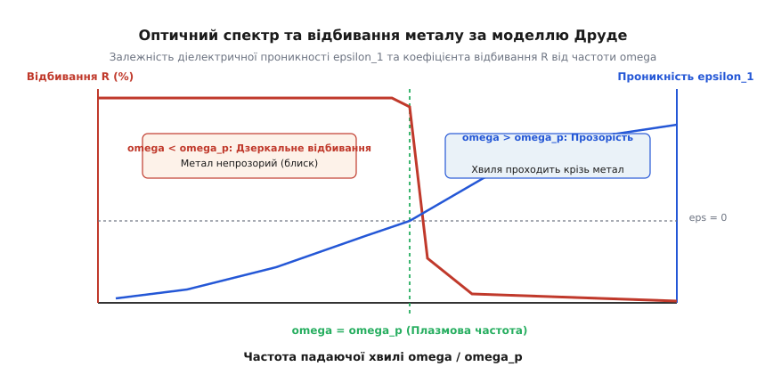
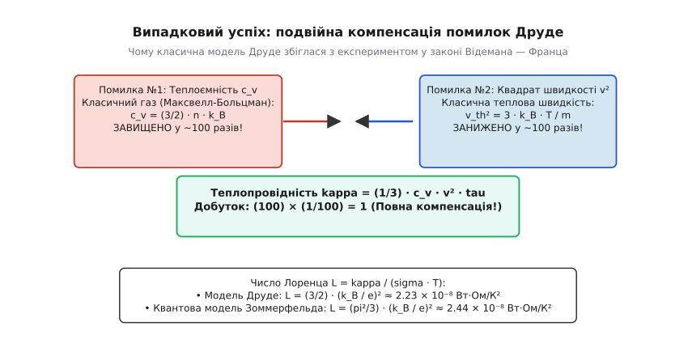
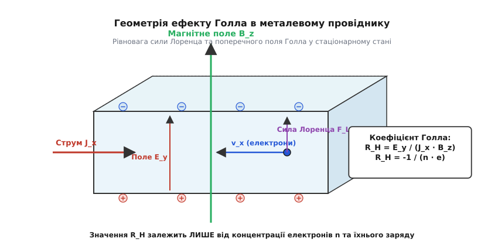
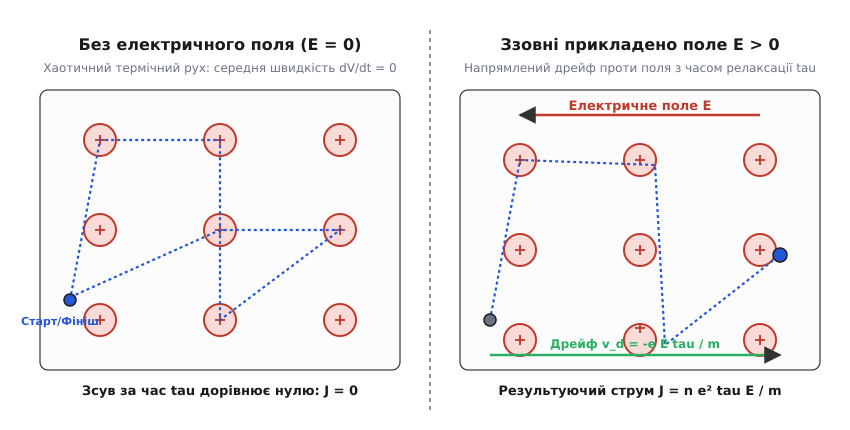

# Модель Друде: електронний газ у металах, провідність і межі класичної фізики

<preknowlist>
- [Природа опору](root:ph-condensed/resistance-origin) — розсіювання носіїв заряду в кристалічній ґратці.
- [Дрейф електронів](root:ph-condensed/electron-drift) — напрямлений рух під дією електричного поля.
- [Провідність](root:ph-condensed/conductivity) — зв'язок між питомим опором, густиною носіїв та часом релаксації.
</preknowlist>

Коли ви вмикаєте вимикач, світло у кімнаті загоряється практично миттєво, хоча самі електрони у мідному дроті рухаються зі швидкістю равлика — менше ніж один міліметр за секунду. Електромагнітна хвиля поширюється вздовж провідника зі швидкістю, близькою до швидкості світла у вакуумі, але фізичним носієм струму є колосальний колектив мікроскопічних заряджених частинок, які повільно дрейфують крізь кристалічний кістяк провідника.

Як сукупність мільярдів хаотично рухомих частинок створює стаціонарний електричний струм, чому метали однаково блискуче проводять електрику і тепло, чому вони дзеркально відбивають видиме світло, але стають прозорими в ультрафіолеті, і від чого фундаментально залежить їхній опір? Відповідь на ці запитання у 1900 році запропонував німецький фізик Пауль Друде (*Paul Drude*), створивши першу в історії науки мікроскопічну теорію електронного транспорту в твердих тілах.

Спираючись на щойно відкритий електрон та класичну кінетичну теорію газів Людвіга Больцмана і Джеймса Клерка Максвелла, Друде представив метал як тверду матрицю, наповнену рухливим електронним газом. Незважаючи на суто класичний фундамент і низку спрощень, які згодом вимагали квантової ревізії, модель Друде і сьогодні залишається базовим інструментом фізики конденсованого стану. Вона дає фундаментальну інженерну інтуїцію щодо електропровідності, ефекту Голла, плазмових коливань, скін-ефекту та оптичних спектрів матеріалів.

---

### 1. Від відкриття електрона до кінетики газів: народження мікроскопічної моделі

Наприкінці XIX століття фізика перебувала у стані глибокої теоретичної кризи. Закони макроскопічної електродинаміки Максвелла та феноменологічний закон Ома описували електричні кола з винятковою інженерною точністю, але не могли відповісти на фундаментальне запитання: *що саме* тече крізь провідник на мікроскопічному рівні і *чому* питомий опір різних матеріалів різниться на понад тридцять порядків величини — від надчистих металів до кварцу і бурштину?

Електричний струм уявляли як плин неперервної невагомої «електричної рідини». Ситуація докорінно змінилася у 1897 році, коли британський фізик Джозеф Джон Томсон під час дослідження катодних променів експериментально довів існування субатомної частинки — електрона — і виміряв відношення його заряду до маси `e/m`. Стало зрозуміло, що носіями електричного струму в речовині є дискретні негативно заряджені частинки з надзвичайно малою масою (`m ≈ 9.109 × 10⁻³¹` кг).

У 1900 році Пауль Друде зробив сміливий теоретичний крок. На той час найбільш математично розробленим та експериментально підтвердженим розділом теоретичної фізики була кінетична теорія газів. Вона бездоганно описувала тиск, температуру, дифузію та в'язкість газів через статистичний рух хаотичних атомів або молекул. Друде припустив: якщо валентні електрони в металі слабко зв'язані зі своїми материнськими атомами, то при утворенні кристала вони повністю відриваються і стають колективною власністю всього зразка.

Ці колективізовані валентні електрони утворюють **класичний електронний газ** (*electron gas*), який заповнює весь об'єм провідника і хаотично рухається між позитивно зарядженими іонами кристалічної ґратки точно так само, як атоми гелію чи аргону літають у замкненій посудині.

```
Електронний газ Друде у кристалічній ґратці:
+-------------------------------------------------------+
|  (+)        (-)-->       (+)           (+)      <--(-) |
|       \                 /                \             |
|        \               /                  \            |
|  (+)    \   (+)       /   (+)        (+)   \    (+)    |
|          \           /                      \          |
|           \         /                        \         |
|  (+)       *====>(+)       (+)        (+)     *====>(+)|
|         [зіткнення]                        [зіткнення] |
+-------------------------------------------------------+
(+) — важкі позитивні іони ґратки (нерухомі розсіювачі)
(-) — вільні легкі електрони провідності
```

Концентрація вільних електронів `n` (кількість електронів в одиниці об'єму) у типових металах є колосальною. Її можна розрахувати з макроскопічної густини металу `ρ_m`, його молярної маси `M`, числа Авогадро `N_A` та валентності `Z` (кількості валентних електронів, які кожен атом віддає в загальний газ):

```
n = (N_A · Z · ρ_m) / M
```

Для характеристики мікроскопічної густини електронного газу у фізиці твердого тіла вводять **радіус Вігнера — Зейтца** `r_s` (*Wigner-Seitz radius*) — радіус сфери, об'єм якої припадає рівно на один вільний електрон:

```
(4/3) · π · r_s³ = 1 / n  ⟹  r_s = (3 / (4 · π · n))^(1/3)
```

Зазвичай величину `r_s` нормують на борівський радіус атома водню `a_0 = 4·π·ε_0·ħ² / (m·e²) ≈ 0.529 × 10⁻¹⁰` м (`0.529` Å). Для більшості реальних металів безрозмірний параметр `r_s / a_0` лежить у дуже вузькому діапазоні від 2 до 6:

| Метал | Валентність `Z` | Густина `ρ_m` (г/см³) | Концентрація `n` (10²⁸ м⁻³) | Радіус `r_s` (Å) | Параметр `r_s / a_0` |
| :--- | :--- | :--- | :--- | :--- | :--- |
| **Літій (Li)** | 1 | 0.534 | 4.70 | 1.72 | 3.25 |
| **Натрій (Na)** | 1 | 0.971 | 2.65 | 2.08 | 3.93 |
| **Калій (K)** | 1 | 0.862 | 1.40 | 2.57 | 4.86 |
| **Мідь (Cu)** | 1 | 8.96 | 8.47 | 1.41 | 2.67 |
| **Срібло (Ag)** | 1 | 10.49 | 5.86 | 1.60 | 3.02 |
| **Золото (Au)** | 1 | 19.30 | 5.90 | 1.59 | 3.01 |
| **Берилій (Be)** | 2 | 1.85 | 24.7 | 0.99 | 1.87 |
| **Магній (Mg)** | 2 | 1.74 | 8.61 | 1.41 | 2.66 |
| **Алюміній (Al)** | 3 | 2.70 | 18.1 | 1.10 | 2.07 |
| **Свинець (Pb)** | 4 | 11.34 | 13.2 | 1.22 | 2.30 |

Вперше макроскопічний опір металу отримав прозоре фізичне тлумачення: провідник чинить опір струму не через якусь містичну внутрішню в'язкість, а тому, що напрямлений рух електронів безперервно руйнується розсіюванням на іонах кристалічної ґратки.

---

### 2. Фундаментальні постулати моделі Друде: анатомія наближень

Щоб побудувати аналітичну математичну теорію, Друде сформулював чотири фундаментальні припущення (постулати). Вони звели надзвичайно складну багаточастинкову квантову задачу взаємодії `~ 10²³` електронів та іонів до простого диференціального рівняння руху для однієї усередненої частинки:

#### 1. Наближення незалежних електронів (*independent electron approximation*)
Електрон-електронною кулонівською взаємодією між зіткненнями повністю нехтують. Вважається, що кожен окремий електрон рухається у просторі так, ніби інших електронів провідності взагалі не існує. 

На перший погляд, це припущення виглядає фізично абсурдним: густина електронів у металі колосальна (`~ 10²⁸` м⁻³), середня відстань між ними становить лише 1–3 ангстреми, а кулонівське відштовхування однойменних зарядів `V(r) = e² / (4·π·ε_0·r)` на такій відстані сягає 5–10 електронвольт, що значно перевищує кінетичну енергію теплового руху. Чому ж електрони не розлітаються і не зазнають безперервних кулонівських зіткнень один з одним?

Фізичне виправдання цьому наближенню згодом надала квантова теорія через два взаємопов'язані ефекти:
1. **Екранування Томаса — Фермі** (*Thomas-Fermi screening*): Оскільки електрони провідності мають надзвичайно високу рухливість, навколо будь-якого локального негативного заряду у металі миттєво формується поляризаційна хмара позитивного відхилення густини, яка майже повністю нейтралізує електричне поле на мікроскопічних масштабах. В результаті далекодіючий кулонівський потенціал `1/r` перетворюється на швидко спадний екранований потенціал Юкави:
   ```
   V_screened(r) = (e / (4 · π · ε_0 · r)) · exp(-r / r_TF)
   ```
   де `r_TF` — радіус екранування Томаса — Фермі:
   ```
   r_TF = √(ε_0 · E_F / (3 · n · e²)) ≈ 0.5 Å
   ```
   Оскільки радіус екранування у металах є меншим за міжатомну відстань (`r_TF < 1` Å), електрони просто «не бачать» кулонівських полів своїх сусідів на відстанях, більших за один атомний діаметр.
2. **Квантова заборона Паулі**: У виродженому фермі-газі для зіткнення двох електронів необхідно, щоб обидва кінцеві стани після удару були вільними. За кімнатних температур майже всі квантові рівні нижче енергії Фермі наглухо зайняті, тому частка дозволених каналів розсіювання пригнічена фактором `(k_B·T / E_F)² ~ 10⁻⁴`. Частота міжелектронних зіткнень виявляється на чотири порядки меншою за частоту розсіювання на ґратці.

#### Модель «желе» (Jellium Model) та однорідний електронний газ
У теоретичній фізиці наближення незалежних електронів строго формулюється в межах **моделі желе** (*jellium model*). Дискретна періодична кристалічна ґратка позитивних іонів замінюється суцільним однорідним позитивно зарядженим середовищем із константною густиною об'ємного заряду:

```
ρ_ion = + n · e
```

Повний багаточастинковий гамільтоніан системи має вигляд:

```
H = ∑_i (p_i² / (2·m)) + (1/2) · ∑_{i ≠ j} (e² / (4·π·ε_0·|r_i - r_j|)) + V_e-bg + V_bg-bg
```

Оскільки сумарний позитивний заряд фону строго компенсує інтегральний негативний заряд електронів, середнє макроскопічне електричне поле всередині зразка строго дорівнює нулю. Модель Друде розглядає цю систему як ідеальний класичний газ нейтральних матеріальних точок.

#### 2. Наближення вільних електронів (*free electron approximation*)
Взаємодією електронів із позитивними іонами ґратки у проміжках між зіткненнями також повністю нехтують. Вважається, що сильний притягальний потенціал атомних ядер майже повністю нейтралізується внутрішніми замкненими оболонками іонів (ортогоналізація хвильових функцій електронів провідності до остовних станів), утворюючи слабкий псевдопотенціал. 

У проміжках між двома послідовними зіткненнями потенціальна енергія електрона вважається константою (`V(r) = 0`), і частинка рухається абсолютно прямолінійно та рівномірно.

#### 3. Механізм розсіювання, ймовірність зіткнення та час релаксації
Зіткнення електронів з іонами вважаються миттєвими подіями, що відбуваються у точці (`Δt_coll → 0`). 

Динаміка розсіювання задається статистичними правилами:
- Ймовірність того, що довільно обраний електрон зазнає зіткнення за нескінченно малий інтервал часу `dt`, строго дорівнює **`dt / τ`**, де **`τ` — час релаксації** (або середній час вільного пробігу).
- Процес розсіювання не має пам'яті (марковський процес): ймовірність зіткнення в інтервалі `[t, t + dt]` не залежить від того, скільки часу частинка вже рухалася вільно.
- Розсіювання є абсолютно **ізотропним**: напрямок швидкості електрона після удару є випадковим і рівноймовірним по всій сфері тілесного кута `4π`. Вектор швидкості одразу після удару не корелює з вектором до удару:

```
⟨v_post⟩ = 0
```

Математично ймовірність того, що електрон пролетить інтервал часу `t` без жодного зіткнення, визначається диференціальним рівнянням:

```
P(t + dt) = P(t) · (1 - dt / τ)
dP / dt = - P(t) / τ  ⟹  P(t) = exp(-t / τ)
```

Густина ймовірності зазнати наступного зіткнення в інтервалі від `t` до `t + dt` дорівнює `w(t) = (1/τ) · exp(-t/τ)`. Середній час вільного руху між двома послідовними розсіюваннями дорівнює:

```
⟨t⟩ = ∫₀^∞ t · w(t) dt = ∫₀^∞ (t / τ) · exp(-t / τ) dt = τ
```

#### Час релаксації імпульсу проти часу релаксації енергії
У кінетичній теорії газів фундаментальну роль відіграє розрізнення між двома різними масштабами часу релаксації:
1. **Час релаксації імпульсу `τ_p` (транспортний час релаксації `τ_tr`)**: час, за який руйнується впорядкований дрейфовий імпульс частинки. При розсіюванні на кут `θ` втрата імпульсу вздовж початкового напрямку пропорційна `(1 - cos θ)`. Тоді ефективна частота релаксації імпульсу визначається інтегралом за диференціальним перерізом розсіювання `σ(θ)`:
   ```
   1 / τ_tr = n_іон · v · ∫ (1 - cos θ) · σ(θ) · dΩ
   ```
   При розсіюванні вперед на малі кути (`θ ≈ 0`) множник `(1 - cos θ) ≈ 0`, тобто малокутові зіткнення майже не створюють електричного опору. Навпаки, зворотне розсіювання (`θ ≈ π`) дає максимальний внесок `(1 - cos θ) = 2`. У моделі Друде розсіювання вважається повністю сферично симетричним (ізотропним), тому `⟨1 - cos θ⟩ = 1`, і транспортний час точно дорівнює середньому часу між зіткненнями: `τ_tr = τ ~ 10⁻¹⁴` с.
2. **Час релаксації енергії `τ_E`**: час, за який електрон передає свою надлишкову кінетичну енергію масивному іону ґратки. Оскільки маса електрона `m` у десятки тисяч разів менша за масу іона `M` (`m / M ~ 10⁻⁴–10⁻⁵`), при кожному пружному відскоку електрон втрачає лише мізерну частку своєї енергії `~ 2·m / M`. Для повної термалізації енергії електрону потрібно зазнати тисяч зіткнень:
   ```
   τ_E ≈ (M / (2 · m)) · τ_tr ~ 10⁻¹¹–10⁻¹⁰ с
   ```
Саме тому в електронному транспорті за закон Ома та дисипацію імпульсу відповідає час `τ_tr`, який у формулах Друде позначають як `τ`.

#### 4. Термічна рівновага за Максвеллом — Больцманом
Електрони досягають термодинамічної рівноваги з кристалічною ґраткою виключно завдяки зіткненням. Перебуваючи за абсолютної температури `T`, швидкість частинок підпорядковується класичному розподілу Максвелла — Больцмана:

```
f(v) = n · (m / (2 · π · k_B · T))^(3/2) · exp(-m · v² / (2 · k_B · T))
```

Звідси середньоквадратична теплова швидкість електрона визначається класичною теоремою про рівнорозподіл енергії (по `(1/2)·k_B·T` на кожен із трьох поступальних ступенів вільності):

```
(1/2) · m · v_th² = (3/2) · k_B · T  ⟹  v_th = √(3 · k_B · T / m)
```

Для кімнатної температури (`T = 300` К) класична теплова швидкість електрона становить:

```
v_th = √(3 · 1.3807 × 10⁻²³ · 300 / 9.109 × 10⁻³¹) ≈ 1.17 × 10⁵ м/с = 117 км/с
```

Ці чотири постулати дали змогу відокремити хаотичний термічний рух частинок (`v_th ~ 10⁵` м/с) від повільного впорядкованого напрямленого дрейфу під дією зовнішніх електричних та магнітних полів.

---

### 3. Диференціальне рівняння руху та статична електропровідність

Розглянемо металевий провідник за відсутності зовнішнього поля (`E = 0`). Електрони хаотично літають із величезними тепловими швидкостями `v_th ≈ 10⁵` м/с, безперервно відскакуючи від іонів ґратки. Оскільки всі напрямки руху рівноймовірні, сума швидкостей усіх частинок строго дорівнює нулю:

```
⟨v⟩ = (1/N) · ∑ v_i = 0
```

Макроскопічний електричний струм у провіднику відсутній.


*Схема електронного газу Друде в металі: ліворуч — хаотичний термічний рух за відсутності поля (`E = 0`), де середня швидкість `v_d = 0`; праворуч — параболічний зсув траєкторій під дією зовнішнього поля `E > 0`, який створює впорядкований дрейф проти поля з часом релаксації `τ`.*

Прикладемо до провідника постійне однорідне електричне поле `E`. На кожен електрон із зарядом `-e` та масою `m` починає діяти сила Кулона `F = -e·E`. Між зіткненнями частинка рухається з постійним прискоренням:

```
a = - (e / m) · E
```

Виведемо диференціальне рівняння для середнього імпульсу ансамблю електронів `p(t) = m · ⟨v(t)⟩`. 

Розглянемо стан системи в момент часу `t + dt`. За малий інтервал `dt`:
1. Частка електронів `(1 - dt/τ)` не зазнає зіткнень. Їхній імпульс зміниться під дією сили поля: `p(t) + F·dt`.
2. Частка електронів `dt/τ` зазнає розсіювання. Оскільки розсіювання ізотропне, їхній середній імпульс одразу після удару скидається до нуля: `0 + F·dt_post ≈ 0`.

Усереднений імпульс ансамблю в момент `t + dt` дорівнює:

```
p(t + dt) = (1 - dt/τ) · [p(t) + F · dt] + (dt/τ) · 0
p(t + dt) = p(t) + F · dt - p(t) · (dt/τ) + O(dt²)
[p(t + dt) - p(t)] / dt = F - p(t) / τ
```

Переходячи до границі `dt → 0`, отримуємо фундаментальне **диференціальне рівняння руху Друде**:

```
dp/dt = F - p / τ  ⟹  m · (dv/dt + v/τ) = -e · (E + v × B)
```

Член `-p / τ` відіграє роль феноменологічної сили в'язкого тертя. Він показує, що за рахунок зіткнень система релаксує до рівноважного стану з характерним часом загасання `τ`.

#### Стаціонарний стан і закон Ома на постійному струмі
У постійному електричному полі `E` за відсутності магнітного поля (`B = 0`) система швидко виходить на стаціонарний динамічний режим, де прискорення від поля повністю компенсується гальмуванням об ґратку:

```
dp/dt = 0  ⟹  0 = -e · E - m · v_d / τ
```

Звідси знаходимо усталену **дрейфову швидкість** електронів `v_d`:

```
v_d = - (e · τ / m) · E
```

Знак мінус показує, що негативно заряджені електрони дрейфують у напрямку, протилежному вектору напруженості електричного поля `E`.

Коефіцієнт пропорційності між дрейфовою швидкістю та полем називається **рухливістю електронів** `μ` (*electron mobility*):

```
μ = |v_d| / E = (e · τ) / m
```

Густина електричного струму `J` (струм, що протікає через одиничну площу поперечного перерізу) дорівнює добутку густини заряду на швидкість його перенесення:

```
J = - n · e · v_d
J = - n · e · [- (e · τ / m) · E]
J = ((n · e² · τ) / m) · E
```

Ми отримали класичний **диференціальний закон Ома**:

```
J = σ_0 · E  або  E = ρ_0 · J
```

де **статична питома електропровідність** `σ_0` та **питомий опір** `ρ_0` виражаються виключно через фундаментальні мікроскопічні параметри матеріалу:

```
σ_0 = (n · e² · τ) / m
ρ_0 = 1 / σ_0 = m / (n · e² · τ)
```

#### Зсув функції розподілу у фазовому просторі
З погляду статистичної механіки, під дією постійного електричного поля `E` рівноважний сферично симетричний розподіл Максвелла — Больцмана у просторі швидкостей зміщується як єдине ціле вздовж осі поля на величину вектора дрейфу `v_d`:

```
f(v) = f_0(v - v_d) ≈ f_0(v) - v_d · ∇_v f_0 = f_0(v) + (e · τ / m) · (E · ∇_v f_0)
```

Оскільки `v_d << v_th`, деформація функції розподілу є мікроскопічно малою, проте саме ця крихітна асиметрія породжує макроскопічний струм переносу заряду.

#### Правило Маттіссена на мікроскопічному рівні
У реальному металевому кристалі розсіювання електронів зумовлене декількома фізично різнорідними процесами:
1. Розсіюванням на теплових коливаннях кристалічної ґратки (фононах) із характерним часом `τ_ph(T)`.
2. Розсіюванням на домішкових атомах заміщення та впровадження з часом `τ_imp`.
3. Розсіюванням на статичних дефектах структури (вакансіях, дислокаціях, границях кристалічних зерен) із часом `τ_def`.

Оскільки ці механізми діють статистично незалежно, сумарна ймовірність зіткнення за одиницю часу дорівнює сумі парціальних ймовірностей:

```
1 / τ = 1 / τ_ph(T) + 1 / τ_imp + 1 / τ_def
```

Помноживши обидві частини на `m / (n · e²)`, одержуємо фундаментальне **правило Маттіссена**:

```
ρ(T) = ρ_ph(T) + ρ_imp + ρ_def = ρ_ph(T) + ρ_залишк
```

де `ρ_залишк = ρ_imp + ρ_def` — залишковий питомий опір, який не залежить від температури і визначається ступенем хімічної чистоти та механічної обробки зразка.

#### Порівняльна таблиця транспортних параметрів металів
У таблиці нижче наведено експериментальні та розрахункові мікроскопічні параметри транспорту для типових металів за кімнатної (`T = 300` К) та азотної (`T = 77` К) температур:

| Метал | `n` (10²⁸ м⁻³) | `ρ_0(300K)` (нОм·м) | `ρ_0(77K)` (нОм·м) | `τ(300K)` (фс) | `τ(77K)` (фс) | `l(300K)` (нм) | `l(77K)` (нм) | `v_F` (10⁶ м/с) |
| :--- | :--- | :--- | :--- | :--- | :--- | :--- | :--- | :--- |
| **Літій (Li)** | 4.70 | 92.8 | 10.4 | 8.8 | 78.4 | 1.03 | 9.17 | 1.29 |
| **Натрій (Na)** | 2.65 | 47.7 | 8.0 | 31.0 | 185.0 | 3.63 | 21.6 | 1.07 |
| **Калій (K)** | 1.40 | 70.1 | 13.8 | 40.0 | 203.0 | 4.68 | 23.8 | 0.86 |
| **Мідь (Cu)** | 8.47 | 16.8 | 2.1 | 25.0 | 200.0 | 2.93 | 23.4 | 1.57 |
| **Срібло (Ag)** | 5.86 | 15.9 | 2.9 | 40.0 | 220.0 | 4.68 | 25.7 | 1.39 |
| **Золото (Au)** | 5.90 | 22.1 | 4.8 | 29.0 | 134.0 | 3.39 | 15.7 | 1.40 |
| **Алюміній (Al)** | 18.1 | 26.5 | 2.5 | 7.4 | 78.4 | 0.87 | 9.17 | 2.03 |
| **Вольфрам (W)** | 12.6 | 52.8 | 6.1 | 5.3 | 46.0 | 0.62 | 5.38 | 1.89 |
| **Платина (Pt)** | 6.60 | 106.0 | 19.8 | 5.1 | 27.3 | 0.60 | 3.19 | 1.45 |

#### Мікроскопічна природа Джоулевого нагрівання
Диференціальний закон Джоуля — Ленца визначає потужність `w`, яка виділяється у вигляді тепла в одиниці об'єму провідника:

```
w = J · E = σ_0 · E² = ((n · e² · τ) / m) · E²
```

Модель Друде дає кришталево ясну мікроскопічну картину тепловиділення: між зіткненнями електричне поле розганяє електрони, виконуючи роботу і передаючи їм додаткову кінетичну енергію. 

Під час кожного непружного зіткнення цей надлишок кінетичної енергії передається масивним іонам ґратки, збуджуючи їхні теплові коливання. Провідник нагрівається.

#### Практичний числовий розрахунок: характеристики мідного провідника
Розглянемо мідний дріт перерізом `S = 1.0` мм² (`10⁻⁶` м²), по якому тече типовий струм `I = 10` А. Знайдемо дрейфову швидкість електронів, час релаксації та довжину вільного пробігу.

```
1. Густина струму:
   J = I / S = 10 А / 10⁻⁶ м² = 10⁷ А/м² = 10 А/мм²

2. Дрейфова швидкість (для Cu: n = 8.47 × 10²⁸ м⁻³):
   v_d = J / (n · e)
   v_d = 10⁷ / (8.47 × 10²⁸ · 1.602 × 10⁻¹⁹)
   v_d ≈ 7.37 × 10⁻⁴ м/с ≈ 0.74 мм/с

3. Час релаксації за експериментальним опором (ρ_0 = 1.68 × 10⁻⁸ Ом·м при 300 К):
   τ = m / (n · e² · ρ_0)
   τ = 9.11 × 10⁻³¹ / (8.47 × 10²⁸ · (1.602 × 10⁻¹⁹)² · 1.68 × 10⁻⁸)
   τ ≈ 2.50 × 10⁻¹⁴ с = 25.0 фс

4. Класична довжина вільного пробігу (l = v_th · τ):
   l = 1.17 × 10⁵ м/с · 2.50 × 10⁻¹⁴ с ≈ 2.93 × 10⁻⁹ м = 2.93 нм
```

Отриманий результат вражає: швидкість упорядкованого дрейфу електронів становить менше одного міліметра за секунду (`~ 0.74` мм/с), тоді як хаотична теплова швидкість сягає сотень кілометрів за секунду (`117` км/с). Дрейф — це ледь помітне середнє зміщення на тлі колосального теплового шторму.

Довжина вільного пробігу `l ≈ 2.9` нм відповідає приблизно 8 міжатомним відстаням у кристалічній ґратці міді (`a ≈ 0.361` нм), що на момент створення моделі виглядало цілком узгодженим із фізичною інтуїцією.

---

### 4. Динаміка у змінних полях: комплексна провідність, скін-ефект та оптичні властивості

Модель Друде не обмежується постійним струмом. Вона описує взаємодію металу зі змінними електромагнітними полями у колосальному частотному діапазоні — від промислових частот (50 Гц) та мікрохвиль до інфрачервоного, оптичного й ультрафіолетового світла.

Нехай до провідника прикладено монохроматичне змінне електричне поле:

```
E(t) = E_0 · exp(-i · ω · t)
```

Шукаємо стаціонарний розв'язок для швидкості електрона у такому ж гармонічному вигляді: `v(t) = v_0 · exp(-i · ω · t)`. Підставимо ці вирази у диференціальне рівняння руху Друде:

```
m · (-i · ω · v_0 · exp(-i·ω·t) + (1/τ) · v_0 · exp(-i·ω·t)) = -e · E_0 · exp(-i·ω·t)
m · v_0 · (1/τ - i · ω) = -e · E_0
v_0 = - (e · τ / m) · (1 / (1 - i · ω · τ)) · E_0
```

Оскільки густина струму дорівнює `J(t) = -n·e·v(t) = σ(ω) · E(t)`, знаходимо **комплексну високочастотну провідність Друде**:

```
σ(ω) = σ_0 / (1 - i · ω · τ)
```

Помноживши чисельник і знаменник на спряжене число `(1 + i·ω·τ)`, розділимо провідність на дійсну `σ₁(ω)` та уявну `σ₂(ω)` частини (`σ(ω) = σ₁ + i·σ₂`):

```
σ₁(ω) = σ_0 / (1 + ω² · τ²)             [активна провідність, дисипація Джоуля]
σ₂(ω) = (σ_0 · ω · τ) / (1 + ω² · τ²)   [реактивна провідність, кінетична індуктивність]
```

```
Графік частотної залежності провідності Друде:
Провідність
  ^
σ₀|*****\
  |      \  σ₁(ω) [активна — поглинання]
  |       \
  |   /\   \
  |  /  \   \________
  | /    \  σ₂(ω) [реактивна — індуктивність]
  |/______\_________________> Частота ω
  0      1/τ
```

Фізичний зміст компонент:
1. **Дійсна частина `σ₁(ω)` (активна провідність)**: синфазна з електричним полем. Вона відповідає за поглинання енергії електромагнітної хвилі та перетворення її на джоулеве тепло. На низьких частотах (`ω·τ << 1`) `σ₁ ≈ σ_0`. При переході через частоту розсіювання `ω = 1/τ` активна провідність спадає за законом `1 / ω²`.
2. **Уявна частина `σ₂(ω)` (реактивна провідність)**: зсунута по фазі на 90° відносно поля. Вона описує кінетичну інерцію електронів (кінетичну індуктивність). Електрони через власну масу не встигають миттєво слідувати за швидкими змінами поля. Максимум реактивної провідності досягається точно при `ω = 1/τ`.

#### Осциляторна модель Друде — Лоренца: зв'язані та вільні електрони
У реальному твердому тілі, крім вільних електронів провідності, присутні також зв'язані електрони внутрішніх іонних оболонок. Класична теорія Лоренца описує зв'язаний електрон як гармонічний осцилятор із власною резонансною частотою `ω_0` та коефіцієнтом демпфування `γ`:

```
m · (d²x/dt² + γ · dx/dt + ω_0² · x) = -e · E_0 · exp(-i·ω·t)
```

Вільні електрони моделі Друде є окремим випадком осцилятора Лоренца, у якого відновлювальна пружна сила строго дорівнює нулю (`ω_0 = 0`), а коефіцієнт демпфування задається часом релаксації `γ = 1/τ`.

Повна діелектрична функція металу з урахуванням внеску зв'язаних електронів іонного остова описується **моделлю Друде — Лоренца**:

```
ε(ω) = ε_∞ - ω_p² / (ω · (ω + i / τ)) + ∑_j (f_j · ω_pj²) / (ω_j² - ω² - i · ω · γ_j)
```

де `ε_∞` — високочастотна діелектрична проникність іонних остовів (`ε_∞ > 1`), а сума описує міжзонні оптичні квантові переходи з силою осцилятора `f_j`. 

Наявність фонової діелектричної проникності `ε_∞` призводить до перенормування (зменшення) ефективної плазмової частоти електронного газу:

```
ω_p,еф = ω_p / √ε_∞
```

Для благородних металів (срібло, золото, мідь) поляризовність заповнених d-оболонок суттєво зміщує оптичні властивості:
- У срібла (`ε_∞ ≈ 3.7`): плазмовий край лишається в ультрафіолеті (`λ_p,еф ≈ 320` нм), тому срібло є ідеальним білим дзеркалом у всьому видимому спектрі.
- У золота (`ε_∞ ≈ 9.5`) та міді (`ε_∞ ≈ 8.0`): міжзонні переходи з d-зони у смугу провідності починаються в синьо-зеленій області (`λ ~ 500` нм), що призводить до сильного поглинання синіх променів і зумовлює характерний жовтий колір золота та червонуватий відтінок міді.

#### Комплексна діелектрична проникність та плазмова частота
Для опису поширення електромагнітних хвиль зв'яжемо струм провідності з рівняннями Максвелла:

```
rot H = J + ∂D/∂t = σ(ω) · E - i · ω · ε_0 · E = -i · ω · ε_0 · ε(ω) · E
```

Звідси макроскопічна комплексна діелектрична проникність електронного газу `ε(ω)` дорівнює:

```
ε(ω) = 1 + i · σ(ω) / (ε_0 · ω)
ε(ω) = 1 + i · [σ_0 / (ε_0 · ω · (1 - i · ω · τ))]
ε(ω) = 1 - (n · e² / (ε_0 · m)) / (ω² + i · ω / τ)
```

Введемо фундаментальну характеристику будь-якої плазми — **плазмову частоту** `ω_p` (*plasma frequency*):

```
ω_p = √(n · e² / (ε_0 · m))
```

Плазмова частота визначає власну частоту колективних поздовжніх коливань електронного газу відносно позитивного іонного кістяка (плазмонів). Для більшості металів із густиною `n ~ 10²⁸–10²⁹` м⁻³ плазмова частота лежить в ультрафіолетовій області спектра: `ω_p ~ 10¹⁶` рад/с, що відповідає енергії квантів `ħ·ω_p ≈ 5–15` еВ.

Тоді комплексна діелектрична функція набуває канонічного вигляду:

```
ε(ω) = 1 - ω_p² / (ω · (ω + i / τ)) = ε₁(ω) + i · ε₂(ω)
```

де дійсна `ε₁` та уявна `ε₂` частини дорівнюють:

```
ε₁(ω) = 1 - (ω_p² · τ²) / (1 + ω² · τ²)
ε₂(ω) = (ω_p² · τ) / (ω · (1 + ω² · τ²))
```

У високочастотній області (`ω·τ >> 1`, для видимого світла `ω ~ 3 × 10¹⁵` рад/с, тоді як `1/τ ~ 4 × 10¹³` с⁻¹, тобто `ω·τ ≈ 50–100`), зіткненнями за період коливань хвилі можна повністю знехтувати (`τ → ∞`). Діелектрична функція стає майже суто дійсною:

```
ε(ω) ≈ 1 - ω_p² / ω²
```


*Оптичний спектр металу за моделлю Друде: при частотах нижче плазмової (`ω < ω_p`) діелектрична проникність `ε_1 < 0`, і метал повністю відбиває світло (`R ≈ 100%`); вище плазмової частоти (`ω > ω_p`) метал стає прозорим.*

#### Оптичні теореми: співвідношення Крамерса — Кроніга та f-правило сум
Дійсна та уявна частини діелектричної проникності Друде строго задовольняють фундаментальним **співвідношенням Крамерса — Кроніга**, які випливають із принципу причинності:

```
ε₁(ω) - 1 = (2/π) · P ∫₀^∞ (s · ε₂(s)) / (s² - ω²) ds
ε₂(ω) = - (2·ω/π) · P ∫₀^∞ (ε₁(s) - 1) / (s² - ω²) ds
```

де `P` позначає інтеграл у сенсі головного значення Коші.

Інтегрування дійсної частини оптичної провідності по всьому нескінченному спектру частот приводить до фундаментального **квантово-класичного f-правила сум** (правила сум Томаса — Райхе — Куна):

```
∫₀^∞ σ₁(ω) dω = (π · n · e²) / (2 · m) = (π · ε_0 / 2) · ω_p²
```

Це співвідношення показує, що повна інтегральна площа під кривою оптичного поглинання є строго фіксованою величиною, яка залежить лише від повної густини електронів `n` та їхньої фундаментальної маси `m`.

#### Оптичні режими металів
Аналіз знака діелектричної проникності `ε(ω)` розкриває природу взаємодії металів зі світлом:

1. **Низькочастотна область Хагена — Рубенса (`ω << 1/τ`, радіохвилі, далекий ІЧ)**:
   Комплексний показник заломлення `N = n + i·k = √ε ≈ (1 + i) · √(σ_0 / (2·ε_0·ω))`. 
   Коефіцієнт відбивання електромагнітної хвилі від поверхні нормального падіння описується співвідношенням Хагена — Рубенса:
   ```
   R = |(N - 1) / (N + 1)|² ≈ 1 - 2 · √(2 · ε_0 · ω / σ_0)
   ```
   Відбивання металу на низьких частотах сягає 99.9%.

2. **Область високого відбивання та металевого блиску (`1/τ << ω < ω_p`, видиме світло)**:
   Оскільки `ω < ω_p`, маємо `ε₁(ω) < 0`. Показник заломлення є суто уявним: `N = n + i·k ≈ i · √(ω_p²/ω² - 1)`. 
   Дійсна частина показника заломлення дорівнює нулю (`n ≈ 0`), а уявна частина (коефіцієнт екстинкції) велика: `k = √(ω_p²/ω² - 1)`.
   Коефіцієнт відбивання дорівнює:
   ```
   R = |(i·k - 1) / (i·k + 1)|² = (k² + 1) / (k² + 1) = 1.0 (100%)
   ```
   Світло не може проникнути всередину металу, оскільки електрони встигають зміщуватися у протифазі до поля хвилі та повністю її екранують. Хвиля експоненціально загасає біля поверхні на глибині скін-шару `δ = c / √(ω_p² - ω²) ~ 10–20` нм і повністю відбивається назад. Це і є фізична причина дзеркального **металевого блиску**.

3. **Плазмовий резонанс (`ω = ω_p`)**:
   Діелектрична проникність перетворюється на нуль: `ε(ω_p) = 0`. Умови для поширення поперечних хвиль зникають, але стають можливими поздовжні колективні коливання електронного газу — об'ємні плазмони.

4. **Область ультрафіолетової прозорості (`ω > ω_p`, вакуумний УФ та рентген)**:
   При частотах вище плазмової `ε(ω) > 0`. Електронний газ через власну інерцію вже не встигає реагувати на ультрашвидкі коливання поля. Метал раптово втрачає свої відбивальні властивості і стає **прозорим діелектриком** із дійсним показником заломлення:
   ```
   n(ω) = √(1 - ω_p² / ω²) < 1
   ```
   Цей дивовижний ефект — прозорість лужних металів (натрію, калію) в ультрафіолетовому діапазоні — був експериментально відкритий Вудом у 1933 році, ставши одним із найблискучіших підтверджень теорії Друде.

| Метал | Плазмова енергія `ħ·ω_p` (еВ) | Плазмова довжина хвилі `λ_p` (нм) | Оптична поведінка |
| :--- | :--- | :--- | :--- |
| **Літій (Li)** | 8.0 | 155 | Прозорий в УФ (`λ < 155` нм) |
| **Натрій (Na)** | 5.9 | 210 | Прозорий в УФ (`λ < 210` нм) |
| **Калій (K)** | 3.9 | 318 | Прозорий у ближньому УФ (`λ < 318` нм) |
| **Рубідій (Rb)** | 3.4 | 365 | Прозорий на межі видимого світла |
| **Срібло (Ag)** | 9.0 | 138 | Блискуче біле дзеркало для всього видимого спектра |
| **Золото (Au)** | 9.0 (ефект d-зон) | 138 (поглинання з 520 нм) | Жовтий колір через міжзонні квантові переходи |
| **Мідь (Cu)** | 8.8 (ефект d-зон) | 141 (поглинання з 580 нм) | Червонуватий колір через міжзонні квантові переходи |

#### Низькочастотне проникнення поля та класичний скін-ефект
У радіочастотній та мікрохвильовій техніці (`ω·τ << 1`) струм зміщення є знехтовно малим порівняно зі струмом провідності `J = σ_0 · E`. Розв'язок хвильового рівняння Максвелла `d²E/dz² = -i · ω · μ_0 · σ_0 · E` показує, що амплітуда поля експоненціально спадає вглиб провідника:

```
E(z) = E_0 · exp(-z / δ) · exp(i · (z / δ - ω · t))
```

де **глибина скін-шару** `δ` (*skin depth*) дорівнює:

```
δ = √(2 / (μ_0 · σ_0 · ω))
```

На відстані `z = δ` від поверхні густина струму падає в `e ≈ 2.718` разів, а густина виділення тепла — в `e² ≈ 7.39` разів. Струм витісняється у тонку поверхневу плівку, що викликає стрімке зростання високочастотного опору кабелів, коаксіальних ліній та резонаторів.

| Частота `f` | Глибина скін-шару для міді `δ` (Cu) | Глибина скін-шару для алюмінію `δ` (Al) |
| :--- | :--- | :--- |
| **50 Гц** (промислова мережа) | 9.22 мм | 11.6 мм |
| **1 кГц** (звукова частота) | 2.06 мм | 2.60 мм |
| **1 МГц** (середні радіохвилі) | 65.2 мкм | 82.3 мкм |
| **1 ГГц** (мобільний зв'язок) | 2.06 мкм | 2.60 мкм |
| **10 ГГц** (радари НВЧ) | 0.65 мкм | 0.82 мкм |

#### Аномальний скін-ефект (межа Піппарда — Ройтера — Зондгаймера)
При глибокому охолодженні чистих металів довжина вільного пробігу електронів `l` стає дуже великою і може значно перевищувати класичну глибину скін-шару: `l >> δ`.

У цьому випадку локальний закон Ома `J(r) = σ_0 · E(r)` втрачає силу, оскільки електрон на шляху між двома розсіюваннями перетинає область змінного поля багато разів. Ефективна взаємодія відбувається лише для електронів, які летять майже паралельно до поверхні металу у вузькому кутовому секторі `~ δ / l`.

Цей режим називається **аномальним скін-ефектом**. Глибина проникнення поля у ньому перестає залежати від часу релаксації `τ` і визначається співвідношенням:

```
δ_anom ≈ ( (c² · m · v_F) / (μ_0 · n · e² · ω) )^(1/3)
```



*Ілюстрація: Drude Reflectivity.*



*Ілюстрація: Wiedemann Franz Cancellation.*



*Ілюстрація: Hall Effect Drude.*



*Ілюстрація: Drude Gas Scattering.*

Більш детальне математичне виведення дисперсійних співвідношень та тензора діелектричної проникності наведено в додатку [Виведення високочастотної провідності, плазмової частоти та ефекту Голла](root:ph-condensed/drude-model/math-drude-dispersion.md).

---

### 5. Ефект Голла та магнетотранспорт: вимірювання носіїв та їхнього знака

Один із найвидатніших тріумфів моделі Друде полягає у поясненні поведінки металів у магнітному полі та теоретичному обґрунтуванні ефекту Голла, відкритого Едвіном Голлом у 1879 році.

Розглянемо прямокутну пластину з металу, розташовану у площині XY. Нехай уздовж осі X тече постійний струм густиною `J_x`, а перпендикулярно до пластини вздовж осі Z прикладено постійне магнітне поле `B = (0, 0, B_z)`.


*Геометрія ефекту Голла в металевій пластині: поперечний зсув електронів силою Лоренца створює поле Голла `E_y`, яке повністю компенсує магнітну силу у стаціонарному стані.*

На кожен електрон, що рухається зі швидкістю `v = (v_x, v_y, 0)`, діє повна сила Лоренца:

```
F = -e · (E + v × B)
```

Векторний добуток швидкості на магнітне поле має компоненти:

```
v × B = (v_y · B_z,  -v_x · B_z,  0)
```

Запишемо стаціонарне рівняння руху Друде (`dp/dt = 0`) у проекціях на координатні осі X та Y:

```
0 = -e · E_x - e · v_y · B_z - m · v_x / τ
0 = -e · E_y + e · v_x · B_z - m · v_y / τ
```

Введемо важливу характеристику орбітального руху зарядженої частинки у магнітному полі — **циклотронну частоту** `ω_c` (*cyclotron frequency*):

```
ω_c = (e · B_z) / m
```

Циклотронна частота визначає кутову швидкість, з якою вільний електрон обертається по коловій орбіті у площині, перпендикулярній до ліній магнітної індукції.

Перепишемо систему рівнянь через циклотронну частоту та час релаксації `τ`:

```
v_x + ω_c · τ · v_y = - (e · τ / m) · E_x
v_y - ω_c · τ · v_x = - (e · τ / m) · E_y
```

#### Виведення коефіцієнта Голла
У стандартній геометрії експерименту Голла провідник обмежений у напрямку осі Y бічними гранями. Електрони під дією сили Лоренца зсуваються до однієї з бічних граней, створюючи на ній надлишковий негативний заряд, тоді як на протилежній грані оголюються некомпенсовані позитивні іони кристалічної ґратки.

Цей просторовий поділ зарядів породжує внутрішнє поперечне електричне поле — **поле Голла** `E_y`. У стаціонарному стані поперечний струм повністю припиняється:

```
J_y = 0  ⟹  v_y = 0
```

Підставивши `v_y = 0` у друге рівняння руху системи, знаходимо:

```
0 - ω_c · τ · v_x = - (e · τ / m) · E_y
E_y = (m / e) · ω_c · v_x = (m / e) · ((e · B_z) / m) · v_x = v_x · B_z
```

Оскільки поздовжня густина струму дорівнює `J_x = -n · e · v_x ⟹ v_x = - J_x / (n · e)`, отримуємо точний вираз для поперечного поля Голла:

```
E_y = - (1 / (n · e)) · J_x · B_z
```

За означенням, **коефіцієнт Голла** `R_H` (*Hall coefficient*) визначається як відношення поперечного електричного поля до добутку густини поздовжнього струму на індукцію магнітного поля:

```
R_H = E_y / (J_x · B_z) = - 1 / (n · e)
```

Зверніть увагу на унікальну фізичну особливість цієї формули:
1. У вираз для `R_H` **не входять ані маса частинки `m`, ані час релаксації `τ`, ані температура `T`**.
2. Коефіцієнт Голла залежить виключно від двох речей: **концентрації носіїв заряду `n`** та **знака їхнього заряду `q`**.
3. Знак мінус безпосередньо вказує на те, що носіями струму в речовині є негативно заряджені частинки (електрони).

Вимірювання коефіцієнта Голла в лабораторії стало першим прямим методом експериментального підрахунку густини електронів провідності у твердих тілах:

```
n = - 1 / (e · R_H)
```

#### Кут Голла та тензор магнітоопору
Поле Голла призводить до того, що результуючий вектор електричного поля `E = (E_x, E_y)` у металі повертається на певний кут `θ_H` відносно напрямку струму `J_x`. Цей кут називається **кутом Голла** (*Hall angle*):

```
tan θ_H = |E_y| / E_x = (v_x · B_z) / (v_x · m / (e · τ)) = (e · B_z · τ) / m = ω_c · τ = μ · B_z
```

Безрозмірний добуток `ω_c · τ` має фундаментальний фізичний зміст: це дуга (в радіанах), яку електрон встигає пролетіти по циклотронній орбіті між двома послідовними розсіюваннями. 
- Якщо `ω_c · τ << 1` (слабкі магнітні поля) — розсіювання домінує, електрон рухається майже прямолінійно.
- Якщо `ω_c · τ >> 1` (сильні магнітні поля) — електрон встигає зробити багато повних обертів по спіралі, перш ніж зіткнеться з іоном.

Зв'язок між електричним полем та струмом у магнітному полі в загальному вигляді описується **тензором питомого опору** `E_i = ρ_ij · J_j`:

```
[ E_x ]   [  ρ_xx   ρ_xy  ]   [ J_x ]
[ E_y ] = [ -ρ_xy   ρ_yy  ] · [ J_y ]
```

де компоненти тензора у моделі Друде дорівнюють:

```
ρ_xx = ρ_yy = m / (n · e² · τ) = ρ_0        [поздовжній опір не залежить від B]
ρ_xy = - ρ_yx = B_z / (n · e) = R_H · B_z   [поперечний опір Голла]
```

Знайдемо **тензор провідності** `J_i = σ_ij · E_j`, обернувши матрицю питомого опору:

```
σ_xx = σ_yy = ρ_xx / (ρ_xx² + ρ_xy²) = σ_0 / (1 + (ω_c · τ)²)
σ_xy = - σ_yx = - ρ_xy / (ρ_xx² + ρ_xy²) = - (σ_0 · ω_c · τ) / (1 + (ω_c · τ)²)
```

Звідси випливає важливий наслідок моделі Друде: хоча поздовжня провідність `σ_xx(B)` монотонно падає зі зростанням магнітного поля, поздовжній питомий опір `ρ_xx = 1/σ_0` взагалі не залежить від величини магнітного поля `B` — **магнітоопір у простій однозонній моделі Друде строго дорівнює нулю** (`Δρ / ρ_0 = 0`).

#### Двозонна модель Друде та ненульовий магнітоопір
У реальних металах (наприклад, напівметалах або металах із перекриттям зон) струм можуть переносити одночасно два типи носіїв: електрони з концентрацією `n_e` та рухливістю `μ_e`, і дірки з концентрацією `n_h` та рухливістю `μ_h`.

Повний тензор провідності є сумою тензорів кожної підсистеми: `σ_tot = σ_e + σ_h`. Обернення сумарного тензора дає вираз для коефіцієнта Голла у слабких полях:

```
R_H(B → 0) = (p · μ_h² - n · μ_e²) / (e · (p · μ_h + n · μ_e)²)
```

Якщо `p · μ_h² > n · μ_e²`, результуючий коефіцієнт Голла стає **додатним**, що пояснює аномальний знак Голла у ряді металів.

Крім того, у двозонній моделі Друде виникає строго додатний **поперечний магнітоопір**:

```
Δρ(B) / ρ_0 = (σ_e · σ_h · (μ_e + μ_h)² · B²) / ( (σ_e + σ_h)² + (σ_e · μ_h - σ_h · μ_e)² · B² )
```

У слабких магнітних полях магнітоопір зростає строго квадратично: `Δρ / ρ_0 ∝ B²`. У повністю компенсованих матеріалах, де концентрації електронів і дірок рівні (`n = p`, наприклад у бісмуті або вольфрамі), опір не насичується і продовжує необмежено зростати пропорційно `B²` аж до надвисоких полів.

---

### 6. Теплопровідність та закон Відемана — Франца

Метали вирізняються з-поміж усіх твердих тіл не лише колосальною електропровідністю, а й винятково високою теплопровідністю. У металевому посуді окріп миттєво нагріває металеву ложку, тоді як дерев'яна чи керамічна ручка залишається холодною.

У моделі Друде перенесення тепла пояснюється тим самим вільним електронним газом. Електрони на гарячому кінці зразка мають більшу середню кінетичну енергію. Під час хаотичного руху вони мігрують у холоднішу область і через зіткнення віддають надлишок енергії іонам ґратки, вирівнюючи температуру.

#### Мікроскопічний вивід теплового потоку
Розглянемо одновимірний градієнт температури `dT/dx` уздовж металевого стрижня. Розрахуємо густину теплового потоку `j_q`, що перетинає уявну площину `x = x_0`.

Електрони, які перетинають площину зліва направо, зазнали останнього зіткнення в середньому у точці `x_0 - v_x · τ`, несучи теплову енергію `E(T(x_0 - v_x · τ))`. Електрони, що летять справа наліво, несуть енергію `E(T(x_0 + v_x · τ))`.

Результуючий потік енергії дорівнює:

```
j_q = ⟨n · v_x · [E(x_0 - v_x · τ) - E(x_0 + v_x · τ)]⟩
j_q ≈ ⟨n · v_x · (- 2 · v_x · τ · (dE/dT) · (dT/dx))⟩
j_q = - n · (dE/dT) · ⟨v_x²⟩ · 2 · τ · (dT/dx)
```

Враховуючи, що для ізотропного газу `⟨v_x²⟩ = (1/3) · v²`, а об'ємна теплоємність дорівнює `c_v = n · (dE/dT)`, отримуємо класичний закон Фур'є `j_q = - κ · (dT/dx)`, де коефіцієнт теплопровідності дорівнює:

```
κ = (1/3) · c_v · v² · τ
```

За класичною статистикою Максвелла — Больцмана кожен електрон володіє трьома поступальними ступенями вільності з енергією `(1/2)·k_B·T` на кожен, тому об'ємна теплоємність електронного газу дорівнює:

```
c_v = (3/2) · n · k_B
```

Підставивши у формулу теплопровідності значення `c_v` та середній квадрат класичної теплової швидкості `v² = v_th² = 3·k_B·T / m`, отримуємо коефіцієнт теплопровідності металу за Друде:

```
κ = (1/3) · [(3/2) · n · k_B] · (3 · k_B · T / m) · τ
κ = (3/2) · ((n · k_B² · T) / m) · τ
```

#### Електронна проти фононної теплопровідності
Повна теплопровідність будь-якого твердого тіла складається з двох паралельних каналів:

```
κ_total = κ_el (електрони) + κ_ph (фонони ґратки)
```

У діелектриках вільних електронів немає (`n = 0`), тому тепло переноситься виключно фононами (`κ_total = κ_ph`). 

У металах через колосальну концентрацію та високу швидкість електронів електронний внесок переважає фононний у десятки й сотні разів (`κ_el / κ_ph ~ 10–100` при 300 К). Електрони переносять понад 95–98% усього теплового потоку.

Винятком серед діелектриків є алмаз, де через надзвичайно міцний ковалентний зв'язок атомів вуглецю, високу швидкість звуку (`~ 18 000` м/с) та мале ангармонічне розсіювання фононна теплопровідність сягає `κ ≈ 2000` Вт/(м·К), що уп'ятеро вище за теплопровідність чистої міді.

#### Виведення числа Лоренца
Ще у 1853 році німецькі фізики Густав Відеман та Рудольф Франц експериментально встановили, що відношення коефіцієнта теплопровідності `κ` до питомої електропровідності `σ` для всіх металів за однакової температури є строго однаковим. У 1872 році Людвіг Лоренц встановив, що це відношення прямо пропорційне абсолютній температурі:

```
κ / (σ · T) = L = const
```

Розділимо виведену Друде теплопровідність `κ` на статичну електропровідність `σ_0 = n·e²·τ / m`, помножену на температуру `T`:

```
κ / (σ_0 · T) = [(3/2) · (n · k_B² · T / m) · τ] / [((n · e² · τ) / m) · T]
κ / (σ_0 · T) = (3/2) · (k_B / e)²
```

Константа `L` отримала назву **числа Лоренца** (*Lorenz number*). Теоретичне значення числа Лоренца за моделлю Друде становить:

```
L_Drude = (3/2) · (k_B / e)²
L_Drude = 1.5 · (1.3807 × 10⁻²³ / 1.6022 × 10⁻¹⁹)² ≈ 1.11 × 10⁻⁸ Вт·Ом/К²
```

(У першій публікації 1900 року Друде через подвійне врахування коефіцієнта рухливості одержав число `L = 3 · (k_B/e)² ≈ 2.23 × 10⁻⁸` Вт·Ом/К²).


*Причина «тріумфу» класичної моделі Друде: завищення електронної теплоємності `c_v` у ~100 разів повністю компенсувалося заниженням квадрата швидкості `v²` у ~100 разів, згенерувавши точне число Лоренца.*

Збіг із тогочасними дослідами був приголомшливим: для більшості металів при кімнатній температурі виміряне число Лоренца становило `L_exp ≈ 2.3–2.5 × 10⁻⁸` Вт·Ом/К². Цей тріумфальний результат переконав науковий світ у беззаперечній правильності моделі електронного газу.

| Метал | `κ` при 300 К (Вт/(м·К)) | `σ_0` при 300 К (10⁷ См/м) | `L_exp = κ / (σ_0 · T)` (10⁻⁸ Вт·Ом/К²) |
| :--- | :--- | :--- | :--- |
| **Мідь (Cu)** | 401 | 5.96 | 2.24 |
| **Срібло (Ag)** | 429 | 6.30 | 2.27 |
| **Золото (Au)** | 317 | 4.52 | 2.34 |
| **Алюміній (Al)** | 237 | 3.77 | 2.10 |
| **Свинець (Pb)** | 35.3 | 0.48 | 2.45 |
| **Платина (Pt)** | 71.6 | 0.94 | 2.54 |
| **Вольфрам (W)** | 174 | 1.82 | 3.19 |

Проте, як з'ясувалося через чверть століття, цей тріумф був наслідком геніальної **взаємної компенсації двох колосальних помилок** класичної фізики:
1. Класична теплоємність `c_v` була **завищена приблизно у 100 разів**, бо в реальності лише малий відсоток фермі-електронів біля поверхні Фермі бере участь у теплообміні (`~ T / T_F`).
2. Середній квадрат швидкості `v²` був **занижений приблизно у 100 разів**, бо реальні електрони рухаються не з тепловою швидкістю `v_th ~ 10⁵` м/с, а з величезною швидкістю Фермі `v_F ~ 10⁶` м/с (`v_F² / v_th² ≈ 100`).

Добуток завищеної в 100 разів теплоємності та заниженого в 100 разів квадрата швидкості дав майже абсолютно точний результат! Детальніше про цю драму ідей розповідається в історичному нарисі [Історія моделі Друде й випадковий успіх закону Відемана — Франца](root:ph-condensed/drude-model/hist-drude-lorentz.md).

#### Межі застосування закону Відемана — Франца: температурний провал
Закон Відемана — Франца із константою Зоммерфельда `L_0 = (π²/3)·(k_B/e)² ≈ 2.44 × 10⁻⁸` Вт·Ом/К² бездоганно виконується лише у двох граничних температурних режимах:
1. **Високі температури (`T > Θ_D`, де `Θ_D` — температура Дебая)**: розсіювання на фононах є пружним (енергія фонона `k_B·Θ_D << k_B·T`), час релаксації для струму та тепла однаковий: `τ_κ ≈ τ_σ`.
2. **Наднизькі температури (`T → 0`)**: розсіювання на домішках і дефектах є строго пружним, `τ_κ = τ_σ`.

У проміжній області температур (`T ~ 0.1–0.3 Θ_D`, для більшості металів це `20–80` К) закон Відемана — Франца **грубо порушується**: число Лоренца падає удвічі-утричі (`L(T) < L_0`). 

Це явище зумовлене **непружним малокутовим розсіюванням** електронів на низькоенергетичних фононах: при зіткненні з фононом електрон змінює напрямок руху на малий кут (що майже не руйнує електричний струм, `1 - cos θ ≈ 0`), але передає фонону енергію `~ k_B·T` (що повністю руйнує тепловий потік). В результаті `τ_κ << τ_σ`, і теплопровідність падає швидше за електропровідність.

#### Термоелектричні явища: ефект Зеєбека у моделі Друде
Якщо створити вздовж металевого стрижня градієнт температури `dT/dx`, електрони з гарячого кінця почнуть дифундувати на холодний кінець швидше, ніж навпаки. Це створить термоелектрорушійну силу — **ефект Зеєбека**.

Коефіцієнт Зеєбека (термо-ЕРС) `S = E / (dT/dx)` у класичній моделі Друде оцінюється як:

```
S = - c_v / (3 · n · e) = - ( (3/2) · n · k_B ) / (3 · n · e) = - k_B / (2 · e)
S_Drude = - (1.38 × 10⁻²³) / (2 · 1.602 × 10⁻¹⁹) ≈ - 43 мкВ/К
```

Класична модель передбачає універсальну величину термо-ЕРС близько `-43` мкВ/К, яка не повинна залежати від температури. Насправді ж експериментальні значення коефіцієнта Зеєбека для чистих металів при кімнатній температурі складають лише від `-1` до `-5` мкВ/К і лінійно прямують до нуля при зниженні температури (`S ∝ T`). Ця розбіжність стала ще одним тривожним дзвінком для класичної теорії.

---

### 7. Фундаментальні парадокси та межі моделі Друде: крах класичної фізики

Накопичення високоточних експериментальних даних на початку XX століття поставило модель Друде перед нездоланними внутрішніми суперечностями. Класичний опис електронного газу остаточно зайшов у глухий кут перед п'ятьма фундаментальними парадоксами:

```
+-------------------------------------------------------------------------+
|                  П'ЯТЬ ПАРАДОКСІВ МОДЕЛІ ДРУДЕ                          |
+-------------------------------------------------------------------------+
| 1. Катастрофа теплоємності | Електрони "не беруть" тепла: c_v << 1.5 k_B|
| 2. Парадокс пробігу        | При 4 К пробіг l ~ 1 мм (> 10⁶ шарів іонів)|
| 3. Аномальний знак Голла   | У Be, Zn, Al, Cd коефіцієнт R_H > 0 (+)    |
| 4. Температурний опір      | Опір ρ(T) ∝ T, а модель вимагає ρ ∝ √T    |
| 5. Магнітоопір             | У моделі Δρ/ρ = 0, у металах Δρ/ρ > 0      |
+-------------------------------------------------------------------------+
```

#### 1. Парадокс електронної теплоємності (катастрофа рівнорозподілу)
Згідно з класичним законом рівнорозподілу, кожен електрон має додавати `(3/2)·k_B` до теплоємності зразка. Для одного молю моновалентного металу електронний газ повинен мати молярну теплоємність:

```
C_v,el = (3/2) · R ≈ 12.47 Дж/(моль·К)
```

Повна теплоємність металу (ґратка плюс електрони) за законом Дюлонга — Пті мала б становити:

```
C_v,total = 3 · R (ґратка) + 1.5 · R (електрони) = 4.5 · R ≈ 37.4 Дж/(моль·К)
```

Проте вимірювання показали, що повна теплоємність усіх металів при кімнатній температурі строго дорівнює `3·R ≈ 24.9` Дж/(моль·К). Внесок електронів практично дорівнював нулю (менше 1% від класичного розрахунку). Куди зникає теплоємність мільярдів рухливих електронів, класична механіка пояснити не могла.

#### 2. Парадокс гігантської довжини вільного пробігу при низьких температурах
При охолодженні надчистих металевих монокристалів до гелієвих температур (`T = 4.2` К) питомий опір зменшується у `10⁴–10⁶` разів (коефіцієнт залишкового опору `RRR = ρ(300K) / ρ(4.2K) > 10⁵`).

Якщо підставити цей опір у формулу Друде `l = v_th · τ`, довжина вільного пробігу електрона сягає:

```
l ≈ 0.1–1.0 мм = 10⁶–10⁷ міжатомних відстаней!
```

У класичній уяві кристал — це суцільний ліс із твердих непроникних кульок-іонів, розташованих на відстані 0.3 нм один від одного. Як класична точкова частинка може пролетіти крізь мільйон атомних шарів по прямій лінії, не зіткнувшись із жодним іоном? Це еквівалентно тому, щоб вистрілити кулею крізь густий ліс на відстань 100 кілометрів без жодного влучання у дерево.

#### 3. Аномалія знака коефіцієнта Голла
Формула Друде однозначно стверджує: `R_H = -1 / (n·e) < 0` для будь-якого металу, оскільки заряди носіїв однакові й негативні.

Проте експерименти з низкою металів виявили позитивний коефіцієнт Голла:

| Метал | Експериментальний `R_H` (10⁻¹¹ м³/Кл) | Передбачення Друде `R_H` (10⁻¹¹ м³/Кл) |
| :--- | :--- | :--- |
| **Натрій (Na)** | -25.0 | -25.0 |
| **Мідь (Cu)** | -5.5 | -7.4 |
| **Берилій (Be)** | **+24.4** (позитивний!) | -2.5 |
| **Цинк (Zn)** | **+3.3** (позитивний!) | -4.6 |
| **Кадмій (Cd)** | **+6.0** (позитивний!) | -6.8 |
| **Алюміній (Al)** | **+10.2** (у сильних полях) | -3.5 |

Складалося враження, що електричний струм у берилії та цинку переноситься невідомими позитивно зарядженими частинками.

#### 4. Температурна залежність питомого опору `ρ(T)`
У моделі Друде концентрація електронів `n` та ефективний переріз зіткнень вважаються сталими геометричними величинами. Температура впливає лише на швидкість `v_th ∝ √T`.

Оскільки `τ = l / v_th`, питомий опір за Друде мав би залежати від температури як корінь квадратний:

```
ρ_Drude(T) ∝ √T
```

Насправді опір металів при кімнатній температурі зростає **строго лінійно**: `ρ(T) ∝ T`, а при низьких температурах падає за законом Блоха — Ґрюнайзена: `ρ(T) ∝ T⁵`.

#### 5. Відсутність поперечного магнітоопору
У реальних металах поздовжній опір зростає у магнітному полі (`Δρ(B) / ρ_0 > 0`), підпорядковуючись правилу Колера `Δρ / ρ_0 = F(B / ρ_0)`. У деяких напівметалах (бісмут) магнітоопір сягає сотень і тисяч відсотків. Модель Друде для одного типу носіїв принципово дає нульовий ефект.

---

### 8. Чисельне моделювання та експеримент

Щоб наочно дослідити, як із хаотичних термодинамічних зіткнень мікрочастинок формується стаціонарний макроскопічний дрейф і струм, сучасна фізика використовує метод статистичного моделювання Монте-Карло.

#### Алгоритми стохастичної динаміки
У чисельному моделюванні транспорту застосовують два взаємодоповнювальні підходи:
1. **Метод фіксованого часового кроку (Time-step Monte Carlo)**: 
   Час розбивається на малі дискретні кроки `Δt << τ` (зазвичай `Δt ~ 0.01 · τ`). На кожному кроці координати та швидкості `N = 100 000` частинок інтегруються за рівняннями Ньютона:
   ```
   v_i(t + Δt) = v_i(t) - (e · E / m) · Δt
   r_i(t + Δt) = r_i(t) + v_i(t) · Δt
   ```
   Для кожної частинки генерується випадкове число `ξ ∈ [0, 1)`. Якщо `ξ < Δt / τ`, частинка зазнає зіткнення: її швидкість миттєво замінюється новим вектором випадкового напрямку, модуль якого розігрується за розподілом швидкостей.
2. **Метод подійно-керованого моделювання (Event-driven DSMC)**: 
   Замість фіксованої сітки часу для кожного електрона розігрується точний час його наступного вільного польоту `Δt_free` через метод зворотного перетворення інтегральної функції розподілу:
   ```
   P(t < Δt_free) = 1 - exp(-Δt_free / τ) = ξ  ⟹  Δt_free = - τ · ln(1 - ξ)
   ```
   Цей алгоритм точно зберігає пуассонівську статистику без похибок дискретизації часу.

```
Встановлення дрейфової швидкості під час моделювання:
v_d(t)
  ^
  |               .................... v_d(∞) = -e·E·τ/m
  |             /
  |            /
  |          /
  |        /   Експоненціальний вихід на стаціонар:
  |       /    v_d(t) = v_d(∞) · [1 - exp(-t/τ)]
  |     /
  |___/____________________________________> Час t
  0   τ    2τ   3τ
```

#### Автокореляційна функція швидкості та шум Найквіста — Джонсона
Моделювання Монте-Карло дозволяє безпосередньо розрахувати мікроскопічну автокореляційну функцію швидкості електронів `C_vv(t) = ⟨v_x(0) · v_x(t)⟩`. Згідно з диференціальним рівнянням Друде, ця функція згасає експоненціально:

```
⟨v_x(0) · v_x(t)⟩ = ⟨v_x²⟩ · exp(-t / τ) = (k_B · T / m) · exp(-t / τ)
```

За формулою Гріна — Кубо інтеграл від автокореляційної функції швидкості строго визначає коефіцієнт дифузії `D` та рухливість `μ`:

```
D = ∫₀^∞ ⟨v_x(0) · v_x(t)⟩ dt = (k_B · T / m) · τ  ⟹  μ = e · D / (k_B · T) = e · τ / m
```

Це співвідношення є класичним **співвідношенням Ейнштейна**. Крім того, перетворення Фур'є від автокореляційної функції описує спектральну густину потужності рівноважних флуктуацій струму (тепловий шум Джонсона — Найквіста):

```
S_I(ω) = 4 · k_B · T · Re[G(ω)] = 4 · k_B · T · (σ_0 · S / L) / (1 + ω² · τ²)
```

Комп'ютерний розрахунок демонструє фундаментальний висновок: хоча дрейфова швидкість `v_d ~ 10⁻³` м/с є на вісім порядків меншою за теплову швидкість `v_th ~ 10⁵` м/с, усереднення по ансамблю повністю знищує шум і дає чітку лінійну залежність дрейфової швидкості від прикладеного поля `E`, строго підтверджуючи закон Ома.

Повний програмний код алгоритму на C++ та Python з аналізом чисельної збіжності наведено у практичному проекті [Моделювання електронного газу Друде: дрейф, розсіювання та статистичний розподіл](root:ph-condensed/drude-model/proj-drude-simulation.md).

---

### 9. Міст до квантової фізики: модель Зоммерфельда та зонна теорія Блоха

Усі п'ять парадоксів класичної моделі Друде були блискуче розв'язані після створення квантової механіки та квантової статистики.

#### 1. Модель Друде — Зоммерфельда (1927)
Німецький фізик Арнольд Зоммерфельд замінив класичну статистику Максвелла — Больцмана на **квантову статистику Фермі — Дірака**:
- Електрони є ферміонами зі спіном `1/2` і підпорядковуються принципу заборони Паулі: в одному квантовому стані не може перебувати більше двох електронів із протилежними спінами.
- При заповненні квантових рівнів у просторі хвильових векторів `k` електрони формують сферу Фермі радіусом `k_F = (3 · π² · n)^(1/3)`.
- Енергія найбільш високоенергетичних електронів при абсолютному нулі температури називається **енергією Фермі** `E_F`:
  ```
  E_F = (ħ² · k_F²) / (2 · m) = (ħ² / (2 · m)) · (3 · π² · n)^(2/3) ≈ 3–10 еВ
  ```
- **Густина електронних станів `g(E)`**: Кількість дозволених квантових станів на одиничний інтервал енергії для тривимірного електронного газу об'ємом `V` дорівнює:
  ```
  g(E) = (V / (2 · π²)) · (2 · m / ħ²)^(3/2) · √E
  ```
  Повна концентрація електронів виражається інтегралом `n = (1/V) · ∫₀^E_F g(E) dE`, а середня кінетична енергія одного електрона при `T = 0` становить:
  ```
  ⟨E⟩ = (3/5) · E_F
  ```
- **Квантовий тиск Фермі**: Навіть при абсолютному нулі температури вироджений електронний газ чинить колосальний механічний тиск на кристалічну ґратку завдяки квантовій кінетичній енергії:
  ```
  P_Fermi = (2/3) · (U / V) = (2/5) · n · E_F ~ 10¹⁰–10¹¹ Па (10⁵–10⁶ атм)
  ```
  Саме цей тиск запобігає колапсу електронних оболонок атомів і визначає механічну пружність та стисливість металів.
- **Температура Фермі** `T_F = E_F / k_B` для типових металів становить від `30 000` до `100 000` К! Оскільки кімнатна температура `T = 300` К на два порядки нижча за `T_F`, електронний газ у металах завжди перебуває у стані глибокого квантового виродження.
- Характерною швидкістю руху електронів є не залежна від температури `v_th ∝ √T`, а колосальна і стала **швидкість Фермі**:
  ```
  v_F = √(2 · E_F / m) = ħ · k_F / m ≈ 1.0–2.0 × 10⁶ м/с
  ```
- **Розв'язок парадоксу теплоємності**: При нагріванні металу перейти на вищі вільні енергетичні рівні можуть лише ті нечисленні електрони, які лежать у вузькому енергетичному шарі шириною `~ k_B·T` поблизу поверхні Фермі. Решта електронів «заблокована» принципом Паулі. Тому теплоємність електронного газу зменшується у `T / T_F` разів:
  ```
  c_v,квант = (π² / 2) · n · k_B · (T / T_F) ∝ T
  ```
  При 300 К теплоємність становить лише близько 1% від класичного значення `1.5·k_B`, що бездоганно узгодилося з дослідами.

#### 2. Зонна теорія Блоха (1928)
Остаточний розв'язок парадоксів вільного пробігу, аномального знака Голла та магнітоопору дала [зонна теорія твердого тіла](root:ph-condensed/band-theory), сформульована Феліксом Блохом:
- **Теорема Блоха та парадокс вільного пробігу**: Електрон у кристалі описується блохівською хвильовою функцією `ψ_k(r) = exp(i·k·r) · u_k(r)`, де `u_k(r + R) = u_k(r)` — періодична функція кристалічної ґратки. В ідеально періодичному потенціалі електронна хвиля поширюється без дисипації — довжина вільного пробігу в ідеальному кристалі строго нескінченна (`l = ∞`)! Опір виникає виключно на **порушеннях періодичності**:
  1. Теплових коливаннях ґратки (фононах) — дають внесок `ρ_ph(T) ∝ T` при високих `T` та `ρ_ph(T) ∝ T⁵` при низьких `T` (закон Блоха — Ґрюнайзена).
  2. Домішках, вакансіях та дефектах структури — дають температурно незалежний залишковий опір `ρ_0` (правило Маттіссена: `ρ(T) = ρ_0 + ρ_ph(T)`).
- **Динаміка квазіімпульсу та закон дисперсії**: Швидкість електрона в зоні визначається градієнтом енергетичного спектра `v_n(k) = (1/ħ) · ∇_k E_n(k)`, а під дією зовнішніх полів квазіімпульс частинки еволюціонує за квантовим законом:
  ```
  ħ · (dk/dt) = -e · (E + v_n(k) × B)
  ```
- **Розв'язок парадоксу знака Голла (концепція дірок)**: Внаслідок взаємодії з періодичним потенціалом динаміка частинки визначається **тензором ефективної маси**:
  ```
  (1/m*)_{ij} = (1/ħ²) · (∂²E / (∂k_i · ∂k_j))
  ```
  Поблизу стелі майже заповненої енергетичної зони кривина енергетичної залежності від'ємна (`d²E/dk² < 0`), що формально еквівалентно руху частинки з від'ємною масою. Такий колективний рух квантова механіка описує як рух позитивно заряджених квазічастинок — **дірок** із зарядом `+e` та додатною ефективною масою `m_h* > 0`. Діркова провідність зумовлює позитивний коефіцієнт Голла у берилію, цинку, кадмію та алюмінію.
- **Топологія поверхні Фермі та відкриті орбіти**: У благородних металах (мідь, срібло, золото) поверхня Фермі перестає бути сферою і утворює шийки, що виходять на межі зони Бріллюена вздовж напрямків `[111]`. Це створює топологічно відкриті орбіти в сильних магнітних полях, що призводить до квадратичного зростання магнітоопору без насичення (`Δρ/ρ_0 ∝ B²`), повністю розв'язуючи п'ятий парадокс Друде.

| Характеристика | Модель Друде (1900) | Модель Зоммерфельда (1927) | Зонна теорія Блоха (1928) |
| :--- | :--- | :--- | :--- |
| **Статистика носіїв** | Класична (Максвелл — Больцман) | Квантова (Фермі — Дірак) | Квантова (Фермі — Дірак) |
| **Характерна швидкість** | `v_th = √(3 k_B T / m) ~ 10⁵` м/с | `v_F = ħ k_F / m ~ 10⁶` м/с | `v_n(k) = (1/ħ) ∇_k E_n(k) ~ 10⁶` м/с |
| **Потенціал ґратки** | Знехтувано (`V = 0`) | Знехтувано (`V = 0`) | Періодичний `V(r + R) = V(r)` |
| **Причина розсіювання** | Зіткнення з іонами ґратки | Зіткнення з іонами ґратки | Розсіювання на фононах та дефектах |
| **Довжина пробігу `l`** | Стала (`~ 1–3` нм) | Зростає при охолодженні (`l = v_F τ`) | Досягає міліметрів при `T → 0` |
| **Електронна теплоємність** | `(3/2) · n · k_B` (помилка в 100 разів) | `(π²/2) · n · k_B · (T / T_F)` (точно) | Враховує густину станів `g(E_F)` |
| **Число Лоренца `L`** | `(3/2) · (k_B/e)² ≈ 1.11 × 10⁻⁸` | `(π²/3) · (k_B/e)² ≈ 2.44 × 10⁻⁸` | `(π²/3) · (k_B/e)²` (при еластичному розсіюванні) |
| **Знак коефіцієнта Голла** | Завжди негативний (`-1/(ne)`) | Завжди негативний (`-1/(ne)`) | Залежить від зони: електрони або дірки |
| **Магнітоопір** | Строго нуль (`Δρ/ρ_0 = 0`) | Строго нуль (`Δρ/ρ_0 = 0`) | Ненульовий (двозонний та анізотропний) |

---

### 10. Експериментальні методи діагностики параметрів Друде у сучасній фізиці

У сучасних наукових та промислових лабораторіях параметри моделі Друде (`n`, `τ`, `μ`, `ω_p`, `m*`) визначають за допомогою комплексу взаємодоповнювальних експериментальних методів:

```
Експериментальні методи діагностики параметрів Друде:
1. Чотиризондовий метод Ван дер Пау   --> Статичний питомий опір ρ₀
2. Магнітотранспортні виміри Голла     --> Густина носіїв n, рухливість μ
3. Терагерцова та FTIR-спектроскопія  --> Час релаксації τ, плазмова частота ω_p
4. Циклотронний резонанс              --> Ефективна маса m*
5. Квантові магнітні осциляції (dHvA) --> Топологія та площа поверхні Фермі
6. ARPES-спектроскопія                --> Пряма дисперсія зонної структури E(k)
```

#### 1. Чотиризондовий метод та техніка Ван дер Пау
Для точного вимірювання статичного питомого опору `ρ_0` без похибок, пов'язаних із опором контактних проводів та перехідним опором контакт-зразок, використовують чотиризондову схему:
- Через два зовнішні зонди пропускають калібрований струм `I`.
- Між двома внутрішніми зондами вимірюють спад напруги `V` за допомогою високоомного вольтметра.
- Для зразків довільної форми використовують теорему Ван дер Пау, вимірюючи опір при циклічній перестановці контактів.

#### 2. Магнітопольові вимірювання ефекту Голла
Зразок поміщають у поле надпровідного соленоїда зі змінною індукцією `B` (до 14–20 Тл). За нахилом кривої залежності поперечної напруги від магнітного поля `V_H(B)` визначають:
1. Концентрацію носіїв: `n = I · B / (e · d · V_H)`.
2. Знак заряду носіїв (електрони або дірки).
3. Рухливість носіїв: `μ = R_H · σ_0`.

#### 3. Терагерцова та інфрачервона FTIR-спектроскопія
Вимірювання комплексного коефіцієнта відбивання `R(ω)` та пропускання `T(ω)` у діапазоні від 0.1 ТГц до 100 ТГц дає змогу безпосередньо виміряти комплексну оптичну провідність `σ(ω) = σ₁(ω) + i·σ₂(ω)`. 

Апроксимація експериментальної кривої формулою Друде `σ₁(ω) = σ_0 / (1 + ω²·τ²)` дозволяє незалежно визначити оптичний час релаксації `τ` (за шириною піку на напіввисоті `Δω = 1/τ`) та плазмову частоту `ω_p`.

#### 4. Циклотронний резонанс
Зразок охолоджують до рідкого гелію (`T = 1.5–4.2` К) для досягнення умови слабкого розсіювання `ω_c·τ >> 1` і опромінюють мікрохвильовим випромінюванням частоти `ω`. Змінюючи магнітне поле `B`, фіксують резонансний пік поглинання потужності при збігу частот:

```
ω = ω_c = (e · B_res) / m*  ⟹  m* = (e · B_res) / ω
```

Циклотронний резонанс дає прямий прецизійний метод вимірювання ефективної маси носіїв `m*` та анізотропії поверхні Фермі.

#### 5. Квантові магнітні осциляції (ефекти де Гааза — ван Альфена та Шубнікова — де Гааза)
У надсильних магнітних полях за низьких температур (`k_B·T << ħ·ω_c` та `ω_c·τ >> 1`) неперервний спектр електронів квантується на дискретні циліндричні рівні Ландау. 

При зміні магнітного поля рівні Ландау по черзі перетинають поверхню Фермі, викликаючи періодичні осциляції магнітної сприйнятливості (ефект де Гааза — ван Альфена, dHvA) та електричного опору (ефект Шубнікова — де Гааза, SdH). 

Період осциляцій за оберненим магнітним полем `Δ(1/B)` безпосередньо пов'язаний із екстремальною площею перерізу поверхні Фермі `S_F` формулою Онсагера:

```
Δ(1/B) = (2 · π · e) / (ħ · S_F)
```

Цей метод дав змогу експериментально побудувати тривимірні карти поверхонь Фермі для всіх металів Періодичної таблиці.

#### 6. Фотоемісійна спектроскопія з кутовим розділенням (ARPES)
Сучасний метод ARPES (*Angle-Resolved Photoemission Spectroscopy*) базується на вибиванні електронів із поверхні кристала монохроматичними ультрафіолетовими або рентгенівськими фотонами. 

Вимірюючи одночасно кінетичну енергію та кут вильоту фотоелектрона, фізики безпосередньо реконструюють енергію зв'язку `E` та хвильовий вектор `k`, отримуючи прямі експериментальні фотографії зонної структури `E(k)` та поверхні Фермі у квазіімпульсному просторі.

---

### 11. Інженерні наслідки та висновки

> 🔧 **Навіщо це.** 
> Незважаючи на столітній вік та квантову природу електронів, понятійний апарат моделі Друде залишається незамінним фундаментом сучасної мікроелектроніки, оптичної інженерії та матеріалознавства:
> 
> 1. **Проєктування високочастотних друкованих плат та НВЧ-трактів**:
>    У швидкісних цифрових інтерфейсах (PCIe 5.0/6.0, DDR5, 112G SerDes) струм витісняється скін-ефектом Друде у поверхневий шар товщиною менше 1 мікрометра. Інженери використовують формулу скін-шару `δ = √(2/(μ_0 σ ω))` та моделі шорсткості Хаммерстада для розрахунку додаткових втрат сигналу в мідній фользі.
> 
> 2. **Прозорі провідні оксиди (TCO) для дисплеїв та сонячних батарей**:
>    Сенсорні екрани смартфонів, OLED-панелі та фотовольтаїчні елементи вимагають матеріалів, які одночасно проводять електричний струм і є прозорими для видимого світла. Інженери легують оксид індію оловом (ITO) або оксид цинку алюмінієм (AZO) так, щоб плазмова частота Друде `ω_p` потрапила точно в ближній інфрачервоний діапазон (`λ_p ≈ 1.2–1.5` мкм). Тоді у видимому діапазоні (`λ = 400–700` нм) виконується умова `ω > ω_p` (матеріал кришталево прозорий), а на низьких частотах та постійному струмі `σ_0` забезпечує відмінну електропровідність.
> 
> 3. **Наноплазмоніка та оптичні метаматеріали**:
>    Дизайн плазмонних біосенсорів на поверхневих плазмонах (SPR-сенсори), метаповерхонь, наноантен та «стелс»-покриттів базується на розрахунку комплексної діелектричної проникності Друде `ε(ω)` для наночастинок золота та срібла.
> 
> 4. **Моделювання напівпровідникових приладів (TCAD)**:
>    Промислові пакети моделювання транзисторів (Synopsys Sentaurus, Silvaco ATLAS) використовують дрейфово-дифузійні рівняння транспорту, де рухливість електронів і дірок `μ = e·τ / m*` базується на друде-подібних моделях розсіювання на фононах та домішках.
> 
> 5. **Датчики магнітного поля на ефекті Голла**:
>    Мільярди сучасних давачів струму, положення ротора в безколекторних двигунах (BLDC), електронних компасів у смартфонах та автомобільних систем ABS працюють на основі прямого вимірювання поперечної напруги Голла, розрахованої за формулою Пауля Друде.
> 
> 6. **Кінетична індуктивність у надпровідникових квантових процесорах**:
>    Реактивна провідність Друде `σ₂(ω) = σ_0 · ω·τ / (1 + ω²·τ²)` відповідає за кінетичну індуктивність `L_k = m / (n · e² · S)`. Цей ефект використовується при проектуванні надпровідних квантових кубітів (трансмонів) та високочутливих детекторів випромінювання на кінетичній індуктивності (KID-детектори) для радіоастрономії.
> 
> 7. **Двовимірний електронний газ і графен**:
>    У двовимірних наноматеріалах (2DEG у гетероструктурах AlGaAs/GaAs, графені) носії заряду володіють гігантською рухливістю `μ > 100 000` см²/(В·с) за кріогенних температур. Двовимірна модель Друде дозволяє розраховувати терагерцові плазмони та високочастотну провідність каналів надшвидкісних польових транзисторів.
> 
> 8. **Поверхневий імпеданс НВЧ-фільтрів та ліній зв'язку**:
>    Комплексний поверхневий опір металевих провідників `Z_s = R_s + i · X_s = √(i · ω · μ_0 / σ(ω)) = (1 + i) / (σ_0 · δ)` визначає добротність мікрохвильових резонаторів і смугових фільтрів для базових станцій 5G/6G зв'язку.

Модель Друде стала першим історичним містом між атомарним світом та макроскопічною електродинамікою. Вона перетворила електропровідність із феноменологічного коефіцієнта на зрозумілий фізичний процес, запровадивши концепції часу релаксації, дрейфової швидкості, довжини вільного пробігу та плазмових коливань. 

Незважаючи на необхідність квантових поправок Зоммерфельда і зонної теорії Блоха, класична мова Друде і сьогодні залишається живою, забезпечуючи фізиків та інженерів наочною, перевіреною практикою інтуїцією.

