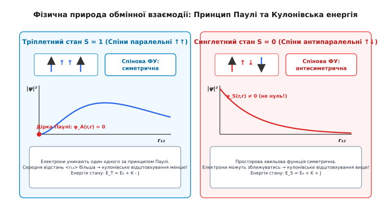
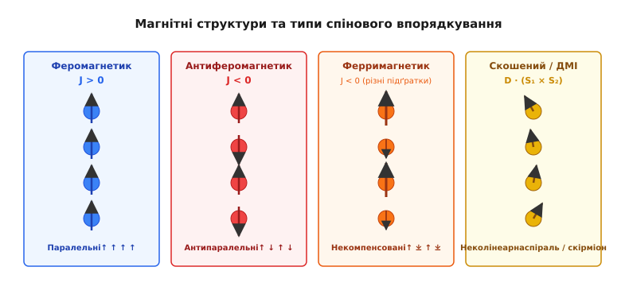
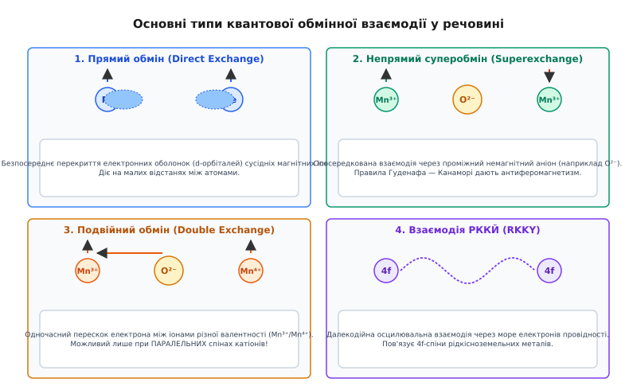
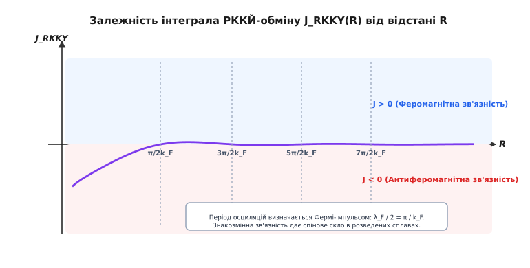

# Обмінна взаємодія

<preknowlist>
- [Спін електрона](root:ph-quantum/electron-spin) — власний квантовий момент електрона та його магнітний момент.
- [Принцип заборони Паулі](root:ph-quantum/pauli-exclusion) — фундаментальна антисиметричність хвильової функції ферміонів при перестановці.
- [Магнітні домени](root:ph-condensed/magnetic-domains) — макроскопічні області самочинного намагнічування у феромагнетиках.
- [Точка Кюрі](root:ph-condensed/curie-temperature) — критична температура фазового переходу з феромагнітного у парамагнітний стан.
</preknowlist>

Звичайний залізний цвях утримує впорядковане намагнічування за кімнатної температури й розмагнічується лише при нагріванні вище 1043 K (770 °C). Для кобальту ця критична межа сягає 1388 K, а для нікелю становить 627 K. З погляду класичної електродинаміки та класичної магнітостатики це явище виглядає абсолютним парадоксом. Магнітні моменти двох сусідніх атомів заліза, розташованих на типовій міжатомній відстані близько 0.25 нанометра, взаємодіють між собою як звичайні магнітні диполі. Якщо обчислити енергію такої прямої класичної магнітної взаємодії двох магнітонів Бора `μ_B`, вона виявиться крихітною:

```
E_dipole ≈ μ₀ · μ_B² / (4π · r³)
         ≈ 10⁻⁴ eV
```

Водночас енергія теплового руху атомів за кімнатної температури становить `k_B · T ≈ 0.025` електронвольт, що у 250 разів перевищує силу магнітної дипольної взаємодії. Якби класичні магнітні сили були єдиною причиною впорядкування, будь-який феромагнетик мав би безповоротно розпадатися на хаотичний парамагнітний стан уже при температурі близько 1 Кельвіна.

Ба більше, фундаментальна теорема Бора — ван Левен доводить, що у строго класичній статистичній термодинаміці Гіббса рівноважна намагніченість будь-якої системи заряджених частинок тотожно дорівнює нулю за будь-якої скінченної температури та в довільному магнітному полі. У класичній функції розподілу інтегрування за імпульсами розв'язується за допомогою простого калібрувального зсуву `p → p - (q/c)·A(r)`, що повністю виключає векторний потенціал магнітного поля з вільної енергії системи. Отже, класична фізика в принципі не здатна пояснити існування постійних магнітів.

Щоб пояснити, чому залізо зберігає феромагнітний порядок при тисячі градусів Цельсія, необхідна взаємодія з характерною енергією близько 0.1–1.0 електронвольт на атомну пару. Тобто реальна сила, яка утримує спіни сусідніх атомів суворо паралельно, у тисячі разів перевершує будь-які магнітні сили. Відповідь криється в квантовій механіці: ця колосальна взаємодія взагалі не є магнітною. Вона має суто **електростатичну** природу й виникає внаслідок нерозривного поєднання закону Кулона та принципу заборони Паулі для тотожних квантових частинок. Цей фундаментальний квантовий механізм отримав назву **обмінної взаємодії** (*exchange interaction*).

Детальний перебіг наукових суперечок, кризу класичних моделей та внесок Вернера Гейзенберга, Поля Дірака і Якова Френкеля розкрито у вставці [📜 Історія відкриття обмінної взаємодії](root:ph-condensed/exchange-interaction/hist-heisenberg-dirac.md).

### Квантовомеханічна природа: Поєднання принципу Паулі та кулонівської взаємодії

Квантова нерозрізність тотожних частинок докорінно змінює структуру багаточастинкових хвильових функцій. Розглянемо найпростішу модельну систему з двох електронів, які рухаються в кулонівських полях двох атомних ядер `A` та `B` (наприклад, у нейтральній молекулі водню або між сусідніми катіонами металу в кристалі).

Електрони є ферміонами зі спіном `1/2`. Фундаментальний постулат квантової механіки вимагає, щоб повна хвильова функція системи двох електронів `Ψ(1, 2)`, яка залежить як від їхніх просторових координат `r₁`, `r₂`, так і від спінових змінних `s₁`, `s₂`, була строго **антисиметричною** щодо одночасної перестановки всіх координат обох частинок:

```
Ψ(2, 1) = -Ψ(1, 2)
```

Якщо гамільтоніан системи не містить спін-орбітальних членів і залежить лише від просторових координат та електростатичного кулонівського потенціалу, повну хвильову функцію можна факторизувати у вигляді добутку просторової частини `ψ(r₁, r₂)` та спінової частини `χ(s₁, s₂)`:

```
Ψ(1, 2) = ψ(r₁, r₂) · χ(s₁, s₂)
```

Для системи двох спінів `1/2` простір спінових станів має розмірність `2 × 2 = 4` і розпадається на два незвідні класи станів із різною симетрією:

1. **Триплетний стан (`S = 1`, повний спін одиничний, кратність виродження 3):**
   Спіни електронів паралельні (`↑↑`). Три можливі проєкції повного спіну описуються симетричними спіновими функціями:

```
χ_T,+1 = |↑⟩₁ |↑⟩₂
χ_T,0  = (1/√2) · [ |↑⟩₁|↓⟩₂ + |↓⟩₁|↑⟩₂ ]
χ_T,-1 = |↓⟩₁ |↓⟩₂
```

Оскільки спінова функція `χ_T` є симетричною (`χ_T(1, 2) = +χ_T(2, 1)`), загальна антисиметричність повної функції вимагає, щоб просторова хвильова функція була строго **антисиметричною**:

```
ψ_A(r₁, r₂) = -ψ_A(r₂, r₁)
```

2. **Синглетний стан (`S = 0`, повний спін нульовий, кратність виродження 1):**
   Спіни електронів антипаралельні (`↑↓`). Єдиний стан описується антисиметричною спіновою функцією:

```
χ_S = (1/√2) · [ |↑⟩₁|↓⟩₂ - |↓⟩₁|↑⟩₂ ]
```

Оскільки спінова функція `χ_S` є антисиметричною (`χ_S(1, 2) = -χ_S(2, 1)`), просторова хвильова функція зобов'язана бути строго **симетричною**:

```
ψ_S(r₁, r₂) = +ψ_S(r₂, r₁)
```

Вирішальний фізичний наслідок цієї математичної вимоги виявляється тоді, коли ми досліджуємо ймовірність знаходження двох електронів в одній і тій самій точці простору (`r₁ = r₂ = r`). Для антисиметричної просторової функції триплетного стану отримуємо:

```
ψ_A(r, r) = -ψ_A(r, r)  ⇒  ψ_A(r, r) = 0
```

Це явище називають **ферміонівською діркою Паулі** (*Pauli exclusion hole*). Квантова статистика забороняє двом електронам з однаковими спінами наближатися один до одного. Навколо кожного електрона формується ефективна «заборонена зона», де густина ймовірності знаходження іншого електрона з паралельним спіном спадає до нуля. 

Внаслідок цього в триплетному стані електрони просторово розведені далі один від одного, їхня середня міжелектронна відстань `⟨|r₁ - r₂|⟩` зростає, а отже, середня енергія прямого кулонівського відштовхування між однойменними негативними зарядами суттєво зменшується.

Навпаки, у синглетному стані просторова хвильова функція є симетричною, тому `ψ_S(r, r) ≠ 0`. Електрони з антипаралельними спінами мають ненульову ймовірність перебувати в одній і тій самій просторовій області. Вони частіше зближуються, їхня взаємна кулонівська енергія відштовхування зростає, проте вони ефективніше екранують позитивні заряди ядер, зосереджуючись у просторі між ними.


*Природа обмінного ефекту. У триплетному стані (ліворуч, спіни паралельні) антисиметрія просторової хвильової функції обнуляє ймовірність знаходження електронів в одній точці (дірка Паулі), що знижує кулонівське відштовхування. У синглетному стані (праворуч, спіни антипаралельні) електрони зближуються частіше, що підвищує кулонівську енергію.*

Розрахунок повної енергії за методом Гайтлера — Лондона показує, що власні енергії синглетного `E_S` та триплетного `E_A` станів визначаються двома фундаментальними кулонівськими інтегралами:

```
E_S = E₀ + (K + J) / (1 + l²)
E_A = E₀ + (K - J) / (1 - l²)
```

де `E₀` — сумарна енергія двох ізольованих атомів, `l` — інтеграл перекриття одноелектронних орбіталей `φ_A(r)` та `φ_B(r)`:

```
l = ∫ φ_A*(r) · φ_B(r) d³r
```

Величини `K` та `J` мають принципово різний зміст:

- **Прямий кулонівський інтеграл `K`:** Описує класичну електростатичну енергію відштовхування двох електронних хмар із густинами заряду `|φ_A(r₁)|²` та `|φ_B(r₂)|²`:

```
K = ∬ |φ_A(r₁)|² · [e² / (4π·ε₀·|r₁ - r₂|)] · |φ_B(r₂)|² d³r₁ d³r₂
```

- **Квантовий обмінний інтеграл `J`:** Описує кулонівську енергію перехресних (інтерференційних) густин заряду `φ_A*(r₁)·φ_B(r₁)` та `φ_B*(r₂)·φ_A(r₂)`:

```
J = ∬ φ_A*(r₁)·φ_B*(r₂) · [e² / (4π·ε₀·|r₁ - r₂|)] · φ_A(r₂)·φ_B(r₁) d³r₁ d³r₂
```

Обмінний інтеграл `J` не має класичного аналога. Він виникає виключно через квантову хвильову інтерференцію стану, коли два тотожні електрони обмінюються своїми квантовими орбіталями. Різниця енергій між триплетним та синглетним станами для слабкого перекриття орбіталей (`l ≪ 1`) набуває вигляду:

```
ΔE = E_A - E_S ≈ -2 · J
```

Якщо `J > 0`, триплетний стан зі співспрямованими спінами має меншу енергію, ніж синглетний (`E_A < E_S`), і система самочинно намагнічується (виникає феромагнітний стан). Якщо ж `J < 0`, енергетично вигіднішим є синглетний стан з антипаралельними спінами (антиферомагнітний стан).

Повний математичний вивід інтегралів Гайтлера — Лондона, матричних елементів перестановки та їх проекцій наведено у вставці [🧮 Квантовомеханічне виведення обмінного інтеграла](root:ph-condensed/exchange-interaction/math-exchange-derivation.md).

#### Багатоелектронні системи, детермінанти Слейтера та теорія функціонала густини (DFT)

У кристалах твердого тіла та багатоелектронних атомах стан описується антисиметризованим добутком одноелектронних спін-орбіталей — детермінантом Слейтера:

```
Ψ(x₁, x₂, ..., x_N) = (1 / √N!) · det [ φ_i(x_j) ]
```

де `x_j = (r_j, s_j)` об'єднує просторові та спінові координати `j`-го електрона.

У вторинному квантуванні електронний гамільтоніан із двочастинковою кулонівською взаємодією записується через оператори народження `c_{i,σ}†` та знищення `c_{j,σ}` електрона у стані з орбітальним квантовим числом `i` та спіновою проєкцією `σ`:

```
Ĥ = ∑_(i,j,σ) t_ij · c_(i,σ)† · c_(j,σ) + 1/2 · ∑_(i,j,k,m,σ,σ') V_(ijkm) · c_(i,σ)† · c_(j,σ')† · c_(m,σ') · c_(k,σ)
```

Матричний елемент кулонівської взаємодії розкладається на прямий та обмінний внески. Якщо зберегти лише взаємодії електронів на двох орбіталях `1` та `2`, діагональна частина кулонівської енергії містить:

- Пряму взаємодію Хартрі `K₁₂ = V₁₂₁₂`, яка однаково діє на електрони з паралельними та антипаралельними спінами.
- Обмінну взаємодію Фока `J₁₂ = V₁₂₂₁`, яка виникає **лише між електронами з однаковими спіновими проєкціями** (`σ = σ'`).

Усереднення гамільтоніана за слейтерівським детермінантом дає повну кулонівську енергію:

```
E_Coulomb = ∑_(i < j) [ K_ij - J_ij · δ_(σ_i, σ_j) ]
```

Символ Кронекера `δ_(σ_i, σ_j)` чітко показує: якщо спіни електронів паралельні (`σ_i = σ_j`), обмінний член `-J_ij` віднімається від загальної позитивної енергії відштовхування. Це безпосередньо зменшує електростатичну енергію системи на величину `J_ij`.

У сучасній обчислювальній фізиці твердого тіла перших принципів (*ab initio*) розрахунок обмінної взаємодії базується на **теорії функціонала густини (DFT)** Кона — Шема. Повна енергія багатоелектронної системи розглядається як функціонал спінових густин `n_↑(r)` та `n_↓(r)`. Уся складна багаточастинкова квантова фізика зводиться до так званого **обмінно-кореляційного функціонала** `E_xc[n_↑, n_↓]`.

У найпростішому наближенні локальної спінової густини (LSDA) обмінна енергія розраховується аналітично через обмін однорідного електронного газу Дірака — Слейтера:

```
E_x^LSDA[n_↑, n_↓] = - (3/4) · (6/π)^(1/3) · ∫ [ n_↑(r)^(4/3) + n_↓(r)^(4/3) ] d³r
```

Для реальних матеріалів застосовують узагальнене градієнтне наближення (GGA, функціонал PBE), яке враховує просторові градієнти густини `∇n(r)`. Проте для сильнокорельованих діелектриків перехідних металів (наприклад, `NiO` або `MnO`) стандартне GGA стикається з катастрофічною помилкою самодії (*self-interaction error*), помилково передбачаючи металічний стан замість діелектричного з великою щілиною.

Цю проблему розв'язує метод **DFT+U** (корекція Габбарда `U` та обміну Гунда `J_H` за Анісімовим): до орбіталей d- чи f-оболонок додається явний модельний гамільтоніан Габбарда. Обчислення повної енергії кристала в різних неколінеарних та колінеарних спінових конфігураціях (метод відображення енергій, *energy mapping analysis*) дозволяє чисельно витягувати значення мікроскопічних обмінних параметрів `J_ij` безпосередньо з розв'язку рівнянь Кона — Шема. Для ще вищої точності використовують гібридні функціонали (B3LYP, HSE06), які підмішують фіксовану частку (близько 25%) точного нелокального обміну Хартрі — Фока.

#### Правила Гунда як внутрішньоатомний прояв обміну

Найпростішим і найяскравішим проявом обмінної взаємодії в ізольованих атомах є **перше правило Гунда** (*Hund's first rule*), яке визначає порядок заповнення вироджених атомних оболонок (наприклад, 2p-, 3d- чи 4f-орбіталей):

1. **Перше правило Гунда (Максимізація повного спіну `S`):** Основний стан ізольованого атома або іона з незаповненою підоболонкою завжди має максимально можливий повний спін `S`, дозволений принципом Паулі.

Фізична причина цього правила полягає не в магнітному притяганні спінів, а в обмінному розведенні електронів у просторі. Розглянемо два електрони на різних d-орбіталях (наприклад, `d_xy` та `d_x²-y²`). Якщо їхні спіни орієнтовані паралельно (`S = 1`), детермінант Слейтера формує антисиметричну просторову конфігурацію, яка обнуляє густину ймовірності знаходження обох електронів у близьких точках простору. В результаті електрони рухаються на більшій середній відстані один від одного, що зменшує їхнє взаємне кулонівське відштовхування на величину внутрішньоатомного обмінного інтеграла `J_Hund`.

2. **Друге правило Гунда (Максимізація повного орбітального моменту `L`):** При заданому максимальному спіні `S` електрони займають такі магнітні квантові числа `m_l`, щоб повний орбітальний момент `L` був максимальним. Це змушує електрони обертатися навколо ядра в один бік, зменшуючи ймовірність їхнього лобового зближення.

3. **Третє правило Гунда (Повний момент `J`):** Враховує релятивістську спін-орбітальну взаємодію `λ · (L · S)`. Якщо підоболонка заповнена менш ніж наполовину, повний кутовий момент дорівнює `J = |L - S|` (мінімальне значення). Якщо оболонка заповнена більш ніж наполовину, то `J = L + S` (максимальне значення).

Саме внутрішньоатомний обмін Гунда формує гігантські локальні магнітні моменти іонів перехідних металів (наприклад, `Mn²⁺` з конфігурацією `3d⁵` має максимальний спін `S = 5/2`, тобто магнітний момент `5 μ_B`) та рідкісноземельних елементів (`Gd³⁺` з конфігурацією `4f⁷` має `S = 7/2`, тобто `7 μ_B`).

### Спіновий гамільтоніан Гейзенберга — Дірака — Ван Флека

Оскільки обмінна енергія залежить від взаємної орієнтації спінів, Поль Дірак та Джон ван Флек показали, що весь складний електростатичний кулонівський оператор можна спроєктувати на ізольований підпростір спінових змінних.

Для цього використовується оператор перестановки спінів двох частинок `P̂₁₂^σ`. Діючи на симетричний триплетний стан, цей оператор дає власне значення `+1`, а на антисиметричний синглетний стан — значення `-1`. Застосовуючи тотожність Дірака через скалярний добуток операторів Паулі, отримуємо фундаментальне співвідношення:

```
P̂₁₂^σ = 1/2 + (2 / ħ²) · (Ŝ₁ · Ŝ₂)
```

Враховуючи, що повна хвильова функція антисиметрична (`P̂₁₂^r · P̂₁₂^σ = -1`), просторовий оператор перестановки виражається як `P̂₁₂^r = -P̂₁₂^σ`. Підставляючи цей вираз у загальний матричний гамільтоніан системи, знаходимо ефективний парний спіновий оператор Гейзенберга:

```
Ĥ_ex = -2 · J · (Ŝ₁ · Ŝ₂)
```

Для твердотільного кристала, де у вузлах ґратки розташовані магнітні іони з локалізованими спінами `S_i`, підсумовування за всіма парами вузлів дає загальний **гамільтоніан Гейзенберга** (*Heisenberg spin Hamiltonian*):

```
Ĥ_Heisenberg = -2 · ∑_(⟨i,j⟩) J_ij · (Ŝ_i · Ŝ_j) - g · μ_B · ∑_i (B_ext · Ŝ_i)
```

де `⟨i,j⟩` позначає підсумовування за парами найближчих сусідів (кожен зв'язок враховується один раз), `J_ij` — обмінний інтеграл між вузлами `i` та `j`, `g` — фактор Ланде, `μ_B` — магнетон Бора, а `B_ext` — зовнішнє магнітне поле.

> ⚠️ **Конвенція запису обмінного члена.** У світовій літературі зустрічаються дві різні форми запису: форма Гейзенберга — Дірака `H = -2 ∑ J_ij (S_i · S_j)` та спрощена форма статистичної фізики `H = -∑ J_ij' (S_i · S_j)`. При переході між джерелами слід уважно стежити за коефіцієнтом: `J_ij' = 2 J_ij`. У цій статті ми дотримуємося фундаментальної квантовомеханічної форми з множником `-2`.

Знак обмінного інтеграла `J_ij` повністю визначає базовий тип магнітного порядку в речовині:

```
J > 0  ⇒  Феромагнетизм: паралельні спіни (↑↑↑↑), мінімум енергії
J < 0  ⇒  Антиферомагнетизм: антипаралельні спіни (↑↓↑↓), мінімум енергії
```

1. **Феромагнетизм (`J > 0`):** Скалярний добуток `(S_i · S_j)` набуває максимального позитивного значення, коли спіни співспрямовані. Енергія системи мінімальна при суцільному паралельному впорядкуванні всіх магнітних моментів кристала. Виникає макроскопічна спонтанна намагніченість (кристалічне залізо `Fe`, кобальт `Co`, нікель `Ni`, гадоліній `Gd`, монооксид європію `EuO`).

2. **Антиферомагнетизм (`J < 0`):** Енергія системи мінімальна, коли скалярний добуток від'ємний, тобто сусідні спіни напрямлені строго протилежно. Кристалічна ґратка розбивається на дві або більше взаємопроникних магнітних підґраток `A` та `B`. У кожній підґратці спіни паралельні, але вектори намагніченостей підґраток `M_A` та `M_B` спрямовані в протилежні боки й повністю компенсують один одного:

```
M_total = M_A + M_B = 0
```

Сумарна макроскопічна намагніченість антиферомагнетика у нульовому зовнішньому полі дорівнює нулю, проте локально існує строгий порядок, який характеризується так званим **вектором Нееля** `L = M_A - M_B ≠ 0` (оксид марганцю `MnO`, оксид нікелю `NiO`, дифторид заліза `FeF₂`, металевий хром `Cr`).

3. **Ферримагнетизм (Некомпенсований антиферомагнетизм):** Якщо в кристалічній структурі магнітні підґратки є кристалографічно нееквівалентними, містять іони різних металів або різну кількість катіонів з відмінними величинами спінів (`|M_A| ≠ |M_B|`), антипаралельний обмінний зв'язок (`J < 0`) не призводить до повної компенсації магнітних моментів:

```
M_total = |M_A - M_B| > 0
```

Такі матеріали називають **ферримагнетиками** або феритами. Вони поєднують антиферомагнітну внутрішню структуру з наявністю значної макроскопічної спонтанної намагніченості (магнетит `Fe₃O₄`, ітрій-залізистий гранат `Y₃Fe₅O₁₂` / YIG, барієві гексаферити `BaFe₁₂O₁₉`). Завдяки високому електричному питомому опору (вони є діелектриками або напівпровідниками) ферити не страждають від вихрових струмів Фуко й незамінні у високочастотній електроніці та НВЧ-техніці.


*Класичні магнітні структури залежно від знака обмінного інтеграла J та симетрії кристала. При J > 0 утворюється феромагнетик, при J < 0 — антиферомагнетик або ферримагнетик (якщо підґратки нерівні). Анізотропний обмін Дзялошинського — Морія згортає спіни у спіраль або скірміон.*

#### Анізотропні граничні випадки спінового гамільтоніана

Залежно від кристалічного поля та величини спін-орбітальної взаємодії спіновий простір може втрачати сферичну симетрію `SO(3)`. Це породжує фундаментальні спрощені моделі теоретичної фізики:

- **Модель Ізінга (`Ising model`):** Відповідає граничному випадку нескінченно сильної одновісної анізотропії вздовж осі `Z`. Враховується лише одна проєкція спінів, які набувають дискретних значень `S_i^z = ±S`:

```
Ĥ_Ising = -2 · J · ∑_(⟨i,j⟩) S_i^z · S_j^z
```

В одновимірному ланцюжку модель Ізінга не має фазового переходу при `T > 0` (теорема Ізінга). У двовимірному випадку на квадратній ґратці модель Ізінга має точний аналітичний розв'язок Ларса Онсагера (1944) з фазовим переходом другого роду при критичній температурі `k_B · T_C = 2.269 · J`.

- **Модель XY (Планарна модель):** Відповідає випадку сильної анізотропії типу «легка площина», коли спіни можуть вільно обертатися лише у площині `XY`:

```
Ĥ_XY = -2 · J · ∑_(⟨i,j⟩) (S_i^x · S_j^x + S_i^y · S_j^y)
```

У 2D просторі модель XY не має спонтанної намагніченості при `T > 0`, проте демонструє унікальний топологічний **фазовий перехід Березинського — Костерліца — Таулеса (BKT)**, зумовлений спарюванням квантових вихорів і антивихорів.

- **Ізотропна модель Гейзенберга (XXX):** Повна сферична інваріантність у тривимірному спіновому просторі.

- **Анізотропна модель Гейзенберга (XXZ та XYZ):** Дозволяє плавно варіювати співвідношення між поздовжнім та поперечними обмінними коефіцієнтами:

```
Ĥ_XXZ = -2 · ∑_(⟨i,j⟩) [ J_xy · (S_i^x · S_j^x + S_i^y · S_j^y) + J_z · S_i^z · S_j^z ]
```

#### Метамагнетизм, спін-флоп та спін-фліп переходи в антиферомагнетиках

Поведінка антиферомагнетика у сильному зовнішньому магнітному полі `B_ext`, спрямованому вздовж осі легкого намагнічування, визначається жорсткою конкуренцією між обмінною енергією `J` (яка утримує спіни антипаралельно) та енергією одновісної магнітної анізотропії `K_u`:

1. **Спін-флоп перехід (*Spin-flop transition*):**
   При збільшенні зовнішнього поля до критичного значення `B_SF` системі стає енергетично невигідно утримувати один із підґраткових спінів проти поля. Відбувається фазовий перехід першого роду: магнітні моменти обох підґраток стрибком розвертаються **майже перпендикулярно** до напрямку зовнішнього поля і злегка нахиляються у бік поля, утворюючи скошену структуру. Критичне поле спін-флопу визначається середнім геометричним поля обміну та поля анізотропії:

```
B_SF = √[ 2 · B_ex · B_anis - B_anis² ]
```

2. **Спін-фліп перехід (*Spin-flip / Metamagnetic transition*):**
   Якщо одновісна анізотропія кристала є дуже сильною і перевершує обмінне поле (`B_anis > B_ex`, як у `FeCl₂`), спіни не можуть повертатися плавно. При досягненні критичного метамагнітного поля підґратка, орієнтована проти поля, миттєво перекидається паралельно зовнішньому полю. Антиферомагнетик стрибком переходить у стан феромагнітного насичення.

> 🔧 **Навіщо це.** Спіновий гамільтоніан Гейзенберга зводить нерозв'язну квантову багатоелектронну задачу з трильйонами кулонівських взаємодій до ефективної взаємодії між дискретними магнітними векторами. Це фундаментальна основа мікромагнітного моделювання магнітних головок запису, спінових вентилів, розрахунку фазових діаграм та проєктування матеріалів для постійних магнітів.

Чисельну реалізацію Монте-Карло моделювання 3D-спінів Гейзенберга на мовах C, C++, Python та TypeScript розібрано у вставці [⚙️ Моделювання спінової системи Гейзенберга](root:ph-condensed/exchange-interaction/proj-heisenberg-model.md).

### Зонний (мандрівний) магнетизм: Модель Стонера

Модель локалізованих спінів Гейзенберга ідеально описує магнітні діелектрики та рідкісноземельні сполуки, але стикається з непереборними труднощами при спробі описати класичні металеві феромагнетики — залізо, кобальт і нікель.

В експерименті насичений магнітний момент на один атом у металевих феромагнетиках виявляється суто дробовим:
- Залізо (`Fe`): `2.22 μ_B` на атом (конфігурація `3d⁶ 4s²` передбачала б ціле число `4 μ_B` для локалізованого `S = 2` або `2 μ_B` для `S = 1`);
- Кобальт (`Co`): `1.72 μ_B` на атом;
- Нікель (`Ni`): `0.606 μ_B` на атом (для локалізованого `S = 1/2` очікувалося б строго `1.0 μ_B`).

Окрім того, 3d-електрони в металах не закріплені на вузлах, а вільно мандрують кристалом, формуючи широкі енергетичні зони провідності та складні поверхні Фермі.

Цю проблему розв'язує **модель мандрівного (зонного) феромагнетизму**, запропонована Едмундом Стонером у 1938 році (*Stoner model of itinerant ferromagnetism*).

#### Спінове розщеплення енергетичних зон

У парамагнітному стані металу енергетичні зони для електронів зі спіном «вгору» (`↑`) та спіном «вниз» (`↓`) є повністю симетричними й заповнені до однакового рівня Фермі `E_F`. Речовина не має сумарного магнітного моменту.

Якщо між колективізованими електронами діє обмінна кулонівська взаємодія, спонтанна поява невеликої спінової поляризації зміщує дві підзони за енергією відносно одна одної на величину **обмінного розщеплення зон** `Δ_ex`:

```
E_↑(k) = E₀(k) - (1/2) · I · m
E_↓(k) = E₀(k) + (1/2) · I · m
```

де `I` — внутрішньоатомний параметр обмінної взаємодії Стонера (має розмірність енергії, зазвичай `I ≈ 0.5 – 1.0` еВ для 3d-металів), а `m` — безрозмірна відносна намагніченість:

```
m = (n_↑ - n_↓) / n
```

де `n_↑` та `n_↓` — концентрації електронів зі спінами вгору та вниз, а `n = n_↑ + n_↓` — повна концентрація електронів у зоні.

Підзона зі спіном `↑` (більшість, *majority spin*) занурюється глибше за енергією і вміщує більше електронів, тоді як підзона зі спіном `↓` (меншість, *minority spin*) зміщується вгору і частково спустошується.

#### Виведення критерію Стонера

Виникнення феромагнітного стану є результатом конкуренції двох термодинамічних внесків:

1. **Втрата кінетичної енергії `ΔE_kin`:** Щоб перенести малу кількість електронів `δn` з підзони `↓` у підзону `↑`, їх необхідно підняти вище початкового рівня Фермі `E_F`. Збільшення кінетичної енергії системи дорівнює:

```
ΔE_kin = (1/2) · (δn)² / D(E_F)
```

де `D(E_F)` — густина одноелектронних станів на рівні Фермі (на один спіновий стан).

2. **Виграш потенціальної обмінної енергії `ΔE_ex`:** Оскільки кількість пар електронів з однаковими спінами зростає, міжелектронне кулонівське відштовхування зменшується на величину обмінної взаємодії:

```
ΔE_ex = - (1/2) · I · (δn)²
```

Повна зміна енергії системи при виникненні спонтанної поляризації набуває вигляду:

```
ΔE_total = ΔE_kin + ΔE_ex
         = (1/2) · (δn)² · [ 1 / D(E_F) - I ]
```

Спонтанний парамагнітний стан стає термодинамічно нестійким щодо спонтанного намагнічування (`ΔE_total < 0`), коли виконується знаменитий **критерій Стонера**:

```
I · D(E_F) > 1
```

Фізичний зміст критерію Стонера надзвичайно глибокий: спонтанний феромагнетизм виникає лише тоді, коли обмінна енергія `I` достатньо велика, а густина станів на рівні Фермі `D(E_F)` є надзвичайно високою.

```
                  Критерій Стонера: I · D(E_F) > 1
                 ┌────────────────────────────────┐
                 │  I · D(E_F) > 1: ФЕРОМАГНЕТИК   │
                 │  Fe, Co, Ni (вузькі 3d-зони)   │
                 └───────────────┬────────────────┘
                                 │
                 ┌───────────────┴────────────────┐
                 │  I · D(E_F) ≈ 0.9: ПАРАМАГНОНИ │
                 │  Pd, Pt (посилений Паулі)      │
                 └───────────────┬────────────────┘
                                 │
                 ┌───────────────┴────────────────┐
                 │  I · D(E_F) ≪ 1: ПАРАМАГНЕТИК   │
                 │  Al, Cu (широкі s-p зони)      │
                 └────────────────────────────────┘
```

Саме тому феромагнетизм зустрічається лише серед 3d-перехідних металів. Їхні 3d-хвильові функції мають малий радіус, перекриття між сусідніми атомами помірне, а енергетична ширина 3d-зони є вузькою (`W ≈ 3 – 5` еВ). Відповідно до теореми про збереження кількості станів, вузька зона формує велетенські піки густини станів `D(E)`. Якщо рівень Фермі потрапляє на один із таких піків, критерій Стонера виконується.

Натомість у простих металах (алюміній `Al`, мідь `Cu`, натрій `Na`) електрони провідності належать до широких 4s- або 3p-зон (`W ≈ 15 – 20` еВ). Їхня густина станів на рівні Фермі мала (`D(E_F) ≪ 1`), тому критерій Стонера не виконується, і вони залишаються звичайними парамагнетиками Паулі.

#### Сильні та слабкі зонні феромагнетики

За ступенем заповнення спінових підзон феромагнітні метали поділяють на дві фундаментальні групи:

1. **Сильні феромагнетики (*Strong ferromagnets*):** Підзона зі спіном більшості `↑` повністю заповнена й лежить цілком нижче рівня Фермі. Рівень Фермі перетинає лише підзону зі спіном меншості `↓`. Спінова поляризація електронів на рівні Фермі є стовідсотковою. До сильних феромагнетиків належать **нікель** (`Ni`) та **кобальт** (`Co`). У нікелі 3d-підзона `↑` містить рівно 5.0 електронів, а 3d-підзона `↓` — 4.44 електрона, що й дає дробовий магнітний момент `m = 5.0 - 4.44 = 0.56 μ_B` (з урахуванням орбітального внеску — `0.606 μ_B`).

2. **Слабкі феромагнетики (*Weak ferromagnets*):** Рівень Фермі перетинає обидві спінові підзони (`↑` та `↓`), жодна з них не є повністю заповненою. До слабких феромагнетиків належить **кристалічне залізо** (`Fe`). Попри слово «слабкий», залізо має більший абсолютний магнітний момент (`2.22 μ_B`), ніж нікель чи кобальт, проте обидві його спінові зони відкриті на рівні Фермі.

#### Майже феромагнітні метали та парамагнони

Особливий інтерес становлять метали, які перебувають на самій межі виконання критерію Стонера: **паладій** (`Pd`) та **платина** (`Pt`). У чистому паладії добуток `I · D(E_F) ≈ 0.90 – 0.95`. Паладій не стає феромагнетиком, проте його парамагнітна сприйнятливість Паулі посилюється обмінним фактором Стонера у десятки разів:

```
χ_Stoner = χ₀ / [ 1 - I · D(E_F) ]
```

У паладії існують довгоживучі колективні низькочастотні спінові флуктуації — **парамагнони**. Ба більше, якщо додати в чистий паладій усього 0.1 атомного відсотка заліза (`Fe`), локальний магнітний момент атома заліза поляризує електронне море паладію на відстані кількох кристалічних ґраток навколо себе. Утворюється гігантський магнітний кластер із сумарним моментом близько `12 μ_B`, і сплав переходить у стійкий феромагнітний стан.

### Різновиди обмінної взаємодії у конденсованих середовищах

Пряме квантове перекриття електронних оболонок сусідніх іонів (прямий обмін) є лише одним із багатьох шляхів реалізації магнітного зв'язку. У реальних напівпровідниках, оксидах, рідкісноземельних металах та наноструктурах природа реалізує п'ять основних мікроскопічних механізмів обміну.


*Схематичний опис п'яти основних механізмів обміну: 1. Прямий обмін d-орбіталей; 2. Непрямий суперобмін через аніон O²⁻; 3. Подвійний обмін із переносом електрона між Mn³⁺ та Mn⁴⁺; 4. Осцилювальний обмін РККЙ через море електронів провідності.*

#### 1. Прямий обмін (Direct Exchange) та Крива Бете — Слейтера

Прямий обмін виникає при безпосередньому геометричному накладанні незаповнених d- або f-орбіталей сусідніх магнітних атомів без участі проміжних іонів. Він діє лише на надмалих відстанях, оскільки хвильові функції спадають експоненційно з віддаленням від ядра.

Знак та амплітуда прямого обмінного інтеграла в перехідних 3d-металах визначаються напівфеноменологічною кривою **Бете — Слейтера** (*Bethe-Slater curve*). Вона виражає залежність `J` від безрозмірного відношення міжатомної відстані в кристалічній ґратці `a` до середнього радіуса незаповненої 3d-електронної оболонки `r_3d`:

```
              Обмінний інтеграл J
                     ▲
                     │          Fe (1.63)
          J > 0      │          Co (1.64)  Ni (1.82)
     (Феромагнетизм) │            ╭───╮
                     │           ╭╯   ╰───────╮
        ─────────────┼──────────╭╯────────────╰────────► a / r_3d
                     │   Mn(1.47)
          J < 0      │  ╭╯
   (Антиферомагнетизм│ ╭╯ Cr(1.20)
                     ▼
```

- **При `a / r_3d > 1.5` (Феромагнітна область):** Атоми рознесені на помірну відстань. Перекриття зовнішніх хвостів d-орбіталей є слабким. У цій геометрії обмінний інтеграл позитивний (`J > 0`), оскільки кулонівське зниження енергії за рахунок дірки Паулі переважає кінетичні внески. До цієї області належать феромагнітні метали: залізо (`a/r_3d ≈ 1.63`), кобальт (`1.64`) та нікель (`1.82`).
- **При `a / r_3d < 1.5` (Антиферомагнітна область):** Атоми розташовані надто близько один до одного порівняно з розміром їхніх d-оболонок. Перекриття орбіталей стає сильним, виникає значна кінетична нестійкість і деформація електронних густин, що робить енергетично вигідним антипаралельне впорядкування спінів (`J < 0`). До цієї зони потрапляють антиферомагнетики: марганець (`a/r_3d ≈ 1.47`) та хром (`1.20`).

Ідеальним експериментальним доказом концепції Бете — Слейтера є поведінка **сплавів Гейслера** (*Heusler alloys*, наприклад `Cu₂MnAl` або `MnBi`). Чистий металевий марганець є антиферомагнетиком із високою щільністю упаковки атомів. Але якщо ввести між атомами марганцю немагнітні атоми міді та алюмінію, вони розсувають кристалічну ґратку. Відстань між сусідніми катіонами `Mn` зростає від 0.27 нм до 0.42 нм, відношення `a / r_3d` перетинає критичний поріг `1.5`, і марганець перетворюється на сильний феромагнетик із точкою Кюрі понад 600 K.

#### 2. Непрямий суперобмін (Superexchange), правила Гуденафа — Канаморі та класифікація ZSA

У більшості магнітних діелектриків (оксидах `MnO`, `NiO`, `Fe₂O₃`, фторидах `MnF₂`, перовськітах `LaMnO₃`, шаруватих купратах `La₂CuO₄`) прямий обмін між магнітними катіонами перехідних металів неможливий. Катіони металу `M` віддалені один від одного на значні відстані (0.4–0.5 нм), а в просторі між ними розташовані немагнітні діамагнітні аніони лігандів — кисню `O²⁻` або фтору `F⁻` із повністю заповненими p-оболонками (`2p⁶`).

Магнітний зв'язок у таких системах здійснюється за допомогою **непрямого суперобміну** (*superexchange*), теорію якого сформулювали Гендрік Крамерс (1934) та Філіп Андерсон (1950). Суперобмін відбувається через віртуальні квантовомеханічні перескоки електронів між незаповненими d-орбіталями двох катіонів металу та повністю заповненою 2p-орбіталлю проміжного аніона кисню.

В аналітичній моделі Андерсона взаємодія розглядається в межах багатоорбітальної моделі Габбарда з урахуванням енергії перескоку (ковалентного тунелювання) `t` та одновузлової кулонівської енергії відштовхування `U` (або енергії перенесення заряду `Δ_CT`). Повний ефективний обмінний інтеграл розкладається на два конкуруючі внески:

```
J_eff = J_pot + J_kin
```

- **Потенціальний обмін (`J_pot > 0`):** Завжди феромагнітний, зумовлений прямим кулонівським обміном на залишковій орбітальній густині.
- **Кінетичний обмін (`J_kin < 0`):** Завжди антиферомагнітний, зумовлений квантовим віртуальним зниженням кінетичної енергії електрона при делокалізації:

```
J_kin = - (2 · t²) / U
```

При половинному заповненні орбіталей кінетичний внесок домінує на порядок, зумовлюючи потужний антиферомагнетизм.

Глибше розуміння природи енергетичних щілин та суперобміну дає **схема Цаанена — Савацкі — Аллена (ZSA-класифікація)**, яка поділяє корельовані магнітні діелектрики на два класи:

1. **Мотт-габбардівські діелектрики (*Mott-Hubbard insulators*):** коли одновузлове кулонівське відштовхування менше за енергію переносу заряду ліганд-метал (`U < Δ_CT`). Характерно для ранніх 3d-металів (наприклад, сполук титану та ванадію). Енергетична щілина визначається переходами `d - d`, а суперобмін описується стандартною формулою Андерсона `J ≈ -2 t² / U`.

2. **Діелектрики з перенесенням заряду (*Charge-transfer insulators*):** коли енергія збудження електрона з p-оболонки кисню на d-орбіталь металу менша за кулонівське відштовхування двох d-електронів (`Δ_CT < U`). Характерно для пізніх 3d-металів — нікелатів (`NiO`) та купратів (`La₂CuO₄`). У цьому випадку енергетична щілина формується `p → d` переходами, а формула суперобміну у четвертому порядку квантової теорії збурень набуває вигляду:

```
J = - [ 2 · t_pd⁴ / (Δ_CT² · U_d) ] - [ t_pd⁴ / Δ_CT³ ]
```

де `t_pd` — матричний елемент гібридизації між 2p-орбіталлю кисню та 3d-орбіталлю міді/нікелю. Оскільки ковалентне перекриття `t_pd` у купратах є надзвичайно сильним, а щілина переносу заряду `Δ_CT` відносно малою, антиферомагнітний суперобмін у шарах `CuO₂` досягає колосальної величини `J ≈ 130 – 140` меВ (що відповідає ефективній температурі обмінного зв'язку понад 1500 K).

Знак і амплітуда суперобміну суворо підпорядковуються напівкласичним **правилам Гуденафа — Канаморі — Андерсона** (*Goodenough-Kanamori-Anderson rules*, GKA), які пов'язують магнітний порядок з просторовою симетрією орбіталей та валентним кутом хімічного зв'язку `M - O - M`:

```
               Правила Гуденафа — Канаморі для зв'язку M—O—M
┌─────────────────────────────────────────────────────────────────────────────┐
│  1. Кут 180° (e_g — p_σ — e_g):                                             │
│     Перекриття з однією p-орбіталлю O²⁻  ⇒  СИЛЬНИЙ АНТИФЕРОМАГНЕТИЗМ (J < 0)│
│                                                                             │
│  2. Кут 90°  (e_g — p_x / p_y — e_g):                                       │
│     Дві ортогональні p-орбіталі + Гунд  ⇒  СЛАБКИЙ ФЕРОМАГНЕТИЗМ (J > 0)    │
│                                                                             │
│  3. Орбіталь d(напівзаповнена) — p — d(порожня):                            │
│     Віртуальний перескок без Паулі       ⇒  ФЕРОМАГНЕТИЗМ (J > 0)           │
└─────────────────────────────────────────────────────────────────────────────┘
```

1. **Лінійний зв'язок 180° (`M - O - M`):**
   Розглянемо два катіони `Mn²⁺` (або `Ni²⁺`), розташовані по обидва боки від іона `O²⁻`. Одна й та сама витягнута гантелеподібна `p_z`-орбіталь кисню з двома спареними електронами (`↑` та `↓`) одночасно перекривається з `d_z²`-орбіталями обох катіонів металу (сильний `σ`-зв'язок).
   - Електрон кисню зі спіном `↓` віртуально перескакує на лівий катіон. За принципом Паулі це дозволено лише тоді, коли локальний спін лівого катіона спрямований вгору `↑`.
   - Другий електрон кисню, що залишився на p-орбіталі, має спін `↑`. Він може віртуально перескочити на правий катіон лише за умови, що спін правого катіона спрямований вниз `↓`.
   - Отже, віртуальне збудження, яке мінімізує повну енергію системи за рахунок делокалізації, можливе **виключно при антипаралельній орієнтації спінів обох катіонів**. Виникає надзвичайно сильний **антиферомагнітний суперобмін** (`J < 0`, температура Нееля в оксидах сягає `T_N = 100 – 500` K).

2. **Прямокутний зв'язок 90° (`M - O - M`):**
   Якщо кут зв'язку близький до прямого, лівий катіон металу перекривається з `p_x`-орбіталлю кисню, а правий катіон — з ортогональною `p_y`-орбіталлю. Оскільки просторові хвильові функції `p_x` та `p_y` є ортогональними, перенесення електронів відбувається через різні орбіталі. Згідно з першим правилом Гунда для атома кисню, спіни електронів на ортогональних орбіталях одного атома енергетично вигідно орієнтувати паралельно (`J_Hund > 0`). Це транслюється на катіони металу й створює **феромагнітний суперобмін** (`J > 0`), хоча й значно слабший за амплітудою.

3. **Перекриття напівзаповненої орбіталі з порожньою:**
   Якщо один катіон має напівзаповнену d-орбіталь, а інший — повністю вільну орбіталь однакової симетрії, електрон кисню будь-якого спіну може вільно переходити на порожню орбіталь. Завдяки внутрішньоатомному обміну Гунда на катіоні з порожньою орбіталлю виникає стабільний **феромагнітний зв'язок**.

#### 3. Подвійний обмін (Double Exchange) та фізика манганітів

Механізм **подвійного обміну** (*double exchange*) запропонував Кларенс Зенер у 1951 році, а згодом розвинули Філіп Андерсон, Хасегава та П'єр-Жіль де Женн для пояснення унікальних властивостей змішановалентних оксидів перехідних металів.

Класичним прикладом є перовськітні манганіти лантану-стронцію `La_(1-x)Sr_xMnO₃` (LSMO). При заміщенні тривалентного лантану `La³⁺` на двовалентний стронцій `Sr²⁺` у кристалічній ґратці для збереження електронейтральності частина іонів марганцю переходить зі стану `Mn³⁺` у стан `Mn⁴⁺`:
- **Іон `Mn³⁺` (`3d⁴`):** Має 3 електрони на нижніх локалізованих `t₂g`-орбіталях (спін ядра `S = 3/2`) та 1 рухливий електрон на верхній виродженій `e_g`-орбіталі (повний спін катіона `S = 2`).
- **Іон `Mn⁴⁺` (`3d³`):** Має 3 електрони на `t₂g`-орбіталях (`S = 3/2`), а його `e_g`-орбіталь є повністю порожньою.

У цій змішаній системі рухливий `e_g`-електрон іона `Mn³⁺` може перейти на порожню `e_g`-орбіталь сусіднього іона `Mn⁴⁺` через проміжний аніон кисню `O²⁻`. Цей квантовий процес є не віртуальним, а **реальним двоетапним перенесенням заряду** (звідки й назва «подвійний обмін»):
1. Електрон з `2p`-орбіталі кисню зі спіном перескакує на порожню `e_g`-орбіталь `Mn⁴⁺`, перетворюючи його на `Mn³⁺`.
2. Одночасно `e_g`-електрон вихідного іона `Mn³⁺` перескакує на звільнене місце в `2p`-оболонці кисню, перетворюючи його на `Mn⁴⁺`.

```
Вихідний стан:     Mn³⁺ (e_g¹) [↑]   ───   O²⁻ (2p²) [↑↓]   ───   Mn⁴⁺ (e_g⁰) [ ]
Кінцевий стан:     Mn⁴⁺ (e_g⁰) [ ]   ───   O²⁻ (2p²) [↑↓]   ───   Mn³⁺ (e_g¹) [↑]
```

Оскільки внутрішньоатомний обмін Гунда на іоні марганцю є гігантським (`J_Hund ≈ 2 – 3` еВ), спін `e_g`-електрона під час руху **зобов'язаний залишатися строго паралельним локальному спіну ядра `t₂g`**.

Якщо локальні магнітні моменти двох сусідніх іонів марганцю розвернуті один відносно одного на кут `θ`, хвильова функція спіну `1/2` при обертанні на кут `θ` набуває геометричного квантового множника `cos(θ / 2)`. Відповідно, ефективна амплітуда перескоку (матричний елемент тунелювання `t_eff`) та повна ширина зони провідності `W` дорівнюють:

```
t_eff = t₀ · cos(θ / 2)
W(θ) = W₀ · cos(θ / 2)
```

- При **паралельних спінах (`θ = 0°`)**: `cos(θ / 2) = 1`. Амплітуда тунелювання максимальна (`t_eff = t₀`), рухливий електрон вільно делокалізується по всій ґратці, його кінетична енергія падає до мінімуму, а матеріал стає **високопровідним феромагнітним металом**.
- При **антипаралельних спінах (`θ = 180°`)**: `cos(θ / 2) = 0`. Амплітуда тунелювання строго обнуляється (`t_eff = 0`), рух електрона повністю блокується, і матеріал перетворюється на **антиферомагнітний діелектрик**.

Таким чином, подвійний обмін нерозривно пов'язує електронний транспорт і магнетизм. Саме подвійний обмін є рушійною силою явища **колосального магнітоопору** (*Colossal Magnetoresistance, CMR*): при накладанні зовнішнього магнітного поля поблизу точки Кюрі спіни катіонів вишиковуються паралельно, кут `θ → 0`, тунелювання відкривається, і електричний опір зразка падає в тисячі разів.

#### 4. Взаємодія Рудермана — Киттеля — Касуї — Йосіди (РККЙ / RKKY)

У металах рідкісноземельних елементів (лантаноїдах: гадоліній `Gd`, тербій `Tb`, диспрозій `Dy`, ербій `Er`) магнітні моменти формуються глибоко захованими електронами незаповненої 4f-оболонки. Радіус 4f-орбіталей настільки малий (`r_4f ≈ 0.03 – 0.05` нм), що вони повністю екрановані зовнішніми заповненими 5s²- та 5p⁶-електронними шарами. 4f-оболонки сусідніх атомів взагалі не перекриваються у просторі, а проміжних аніонів у металі немає, що виключає як прямий обмін, так і суперобмін.

Магнітний зв'язок здійснюється за допомогою **взаємодії РККЙ** (*RKKY interaction*), яку розробили М. Рудерман та Ч. Киттель (1954) для ядерних спінів і розширили Т. Касуя (1956) та К. Йосіда (1957) для локалізованих d- та f-електронів.

Локалізований 4f-спін `S_i` взаємодіє з делокалізованими s-електронами провідності через контактний внутрішньоатомний `s-f` обмінний гамільтоніан:

```
Ĥ_(s-f) = - J_(sf) · ∑_i (Ŝ_i · ŝ(R_i))
```

де `ŝ(R_i)` — локальна густина спіну електронів провідності у вузлі `R_i`.

Локалізований спін поляризує спіни електронів провідності навколо себе. Оскільки електронний газ підпорядковується статистиці Фермі — Дірака і має чітку сферу Фермі з хвильовим вектором `k_F`, просторовий відгук електронного моря описується поляризаційним оператором Ліндхарда. Подібно до дифракційних хвиль від перешкоди, спінова поляризація навколо магнітного іона утворює просторові **осциляції Фріделя**.

Сусідній локалізований спін `S_j`, розташований на відстані `R = |R_i - R_j|`, відчуває цю наведену спінову поляризацію. У результаті виникає ефективний непрямий обмінний гамільтоніан Гейзенберга `H = -2 ∑ J_RKKY(R) (S_i · S_j)`, де обмінний інтеграл набуває вигляду:

```
J_RKKY(R) = J₀ · [ (2·k_F·R) · cos(2·k_F·R) - sin(2·k_F·R) ] / (2·k_F·R)⁴
```

На великих відстанях (`k_F · R ≫ 1`) асимптотична поведінка функції РККЙ описується знакозмінним виразом зі степеневим загасанням:

```
J_RKKY(R) ∝ cos(2 · k_F · R) / R³
```


*Залежність обмінного інтеграла РККЙ від відстані R між магнітними іонами. Знакозмінні осциляції з періодом π/k_F почергово створюють феромагнітну (J > 0) та антиферомагнітну (J < 0) зв'язаність.*

Ключова властивість обміну РККЙ — його **знакозмінний просторовий характер**. Залежно від відстані `R` між іонами, взаємодія є то феромагнітною (`J > 0`), то антиферомагнітною (`J < 0`). Період просторових осциляцій дорівнює `λ_RKKY = π / k_F`.

Наслідки взаємодії РККЙ мають фундаментальне значення:
1. **Складні неколінеарні структури лантаноїдів:** У чистих рідкісноземельних металах (тербій, диспрозій, гольмій) конкуренція обміну РККЙ між різними координаційними сферами породжує спіральні, конічні, гвинтові та гелікоїдальні магнітні фази.
2. **Спінове скло (*Spin glass*):** У розбавлених магнітних сплавах (наприклад, `Cu-Mn` або `Au-Fe`), де магнітні домішки випадково розкидані у немагнітній матриці, відстані `R` набувають неперервного спектра значень. Одночасне існування випадкових феромагнітних та антиферомагнітних зв'язків призводить до повної геометричної фрустрації спінів і формування стану спінового скла з неергодичною динамікою.
3. **Синтетичні антиферомагнетики (SAF) у спінтроніці:** У штучних багатошарових металевих наноструктурах (наприклад, `Co/Ru/Co` або `Fe/Cr/Fe`) два феромагнітні шари кобальту розділені ультратонким немагнітним прошарком рутенію `Ru`. Електрони провідності рутенію передають обмінну взаємодію РККЙ між шарами. Зміна товщини прошарку рутенію лише на 0.2 нанометра перемикає зв'язок між шарами з феромагнітного на антиферомагнітний.

#### 5. Анізотропний обмін Дзялошинського — Морія (ДМІ / DMI)

Усі розглянуті вище обмінні взаємодії є симетричними й ізотропними в спіновому просторі: вони залежать виключно від скалярного добутку `(S_i · S_j)` і прагнуть вишикувати спіни строго колінеарно (паралельно під кутом 0° або антипаралельно під кутом 180°).

Проте в кристалах з порушеною просторовою інверсійною симетрією за наявності сильного релятивістського спін-орбітального зв'язку `λ · (L · S)` виникає антисиметрична векторна обмінна взаємодія — **взаємодія Дзялошинського — Морія** (*Dzyaloshinskii-Moriya interaction, DMI*).

У 1957 році Ігор Дзялошинський на основі теорії фазових переходів Ландау феноменологічно довів, що слабкий феромагнетизм у кристалах гематиту `α-Fe₂O₃` зумовлений термодинамічним членом симетрії `D · (M_A × M_B)`. У 1960 році Тору Морія знайшов мікроскопічний механізм цього явища, показавши, що воно виникає у другому порядку квантової теорії збурень при комбінації суперобміну та спін-орбітальної взаємодії.

Гамільтоніан взаємодії ДМІ записується через **векторний добуток** спінів:

```
Ĥ_DMI = D_ij · (Ŝ_i × Ŝ_j)
```

де `D_ij` — осьовий вектор Дзялошинського — Морія. Напрямок і величина вектора `D_ij` визначаються локальною точковою симетрією кристалічного зв'язку за правилами Морія. Якщо катіони `i` та `j` взаємодіють через проміжний аніон, вектор `D_ij` перпендикулярний площині трикутника `M_i - O - M_j`.

```
                    Гамільтоніан взаємодії ДМІ:
                     H_DMI = D_ij · (S_i × S_j)
                                    ▲
                                    │ Вектор D_ij
                                    │
                                 S_j│   / S_i
                                    │  /
                                    │ /  Кут 90° мінімізує енергію DMI
                         ───────────┼────────────────►
                                    │
```

На відміну від симетричного обміну Гейзенберга, взаємодія ДМІ намагається розвернути сусідні спіни **перпендикулярно один до одного під кутом 90°**, фіксуючи векторний напрямок обходу (хіральність).

Змагання між симетричним обміном Гейзенберга `J` (який прагне тримати спіни паралельними або антипаралельними) та антисиметричним обміном ДМІ `D` породжує унікальні нелінійні та топологічні явища:

1. **Слабкий феромагнетизм у скошених антиферомагнетиках (*Canted antiferromagnetism*):**
   В антиферомагнетиках типу `α-Fe₂O₃`, `FeBO₃`, `YFeO₃` сильний антиферомагнітний обмін `J < 0` утримує спіни підґраток майже антипаралельно, але взаємодія ДМІ злегка скошує їх на малий кут `α ≈ |D| / (2|J|) ≈ 0.5° – 1°`. Внаслідок цього виникає слабка нескомпенсована спонтанна намагніченість порядку `0.01 – 0.05 μ_B` на формульну одиницю.

2. **Хіральні гелікоїди та спіралі:**
   В об'ємних кристалах нецентросиметричних просторових груп (наприклад, киральні моносиліциди B20: `MnSi`, `FeGe`) взаємодія ДМІ плавно повертає напрямок намагніченості у просторі, формуючи спінові гелікоїдальні хвилі з фіксованим знаком закручування (правою або лівою хіральністю) та періодом від 3 до 100 нанометрів.

3. **Магнітні скірміони (*Magnetic Skyrmions*):**
   В ультратонких магнітних плівках з порушеною інверсійною симетрією інтерфейсу (наприклад, моношари `Co` чи `Fe` на підкладках із важких металів з гігантським спін-орбітальним зв'язком `Pt`, `Ir`, `W`) виникає сильний **інтерфейсний ДМІ (i-DMI)**.
   У зовнішньому магнітному полі змагання обміну Гейзенберга, ДМІ та магнітної анізотропії згортає однорідну намагніченість у стабільні локалізовані топологічні вихори — магнітні скірміони.

Скірміон характеризується цілочисельним топологічним зарядом (індексом Понтрягіна):

```
Q = (1 / 4π) · ∬ [ m · ((∂m / ∂x) × (∂m / ∂y)) ] dx dy = ±1
```

де `m(r) = M(r) / |M|` — одиничний вектор локальної намагніченості.

Завдяки топологічному захисту скірміони поводяться як дискретні наночастинки діаметром від 1 до 50 нанометрів. Їх можна переміщувати вздовж магнітних нанодоріжок наднизькими густинами спін-поляризованого електричного струму (`j ≈ 10⁵ – 10⁶` А/м², що на 5–6 порядків менше за критичні струми зміщення звичайних феромагнітних доменних стінок).

#### Топологічний ефект Холла (THE) та фаза Беррі

Рух електронів провідності крізь неколінеарну текстуру скірміона супроводжується фундаментальним квантовим ефектом — виникненням геометричної **фази Беррі**.

Оскільки спін рухомого електрона адіабатично підлаштовується під локальний напрямок намагніченості `m(r)`, квантова хвильова функція електрона набуває фазового зсуву Беррі. У рівняннях руху цей геометричний ефект еквівалентний дії ефективного фіктивного магнітного поля надвисокої напруженості:

```
B_eff^z = (ħ / 2e) · [ m · ((∂m / ∂x) × (∂m / ∂y)) ]
```

Для нанорозмірного скірміона це локальне фіктивне поле досягає колосальних значень у сотні Тесла. Електрони провідності відчувають силу Лоренца й відхиляються перпендикулярно до напрямку струму. Це явище називають **топологічним ефектом Холла** (*Topological Hall Effect, THE*).

Вимірювання додаткової поперечної напруги Холла дозволяє експериментаторам безпосередньо фіксувати зародження, рух та знищення окремих магнітних скірміонів за допомогою чисто електричних вимірювань без використання складних електронних чи магнітно-силових мікроскопів.

### Вищі порядки обміну, геометрична фрустрація та квантові спінові рідини

У багатьох магнітних матеріалах білінійний парний гамільтоніан Гейзенберга є лише першим членом розкладу повної електронної взаємодії. Якщо врахувати вищі порядки квантової теорії збурень за параметром міжвузлового перескоку `t / U`, виникають нелінійні та багаточастинкові обмінні взаємодії.

#### 1. Біквадратичний та багатоспіновий циклічний обмін

- **Біквадратичний обмін (*Biquadratic exchange*):**
  Для спінів `S ≥ 1` у розкладі ефективного гамільтоніана з'являється нелінійний член, що залежить від квадрата скалярного добутку:

```
Ĥ_biq = - K_ij · (Ŝ_i · Ŝ_j)²
```

Біквадратичний обмін відіграє вирішальну роль у магнітних напівпровідниках, інтерметалідах рідкісноземельних елементів та рідких кристалах. Він може стабілізувати незвичайні **квантові квадрупольні та нематичні фази**, у яких традиційна векторна намагніченість дорівнює нулю (`⟨S_i⟩ = 0`), проте існує строгий тензорний порядок орієнтації спінових флуктуацій (`⟨(S_i^z)² - S(S+1)/3⟩ ≠ 0`).

- **Чотириспіновий циклічний обмін (*Four-spin ring exchange*):**
  У квантовому кристалі твердого гелію-3 (`³He`), а також у площинах `CuO₂` високотемпературних купратних надпровідників (`La₂CuO₄`) чотири електрони можуть одночасно синхронно обмінюватися позиціями вздовж замкненого квадратного контуру ґратки:

```
Ĥ_ring = J_ring · [ (Ŝ₁·Ŝ₂)(Ŝ₃·Ŝ₄) + (Ŝ₁·Ŝ₄)(Ŝ₂·Ŝ₃) - (Ŝ₁·Ŝ₃)(Ŝ₂·Ŝ₄) ]
```

Амплітуда циклічного обміну в купратах сягає значної величини `J_ring ≈ 0.2 · J`, що радикально перенормує дисперсію двомагнонних збуджень і руйнує класичний дальній порядок при легуванні.

#### 2. Геометрична магнітна фрустрація

Особливий клас магнітних явищ виникає в системах, де топологія кристалічної ґратки робить неможливим одночасне задоволення всіх антиферомагнітних зв'язків. Це явище називають **геометричною магнітною фрустрацією** (*geometric magnetic frustration*).

Найпростіший приклад фрустрації — трикутник із трьох спінів з антиферомагнітним зв'язком `J < 0`. Якщо перший спін спрямований вгору (`↑`), а другий — вниз (`↓`), то для третього спіна не існує орієнтації, яка задовольняла б антиферомагнітну вимогу щодо обох його сусідів одночасно.

```
                         Фрустрований трикутник
                                 (↑) Спін 1
                                ╭───╮
                               ╱     ╲
                        J < 0 ╱       ╲ J < 0
                             ╱         ╲
                   Спін 2 (↓) ────────── (?) Спін 3: ФРУСТРАЦІЯ
                                 J < 0
```

У тривимірних кристалах геометрична фрустрація реалізується на ґратках, утворених трикутними структурними одиницями:
- **Ґратка Кагоме** (двовимірна сітка з трикутників, з'єднаних вершинами);
- **Пірохлорна ґратка** (тривимірна ґратка з тетраедрів, з'єднаних вершинами, наприклад у мінералах `Dy₂Ti₂O₇`, `Tb₂Ti₂O₇`);
- **Трикутна та стільникова ґратки**.

Фрустрація призводить до гігантського макроскопічного виродження основного стану: система має безліч різних конфігурацій з однаковою мінімальною енергією, що перешкоджає встановленню будь-якого класичного магнітного порядку навіть при температурах, що на кілька порядків нижчі за абсолютне значення енергії обміну `|J|`.

Кількісно міру фрустрації матеріалу характеризують **індексом фрустрації Раміреза**:

```
f = |θ_CW| / T_N
```

де `θ_CW` — парамагнітна температура Кюрі — Вейсса, а `T_N` — реальна експериментальна температура фазового переходу. У нефрустрованих магнетиках `f ≈ 1`. Якщо `f > 10 – 100`, система вважається сильно фрустрованою.

#### 3. Спіновий лід та емерджентні магнітні монополі

У пірохлорних діелектриках `Dy₂Ti₂O₇` та `Ho₂Ti₂O₇` потужна одновісна кристалічна анізотропія змушує магнітні моменти іонів рідкісної землі орієнтуватися строго вздовж локальних осей, що сполучають вершини тетраедра з його центром.

Конкуренція між феромагнітним обміном та дипольними силами приводить до виникнення локального **правила льоду**: у кожному тетраедрі рівно два спіни повинні дивитися всередину тетраедра, а два — назовні («*2-in / 2-out*»).

```
                          Правило спінового льоду
                          ┌─────────────────────┐
                          │   Тетраедр пірохлору:│
                          │   2 спіни В СЕРЕДИНУ│
                          │   2 спіни НАЗОВНІ   │
                          │   («2-in / 2-out»)  │
                          └─────────────────────┘
```

Ця конфігурація є точною математичною та термодинамічною аналогією правила розміщення протонів у кристалічному водяному льоді, виведеного Лайнусом Полінгом у 1935 році. Такі матеріали отримали назву **спінового льоду** (*spin ice*). Залишкова ентропія спінового льоду при `T → 0` з високою точністю дорівнює ентропії Полінга `S₀ = (R / 2) · ln(3/2)`.

Найдивовижнішим наслідком структури спінового льоду є відкриття **емерджентних магнітних монополів** (Кастельново, Сонді, Мьйосснер, 2008). Якщо перевернути один спін у конфігурації «2-in / 2-out», утворюються два сусідні дефектні тетраедри: один зі структурою «3-in / 1-out» (ефективний магнітний заряд `+q_m`), а другий — «1-in / 3-out» (ефективний магнітний заряд `-q_m`).

При подальших переворотах сусідніх спінів ці два точкові магнітні заряди можуть вільно віддалятися один від одного на нескінченну відстань без додаткових витрат енергії, залишаючи між собою невидиму струну Дірака. Вони поводяться як вільні деконфайновані квазічастинки — ізольовані магнітні монополі, що взаємодіють між собою за класичним магнітним законом Кулона `F = (μ₀ / 4π) · (q_m² / r²)`.

#### 4. Квантові спінові рідини (QSL)

Якщо у фрустрованій ґратці спін є мінімальним (`S = 1/2`), потужні квантові нульові коливання повністю пригнічують дальній магнітний порядок аж до абсолютного нуля температури `T = 0`. Формується екзотичний стан квантової матерії — **квантова спінова рідина** (*Quantum Spin Liquid, QSL*), концепцію якої запропонував Філіп Андерсон у 1973 році (модель резорбуючих валентних зв'язків, RVB).

У квантовій спіновій рідині спіни зв'язуються в квантову суперпозицію синглетних пар (`S = 0`), які флуктують і перегруповуються подібно до молекул у звичайній рідині:

- Система володіє макроскопічною **топологічною квантовою заплутаністю** (*long-range quantum entanglement*).
- Елементарні збудження зазнають **фракціоналізації** (розпаду): звичайний магнон зі спіном `ΔS = 1` розпадається на дві незалежні квазічастинки — нейтральні ферміони **спінони** зі спіном `S = 1/2` (які переносять спін без електричного заряду) та топологічні вихори — **візони**.
- Кандидатами у стан квантової спінової рідини є мінерал гербертсмітит `ZnCu₃(OH)₆Cl₂` (ґратка Кагоме), органічні солі `κ-(BEDT-TTF)₂Cu₂(CN)₃` та кристали трихлориду рутенію `α-RuCl₃` (реалізація моделі Кітаєва).

### Термодинаміка, фазові переходи та магнонна динаміка

При підвищенні температури магнітні матеріали проходять через термодинамічний фазовий перехід другого роду. Теплове дрижання ґратки поступово руйнує обмінне впорядкування спінів, доки при критичній температурі спонтанна намагніченість повністю не зникне.

#### 1. Теорія середнього поля (Молекулярне поле Вейсса)

У статистичній термодинаміці першим і найпростішим наближенням є **теорія середнього (молекулярного) поля** (*Mean Field Theory, MFT*). У цьому наближенні взаємодія виділеного спіна `S_i` з усіма його сусідами замінюється взаємодією з ефективним усередненим магнітним полем Вейсса `B_mol`:

```
Ĥ_i ≈ - g · μ_B · Ŝ_i · (B_ext + B_mol)
```

де молекулярне поле Вейсса пропорційне середній макроскопічній намагніченості матеріалу `M`:

```
B_mol = λ_Weiss · M = [ (2 · z · J) / (N · g² · μ_B²) ] · M
```

де `z` — координаційне число (кількість найближчих сусідів вузла), а `N` — концентрація магнітних атомів.

Рівноважна намагніченість системи з довільним квантовим спіном `S` описується самоузгодженим трансцендентним рівнянням через **функцію Бріллюена** `B_S(x)`:

```
M(T) = M₀ · B_S(y)
```

де `M₀ = N · g · μ_B · S` — намагніченість повного насичення при `T = 0`, а безрозмірний аргумент `y` дорівнює:

```
y = [ g · μ_B · S · (B_ext + λ_Weiss · M) ] / (k_B · T)
```

Функція Бріллюена визначається аналітичним виразом:

```
B_S(y) = [ (2S + 1) / (2S) ] · coth[ (2S + 1)·y / (2S) ] - [ 1 / (2S) ] · coth[ y / (2S) ]
```

Розкладаючи функцію Бріллюена в ряд при малих значеннях аргументу (`y ≪ 1`, поблизу точки переходу), отримуємо точний аналітичний вираз для **температури Кюрі** `T_C` у наближенні середнього поля:

```
T_C = [ 2 · z · J · S(S + 1) ] / (3 · k_B)
```

Для антиферомагнетиків аналогічний розрахунок із розбиттям на дві підґратки дає критичну **температуру Нееля** `T_N`:

```
T_N = [ 2 · z · |J| · S(S + 1) ] / (3 · k_B)
```

У високотемпературній парамагнітній фазі (`T > T_C`) магнітна сприйнятливість підпорядковується **закону Кюрі — Вейсса**:

```
χ = C / (T - θ_CW)
```

де `C = N · g² · μ_B² · S(S + 1) / (3 · k_B)` — стала Кюрі, а `θ_CW` — парамагнітна температура Кюрі.
- Для феромагнетиків: `θ_CW > 0` (асимптота перетинає вісь температур у позитивній області `θ_CW ≈ T_C`).
- Для антиферомагнетиків: `θ_CW < 0` (закон набуває вигляду `χ = C / (T + |θ_CW|)`).

#### 2. Спінові хвилі (Магнони), закон Блоха `T^(3/2)` та магнон-магнонна взаємодія

Попри простоту, теорія середнього поля абсолютно неправильно описує низькотемпературну термодинаміку магнетиків (`T ≪ T_C`). Теорія середнього поля передбачає, що за низьких температур намагніченість спадає експоненційно повільно: `ΔM(T) ∝ exp(-2zJ / k_B T)`, оскільки для збудження системи необхідно подолати енергетичний бар'єр перевороту одиничного локального спіна.

В експерименті за низьких температур спостерігається плавне степеневе спадання намагніченості.

Причина полягає в тому, що елементарними збудженнями обмінно-зв'язаної спінової системи є не локальні перевороти окремих спінів, а колективні хвилі прецесії — **спінові хвилі** (*spin waves*), квантами яких є квазічастинки-бозони — **магнони**.

У 1930 році Фелікс Блох проквантував спінові хвилі за допомогою бозонного представлення (яке згодом формалізували Т. Гольштейн та Х. Примаков):

```
Ŝ_i⁺ ≈ √(2S) · â_i
Ŝ_i⁻ ≈ √(2S) · â_i†
Ŝ_i^z = S - â_i† · â_i
```

де `â_i†` та `â_i` — бозонні оператори народження та знищення відхилення спіну на вузлі `i`.

Діагоналізація гамільтоніана Гейзенберга за допомогою просторового перетворення Фур'є дає закон дисперсії магнонів у тривимірній кубічній ґратці з періодом `a`:

```
ħ · ω(k) = 2 · J · S · [ z - ∑_(δ) cos(k · δ) ]
```

У довгохвильовій границі (`k · a ≪ 1`, малі хвильові вектори) дисперсійне співвідношення набуває **квадратичного вигляду**:

```
ħ · ω(k) ≈ D · k²
```

де `D = 2 · J · S · a²` — **константа жорсткості спінових хвиль** (*spin-wave stiffness*, має розмірність `еВ · Ų`).

Для антиферомагнетика через наявність двох підґраток закон дисперсії магнонів стає **строго лінійним** при малих `k` (аналогічно акустичним фононам):

```
ħ · ω_AFM(k) ≈ c_s · k = (2 · z · |J| · S · a / ħ) · k
```

де `c_s` — швидкість антиферомагнітних спінових хвиль.

Оскільки магнони є безмасовими бозонами (у феромагнетику без урахування анізотропії їхня щілина `Δ = 0`), їхня рівноважна теплова концентрація описується інтегралом розподілу Бозе — Ейнштейна:

```
n_mag(T) = ∫ [ D_mag(E) / (exp(E / k_B T) - 1) ] dE
```

Густина станів для квадратичного закону дисперсії в тривимірному просторі пропорційна кореню з енергії: `D_mag(E) ∝ √E`. Введення безрозмірної змінної `x = E / (k_B T)` виносить температурний фактор за знак інтеграла:

```
ΔM(T) = M(0) - M(T) ∝ ∫ [ √E / (exp(E / k_B T) - 1) ] dE
                    ∝ (k_B · T)^(3/2) · ∫ [ √x / (exp(x) - 1) ] dx
```

Інтеграл зводиться до дзета-функції Рімана `ζ(3/2) ≈ 2.612`. Це дає фундаментальний **закон Блоха `T^(3/2)`** (*Bloch's T^(3/2) law*):

```
M(T) = M(0) · [ 1 - B · T^(3/2) - C · T^(5/2) - ... ]
```

де коефіцієнт Блоха `B` дорівнює:

```
B = (g · μ_B / M(0)) · [ ζ(3/2) / (4π²) ] · [ k_B / (2·J·S·a²) ]^(3/2)
```

Член `T^(5/2)` виникає при врахуванні наступних порядків розкладу косинуса в законі дисперсії магнонів.

При підвищенні температури концентрація магнонів зростає, і стає необхідним врахування **магнон-магнонної взаємодії**, точну квантову теорію якої побудував Фрімен Дайсон у 1956 році. Квартичні члени розкладу Гольштейна — Примакова описують пружне розсіяння двох магнонів `a₁† a₂† a₃ a₄`. Дайсон довів, що взаємодія магнонів перенормує жорсткість спінових хвиль, зменшуючи ефективну обмінну енергію з ростом температури:

```
D(T) = D(0) · [ 1 - D₁ · T^(5/2) ]
```

У металевих феромагнетиках (наприклад, `Fe` чи `Ni`) існує додатковий канал затухання спінових хвиль: при великих хвильових векторах `k` спектр магнонів перетинає область незв'язаних стонерівських збуджень (континуум Стонера переходу електронів між спіновими підзонами `↑ → ↓`). При вході в континуум Стонера магнон зазнає резонансного затухання Ландау і розпадається на пару «електрон зі спіном вниз — дірка зі спіном вгору».

Магнонний внесок у теплоємність твердого тіла за низьких температур також підпорядковується характеристичним законам:
- Для феромагнетиків: `C_mag ∝ T^(3/2)` (переважає ґраткову теплоємність фононів Дебая `C_lattice ∝ T³` при наднизьких температурах `T < 5` K);
- Для антиферомагнетиків: `C_mag ∝ T³` (внаслідок лінійної дисперсії магнонів).

#### 3. Низьковимірний магнетизм та теорема Мерміна — Вагнера

Питання про можливість існування магнітного порядку в системах зниженої розмірності (двовимірних плівках та одновимірних ланцюжках) має фундаментальний теоретичний характер.

У 1966 році Девід Мермін та Герберт Вагнер (а також незалежно Сідні Колеман для квантової теорії поля) строго довели **теорему Мерміна — Вагнера** (*Mermin-Wagner theorem*):

> **Теорема Мерміна — Вагнера:** У просторах розмірності `d ≤ 2` в ізотропних квантових системах із короткодійною взаємодією та неперервною симетрією (наприклад, ізотропна модель Гейзенберга з симетрією `SO(3)` або модель XY з симетрією `SO(2)`) спонтанне порушення неперервної симетрії та далекий магнітний порядок за будь-якої скінченної температури `T > 0` строго неможливі (`T_C = 0`).

Фізична причина полягає в інфрачервоній розбіжності густини станів теплових магнонів. У розмірності `d = 2` густина магнонних станів зі спектром `E ∝ k²` є константою `D(E) = const`, а інтеграл теплових збуджень при малих енергіях розбігається логарифмічно:

```
n_mag ∝ ∫ [ 1 / (exp(E / k_B T) - 1) ] dE  ⇒  ∫ (1 / E) dE  →  ∞
```

Будь-яка нескінченно мала температура `T > 0` породжує таку величезну кількість довгохвильових спінових хвиль, що вони повністю руйнують фазову когерентність та далекий порядок у 2D кристалі.

#### Як реальні двовимірні матеріали обходять теорему

Теорема Мерміна — Вагнера вимагає строго **неперервної симетрії**. Якщо в реальному кристалі симетрія порушується (наприклад, виникає магнітна одновісна кристалографічна анізотропія `K_u`), у спектрі спінових хвиль відкривається енергетична щілина `Δ_anis = 2 · K_u · S`:

```
ħ · ω(k) = Δ_anis + D · k²
```

Наявність щілини усуває розбіжність інтеграла при `E → 0`. При температурах `k_B · T < Δ_anis` теплові магнони «виморожуються», що стабілізує стійкий двовимірний феромагнітний порядок при скінченних температурах.

```
                      Подолання теореми Мерміна — Вагнера
┌─────────────────────────────────────────────────────────────────────────────┐
│  Ізотропний 2D Гейзенберг:                                                 │
│  Неперервна симетрія SO(3)  ⇒  Щілина Δ = 0  ⇒  T_C = 0 (Порядок відсутній)│
│                                                                             │
│  Анізотропний 2D кристал:                                                   │
│  Одновісна анізотропія      ⇒  Щілина Δ > 0  ⇒  T_C > 0 (2D ФЕРОМАГНЕТИЗМ!) │
└─────────────────────────────────────────────────────────────────────────────┘
```

У 2017 році це передбачення блискуче підтвердилося відкриттям **істинних 2D ван-дер-ваальсових магнетиків**:
- Моношар трийодиду хрому `CrI₃` є феромагнетиком з `T_C = 45` K завдяки сильній перпендикулярній магнітній анізотропії;
- Моношари `Fe₃GeTe₂` (FGT) демонструють феромагнетизм при `T_C ≈ 220` K, а при легуванні йонним затвором зберігають магнітний порядок навіть за кімнатної температури.

#### Муарові надґратки та топологічний міжшаровий обмін

Справжнім проривом у фізиці низьковимірного магнетизму стало створення **муарових магнітних надґраток** (*moiré magnetic superlattices*). При накладанні двох моношарів 2D магнетика (наприклад, `CrI₃` або `CrBr₃`) з невеликим кутом відносного повороту (скручування, *twist angle*) утворюється періодичний муаровий візерунок надвеликого періоду (10–50 нанометрів).

Оскільки суперобмін між сусідніми шарами надзвичайно чутливий до відносного зсуву атомів хрому та йоду на частки ангстрема, знак міжшарового обмінного інтеграла `J_inter(r)` періодично змінюється у просторі: в одних ділянках муарової комірки реалізується феромагнітний зв'язок (`J_inter > 0`), а в інших — антиферомагнітний (`J_inter < 0`). Це призводить до самочинного виникнення періодичної решітки нанодоменів та муарових скірміонних кристалів без накладання зовнішнього магнітного поля.

### Експериментальні методи дослідження та вимірювання обмінної взаємодії

Оскільки обмінна взаємодія є внутрішнім квантовомеханічним ефектом, її неможливо виміряти за допомогою звичайних макроскопічних магнітометрів. Для прецизійного визначення обмінних інтегралів `J_ij`, вивчення магнонних спектрів та картографування неколінеарних спінових текстур застосовують сучасний спектроскопічний і мікроскопічний інструментарій.

#### 1. Непружне розсіяння нейтронів (Inelastic Neutron Scattering, INS)

Непружне розсіяння повільних (теплових і холодних) нейтронів є «золотим стандартом» дослідження обмінної взаємодії в конденсованому стані речовини.

Нейтрон — це нейтральна частинка зі спіном `1/2` та власним магнітним моментом `μ_n = -1.913 μ_N`. Завдяки відсутності електричного заряду нейтрон вільно проникає вглиб кристала, де його магнітний момент безпосередньо взаємодіє з неспареними спінами та орбітальними моментами електронів через дипольну магнітну взаємодію.

У процесі непружного розсіяння нейтрон поглинає або народжує магнон у кристалічній ґратці. Вимірюючи зміну енергії нейтрона `ħω = E_i - E_f` та зміну його імпульсу `ħq = ħ(k_i - k_f)`, експериментатори безпосередньо вимірюють повний закон дисперсії магнонів `ħω(q)` у всіх точках зони Бріллюена:

```
d²σ / (dΩ · dE_f) ∝ (k_f / k_i) · S(q, ω)
```

де `S(q, ω)` — динамічний магнітний структурний фактор.

Апроксимація виміряної дисперсійної кривої `ω(q)` теоретичним виразом Гейзенберга дозволяє з надзвичайною точністю (до часток міліелектронвольта) обчислити обмінні інтеграли найближчих (`J₁`), других (`J₂`) та третіх (`J₃`) сусідів, константи магнітної анізотропії та величину міжшарового обмінного зв'язку.

#### 2. Феромагнітний та антиферомагнітний резонанс (FMR / AFMR)

Метод магнітного резонансу базується на збудженні колективної прецесії магнітних моментів кристала під дією змінного електромагнітного поля надвисокої частоти (НВЧ).

- **Феромагнітний резонанс (FMR):** Збуджує однорідну моду прецесії (магнон із хвильовим вектором `k = 0`), коли всі спіни зразка прецесують синфазно. Частота FMR для плівки описується формулою Кіттеля:

```
ω_FMR = γ · √[ B_ext · (B_ext + μ₀·M) ]
```

де `γ` — гіромагнітне співвідношення. FMR працює в гігагерцовому діапазоні (9–40 ГГц) і дозволяє визначати константи магнітної анізотропії, фактор затухання Гілберта `α` та константу спін-хвильової жорсткості `D` (за допомогою спектроскопії стоячих спін-хвильових мод у тонких плівках, *Spin Wave Resonance*).

- **Антиферомагнітний резонанс (AFMR):** В антиферомагнетиках магнітні моменти двох підґраток прецесують у велетенському внутрішньому молекулярному полі обміну `B_ex ≈ 100 – 500` Тл. Внаслідок обмінного посилення частота резонансу різко зростає:

```
ω_AFMR = γ · √[ 2 · B_ex · B_anis + B_anis² ]
```

Частоти AFMR потрапляють у **субтерагерцовий та терагерцовий діапазони** (0.1–2.0 ТГц). Це відкриває шлях до створення надшвидкісних терагерцових пристроїв обробки інформації на основі антиферомагнетиків.

#### 3. Рентгенівський магнітний круговий дихроїзм (XMCD)

**XMCD** (*X-ray Magnetic Circular Dichroism*) — це синхротронний спектроскопічний метод, який полягає у вимірюванні різниці поглинання ліво- та правополяризованого рентгенівського випромінювання у ділянці L-країв поглинання 3d-металів (`L₂` та `L₃` краї, збудження електронів з `2p₁/₂` та `2p₃/₂` оболонок на незаповнені 3d-орбіталі).

Ключові переваги XMCD:
- **Хімічна та елементна селективність:** Оскільки резонансні енергії поглинання `2p → 3d` для різних хімічних елементів відрізняються на сотні електронвольт, XMCD дозволяє роздільно вимірювати намагніченість кожного елемента в складних багатокомпонентних сплавах, гетероструктурах та нанокластерах (наприклад, окремо для шару `Fe`, `Co` та `Pt` у гетероструктурі `CoFe/Pt`).
- **Правила сум Кара (Sum rules):** За допомогою аналітичних правил сум XMCD дозволяє незалежно й кількісно визначити орбітальний магнітний момент `⟨L_z⟩` та спіновий магнітний момент `⟨S_z⟩` кожного конкретного іона.

#### 4. Спін-поляризована сканувальна тунельна мікроскопія (SP-STM)

**SP-STM** (*Spin-Polarized Scanning Tunneling Microscopy*) поєднує надвисоку просторову роздільну здатність сканувального тунельного мікроскопа з магнітною чутливістю.

Кінчик металевого вістря покривають тонким шаром феромагнітного або антиферомагнітного металу (наприклад, заліза або хрому), внаслідок чого електрони, які тунелюють крізь вакуумний проміжок між вістрям і зразком, стають спін-поляризованими. Відповідно до теорії тунельного магнітоопору (TMR), величина тунельного струму пропорційна косинусу кута `θ` між вектором намагніченості вістря та локальним напрямком магнітного моменту конкретного атома поверхні:

```
I_tunnel(r) = I₀ · [ 1 + P_tip · P_sample · cos(θ(r)) ]
```

де `P_tip` та `P_sample` — спінові поляризації вістря та зразка.

SP-STM дозволяє безпосередньо візуалізувати магнітні структури на **атомарному масштабі**: картографувати окремі магнітні атоми, атомні спінові ланцюжки, структуру неколінеарних спінових спіралей, атомний профіль доменних стінок Нееля та внутрішню топологію одиничних магнітних скірміонів.

#### 5. Мюонна спінова спектроскопія (μSR)

Метод **μSR** (*Muon Spin Rotation / Relaxation / Resonance*) використовує позитивні мюони `μ⁺` зі спіном `1/2` та часом життя 2.2 мікросекунди. Мюони імплантуються в міжвузля кристалічної ґратки зразка.

Спін мюона прецесує в локальному магнітному полі кристала. При розпаді мюон випромінює позитрон переважно в напрямку свого миттєвого спіна. Детектуючи асиметрію просторового розльоту позитронів у часі, фізики отримують інформацію про локальні внутрішні магнітні поля, розподіл підґраткових намагніченостей та повільні спінові флуктуації. Метод незамінний для вивчення стану спінового скла, квантових спінових рідин та вимірювання надпровідної глибини проникнення поля.

#### 6. Торсійна магнітометрія та експерименти у сильних імпульсних магнітних полях

Для прямого визначення надсильних обмінних полів `B_ex` (які в оксидах та інтерметалідах сягають сотень Тесла) застосовують **імпульсні магнітні поля** з тривалістю імпульсу від кількох мілісекунд до мікросекунд (за допомогою одноразових котушок мегаґауссного діапазону або методів вибухового стиснення магнітного потоку до полів 100–300 Тл).

Вимірювання механічного обертального моменту зразка за допомогою прецизійної **торсійної консольної магнітометрії** (*torque magnetometry*) під час польового імпульсу реєструє стрибки намагніченості при спін-флоп та спін-фліп переходах. Це дозволяє безпосередньо виміряти константи міжпідґраткового обмінного зв'язку `J_AB` та константи внутрішньокристалічної анізотропії без застосування складних спектроскопічних моделей.


### Технологічні застосування та сучасна спінтроніка

Обмінна взаємодія є фізичним фундаментом усієї сучасної спінтроніки та технологій магнітного запису інформації.

```
                          Спінтронні застосування
┌─────────────────────────────────────────────────────────────────────────────┐
│  • Ефект обмінного зміщення (Exchange Bias): Фіксація опорного шару в MRAM  │
│  • Синтетичні антиферомагнетики (SAF): Пригнічення полів розсіювання        │
│  • Магноніка: Передача квантових сигналів без джоулевого нагрівання         │
│  • Скірміоніка: Трекова пам'ять Racetrack Memory на топологічних нановузлах │
│  • Антиферомагнітна спінтроніка: Терагерцове перемикання вектора Нееля      │
└─────────────────────────────────────────────────────────────────────────────┘
```

1. **Ефект обмінного зміщення (*Exchange Bias*):**
   Виникає на межі розділу між феромагнітною (FM) та антиферомагнітною (AFM) тонкоплівковими структурами (наприклад, `CoFe / IrMn` або `NiFe / FeMn`) після їх охолодження у зовнішньому магнітному полі нижче температури Нееля `T_N`.
   Нескомпенсовані жорсткі спіни антиферомагнетика на межі розділу створюють додаткове ефективне обмінне поле, яке блокує обертання спінів феромагнетика. Це призводить до горизонтального зсуву петлі магнітного гістерезису феромагнетика на величину **поля обмінного зміщення** `H_EB`:

```
H_EB = - J_int / (μ₀ · M_FM · t_FM)
```

де `J_int` — енергія міжфазного обмінного зв'язку, а `t_FM` — товщина феромагнітного шару.
Ефект обмінного зміщення є критично важливим для фіксації напрямку магнітного моменту опорного шару (*pinned reference layer*) у зчитувальних голівках жорстких дисків HDD, високочутливих автомобільних давачах кута й струму та комірках енергонезалежної магніторезистивної пам'яті **MRAM**.

2. **Синтетичні антиферомагнетики (SAF):**
   У пристроях магнітної пам'яті зі спін-трансферним моментом (**STT-MRAM**) та спін-орбітальним моментом (**SOT-MRAM**) як вільний або опорний шар використовують тришарові структури `CoFeB / Ru / CoFeB`. Завдяки обміну РККЙ товщина прошарку рутенію `Ru ≈ 0.8` нм забезпечує надзвичайно жорсткий антипаралельний зв'язок між двома шарами `CoFeB`.
   Сумарний магнітний момент структури SAF дорівнює нулю, що повністю усуває паразитичні магнітні поля розсіювання (*stray fields*), унеможливлює взаємний перехресний вплив сусідніх комірок пам'яті на кристалі та підвищує щільність запису до терабіт на квадратний дюйм.

3. **Магноніка та спін-хвильова логіка:**
   **Магноніка** — це напрямок інформаційних технологій, у якому для передачі та логічної обробки квантової інформації використовуються не рухомі електричні заряди (електрони), а спінові хвилі (магнони).
   Оскільки магнони можуть вільно поширюватися в магнітних діелектриках (наприклад, у монокристалах ітрій-залізистого гранату `Y₃Fe₅O₁₂`, де довжина вільного пробігу магнонів сягає сантиметрів), рух інформаційного сигналу відбувається **без будь-якого переносу електричного заряду і без виділення джоулевого тепла**. На інтерференції магнонів будуються надшвидкісні логічні вентилі Маха — Цендера, магнонні транзистори та інтерфейси для зв'язку з квантовими кубітами.

4. **Скірміоніка та пам'ять на магнітних нанодоріжках:**
   Використання магнітних скірміонів, стабілізованих взаємодією Дзялошинського — Морія, відкриває шлях до створення принципово нового класу тривимірної енергонезалежної пам'яті — **Racetrack Memory**. Послідовності скірміонів («1») та їхня відсутність («0») рухаються вздовж магнітних нанодротів зі швидкістю понад 1000 м/с під дією надкоротких імпульсів струму, поєднуючи швидкість оперативної пам'яті SRAM із щільністю та дешевизною флеш-накопичувачів.

5. **Антиферомагнітна спінтроніка та електричне керування вектором Нееля:**
   Традиційна феромагнітна пам'ять обмежена швидкістю прецесії в гігагерцовому діапазоні. Новітній напрямок — **антиферомагнітна спінтроніка** — використовує антиферомагнетики з локально порушеною інверсійною симетрією підґраток (наприклад, напівпровідник `CuMnAs` або метал `Mn₂Au`).
   Пропускання імпульсу електричного струму генерує ефективний **спін-орбітальний обертальний момент Нееля** (*Néel spin-orbit torque*), напрямок якого протилежний на двох підґратках. Це дозволяє перемикати орієнтацію вектора Нееля `L` електричним імпульсом тривалістю лише кілька пікосекунд, забезпечуючи роботу пам'яті на рекордних терагерцових частотах без будь-яких зовнішніх магнітних полів.

---

### Підсумковий синтез

Обмінна взаємодія — один із найглибших і найкрасивіших результатів сучасної фізики. Вона наочно демонструє, що класичне уявлення про природу роздільних сил є оманливим. Макроскопічний магнетизм речовини, який століттями здавався проявом суто магнітних дипольних сил, насправді є гігантським квантовомеханічним електростатичним ефектом.

Нерозривна єдність принципу заборони Паулі для тотожних ферміонів та кулонівського закону взаємодії зарядів породжує всю величну різноманітність магнітних станів природи — від простого феромагнетизму залізного цвяха до квантових спінових рідин, емерджентних магнітних монополів та топологічних скірміонів напівпровідникової наноелектроніки.
