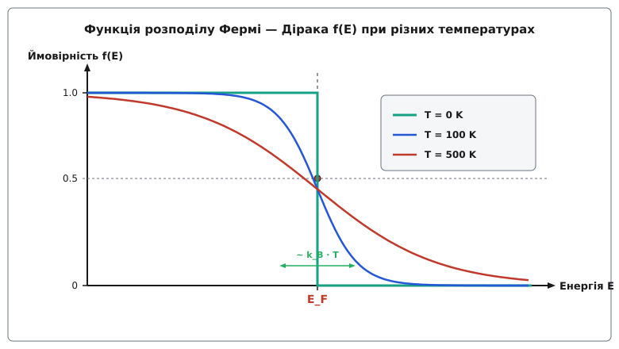
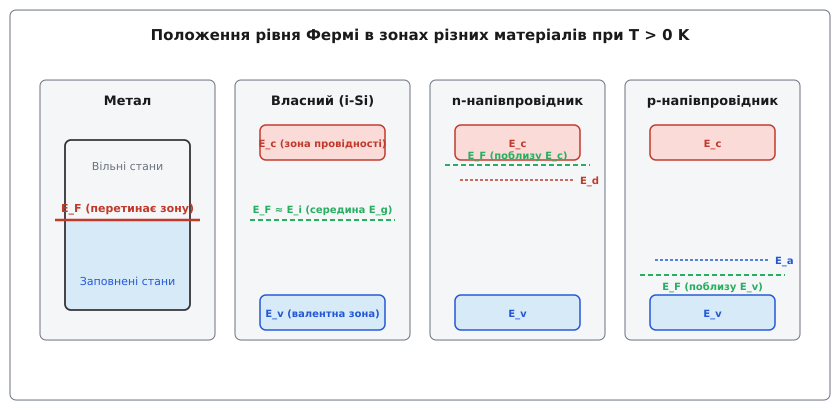
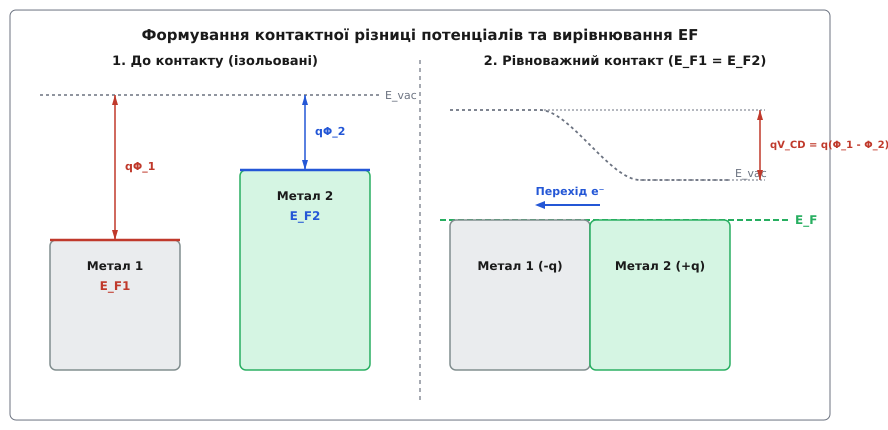

# Рівень Фермі

<preknowlist>
- [Електронні провідники та ізолятори](root:ph-condensed/conductors-insulators) — відмінність між вільними та зв'язаними носіями заряду у кристалічній ґратці.
- [Напівпровідники](root:ph-condensed/semiconductor) — енергетична зонна структура, зона провідності та валентна зона.
- [Допування напівпровідників](root:ph-condensed/doping) — утворення донорних та акцепторних енергетичних рівнів.
</preknowlist>

Коли два різні провідники чи напівпровідники приводять у атомарно чистий електричний контакт, електрони починають миттєво перетікати через межу розподілу, створюючи приповерхневі заряди та внутрішні електричні поля. Це перетікання зумовлене не просторовою концентрацією електронів, а різницею їхнього термодинамічного потенціалу. Електрони в твердому тілі є квантовими частинками — ферміонами з напівцілим спіном, що підкоряються принципу заборони Паулі. Вони заповнюють доступні енергетичні стани в суворому порядку, а середня енергія, що припадає на один доданий електрон у стані термодинамічної рівноваги, задається хімічним потенціалом. У фізиці конденсованого стану цей електрохімічний потенціал носіїв заряду називають **рівнем Фермі** (лат. *aequalis* — рівний / названо на честь італо-американського фізика Енріко Фермі).

У стані термодинамічної рівноваги рівень Фермі приймає єдине постійне значення вздовж усієї замкненої або контактуючої системи матеріалів. Спроба припустити наявність градієнта рівня Фермі у рівноважному стані означала б існування результуючого дифузійного або дрейфового струму без зовнішнього джерела енергії, що прямо суперечить другому початку термодинаміки. Саме вирівнювання рівнів Фермі визначає контактну різницю потенціалів, висоту бар'єрів Шотткі у контактах метал-напівпровідник, величину вбудованого поля в p-n перехід, роботу виходу електронів та напругу холостого ходу сонячних елементів.

---

## 1. Квантово-статистичні витоки: принцип Паулі та статистика Фермі — Дірака

У класичній фізиці частинки можуть володіти будь-якою енергією, а при охолодженні системи до абсолютного нуля їхній хаотичний рух повністю припиняється (`E = 0`). Однак для електронів у кристалічній ґратці ця картина ламається через квантовомеханічну нерозрізненість частинок та принцип заборони Паулі. Електрони володіють напівцілим спіном (`s = 1/2`) і належать до класу ферміонів.

Квантовомеханічний стан системи багатьох ферміонів описується повною хвильовою функцією `Ψ(r_1, s_1; r_2, s_2; ...; r_N, s_N)`, яка є антисиметричною відносно одночасної перестановки просторових координат `r_i` та спінових змінних `s_i` будь-якої пари частинок:

```
Ψ(..., r_i, s_i, ..., r_j, s_j, ...) = - Ψ(..., r_j, s_j, ..., r_i, s_i, ...)
```

Якщо представити хвильову функцію системи неінтенсивно взаємодіючих електронів у вигляді детермінанта Слейтера, складеного з одноелектронних хвильових функцій `ψ_k(r, s)`:

```
Ψ = (1 / √(N!)) · det [ ψ_k(r_j, s_j) ]
```

то при спробі посадити два електрони в один і той самий одноелектронний квантовий стан (`k_1 = k_2`) два рядки детермінанта виявляються ідентичними, і вся хвильова функція тотожно обнуляється (`Ψ ≡ 0`). Це означає, що ймовірність знайти два ферміони в однаковому квантовому стані строго дорівнює нулю.

З антисиметрії хвильової функції виникає фундаментальна обмінна квантова взаємодія, яка змушує електрони ефективно відштовхуватися у фазовому просторі координати та імпульсу, навіть якщо повністю знехтувати їхнім електростатичним кулонівським відштовхуванням. Ця обмінна взаємодія породжує квантовий тиск виродження, який утримує тверді тіла від колапсу при охолодженні та запобігає гравітаційному стисканню білих карликів в астрофізиці.

### Періодичний потенціал ґратки, теорема Блоха та виникнення енергетичних зон

Рух електрона у твердому тілі відбувається не у вільному просторі, а в строго періодичному електростатичному потенціалі кристалічної ґратки `V(r + R) = V(r)`, створеному позитивними іонними остовами. Згідно з фундаментальною теоремою Блоха, хвильова функція електрона в такому потенціалі має вигляд плоскої хвилі, модульованої періодичною функцією ґратки `u_{n, k}(r)`:

```
ψ_{n, k}(r) = u_{n, k}(r) · exp(i · k · r)
```

де `k` — квазіхвильовий вектор, що належить першій зоні Бріллюена, а `n` — дискретний номер енергетичної зони.

На межах зони Бріллюена (наприклад, при `k = ± π / a` для одновимірної ґратки з періодом `a`) довжина хвилі де Бройля електрона задовольняє умову бреггівського відбиття `2 · a · sin(θ) = n · λ`. Падаюча та відбита електронні хвилі інтерферують, утворюючи дві різні стаціонарні стоячі хвилі:
1. Симетричну хвилю `ψ_+ ∝ cos(π x / a)`, густина ймовірності якої `|ψ_+|²` концентрується безпосередньо на позитивних іонах ґратки, де потенційна енергія мінімальна. Енергія цього стану знижується.
2. Антисиметричну хвилю `ψ_- ∝ sin(π x / a)`, густина ймовірності якої `|ψ_-|²` зосереджена між іонами. Енергія цього стану підвищується.

Різниця потенційних енергій між цими двома стоячими хвилями відкриває енергетичний розрив — **заборонену зону (енергетичну щілину) `E_g`**, у якій розповсюдження електронних хвиль неможливе. У результаті енергетичний спектр електронів розпадається на дозволені смуги (енергетичні зони) та заборонені проміжки.

Кривина енергетичної зони `E(k)` визначає динамічні властивості електрона у кристалі через тензор **ефективної маси `m*`**:

```
m* = ℏ² / (d²E / dk²)
```

Поблизу дна дозволеної зони кривина є додатною (`d²E / dk² > 0`), і електрон реагує на зовнішнє електричне поле як вільна квазічастинка з додатною ефективною масою `m_e*`. Поблизу верхівки (стелі) зони кривина стає від'ємною (`d²E / dk² < 0`). Це означає, що при прискоренні електрона електричним полем бреггівське відбиття від кристалічної ґратки передає кристалу імпульс, більший за імпульс від зовнішнього поля, через що електрон уповільнюється. Для зручності квантовий стан майже заповненої зони описують через квазічастинки з додатним зарядом `+e` та додатною масою `m_h* = |m*|` — **дірки**, які являють собою порожні вакантні місця на вершині моря заповнених електронних станів.

### Статистичний вивід розподілу Фермі — Дірака

Розглянемо термодинамічну систему електронів у контакті з резервуаром енергії та частинок (великий канонічний ансамбль Гіббса). Нехай система розбита на сукупність незалежних одноелектронних квантових станів із дискретними або квазінеперервними енергіями `E_i`.

Оскільки в кожному окремому стані `i` через принцип заборони Паулі може перебувати лише `n_i = 0` або `n_i = 1` електронів, статистична сума великого канонічного ансамблю для одного виділеного квантового стану `Ξ_i` містить лише два доданки:

```
Ξ_i = ∑_{n_i = 0}^1 exp(- (n_i · (E_i - μ)) / (k_B · T))
    = 1 + exp(- (E_i - μ) / (k_B · T))
```

де `μ` — хімічний потенціал електронного газу, `k_B ≈ 8.617 × 10⁻⁵ еВ/К` — стала Больцмана, а `T` — абсолютна температура.

Середнє число заповнення даного квантового стану (середня кількість електронів у стані `i`) обчислюється через логарифмічну похідну великої статистичної суми:

```
⟨n_i⟩ = (k_B · T) · (∂ ln(Ξ_i) / ∂μ)                     [визначення середнього числа через логарифмічну похідну]
      = (exp(- (E_i - μ) / (k_B · T))) / (1 + exp(- (E_i - μ) / (k_B · T))) [підстановка великої статистичної суми Ξ_i]
      = 1 / (exp((E_i - μ) / (k_B · T)) + 1)            [ділення чисельника і знаменника на експоненту]
```

Цей вираз є **функцією розподілу Фермі — Дірака** `f(E)`:

```
f(E) = 1 / (exp((E - E_F) / (k_B · T)) + 1)
```

де параметр `E_F ≡ μ` позначає рівень Фермі системи.

З цієї математичної формули безпосередньо випливає фундаментальне фізичне означення: **рівень Фермі `E_F` — це та енергетична мітка, при якій ймовірність заповнення квантового стану дорівнює точно `0.5` (50%) при будь-якій температурі `T > 0 K`.**

```
При E = E_F:
f(E_F) = 1 / (exp(0) + 1) = 1 / (1 + 1) = 1/2
```


*Функція розподілу Фермі — Дірака f(E) при абсолютному нулю (ступенева функція) та при скінченній температурі, що ілюструє симетричне розмиття ймовірності навколо рівня Фермі.*

### Математичні властивості функції Фермі — Дірака

Функція Фермі — Дірака має кілька критично важливих аналітичних властивостей, що визначають фізику транспортних явищ:

1. **Симетрія теплового розмиття навколо `E_F`:**
   Ймовірність того, що стан із енергією вище рівня Фермі на `ΔE` зайнятий електроном, строго дорівнює ймовірності того, що стан нижче рівня Фермі на таку саму величину `ΔE` є вільним (зайнятий діркою `f_h(E) = 1 - f(E)`):

```
f(E_F + ΔE) + f(E_F - ΔE)
= 1 / (exp(ΔE / (k_B · T)) + 1) + 1 / (exp(-ΔE / (k_B · T)) + 1)        [підстановка значень E = E_F ± ΔE]
= 1 / (exp(ΔE / (k_B · T)) + 1) + exp(ΔE / (k_B · T)) / (1 + exp(ΔE / (k_B · T))) [множення другого дробу на exp(ΔE / k_B T)]
= (1 + exp(ΔE / (k_B · T))) / (1 + exp(ΔE / (k_B · T)))                 [зведення до спільного знаменника]
= 1                                                                     [скорочення чисельника та знаменника]
```

2. **Похідна функції Фермі та термодинамічне вікно:**
   Швидкість зміни функції розподілу за енергією є симетричним дзвіноподібним піком, зосередженим навколо `E_F`:

```
- (df / dE) = (1 / (k_B · T)) · (exp((E - E_F) / (k_B · T))) / (exp((E - E_F) / (k_B · T)) + 1)²
            = (1 / (4 · k_B · T)) · sech²((E - E_F) / (2 · k_B · T))
```

Інтеграл від цієї похідної по всій енергетичній осі строго дорівнює одиниці:

```
∫_{-∞}^{+∞} (- df / dE) dE = f(-∞) - f(+∞) = 1 - 0 = 1
```

Повна ширина цього піка на половині висоти (FWHM) становить приблизно `3.52 · k_B · T` (близько `0.091 еВ` при `T = 300 K`). Саме ця вузька енергетична смуга — "вікно Фермі" — бере участь у процесах перенесення електричного заряду, теплопровідності та термо-ЕРС у металах та вироджених напівпровідниках. Електрони, розташовані глибше (`E_F - E >> k_B · T`), повністю заблоковані принципом Паулі і не мають доступних вільних станів для розсіювання.

3. **Асимптотичні межі:**
   * При `(E - E_F) >> k_B · T` (наприклад, зона провідності невиродженого напівпровідника) одиницею у знаменнику можна знехтувати, і розподіл Фермі переходить у класичну статистику Максвелла — Больцмана:

```
f(E) ≈ exp(- (E - E_F) / (k_B · T))
```

   * При `(E_F - E) >> k_B · T` (глибина валентної зони або глибина моря Фермі) ймовірність відсутності електрона (діркова функція) також стає больцманівською:

```
1 - f(E) ≈ exp(- (E_F - E) / (k_B · T))
```

### Густина квантових станів у просторах різної розмірності

Концентрація носіїв заряду та положення рівня Фермі визначаються інтегралом добутку функції Фермі `f(E)` на густину доступних квантових станів `g(E)`. Форма функції `g(E)` радикально залежить від квантової розмірності системи.

У загальному випадку для системи об'ємом (або площею, або довжиною) `L^d` з періодичними граничними умовами Борна — фон Кармана елементарний квантовий об'єм одного стану в `k`-просторі становить `(2π / L)^d`. Враховуючи виродження за спіном (`g_s = 2`), кількість квантових станів на одиницю геометричного розміру в інтервалі волнового вектора від `k` до `k + dk` визначається геометрією ізоенергетичної поверхні.

При квадратичному ізотропному законі дисперсії `E = (ℏ² · k²) / (2 · m*)` для носіїв із ефективною масою `m*`:

1. **Тривимірний кристал (3D, об'ємний матеріал):**
   Елемент об'єму в сферичних координатах `k`-простору дорівнює `4 · π · k² dk`. Підставляючи `k = √((2 m* E) / ℏ²)` та `dk = (1/2) · √((2 m*) / ℏ²) · E⁻¹ᐟ² dE`:

```
g_3D(E) = (1 / V) · (dN_3D / dE)                                       [визначення густини станів на одиницю об'єму]
        = 2 · (4 · π · k² dk) / ((2 · π)³ · dE)                        [об'єм сферичного шару в k-просторі зі спіном]
        = (1 / (2 · π²)) · ((2 · m*) / ℏ²)³ᐟ² · √E                     [підстановка k = √((2 m* E)/ℏ²) та dk/dE]
```

Густина станів монотонно зростає від дна зони пропорційно квадратному кореню з енергії `√E`.

2. **Двовимірна квантова яма (2D, двовимірний електронний газ — 2DEG):**
   У наноплівках та гетеропереходах рух вздовж осі `z` квантований (`E_z = E_n`), а в площині `xy` рух вільний. Елемент площі в двовимірному `k`-просторі дорівнює `2 · π · k_|| dk_||`. Диференціюючи `E = (ℏ² · k_||²) / (2 · m*)`:

```
g_2D(E) = (1 / A) · (dN_2D / dE)                                       [визначення густини станів на одиницю площі]
        = 2 · (2 · π · k_|| dk_||) / ((2 · π)² · dE)                   [площа кільця в 2D k-просторі зі спіновим виродженням]
        = (m* / (π · ℏ²)) · ∑_n θ(E - E_n)                             [підстановка закону дисперсії E = ℏ² k_||² / (2 m*)]
```

де `θ(x)` — ступенева функція Хевісайда. Густина станів є константою в межах кожної підзони розмірного квантування і має сходинковий профіль. Для одного рівня квантування `g_2D` взагалі не залежить від енергії.

3. **Одновимірний квантовий дріт (1D, nanowire / nanotube):**
   Електрони вільно рухаються лише вздовж осі `x`, а рух за осями `y` та `z` квантований:

```
g_1D(E) = (1 / L) · (dN_1D / dE)                                       [визначення густини станів на одиницю довжини]
        = 2 · (2 dk_x) / (2 · π · dE)                                  [елемент одновимірного k-простору зі спіном]
        = (1 / (π · ℏ)) · √(2 · m*) · ∑_{n, m} (E - E_{n, m})⁻¹ᐟ² · θ(E - E_{n, m}) [диференціювання k_x = √((2 m*(E-E_nm))/ℏ²)]
```

На кожному порозі нової підзони квантування виникає коренева розбіжність — **сингулярність ван Хова** (`g_1D ∝ 1 / √(E - E_{n, m})`).

4. **Нульвимірна квантова точка (0D, quantum dot / штучний атом):**
   Рух обмежений у всіх трьох напрямках, енергетичний спектр стає чисто дискретним:

```
g_0D(E) = 2 · ∑_i δ(E - E_i)
```

де `δ(x)` — дельта-функція Дірака. Рівень Фермі в квантовій точці регулюється дискретним заповненням рівнів і зазнає стрибкоподібних змін при додаванні кожного окремого електрона (кулонівська блокада).

### Сфера Фермі та характеристики електронного газу Соммерфельда при T = 0 K

При абсолютному нулі температур (`T = 0 K`) електрони заповнюють усі доступні квантові стани в `k`-просторі від дна зони до граничного волнового вектора Фермі `k_F`. У тривимірному ізотропному кристалі сукупність цих заповнених станів утворює ідеальну **сферу Фермі** об'ємом `V_F = (4/3) · π · k_F³`.

Інтегруючи кількість станів всередині сфери з урахуванням спінового виродження:

```
N = 2 · (V · (4/3) · π · k_F³) / (2 · π)³ = (V / (3 · π²)) · k_F³
```

Звідси об'ємна концентрація електронів `n = N / V` однозначно визначає радіус сфери Фермі:

```
k_F = (3 · π² · n)¹ᐟ³
```

Знаючи `k_F`, визначають повний набір фундаментальних квантових характеристик електронного газу при `T = 0 K`:

* **Імпульс Фермі:** `p_F = ℏ · k_F = ℏ · (3 · π² · n)¹ᐟ³`
* **Швидкість Фермі:** `v_F = p_F / m* = (ℏ / m*) · (3 · π² · n)¹ᐟ³`
* **Енергія Фермі (хімічний потенціал при T = 0 K):**

```
E_F0 = (ℏ² · k_F²) / (2 · m*) = (ℏ² / (2 · m*)) · (3 · π² · n)²ᐟ³
```

* **Температура Фермі:** `T_F = E_F0 / k_B` — еквівалентна температура, при якій класична теплова енергія зрівнялася б із квантовою енергією Фермі.
* **Довжина хвилі де Бройля на рівні Фермі:** `λ_F = 2 · π / k_F = (8 · π / (3 · n))¹ᐟ³`

### Повна внутрішня енергія, тиск виродження та модуль стиску

Повна кінетична енергія `U_0` системи `N` електронів при `T = 0 K` обчислюється інтегруванням за всіма енергетичними станами від `0` до `E_F0`:

```
U_0 = V · ∫₀^{E_F0} E · g_3D(E) dE                                     [інтегрування енергії станів від 0 до E_F0]
    = V · (1 / (2 · π²)) · ((2 · m*) / ℏ²)³ᐟ² · ∫₀^{E_F0} E³ᐟ² dE      [підстановка густини станів g_3D(E)]
    = V · (1 / (2 · π²)) · ((2 · m*) / ℏ²)³ᐟ² · (2 / 5) · E_F0⁵ᐟ²       [обчислення інтеграла від E³ᐟ²]
    = (3 / 5) · N · E_F0                                               [вираження через повне число частинок N]
```

Середня кінетична енергія на один електрон становить рівно три п'ятих від максимальної енергії Фермі:

```
⟨E⟩ = U_0 / N = (3 / 5) · E_F0
```

Навіть при `T = 0 K`, коли будь-який тепловий рух відсутній, рух електронів, обумовлений принципом заборони Паулі, створює колосальний макроскопічний **квантовий тиск виродження `P_0`**:

```
P_0 = - (∂U_0 / ∂V)_N                                                  [термодинамічне визначення тиску при сталому N]
    = - (3/5) · N · (∂E_F0 / ∂V)_N                                     [підстановка U_0 = (3/5) N E_F0]
    = (2 / 5) · n · E_F0                                               [диференціювання E_F0 ∝ V^(-2/3)]
    = (2 / 3) · (U_0 / V)                                              [вираження через густину внутрішньої енергії]
```

Цей тиск визначає опір кристала стисканню. Модуль всебічного стиску електронного газу (bulk modulus) `B_el`:

```
B_el = - V · (∂P_0 / ∂V)_N = (5 / 3) · P_0 = (2 / 3) · n · E_F0
```

Для більшості металів розрахунковий електронний модуль стиску `B_el` становить від `10` до `100 ГПа`, що дає значну частку повної пружності металічного кристала (решту забезпечує електростатичне кулонівське відштовхування іонних остовів).

### Порівняльні квантові параметри реальних металів

У таблиці наведено експериментальні та розрахункові параметри електронного газу Соммерфельда для типових металів (де `r_s / a_0` — безрозмірний радіус сфери Вігнера — Зейтца, що припадає на один електрон, виражений в одиницях борівського радіуса `a_0 ≈ 0.0529 нм`):

| Метал | Валентність | Концентрація `n` (10²² см⁻³) | `r_s / a_0` | Енергія Фермі `E_F0` (еВ) | Швидкість Фермі `v_F` (10⁶ м/с) | Температура Фермі `T_F` (10⁴ K) |
|---|---|---|---|---|---|---|
| **Калій (K)** | 1 | 1.40 | 4.86 | 2.12 | 0.86 | 2.46 |
| **Натрій (Na)** | 1 | 2.65 | 3.93 | 3.24 | 1.07 | 3.77 |
| **Літій (Li)** | 1 | 4.70 | 3.25 | 4.74 | 1.29 | 5.51 |
| **Срібло (Ag)** | 1 | 5.86 | 3.02 | 5.49 | 1.39 | 6.38 |
| **Золото (Au)** | 1 | 5.90 | 3.01 | 5.53 | 1.40 | 6.42 |
| **Мідь (Cu)** | 1 | 8.47 | 2.67 | 7.00 | 1.57 | 8.16 |
| **Алюміній (Al)** | 3 | 18.10 | 2.07 | 11.70 | 2.03 | 13.60 |

Значення температури Фермі `T_F ~ 20 000–140 000 K` показують, що при будь-яких температурах існування твердого металу (включаючи точку плавлення) електронний газ перебуває в стані глибокого квантового виродження (`T << T_F`).

### Топологія реальних поверхонь Фермі та квазічастинки Ландау

У реальних кристалах періодичний потенціал ґратки деформує поверхню Фермі, відхиляючи її від ідеальної сферичної форми:

* **Шийки на поверхні Фермі благородних металів (Cu, Ag, Au):** У міді та сріблі поверхня Фермі є майже сферичною в центрі зони Бріллюена, але в напрямках граней `<111>` першої зони Бріллюена вона витягується і утворює вісім контактних перемичок ("шийок"). У результаті поверхня Фермі стає відкритою багатозв'язною поверхнею, що пронизує всю обернену ґратку.
* **Закриті та відкриті траєкторії в магнітному полі:** Якщо переріз поверхні Фермі площиною, перпендикулярною до магнітного поля `B`, утворює замкнену криву, електрон рухається по замкненій орбіті з циклотронною частотою `ω_c`, а його поперечний магнітоопір насичується при сильних полях. Якщо ж переріз проходить крізь відкриті шийки поверхні Фермі, електрон рухається по нескінченній відкритій орбіті у реальному просторі. При цьому поперечний магнітоопір матеріалу демонструє необмежене квадратичне зростання `ρ_xx ∝ B²` при довільно сильних полях (як це спостерігається в монокристалах міді).
* **Електронні топологічні переходи Ліфшиця:** При зміні зовнішнього тиску, одновісного стиснення або введенні ізоелектронних домішок об'єм та геометрія поверхні Фермі неперервно змінюються. Якщо поверхня Фермі торкається межі зони Бріллюена з утворенням нової перемички або в окремій точці зароджується нова порожнина, топологічна зв'язність поверхні змінюється стрибком. Цей стрибок супроводжується кореневою особливістю у густині станів `g(E_F)`, що призводить до аномалій у термоелектрорушійній силі, пружних константах та температурі надпровідного переходу (фазовий перехід 2.5 роду за Ліфшицем).
* **Теорія фермі-рідини Ландау:** Чому електрони в металі, які сильно взаємодіють між собою через далекодіюче кулонівське поле, з такою вражаючою точністю описуються моделлю майже вільних частинок Зоммерфельда? Лев Ландау показав, що при поступовому адіабатичному включенні міжелектронної взаємодії одночастинкові квантові стани ідеального газу взаємно однозначно переходять у стани **квазічастинок**. Квазічастинка являє собою електрон, одягнений у "хмару" поляризації та деформації навколишнього електронного середовища. Її ефективна маса `m*` перенормується міжелектронною взаємодією, проте квантові числа (спін `1/2`, заряд `-e`, імпульс Фермі `p_F`) та форма поверхні Фермі зберігаються строго незмінними (теорема Латтінджера).
* **Час життя квазічастинки:** Завдяки принципу заборони Паулі для розсіювання двох квазічастинок з енергіями поблизу `E_F` доступний лише надзвичайно вузький шар станів у фазовому просторі. Швидкість затухання квазічастинки падає як квадрат її відхилення від рівня Фермі:

```
1 / τ_{ee} ∝ (E - E_F)² + (π · k_B · T)²
```

Тому на самій поверхні Фермі (`E = E_F`, `T = 0 K`) час життя квазічастинки прямує до нескінченності (`τ → ∞`). Квазічастинки на рівні Фермі є строго визначеними, стабільними квантовими станами, що обґрунтовує застосування одноелектронної зонної теорії до сильнокорельованих металів.

* **Ефект Кондо та важкоферміонні системи:** При наявності локалізованих магнітних домішок (іони рідкісноземельних елементів Ce, Yb, U) обмінна взаємодія `J` між спіном домішки та електронами провідності призводить до екранування магнітного моменту при температурах нижче температури Кондо `T_K`. Це породжує гігантський вузький багаточастинковий резонанс Абрикосова — Сула в густині станів безпосередньо на рівні Фермі. У періодичних ґратках Кондо (важкі ферміони `CeCu_6`, `UPt_3`) квазічастинки на рівні Фермі набувають гігантської ефективної маси `m* ~ 100–1000 · m_0`, що проявляється у колосальній електронній теплоємності та незвичайній не-БКШ надпровідності.

Детальний перебіг наукових дискусій 1920-х років між Фермі, Діраком та Зоммерфельдом, який привів до розв'язання парадоксу електронної теплоємності металів, описано у вставці [📜 Історія статистики Фермі — Дірака та квантової теорії металів](root:ph-condensed/fermi-level/hist-fermi-dirac.md).

---

## 2. Рівень Фермі як хімічний та електрохімічний потенціал електронів

З точки зору класичної та квантової термодинаміки, рівень Фермі є не просто позначкою на енергетичній діаграмі, а фундаментальною функцією стану — **хімічним потенціалом `μ` електронного газу**.

За визначенням Гіббса, хімічний потенціал `μ` дорівнює зміні вільної енергії Гельмгольца `F = U - T·S` (або енергії Гіббса `G = U + P·V - T·S`) системи при додаванні одного електрона за умови постійної температури та об'єму (або тиску):

```
μ = (∂F / ∂N)_{T, V} = (∂G / ∂N)_{T, P} = - T · (∂S / ∂N)_{U, V}
```

Хімічний потенціал характеризує термодинамічну роботу, яку необхідно виконати над навколишнім середовищем, щоб квазістатично ввести одну додаткову частинку в систему за фіксованої ентропії та об'єму.

### Електрохімічний потенціал та умова рівноваги

У твердому тілі на рух електронів впливає як квантовий тиск і зонна структура кристала, так і макроскопічні електростатичні поля, створювані просторовими зарядами іонів, домішок та сусідніх електронів. Тому повна енергія введення електрона розділяється на дві частини:

1. **Внутрішній хімічний потенціал `μ_int`** — зумовлений кінетичною енергією електронів, квантовою густиною станів, обмінною та кореляційною взаємодією в кристалічній ґратці.
2. **Електростатична потенціальна енергія `- e · ϕ`** — робота перенесення заряду `-e` у точку з локальним електростатичним макропотенціалом `ϕ(r)`.

Сума цих двох величин утворює **електрохімічний потенціал `μ̄`**:

```
E_F ≡ μ̄ = μ_int - e · ϕ
```

Саме електрохімічний потенціал `μ̄` виступає дійсним рівнем Фермі у неоднорідних системах, контактах, напівпровідникових структурах та під дією зовнішніх полів.

У стані повної термодинамічної рівноваги потоки частинок між будь-якими просторово розділеними частинами системи повинні компенсувати один одного. З другого початку термодинаміки випливає, що умова відсутності ентропійного виробництва вимагає строгої рівності електрохімічного потенціалу в усіх точках простору:

```
∇E_F = ∇μ̄ = 0   ⇒   E_F = const уздовж всієї системи
```

Якщо у системі виникає просторовий градієнт електрохімічного потенціалу `∇E_F ≠ 0`, це створює рушійну термодинамічну силу, яка викликає результуючий електричний струм. Повна густина струму `j` містить як дрейфову складову (під дією електричного поля `E_field = -∇ϕ`), так і дифузійну складову (під дією градієнта концентрації або хімічного потенціалу `∇μ_int`):

```
j = j_drift + j_diff                                                   [сума дрейфової та дифузійної складових]
  = σ · E_field + e · D · ∇n                                           [закон Ома та закон дифузії Фіка]
  = (σ / e) · ∇μ̄                                                       [співвідношення Ейнштейна D = (k_B T / e) μ_mob]
  = (σ / e) · ∇E_F                                                     [визначення E_F = μ̄]
```

де `σ = e · n · μ_mob` — питома електропровідність, `μ_mob` — рухливість електронів, а `D = (k_B · T / e) · μ_mob` — коефіцієнт дифузії (співвідношення Ейнштейна).

Якщо `∇E_F = 0`, дрейфовий і дифузійний струми врівноважують один одного в кожній точці матеріалу (`j_drift = - j_diff`), струм через будь-який переріз відсутній, і система перебуває в стані спокою.

### Вольта-потенціал, Гальвані-потенціал та робота виходу

Для повного розуміння електростатичних властивостей поверхонь та контактів твердих тіл розрізняють три взаємопов'язані фізичні потенціали:

* **Внутрішній потенціал Гальвані `ϕ_in`** — повний електростатичний макропотенціал всередині об'єму матеріалу.
* **Зовнішній потенціал Вольта `ϕ_out`** — електростатичний потенціал у вакуумі на відстані близько `10⁻⁵–10⁻⁴ см` від поверхні (поза зоною дії сил дзеркального зображення та поверхневих квантових сил, але достатньо близько, щоб відчувати макроскопічну форму зразка).
* **Поверхневий стрибок потенціалу `χ_surf = ϕ_in - ϕ_out`** — стрибок потенціалу на кордоні поділу, спричинений квантовим виходом електронної густини за межі площини атомних ядер ґратки. Це витікання формує подвійний електричний шар (поверхневий диполь) із негативним зарядом назовні та позитивним всередині.

**Робота виходу електрона `q · Φ`** визначається як мінімальна енергія, яку необхідно надати електрону, що перебуває на рівні Фермі `E_F`, для його виведення з глибини матеріалу через поверхню у точку зовнішнього Вольта-потенціалу `E_vac = - e · ϕ_out`:

```
q · Φ = E_vac - E_F = - e · ϕ_out - (μ_int - e · ϕ_in) = - μ_int + e · χ_surf
```

З цієї формули видно, що робота виходу складається з двох компонентів: об'ємного хімічного вкладу `-μ_int` (положення рівня Фермі відносно внутрішнього дна потенціальної ями кристала) та суто поверхневого дипольного вкладу `e · χ_surf`. Останній сильно залежить від кристалографічної орієнтації грані (наприклад, для вольфраму `Φ(110) = 5.25 еВ`, тоді як `Φ(111) = 4.47 еВ`) та наявності субмоношарових адсорбатів (нанесення цезію знижує роботу виходу до `~ 1.8 еВ`).

### Термоелектричні явища та градієнт рівня Фермі

Якщо вздовж провідника підтримується градієнт температури `∇T ≠ 0`, система виходить із стану повної рівноваги. Електрони на гарячому кінці зразка мають ширше теплове розмиття функції Фермі і дифундують у бік холодного кінця швидше, ніж зустрічний потік холодних електронів.

Цей процес викликає просторовий перерозподіл заряду та формування термо-ЕРС — **ефект Зеєбека**. У розімкненому колі виникає градієнт електростатичного потенціалу `∇ϕ`, який зупиняє подальший струм:

```
j = (σ / e) · ∇E_F - σ · S · ∇T = 0
```

де `S` — **коефіцієнт Зеєбека (диференціальна термо-ЕРС)**. При відсутності струму градієнт рівня Фермі прямо зв'язаний із градієнтом температури:

```
∇E_F = e · S · ∇T
```

Для металів та вироджених систем коефіцієнт Зеєбека описується **формулою Мотта**:

```
S = - (π² · k_B² · T) / (3 · e) · [ d ln(σ(E)) / dE ]_{E = E_F}
```

де провідність як функція енергії `σ(E) ∝ g(E) · v²(E) · τ(E)`. Якщо густина станів чи час релаксації `τ(E)` швидко зростає з енергією на рівні Фермі, гарячі електрони мають вищу рухливість, що призводить до негативного знака `S`. Якщо ж розсіювання на рівні Фермі переважає для електронів високих енергій, коефіцієнт Зеєбека може змінювати знак на позитивний (діркова термо-ЕРС у благородних металах Cu, Ag, Au).

З ефектом Зеєбека фундаментально пов'язані ще два термоелектричні явища:
* **Ефект Пельтьє:** При протіканні електричного струму `I` через контакт двох різних провідників на межі виділяється або поглинається теплота Пельтьє `Q_P = Π_{12} · I`, де коефіцієнт Пельтьє `Π_{12} = (S_1 - S_2) · T` (друге співвідношення Кельвіна). Фізична причина полягає в тому, що середній перенос енергії, що припадає на один електрон струму вище рівня Фермі `(⟨E⟩ - E_F)`, різний у двох матеріалах.
* **Ефект Томсона:** При протіканні струму вздовж провідника за наявності температурного градієнта виділяється додаткова теплота Томсона `q_T = - τ_T · j · ∇T`, де коефіцієнт Томсона `τ_T = T · (dS / dT)`.

### Температурна залежність хімічного потенціалу μ(T)

Часто виникає запитання: наскільки сильно положення хімічного потенціалу `μ(T)` відхиляється від енергії Фермі `E_F0` при підвищенні температури?

У тривимірному електронному газі густина станів зростає з енергією як `g(E) ∝ √E`. При `T > 0 K` теплове розмиття функції Фермі закидає частину електронів з області `E < μ` в область `E > μ`. Але оскільки вище `μ` густина станів більша, ніж нижче `μ`, кількість доступних станів для теплового збудження вгорі перевищує кількість звільнених станів внизу. Щоб сумарна кількість електронів `N = ∫₀^∞ g(E) · f(E) dE` залишалася строго постійною, хімічний потенціал `μ(T)` змушений зміщуватися вниз у бік меншої густини станів.

Використовуючи асимптотичний розклад Зоммерфельда для інтегралів із функцією Фермі — Дірака:

```
∫₀^∞ H(E) · f(E) dE = ∫₀^μ H(E) dE + (π² / 6) · (k_B · T)² · H'(μ) + O((k_B · T)⁴)
```

покладаючи `H(E) = g(E) = C · √E` та прирівнюючи `n(T) = n(0)`:

```
∫₀^μ C · √E dE + (π² / 6) · (k_B · T)² · C · (1 / (2 · √μ)) = ∫₀^{E_F0} C · √E dE
(2/3) · μ³ᐟ² + (π² / 12) · (k_B · T)² · μ⁻¹ᐟ² = (2/3) · E_F0³ᐟ²
```

Розкладаючи `μ = E_F0 · (1 + δ)` за малим параметром `(k_B · T / E_F0)²`:

```
μ(T) = E_F0 · [ 1 - (π² / 12) · (k_B · T / E_F0)² ]
```

Для міді (`E_F0 = 7.0 еВ`) при кімнатній температурі (`T = 300 K`, `k_B · T ≈ 0.0259 еВ`):

```
(k_B · T / E_F0)² = (0.0259 / 7.0)² ≈ 1.37 × 10⁻⁵
Δμ = - (π² / 12) · 1.37 × 10⁻⁵ · 7.0 еВ ≈ - 7.9 × 10⁻⁵ еВ = - 0.079 меВ
```

Відносне зміщення становить близько `0.001%`. Тому в металах різницею між хімічним потенціалом `μ(T)` та енергією Фермі `E_F0` можна впевнено нехтувати при всіх практичних температурах.

Повний математичний вивід розкладу Зоммерфельда, розрахунок інтегралів Фермі — Дірака та невиродженого больцманівського межі наведено у вставці [🧮 Математичний апарат: розклад Зоммерфельда та температурний зсув хімічного потенціалу](root:ph-condensed/fermi-level/math-fermi-integrals.md).

---

## 3. Положення рівня Фермі у зоновій структурі матеріалів

Фундаментальна відмінність між провідниками, напівпровідниками та діелектриками визначається взаємним розташуванням рівня Фермі та дозволених зон енергетичного спектра.


*Положення рівня Фермі у металі (перетинає дозволену зону), власному напівпровіднику (середина забороненої зони) та при легуванні n-та p-типу.*

### 1. Метали, напівметали та матеріали з діраківськими конусами

У металах рівень Фермі проходить **всередині дозволеної енергетичної зони** (або у зоні перекриття валентної зони та зони провідності).

Оскільки `E_F` лежить безпосередньо серед високої густини квантових станів `g(E_F) > 0`, для переведення електрона у суміжний вільний стан потрібна нескінченно мала енергія `δE → 0`. При прикладанні навіть найменшої зовнішньої напруги електрони поблизу рівня Фермі прискорюються і створюють високий електричний струм.

У лужних металах (Na, K, Rb) рівень Фермі заповнює звичайну s-зону рівно наполовину, а поверхня Фермі являє собою сферичну форму. У двовалентних лужноземельних металах (Be, Mg, Ca) s-зона повністю заповнена, проте завдяки перекриттю s-зони з вищою p-зоною в `k`-просторі електрони перетікають у p-зону, утворюючи частково заповнені зони провідності та зберігаючи металічний характер провідності.

У перехідних металах (Fe, Ni, Pt) рівень Фермі перетинає вузьку d-зону з високою густиною станів `g(E_F)`, що обумовлює їхній високий парамагнетизм Паулі, сильну електронну теплоємність та феромагнетизм за критерієм Стонера `I · g(E_F) > 1`.

* **Напівметали (Bi, Sb, As, графіт):** Зона провідності та валентна зона мають невелике енергетичне перекриття (від кількох міліелектронвольт до `0.04 еВ` у вісмуті). Рівень Фермі перетинає дно зони провідності в одних точках зони Бріллюена та верхівку валентної зони в інших. У результаті матеріал містить однакову і дуже малу концентрацію електронів та дірок (`n = p ~ 10¹⁷–10¹⁸ см⁻³`), володіючи високою рухливістю носіїв та гігантським магнітоопором.
* **Графен та топологічні ізолятори (Діраківські напівметали):** У моношарі графену зона провідності та валентна зона торкаються одна одної в кутах гексагональної зони Бріллюена (точках Дірака `K` та `K'`). Закон дисперсії поблизу точок Дірака строго лінійний:

```
E(k) = ± ℏ · v_F · |k|
```

де швидкість Фермі `v_F ≈ 10⁶ м/с`. Густина станів залежить від енергії лінійно: `g(E) = (2 / (π · ℏ² · v_F²)) · |E|`. У чистому нелегованому графені при `T = 0 K` рівень Фермі проходить точно через точку Дірака (`E_F = 0`), де густина станів дорівнює нулю (`g(E_F) = 0`). Прикладанням напруги до затвора (електростатичне гейтування) можна неперервно зміщувати рівень Фермі як вгору в зону провідності (n-тип), так і вниз у валентну зону (p-тип), контролюючи концентрацію поверхневих носіїв:

```
E_F = ± ℏ · v_F · √(π · |n_s|)
```

* **Спін-орбітальне розщеплення Рашби:** У двовимірних системах та на поверхнях із порушеною дзеркальною інверсійною симетрією релятивістська спін-орбітальна взаємодія Рашби `H_R = α_R · (σ × k) · ẑ` розщеплює параболічну зону на дві зміщені в `k`-просторі гілки. У результаті ізоенергетичний переріз на рівні Фермі утворює два концентричні кола Фермі з протилежною хіральністю спіну (спінова текстура). При протіканні зарядового струму зміщення кіл Фермі викликає неравноважну спінову поляризацію (ефект Едельштейна).

### 2. Власні (чисті) напівпровідники

У чистому напівпровіднику без домішок при `T = 0 K` валентна зона повністю заповнена електронами, а зона провідності є абсолютно порожньою. Заборонена зона `E_g` не містить дозволених квантових станів (`g(E) = 0`).

З підвищенням температури електрони за рахунок теплових флуктуацій перестрибують через заборонену зону з валентної зони у зону провідності, утворюючи однакову кількість вільних електронів `n` та вільних дірок `p` (`n = p = n_i`).

Концентрація електронів `n` у зоні провідності та дірок `p` у валентній зоні в невиродженому наближенні описуються інтегралами Больцмана:

```
n = N_c · exp(- (E_c - E_F) / (k_B · T))
p = N_v · exp(- (E_F - E_v) / (k_B · T))
```

де `N_c` та `N_v` — ефективні густини станів у зоні провідності та валентній зоні:

```
N_c(T) = 2 · ((2 · π · m_e* · k_B · T) / h²)³ᐟ²
N_v(T) = 2 · ((2 · π · m_h* · k_B · T) / h²)³ᐟ²
```

Прирівнюючи `n = p = n_i` для власного напівпровідника:

```
N_c · exp(- (E_c - E_i) / (k_B · T)) = N_v · exp(- (E_i - E_v) / (k_B · T))
exp(2 · E_i / (k_B · T)) = (N_v / N_c) · exp((E_c + E_v) / (k_B · T))
```

Логарифмуючи обидві частини рівності, знаходимо точне аналітичне положення **власного рівня Фермі `E_i`**:

```
E_i = (E_c + E_v) / 2 + (1/2) · k_B · T · ln(N_v / N_c)
    = (E_c + E_v) / 2 + (3/4) · k_B · T · ln(m_h* / m_e*)
```

де `(E_c + E_v) / 2` — геометрична середина забороненої зони (`E_midgap`). Якщо ефективні маси електрона та дірки строго рівні (`m_e* = m_h*`), рівень Фермі перебуває точно посередині забороненої зони при будь-якій температурі.

Якщо ж маса дірки більша за масу електрона (`m_h* > m_e*`, як у більшості реальних напівпровідників), ефективна густина станів у валентній зоні перевищує густину в зоні провідності (`N_v > N_c`). Щоб зрівняти інтегральні кількості електронів та дірок, рівень Фермі при нагріванні зміщується вгору до зони провідності.

Для кремнію (Si) при `300 K`:
* `m_e* ≈ 1.08 · m_0`, `m_h* ≈ 0.81 · m_0` (з урахуванням багатодолинної структури зон)
* `N_c ≈ 2.86 × 10¹⁹ см⁻³`, `N_v ≈ 3.10 × 10¹⁹ см⁻³`
* `E_i - E_midgap = (1/2) · (0.0259 еВ) · ln(3.10 / 2.86) ≈ + 0.0010 еВ` (зсув на 1.0 меВ вгору).

Для арсеніду галію (GaAs) при `300 K`:
* `m_e* ≈ 0.067 · m_0`, `m_h* ≈ 0.47 · m_0`
* `N_c ≈ 4.7 × 10¹⁷ см⁻³`, `N_v ≈ 7.0 × 10¹⁸ см⁻³`
* `E_i - E_midgap = (1/2) · (0.0259 еВ) · ln(7.0 × 10¹⁸ / 4.7 × 10¹⁷) ≈ + 0.035 еВ` (зсув на 35 меВ вгору від середини).

Ширина забороненої зони напівпровідника `E_g(T)` зменшується при нагріванні за емпіричним законом Варшні:

```
E_g(T) = E_g(0) - (α · T²) / (T + β)
```

Для кремнію `E_g(0) = 1.170 еВ`, `α = 4.73 × 10⁻⁴ еВ/К`, `β = 636 K`, тому при `300 K` величина `E_g ≈ 1.12 еВ`. Власний рівень Фермі `E_i(T)` слідує за звуженням забороненої зони, залишаючись біля її рухомого центру.

### 3. Леговані напівпровідники (n- та p-типи)

Введення домішкових атомів кардинально змінює баланс зарядів і положення рівня Фермі:

* **Воднеподібна модель мілких домішок:**
  Донорний атом V групи (фосфор P, миш'як As) у кристалічній ґратці кремнію IV групи заміщує вузол ґратки. Чотири валентні електрони утворюють ковалентні зв'язки з сусідами, а п'ятий електрон рухається в кулонівському полі позитивного іонного остова `+e`, екранованому діелектричною проникністю кристала `ε_r ≈ 11.7`. Енергія зв'язку домішкового електрона оцінюється за модифікованою формулою Бора:

```
E_d,bind = 13.6 еВ · (m_e* / m_0) / ε_r²
```

Для кремнію це дає `E_c - E_d ≈ 0.045 еВ` (мілкий рівень). Домішковий електрон легко іонізується тепловим рухом за кімнатної температури.

Положення рівня Фермі в легованому напівпровіднику проходить три температурні режими:

1. **Режим виморожування носіїв (freeze-out, T < 100 K):**
   Теплової енергії недостатньо для повної іонізації донорів. Рівняння нейтральності для n-напівпровідника без компенсації має вигляд `n ≈ N_d^+`. Враховуючи фактор виродження донорного рівня `g_d = 2`:

```
N_c · exp(- (E_c - E_F) / (k_B · T)) ≈ N_d / (1 + 2 · exp((E_F - E_d) / (k_B · T)))
```

При низьких температурах експонента в знаменнику велика, що дає:

```
E_F(T) ≈ (E_c + E_d) / 2 + (1/2) · k_B · T · ln(N_d / (2 · N_c))
```

При `T → 0 K` рівень Фермі розташовується **строго посередині між донорним рівнем `E_d` та дном зони провідності `E_c`**. Концентрація електронів експоненціально падає: `n(T) ∝ exp(- (E_c - E_d) / (2 · k_B · T))`.

2. **Режим виснаження домішок (насичення, 100 K < T < 500 K):**
   Усі донори повністю іонізовані (`N_d^+ ≈ N_d`), а власна концентрація `n_i` мізерно мала (`n ≈ N_d`). Положення рівня Фермі однозначно задається виразом:

```
E_c - E_F = k_B · T · ln(N_c(T) / N_d)
```

Для p-типу з концентрацією акцепторів `N_a`:

```
E_F - E_v = k_B · T · ln(N_v(T) / N_a)
```

Оскільки `N_c(T) ∝ T³ᐟ²`, зі зростанням температури в області насичення логарифм повільно збільшується, і рівень Фермі n-типу лінійно зміщується вниз від `E_c` углиб забороненої зони.

3. **Режим власної провідності (високотемпературний, T > 600 K):**
   Власна концентрація термічно згенерованих носіїв починає перевершувати домішкову (`n_i(T) >> N_d`). Напівпровідник втрачає свій домішковий характер, а рівень Фермі прямує до власного значення `E_i(T)` біля середини забороненої зони.

### Кількісний приклад: розрахунок положення рівня Фермі в кремнії

**Розрахунок положення `E_F` для кремнію n-типу з концентрацією донорів фосфору `N_d = 5.0 × 10¹⁶ см⁻³` та залишковою концентрацією акцепторів бору `N_a = 1.0 × 10¹⁵ см⁻³`:**

```
Параметри Si:
N_c(300 K) = 2.86 × 10¹⁹ см⁻³
N_v(300 K) = 3.10 × 10¹⁹ см⁻³
E_g(300 K) = 1.124 еВ
n_i(300 K) = 1.0 × 10¹⁰ см⁻³
E_c - E_d  = 0.045 еВ

1. При T = 300 K (кімнатна температура, режим виснаження):
n = N_d - N_a = 5.0 × 10¹⁶ - 1.0 × 10¹⁵ = 4.9 × 10¹⁶ см⁻³
E_c - E_F = k_B · T · ln(N_c / n)
          = 0.02586 еВ · ln(2.86 × 10¹⁹ / 4.9 × 10¹⁶)
          = 0.02586 еВ · ln(583.67)
          = 0.02586 еВ · 6.369
          = 0.1647 еВ

Положення над валентною зоною:
E_F - E_v = E_g - (E_c - E_F) = 1.124 - 0.165 = 0.959 еВ

2. При T = 77 K (рідкий азот, режим виморожування):
N_c(77 K) = 2.86 × 10¹⁹ · (77 / 300)³ᐟ² = 3.72 × 10¹⁸ см⁻³
k_B · T   = 8.617 × 10⁻⁵ · 77 = 0.006635 еВ
Рівень Фермі закріплюється біля донорного рівня:
E_c - E_F ≈ 0.038 еВ  (на 7 меВ вище рівня домішки E_d)
Частка іонізованих донорів N_d^+ / N_d падає нижче 15%.

3. При T = 650 K (висока температура, перехід у власний режим):
N_c(650 K) = 2.86 × 10¹⁹ · (650 / 300)³ᐟ² = 9.13 × 10¹⁹ см⁻³
N_v(650 K) = 3.10 × 10¹⁹ · (650 / 300)³ᐟ² = 9.90 × 10¹⁹ см⁻³
E_g(650 K) ≈ 1.030 еВ
k_B · T    = 8.617 × 10⁻⁵ · 650 = 0.05601 еВ
n_i(650 K) = √(N_c · N_v) · exp(- E_g / (2 · k_B · T))
           = 9.50 × 10¹⁹ · exp(- 1.030 / 0.11202)
           = 9.50 × 10¹⁹ · exp(- 9.195)
           = 9.50 × 10¹⁹ · 1.015 × 10⁻⁴
           = 9.64 × 10¹⁵ см⁻³

Оскільки n_i вже сумірна з (N_d - N_a), розв'язок повного квадратного рівняння нейтральності
n = (N_d - N_a)/2 + √(((N_d - N_a)/2)² + n_i²) дає n ≈ 5.08 × 10¹⁶ см⁻³:
E_c - E_F = 0.05601 еВ · ln(9.13 × 10¹⁹ / 5.08 × 10¹⁶) = 0.420 еВ
Рівень Фермі опустився майже до середини забороненої зони (E_g/2 ≈ 0.515 еВ).
```

### Компенсовані напівпровідники та глибокі домішкові пастки

Якщо матеріал містить одночасно донори `N_d` та акцептори `N_a` (компенсований напівпровідник, наприклад `N_d > N_a`):
* При `T = 0 K` усі `N_a` акцепторів захоплюють електрони з донорів і стають негативно зарядженими `N_a^-`.
* Кількість нейтральних донорів з електронами становить `N_d - N_a`, а кількість іонізованих вільних донорів дорівнює `N_a`.

* У режимі виморожування рівень Фермі закріплюється безпосередньо на донорному рівні `E_d`:

```
E_F(T) = E_d - k_B · T · ln((g_d · N_a) / (N_d - N_a))
```

* Концентрація електронів у зоні провідності при низьких температурах змінюється за законом `n(T) ∝ exp(- (E_c - E_d) / (k_B · T))` (зверніть увагу: енергія активації дорівнює повній глибині залягання донора `ΔE_d = E_c - E_d`, а не половині `ΔE_d / 2`, як у некомпенсованому матеріалі).

Глибокі домішки (золото Au або платина Pt у кремнії, дефект EL2 в арсеніді галію) утворюють енергетичні рівні глибоко посередині забороненої зони (`E_c - E_t ~ 0.5–0.7 еВ`). Такі домішки діють як ефективні центри рекомбінації Шоклі — Холла — Ріда (SRH) і здатні повністю "прив'язати" рівень Фермі до середини забороненої зони, перетворюючи легований матеріал на високоомний напівізолятор (semi-insulating GaAs з питомим опором `ρ > 10⁷ Ом·см`).

### 4. Вироджені напівпровідники та перехід Мотта

При дуже високій концентрації домішок (`N_d > N_c`, наприклад `N_d > 3 × 10¹⁹ см⁻³` для Si при `300 K`) відстань між атомами домішки `r_d ~ N_d⁻¹ᐟ³` стає сумірною з їхнім ефективним борівським радіусом `a_B*`.

Згідно з **критерієм переходу метал-діелектрик Мотта**:

```
n_c¹ᐟ³ · a_B* ≈ 0.25
```

Хвильові функції сусідніх домішкових електронів починають сильно перекриватися. Дискретний домішковий рівень розширюється в домішкову зону, яка зливається з дном зони провідності. Енергія іонізації домішки падає до нуля (`ΔE_d → 0`).

У виродженому напівпровіднику:
* Рівень Фермі перетинає дно зони провідності і входить всередину дозволеної зони (`E_F > E_c`).
* Концентрація електронів залишається постійною аж до `T = 0 K` (виморожування носіїв відсутнє).
* Больцманівська статистика стає непридатною; розрахунок вимагає повного інтеграла Фермі — Дірака `F₁ᐟ₂(η)`:

```
n = N_c · (2 / √π) · F₁ᐟ₂((E_F - E_c) / (k_B · T))
```

* **Оптичний ефект Бурштейна — Мосса:** Оскільки стани в зоні провідності від дна `E_c` до рівня Фермі `E_F` повністю заповнені електронами, міжзонні оптичні квантові переходи з валентної зони під дією світла блокуються принципом Паулі. Оптичний край поглинання зміщується у бік більших енергій:

```
E_g,opt = E_g + (1 + m_e* / m_h*) · (E_F - E_c)
```

Цей ефект широко використовується для створення прозорих провідних електродів (Transparent Conducting Oxides — ITO, FTO, Al-doped ZnO) для сенсорних екранів, сонячних батарей та світлодіодів.

### 5. Поверхневі стани та зазакріплення рівня Фермі (Fermi Level Pinning)

На реальній поверхні напівпровідникового монокристала ідеальна періодичність кристалічної ґратки різко обривається. Це призводить до утворення ненасичених ковалентних зв'язків ("висячих зв'язків", dangling bonds), які формують дозволені квантові рівні всередині забороненої зони — **поверхневі стани Тамма та Шоклі**.


### Контакт метал-напівпровідник: бар'єри Шотткі та омічні контакти

При приведенні у контакт металу з роботою виходу `Φ_m` та напівпровідника n-типу з роботою виходу `Φ_s` та спорідненістю до електрона `χ_s` вирівнювання рівнів Фермі на єдину лінію призводить до перетікання заряду.


*Вирівнювання рівня Фермі на єдину ізоенергетичну лінію при контакті двох металів з утворенням вигину рівня вакууму та контактної різниці потенціалів.*

Згідно з ідеалізованою **моделлю Шотткі — Мотта** (за відсутності впливу поверхневих станів):

1. **Бар'єр Шотткі (випрямляючий контакт, `Φ_m > Φ_s`):**
   Електрони з напівпровідника перетікають у метал, оголюючи некомпенсовані позитивні іонізовані донори `N_d^+`. У приповерхневому шарі утворюється збіднена область просторового заряду товщиною `W`. Зони напівпровідника вигинаються вгору.

Висота потенціального бар'єра для електронів з боку металу `q · Φ_Bn`:

```
q · Φ_Bn = q · (Φ_m - χ_s)
```

Висота внутрішнього потенціального бар'єра з боку напівпровідника (вбудований потенціал `V_bi`):

```
q · V_bi = q · (Φ_m - Φ_s) = q · Φ_Bn - (E_c - E_F)_{bulk}
```

Товщина збідненої області `W` розраховується інтегруванням одновимірного рівняння Пуассона `d²ϕ / dx² = - ρ(x) / ε_s`:

```
W = √((2 · ε_0 · ε_r · V_bi) / (q · N_d))
```

2. **Омічний контакт (невипрямляючий контакт з низьким опором):**
   Для n-типу умова Шотткі — Мотта вимагає підбору металу з малою роботою виходу `Φ_m < Φ_s`. У цьому випадку електрони перетікають із металу в напівпровідник, утворюючи збагачений шар з вигином зон униз. Бар'єр для проходження струму відсутній в обох напрямках.

На практиці через зазакріплення рівня Фермі знайти метал із потрібною малою роботою виходу практично неможливо. Тому омічні контакти в мікроелектроніці створюють шляхом **надвисокого легування приповерхневого шару** (`n⁺`-шар з `N_d > 10²⁰ см⁻³`). Товщина бар'єра `W` при цьому звужується до `1–2 нм`:

```
W ∝ 1 / √N_d
```

Електрони долають такий надтонкий бар'єр не за рахунок термоелектронної емісії над бар'єром, а шляхом **квантовомеханічного тунелювання** (польова емісія). Питомий контактний опір `ρ_c` експоненціально падає:

```
ρ_c ∝ exp((4 · π · √ε_s · m*) / ℏ · (Φ_Bn / √N_d))
```

досягаючи технологічних значень `ρ_c < 10⁻⁷–10⁻⁸ Ом·см²`.

### Розрахунковий приклад: параметри бар'єра Шотткі W / n-Si

**Розрахунок характеристик контакту між вольфрамом (W) та кремнієм n-типу при T = 300 K:**

```
Вихідні дані:
Робота виходу вольфраму:      Φ_m = 4.55 еВ
Спорідненість до електрона Si: χ_s = 4.05 еВ
Легування кремнію:            N_d = 2.0 × 10¹⁶ см⁻³
Діелектрична проникність Si:  ε_r = 11.7
Ефективна густина станів Si:  N_c = 2.86 × 10¹⁹ см⁻³

Покроковий розрахунок:
1. Висота бар'єра Шотткі:
q · Φ_Bn = q · (Φ_m - χ_s) = 4.55 - 4.05 = 0.50 еВ

2. Положення рівня Фермі в об'ємі Si відносно дна зони:
E_c - E_F = k_B · T · ln(N_c / N_d)
          = 0.02586 еВ · ln(2.86 × 10¹⁹ / 2.0 × 10¹⁶)
          = 0.02586 еВ · ln(1430)
          = 0.02586 еВ · 7.265 = 0.1879 еВ

3. Вбудований потенціал V_bi:
V_bi = Φ_Bn - (E_c - E_F)/q = 0.50 - 0.1879 = 0.3121 В

4. Товщина збідненої області W при нульовому зміщенні:
W = √((2 · ε_0 · ε_r · V_bi) / (q · N_d))
  = √((2 · 8.854 × 10⁻¹⁴ Ф/см · 11.7 · 0.3121 В) / (1.602 × 10⁻¹⁹ Кл · 2.0 × 10¹⁶ см⁻³))
  = √((6.467 × 10⁻¹³ Кл/см) / (3.204 × 10⁻³ Кл/см³))
  = √(2.018 × 10⁻¹⁰ см²)
  = 1.42 × 10⁻⁵ см = 142 нм = 0.142 мкм

5. Максимальне електричне поле на кордоні метал-напівпровідник (x = 0):
E_max = (2 · V_bi) / W = (2 · 0.3121 В) / (1.42 × 10⁻⁵ см) = 4.39 × 10⁴ В/см = 4.39 МВ/м
```

### Внутрішній потенціал та вирівнювання рівня Фермі в p-n переході

У гомогенному p-n переході до контакту p- та n-області мають різні положення рівня Фермі відносно країв своїх зон:
* В n-області: `(E_c - E_Fn) = k_B · T · ln(N_c / N_d)`
* У p-області: `(E_Fp - E_v) = k_B · T · ln(N_v / N_a)`

Після приведення областей в електричний контакт градієнт рівня Фермі викликає потужний дифузійний струм: електрони дифундують з n-області в p-область, а дірки — з p-області в n-область. Дифузія триває доти, доки на межі не сформується подвійний шар просторового заряду (шар збіднення), поле якого змістить енергетичні зони на величину **вбудованого потенціалу `V_bi`**:

```
q · V_bi = E_Fn - E_Fp                                                 [різниця квазірівнів Фермі на межі переходу]
         = (E_c - E_v) - (E_c - E_Fn) - (E_Fp - E_v)                   [геометричне розбиття через краї зон]
         = E_g - k_B · T · ln(N_c / N_d) - k_B · T · ln(N_v / N_a)     [підстановка положення квазірівнів Фермі]
         = k_B · T · ln((N_c · N_v) / n_i²) - k_B · T · ln((N_c · N_v) / (N_a · N_d)) [використання n_i² = N_c N_v exp(-E_g / k_B T)]
         = k_B · T · ln((N_a · N_d) / n_i²)                            [логарифмічне скорочення однакових множників]
```

У стані термодинамічної рівноваги рівень Фермі є єдиною горизонтальною лінією на всій протяжності діодної структури, а повний вигин зон від n-нейтрального об'єму до p-нейтрального об'єму строго дорівнює `q · V_bi`.

### Структури метал-діелектрик-напівпровідник (MOS) та зонні діаграми MOSFET

У структурах метал-оксид-напівпровідник (MOS) прикладання напруги до металічного затвора `V_G` змушує рівень Фермі металу зміщуватися відносно рівня Фермі напівпровідника на величину `- q · V_G`. Це створює керований вигин зон біля поверхні напівпровідника:

1. **Режим плоских зон (flat-band):** Напруга плоских зон `V_FB` компенсує різницю робіт виходу затвора та напівпровідника `Φ_{ms} = Φ_m - Φ_s` і фіксований заряд в оксиді `Q_{ox}`:

```
V_FB = Φ_{ms} - Q_{ox} / C_{ox}
```

2. **Режим збагачення (accumulation):** Для p-підкладки при `V_G < V_FB` зони вигинаються вгору. Рівень Фермі на поверхні наближається до валентної зони, і концентрація дірок біля діелектрика різко зростає.
3. **Режим збіднення (depletion):** При `V_G > V_FB` зони вигинаються вниз. Рівень Фермі віддаляється від валентної зони, дірки виштовхуються вглиб підкладки, оголюючи негативно заряджені акцепторні іони `N_a^-`.
4. **Режим сильної інверсії (inversion):** Коли поверхневий вигин зон сягає величини `q · ψ_s = 2 · q · ψ_B = 2 · k_B · T · ln(N_a / n_i)`, дно зони провідності на поверхні наближається до рівня Фермі на таку саму відстань, на якій рівень Фермі лежить від валентної зони в глибині кристала. Концентрація електронів на поверхні перевищує концентрацію фонових дірок (`n_s ≥ N_a`), формуючи надтонкий провідний n-канал транзистора. Порогова напруга відкривання транзистора `V_{th}`:

```
V_{th} = V_FB + 2 · ψ_B + (√(4 · ε_s · q · N_a · ψ_B)) / C_{ox}
```

### Гетеропереходи та правило спорідненості Андерсона

У контакті двох напівпровідників із різним хімічним складом (наприклад, широкозонного `Al_x Ga_{1-x} As` та вузькозонного `GaAs`) вирівнювання рівня Фермі супроводжується виникненням розривів зон на інтерфейсі:

Згідно з **правилом спорідненості до електрона Андерсона**:
* Розрив зони провідності `ΔE_c` визначається різницею спорідненостей до електрона двох напівпровідників:

```
ΔE_c = q · (χ_1 - χ_2)
```

* Розрив валентної зони `ΔE_v` компенсує різницю заборонених зон:

```
ΔE_v = ΔE_g - ΔE_c = (E_{g1} - E_{g2}) - q · (χ_1 - χ_2)
```

У гетероструктурі `n-AlGaAs / undoped-GaAs` вирівнювання рівня Фермі змушує електрони перетікати з легованого AlGaAs у чистий GaAs. На межі розділу зони вигинаються, формуючи трикутну квантову яму, де рівень Фермі перетинає дно зони провідності GaAs. Електрони накопичуються в цій ямі, утворюючи **двовимірний електронний газ (2DEG)**. Оскільки електрони просторово відокремлені від своїх іонізованих батьківських донорів у шарі AlGaAs, розсіювання на іонізованих домішках практично відсутнє. Це забезпечує рекордну рухливість електронів (`μ > 10⁶ см²/(В·с)` при кріогенних температурах) у польових транзисторах із високою рухливістю електронів (HEMT).

### Кількісний приклад: розрахунок 2DEG у квантовій ямі AlGaAs/GaAs

**Розрахунок параметрів двовимірного газу при поверхневій густині `n_s = 6.0 × 10¹¹ см⁻²` в GaAs (`m* = 0.067 · m_0`):**

```
Константи:
m_0 = 9.109 × 10⁻³¹ кг
m*  = 0.067 · 9.109 × 10⁻³¹ = 6.103 × 10⁻³² кг
ℏ   = 1.0546 × 10⁻³⁴ Дж·с = 6.582 × 10⁻¹⁶ еВ·с

1. Двовимірна густина станів однієї підзони:
g_2D = m* / (π · ℏ²)
     = (6.103 × 10⁻³² кг) / (π · (1.0546 × 10⁻³⁴ Дж·с)²)
     = (6.103 × 10⁻³²) / (3.494 × 10⁻⁶⁷)
     = 1.747 × 10³⁵ Дж⁻¹·м⁻²
     = (1.747 × 10³⁵ · 1.602 × 10⁻¹⁹ · 10⁻⁴) еВ⁻¹·см⁻²
     = 2.798 × 10¹⁴ еВ⁻¹·см⁻² = 2.80 × 10¹¹ см⁻² / меВ

2. Положення рівня Фермі над дном першої підзони розмірного квантування E_1:
E_F - E_1 = n_s / g_2D
          = (6.0 × 10¹¹ см⁻²) / (2.80 × 10¹¹ см⁻² / меВ)
          = 2.14 меВ = 0.00214 еВ

3. Двовимірний хвильовий вектор Фермі k_F:
k_F = √(2 · π · n_s) = √(2 · π · 6.0 × 10¹⁵ м⁻²) = √(3.770 × 10¹⁶ м⁻²) = 1.94 × 10⁸ м⁻¹

4. Швидкість Фермі v_F:
v_F = (ℏ · k_F) / m* = (1.0546 × 10⁻³⁴ · 1.94 × 10⁸) / (6.103 × 10⁻³²) = 3.35 × 10⁵ м/с
```

Чисельний алгоритм на мовах C та C++ для розрахунку рівноважного рівня Фермі в напівпровідниках при заданому рівні допування та температурі наведено у вставці [⚙️ Чисельний розрахунок рівноважного рівня Фермі в напівпровідниках](root:ph-condensed/fermi-level/proj-fermi-solver.md).

### Екранування Томаса — Фермі та довжина Дебая

Якщо всередину електронного газу помістити точковий заряд `+Q`, електрони перерозподіляються навколо нього, екрануючи його електричне поле. Зміна електростатичного потенціалу `ϕ(r)` призводить до локального зміщення зон відносно нерухомого рівня Фермі `E_F`.

1. **Квантове екранування Томаса — Фермі (метали та вироджені провідники):**
   Зміна локальної концентрації електронів описується через густину станів на рівні Фермі: `δn(r) ≈ g(E_F) · e · ϕ(r)`. Підставляючи це у рівняння Пуассона:

```
∇²ϕ = (e / ε_s) · δn = ((e² · g(E_F)) / ε_s) · ϕ = (1 / λ_TF²) · ϕ
```

Розв'язок для точкового заряду має вигляд екранованого потенціалу Юкави:

```
ϕ(r) = (Q / (4 · π · ε_0 · ε_r · r)) · exp(- r / λ_TF)
```

де **довжина екранування Томаса — Фермі `λ_TF`**:

```
λ_TF = √((ε_0 · ε_r) / (e² · g(E_F))) = √((ε_0 · ε_r · ℏ² · π²ᐟ³) / (e² · m* · (3 · n)¹ᐟ³))
```

У металах `λ_TF ≈ 0.05–0.1 нм` (менше міжатомної відстані). Будь-яке статичне електричне поле повністю гаситься на глибині одного атомного шару.

2. **Класичне екранування Дебая (невироджені напівпровідники):**
   У напівпровідниках зі статистикою Больцмана розклад експоненти дає `δn(r) ≈ n_0 · (e · ϕ / (k_B · T))`, що визначає **довжину екранування Дебая `L_D`**:

```
L_D = √((ε_0 · ε_r · k_B · T) / (e² · n_0))
```

Для кремнію з концентрацією носіїв `n = 10¹⁶ см⁻³` при `300 K` довжина Дебая становить `L_D ≈ 40 нм`. Це дає змогу керувати провідністю напівпровідникового каналу за допомогою зовнішнього польового електрода (затвора) в MOSFET-транзисторах.

3. **Осциляції Фріделя:**
   Більш строгий квантовомеханічний розрахунок (діелектрична функція Ліндхарда) показує, що через різкий ступеневий обрив функції розподілу Фермі при `T = 0 K` на хвильовому векторі `2 · k_F` екрануючий заряд на великих відстанях спадає не чисто експоненціально, а утворює далекодіючі просторові квантові биття — **осциляції Фріделя**:

```
δn(r) ∝ cos(2 · k_F · r) / r³
```

Ці осциляції визначають магнітну непряму обмінну взаємодію Рудермана — Кіттеля — Касуї — Йосіди (RKKY) між магнітними іонами в металах.

### Нерівноважні умови: Квазірівні Фермі та умова Бернарда — Дюрафура

При порушенні термодинамічної рівноваги (під дією прикладеної напруги, освітлення фотонами чи інжекції через контакт) єдиний рівень Фермі перестає існувати і **розщеплюється**.

Оскільки час внутрішньозонної енергетичної релаксації носіїв (термалізація за рахунок електрон-електронного та електрон-фононного розсіювання) становить частки пікосекунди (`τ_th ~ 10⁻¹³–10⁻¹² с`), електрони всередині зони провідності встигають прийти у взаємну теплову рівновагу з ґраткою. Водночас час міжзонної рекомбінації (перехід електрона з зони провідності у валентну зону) є набагато довшим (`τ_rec ~ 10⁻⁹–10⁻³ с`).

Це дає змогу описувати нерівноважні підсистеми електронів та дірок за допомогою двох незалежних термодинамічних параметрів — **квазірівня Фермі для електронів `E_Fn`** та **квазірівня Фермі для дірок `E_Fp`**:

```
n = N_c · exp(- (E_c - E_Fn) / (k_B · T))
p = N_v · exp(- (E_Fp - E_v) / (k_B · T))
```

Добуток нерівноважних концентрацій електронів та дірок стає більшим за рівноважний:

```
n · p = n_i² · exp((E_Fn - E_Fp) / (k_B · T))
```

Різниця між квазірівнями Фермі в кожній точці простору прямо задає локальну міру термодинамічної нерівноважності. Якщо до діода прикладено зовнішню напругу `V_ext`, розщеплення квазірівней у нейтральних областях дорівнює енергії зовнішнього джерела:

```
E_Fn - E_Fp = q · V_ext
```

Градієнти квазірівнів Фермі визначають повні електронні та діркові струми:

```
j_n = μ_n · n · ∇E_Fn
j_p = μ_p · p · ∇E_Fp
```

Швидкість міжзонної рекомбінації за механізмом Шоклі — Холла — Ріда (SRH) прямо пов'язана з різницею квазірівнів Фермі:

```
R_{SRH} = (n · p - n_i²) / (τ_p · (n + n_1) + τ_n · (p + p_1))
        = (n_i² · [ exp((E_Fn - E_Fp) / (k_B · T)) - 1 ]) / (τ_p · (n + n_1) + τ_n · (p + p_1))
```

де `n_1` та `p_1` — розрахункові концентрації носіїв за умови, що рівень Фермі збігається з енергетичним рівнем пастки `E_t`. При повній термодинамічній рівновазі `E_Fn = E_Fp`, експонента дорівнює 1, і результуюча швидкість рекомбінації строго обнуляється (`R_{SRH} = 0`).

### Сонячні елементи та генерація фото-ЕРС

У фотовольтаїчному сонячному елементі кванти світла з енергією `h·ν > E_g` генерують надлишкові електронно-діркові пари. Вбудоване електричне поле p-n переходу розділяє носії: електрони скидаються в n-область, а дірки — в p-область.

Це призводить до розщеплення квазірівнів Фермі по всьому об'єму напівпровідника. Максимальна напруга, яку може згенерувати сонячний елемент у режимі холостого ходу (відкритий ланцюг, `j = 0`), строго обмежується максимально досяжним розщепленням квазірівнів Фермі:

```
q · V_oc = (E_Fn - E_Fp)_{max} < E_g
```

Через фундаментальні процеси рекомбінації випромінювання напруга холостого ходу кремнієвого елемента при кімнатній температурі не перевищує `V_oc ≈ 0.72–0.76 В` при ширині забороненої зони `E_g = 1.12 еВ` (границя Шоклі — Квайссера).

У тандемних сонячних елементах (наприклад, перовськіт на кремнії) два фотоактивні шари з різними забороненими зонами з'єднуються через рекомбінаційний тунельний контакт. Вирівнювання квазірівнів Фермі електронів верхнього елемента та дірок нижнього елемента на цьому контакті дає змогу сумувати напруги двох переходів, підвищуючи теоретичний ККД до понад `35%`.

### Напівпровідникові лазери та умова Бернарда — Дюрафура

У напівпровідникових випромінювачах (лазерних діодах) для досягнення оптичного підсилення (інверсії населеностей) необхідно, щоб швидкість стимульованого випромінювання фотонів перевищувала швидкість їхнього міжзонного поглинання.

Імовірність випромінювання фотона з енергією `ℏ·ω` пропорційна добутку ймовірності знайти електрон у зоні провідності на ймовірність знайти вільний стан (дірку) у валентній зоні: `f_n(E_2) · (1 - f_p(E_1))`. Швидкість поглинання пропорційна `f_p(E_1) · (1 - f_n(E_2))`, де `E_2 - E_1 = ℏ·ω`.

Умова переважання випромінювання над поглинанням (чисте оптичне підсилення) призводить до фундаментальної **умови Бернарда — Дюрафура**:

```
f_n(E_2) · (1 - f_p(E_1)) > f_p(E_1) · (1 - f_n(E_2))
f_n(E_2) > f_p(E_1)
1 / (exp((E_2 - E_Fn) / (k_B · T)) + 1) > 1 / (exp((E_1 - E_Fp) / (k_B · T)) + 1)
E_2 - E_Fn < E_1 - E_Fp
E_Fn - E_Fp > E_2 - E_1 = ℏ·ω ≥ E_g
```

Для виникнення лазерної генерації розщеплення квазірівнів Фермі в активній області напівпровідника обов'язково повинно перевищувати ширину забороненої зони `E_g`. Це досягається створенням надвисокої густини струму інжекції (`j > j_th ~ 100–1000 А/см²`) у вироджених подвійних гетероструктурах з квантовими ямами.

### Фізика рівня Фермі у надпровідниках та спектр БКШ

У теорії надпровідності Бардіна — Купера — Шріффера (БКШ) слабке притягання між електронами через обмін віртуальними фононами в шарі товщиною `± ℏ · ω_D` (де `ω_D` — дебаївська частота коливань ґратки) навколо поверхні Фермі призводить до зв'язування електронів у куперівські пари з нульовим повним імпульсом та синглетним спіном `(k↑, -k↓)`.

При переході в надпровідний стан при `T < T_c` одночастинковий спектр збуджень зазнає радикальної перебудови: безпосередньо на рівні Фермі відкривається **надпровідна енергетична щілина `2 · Δ(T)`**. Енергія квазічастинкових збуджень (боголюбонів) набуває вигляду:

```
E_k = √((ε_k - E_F)² + Δ²(T))
```

де `ε_k` — зонна енергія нормального електрона.

Рівень Фермі виступає строгою віссю квантової симетрії спектра БКШ. При `T = 0 K` надпровідна щілина пов'язана з критичною температурою універсальним співвідношенням БКШ `2 · Δ(0) = 3.528 · k_B · T_c`.

Густина станів у надпровіднику `g_s(E)` має характерні сингулярні козирки на краях щілини:

```
g_s(E) = g_n(E_F) · (|E - E_F| / √((E - E_F)² - Δ²))   при |E - E_F| > Δ
g_s(E) = 0                                            при |E - E_F| < Δ
```

При прикладанні зовнішньої напруги до тунельного контакту надпровідник-ізолятор-нормальний метал (SIN) тунельний струм з'являється лише тоді, коли різниця рівнів Фермі досягає порогу розкриття щілини `q · V = Δ`, що дає змогу вимірювати форму та температурну еволюцію надпровідної щілини з високою точністю.

### Одновимірні провідники та рідина Томонаги — Латтінджера

В одновимірних квантових провідниках (вуглецевих нанотрубках, нанодротах, крайових станах двовимірних топологічних ізоляторів) концепція фермі-рідини Ландау перестає діяти. В одному просторовому вимірі електрон не може оминути інший електрон без прямого лобового зіткнення, тому будь-яке елементарне збудження негайно набуває колективного багаточастинкового характеру.

Така одновимірна система описується теорією **рідини Томонаги — Латтінджера**:
* **Розділення спіну та заряду (spin-charge separation):** Квантове збудження розпадається на дві незалежні колективні хвилі — хвилю спінової густини (нейтральний ферміон зі спіном `1/2` — спінон) та хвилю зарядової густини (безспінова частинка з зарядом `-e` — холон). Ці дві моди поширюються вздовж одновимірного моря Фермі з різними швидкостями `v_s` та `v_c`.
* **Степеневе придушення тунельної густини станів:** На відміну від звичайного тривимірного металу з постійною густиною станів `g(E_F)`, тунельна густина станів одновимірного провідника поблизу рівня Фермі плавно прямує до нуля за степеневим законом:

```
g_1D(E) ∝ |E - E_F|^α
```

де показник `α` визначається параметрами міжелектронної взаємодії. Введення одного додаткового електрона на рівень Фермі вимагає колективного перерозподілу всіх частинок вздовж квантового дроту, що створює ефективний енергетичний бар'єр для тунелювання за низьких енергій.

---

## 5. Експериментальні методи вимірювання та діагностики рівня Фермі

Положення рівня Фермі, робота виходу та топологія поверхні Фермі є головними об'єктами експериментального дослідження у фізиці твердого тіла. Для їхнього вимірювання застосовують комплекс спектроскопічних та зондових методів.

### 1. Фотоелектронна спектроскопія з кутовим розділенням (ARPES)

Метод ARPES (Angle-Resolved Photoemission Spectroscopy) є найбільш потужним прямим методом візуалізації електронної зонної структури та форми поверхні Фермі.

* **Фізичний принцип:** Зразок у надвисокому вакуумі (`P < 10⁻¹⁰ торр`) опромінюється монохроматичним ультрафіолетовим або синхротронним випромінюванням із енергією фотонів `h·ν` (зазвичай від `10` до `100 еВ`). Фотон поглинається електроном кристала, який вилітає у вакуум (зовнішній фотоефект).
* Енергетичний аналізатор вимірює кінетичну енергію `E_kin` та кути вильоту фотоелектрона `(θ, φ)`.
* **Закон збереження енергії:**

```
E_kin = h·ν - q · Φ_spec - E_B
```

де `E_B` — енергія зв'язку електрона відносно рівня Фермі зразка (`E_B = 0` на рівні Фермі), а `Φ_spec` — робота виходу спектрометра.
* **Закон збереження паралельного квазіімпульсу:** Оскільки при проходженні гладкої поверхні трансляційна симетрія вздовж поверхні зберігається, паралельна складова волнового вектора `k_||` зберігається з точністю до вектора оберненої ґратки:

```
ℏ · k_|| = √(2 · m_0 · E_kin) · sin(θ)
```

Скануючи кут вильоту `θ` та енергію `E_kin`, ARPES будує пряму карту інтенсивності `I(E_B, k_||) ∝ A(k, ω) · f(ω)`, яка безпосередньо відображає одноелектронну спектральну функцію `A(k, ω)`. Поверхня Фермі визначається як сукупність точок у `k`-просторі, де інтенсивність різко обривається функцією Фермі `f(E)`.

ARPES дав змогу експериментально довести наявність конусів Дірака у графені та тривимірних топологічних ізоляторах (`Bi_2Se_3`, `Bi_2Te_3`), виміряти анізотропію d-хвильової надпровідної щілини у купратних високотемпературних надпровідниках та зафіксувати реконструкцію поверхонь Фермі при фазових переходах хвилі густини заряду (CDW).

### 2. Рентгенівська та ультрафіолетова фотоелектронна спектроскопія (XPS / UPS)

* **UPS (ультрафіолетова фотоелектронна спектроскопія):** Використовує газорозрядні резонансні лінії гелію He-I (`h·ν = 21.22 еВ`) або He-II (`h·ν = 40.81 еВ`). Метод має високу енергетичну роздільну здатність (`ΔE ~ 2–10 меВ`) і застосовується для вимірювання густини станів у валентній зоні та прямого визначення роботи виходу матеріалів.

Повна ширина фотоелектронного спектра `W_spec` визначається різницею між краєм Фермі `E_Fermi` та низькоенергетичним порогом відсікання вторинних електронів (Secondary Electron Cutoff, SECO) `E_SECO`:

```
q · Φ = h·ν - (E_Fermi - E_SECO) = h·ν - W_spec
```

* **XPS (рентгенівська фотоелектронна спектроскопія / ESCA):** Використовує характерне рентгенівське випромінювання алюмінієвого (`Al Kα = 1486.6 еВ`) або магнієвого (`Mg Kα = 1253.6 еВ`) анода. Метод вибиває глибокі остовні електрони внутрішніх оболонок атомів (наприклад, Si 2p, C 1s, Ga 3d).

Оскільки енергетична шкала спектрометра жорстко калібрується за рівнем Фермі металічного тримача зразка (`E_F = 0`), зміщення піків остовних рівнів (хімічні зсуви) дають змогу визначати хімічний стан елементів, величину вигину енергетичних зон біля поверхні та висоту бар'єрів на гетероінтерфейсах.

### 3. Метод динамічного конденсатора Кельвіна та KPFM

* **Макроскопічний зонд Кельвіна (Kelvin Probe):** Вимірює контактну різницю потенціалів (КРП) `V_CPD` між пластиною еталонного зонда з відомою роботою виходу `Φ_tip` та досліджуваною поверхнею `Φ_sample`. Зонд розташовують паралельно зразку на відстані `d ~ 0.1–1 мм`, утворюючи плоский конденсатор ємністю `C = (ε_0 · A) / d`.

Зонд приводять у механічне коливання з частотою `ω` (`d(t) = d_0 + d_1 · sin(ω t)`). Зміна ємності генерує змінний електричний струм у колі:

```
i(t) = (V_ext - V_CPD) · (dC / dt)
```

Змінюючи зовнішню регульовану напругу зміщення `V_ext`, знаходять точку повної компенсації струму (`i(t) = 0`), при якій:

```
V_ext = V_CPD = (Φ_tip - Φ_sample) / q
```

* **Силова мікроскопія Кельвін-зонда (Kelvin Probe Force Microscopy, KPFM):** Поєднує метод Кельвіна з атомно-силовою мікроскопією (AFM). Роль еталонного електрода виконує провідне нанорозмірне вістря кантилевера (радіус заокруглення `R ~ 10–20 нм`), що коливається над зразком на висоті кількох нанометрів.

Мікроскоп вимірює локальну електростатичну силу між вістрям та поверхнею:

```
F_el = (1/2) · (dC / dz) · (V_DC - V_CPD + V_AC · sin(ω t))²
```

Система зворотного зв'язку компенсує складову сили на частоті `ω`, автоматично підтримуючи `V_DC = V_CPD`. KPFM забезпечує просторову роздільну здатність до `~ 5–10 нм`, даючи змогу будувати двовимірні карти локальної роботи виходу та розподілу рівня Фермі поперек окремих зерен полікристалів, гетеропереходів та робочих каналів нанотранзисторів.

### 4. Сканувальна тунельна спектроскопія (STS)

У сканувальному тунельному мікроскопі (STM) при прикладанні напруги зміщення `V` між атомарно гострим металевим вістрям та провідним зразком виникає квантовомеханічний тунельний струм крізь вакуумний проміжок:

```
I(V) ∝ ∫₀^{q · V} g_tip(E - q · V) · g_sample(E) · T(E, V, z) dE
```

де `T(E, V, z) ≈ exp(- 2 · z · √((2 · m_0 / ℏ²) · (Φ̄ - E)))` — коефіцієнт прозорості бар'єра.

Якщо густина станів вістря `g_tip` слабо змінюється поблизу рівня Фермі (платино-іридієве або вольфрамове вістря), диференціальна тунельна провідність `dI / dV` прямо пропорційна локальній густині станів зразка (Local Density of States, LDOS) на енергії `E = E_F + q · V`:

```
(dI / dV) / (I / V) ∝ g_sample(r, E_F + q · V)
```

STS дає змогу вимірювати локальне положення країв зонної щілини `E_c` та `E_v`, енергетичні рівні окремих домішкових атомів, вигини зон біля дефектів та візуалізувати квантові вихори Абрикосова у надпровідниках з суб-ангстремною просторовою роздільною здатністю.

### 5. Квантові магнітотранспортні осциляції та квантовий ефект Холла

У сильних магнітних полях `B` при низьких температурах неперервний спектр електронів у площині, перпендикулярній до вектора магнітного поля, квантується в дискретні **рівні Ландау**:

```
E_n = (n + 1/2) · ℏ · ω_c = (n + 1/2) · (ℏ · e · B / m_c*)
```

де `ω_c` — циклотронна частота, `m_c*` — циклотронная ефективна маса.

При плавному збільшенні магнітного поля рівні Ландау розширюються за енергією і по черзі перетинають рівень Фермі `E_F`. Кожного разу, коли черговий рівень Ландау збігається з рівнем Фермі, густина станів на рівні Фермі `g(E_F)` різко зростає.

Це викликає періодичні осциляції всіх макроскопічних електронних властивостей матеріалу як функції оберненого магнітного поля `1/B`:
* **Ефект де Гааза — ван Альфена (dHvA):** Осциляції магнітної сприйнятливості та намагніченості кристала `M(1/B)`.
* **Ефект Шубнікова — де Гааза (SdH):** Осциляції тензора питомого електричного опору `ρ_xx(1/B)`.

Згідно з фундаментальною **теоремою Онзагера**, період осциляцій за оберненим полем `Δ(1/B)` строго визначається площею екстремального перерізу поверхні Фермі `S_ext` площиною, перпендикулярною до магнітного поля:

```
Δ(1/B) = (2 · π · e) / (ℏ · S_ext)
```

Обертаючи зразок у магнітному полі та вимірюючи залежність періодів осциляцій від кута, фізики проводять повну тривимірну томографію поверхні Фермі складних кристалів із прецизійною точністю. Температурне затухання амплітуди осциляцій (фактор Ліфшиця — Косевича) дає змогу однозначно обчислити циклотронну масу квазічастинок `m_c*`, а затухання внаслідок розсіювання на домішках (температура Дінгла `T_D`) — визначити час квантового релаксаційного життя носіїв `τ_q`.

У двовимірному електронному газі при сильних магнітних полях проходження рівня Фермі крізь ділянки локалізованих станів між сусідніми рівнями Ландау формує **квантовий ефект Холла (QHE)**. Поздовжній опір зразка прямує до нуля (`ρ_xx = 0`), а холлівський опір квантується на строго дискретних сходинках:

```
R_{xy} = h / (ν · e²)
```

де `ν` — ціле число заповнених рівнів Ландау. Це явище забезпечує фундаментальний метрологічний стандарт електричного опору (стала фон Клітцинга `R_K = h / e² ≈ 25 812.807 Ом`).

### 6. Внутрішня фотоемісія (IPE) та ємнісна спектроскопія DLTS

Для дослідження меж розділу метал-напівпровідник, контактів метал-діелектрик та наявності глибоких пасток застосовують два додаткових прецизійних методи:

* **Спектроскопія внутрішньої фотоемісії (Internal Photoemission, IPE):** Зразок з напівпрозорим металевим електродом опромінюють фотонами регульованої частоти `h·ν`. Якщо енергія кванта перевищує висоту бар'єра Шотткі `q · Φ_Bn`, електрони на рівні Фермі металу поглинають фотон і переходять у зону провідності напівпровідника, створюючи фотострум у зовнішньому колі. Квантовий вихід фотоструму `Y` поблизу порогу описується **законом Фаулера**:

```
Y ∝ (h · ν - q · Φ_Bn)²   ⇒   √Y ∝ (h · ν - q · Φ_Bn)
```

Екстраполяція прямої лінії `√Y` до нуля за енергією фотона дає пряме оптичне значення висоти потенціального бар'єра `q · Φ_Bn` безпосередньо у робочому приладі.

* **Ємнісна спектроскопія глибоких рівнів (Deep-Level Transient Spectroscopy, DLTS):** До діода Шотткі або p-n переходу прикладають короткочасний імпульс прямої напруги, який зміщує квазірівень Фермі і заповнює глибокі пастки в забороненій зоні електронами. Після зняття імпульсу напівпровідник повертається у збіднений стан під зворотною напругою. Пастки термічно вивільняють захоплені носії в зону провідності зі швидкістю емісії:

```
e_n = σ_n · ⟨v_{th}⟩ · N_c · exp(- (E_c - E_t) / (k_B · T))
```

де `σ_n` — переріз захоплення пастки, `⟨v_{th}⟩` — теплова швидкість, а `E_t` — енергія залягання рівня пастки. Вивільнення заряду змінює товщину шару збіднення та викликає релаксацію високої частоти бар'єрної ємності `C(t)`. Скануючи температуру зразка та аналізуючи швидкість відновлення ємності, DLTS фіксує спектральні піки, що відповідають окремим домішковим рівням, з чутливістю до `10⁻⁵` від фонової концентрації легування (до `~ 10¹⁰ см⁻³`).

---

## 6. Інженерне проектування та прикладні застосування

Розуміння та інженерний контроль положення рівня Фермі становлять основу сучасної твердотільної мікроелектроніки, оптоелектроніки, спінтроніки та квантових обчислень.

### 1. Проектування контактних систем НВІС

У кремнієвих інтегральних схемах ультравеликого ступеня інтеграції (ULSI / CMOS) з нанометровими розмірами транзисторів послідовний контактний опір витоку та стоку є головним фактором, що обмежує струм насичення та тактову частоту процесора.

Для мінімізації контактного опору застосовують технологію самосуміщеної саліцидації (Self-Aligned Silicide, Salicide):
* На поверхню кремнію напилюють перехідні метали (титан Ti, кобальт Co або нікель Ni) та проводять швидкий термічний відпал.
* Метал реагує з кремнієм, утворюючи низькоомні силіциди (`TiSi_2`, `CoSi_2`, `NiSi`).
* Рівень Фермі на межі `NiSi/Si` закріплюється поблизу середини забороненої зони, що в комбінації з важким допуванням витоку/стоку забезпечує тунельний омічний контакт з опором `ρ_c < 10⁻⁸ Ом·см²`.

У приладах силової електроніки на основі нітриду галію (GaN) та карбіду кремнію (SiC) для створення контактів, стійких до високих температур і струмів, застосовують багатошарові металізації `Ti/Al/Ni/Au`, де високотемпературний відпал при `850 °C` призводить до утворення провідних фаз `TiN`, які витягують азот із ґратки GaN, створюючи надвисоколегований вакансіями азоту приповерхневий `n⁺⁺`-шар з низьким бар'єром.

### 2. Спінтроніка та спінова поляризація на рівні Фермі

У феромагнітних металах (Fe, Co, Ni) сильна внутрішня обмінна взаємодія розщеплює зони електронів з орієнтацією спіну вгору `↑` (більшість) та вниз `↓` (меншість). Внаслідок цього густина квантових станів на рівні Фермі для електронів протилежних спінів стає неоднаковою: `g_↑(E_F) ≠ g_↓(E_F)`.

Ступінь спінової поляризації провідності визначається виразом:

```
P = (g_↑(E_F) - g_↓(E_F)) / (g_↑(E_F) + g_↓(E_F))
```

У так званих **напівметалічних феромагнетиках (Half-Metals)**, таких як сплави Гейслера (`Co_2MnSi`), діоксид хрому (`CrO_2`) та манганіти лантану-стронцію (`La_{0.7}Sr_{0.3}MnO_3`), підзона з одним напрямком спіну має металічний характер і перетинає рівень Фермі, тоді як підзона з протилежним спіном має заборонену зону, у якій лежить рівень Фермі. У таких матеріалах спінова поляризація на рівні Фермі сягає майже `100%` (`P ≈ 1`).

На основі спінової поляризації працюють магнітні тунельні переходи (Magnetic Tunnel Junctions, MTJ), у яких два феромагнітні шари розділені діелектричним бар'єром з оксиду магнію `MgO` товщиною `~ 1 нм`. Згідно з моделлю Джульєра, величина **тунельного магнітоопору (TMR)**:

```
TMR = (R_{AP} - R_P) / R_P = (2 · P_1 · P_2) / (1 - P_1 · P_2)
```

де `R_P` та `R_{AP}` — опір структури при паралельній та антипаралельній орієнтації намагніченості шарів. При паралельній орієнтації електрони з рівня Фермі з переважним спіном тунелюють у незаповнені стани з таким самим спіном за бар'єром з високою ймовірністю. При антипаралельній орієнтації густина доступних вільних станів на рівні Фермі протилежного електрода мала, і струм різко падає. Ефект TMR сягає понад `200–600%` при кімнатній температурі та становить основу енергонезалежної магніторезистивної оперативної пам'яті (STT-MRAM).

### 3. Топологічна квантова електроніка

У тривимірних топологічних ізоляторах (`Bi_2Se_3`, `Bi_2Te_3`, `Sb_2Te_3`) релятивістська спін-орбітальна взаємодія викликає інверсію енергетичних зон в об'ємі матеріалу. На поверхні кристала виникають безщілинні стани Дірака, захищені симетрією відносно обернення часу.

Спін квазічастинок на поверхні Фермі жорстко зафіксований перпендикулярно до їхнього хвильового вектора (спін-імпульсне замикання, spin-momentum locking): `⟨S⟩ ∝ k_F × ẑ`. Електрон з імпульсом `+k_F` має спін вгору, а електрон з імпульсом `-k_F` — спін вниз. Зворотне пружне розсіювання на немагнітних домішках строго заборонене квантовою інтерференцією, що забезпечує надвисоку рухливість поверхневих носіїв та уможливлює створення спінових транзисторів без дисипації енергії.

У топологічних вейлівських напівметалах (`TaAs`, `NbAs`) тривимірні конуси Дірака розщеплюються на пари ізольованих вейлівських вузлів протилежної хіральності, які діють як монополі кривини Беррі в імпульсному просторі. Поверхня Фермі таких кристалів складається з відкритих "фермієвих дуг" (Fermi arcs), що з'єднують проекції вейлівських точок, забезпечуючи аномальний холлівський ефект та гігантську від'ємну поздовжню магнітопровідність (хіральний квантовий аномальний ефект).

### 4. Оптимізація термоелектричних генераторів

Ефективність перетворення тепла в електрику термоелектричними матеріалами (наприклад, халькогенідами вісмуту та телуру `Bi_2Te_3`, `Sb_2Te_3`, `PbTe`) характеризується безрозмірним коефіцієнтом термоелектричної добротності `ZT`:

```
ZT = (S² · σ · T) / κ
```

де `S` — коефіцієнт Зеєбека, `σ` — електропровідність, `κ = κ_el + κ_lat` — повна теплопровідність (електронна та ґраткова).

Усі ці параметри суперечливо залежать від положення рівня Фермі:
* Зі зміщенням рівня Фермі вглиб зони провідності концентрація електронів `n` та провідність `σ` зростають.
* Однак коефіцієнт Зеєбека `S ∝ 1/n` та електронна теплопровідність `κ_el ∝ σ` змінюються у невигідний бік.

Максимум фактора потужності `S² · σ` досягається тоді, коли рівень Фермі розташований строго поблизу краю дозволеної зони (на відстані `(E_F - E_c) ~ 0–2 · k_B · T`). Цей стан досягається точним прецизійним легуванням базового напівпровідника з контролем концентрації носіїв на рівні `n ~ 10¹⁹–10²⁰ см⁻³`.

### 5. Наноелектроніка та квантові обчислення

У нанорозмірних квантових приладах маніпулювання рівнем Фермі відкриває принципово нові фізичні режими:

* **Одноелектронний транзистор (Single-Electron Transistor, SET):** Являє собою субмікронний острівець (квантову точку), з'єднаний з витоком та стоком через надтонкі тунельні бар'єри. Якщо електростатична енергія додавання одного електрона `E_C = e² / (2 · C_total)` перевищує теплову енергію `k_B · T`, тунелювання електронів блокується (**кулонівська блокада**). Зміщуючи рівень Фермі острівця напругою затвора `V_g`, можна почергово вирівнювати квантовий рівень точки з рівнями Фермі витоку і стоку, пропускаючи струм строго по одному електрону за раз.
* **Джозефсонівські переходи у надпровідникових кубітах (трансмонах):** Два надпровідники (алюміній Al або ніобій Nb) розділені надтонким діелектриком (`Al_2O_3` товщиною `~ 1 нм`). При температурах нижче критичної (`T < T_c`) електрони поблизу рівня Фермі об'єднуються у куперівські пари з протилежними імпульсами та спінами. На рівні Фермі відкривається надпровідна щілина `Δ(T)`. Тунелювання куперівських пар без дисипації задається різницею квантових фаз хвильових функцій, а швидкість зміни фази прямо пропорційна різниці електрохімічних потенціалів:

```
dφ / dt = (2 · e / ℏ) · V = (2 / ℏ) · (E_{F1} - E_{F2})
```

Цей ефект визначає нелінійну індуктивність джозефсонівського переходу, на базі якої реалізуються кубіти сучасних квантових процесорів.

### 6. Електрохімічні комірки та акумулятори

В електрохімічних джерелах живлення (літій-іонних та натрій-іонних акумуляторах) рівень Фермі металічного або інтеркальованого електрода безпосередньо визначає його окисно-відновний електродний потенціал.

Напруга розімкненого кола акумулятора (Open-Circuit Voltage, OCV) строго дорівнює різниці електрохімічних потенціалів електронів (рівнів Фермі) матеріалу катода `E_{F,cathode}` та анода `E_{F,anode}`:

```
V_{cell} = (E_{F,anode} - E_{F,cathode}) / e
```

Під час заряду зовнішнє джерело струму нагнітає електрони в анод, піднімаючи його рівень Фермі `E_{F,anode}`, та відбирає електрони з катода, опускаючи `E_{F,cathode}`. Термодинамічна стабільність рідкого або твердого електроліту вимагає, щоб рівні Фермі електродів не виходили за межі вікна електрохімічної стійкості електроліту (між його найнижчою вільною LUMO та найвищою зайнятою HOMO молекулярними орбіталями), інакше на поверхні електроду розпочнеться незворотний окисно-відновний розклад електроліту.

Рівень Фермі виступає універсальним компасом термодинамічної рівноваги електронів у конденсованому стані. Він об'єднує квантову статистику Паулі, термодинаміку Гіббса, квантову теорію зон та макроскопічну електродинаміку в єдину струнку теорію, на якій тримається весь фундамент сучасної твердотільної електроніки.
