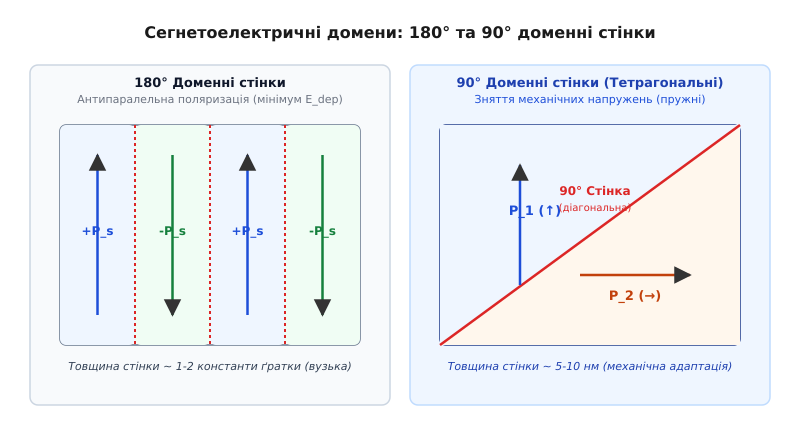
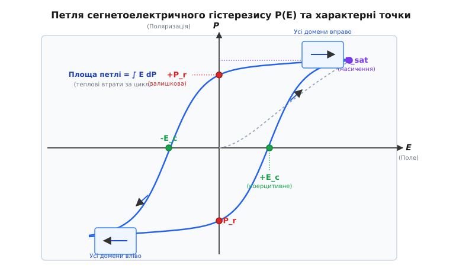
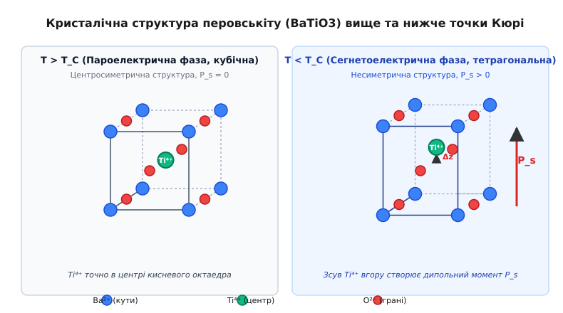
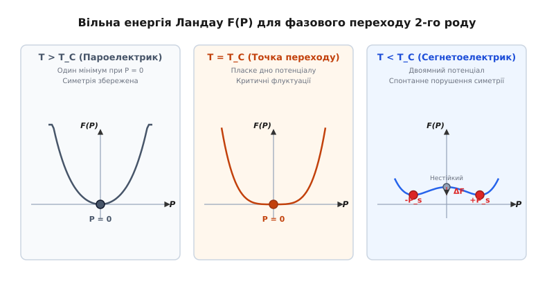

# Сегнетоелектрика та сегнетоелектричні домени

<preknowlist>
- [Температура Кюрі](root:ph-condensed/curie-temperature) — фазовий перехід між упорядкованим і нераціонально-тепловим станами.
- [Закон Кюрі — Вейсса](root:ph-condensed/curie-weiss-law) — розбіжність сприйнятливості поблизу фазового переходу.
- [П'єзоефект](root:ph-condensed/piezoelectric-effect-quartz-resonance) — лінійний зв'язок між механічною деформацією та електричним зарядом.
- [Магнітні домени](root:ph-condensed/magnetic-domains) — області однорідного спонтанного упорядкування для зменшення енергії полів розсіювання.
</preknowlist>

Якщо взяти звичайний багатошаровий керамічний конденсатор (MLCC) на основі титанату барію (`BaTiO3`) і виміряти його ємність при поступовому нагріванні, прецизійний вимірювальний міст зафіксує разючий стрибок: поблизу температури 120 °C діелектрична проникність матеріалу зростає у тисячі разів, досягаючи гігантських значень `ε > 10000`, після чого стрімко спадає за гіперболічним законом. Якщо ж зняти зовнішнє електричне поле, кристал не повертається до електрично нейтрального стану, а зберігає всередині потужний макроскопічний дипольний момент, здатний стабільно існувати роками.

Ця фундаментальна властивість твердих тіл дістала назву **сегнетоелектрика** *(від назви «сегнетова сіль», англ. ferroelectricity — за прямою фізичною аналогією з феромагнетизмом)*: здатність діелектричного кристала володіти спонтанною електричною поляризацією за повної відсутності зовнішнього поля та оборотним чином переорієнтовувати її просторовий напрямок під дією прикладеної зовнішньої електричної напруги.

---

### 1. Загадка спонтанної поляризації, класи симетрії та квантова теорія поляризації

У переважній більшості звичайних діелектричних середовищ (як-от парафін, кварцове скло, трансформаторне масло чи поліетилен) електрична поляризація `P` виникає виключно як пасивна реакція на прикладене зовнішнє електричне поле `E`. Зовнішнє поле зміщує центри тяжіння електронних хмар відносно позитивно заряджених ядер або деформує іонні зв'язки, вибудовуючи індуковані диполі. Після вимкнення зовнішньої напруги хаотичний тепловий рух миттєво руйнує просторову впорядкованість, повертаючи вектор макроскопічної поляризації точно до нуля.

Зв'язок між вектором електричного зміщення `D`, напруженістю електричного поля `E` та макроскопічною поляризацією `P` у системі SI визначається фундаментальним матеріальним рівнянням електродинаміки суцільних середовищ:

```
D = ε₀ · E + P     [визначення вектора електричного зміщення у діелектрику]
```

Вектор макроскопічної поляризації класично визначається як сумарний електричний дипольний момент одиниці об'єму речовини:

```
P = (1 / V) · ∑ p_i     [сума елементарних дипольних моментів у макроскопічному об'ємі V]
```

де `p_i = q_i · r_i` — елементарний електричний дипольний момент `i`-ї комірки, утворений зарядами `q_i`, розведеними на вектор просторового зміщення `r_i`.

#### Ієрархія кристалографічних класів симетрії

Здатність твердого тіла проявляти спонтанну поляризацію та реагувати на зовнішні механічні й електричні впливи строго регламентується просторовою симетрією його кристалічної ґратки. Згідно з фундаментальним принципом Кюрі — Неймана, точкова симетрія будь-якої фізичної властивості кристала не може бути нижчою за точкову симетрію самої кристалічної ґратки.

Із **32 кристалографічних точкових груп** (класів кристалічної симетрії) природа вибудовує чітку вкладену ієрархію діелектричних властивостей:

```
Всі кристали (32 точкові групи)
├── Центросиметричні кристали (11 груп): мають центр інверсії, п'єзоефект неможливий
└── Нецентросиметричні кристали (21 група): позбавлені центра інверсії
     ├── Неп'єзоелектрична група (1 група: кубічний клас 432 — висока симетрія гасить відгук)
     └── П'єзоелектрики (20 груп): лінійний зв'язок між механічною деформацією та зарядом
          ├── Неполярні п'єзоелектрики (10 груп): P_s = 0 у недеформованому стані кристала
          └── Піроелектрики (10 полярних груп): володіють спонтанною поляризацією P_s(T)
               └── Сегнетоелектрики (підклас піроелектриків): вектор P_s перемикається полем E
```

Розглянемо фізичну сутність та умови симетрії кожного щабля цієї кристалографічної ієрархії:

1. **Центросиметричні кристали** (11 точкових груп: `1̄, 2/m, mmm, 4/m, 4/mmm, 3̄, 3̄m, 6/m, 6/mmm, m3̄, m3̄m`): володіють операцією просторової інверсії `r → -r`. Будь-який полярний векторний відгук (як-от спонтанна поляризація) або тензор непарного рангу (зокрема тензор п'єзоелектричних модулів третього рангу `d_ijk`) у них суворо заборонений симетрією. При інверсії координат компоненти тензора третього рангу змінюють знак (`d_ijk → -d_ijk`), але оскільки кристалічна ґратка переходить сама в себе, виконується тотожність:

```
d_ijk = - d_ijk = 0     [обнулення тензора п'єзомодулів у центросиметричному кристалі]
```

2. **Нецентросиметричні кристали** (21 точкова група): позбавлені центра просторової інверсії. За винятком кубічного класу `432`, у якому специфічна комбінація поворотних осей симетрії другого, третього та четвертого порядків алгебраїчно обнуляє всі 18 незалежних компонентів тензора деформацій, решта **20 точкових груп є п'єзоелектриками**. У п'єзоелектриках механічне стискання або зсув розводить центри розподілу додатних і від'ємних іонів, генеруючи на поверхні кристала електричний заряд:

```
P_i = d_ijk · σ_jk     [прямий п'єзоелектричний ефект: заряд від механічного напруження]
S_ij = d_kij · E_k     [обернений п'єзоелектричний ефект: механічна деформація від поля]
```

де `σ_jk` — тензор механічних напружень, `S_ij` — тензор деформацій, а `d_ijk` — тензор п'єзоелектричних коефіцієнтів. Проте у недеформованому стані за відсутності поля вектор поляризації дорівнює нулю.

3. **Піроелектрики** (10 полярних точкових груп: `1, 2, m, mm2, 3, 3m, 4, 4mm, 6, 6mm`): кристали, що мають єдину виділену кристалографічну полярну вісь, не перемножену іншими операціями симетрії. Навіть у стані повної термодинамічної рівноваги та за відсутності механічних напружень центри тяжіння катіонних та аніонних підґраток просторово розведені. Внаслідок цього піроелектрик володіє ненульовою спонтанною поляризацією `P_s`, величина якої монотонно залежить від температури (`dP_s / dT ≠ 0`), породжуючи макроскопічний піроелектричний струм:

```
i_pyro = A · ( dP_s / dT ) · ( dT / dt )     [піроелектричний струм при зміні температури]
```

де `A` — площа поверхні електродів, а `p = dP_s / dT` — піроелектричний коефіцієнт матеріалу.

4. **Сегнетоелектрики** (підмножина полярних піроелектриків): матеріали, у яких вектор спонтанної поляризації `P_s` не є «вмороженим» назавжди в кристалічний каркас, а володіє щонайменше двома енергетично еквівалентними напрямками просторової рівноваги в ґратці, між якими його можна **оборотно перемикати** прикладеним зовнішнім електричним полем `E`, що перевищує коерцитивне значення `E_c`.

Ця вимога оборотної переорієнтації є фундаментальною: у звичайних піроелектриках (наприклад, у монокристалах турмаліну чи вюрцитного оксиду цинку `ZnO`) спроба перевернути напрямок вектора поляризації зовнішнім електричним полем неминуче спричиняє електричний пробій кристала задовго до того, як жорстка кристалічна ґратка змогла б зазнати структурної перебудови.

#### Мікроскопічний рельєф подвійної потенціальної ями

Мікроскопічний механізм бістабільності сегнетоелектричного стану описується рельєфом **подвійної потенціальної ями** *(double-well potential)* для зміщення центрального катіона вздовж полярної осі:

```
U(x) ↑
     |             Енергетичний бар'єр ΔU_b
     |                     /     |                    /       |            \      /    \      /
     |             \____/      \____/
     |               -x₀   0    +x₀
     +-------------------------------------> Зсув центрального катіона x
                     Стан «0»    Стан «1»
                     ( -P_s )    ( +P_s )
```

Локальна потенціальна енергія як функція зміщення `x` центрального іона з високосиметричного центросиметричного положення (`x = 0`) апроксимується симетричним поліномом четвертого степеня:

```
U(x) = - (1/2) · a · x² + (1/4) · b · x⁴     [локальна потенціальна енергія зміщення іона]
```

де `a > 0` та `b > 0` — константи мікроскопічного потенціалу. Мінімуми потенціальної енергії реалізуються у двох симетричних точках рівноваги `x = ± x₀`, де значення рівноважного зміщення визначається співвідношенням коефіцієнтів розкладу:

```
x₀ = √( a / b )     [рівноважне зміщення іона від центросиметричного положення]
```

Висота енергетичного бар'єра `ΔU_b`, що розділяє два полярні мінімуми за відсутності поля, становить:

```
ΔU_b = U(0) - U(x₀)
= 0 - [ - (1/2)·a·(a/b) + (1/4)·b·(a/b)² ]     [підстановка положення рівноваги x₀]
= (1/4) · (a² / b)                              [висота потенціального бар'єра подвійної ями]
```

Для практичного застосування сегнетоелектрика в енергонезалежній пам'яті висота бар'єра `ΔU_b` мусить суттєво перевищувати теплову енергію флуктуацій при кімнатній температурі (`ΔU_b ≫ k_B · T`, де `k_B · T ≈ 25.8 меВ` при 300 K). У кристалах `BaTiO3` та `PbTiO3` енергетичний бар'єр становить близько 50–150 меВ на елементарну комірку, що гарантує надійне термодинамічне збереження записаного полярного стану протягом понад 10 років.

Коли до кристала прикладається зовнішнє електричне поле `E`, воно додає до потенціалу лінійний внесок `- q · E · x`, деформуючи енергетичний рельєф:

```
U_eff(x, E) = - (1/2) · a · x² + (1/4) · b · x⁴ - q · E · x     [ефективний потенціал у зовнішньому полі E]
```

При досягненні критичного поля бар'єр з одного боку повністю зникає, і катіони лавиноподібно перескакують у напрямку вектора напруженості зовнішнього поля, перемикаючи поляризацію кристала.

#### Сучасна квантова теорія поляризації за фазою Беррі

Протягом багатьох десятиліть у курсах фізики твердого тіла поляризацію намагалися визначати через класичний інтеграл дипольного моменту по об'єму елементарної комірки: `P = (1/Ω) ∫ r · ρ(r) d³r`. Проте на початку 1990-х років Р. Реста, Р. Кінг-Сміт та Д. Вандербільт (Resta, King-Smith, Vanderbilt) строго довели, що для нескінченного тривимірного кристала це класичне означення є некоректним і математично невизначеним.

Оскільки квантова електронна густина `ρ(r)` є неперервною та періодичною у просторі, значення інтеграла прямо залежить від довільного вибору просторових меж та зсуву початку відліку елементарної комірки: зсунувши межу комірки на частку періоду ґратки, можна формально отримати будь-яке довільне значення поляризації через перетин електронних хмар межами інтегрування.

Сучасна квантова теорія поляризації (Modern Theory of Polarization) розглядає електричну поляризацію не як статичний просторовий розподіл заряду, а як **геометро-квантову фазу Беррі** валентних електронних хвильових функцій у просторі квазіімпульсів зони Бріллюена.

Електронний внесок у поляризацію кристала виражається через інтеграл зв'язності Беррі для блохівських хвильових функцій `|u_{n,k}⟩`:

```
P_elec = (i · e / (2·π)³) · ∑_{n=1}^{N_occ} ∫_{BZ} ⟨u_{n,k} | ∇_k u_{n,k}⟩ d³k     [електронна поляризація через фазу Беррі]
```

Квантовомеханічно поляризація визначена з точністю до цілого числа так званих «квантів поляризації»:

```
ΔP_quantum = (e · R) / Ω     [квант невизначеності поляризації у періодичній ґратці]
```

де `e` — елементарний заряд, `R` — вектор прямої трансляційної ґратки, а `Ω` — об'єм елементарної комірки. Фізично однозначно спостережуваною величиною, яку реєструють в експерименті за допомогою струму переполяризації (`j(t) = dP/dt`), є строга різниця поляризацій `ΔP = P_ferro - P_para` між високосиметричною пароелектричною фазою (де `P = 0` за симетрією) та спотвореною сегнетоелектричною фазою.

#### Класифікація за типом мікроскопічного механізму: зміщення проти лад-безлад

За мікроскопічною природою виникнення полярного стану всі сегнетоелектрики класифікують на два фундаментальні типи:

1. **Сегнетоелектрики типу зміщення** *(displacive ferroelectrics)*:
   - *Класичні представники*: `BaTiO3`, `PbTiO3`, `LiNbO3`, `KNbO3`, `BiFeO3`.
   - *Механізм*: у високотемпературній пароелектричній фазі кожна елементарна комірка в середньому за часом є центросиметричною. При охолодженні нижче критичної точки відбувається координований макроскопічний зсув цілих підґраток катіонів та аніонів одна відносно одної.
   - *Динаміка*: перехід супроводжується пом'якшенням та повною конденсацією поперечної оптичної фононної моди у центрі зони Бріллюена (`k → 0`).
2. **Сегнетоелектрики типу лад-безлад** *(order-disorder ferroelectrics)*:
   - *Класичні представники*: нітрит натрію `NaNO2`, дигідрофосфат калію `KH2PO4` (KDP), тригліцинсульфат (TGS), сегнетова сіль.
   - *Механізм*: індивідуальні несиметричні молекулярні групи або іони (наприклад, полярні групи `NO2⁻` чи протони на водневих зв'язках `O-H...O`) володіють ненульовим постійним дипольним моментом навіть у пароелектричній фазі при `T > T_C`. Проте внаслідок теплового руху вони хаотично переорієнтовуються між кількома еквівалентними мінімумами, забезпечуючи нульове середнє макроскопічне значення поляризації (`⟨P⟩ = 0`). При охолодженні далекодійна взаємодія спричиняє колективне кооперативне замерзання диполів у паралельному напрямку.
   - *Теорія*: описується псевдоспіновим гамільтоніаном Ізінга у поперечному полі тунелювання (модель де Жена для KDP).

Експерименти з рентгенівської спектроскопії поглинання EXAFS та розсіювання нейтронів довели, що навіть у класичних перовськітах типу зміщення (`BaTiO3`) мікроскопічна картина має змішаний характер: катіони `Ti⁴⁺` мають локальні динамічні зміщення вздовж восьми діагональних напрямків `⟨111⟩` навіть у кубічній парафазі, а макроскопічний фазовий перехід є комбінацією конденсації м'якої моди та часткового впорядкування цих локальних зміщень.

Детальніше про те, як було виявлено це явище та як воно пройшло шлях від аптечного проносного XVII століття до кремнієвих нанотранзисторів, читайте в розгортці [історію відкриття сегнетоелектрики](root:ph-condensed/ferroelectricity/hist-rochelle-salt.md).

---

### 2. Кристалохімія перовськітів та електронні механізми спонтанної поляризації

Найважливішим та найпоширенішим сімейством сегнетоелектриків є оксиди зі структурою **перовськіту** загальної хімічної формули **`ABO3`**.

У ідеальній високотемпературній **кубічній фазі** (просторова група `Pm3̄m`, стала ґратки `a ≈ 4 Å`) структура перовськіту складається з трьох взаємопроникних підґраток:
- Великі катіони **`A`** (як-от `Ba²⁺`, `Pb²⁺`, `Sr²⁺`, `Ca²⁺`, `Bi³⁺`, `La³⁺`) займають вершини кубічної елементарної комірки з координаційним числом 12 (оточені 12 аніонами кисню).
- Менші катіони перехідних металів **`B`** (як-от `Ti⁴⁺`, `Zr⁴⁺`, `Nb⁵⁺`, `Ta⁵⁺`, `Fe³⁺`) розташовані у геометричному центрі куба з координаційним числом 6.
- Аніони кисню **`O²⁻`** розташовані у центрах усіх шести граней куба, формуючи навколо центрального катіона `B` правильний октаедр `BO6`.

```
          [A] ────────────────── [A]
          /│                    /│
         / │       (O)         / │
       [A] ────────────────── [A]│
        │  │        │          │ │
        │ (O) ──── [B] ─── (O) │ │
        │  │        │          │ │
        │  │                   │ │
        │ [A] ──────│──────────│[A]
        │ /        (O)         │ /
        │/                     │/
       [A] ────────────────── [A]
```

#### Фактор толерантності Гольдшмідта та октаедричний нахил

Стабільність кристалічної ґратки перовськіту та схильність до виникнення полярних спотворень визначаються геометричним співвідношенням іонних радіусів Шеннона через **фактор толерантності Гольдшмідта** *(Goldschmidt tolerance factor)*:

```
t = (r_A + r_O) / ( √2 · (r_B + r_O) )     [фактор толерантності перовськітної структури]
```

де `r_A`, `r_B` та `r_O` — ефективні іонні радіуси відповідних елементів. Значення фактора толерантності визначає структурний тип матеріалу:

- **`t ≈ 0.95 – 1.00`**: ідеальна або майже ідеальна кубічна упаковка без виражених внутрішніх механічних напружень (наприклад, параелектричний титанат стронцію `SrTiO3`, де `t ≈ 1.002`).
- **`t > 1.00`**: катіон `A` є відносно великим, або катіон `B` є замалим для октаедричної порожнини. Кисневий октаедр `BO6` виявляється просторово розтягнутим. Для зменшення внутрішньої енергії центральний катіон `B` не може залишатися у центрі симетрії та зміщується до однієї з граней або ребер октаедра. Саме у цьому діапазоні (`t ≈ 1.02 – 1.08`) виникає класична **сегнетоелектрика типу зміщення** (зокрема для `BaTiO3` `t ≈ 1.06`).
- **`t < 0.95`**: катіон `A` занадто малий для кубооктаедричної порожнини, і ґратка перовськіту стискається. Щоб зменшити порожнечі навколо катіона `A`, жорсткі октаедри `BO6` координовано повертаються та нахиляються *(octahedral tilting)*. За класифікацією Глейзера (Glazer notation, наприклад `a⁻a⁻c⁺`) такі антифазові та синфазні нахили октаедрів знижують просторову симетрію до ромбічної чи моноклінної (`CaTiO3`, `GdFeO3`), що зазвичай пригнічує сегнетоелектрику та стабілізує параелектричний або антисегнетоелектричний стан.

#### Квантовохімічна природа: ефект Яна — Теллера другого роду (SOJT)

Чому іон `Ti⁴⁺` зміщується з центра октаедра, якщо класичні сили кулонівського та борнівського відштовхування іонних остовів намагаються втримати його у точці максимальної симетрії? Фундаментальна відповідь криється у квантовохімічному **ефекті Яна — Теллера другого роду** *(Second-Order Jahn-Teller effect, SOJT)*.

Катіон `Ti⁴⁺` має електронну конфігурацію інертного газу аргону з повністю вільними `3d`-орбіталями (`d^0`-конфігурація). Аніони кисню `O²⁻` мають повністю заповнені `2p`-оболонки. У центросиметричному стані перекриття між порожніми орбіталями титану `3d(t_2g, e_g)` та зайнятими орбіталями кисню `2p` є суто симетричним.

Згідно з квантовомеханічною теорією збурень другого порядку, якщо кристал зазнає низькосиметричного зміщення ядер за нормальною модою координати `Q`, зміна електронної енергії основного стану `E₀` становить:

```
ΔE_elec = ⟨ψ₀ | (∂H / ∂Q) | ψ₀⟩ · Q + ∑_{n ≠ 0} ( |⟨ψ₀ | (∂H / ∂Q) | ψ_n⟩|² / (E₀ - E_n) ) · Q²
```

У системі з закритою електронною оболонкою перший діагональний матричний елемент (ефект Яна — Теллера першого роду) тотожно дорівнює нулю. Проте другий недіагональний член між основним станом `ψ₀` (заповнені зв'язуючі орбіталі `O 2p`) та збудженими незаповненими станами `ψ_n` (розпушуючі орбіталі `Ti 3d`) є строго від'ємним, оскільки енергетичний знаменник `E₀ - E_n = - ΔE_gap < 0`.

Внаслідок асиметричного зсуву катіона титану до одного або кількох іонів кисню виникає сильна спрямована ковалентна **гібридизація `Ti 3d – O 2p`**. Електронні хмари частково перетікають з кисню на титан, зменшуючи формальний заряд іонів і знижуючи сумарну електронну енергію системи. Якщо величина зниження електронної енергії переважає зростання енергії пружного відштовхування закритих іонних остовів:

```
k_eff = k_short - 2 · ( |⟨ψ₀ | (∂H / ∂Q) | ψ_ex⟩|² / ΔE_gap ) < 0     [умова сегнетоелектричної нестійкості ґратки]
```

високосиметрична кубічна ґратка стає абсолютно нестійкою, і іон титану спонтанно випадає у зміщене сегнетоелектричне положення.

#### Послідовність фазових переходів у BaTiO₃

При поступовому охолодженні від високих температур кристал титанату барію `BaTiO3` проходить через каскад із чотирьох кристалографічних фаз, у кожній з яких напрямок зміщення катіона титану та вектор спонтанної поляризації змінюються:

```
Кубічна фаза (Pm3̄m)  ──(120 °C)──>  Тетрагональна (P4mm)  ──(5 °C)──>  Орторомбічна (Amm2)  ──(-90 °C)──>  Ромбоедрична (R3m)
P_s = 0                              P_s ∥ [001] (6 напрямків)           P_s ∥ [110] (12 напрямків)          P_s ∥ [111] (8 напрямків)
a = b = c = 3.996 Å                  c/a ≈ 1.011, P_s = 26 мкКл/см²      P_s = 30 мкКл/см²                   P_s = 33 мкКл/см²
```

1. **Кубічна фаза** (`T > 120 °C`, параелектрик): `a = 3.996 Å`, `P_s = 0`. Всі кути 90°, центри розподілу зарядів точно збігаються.
2. **Тетрагональна фаза** (`5 °C < T < 120 °C`): елементарна комірка витягується вздовж ребра `[001]` (`c = 4.036 Å`, `a = 3.992 Å`). Катіон `Ti⁴⁺` зміщується вздовж осі `c` на `+0.1 Å`, а аніони кисню — на `-0.03 Å`. Виникає 6 можливих кристалографічних напрямків поляризації (`±[100], ±[010], ±[001]`), `P_s ≈ 26 мкКл/см²`.
3. **Орторомбічна фаза** (`-90 °C < T < 5 °C`): іон титану зміщується вздовж діагоналі грані куба `[110]`, деформуючи ґратку до симетрії `Amm2`. Вектор поляризації має 12 еквівалентних орієнтацій, `P_s ≈ 30 мкКл/см²`.
4. **Ромбоедрична фаза** (`T < -90 °C`): титан зміщується вздовж головної просторової діагоналі куба `[111]`, витягуючи комірку вздовж осі третього порядку (симетрія `R3m`). Вектор `P_s` має 8 еквівалентних напрямків, `P_s ≈ 33 мкКл/см²`.

#### Роль неподіленої електронної пари 6s² (Pb²⁺, Bi³⁺) та титанат свинцю

Якщо замістити катіон барію катіоном свинцю (`PbTiO3`), фізика спонтанної поляризації кардинально змінюється. Іон `Pb²⁺` (як і `Bi³⁺`) має зовнішню заповнену електронну підлінію **`6s²`**.

У кристалічному полі аніонів кисню сферично-симетрична орбіталь `Pb 6s` гібридизується з орбіталями `O 2p` та `Pb 6p`, утворюючи просторово асиметричну полярну гібридну хмару — **стереоактивну неподілену електронну пару** *(stereochemically active lone pair)*. Ця неподілена пара відштовхує кисневі іони з одного боку катіона свинцю, викликаючи колосальні спотворення ґратки:

- У `PbTiO3` тетрагональне відношення осей сягає аномального значення `c/a = 1.064` (проти `1.011` у `BaTiO3`).
- Спонтанна поляризація зростає майже втричі, досягаючи `P_s ≈ 75 мкКл/см²`.
- Критична температура Кюрі зростає до `T_C = 490 °C` (порівняно зі `120 °C` для `BaTiO3`).

У титанаті свинцю обидві підґратки (і катіони `A` за рахунок пари `6s²`, і катіони `B` за рахунок гібридизації `3d-2p`) узгоджено працюють на посилення макроскопічного полярного зміщення.

#### Морфотропна фазова межа (MPB) у твердих розчинах PZT

При синтезі твердого розчину цирконату-титанату свинцю **`Pb(Zr_x Ti_{1-x})O3` (PZT)** ізовалентна заміна титану цирконієм (`Zr⁴⁺` має більший іонний радіус `0.72 Å` порівняно з `0.605 Å` для `Ti⁴⁺`) призводить до формування унікального явища — **морфотропної фазової межі** *(Morphotropic Phase Boundary, MPB)* при концентрації цирконію `x ≈ 0.52`.

```
Температура T ↑
             │         Пароелектрична кубічна фаза (Pm3̄m)
             │─────────────────────────────────────────────────
             │    Ромбоедрична фаза       │    Тетрагональна фаза
             │         (R3m)              │         (P4mm)
             │      P_s ∥ [111]           │      P_s ∥ [001]
             │      (8 напрямків)         │      (6 напрямків)
             │                            │
             │                      Морфотропна
             │                      межа (MPB)
             │                      (x ≈ 0.52)
             +────────────────────────────┴────────────────────> Склад x (Zr)
```

На морфотропній межі вільні енергії тетрагональної (`P4mm`) та ромбоедричної (`R3m`) фаз практично вироджуються, а між ними виникає проміжна моноклінна фаза (`Cm` або `Pm`). У результаті бар'єр анізотропії для повертання вектора поляризації прямує до нуля: вектор `P_s` може майже вільно неперервно обертатися у просторі між 14 кристалографічними напрямками (`6 × [001]` та `8 × [111]`).

Це явище **вільного обертання поляризації** *(polarization rotation)* під дією зовнішнього електричного чи механічного поля забезпечує гігантські значення діелектричної проникності (`ε > 5000`) та рекордні п'єзоелектричні модулі (`d_33 > 500 – 700 пКл/Н`), роблячи кераміку PZT безальтернативним світовим стандартом для п'єзоактюаторів та медичних ультразвукових випромінювачів.

#### Безперовськітна сегнетоелектрика: флюоритні оксиди гафнію (HfO₂) та цирконію (ZrO₂)

До 2011 року вважалося, що сегнетоелектрика є ексклюзивною властивістю складних перовськітних оксидів і зникає при зменшенні товщини плівки нижче кількох десятків нанометрів через розмірні деполяризуючі ефекти. Відкриття групи Боске (Böscke et al., 2011) перевернуло фізику полярних матеріалів: було експериментально доведено наявність стабільної сегнетоелектрики у нанометрових плівках простого бінарного діоксиду гафнію **`HfO2`** та цирконію **`ZrO2`**, які кристалізуються у структурі типу **флюориту** (`CaF2`).

Об'ємний діоксид гафнію за нормальних умов кристалізується у центросиметричній моноклінній фазі (група `P2_1/c`), яка є параелектриком з низькою проникністю (`ε ≈ 16 – 20`). При високих температурах (`> 1700 °C`) `HfO2` переходить у центросиметричну тетрагональну фазу (`P4_2/nmc`, `ε ≈ 35 – 40`), а вище 2600 °C — у кубічну (`Fm3̄m`).

Сегнетоелектричний стан у `HfO2` виникає у метастабільній нецентросиметричній **орторомбічній фазі** (просторова група **`Pca2_1`**). У цій гратці чотири аніони кисню зміщуються відносно важкої підґратки катіонів гафнію вздовж полярної осі `c`, генеруючи спонтанну поляризацію `P_s ≈ 15 – 45 мкКл/см²`.

```
Фази HfO₂:
├── Моноклінна фаза (P2₁/c): стабільна при 300 K, параелектрик, центросиметрична
├── Тетрагональна фаза (P4₂/nmc): високотемпературна, параелектрик (high-k діелектрик DRAM)
└── Орторомбічна фаза (Pca2₁): метастабільна полярна сегнетоелектрична фаза (P_s = 20-45 мкКл/см²)
```

Стабілізація метастабільної полярної фази `Pca2_1` у тонких плівках товщиною **1–10 нм** досягається синергією чотирьох фізичних чинників:

1. **Розмірний наноефект (поверхнева енергія)**: завдяки надзвичайно малим розмірам кристалітів (зерна 5–15 нм) внесок питомої поверхневої енергії стає домінуючим, знижуючи вільну енергію орторомбічної та тетрагональної фаз нижче моноклінної.
2. **Механічне затиснення верхнім електродом**: плівку осаджують методом атомарно-шарового осадження (ALD), покривають зверху жорстким металевим електродом нітриду титану (`TiN`) і піддають швидкому термічному відпалу (RTA при 450–650 °C). Різниця коефіцієнтів теплового розширення між `TiN` та `HfO2` створює потужні двовісні механічні напруження розтягу в площині плівки, які блокують перехід у моноклінну фазу і фіксують фазу `Pca2_1`.
3. **Легування катіонами заміщення**: введення домішок з меншим іонним радіусом (`Si⁴⁺`, `Al³⁺`, `C`) або більшим іонним радіусом (`Y³⁺`, `La³⁺`, `Gd³⁺`, `Sr²⁺`), а також створення твердих розчинів `Hf_{0.5}Zr_{0.5}O2` (HZO).
4. **Кисневі вакансії (`V_O¨`)**: дефіцит кисню зменшує координаційне число катіонів гафнію, кінетично стабілізуючи тетрагональну фазу як високотемпературного попередника орторомбічної фази при охолодженні.

Оскільки `HfO2` вже є стандартним підзатворним діелектриком у кремнієвих FinFET/GAAFET транзисторах на фабриках TSMC та Intel, це відкриття усунуло головний бар'єр на шляху масштабування сегнетоелектричної пам'яті до суб-3-нанометрових технологічних норм.

---

### 3. Динаміка ґратки, закон Кюрі — Вейсса та термодинамічна теорія Ландау — Девоншира

#### Закон Кюрі — Вейсса та діелектрична проникність

При нагріванні сегнетоелектрика тепловий рух атомів руйнує просторову дипольну впорядкованість. При досягненні критичної **температури Кюрі `T_C`** кристал зазнає структурного фазового переходу у високосиметричну неполярну пароелектричну фазу.

У пароелектричній фазі (`T > T_C`) статична діелектрична проникність `ε(T)` підпорядковується фундаментальному **закону Кюрі — Вейсса**:

```
ε(T) = ε_core + C / (T - T₀)     [закон Кюрі — Вейсса для діелектричної проникності]
```

де `C` — стала Кюрі, `T₀` — характеристична температура Кюрі — Вейсса, а `ε_core` — фоновий внесок поляризованості електронних оболонок.

Значення сталої Кюрі `C` несе фундаментальну інформацію про мікроскопічний механізм поляризації:
- Для сегнетоелектриків **типу зміщення** (`BaTiO3`, `PbTiO3`, `KNbO3`): стала Кюрі має гігантську величину **`C ≈ 10⁵ K`**.
- Для сегнетоелектриків **типу лад-безлад** (тригліцинсульфат TGS, дигідрофосфат калію KDP): стала Кюрі на два порядки менша і становить **`C ≈ 10³ K`**.

Співвідношення між критичною температурою фазового переходу `T_C` та температурою Кюрі — Вейсса `T₀` визначається термодинамічним родом переходу:
- Для фазових переходів **другого роду** (неперервних): `T_C = T₀`.
- Для фазових переходів **першого роду** (зі стрибком поляризації): `T_C > T₀`. Зокрема, у титанаті барію `BaTiO3` `T_C ≈ 120 °C` (393 K), тоді як екстрапольована температура `T₀ ≈ 105 °C` (378 K), тобто різниця становить `T_C - T₀ ≈ 15 K`.

#### Теорія м'якої оптичної фононної моди Кокрана

Мікроскопічний динамічний зв'язок між тепловими коливаннями кристалічної ґратки та розбіжністю діелектричної проникності було розкрито Вільямом Кокраном (William Cochran, 1960) у **теорії м'якої моди** *(soft mode theory)*.

Розглянемо довжинохвильове (`k → 0`) коливання поперечного оптичного фонона (`TO`-мода), у якому підґратка позитивних іонів (`Ba²⁺`, `Ti⁴⁺`) зміщується у протифазі відносно підґратки негативних іонів кисню (`O²⁻`). Відновлювальна сила, що діє на зміщений іон, формується суперпозицією двох протидіючих факторів:

1. **Короткодійна пружна сила відштовхування** перекритих електронних оболонок, що прагне повернути іон у центросиметричне положення (характеризується ефективною жорсткістю `k_short > 0`).
2. **Довгодійна електростатична кулонівська сила** локального поля Лоренца (`E_local = E + P / (3·ε₀)`), створена дипольними моментами сусідніх зміщених комірок. Це поле спрямоване у бік зміщення і тягне іон далі від центра симетрії (характеризується від'ємною жорсткістю `- k_coulomb < 0`).

Ефективна силова стала пружини коливань ґратки становить:

```
k_eff(T) = k_short - k_coulomb(T)     [ефективна жорсткість коливань оптичного фонона]
```

У більшості звичайних діелектриків (як-от `NaCl`) сили пружності значно переважають кулонівське поле (`k_short ≫ k_coulomb`), тому частота `TO`-фононів практично не залежить від температури. Проте в перовськітах через велику електронну поляризовність та високі ефективні заряди Борна (`Z*_{Ti} ≈ +7.2e` замість номінального `+4e`) кулонівські сили майже повністю компенсують короткодєйну пружність.

За рахунок теплового розширення ґратки та ангармонізму міжатомних коливань при охолодженні від високих температур ефективна жорсткість прямує до нуля. В результаті частота поперечного оптичного фонона стрімко зменшується за законом:

```
ω_TO²(T) = γ_C · (T - T₀)     [закон пом'якшення частоти поперечного фонона Кокрана]
```

де `γ_C` — коефіцієнт ангармонічного зв'язку. При наближенні температури до `T₀` частота коливань `ω_TO → 0`: коливальна мода «пом'якшується», період коливань прямує до нескінченності, і динамічне коливання іонів «заморожується» у статичне зміщення підґраток — кристал зазнає сегнетоелектричного фазового переходу.

#### Співвідношення Лідана — Сакса — Теллера (LST)

Фундаментальний зв'язок між фононними спектрами ґратки та діелектричною проникністю задається **співвідношенням Лідана — Сакса — Теллера** *(Lyddane — Sachs — Teller, LST relation)*:

```
ε(0) / ε_∞ = ∏_j ( ω_LO,j² / ω_TO,j² )     [співвідношення Лідана — Сакса — Теллера]
```

де `ε(0)` — статична низькочастотна діелектрична проникність, `ε_∞` — високочастотна (оптична) проникність, обумовлена виключно поляризацією електронів, а `ω_LO,j` та `ω_TO,j` — частоти поздовжніх та поперечних оптичних фононів `j`-ї гілки коливань.

Якщо в кристалі існує одна виділена м'яка мода `ω_TO,soft`, тоді як поздовжня частота `ω_LO` залишається практично стабільною, співвідношення LST зводить залежність до вигляду:

```
ε(0, T) = ε_∞ · ( ω_LO² / ω_TO²(T) )
= ε_∞ · [ ω_LO² / ( γ_C · (T - T₀) ) ]     [підстановка закону Кокрана для м'якої моди]
= C / (T - T₀)                             [виведення закону Кюрі — Вейсса]
```

Цей висновок є тріумфом фізики твердого тіла: він довів, що феноменологічний макроскопічний закон Кюрі — Вейсса є прямим математичним наслідком квантового пом'якшення поперечного оптичного фонона у центрі зони Бріллюена.

#### Феноменологічна термодинамічна теорія Ландау — Девоншира (LGD)

Макроскопічний термодинамічний опис фазових переходів у сегнетоелектриках базується на теорії Ландау для фазових переходів із порушенням неперервної просторової симетрії, розширеній А. Девонширом (A. Devonshire) для діелектричних систем.

Вільна енергія Гельмгольца `F(P, T)` розкладається в ряд за парними степенями параметра порядку — макроскопічного вектора поляризації `P` (для одновісного сегнетоелектрика):

```
F(P, T) = F₀ + (1/2) · α · P² + (1/4) · β · P⁴ + (1/6) · γ · P⁶ - E · P     [термодинамічний потенціал Ландау — Девоншира]
```

Згідно з базовим постулатом Ландау, перший температурно-залежний коефіцієнт лінійно змінює знак при проходженні через характеристичну температуру `T₀`:

```
α(T) = α₀ · (T - T₀)     [зміна знака коефіцієнта гармонічної пружності при T = T₀, α₀ > 0]
```

Рівноважний стан системи за заданої температури `T` та зовнішнього поля `E` визначається умовами термодинамічного екстремуму:

```
dF / dP = 0     [умова рівноваги: відсутність термодинамічних сил]
d²F / dP² > 0   [умова стійкості рівноважного стану]
```

Залежно від знака коефіцієнта четвертого порядку `β` теорія описує два принципово різні типи фазових переходів.

#### Фазовий перехід другого роду (β > 0)

Якщо `β > 0`, коефіцієнт шостого порядку можна знехтувати (`γ = 0`). У відсутності поля (`E = 0`) рівняння рівноваги набуває вигляду:

```
dF / dP = α₀ · (T - T₀) · P + β · P³ = P · [ α₀ · (T - T₀) + β · P² ] = 0
```

Розв'язок дає два температурні інтервали:
1. При `T > T₀`: єдиним мінімумом є центросиметричний неполярний стан `P_s = 0` (пароелектрична фаза).
2. При `T < T₀`: стан `P = 0` перетворюється на локальний максимум (`d²F/dP² = α < 0`), а стійкими мінімумами стають два симетричні полярні стани:

```
P_s(T) = ± √[ (α₀ / β) · (T₀ - T) ]     [температурна залежність поляризації для переходу 2-го роду]
```

Спонтанна поляризація виникає нижче `T₀` абсолютно неперервно, наростаючи за кореневим законом `P_s ∝ (T₀ - T)^{1/2}` (критичний індекс `1/2` у теорії середнього поля).

Діелектрична сприйнятливість `χ = dP / (ε₀ · dE) = 1 / (ε₀ · (d²F/dP²))` визначається другою похідною потенціалу:
- У пароелектричній фазі (`T > T₀`, `P = 0`):
  `χ⁻¹(T) = ε₀ · α₀ · (T - T₀)`
- У сегнетоелектричній фазі (`T < T₀`, `P = P_s`):
  `d²F/dP² = α + 3·β·P_s² = α₀·(T - T₀) + 3·β·[ (α₀/β)·(T₀ - T) ] = 2 · α₀ · (T₀ - T)`
  `χ⁻¹(T) = 2 · ε₀ · α₀ · (T₀ - T)`

Звідси випливає фундаментальний **«закон двійки» Ландау**: нахил прямої оберненої діелектричної сприйнятності `χ⁻¹(T)` нижче точки Кюрі рівно вдвічі більший за абсолютним значенням, ніж нахил у пароелектричній фазі вище точки Кюрі.

Стрибок питомої теплоємності при фазовому переході другого роду (`ΔC_p = - T · (∂²F / ∂T²)`) становить:

```
ΔC_p = ( α₀² · T₀ ) / ( 2 · β )     [стрибок теплоємності у точці Кюрі]
```

#### Фазовий перехід першого роду (β < 0, γ > 0)

Якщо `β < 0`, стабільність потенціалу забезпечується додатним членом шостого порядку (`γ > 0`). Потенціал формує складений рельєф із трьома конкуруючими мінімумами.

```
Вільна енергія F(P)
       |
       |     T > T_C (пароелектрик стійкий, P=0)
       |       \     /
       |        \___/
       |
       |     T = T_C (рівновага фаз: F(0) = F(±P_C))
       |       \  _  /
       |       /\   /       |      /  \_/         |
       |     T < T_C (сегнетоелектрик стійкий, P=±P_s)
       |       \     /
       |       /\   /       |      /  \_/         +---------------------------------------------> Поляризація P
               -P_s  0  +P_s
```

При охолодженні кристал проходить такі характерні точки:
1. При високих температурах мінімум при `P = 0` є глобальним.
2. При температурі `T₁ = T₀ + β² / (4 · α₀ · γ)` на кривій вільної енергії виникають перегини, що трансформуються у бічні локальні мінімуми при `P ≠ 0`.
3. При критичній температурі **`T_C = T₀ + (3/16) · (β² / (α₀ · γ))`** глибина полярних мінімумів точно зрівнюється з нульовим мінімумом (`F(P_C) = F(0)`). Відбувається фазовий перехід першого роду зі стрибком поляризації від нуля до скінченного значення:

```
P_C = √[ (3/4) · ( |β| / γ ) ]     [стрибок спонтанної поляризації в точці фазового переходу]
```

4. Стрибок поляризації супроводжується виділенням або поглинанням **прихованої теплоти фазового переходу**:

```
Q = (1/2) · α₀ · T_C · P_C²     [прихована теплота фазового переходу першого роду]
```

5. Фазовий перехід першого роду демонструє виражений **температурний гістерезис**: при нагріванні сегнетоелектрична фаза може перегріватися до температури `T₁`, а при охолодженні пароелектрична фаза переохолоджується до температури Кюрі — Вейсса `T₀`.

#### Градієнтні члени Гінзбурга для неоднорідних систем

Для опису просторово-неоднорідних станів (доменних стінок, тонких плівок та наноструктур) до термодинамічного потенціалу додають градієнтні внески Гінзбурга:

```
F_total = ∫ [ F(P, T) + (1/2) · g_ijkl · (∂P_i / ∂x_j) · (∂P_k / ∂x_l) - (1/2) · E_dep · P ] dV     [функціонал Гінзбурга — Ландау]
```

де `g_ijkl` — тензор градієнтних коефіцієнтів, що визначає енергетичну ціну просторової зміни вектора поляризації (поверхневу енергію доменних меж), а `E_dep` — локальне деполяризуюче поле.

Повний математичний вивід усіх термодинамічних співвідношень, аналіз тензорів пружного зв'язку та тривимірного фазового простору наведено у розгортці [термодинамічну теорію Ландау — Девоншира](root:ph-condensed/ferroelectricity/math-landau-devonshire.md).

---

### 4. Діелектричний гістерезис, динаміка перемикання та методи вимірювань

#### Структура діелектричної петлі гістерезису P(E)


*Ілюстрація: Domain Structure.*



*Ілюстрація: Ferro Hysteresis.*



*Ілюстрація: Perovskite Structure.*


Найяскравішим макроскопічним проявом сегнетоелектричного стану є нелінійна **петля діелектричного гістерезису** залежності поляризації від прикладеного електричного поля `P(E)`.

```
              Поляризація P ↑
                            │           +P_sat
                            │          /
                            │    +P_r /
                            │   ┌────┘
                            │  /│
            ────────────────┼─/─┼──────────────> Поле E
                     -E_c   │/  │ +E_c
                    ────────┼───┘
                           /│ -P_r
                          / │
                         /  │
                   -P_sat   │
```

Ключові параметри петлі гістерезису:

1. **Спонтанна поляризація `P_s`**: фундаментальна поляризація всередині окремого домену за відсутності поля. Визначається екстраполяцією лінійної ділянки насичення до осі ординат (`E = 0`).
2. **Залишкова поляризація `P_r`** *(remanent polarization)*: макроскопічна поляризація зразка, що зберігається після зняття зовнішнього електричного поля (`E = 0`). У полікристалічних кераміках `P_r` дещо менша за `P_s` через хаотичну орієнтацію зерен та неповне 100% перемикання доменів.
3. **Коерцитивне поле `E_c`** *(coercive field)*: напруженість зовнішнього електричного поля протилежного знака, яку необхідно прикласти, щоб макроскопічна поляризація зразка повністю обнулилася (`P = 0`).
4. **Поляризація насичення `P_sat`**: поляризація в сильному зовнішньому полі, де всі домени вирівняні вздовж поля, а подальше зростання обумовлене лише звичайною діелектричною поляризовністю (`P(E) = P_s + ε₀·χ_para·E`).

Площа петлі гістерезису визначає густину енергетичних втрат на переполяризацію кристала за один повний період змінного поля:

```
W_loss = ∮ E dP     [густина діелектричних втрат на один цикл перемикання, Дж/м³]
```

Ця енергія безповоротно розсіюється у кристалічній ґратці у вигляді тепла за рахунок тертя при русі доменних стінок та взаємодії з дефектами.

#### Парадокс коерцитивного поля та зародкоутворення

Якщо обчислити коерцитивне поле сегнетоелектрика строго в рамках однорідної термодинамічної моделі Ландау (припускаючи, що всі диполі у кристалі перемикаються одночасно як єдиний когерентний масив), значення поля спінодалі становить:

```
E_c,Landau = (2 / (3·√3)) · |α₀ · (T - T₀)| · √[ |α₀ · (T - T₀)| / β ]     [термодинамічна коерцитивність Ландау]
```

Чисельний розрахунок для `BaTiO3` або `PbTiO3` дає гігантські значення: `E_c,Landau ≈ 100 – 1000 кВ/см`. Проте експериментально виміряне коерцитивне поле у монокристалах та кераміках становить лише **`E_c,exp ≈ 1 – 10 кВ/см`**, тобто у 10–100 разів менше за теоретичну межу Ландау!

Ця розбіжність, відома як **парадокс коерцитивного поля**, має те саме фізичне походження, що й низька міцність реальних металів порівняно з ідеальною ґраткою (теорія дислокацій). Переполяризація сегнетоелектрика ніколи не відбувається однорідно по всьому об'єму. Вона розгортається локально шляхом **зародкоутворення** крихітних нанометрових зародків протилежної поляризації та подальшого легкого **руху доменних стінок**.

#### Механізм Мерца

Кінетичний механізм перемикання поляризації був детально експериментально та теоретично досліджений Вальтером Мерцом (Walter Merz, 1954). Процес переполяризації тонкої пластини сегнетоелектрика складається з чотирьох послідовних стадій:

1. **Зародкоутворення на межі з електродом**: у приповерхневому шарі поблизу дефектів ґратки, мікротріщин або неоднорідностей електричного поля виникають ультрадрібні зародки протилежної фази клиноподібної форми.
2. **Швидке поздовжнє проростання**: утворені голкоподібні домени стрімко проростають вздовж полярної осі крізь усю товщину кристала від одного електрода до іншого. Швидкість поздовжнього росту близька до швидкості звуку в кристалі.
3. **Латеральний рух 180° доменних стінок**: доменні стінки повільно рухаються вбік перпендикулярно до полярної осі завдяки двовимірному зародкоутворенню нових атомних моношарів на поверхні існуючої стінки.
4. **Коалесценція**: окремі розрослі домени зливаються в єдиний монодоменний стан.

Закон Мерца для швидкості латерального руху доменної стінки `v` та сумарного часу перемикання кристала `t_sw` має характерну активаційну експоненційну залежність від напруженості поля:

```
1 / t_sw = (1 / t_0) · exp( - α_M / E )     [закон Мерца для кінетики перемикання]
```

де `α_M` — активаційне поле Мерца, яке визначається поверхневою енергією доменної стінки та величиною спонтанної поляризації (`α_M ∝ σ_w^{3/2} · P_s / (k_B · T)`), а `t_0` — мінімальний граничний час релаксації.

#### Статистичні моделі кінетики перемикання: KAI та NLS

Для математичного моделювання перехідних струмів перемикання `j(t) = dP/dt` у пристроях пам'яті застосовують дві класичні концепції:

1. **Модель Колмогорова — Аврамі — Ішібаші (KAI model)**:
   Описує перемикання якісних монокристалів та однорідних епітаксійних плівок як класичний процес фазового переходу шляхом зародкоутворення центрів та їх необмеженого геометричного росту з подальшим перекриттям.

Частка перемкнутого об'єму `f(t) = ΔP(t) / (2·P_r)` описується формулою Аврамі:

```
f(t) = 1 - exp[ - (t / t₀)^n ]     [кінетичне рівняння Колмогорова — Аврамі — Ішібаші]
```

де `t₀` — характерний час перемикання, а показник степеня Аврамі `n = d + 1` (для постійної швидкості зародження в часі) або `n = d` (для миттєвого зародження всіх центрів на початковому етапі) у просторі вимірності `d` (для тонких плівок `d = 2`, що дає `n = 2` або `n = 3`).

2. **Модель перемикання, обмеженого зародкоутворенням (Nucleation-Limited Switching, NLS model)**:
   У полікристалічних плівках, нанокераміках та плівках `HfO2` кристал розбитий на мільярди нанорозмірних зерен, розділених високодефектними границями. Розростання доменної стінки блокується межами зерен, і час перемикання кожного зерна повністю лімітується часом зародження в ньому першого критичного зародка.

Сумарна макроскопічна поляризація є інтегралом за неперервним розподілом локальних часів очікування зародка `g(log τ)`:

```
ΔP(t) / (2 · P_r) = ∫ [ 1 - exp( - t / τ ) ] · g(log τ) · d(log τ)     [інтегральне перемикання в моделі NLS]
```

де функція `g(log τ)` зазвичай має широкий логнормальний розподіл із дисперсією понад 3–6 декад за часом.

#### Динаміка Ландау — Халатникова та чисельне моделювання

Динамічний відгук поляризації в часі при довільній формі зовнішнього поля `E(t)` описується релаксаційним диференціальним рівнянням Ландау — Халатникова:

```
γ_L · (dP / dt) = - δF / δP = E(t) - α₀ · (T - T₀) · P - β · P³     [динамічне рівняння Ландау — Халатникова]
```

де `γ_L` — коефіцієнт в'язкого кінетичного тертя. Чисельна дискретизація та інтегрування цього нелінійного диференціального рівняння дозволяють точно відтворювати форму петлі гістерезису, розраховувати залежність коерцитивного поля від частоти та моделювати втрати на переполяризацію.

Повний чисельний алгоритм інтегрування методом Рунге — Кутти 4-го порядку (RK4) та вихідний програмний код реалізаціями на C, C++ і Python розібрано в практичній розгортці [чисельне моделювання динамічного гістерезису](root:ph-condensed/ferroelectricity/proj-hysteresis-sim.md).

#### Експериментальні методи дослідження

```
Метод дослідження        Принцип вимірювання                       Що саме спостерігаємо
Міст Сойєра — Тауера    Інтегрування заряду на еталонному C_ref   Макроскопічна петля P(E), P_r, E_c
Імпульсний тест PUND     Серія з 5 імпульсів (P, U, N, D)          Справжній перемиканий заряд без витоків
Мікроскопія PFM          АСМ з провідним зондом (п'єзовідгук)      Нанодомени 1-10 нм, запис окремих бітів
Оптична гармоніка SHG    Генерація подвоєної частоти лазера 2ω     Нецентросиметричність і симетрія фаз
```

1. **Класичний міст Сойєра — Тауера (Sawyer — Tower circuit)**: історично перший метод вимірювання `P(E)`. Послідовно з сегнетоелектричним зразком `C_x` вмикається лінійний еталонний конденсатор великої ємності `C_ref ≫ C_x`. Напруга на еталонному конденсаторі прямо пропорційна накопиченому заряду поляризації (`V_ref = Q / C_ref = P · A / C_ref`) і подається на вертикальні пластини осцилографа, тоді як напруга генератора — на горизонтальні.
2. **Імпульсна методика PUND (Positive Up Negative Down)**: сучасний стандарт вимірювання пам'яті FeRAM. На зразок подається послідовність із 5 імпульсів напруги однакової амплітуди:
   - Імпульс ініціалізації: встановлює стан `-P_r`.
   - **P-імпульс** *(Positive)*: перемикає поляризацію у стан `+P_r`. Вимірюваний струм містить суму сегнетоелектричного заряду перемикання `2·P_r`, лінійного діелектричного заряду `ε₀·ε_r·E` та струму омічного витоку: `Q_P = 2·P_r·A + Q_lin + Q_leak`.
   - **U-імпульс** *(Up)*: подається той самий додатний імпульс, коли матеріал вже поляризований. Сегнетоелектричного перемикання не відбувається: `Q_U = Q_lin + Q_leak`.
   - **N-імпульс** *(Negative)* та **D-імпульс** *(Down)*: повторюють операцію для від'ємної полярності.
   Чистий сегнетоелектричний заряд обчислюється апаратним відніманням: **`Q_sw = Q_P - Q_U = 2 · P_r · A`**, що повністю виключає помилки від паразитних витоків.
3. **Силова мікроскопія п'єзовідгуку (Piezoresponse Force Microscopy, PFM)**: метод наноексперименту на основі атомно-силового мікроскопа (АСМ). Провідний кантилевер сканує поверхню зразка, прикладаючи змінну напругу `V_ac · sin(ω t)`. Завдяки оберненому п'єзоефекту домен локально стискається або розширюється, що детектується фотодіодом із суб-нанометровою просторовою роздільністю (< 5 нм). Подаючи високовольтні імпульси постійної напруги на голку, можна локально перемикати поодинокі нанодомени.
4. **Генерація другої оптичної гармоніки (SHG)**: нелінійно-оптичний метод. Оскільки тензор нелінійної сприйнятності другого порядку `χ⁽²⁾` строго дорівнює нулю в центросиметричних середовищах, поява випромінювання подвоєної частоти (`2ω`) при опроміненні лазером є прямим безконтактним доказом порушення інверсної симетрії та появи полярного стану.

---

### 5. Сегнетоелектричні домени, структура та провідність доменних стінок

#### Енергетичні причини розбиття на домени

Якби монокристал після фазового переходу залишився ідеально однорідно поляризованим монодоменом, на його протилежних торцях виник би гігантський некомпенсований зв'язаний поверхневий заряд густиною `σ_bound = P_s`. Цей заряд генерує всередині кристала потужне електростатичне **деполяризуюче поле `E_dep`**, спрямоване назустріч вектору `P_s`:

```
E_dep = - P_s / ( ε₀ · ε_r )     [електростатичне деполяризуюче поле у монодоменному кристалі]
```

Для типових параметрів `BaTiO3` деполяризуюче поле сягає значень `E_dep ~ 10⁶ – 10⁷ В/см`, що на порядки перевищує коерцитивне поле. Густина електростатичної енергії такого поля становить:

```
U_elec = (1/2) · ∫ E_dep · P_s dV     [об'ємна енергія деполяризуючого поля]
```

Щоб мінімізувати цю енергію, кристал спонтанно розбивається на просторові мікроскопічні області з різними напрямками спонтанної поляризації — **сегнетоелектричні домени**. Утворення доменної структури з чергуванням знаків `+P_s` та `-P_s` замикає електричні силові лінії всередині крихітних приповерхневих петель, практично обнуляючи макроскопічне поле деполяризації.

Проте поділ на домени потребує утворення внутрішніх границь розділу — **доменних стінок**, кожна з яких має власну надлишкову поверхневу енергію `σ_w`. Рівноважний розмір доменів `w` визначається конкуренцією об'ємної електростатичної енергії та поверхневої енергії стінок за класичним законом Кіттеля:

```
w ≈ √[ ( σ_w · d ) / ( ε₀ · ε_r · E_dep² ) ] ∝ √d     [закон Кіттеля для рівноважної ширини доменів]
```

де `d` — товщина пластини кристала.

#### Геометрія доменних стінок: 180° та 90° межі

У тетрагональній фазі перовськітів (наприклад, `BaTiO3` чи `PZT`) існують два фундаментальні типи доменних меж:

```
180°-ва доменна стінка:                     90°-ва доменна стінка:
┌───────────┬───────────┐                   ┌───────────┬───────────┐
│           │           │                   │           │   ▲       │
│     ▲     │     │     │                   │     ▲     │  ╱        │
│     │     │     │     │                   │     │     │ ╱         │
│     │     │     ▼     │                   │     │     │╱          │
│   +P_s    │   -P_s    │                   │   +P_s    │   +P_s    │
│           │           │                   │   [001]   │   [100]   │
└───────────┴───────────┘                   └───────────┴───────────┘
   (Суто електрична стінка,                     (Фероеластична стінка,
    деформації відсутні)                         механічний зсув 90°)
```

1. **180°-ві доменні стінки**:
   - Розділяють антипаралельні домени (`+P_s` та `-P_s`).
   - *Електромеханічний стан*: оскільки тетрагональна деформація ґратки пропорційна квадрату поляризації (електрострикція `S ∝ Q · P²`), при інверсії поляризації `P → -P` форма та розміри елементарної комірки не змінюються. 180°-ва стінка є суто електричною і не створює пружних напружень (нееластоактивна стінка). Вона може проходити по довільних кристалографічних площинах, паралельних полярній осі (типово `{100}`).
   - *Профіль поляризації*: на відміну від магнітних стінок Блоха (де магнітний момент неперервно повертається за модулем у просторі), у сегнетоелектриках стінка має **структуру типу Ізінга**: вектор поляризації зберігає свій напрямок, але плавно зменшується за амплітудою, проходить через нуль у центрі стінки і змінює знак.
   - *Товщина*: ширина 180° стінки надзвичайно мала і становить лише **`δ_180 ≈ 0.5 – 2 нм`** (1–4 періоди кристалічної ґратки).
2. **90°-ві доменні стінки** (та 71°/109° у ромбоедричній фазі):
   - Розділяють домени, вектори поляризації яких орієнтовані під прямим кутом (наприклад, `[001]` та `[100]`).
   - *Фероеластичність*: оскільки `c > a`, комірки у сусідніх доменах повернуті осями розтягу одна відносно одної на 90°. Щоб уникнути катастрофічних механічних розривів кристала, 90°-ві стінки мусять суворо задовольняти умови механічної сумісності деформацій Сен-Венана: вони можуть залягати виключно вздовж діагональних кристалографічних площин **`{110}`**.
   - *Електростатична нейтральність*: для відсутності зв'язаного об'ємного заряду (`div P = 0`) нормальні компоненти вектора поляризації на стінці мусять бути строго неперервними: `P_{1n} = P_{2n}`.
   - *Товщина*: через значні градієнти пружних деформацій ширина 90° стінок становить **`δ_90 ≈ 2 – 10 нм`**.

#### Заряджені доменні стінки та наноелектроніка

Якщо умови електростатичної нейтральності порушуються, формуються **заряджені доменні стінки** *(Charged Domain Walls)*:
- Конфігурація **«голова до голови»** *(head-to-head, `→|←`)*: вектори поляризації спрямовані назустріч один одному, створюючи позитивний зв'язаний заряд `σ_bound = + 2·P_s`.
- Конфігурація **«хвіст до хвоста»** *(tail-to-tail, `←|→`)*: вектори поляризації спрямовані від межі, створюючи негативний зв'язаний заряд `σ_bound = - 2·P_s`.

```
Заряджена стінка «голова до голови» (Head-to-Head):
┌─────────────────────────┬─────────────────────────┐
│                         │                         │
│           ───►          │          ◄───           │
│           +P_s          │          -P_s           │
│                         │                         │
└─────────────────────────┴─────────────────────────┘
                    Зв'язаний заряд:
                    σ_bound = + 2·P_s
                    Екранування електронами:
                    Формування провідного 2DEG каналу
```

Щоб компенсувати колосальний електростатичний потенціал зв'язаного заряду, енергетичні зони напівпровідникового діелектрика різко викривляються. Біля стінки «голова до голови» дно зони провідності опускається нижче рівня Фермі, притягуючи вільні електрони та формуючи високопровідний **двовимірний електронний газ (2DEG)**.

Експерименти на кристалах `BiFeO3` та `LiNbO3` продемонстрували, що електрична провідність заряджених доменних стінок може бути на **4–8 порядків вищою**, ніж провідність навколишнього ізолюючого об'єму кристала. Оскільки доменні стінки можна створювати, переміщувати та стирати локальними імпульсами електричного поля за допомогою зонда АСМ, це відкрило шлях до створення принципово нової концепції — **наноелектроніки рухомих доменних стінок** *(domain wall nanoelectronics)*, де сама стінка відіграє роль реконфігуровного нанопроводу або синаптичного каналу.

#### Механізми деградації: закріплення стінок, втома та імпринтинг

При тривалій експлуатації сегнетоелектричних пристроїв рухливість доменних стінок поступово знижується внаслідок взаємодії з дефектами кристалічної ґратки:

1. **Закріплення стінок (Pinning) кисневими вакансіями**:
   Найрухливішими точковими дефектами в оксидних перовськітах є **кисневі вакансії (`V_O¨`)**, що несуть ефективний позитивний заряд `+2e`. Під дією внутрішніх полів деполяризації та циклічних перемикань вакансії мігрують до доменних меж та поверхні електродів, формуючи скупчення заряду та дипольні комплекси дефектів. Ці комплекси створюють глибокі потенціальні ями, які «пришивають» (пінінгують) доменні стінки, блокуючи їх переміщення.
2. **Втома поляризації (Polarization Fatigue)**:
   Поступове зменшення перемиканої залишкової поляризації `P_r` після багаторазових циклів переполяризації (`> 10⁶ – 10¹⁰` циклів). Втома викликається пінінгом доменів кисневими вакансіями та інжекцією вільних носіїв заряду з металевих електродів. Проблема втоми у кераміках PZT була вирішена заміною простих металевих електродів (`Pt`) на провідні оксидні електроди (`IrO2`, `RuO2`, `La_{0.5}Sr_{0.5}CoO3` / LSCO), які діють як ефективні резервуари («губки») для поглинання та нейтралізації кисневих вакансій.
3. **Вдруковування (Imprint)**:
   Самочинне формування внутрішнього електричного поля зсуву `E_bias`, спрямованого вздовж одного з полярних станів. Внаслідок імпринтингу петля гістерезису асиметрично зсувається вздовж осі полів `E`, що з часом робить один із логічних станів нестабільним і призводить до втрати записаної інформації у комірках пам'яті.
4. **Ефект пробудження (Wake-up effect)**:
   Специфічний ефект, притаманний тонким плівкам `HfO2`. Протягом перших `10³ – 10⁵` циклів перемикання залишкова поляризація не падає, а навпаки зростає на 50–100%. Фізичний механізм полягає в депінінгу спочатку заблокованих доменів, дифузійному вирівнюванні профілю кисневих вакансій та фазовому переході залишкових включень неполярної тетрагональної фази у сегнетоелектричну орторомбічну фазу під дією змінного поля.

#### Доменний інжиніринг та періодично поляризований ніобат літію (PPLN)

Штучне просторове структурування доменних ансамблів відкрило нову еру у нелінійній квантовій оптиці.

У монокристалах ніобату літію **`LiNbO3`** за допомогою нанесення мікролітографічних металевих електродів та подачі високовольтних імпульсів напруги формують регулярну періодичну ґратку 180° доменів із чергуванням знаку поляризації (`+P_s / -P_s`) з періодом у кілька мікрометрів. Такі структури називають **періодично поляризованим ніобатом літію (PPLN)** *(Periodically Poled Lithium Niobate)*.

Оскільки нелінійна оптична сприйнятливість другого порядку `χ⁽²⁾` пропорційна вектору спонтанної поляризації, знак `χ⁽²⁾` періодично інвертується у просторі з кроком `Λ`. Це забезпечує виконання умови **квазісинхронізму** *(Quasi-Phase Matching, QPM)*:

```
Δk = k_{2ω} - 2 · k_ω - ( 2 · π / Λ ) = 0     [умова оптичного квазісинхронізму в PPLN]
```

де вектор оберненої ґратки доменної структури `G = 2·π / Λ` точно компенсує фазовий розсинхронізм між основною світловою хвилею `ω` та другою гармонікою `2ω`, викликаний природною дисперсією кристала. Завдяки PPLN ефективність генерації другої гармоніки (подвоєння частоти лазера з інфрачервоного 1064 нм у зелене світло 532 нм) та параметричної генерації переплутаних фотонних пар для квантової криптографії зросла на кілька порядків.

---

### 6. Розширені класи полярних матеріалів: релаксори, антисегнетоелектрики, безсвинцеві системи та мультифероїки

#### Релаксорні сегнетоелектрики (релаксори)

Релаксорні сегнетоелектрики (наприклад, магніоніобат свинцю **`Pb(Mg_{1/3}Nb_{2/3})O3` (PMN)** або тверді розчини **`Pb(Zn_{1/3}Nb_{2/3})O3 - PbTiO3` (PZN-PT)**) кардинально відрізняються від класичних сегнетоелектриків характером діелектричного відгуку:

```
Діелектрична проникність ε ↑
                            │             f = 100 Гц  (пік при меншій T)
                            │               /                            │              /  \     f = 10 кГц
                            │             / /\ \   f = 1 МГц  (пік при вищій T)
                            │            / /  \                             │           / / /\ \                             │          / / /  \ \                             │         / / /    \ \                             +────────┴─┴─┴──────┴─┴─┴──────> Температура T
                                       T_m1 T_m2 T_m3
```

Основні ознаки релаксорного стану:
1. **Відсутність макроскопічного розриву просторової симетрії**: навіть при низьких температурах кристал у середньому за даними дифракції залишається кубічним, без утворення макродоменів.
2. **Гігантський розмитий діелектричний максимум**: пік проникності `ε(T)` розтягнутий на десятки градусів, а його значення сягає `ε_max ≈ 20000 – 40000`.
3. **Сильна частотна дисперсія**: температура максимуму діелектричної проникності `T_m` зміщується у бік вищих температур зі збільшенням частоти зондуючого поля `f`.

Температурно-частотна залежність максимуму підпорядковується **закону Фогеля — Фульчера** *(Vogel — Fulcher law)*:

```
f = f₀ · exp[ - E_a / ( k_B · (T_m - T_VF) ) ]     [закон Фогеля — Фульчера для релаксорів]
```

де `T_VF` — температура статичного замерзання диполів *(Vogel — Fulcher freezing temperature)*, `E_a` — енергія активації, а `f₀` — частота спроб (близько `10¹² – 10¹³ Гц`).

Мікроскопічною причиною релаксорної поведінки є **хімічний нанобезлад** у підґратці катіонів `B`: іони `Mg²⁺` та `Nb⁵⁺` мають різні заряди та радіуси і розташовуються статистично хаотично. Це створює випадкові локальні електричні поля та поля напружень. При температурі Бернса (`T_B ≈ 600 K` для PMN, де `T_B ≫ T_m`) у матеріалі виникають локальні нанометрові полярні кластери — **полярні нанообласті (PNR)** *(Polar Nanoregions)* розміром 2–10 нм. При високих температурах їхні дипольні моменти суперпараелектрично флуктують, а при охолодженні до `T_VF` зазнають колективного замерзання у стан дипольного кластерного скла *(dipole glass)*.

Монокристали релаксорних перовськітів `PZN-PT` та `PMN-PT`, зрізані вздовж кристалографічного напрямку `[001]`, володіють неперевершеними п'єзоелектричними характеристиками: коефіцієнт поздовжнього п'єзомодуля сягає **`d_33 > 2500 пКл/Н`**, а коефіцієнт електромеханічного зв'язку **`k_33 > 92%`**. Вони є головною елементною базою для високочутливих акустичних антен військових сонарів та ультразвукових сканерів кардіодіагностики преміум-класу.

#### Антисегнетоелектрики

В **антисегнетоелектриках** (класичний представник — цирконат свинцю **`PbZrO3`**, а також `AgNbO3`, `NaNbO3`) кристалічна ґратка складається з двох або більше взаємопроникних підґраток, кожна з яких володіє спонтанною поляризацією однакової величини, але вектори поляризації сусідніх підґраток спрямовані антипаралельно.

Внаслідок повної взаємної компенсації сумарна макроскопічна спонтанна поляризація кристала за відсутності зовнішнього поля тотожно дорівнює нулю (`P_s = 0`).

```
Подвійна петля гістерезису антисегнетоелектрика (PbZrO₃):
              Поляризація P ↑
                            │                 ┌─────/  +P_sat
                            │                /     /
                            │        ▲      /     /   Індукована
                            │        │     /     /    сегнетофаза
                            │        │    /     /
            ────────────────┼────────┼───/─────/──────────────> Поле E
                     -E_crit│       -P_r 0    +P_r  +E_crit
                            │   /     /
             Індукована     │  /     /
             сегнетофаза    │ /     /
                     -P_sat └/─────/
```

Якщо до антисегнетоелектрика прикласти сильне зовнішнє електричне поле, при досягненні критичного порогу `E_crit` відбувається індукований полем **фазовий перехід першого роду антисегнетоелектрик → сегнетоелектрик (AFE → FE)**: зовнішнє поле примусово розвертає зустрічні диполі вздовж вектора напруженості, викликаючи різкий стрибок поляризації. При зменшенні поля матеріал повертається у вихідний антисегнетоелектричний стан із нульовою залишковою поляризацією (`P_r = 0`).

В результаті формується характерна **подвійна петля гістерезису**. Оскільки залишкова поляризація відсутня, антисегнетоелектрики мають надзвичайно високу густину відновлюваної енергії розряду:

```
U_rec = ∫_{P_r}^{P_max} E dP     [густина енергії розряду антисегнетоелектричного конденсатора]
```

У тонких плівках `PbZrO3` та легованому `Hf_{0.2}Zr_{0.8}O2` густина накопичуваної енергії сягає **50–120 Дж/см³** при енергетичній ефективності `η > 85%`, що робить їх ключовими компонентами для імпульсних джерел живлення лазерів, дефібриляторів та силової електроніки електромобілів.

#### Безсвинцеві сегнетоелектрики (Lead-Free Systems)

Незважаючи на видатні властивості кераміки PZT, вміст токсичного оксиду свинцю `PbO` у ній перевищує 60 вагових відсотків. Через високу леткість свинцю при високотемпературному спіканні (понад 1200 °C) та жорсткі екологічні нормативи (директиви ЄС RoHS та WEEE) світова індустрія веде масштабний перехід на безсвинцеві аналоги.



*Ілюстрація: Landau Free Energy.*

Головні безсвинцеві родини:
1. **Ніобат калію-натрію `(K_{0.5}Na_{0.5})NbO3` (KNN)**: при легуванні літієм, танталом та сурмою (`KNN-LT-LS`) на поліморфній фазовій межі (PPB) ромбоедрична-тетрагональна фаза досягає п'єзомодулів `d_33 ≈ 300 – 450 пКл/Н` при високих температурах Кюрі (`T_C > 300 °C`).
2. **Титанат вісмуту-натрію `(Bi_{0.5}Na_{0.5})TiO3` (BNT)**: у твердих розчинах з `BaTiO3` (`BNT-BT`) демонструє гігантську електрострикційну деформацію (`S > 0.45%`), що перевищує показники стандартного PZT для силових актуаторів.
3. **Титанат барію-кальцію — цирконат-титанат `(Ba_{0.85}Ca_{0.15})(Zr_{0.1}Ti_{0.9})O3` (BCZT)**: розроблений у 2009 році Лю і Реном (Liu & Ren), матеріал показав рекордний для безсвинцевих керамік п'єзомодуль **`d_33 ≈ 550 – 620 пКл/Н`** завдяки зближенню фазових меж у трикритичній точці.

#### Мультифероїки

**Мультифероїки** — це рідкісний клас матеріалів, у яких в одній кристалічній фазі одночасно співіснують щонайменше два типи фероїчного впорядкування: сегнетоелектричне (спонтанна поляризація `P_s`) та магнітне (феро- або антиферомагнетизм, спонтанна намагніченість `M_s`).

Найвідомішим мультифероїком кімнатної температури є перовськіт **ферит вісмуту `BiFeO3` (BFO)**:
- Сегнетоелектричний перехід: `T_C ≈ 830 °C` (1103 K), `P_s ≈ 100 мкКл/см²` вздовж осі `[111]` за рахунок неподіленої пари `Bi³⁺ 6s²`.
- Магнітний перехід: температура Нееля `T_N ≈ 370 °C` (643 K), антиферомагнітне впорядкування G-типу за рахунок супер-обмінної взаємодії магнітних катіонів `Fe³⁺ (3d^5)` через аніони кисню, на яку накладається просторово-модульована спінова циклоїда з періодом 62 нм.

У мультифероїках реалізується **магнітоелектричний ефект**: зміна намагніченості під дією зовнішнього електричного поля (`ΔM = α_ME · E`) або зміна електричної поляризації під дією магнітного поля (`ΔP = α_ME · H`). Це відкриває можливість створення енергонезалежної пам'яті нового покоління з електричним записом біта та магнітним безруйнівним зчитуванням.

---

### 7. Фізика тонких плівок, нанорозмірні ефекти та деполяризуюче поле

При зменшенні товщини сегнетоелектрика до нанометрових масштабів фундаментальні об'ємні властивості зазнають кардинальних змін під дією граничних електростатичних та механічних умов.

#### Деполяризуюче поле та критична товщина

У тонкій плівці сегнетоелектрика товщиною `d`, затиснутій між двома реальними металевими електродами, зв'язаний поверхневий заряд поляризації `σ_bound = P_s` екранується вільними електронами металу. Проте метал не є ідеальним провідником: електрони екранування проникають углиб металу на кінцеву глибину, що описується **довжиною екранування Томаса — Фермі** (`λ_TF ≈ 0.5 – 1.0 Å` для благородних металів як-от `Pt` чи `Au`).

Крім того, на межі метал/сегнетоелектрик завжди присутній тонкий перехідний шар з порушеною кристалічною структурою та низькою діелектричною проникністю — так званий **діелектричний мертвий шар** *(interfacial dead layer)* товщиною `d_i` та проникністю `ε_i`.

```
Верхній електрод (Pt / TiN)  ─── Екрануючий шар Томаса — Фермі (λ_TF)
───────────────────────────────── Межа розділу (Dead layer: d_i, ε_i)
Сегнетоелектрична плівка         Вектор поляризації P_s (▲)
(HfO₂ / BaTiO₃, товщина d)       Деполяризуюче поле E_dep (▼)
───────────────────────────────── Межа розділу (Dead layer: d_i, ε_i)
Нижній електрод (Pt / TiN)   ─── Екрануючий шар Томаса — Фермі (λ_TF)
```

Внаслідок неідеального екранування центри тяжіння компенсуючого заряду виявляються просторово відсунутими від зв'язаного заряду ґратки. Це породжує всередині плівки потужне нескомпенсоване **деполяризуюче поле**:

```
E_dep = - [ P_s / ( ε₀ · ε_FE ) ] · [ 1 / ( 1 + ( ε_i · d ) / ( 2 · ε_FE · ( λ_TF + d_i ) ) ) ]     [деполяризуюче поле у тонкій плівці]
```

При зменшенні товщини плівки `d` деполяризуюче поле різко зростає. Коли його величина перевищує критичне термодинамічне поле стійкості, однорідний сегнетоелектричний стан руйнується. Виникає фундаментальна **критична товщина сегнетоелектрики `d_crit`** (для `BaTiO3` на металевих електродах `d_crit ≈ 1.2 – 2.5 нм`), нижче якої плівка або переходить у параелектричний стан, або розпадається на нанорозмірні смугасті домени з періодом у кілька нанометрів для самозакорочення полів.

У плівках `HfO2` завдяки відносно низькій діелектричній проникності (`ε ≈ 30` порівняно з `ε > 1000` у перовськітів) відношення `ε_FE / ε_i` значно менше, що мінімізує вплив деполяризуючого поля та дозволяє зберігати стабільну поляризацію при товщинах менше **1.5 нм**.

#### Деформаційний інжиніринг (Strain Engineering) в епітаксійних плівках

При вирощуванні монодоменних епітаксійних плівок на монокристалічних підкладках невідповідність параметрів кристалічних ґраток підкладки `a_sub` та вільного кристала `a_bulk` створює регульовані двовісні механічні напруження:

```
u_m = ( a_sub - a_bulk ) / a_sub     [невідповідність сталих ґратки підкладки та плівки]
```

Завдяки сильному електропружному зв'язку двовісний стиск у площині (`u_m < 0`, наприклад ріст `BaTiO3` на підкладках скандосилікатів диспрозію `DyScO3` або `GdScO3`) деформує комірку за законом Пуассона, різко збільшуючи її тетрагональність вздовж нормалі.

Ефект деформаційного інжинірингу є колосальним:
- Температура Кюрі плівки `BaTiO3` під стиском зростає з `120 °C` до **`T_C > 540 °C`** (зсув на понад 400 градусів!).
- Залишкова поляризація зростає майже втричі, досягаючи рекордних **`P_s ≈ 70 мкКл/см²`** (значення, порівнянного з титанатом свинцю).

---

### 8. Сучасні застосування, приладові архітектури та наноелектроніка

```
Галузь застосування       Матеріал               Фізичний ефект                 Ключовий параметр
Конденсатори MLCC         BaTiO₃ (модифікований)  Гігантська діелектрична прон.  ε > 10000, X7R клас
П'єзоактюатори, сонари    PZT, PMN-PT            П'єзоелектричний ефект         d₃₃ > 2500 пКл/Н
Пам'ять FeRAM (1T1C)      PZT, HfO₂:Zr           Перемикання поляризації P_s    Ресурс > 10¹⁴ циклів
Транзистори FeFET         HfO₂:Si, HZO (5 нм)    Зсув порогової напруги ΔV_th   Безруйнівне читання < 1 нс
Мемристори FTJ            BaTiO₃, HZO (2 нм)     Тунельний електроопір TER      ON/OFF відношення > 1000
Логіка NC-FET             HfO₂ / HZO             Негативна ємність C_fe < 0     SS < 60 мВ/декаду
Тепловізори, ІЧ-сенсори   TGS, LiTaO₃, PZT       Піроелектричний струм          p = dP_s/dT > 300 мкКл/м²·K
Оптичні модулятори        LiNbO₃ (LNOI)          Ефект Поккельса (електрооптика) Частота > 110 ГГц, V_π < 1 В
Твердотільне охолодження  PMN-PT, PbZrO₃         Електрокалоричний ефект (ECE)  ΔT_ECE ≈ 5 – 12 K
```

#### Багатошарові керамічні конденсатори (MLCC)

Багатошарові керамічні конденсатори є наймасовішим сегнетоелектричним компонентом у світі: щорічно виробляється понад 5 трильйонів одиниць (у типовому сучасному смартфоні встановлено понад 1000 конденсаторів MLCC).

Конденсатор складається з чергування сотень нанокерамічних шарів модифікованого `BaTiO3` товщиною менше **0.4–0.8 мкм** та внутрішніх металевих електродів із нікелю (технологія BME — Base Metal Electrodes). Сумарна ємність становить:

```
C = ε₀ · ε_r · N · ( A / d )     [ємність багатошарового конденсатора MLCC]
```

де `N` — кількість шарів (до 500–1000), `A` — площа перекриття, `d` — товщина керамічного прошарку.

Щоб стабілізувати ємність у широкому температурному інтервалі від -55 °C до +125 °C (вимога промислового стандарту **X7R**), мікроструктуру керамічних зерен `BaTiO3` формують за принципом **«ядро — оболонка»** *(core — shell structure)*. Чисте сегнетоелектричне ядро `BaTiO3` забезпечує високу діелектричну проникність, тоді як оболонка, допована рідкісноземельними елементами (`Dy³⁺`, `Ho³⁺`, `Mg²⁺`), розмиває фазовий перехід і пригнічує температурний дрейф.

#### Сегнетоелектрична пам'ять: FeRAM, FeFET та FTJ

Сегнетоелектричні матеріали стали основою трьох провідних класів енергонезалежної напівпровідникової пам'яті:

```
1. FeRAM (комірка 1T-1C)       2. FeFET (комірка 1T)          3. FTJ (тунельний контакт)
      Bit Line                       Drain                          Top Electrode
         │                              │                              │
       ──┴── NMOS Transistor          ──┴── FeFET Transistor         ┌─┴─┐
      ╱     │                        ╱     │ (HfO₂ на затворі)       │FE │ Ультратонка
     WL     │                       WL     │ (HfO₂:Zr)               └─┬─┘ плівка 2 нм
            │                              │                           │
          ┌─┴─┐ FE Capacitor            Source                         Bottom Electrode
          │FE │ (PZT / HZO)
          └─┬─┘
            │
        Plate Line
```

1. **FeRAM (Ferroelectric RAM, архітектура 1T-1C)**:
   - *Будова*: подібна до класичної динамічної пам'яті DRAM, але звичайний діелектрик конденсатора замінено на сегнетоелектрик (`PZT` або `HZO`).
   - *Зчитування*: є **руйнівним** *(Destructive Readout)*. На лінію платівки (Plate Line) подається імпульс додатної напруги. Якщо комірка зберігала стан «0» (`+P_r`), перемикання поляризації не відбувається, і на бітову лінію витікає лише малий заряд лінійної ємності `Q₀ = C_lin · V`. Якщо комірка зберігала стан «1» (`-P_r`), поле перевертає домени, генеруючи повний заряд перемикання `Q₁ = C_lin · V + 2·P_r · A`. Чутливий підсилювач фіксує різницю напруг на бітовій лінії. Оскільки зчитування «1» перемикає комірку в «0», після читання обов'язково виконується автоматичний апаратний цикл перезапису.
   - *Переваги*: феноменальна енергоефективність (запис зарядом, а не струмом), час циклу < 20 нс, ресурс перемикання понад **`10¹⁴` циклів** (проти `10⁵` у Flash-пам'яті), радіаційна стійкість.
2. **FeFET (Ferroelectric Field-Effect Transistor, архітектура 1T)**:
   - *Будова*: сегнетоелектричний шар (`HfO2:Zr` або `HfO2:Si` товщиною 5–8 нм) інтегровано безпосередньо у затворний діелектричний стек польового транзистора.
   - *Зчитування*: є **безруйнівним** *(Non-Destructive Readout)*. Залежно від напрямку залишкової поляризації `P_r` у затворі, додатковий електростатичний заряд зміщує порогову напругу відкриття транзистора на величину так званого вікна пам'яті:
     `ΔV_th = 2 · E_c · d_FE`
     При зчитуванні на затвор подається проміжна напруга `V_read`: у стані «1» транзистор відкритий і проводить високий струм стоку (`I_on`), у стані «0» — закритий (`I_off`). Час зчитування становить менше 1 нс.
3. **FTJ (Ferroelectric Tunnel Junction, тунельний контакт)**:
   - *Будова*: ультратонкий сегнетоелектричний бар'єр товщиною **1.5–3 нм**, розташований між двома провідними електродами з різними роботами виходу (наприклад, `Pt / BaTiO3 / SrRuO3` або `TiN / HZO / Pt`).
   - *Фізика*: тунельний струм електронів крізь нанобар'єр експоненційно залежить від середньої висоти потенційного бар'єра `Φ`. Зміна напрямку поляризації за рахунок деполяризуючих зарядів асиметрично викривляє бар'єр, змінюючи його ефективну висоту.
   - *Ефект гігантського тунельного електроопору (Giant TER effect)*: відношення опорів `R_OFF / R_ON` сягає **`10² – 10⁴`**. Крім бінарних станів, контрольоване переміщення нанодоменів дозволяє плавно змінювати провідність контакту, реалізуючи штучні аналогові **синаптичні мемристори** для апаратних нейроморфних нейромереж штучного інтелекту.

Детальний порівняльний аналіз схемотехніки комірок, часових діаграм зчитування та механізмів надійності наведено у розгортці [порівняння сегнетоелектричної пам'яті FeRAM та FeFET](root:ph-condensed/ferroelectricity/comp-feram-cell.md).

#### Транзистори з негативною ємністю (Negative Capacitance FET, NC-FET)

У сучасних кремнієвих процесорах фундаментальним бар'єром зниження напруги живлення (`V_DD`) є так званий **«больцманівський тиран»** *(Boltzmann Tyrant)* — теоретична термодинамічна межа підпорогового розмаху (підпорогового нахилу) класичного МОН-транзистора при кімнатній температурі:

```
SS = ln(10) · ( k_B · T / e ) · ( 1 + C_s / C_ins ) ≥ 60 мВ/декаду     [термодинамічна межа Больцмана при 300 K]
```

Щоб змінити струм стоку транзистора на один порядок (декаду), напругу на затворі необхідно змінити щонайменше на 60 мВ.

Концепція Салахуддіна та Датти (Salahuddin & Datta, 2008) запропонувала подолати цю межу за допомогою сегнетоелектрика. У процесі перемикання у потенціалі Ландау область між двома ямами має від'ємну кривизну (`d²F/dP² < 0`), що відповідає **від'ємній диференціальній ємності**:

```
C_fe = dQ / dV = A · ( dP / dE ) < 0     [негативна диференціальна ємність сегнетоелектрика]
```

Якщо послідовно з'єднати сегнетоелектричний шар з від'ємною ємністю `C_fe < 0` та звичайний позитивний підзатворний діелектрик `C_mos > 0` так, щоб сумарна ємність залишалася додатною (`|C_fe| > C_mos`), виникає ефект **внутрішнього підсилення напруги на затворі**:

```
A_v = dV_int / dV_gate = C_fe / ( C_fe + C_mos ) > 1     [коефіцієнт підсилення поверхневого потенціалу]
```

Це дозволяє створити транзистори з підпороговим нахилом **`SS < 60 мВ/декаду`** (експериментально досягнуто `SS ≈ 35 – 45 мВ/дек` у плівках `HZO`), що відкриває шлях до зниження напруги живлення мікропроцесорів нижче 0.4–0.5 В зі збереженням високої тактової частоти та колосальним зниженням енергоспоживання чипів.

#### Інтегрована електрооптика на кристалах LiNbO₃ (LNOI)

Ніобат літію `LiNbO3` поєднує гігантський лінійний електрооптичний коефіцієнт Поккельса (`r₃₃ ≈ 31 пм/В`) та прозорість у телекомунікаційному інфрачервоному діапазоні (довжини хвиль 1310 нм та 1550 нм).

При прикладанні електричного поля `E` зміна показника заломлення для надзвичайного променя становить:

```
Δn_e = - (1/2) · n_e³ · r₃₃ · E     [лінійний електрооптичний ефект Поккельса]
```

У сучасній інтегрованій фотоніці революцію здійснила технологія **«ніобат літію на ізоляторі» (LNOI)** *(Lithium Niobate on Insulator)*. Створення тонкоплівкових нанохвилеводів `LiNbO3` товщиною 300–600 нм на оксидній підкладці дозволило сфокусувати світлове поле у субмікронному об'ємі.

Інтерферометричні модулятори інтенсивності світла Маха — Цендера на базі LNOI забезпечують модуляцію оптичного сигналу в магістральних оптоволоконних лініях зв'язку та центрах обробки даних на частотах понад **110–200 ГГц** при напівхвильовій керуючій напрузі менше **`V_π < 1.0 В`**, що на порядок перевершує традиційні кремнієві фотонні модулятори.

#### Твердотільне охолодження на електрокалоричному ефекті (ECE)

**Електрокалоричний ефект (ECE)** — це явище оборотної зміни температури та ентропії сегнетоелектрика при адіабатичному накладанні або знятті зовнішнього електричного поля.

При прикладанні поля `E` хаотичні дипольні флуктуації кристала примусово орієнтуються вздовж поля. Дипольна ентропія різко спадає (`ΔS_dipole < 0`). За умов адіабатичної ізоляції сумарна ентропія системи мусить зберігатися (`ΔS_total = ΔS_dipole + ΔS_lattice = 0`), тому ентропія коливань ґратки зростає — кристал нагрівається на величину `ΔT_ECE`. Після скидання тепла в навколишнє середовище поле вимикають: диполі знову дезорієнтуються, забираючи тепло від ґратки, і матеріал охолоджується нижче початкової температури.

Адіабатична зміна температури визначається співвідношенням Максвелла через піроелектричний коефіцієнт:

```
ΔT_ECE = - ∫₀^E ( T / ( ρ · C_E ) ) · ( ∂P / ∂T )_E · dE     [адіабатичне електрокалоричне охолодження]
```

У релаксорних тонких плівках `PMN-PT` та антисегнетоелектриках `PbZrO3` електрокалоричне охолодження сягає **`ΔT_ECE ≈ 12 – 15 K`** при прикладанні полів порядку 500 кВ/см. Розробка компактних мікрохолодильників на базі ECE є перспективною екологічною заміною традиційних парокомпресійних систем на фреонах, відкриваючи можливості для прямого охолодження гарячих зон комп'ютерних процесорів без рухомих механічних вузлів та рідких холодоагентів.

---

> 🔧 **Навіщо це.** Сегнетоелектрика — це універсальний міст між квантовою геометрією кристалічної ґратки та фундаментальними технологіями сучасної мікро- і наноелектроніки. Вона лежить в основі мільярдів пасивних керамічних конденсаторів (MLCC), що живлять кожен смартфон і сервер, визначає роботу надчутливих медичних ультразвукових діагностичних систем (п'єзоефект PZT та PMN-PT), забезпечує роботу високошвидкісних глобальних оптоволоконних ліній зв'язку (електрооптичні модулятори LiNbO3) та відкриває шлях до подолання теплового бар'єра кремнієвих транзисторів (негативна ємність HfO2 NC-FET) і створення радіаційно стійкої ультрашвидкої енергонезалежної пам'яті майбутнього (FeRAM, FeFET, FTJ).
