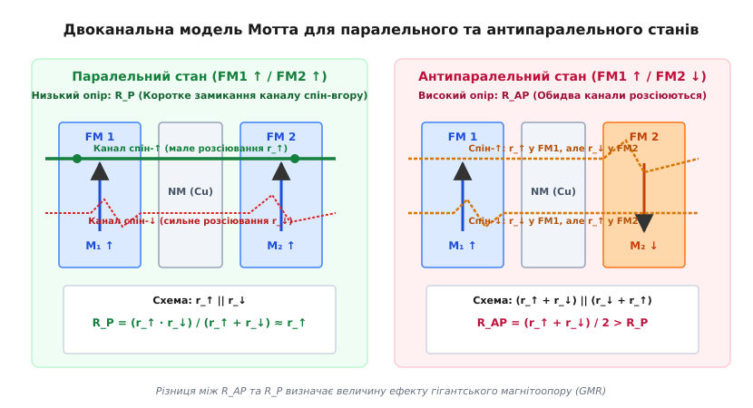
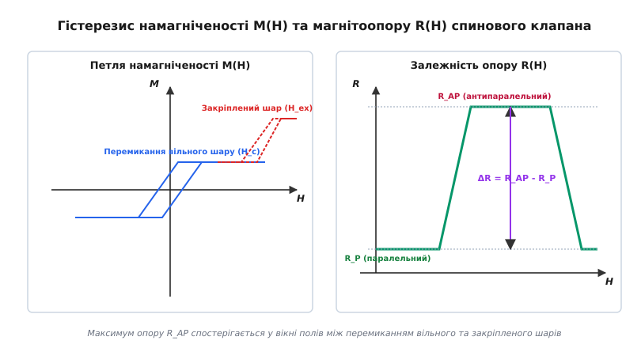
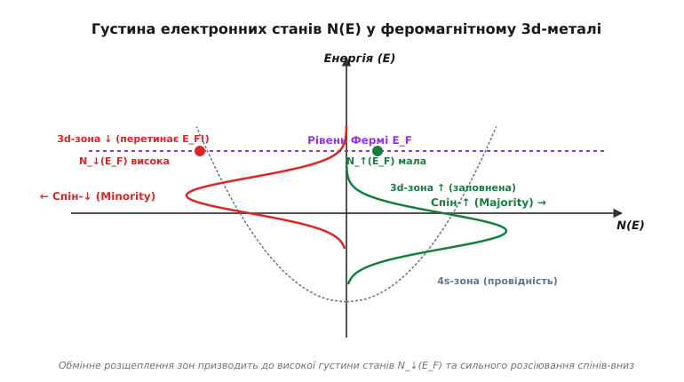
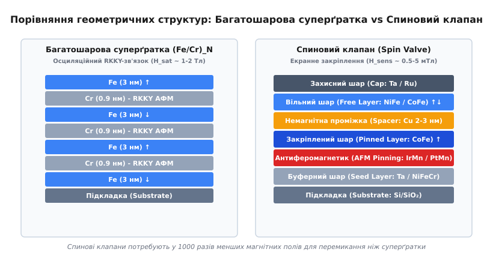

# Гігантський магнітоопір (GMR)

<preknowlist>
- [Феромагнетизм](root:ph-condensed/ferromagnetism) — спонтанна намагніченість і доменна структура 3d-металів.
- [Обмінна взаємодія](root:ph-condensed/exchange-interaction) — квантовомеханічне розщеплення електронних станів за спіном.
- [Середня довжина вільного пробігу](root:ph-condensed/mean-free-path) — відстань між послідовними актами розсіювання електронів.
- [Модель Друде](root:ph-condensed/drude-model) — класична теорія провідності електронів у металі.
</preknowlist>

Електричний опір більшості масивних металів слабко реагує на зовнішнє магнітне поле. У звичайних немагнітних провідниках класичний ординарний магнітоопір (OMR) зумовлений дією сили Лоренца, яка викривляє траєкторії електронів провідності між зіткненнями. Відносне зростання опору в такому разі пропорційне квадрату добутку циклотронної частоти на час релаксації `(ω_c·τ)²` і в полях порядку кількох мілітесл становить нікчемні частки відсотка (`10⁻⁴–10⁻³`). У масивних 3d-феромагнетиках (залізо, кобальт, нікель та їхні сплави) проявляється ефект анізотропного магнітоопору (AMR, відкритий Вільямом Томсоном у 1857 році), зумовлений спін-орбітальною взаємодією: питомий опір зразка змінюється залежно від кута `θ` між вектором густини струму `J` та вектором спонтанної намагніченості `M`:

```
ρ(θ) = ρ_⊥ + (ρ_∥ - ρ_⊥) · cos²(θ)     [залежність опору AMR від орієнтації намагніченості]
```

тут `ρ_∥` та `ρ_⊥` — питомі опори при орієнтації намагніченості паралельно та перпендикулярно до напрямку протікання струму відповідно. Проте максимальна амплітуда відгуку AMR навіть у спеціально оптимізованих магнітом'яких сплавах (наприклад, у пермалої `Ni₈₀Fe₂₀`) при кімнатній температурі не перевищує `1–3%`.

Такий слабкий магніторезистивний відгук наприкінці 1980-х років створив нездоланний фізичний бар'єр на шляху подальшого розвитку систем магнітного запису інформації. Зменшення розмірів магнітних бітів на жорстких дисках до субмікронних і нанометрових масштабів призводило до різкого падіння магнітного потоку, що розсіюється над поверхнею доріжки. Традиційні індукційні зчитувальні голівки, вихідна напруга яких визначається законом Фарадея `V_ind = -dΦ/dt = -v · (dΦ/dx)` (де `v` — лінійна швидкість обертання пластини, а `Φ` — магнітний потік), генерували занадто слабкий сигнал на низьких швидкостях. Зчитувальні голівки на основі AMR вимагали значного струму живлення і вперлися в поріг власних теплових та магнонних шумів, не дозволяючи впевнено детектувати поля величиною в одиниці мілітесл.

Виходом із цієї технологічної кризи стало відкриття у 1988 році ефекту гігантського магнітоопору (GMR, від англ. *Giant Magnetoresistance*). У штучно створених металевих гетероструктурах, де шари феромагнітного металу чергуються з шарами немагнітного металу товщиною в кілька нанометрів, спад електричного опору при зміні взаємної орієнтації намагніченостей шарів від антипаралельного до паралельного стану сягає `10–80%`. Це на один-два порядки перевищило можливості AMR і започаткувало новий розділ квантової електроніки твердого тіла — спінтроніку.

## Спін-залежне розсіювання електронів провідності

Фізичний фундамент ефекту гігантського магнітоопору базується на квантовій природі провідності у 3d-перехідних феромагнітних металах (Fe, Co, Ni). На відміну від простих лужних або благородних металів (Cu, Ag, Au), у яких зонна структура поблизу рівня Фермі формується виключно сферичною та майже ізотропною зоною рухливих `s`-електронів, електронна структура перехідних металів містить дві просторово перекривні, але принципово різні за своїми динамічними властивостями електронні підсистеми:

1. **Широка `4s`-зона провідності:** Характеризується малою ефективною масою електронів (`m_s^* ≈ m_0`), високою швидкістю Фермі (`v_F ≈ 10⁶` м/с) та відносно низькою густиною станів `D_4s(E)`. Саме високорухливі `4s`-електрони переносять понад 90% електричного заряду і визначають силу струму провідності в металі.
2. **Вузька `3d`-зона:** Складається з сильно локалізованих атомних орбіталей із великою ефективною масою (`m_d^* ≈ 5–10·m_0`), надзвичайно низькою груповою швидкістю та гігантською густиною станів `D_3d(E)` на рівні Фермі `E_F`. Електрони `3d`-зони майже не беруть безпосередньої участі у перенесенні заряду, проте слугують основним резервуаром кінцевих станів, у які розсіюються `4s`-електрони при взаємодії з дефектами кристалічної ґратки, домішками, фононами або міжфазними межами.

Відповідно до квантовомеханічного золотого правила Фермі, ймовірність переходу електрона провідності в одиницю часу `1/τ` (частота розсіювання) із початкового стану хвильової функції `|k, s⟩` у довільний вільний кінцевий стан `|k', s'⟩` на ізоенергетичній поверхні Фермі визначається матричним елементом оператора збурення `M_scat` та повною густиною доступних кінцевих станів `D(E_F)`:

```
1/τ = (2·π / ℏ) · |M_scat|² · D(E_F)     [частота розсіювання за золотим правилом Фермі]
```

Оскільки густина станів у вузькій `3d`-зоні на два порядки перевищує густину станів у `4s`-зоні (`D_3d(E_F) ≫ D_4s(E_F)`), домінуючим каналом релаксації імпульсу є саме міжзонні `s-d` переходи. Питомий електричний опір металу `ρ`, що за класичною формулою Друде пов'язаний із часом релаксації `τ` через співвідношення `ρ = m_s^* / (n · e² · τ)`, виявляється прямо пропорційним густині вільних `3d`-станів на рівні Фермі: `ρ ∝ D_3d(E_F)`.

```
                    Зонна модель Стонера для 3d-феромагнетика
                    
          Мажоритарна підзона (↑)               Міноритарна підзона (↓)
          
     E ▲                                   E ▲
       │                                     │
   E_F ┼───────────┐                     E_F ┼─────────┬─────────┐
       │           │                         │         │/////////│
       │   4s(↑)   │   3d(↑)                 │  4s(↓)  │/ 3d(↓) /│ ◄── Висока густина
       │           │ ┌───────┐               │         │/////////│     кінцевих станів
       │           │ │       │               │         │/////////│     D_3d↓(E_F)
       │           │ │Повністю               │         └─────────┘
       │           │ │заповнена              │
       │           │ └───────┘               │
       └───────────┴─────────► D(E)          └───────────────────► D(E)
       Низька D_3d↑(E_F) ───► λ_↑ велика     Висока D_3d↓(E_F) ──► λ_↓ мала
```

У феромагнітному стані ситуація докорінно змінюється внаслідок внутрішньоатомного квантового обмінного розщеплення (модель Стонера). Обмінна взаємодія між електронами розсуває підзони з протилежними орієнтаціями спіна на енергетичний інтервал `ΔE_ex = I_ex · ⟨m⟩ ≈ 1.0–2.0` еВ (де `I_ex` — обмінний інтеграл Стонера, а `⟨m⟩` — відносна спонтанна намагніченість).

У результаті цього розщеплення:
- **Підзона мажоритарних електронів (спін-вгору `↑`, паралельний намагніченості):** Опускається глибоко вниз за шкалою енергій. `3d`-підзона виявляється майже або повністю заповненою нижче рівня Фермі. Густина станів на рівні Фермі `D_3d↑(E_F)` стає мінімальною. Електрони зі спіном `↑` майже не мають вільних `3d`-рівнів для розсіювання, здійснюють лише слабкі `s-s` переходи і рухаються крізь кристал практично безперешкодно, володіючи великою середньою довжиною вільного пробігу `λ_↑` (малий питомий опір `ρ_↑`).
- **Підзона міноритарних електронів (спін-вниз `↓`, антипаралельний намагніченості):** Зміщується вгору по енергії. Рівень Фермі перетинає найщільнішу ділянку `3d`-піка станів. Густина станів `D_3d↓(E_F)` досягає гігантських значень. Електрони зі спіном `↓` зазнають катастрофічно інтенсивного `s-d` розсіювання, що призводить до короткої довжини вільного пробігу `λ_↓` (високий питомий опір `ρ_↓`).


*Густина електронних станів N(E) у 3d-феромагнетику: обмінне розщеплення створює низьку густину станів N_↑(E_F) для спінів-вгору та високу N_↓(E_F) для спінів-вниз.*

Кількісно асиметрію об'ємного розсіювання характеризують коефіцієнтом спінової асиметрії питомого опору `β`:

```
β = (ρ_↓ - ρ_↑) / (ρ_↓ + ρ_↑) = (λ_↑ - λ_↓) / (λ_↑ + λ_↓)     [об'ємний коефіцієнт спінової асиметрії]
```

Для чистого нікелю відношення питомих опорів становить `ρ_↓ / ρ_↑ ≈ 5–8` (`β ≈ 0.6–0.7`), для кобальту `ρ_↓ / ρ_↑ ≈ 3–5` (`β ≈ 0.45–0.6`), а для сплаву кобальт-залізо `Co₉₀Fe₁₀` параметр `β` може перевищувати `0.75–0.85`. Відповідно, довжини вільного пробігу при низьких температурах можуть відрізнятися у 10 разів: `λ_↑ ≈ 10–20` нм проти `λ_↓ ≈ 1–2` нм.

### Ступінь спінової поляризації та половинні метали Гейслера

Для кількісного опису магнітних властивостей носіїв на рівні Фермі використовують поняття спінової поляризації густини станів `P`:

```
P = (D_↑(E_F) - D_↓(E_F)) / (D_↑(E_F) + D_↓(E_F))     [спінова поляризація на рівні Фермі]
```

У звичайних 3d-феромагнетиках ступінь поляризації становить помірну величину: для Fe `P ≈ +42–45%`, для Co `P ≈ +45%`, для Ni `P ≈ +33%`, а для пермалою `Ni₈₀Fe₂₀` `P ≈ +48%`.

Особливий клас матеріалів для високоамплітудних GMR-структур становлять так звані половинні феромагнітні метали (Half-Metallic Ferromagnets), зокрема впорядковані сплави Гейслера (Heusler Alloys) зі стехіометрією `X₂YZ` (наприклад, `Co₂MnSi`, `Co₂FeAl`, `Co₂MnGe`) та деякі магнітні оксиди (`CrO₂`, `Fe₃O₄`). У цих сполуках квантова зонна структура влаштована так, що для мажоритарних електронів матеріал поводиться як типовий провідник із широкою зоною провідності, що перетинає `E_F`, тоді як для міноритарних електронів на рівні Фермі існує заборонена енергетична щілина шириною `0.3–0.8` еВ:

```
D_↓(E_F) = 0 ──► P = (D_↑ - 0) / (D_↑ + 0) = 1.0 (100% поляризація)
```

Завдяки повній відсутності вільних міноритарних станів при низьких температурах, параметр спінової асиметрії `β` у половинних металах наближається до 1, що дозволяє спостерігати гігантський магнітоопір амплітудою понад `70–90%` у CPP-структурах на основі `Co₂MnSi / Ag / Co₂MnSi`.

При нагріванні системи від температури рідкого гелію (`4.2 K`) до кімнатної (`300 K`) ефективна спінова поляризація спадає за законом Блоха для теплових магнонів:

```
P(T) = P_0 · (1 - A_sp · T^(3/2))     [температурна деградація спінової поляризації]
```

Теплові збудження магнонів починають перевертати спіни електронів під час дифузії, змішуючи струми в обох каналах, що пояснює зменшення величини ефекту GMR при кімнатній температурі порівняно з кріогенними умовами.

### Об'ємне та інтерфейсне спін-залежне розсіювання

Ефект GMR виникає завдяки двом фізично різним механізмам розсіювання носіїв заряду, які діють одночасно:

1. **Об'ємне розсіювання (Bulk Scattering):** Відбувається у товщі феромагнітного шару на точкових дефектах, фононах та домішкових атомах внаслідок асиметрії густини станів `D_3d↑(E_F) ≪ D_3d↓(E_F)`.
2. **Інтерфейсне розсіювання (Interface Scattering):** Відбувається безпосередньо на межі поділу між феромагнітним та немагнітним металом (`FM / NM`). На цій межі виникає ступінчаста зміна кристалічного потенціалу. Якщо хвильові функції електронів зі спіном `↑` у феромагнетику добре узгоджуються за симетрією орбіталей та хвильовими векторами Фермі `k_F` із хвильовими функціями електронів немагнітного металу (як у системі `Co / Cu`), то інтерфейс є абсолютно оптично прозорим для спінів `↑` (коефіцієнт відбивання `R_↑ ≈ 0`). Натомість для електронів зі спіном `↓` через розрив зонного потенціалу виникає потужний квантовий бар'єр відбивання (`R_↓ ≈ 1`).

Інтерфейсна спінова асиметрія описується коефіцієнтом `γ`:

```
γ = (r_S↓ - r_S↑) / (r_S↓ + r_S↑)     [інтерфейсний коефіцієнт спінової асиметрії]
```

тут `r_S↑` та `r_S↓` — питомі поверхневі опори межі поділу для відповідних спінових орієнтацій. У системах на основі `Co/Cu` інтерфейсне розсіювання дає до 60–70% повного магніторезистивного ефекту.

### Гранульовані системи GMR

Окрім плоских шаруватих плівок, гігантський магнітоопір спостерігається також у масивних гранульованих сплавах (granular alloys), таких як металургійно незмішувані пари `Co-Cu`, `Fe-Ag` або `Co-Ag`. Якщо такий сплав із вмістом феромагнетика 10–25% нанести методом сумісного магнетронного напилення або термічного випаровування на охолоджену підкладку, а потім піддати швидкому термічному відпалу при `350–500 °C`, у немагнітній мідній матриці самоорганізуються нанометрові феромагнітні гранули кобальту діаметром `d ≈ 2–5` нм.

За відсутності магнітного поля теплові флуктуації при кімнатній температурі хаотично розвертають магнітні моменти гранул завдяки явищу суперпарамагнетизму. Електрони провідності, дифундуючи крізь матрицю, по черзі зустрічають гранули з випадковими орієнтаціями намагніченостей, зазнаючи сильного розсіювання незалежно від власного спіна. Опір матеріалу є максимальним.

При накладанні сильного зовнішнього магнітного поля `H` магнітні моменти всіх гранул орієнтуються паралельно вектору поля. Для одного зі спінових каналів гранули стають прозорими, і загальний опір зразка зменшується на `10–20%`. Хоча гранульовані системи є ізотропними (ефект GMR не залежить від напрямку прикладеного струму) і значно простішими у виробництві, ніж багатошарові плівки, вони вимагають високих полів насичення (`H_sat > 0.5–1.0` Тл) через суперпарамагнітну природу гранул, що унеможливлює їхнє використання у прецизійних магнітних голівках, проте робить зручними для створення надпотужних датчиків сильних полів.

## Двоканальна модель Мотта для екстраполяції опору

Для побудови кількісної електродинамічної теорії транспорту заряду у магнітних гетероструктурах використовують феноменологічну двострумову модель Мотта (Two-Current Model), сформульовану Невіллом Моттом у 1936 році.

Головне фізичне припущення моделі полягає у тому, що при температурах, суттєво нижчих за температуру магнітного впорядкування Кюрі (`T ≪ T_C`), процеси пружного розсіювання електронів на домішках, фононах та дефектах кристалічної ґратки відбуваються строго зі збереженням спінової проекції (`Δs = 0`). Єдиним фізичним механізмом, здатним перевернути спін електрона (`↑ ↔ ↓`), є непружне розсіювання на спінових хвилях (магнонах) або взаємодія з магнітними домішками за рахунок релятивістської спін-орбітальної взаємодії.

Характерний час релаксації спіна `τ_sf` (spin-flip relaxation time) у чистих металах та немагнітних проміжках при кімнатній температурі перевищує імпульсний час розсіювання `τ_p` на два-три порядки:

```
τ_sf ≫ τ_p                     [умова слабкого спін-фліп розсіювання]
l_sf = √(D · τ_sf) ≫ d_шару    [спін-дифузійна довжина перевищує товщину шарів]
```

тут `l_sf` — довжина спінової дифузії (відстань, яку електрон проходить до втрати спінової пам'яті), `D = v_F · λ / 3` — коефіцієнт дифузії електронів, а `d_шару` — типова товщина індивідуального шару в гетероструктурі (`1–4` нм). Оскільки `l_sf` для міді перевищує `100–300` нм, а для заліза та кобальту становить `20–50` нм, електрон пролітає крізь усю наноструктуру, зберігаючи незмінною свою спінову орієнтацію.

За таких умов повний електричний струм розпадається на два повністю незалежні паралельні струмові потоки: канал електронів зі спіном «вгору» (`I_↑`) та канал електронів зі спіном «вниз» (`I_↓`). Загальна провідність структури `G` є сумою парціальних провідностей обох каналів: `G = G_↑ + G_↓`, що еквівалентно паралельному з'єднанню двох незалежних електричних резистивних гілок.


*Схема двох каналів провідності Мотта: у паралельному стані канал спін-вгору забезпечує низький опір R_P, у той час як в антипаралельному стані обидва канали зазнають сильного розсіювання, формуючи високий опір R_AP.*

Розглянемо проходження струму крізь тришаровий сендвіч `FM1 / NM / FM2`, що складається з двох однакових феромагнітних шарів товщиною `d_FM` та немагнітної проміжки `NM` товщиною `d_NM`. Позначимо активний опір одного феромагнітного шару для мажоритарних носіїв як `r_↑`, а для міноритарних як `r_↓` (де через асиметрію розсіювання `r_↓ > r_↑`).

### 1. Паралельний магнітний стан (P)

Вектори спонтанної намагніченості обох шарів орієнтовані колінеарно в одному напрямку (`FM1 ↑ / FM2 ↑`).
- **Канал спін-вгору (`↑`):** Для цих носіїв обидва шари `FM1` та `FM2` є мажоритарними середовищами з низькою густиною станів. Електрони відчувають слабке розсіювання в обох шарах. Повний послідовний опір верхньої гілки дорівнює: `R_каналу↑ = r_↑ + r_↑ = 2·r_↑`.
- **Канал спін-вниз (`↓`):** Для цих носіїв обидва шари є міноритарними середовищами з високою густиною станів. Електрони зазнають сильного розсіювання в обох шарах. Повний послідовний опір нижньої гілки дорівнює: `R_каналу↓ = r_↓ + r_↓ = 2·r_↓`.

Еквівалентний електричний опір системи у паралельному стані `R_P` розраховується за формулою паралельного з'єднання:

```
R_P = (R_каналу↑ · R_каналу↓) / (R_каналу↑ + R_каналу↓)
    = (2·r_↑ · 2·r_↓) / (2·r_↑ + 2·r_↓)
    = 2·r_↑·r_↓ / (r_↑ + r_↓)                              [еквівалентний опір стану P]
```

Оскільки низькоомний канал `2·r_↑` увімкнений паралельно з високоомним `2·r_↓`, він виконує роль ефективного шунта короткого замикання: практично весь електричний струм вибирає шлях найменшого опору і вільно протікає крізь мажоритарний канал. Загальний опір `R_P` виявляється близьким до мінімального значення `2·r_↑`.

### 2. Антипаралельний магнітний стан (AP)

Вектор намагніченості першого шару спрямований вгору, а другого — вниз (`FM1 ↑ / FM2 ↓`).
- **Канал спін-вгору (`↑`):** Електрони вільно і без розсіювання проходять шар `FM1` (мажоритарний, опір `r_↑`), проте при попаданні в шар `FM2` вони опиняються в міноритарному середовищі з гігантською густиною кінцевих станів і зазнають інтенсивного розсіювання (опір `r_↓`). Загальний опір каналу: `R_каналу↑ = r_↑ + r_↓`.
- **Канал спін-вниз (`↓`):** Електрони інтенсивно розсіюються у першому шарі `FM1` (міноритарний, опір `r_↓`), але вільно долають другий шар `FM2` (мажоритарний, опір `r_↑`). Загальний опір каналу: `R_каналу↓ = r_↓ + r_↑`.

У антипаралельному стані обидва паралельні канали набувають абсолютно однакового, високого опору. Ефект низькоомного шунтування повністю зникає, оскільки кожен електрон незалежно від початкового спіна обов'язково зазнає зіткнення принаймні в одному з двох феромагнітних шарів. Еквівалентний опір `R_AP` становить:

```
R_AP = (R_каналу↑ · R_каналу↓) / (R_каналу↑ + R_каналу↓)
     = (r_↑ + r_↓) · (r_↑ + r_↓) / (2 · (r_↑ + r_↓))
     = (r_↑ + r_↓) / 2                                     [еквівалентний опір стану AP]
```

### Виведення магніторезистивного коефіцієнта GMR

Абсолютна зміна електричного опору при перемагнічуванні структури становить:

```
R_AP - R_P = (r_↑ + r_↓)/2 - 2·r_↑·r_↓/(r_↑ + r_↓)
           = ((r_↑ + r_↓)² - 4·r_↑·r_↓) / (2·(r_↑ + r_↓))
           = (r_↓ - r_↑)² / (2·(r_↑ + r_↓)) > 0            [різниця опорів станів AP та P]
```

Оскільки різниця `(r_↓ - r_↑)²` містить квадрат, величина `R_AP - R_P` завжди є строго додатною за будь-якої несиметричності розсіювання. Опір антипаралельного стану завжди перевищує опір паралельного стану.

Нормований коефіцієнт гігантського магнітоопору (визначення за оптимістичною шкалою `GMR_P`) розраховується як відношення зміни опору до опору низькоомного паралельного стану:

```
GMR = (R_AP - R_P) / R_P
    = [ (r_↓ - r_↑)² / (2·(r_↑ + r_↓)) ] / [ 2·r_↑·r_↓ / (r_↑ + r_↓) ]
    = (r_↓ - r_↑)² / (4·r_↑·r_↓)                           [амплітуда GMR через опори каналів]
```

Підставляючи вирази для парціальних опорів через коефіцієнт об'ємної спінової асиметрії `r_↑ = r_0·(1 - β)` та `r_↓ = r_0·(1 + β)` (де `r_0 = (r_↑ + r_↓)/2`), маємо:

```
r_↓ - r_↑ = r_0·(1 + β) - r_0·(1 - β) = 2·β·r_0
r_↑ · r_↓ = r_0² · (1 - β²)

GMR = (2·β·r_0)² / (4 · r_0²·(1 - β²))
    = 4·β²·r_0² / (4·r_0²·(1 - β²))
    = β² / (1 - β²)                                        [зв'язок GMR з коефіцієнтом асиметрії β]
```

Детальне [математичне виведення двоканальної моделі Мотта](root:ph-condensed/giant-magnetoresistance/math-mott-two-channel.md) для багатошарових періодичних структур показує, що при зростанні параметра `β` від 0 до 1 величина GMR нелінійно зростає до нескінченності. При типовому для сплавів CoFe значенні `β = 0.6` теоретичний коефіцієнт GMR становить `0.36 / (1 - 0.36) = 56.2%`.

Якщо врахувати паразитний шунтувальний опір немагнітного шару проміжки `r_NM` (шар міді), який додається однаково до обох спінових каналів (`R_каналу↑ = 2·r_↑ + r_NM`, `R_каналу↓ = 2·r_↓ + r_NM`), підсумковий магніторезистивний ефект зменшується:

```
GMR(d_NM) = (r_↓ - r_↑)² / [ 4·r_↑·r_↓ + 2·r_NM·(r_↑ + r_↓) ]
```

Звідси випливає важлива технологічна вимога: товщину проміжки `d_NM` слід робити мінімально можливою, оскільки зайва товщина міді шунтує спін-залежні феромагнітні шари паразитичним струмом, зменшуючи амплітуду корисного сигналу.

## Геометрії протікання струму: CIP та CPP

Залежно від взаємної орієнтації вектора густини струму `J` та площини тонких плівок виділяють дві фундаментальні експериментальні та конструктивні геометрії:

```
          CIP (Current-In-Plane)                   CPP (Current-Perpendicular-to-Plane)
          Струм у площині шарів                    Струм перпендикулярно до шарів
          
                  I ──►                                           │ I
        ┌─────────────────────────┐                     ┌─────────┴─────────┐
        │  Вільний шар (FM)       │                     │  Вільний шар (FM) │
        ├─────────────────────────┤                     ├───────────────────┤
        │  Проміжка (Cu)          │                     │  Проміжка (Cu)    │
        ├─────────────────────────┤                     ├───────────────────┤
        │  Закріплений шар (FM)   │                     │  Закріплений (FM) │
        └─────────────────────────┘                     └─────────┬─────────┘
                  I ──►                                           │ ▼
        • Струм шунтується міддю                        • 100% струму перетинає межі
        • GMR: 8–15% при 300 K                          • GMR: 25–50% при 300 K
        • Опір: 10–100 Ом                               • Опір: 0.1–1.0 Ом
```

### Геометрія CIP (Current-In-Plane)

У конфігурації CIP електричні контакти розташовані на бічних торцях багатошарової структури, і струм тече вздовж площини шарів. Електрони рухаються паралельно границям розділу, багаторазово перетинаючи інтерфейси `FM / NM` за рахунок теплового руху та дифракційного розсіювання.

Теоретичний опис CIP-транспорту ґрунтується на напівкласичному кінетичному рівнянні Больцмана з граничними умовами Фукса-Зондгеймера (модель Кемлі-Барнася):

```
v_z · (∂f_↑,↓ / ∂z) + (e·E_x / m*) · (∂f_↑,↓ / ∂v_x) = - (f_↑,↓ - f_0) / τ_↑,↓
```

де `z` — координата по нормалі до шарів, `E_x` — поздовжнє електричне поле, а `p_↑,↓` — коефіцієнти дзеркального відбивання на міжфазних границях.

Головні особливості та обмеження CIP:
- **Паразитичне шунтування:** Значна частка струму протікає по високопровідному шару міді (`ρ_Cu ≈ 2` мкОм·см проти `ρ_CoFe ≈ 15–25` мкОм·см), не беручи участі у формуванні спін-залежного розсіювання.
- **Вимога до довжини вільного пробігу:** Ефект GMR спостерігається лише тоді, коли товщина шарів є меншою за довжину вільного пробігу `d < λ_↑`. Якщо товщина шарів перевищує `λ_↑`, більшість електронів розсіюється всередині одного шару, не долітаючи до другого, і магнітоопір експоненціально спадає як `λ / d`.
- **Практична зручність:** Опір вимірювальних елементів перебуває у зручному діапазоні `10–100` Ом, що дозволило компанії IBM створити перші комерційні зчитувальні голівки на основі CIP-структур без потреби у складній субмікронній стовпчиковій нанолітографії. Величина кімнатного GMR у CIP-геометрії становить `8–15%`.

### Геометрія CPP (Current-Perpendicular-to-Plane) та модель Валета — Ферта

У геометрії CPP струм підводиться до верхньої та нижньої площин структури і протікає строго перпендикулярно до наношарів. Кожен електрон провідності примусово перетинає абсолютно всі інтерфейси гетероструктури.

Оскільки густина струму електронів зі спіном `↑` та `↓` у феромагнетику є різною (`j_↑ ≠ j_↓`), а в немагнітному металі струми мають бути однаковими, на міжфазній межі виникає розрив спінового струму. Це призводить до накопичення надлишкового просторового спінового заряду — явища спінового накопичення (spin accumulation). Спінове накопичення описується розщепленням квазірівнів Фермі (хімічних потенціалів) для двох спінових підсистем: `Δμ(z) = μ_↑(z) - μ_↓(z)`.

Теорія Валета — Ферта (Valet-Fert Theory, 1993) описує просторовий розподіл спінового накопичення у геометрії CPP за допомогою одновимірного дифузійного рівняння:

```
∂²(Δμ) / ∂z² = Δμ / l_sf²     [дифузійне рівняння Валета — Ферта для накопичення спіна]
```

тут `l_sf` — довжина спінової дифузії відповідного матеріалу. Граничні умови на кожній межі поділу вимагають неперервності спінового струму та стрибка хімічного потенціалу, пропорційного інтерфейсному опору `r_S` та коефіцієнту асиметрії `γ`.

Розв'язок рівняння показує, що у геометрії CPP повний опір структури, помножений на площу контакту `A · R`, для паралельного та антипаралельного станів описується виразами:

```
A · R_AP = N · [ ρ_FM·d_FM + ρ_NM·d_NM + 2·r_S ]
A · R_P  = A · R_AP - [ (N · β · ρ_FM·d_FM + 2·N · γ · r_S)² / (A · R_AP) ]
```

де `N` — кількість періодів структури.

Переваги та особливості CPP:
1. **Висока амплітуда ефекту:** Відсутнє паразитичне шунтування міддю. Величина GMR у CPP-геометрії при кімнатній температурі досягає `30–60%` (у 2–3 рази вище, ніж у CIP).
2. **Масштабованість:** При зменшенні площі зчитувального датчика `A` його опір `R = (A·R)/A` зростає, що дозволяє створювати нанодатчики з площею менше `50×50` нм для надвисокої щільності запису HDD.
3. **Технологічна складність:** Оскільки питомий добуток `A · R` для металевих CPP-структур становить усього `0.05–0.5` мОм·мкм², опір елементів розміром у кілька мікрометрів становить частки міліома, що робить його важким для вимірювання через вплив контактних провідників. Застосування CPP вимагає формування субмікронних наностовпчиків (nanopillars).

## Від суперґраток Fe/Cr до спінових клапанів FM/NM/FM

Історично перші структури, у яких було відкрито GMR, являли собою штучні монокристалічні суперґратки `(Fe / Cr)ₙ`, вирощені методом молекулярно-променевої епітаксії (MBE). Досліджуючи [історію відкриття GMR Альбертом Фером та Петером Ґрюнберґом](root:ph-condensed/giant-magnetoresistance/hist-fert-gruenberg.md), можна простежити, як експерименти з багатошаровими суперґратками в Орсє та тришаровими сендвічами Fe/Cr/Fe в Юліху привели до виявлення фундаментального явища міжшарового обмінного зв'язку Рудермана — Кіттеля — Касуї — Йосіди (РККІ, або RKKY-зв'язок).

```
          Міжшаровий обмінний зв'язок RKKY крізь немагнітну проміжку
          
    Енергія зв'язку J_ex ▲
                         │      Феромагнітний зв'язок (P)
                      +  │      ┌───┐             ┌───┐
                         │     ┌┘   └┐           ┌┘   └┐
                      0 ─┼─────┼─────┼───────────┼─────┼──────────► Товщина проміжки d_NM
                         │    ┌┘     └┐         ┌┘     └┐
                      -  │────┘       └─────────┘       └─────
                         │     1-й АФМ-пік       2-й АФМ-пік
                         │  (Cr 0.9 нм, Ru 0.8 нм) (Cr 2.1 нм)
                         ▼     Антиферомагнітний зв'язок (AP)
```

Спіни електронів провідності немагнітного металу (Cr, Cu, Ru) поляризуються на межі із феромагнетиком за рахунок `s-d` обмінної взаємодії. Спіново поляризована хвиля електронної густини поширюється углиб проміжки. Внаслідок інтерференції хвильових функцій на протилежній межі виникає осцилювальний обмінний зв'язок між сусідніми шарами заліза, енергія якого на одиницю площі описується асимптотичною формулою:

```
E_inter(d) = - J_ex(d) · (M₁ · M₂) / (|M₁| · |M₂|)
J_ex(d)    = (J_0 / d²) · Σ_i A_i · sin(q_sp,i · d + φ_i)     [осциляції міжшарового зв'язку RKKY]
```

тут `q_sp = 2·(k_F - k_ext)` — вектор екстремального перетину (spanning vector) поверхні Фермі немагнітного металу, який визначає просторовий період осциляцій `Λ = 2·π / q_sp ≈ 0.8–1.2` нм.

При товщині хрому `d_Cr ≈ 0.9` нм зв'язок між шарами заліза є строго антиферомагнітним (`J_ex < 0`). У відсутності зовнішнього поля вектори намагніченості сусідніх шарів заліза за рахунок RKKY-зв'язку встановлюються строго антипаралельно один до одного (`↑ ↓ ↑ ↓`), формуючи високоомний стан. Зовнішнє магнітне поле долає енергію RKKY-зв'язку і насичує всі шари паралельно полю (`↑ ↑ ↑ ↑`), що викликає спад опору на 50% при гелієвих температурах.

### Квантові розмірні стани (Quantum Well States) у немагнітній проміжці


*Ілюстрація: Fig1 Mott Two Channel.*



*Ілюстрація: Fig3 Gmr Hysteresis Curve.*



*Ілюстрація: Fig4 Spin Dependent Density Of States.*

Мікроскопічна квантова природа осциляцій RKKY та магніторезистивного відгуку тісно пов'язана з формуванням квантових розмірних станів (Quantum Well States, QWS) усередині тонкого шару немагнітного металу (Cu, Ag, Cr).

Оскільки електрони зі спіном `↓` зазнають майже повного внутрішнього квантовомеханічного відбивання на інтерфейсах `FM/NM`, немагнітна плівка міді чи хрому між двома феромагнітними шарами працює як одновимірна квантова потенціальна яма для міноритарних носіїв. Умова квантування хвильового вектора Фабрі — Перо для стоячих хвиль електронів у проміжці товщиною `d_NM` має вигляд:

```
2 · k_z · d_NM + φ_1 + φ_2 = 2 · π · n     [умова резонансного квантування рівнів QWS]
```

де `φ_1` та `φ_2` — фазові зсуви при відбиванні від меж, а `n` — ціле квантове число.

При плавному збільшенні товщини проміжки `d_NM` дискретні квантові рівні `E_n` почергово перетинають рівень Фермі `E_F`. Кожен перетин енергетичного рівня через поверхню Фермі супроводжується різким локальним зростанням густини станів `D(E_F)` усередині проміжки та зміною повної енергії зв'язаного електронного газу. Це безпосередньо генерує осциляції знака обмінного інтеграла `J_ex(d)` між феромагнітним та антиферомагнітним станами, що експериментально підтверджується методами фотоелектронної спектроскопії з кутовим розділенням (ARPES).


*Конструктивне порівняння багатошарової суперґратки (Fe/Cr)ₙ та спинового клапана: спиновий клапан використовує закріплення антиферомагнетиком замість жорсткого RKKY-зв'язку.*

Проте суперґратки Fe/Cr володіли критичним недоліком: для розвороту сильного антиферомагнітного зв'язку крізь надтонкий хром вимагалися зовнішні поля насичення понад `1–2` Тл (`10 000–20 000` Ерстед). Такі гігантські поля було неможливо створити від нанометрових бітів жорсткого диска.

### Конструкція спінового клапана (Spin Valve)

Революційне вирішення проблеми надвисоких полів запропонували Б. Діні (B. Dieny) та С. Паркін (S. Parkin) у 1991 році, створивши спіновий клапан (*Spin Valve*). У цій структурі функції шарів були штучно розділені за рахунок контролю магнітної анізотропії та використання явища екранного обмінного зсуву (*Exchange Bias*).



*Ілюстрація: Fig2 Gmr Multilayer Vs Spin Valve.*

Детальні [конструктивні особливості багатошарового спинового клапана](root:ph-condensed/giant-magnetoresistance/comp-spin-valve.md) полягають у наступній пошаровій наноархітектурі:

```
┌─────────────────────────────────────────────────────────────┐
│ 6. Захисний шар (Cap Layer): Ta / Ru (2–3 нм)               │
├─────────────────────────────────────────────────────────────┤
│ 5. Вільний шар (Free Layer): Ni₈₀Fe₂₀ (3 нм) / CoFe (0.5 нм)│ ◄── Повертається полем H < 0.5 мТл
├─────────────────────────────────────────────────────────────┤
│ 4. Немагнітна проміжка (Spacer): Cu (2.0–2.5 нм)            │ ◄── d > d_RKKY (магнітна розв'язка)
├─────────────────────────────────────────────────────────────┤
│ 3. Закріплений шар (Pinned Layer): Co₉₀Fe₁₀ (2–3 нм)         │ ◄── Намагніченість зафіксована
├─────────────────────────────────────────────────────────────┤
│ 2. Антиферомагнетик (AFM): Ir₂₀Mn₈₀ (6–8 нм) або PtMn       │ ◄── Створює поле обмінного зсуву H_ex
├─────────────────────────────────────────────────────────────┤
│ 1. Буферний шар (Seed Layer): Ta (3 нм) / NiFeCr            │ ◄── Задає ГЦК (111) текстуру
├─────────────────────────────────────────────────────────────┤
│ Підкладка: Si / SiO₂                                        │
└─────────────────────────────────────────────────────────────┘
```

1. **Немагнітна мідна проміжка (Cu Spacer):** Її товщину вибирають рівною `d_Cu = 2.0–2.5` нм. Це більше за радіус дії першого антиферомагнітного максимуму RKKY (`~1.0` нм), що повністю усуває магнітний зв'язок між вільним і закріпленим шарами (`J_RKKY ≈ 0`). При цьому товщина залишається на два порядки меншою за довжину збереження спінової пам'яті в міді (`l_sf > 150` нм).
2. **Вільний шар (Free Layer):** Виготовляється з магнітом'якого сплаву пермалою `Ni₈₀Fe₂₀` із тонкою вставкою `CoFe` на межі з міддю для посилення інтерфейсного розсіювання. Має майже нульову магнітострикцію та коерцитивну силу менше `0.2–0.5` мТл, завдяки чому його вектор намагніченості вільно обертається під дією найдрібніших зовнішніх магнітних полів.
3. **Закріплений шар (Pinned Layer):** Шар `Co₉₀Fe₁₀`, вектор намагніченості якого жорстко зафіксований в одному просторовому напрямку.
4. **Антиферомагнітний шар (AFM Pinning Layer):** Сплав `Ir₂₀Mn₈₀` або `Pt₅₀Mn₅₀`. Створює явище екранного обмінного зсуву (*Exchange Bias*). При охолодженні структури в однорідному магнітному полі нижче температури блокування `T_B` некомпенсовані спіни поверхні антиферомагнетика через пряму обмінну взаємодію `J_K` замикаються на спіни `CoFe`, утримуючи намагніченість закріпленого шару еквівалентним внутрішнім полем обмінного зсуву:

```
H_ex = J_K / (M_s · d_pinned)     [величина поля обмінного зсуву]
```

Типові значення `H_ex` становлять `30–60` мТл, що на два порядки перевищує коерцитивну силу вільного шару.

### Синтетичний антиферомагнетик (SAF)

У прецизійних датчиках та сучасних зчитувальних голівках замість простого закріпленого шару застосовують тришарову систему — синтетичний антиферомагнетик (Synthetic Antiferromagnet, SAF): `CoFe(t₁) / Ru (0.8 нм) / CoFe(t₂) / IrMn`.

Товщина рутенію `0.8` нм відповідає найглибшому першому антиферомагнітному піку RKKY-взаємодії між шарами кобальт-заліза (`J_RKKY ≈ -1.0` мДж/м²). Переваги конструкції SAF:
- **Замикання магнітного потоку (Flux Closure):** Якщо товщини підібрані так, що магнітні моменти шарів скомпенсовані (`M₁·t₁ = M₂·t₂`), сумарний магнітний момент закріпленої системи дорівнює нулю. Це повністю ліквідує магнітостатичні поля розсіювання (demagnetizing stray fields) від країв датчика, які в простих клапанах розмагнічували та підмагнічували вільний шар.
- **Гігантське поле закріплення:** Ефективне поле розкріплення `H_ex` зростає до `200–400` мТл.
- **Термічна стійкість:** SAF надійно зберігає магнітну орієнтацію при технологічних нагрівах до `200–250 °C`.

## Петлі гістерезису намагніченості M(H) та магнітоопору R(H)

Робота спінового клапана наочно демонструється суміщеними петлями гістерезису намагніченості `M(H)` та кривими зміни електричного опору `R(H)`.


*Гістерезис намагніченості M(H) та магнітоопору R(H) спинового клапана: плато високого опору R_AP формується в інтервалі полів між коерцитивним полем H_c та полем обмінного зсуву H_ex.*

При циклічній розгортці зовнішнього магнітного поля `H` вздовж осі легкого намагнічування система проходить чотири послідовні фази:

1. **Сильне від'ємне поле (`H < -H_ex`):** Зовнішнє поле долає поле обмінного зсуву `H_ex` і поле коерцитивності вільного шару. Намагніченості обох шарів орієнтовані паралельно полю (вліво `← ←`). Система перебуває у низькоомному паралельному стані: `R = R_P`.
2. **Зменшення від'ємного поля (`-H_ex < H < -H_c`):** Коли зовнішнє поле стає слабшим за `H_ex`, внутрішній обмінний зв'язок з антиферомагнетиком повертає закріплений шар у вихідний зафіксований стан (вправо `→`). Вільний шар, володіючи низькою коерцитивною силою, все ще утримується зовнішнім від'ємним полем у напрямку вліво (`←`). Формується антипаралельний стан (`← →`), і опір стрибкоподібно зростає до максимуму: `R = R_AP`.
3. **Перехід через нуль та слабке позитивне поле (`-H_c < H < +H_c`):** Вільний шар перемагнічується у напрямку позитивного поля (вправо `→`). Обидва шари знову стають паралельними (`→ →`), опір повертається до мінімуму `R = R_P`.
4. **Плато магнітоопору:** Ширина вікна високого опору `ΔH = H_ex - H_c` забезпечує надійний цифровий діапазон розділення логічних станів 0 та 1.

Виконуючи [числове моделювання кривої магнітоопору](root:ph-condensed/giant-magnetoresistance/proj-gmr-simulation.md), можна розрахувати зміщення петлі вільного шару під дією міжшарового неєлівського топологічного зв'язку (Orange-peel coupling). Якщо межі розділу мають періодичну хвилястість із середньою висотою шорсткості `h` та довжиною хвилі `λ_r`, магнітні полюси на нерівностях створюють локальні поля розсіювання, що зміщують петлю перемагнічування вільного шару на величину:

```
H_orange = (π² · h² / (√2 · λ_r · d_free)) · M_pinned · exp(- 2·π·√2 · d_spacer / λ_r)
```

Для усунення цього зміщення шорсткість плівок при магнетронному напиленні підтримують на рівні `RMS < 0.15–0.2` нм.

### Високочастотна динаміка та рівняння Ландау — Ліфшиця — Ґільберта (LLG)

Коли GMR-елемент працює у складі високошвидкісної зчитувальної голівки або мікрохвильового спінового наногенератора при швидкостях передачі даних у гігагерцовому діапазоні (понад `1–3` Гбіт/с), вектор намагніченості вільного шару `M` не встигає миттєво слідувати за змінами зовнішнього магнітного поля `H(t)`.

Просторово-часова динаміка намагніченості описується диференціальним рівнянням Ландау — Ліфшиця — Ґільберта (LLG):

```
dM/dt = - γ_0 · (M × H_eff) + (α / M_s) · (M × dM/dt)     [рівняння динаміки намагніченості LLG]
```

тут `γ_0 = μ_0 · γ_e ≈ 2.21·10⁵` м/(А·с) — гіромагнітне співвідношення для електрона, `H_eff` — сумарне ефективне магнітне поле (включаючи зовнішнє поле, поле анізотропії та розмагнічувальні поля), а `α` — безрозмірний параметр магнітної релаксації (затухання Ґільберта).

Перший доданок описує гіроскопічну прецесію намагніченості довкола вектора ефективного поля з частотою феромагнітного резонансу (FMR):

```
f_FMR = (γ_0 / (2·π)) · √( H_eff · (H_eff + 4·π·M_s) )     [частота феромагнітного резонансу Кіттеля]
```

Другий доданок описує спінову релаксацію, що спрямовує вектор намагніченості до рівноважного стану. Для сплавів пермалою параметр затухання становить `α ≈ 0.008–0.015`. Якщо параметр `α` є занадто малим, перемикання супроводжується небажаними високочастотними дзвоноподібними коливаннями намагніченості (ringing effect), що спотворює форму вихідного сигналу; якщо ж `α` завеликий, час наростання імпульсу сповільнюється. Частота зрізу GMR-датчиків за смугою пропускання становить близько `1–2` ГГц.

### Кутова характеристика та лінеаризація відгуку

При довільному куті `θ` між векторами намагніченості вільного та закріпленого шарів опір спінового клапана підпорядковується закону:

```
R(θ) = R_P + [(R_AP - R_P) / 2] · (1 - cos θ) = R_0 - (ΔR_GMR / 2) · cos θ
```

де `R_0 = (R_P + R_AP) / 2`, а `ΔR_GMR = R_AP - R_P`.

```
        R(θ) ▲
             │
        R_AP ┼──────────────────────┐
             │                     /│\
             │                    / │ \
         R_0 ┼ - - - - - - - - - ┼ -│- ┼ ◄── Лінійна робоча точка (θ = 90°)
             │                  /   │   \
             │                 /    │    \
         R_P ┼────────────────┘     │     └───
             └──────────────────────┼─────────► Кут θ
             0° (Паралельний)      90°       180° (Антипаралельний)
```

Для використання спінового клапана у ролі лінійного аналогового датчика (наприклад, у зчитувальних голівках HDD чи вимірювачах струму) вихідну робочу точку необхідно змістити у стан `θ = 90°` (вектори намагніченостей взаємно перпендикулярні у відсутності сигналу). Поблизу `θ = 90°` функція `cos(90° + δθ) = - sin(δθ) ≈ - δθ`, завдяки чому зміна опору стає строго лінійною функцією малого вимірюваного поля: `ΔR(H) ∝ H`.

Для створення перпендикулярної конфігурації використовують:
1. **Взаємно перпендикулярні осі магнітної анізотропії:** Вісь легкого намагнічування закріпленого шару фіксують магнітним відпалом уздовж осі `Y`, а вісь легкого намагнічування вільного шару задають уздовж осі `X` за допомогою анізотропії форми (геометричне співвідношення довжини до ширини смужки).
2. **Смужки Барбера (Barber Poles):** На поверхню сенсора під кутом 45° напилюють високопровідні золоті або алюмінієві смужки, які повертають вектор густини струму на 45° відносно осі датчика.
3. **Стабілізаційні магніти поздовжнього зміщення (Hard Bias):** На краях вільного шару розташовують магнітотверді постійні магніти (`CoPt` або `CoCrPt`), які створюють слабке поздовжнє поле. Це усуває доменні стінки у вільному шарі, переводить його в монодоменний стан і повністю пригнічує шуми стрибків Баркгаузена при перемагнічуванні.

## Технологічний прорив, сенсорика та покроковий розрахунок давача

Упровадження спінових клапанів компанією IBM у 1997 році (серія накопичувачів Deskstar 16GP «Titan», ємністю 16.8 ГБ) спричинило справжній технологічний вибух у галузі збереження даних. Протягом 1997–2005 років щільність магнітного запису на жорстких дисках зростала з темпом понад 60–100% на рік (проти 25–30% у еру AMR та індукційних голівок), перетнувши рубіж у `100 Гбіт/дюйм²`.

Окрім комп'ютерної пам'яті, GMR-елементи стали домінуючим стандартом у прецизійному приладобудуванні:
- **Безконтактні вимірювачі електричного струму:** Сенсор встановлюється поруч із друкованою струмовою доріжкою або силовою шиною, вимірюючи напруженість магнітного поля Біо — Савара `B = μ₀·I / (2·π·r)` без розриву електричного кола та з повною гальванічною розв'язкою.
- **Датчики положення та швидкості обертання:** Використовуються в автомобільних системах ABS/ESP, датчиках кута повороту колінчастого та розподільчого валів двигунів внутрішнього згоряння, безколекторних електродвигунах та робототехнічних енкодерах.
- **Біосенсори та магнітна мікрофлюїдика:** Реєстрація надслабких полів від біомолекул, помічених нанометровими магнітними маркерами (superparamagnetic nanoparticles).

### Дзеркальні нанооксидні шари (Nano-Oxide Layers, NOL)

Для подальшого збільшення амплітуди CIP-GMR у промислових датчиках застосовують технологію дзеркального квантового відбивання за допомогою нанооксидних шарів (NOL). Введення субатомного шару оксиду (`CoFeO_x` або `AlO_x` товщиною `0.5–1.0` нм) усередину закріпленого або захисного шару створює високий діелектричний потенціальний бар'єр.

Електрони провідності зазнають дзеркального квантового відбивання від шару NOL замість дифузного розсіювання на зовнішніх шорстких поверхнях плівки. Це ефективно утримує носії заряду всередині активного спін-залежного металевого каналу, штучно подовжуючи їхній ефективний пробіг і підвищуючи кімнатну амплітуду CIP-GMR із `10–12%` до `16–20%`.

### Мостова топологія вимірювального вузла

Одиночний GMR-резистор володіє високим температурним коефіцієнтом опору (`TCR ≈ +0.14%/°C`), зумовленим зростанням фононного розсіювання. Щоб виключити вплив температури на результат вимірювання, використовують повний міст Вітстона, сформований на єдиному кристалі.

Використовуючи [параметри електричного інтерфейсу та мостового підключення GMR-сенсора](root:ph-condensed/giant-magnetoresistance/api-gmr-sensor.md), чотири спінові клапани з'єднують за диференціальною схемою: два протилежні плеча екранують товстим шаром магніто-м'якого пермалою (екрановані опорні резистори), або поляризують сусідні плечі у протилежних напрямках.

```
                      Мостова топологія Вітстона для GMR-сенсора
                      
                                 ┌──────────────┐
                                 │   V_cc (+)   │
                                 └──────┬───────┘
                                        │
                         ┌──────────────┴──────────────┐
                         │                             │
                  ┌──────┴──────┐               ┌──────┴──────┐
                  │ R1 = R₀+ΔR  │               │ R2 = R₀-ΔR  │
                  │   Активне   │               │ Реверсивне  │
                  └──────┬──────┘               └──────┬──────┘
                         │                             │
                         ├─────────────┐               ├─────────────┐
                         │             │               │             │
                  ┌──────┴──────┐ ┌────┴────────┐ ┌────┴────────┐ ┌──┴──────────┐
                  │  OUT-       │ │ R3 = R₀-ΔR  │ │  OUT+       │ │ R4 = R₀+ΔR  │
                  └─────────────┘ │ Реверсивне  │ └─────────────┘ │   Активне   │
                                  └─────┬───────┘                 └─────┬───────┘
                                        │                               │
                                        └──────────────┬────────────────┘
                                                       │
                                                ┌──────┴──────┐
                                                │   GND (-)   │
                                                └─────────────┘
```

Диференціальна вихідна напруга моста `V_out = V_(OUT+) - V_(OUT-)` за умови `ΔR ≪ R_0` є строго лінійною:

```
V_out = V_cc · (ΔR(H) / R_0) = V_cc · S_v · H     [диференціальна вихідна напруга моста]
```

де `S_v` — питома магніточутливість моста (мВ/В/мТл). Температурний дрейф опору проявляється як синфазний сигнал і повністю пригнічується диференціальним інструментальним підсилювачем.

### Покроковий інженерний розрахунок мікроструктури GMR-сенсора

Розглянемо практичний приклад проєктування лінійного датчика слабкого магнітного поля на основі CIP-спінового клапана:

#### Вихідні технічні вимоги:
- Номінальний опір моста: `R_0 = 5.0` кОм (струм споживання `1.0` мА при живленні `5.0` В).
- Робочий лінійний діапазон полів: `B = ± 2.0` мТл.
- Максимальна амплітуда GMR плівки: `GMR = 12%`.
- Поле магнітного насичення вільного шару: `B_sat = 3.0` мТл.

#### 1. Розрахунок поверхневого опору наноструктури (Sheet Resistance)
Спіновий клапан складається з металевого пакету шарів: `Ta (3 нм) / NiFe (4 нм) / Cu (2.2 нм) / CoFe (2.5 нм) / IrMn (7 нм) / Ta (2 нм)`.
Ефективний питомий поверхневий опір плівки `R_□` (опір квадрата) обчислюється як сума паралельних провідностей індивідуальних шарів:

```
1 / R_□ = Σ (d_i / ρ_i)
```

Підставляючи питомі опори матеріалів (`ρ_Ta ≈ 130` мкОм·см, `ρ_NiFe ≈ 20` мкОм·см, `ρ_Cu ≈ 2.5` мкОм·см, `ρ_CoFe ≈ 18` мкОм·см, `ρ_IrMn ≈ 150` мкОм·см), отримуємо загальну провідність квадрата:

```
1 / R_□ = (3·10⁻⁷ / 130·10⁻⁶) + (4·10⁻⁷ / 20·10⁻⁶) + (2.2·10⁻⁷ / 2.5·10⁻⁶) + (2.5·10⁻⁷ / 18·10⁻⁶) + (7·10⁻⁷ / 150·10⁻⁶)
        = 0.0023 + 0.0200 + 0.0880 + 0.0139 + 0.0047 = 0.1289 Ом⁻¹
R_□     = 1 / 0.1289 ≈ 7.75 Ом/□
```

#### 2. Геометрія чутливого резистивного елемента
Для формування резистора з номіналом `R_res = 5.0` кОм необхідна кількість квадратів становить:

```
N_□ = R_res / R_□ = 5000 / 7.75 ≈ 645 квадратів
```

При ширині смужки `W = 2.0` мкм повна довжина меандру становить: `L = N_□ · W = 645 · 2.0 = 1290` мкм (`1.29` мм). Меандр компактно вкладається на кристалі у прямокутний осередок площею `80 × 50` мкм.

#### 3. Розрахунок чутливості та вихідного сигналу
При зміщенні робочої точки під кутом 90° зміна опору на краях лінійного діапазону (`B = ± 2.0` мТл) становить:

```
ΔR = (R_0 · GMR / 2) · (B / B_sat) = (5000 · 0.12 / 2) · (2.0 / 3.0) = 300 · 0.667 = 200 Ом
```

Коефіцієнт магніточутливості мостової схеми:

```
S_v = (1 / V_cc) · (V_out / B) = (ΔR / R_0) / B = (200 / 5000) / 2.0 мТл = 0.04 / 2.0 = 0.02 В / (В · Тл) = 20 мВ / (В · мТл)
```

При живленні моста напругою `V_cc = 5.0` В повна вихідна диференціальна напруга при полі `2.0` мТл досягає: `V_out = 5.0 · 20 · 2.0 = 200` мВ.

#### 4. Аналіз шумів та поріг виявлення
Гранична роздільна здатність сенсора обмежується трьома джерелами шумів:
- **Тепловий шум Джонсона — Найквіста:** Спектральна густина шуму напруги для моста з опором `5 кОм` при кімнатній температурі `T = 300` K:

```
e_n = √(4 · k_B · T · R_0) = √(4 · 1.38·10⁻²³ · 300 · 5000) = √(8.28·10⁻¹⁷) ≈ 9.1 нВ / √Гц
```

У смузі пропускання `Δf = 10` кГц повна напруга теплового шуму становить: `V_n,th = 9.1 · √10000 = 0.91` мкВ.
- **Флікер-шум (`1/f` шум):** Виникає через повільні флуктуації магнітної доменної структури та описується формулою Хуге: `S_v(f) = α_H · V_cc² / (N_e · f)`. Застосування постійного магнітного зміщення (Hard Bias) зменшує параметр Хуге `α_H` на два порядки.
- **Еквівалентний магнітний шум (LOD):** Мінімальне реєстроване магнітне поле при відношенні сигнал/шум `SNR = 1`:

```
B_min = V_n,th / (V_cc · S_v) = 0.91·10⁻⁶ В / (5.0 В · 0.02 В/(В·мТл)) = 0.91·10⁻⁶ / 0.1 = 9.1·10⁻⁶ мТл = 9.1 нТл
```

Сенсор забезпечує роздільну здатність у частки мікротесли, що робить його високоефективним для навігаційних компасів та медичної діагностики.

## Порівняння з тунельним магнітоопором (TMR)

Еволюційним наступником GMR у наноелектроніці став ефект тунельного магнітоопору (TMR, *Tunnel Magnetoresistance*), відкритий М. Джульєром (1975) та реалізований при кімнатній температурі Дж. Мудерою (1995).

У магнітних тунельних переходах (MTJ) металеву мідну проміжку Cu замінюють ультратонким діелектричним тунельним бар'єром монокристалічного оксиду магнію `MgO(001)` або аморфного `Al₂O₃` товщиною `0.8–1.2` нм. Носії заряду долають цей бар'єр шляхом квантовомеханічного підбар'єрного тунелювання.

```
┌─────────────────────────────────────────────────────────────┐
│          Порівняння технологій GMR та TMR                   │
├──────────────────────────┬──────────────────────────────────┤
│ Параметр                 │ GMR (Спіновий клапан) │ TMR (Тунельний перехід)  │
├──────────────────────────┼───────────────────────┼──────────────────────────┤
│ Проміжний шар            │ Метал (Cu, 2.0 нм)    │ Діелектрик (MgO, 1.0 нм) │
│ Характер транспорту      │ Дифузійний / Баліст.  │ Квантове тунелювання     │
│ Опір структури (A·R)     │ 0.05–0.5 Ом·мкм²      │ 1–10 000 Ом·мкм²         │
│ Кімнатний магнітоопір    │ 10–20% (CIP), 40%(CPP)│ 100–600% (MgO MTJ)       │
│ Вихідний сигнал напруги  │ 10–50 мВ              │ 200–500 мВ               │
│ Основне застосування     │ Датчики струму, кута  │ MRAM, сучасні голівки HDD│
└──────────────────────────┴───────────────────────┴──────────────────────────┘
```

Гігантська величина TMR у структурах `CoFeB / MgO(001) / CoFeB` (`>200–600%` при кімнатній температурі) пояснюється ефектом когерентного спінового фільтрування. Електронні хвильові функції мажоритарної підзони симетрії `Δ₁` повільно згасають у кристалічній ґратці `MgO(001)`, тоді як хвильові функції міноритарних підзон інших симетрій (`Δ₅`, `Δ₂`) зазнають експоненціально сильного згасання вглиб діелектрика.

TMR повністю витіснив GMR зі зчитувальних голівок жорстких дисків ультрависокої щільності та став фундаментом нової енергонезалежної магніторезистивної пам'яті MRAM (Magnetoresistive Random-Access Memory). Проте GMR зберігає домінуючі позиції у прецизійних датчиках великих струмів, автомобільних енкодерах та низькоомних високочастотних детекторах завдяки значно меншому рівню дробового шуму, низькому власному опору та стійкості до високовольтного пробою.

## Спінтроніка як нова парадигма твердотільної фізики

Відкриття гігантського магнітоопору перетворилося на відправну точку для формування нової міждисциплінарної галузі фізики конденсованого стану — спінтроніки (*spintronics*, або спінової електроніки).

Якщо традиційна напівпровідникова електроніка маніпулює виключно просторовим переміщенням електричного заряду електрона `e` за допомогою електростатичних полів (ігноруючи власний кутовий момент), то спінтроніка використовує спіновий ступінь вільності `s = ℏ/2` та пов'язаний із ним магнітний момент Бора `μ_B`.

Розвиток концепцій спін-залежного транспорту GMR зумовив відкриття низки фундаментальних фізичних квантових явищ:

1. **Перенесення спінового обертального моменту (Spin-Transfer Torque, STT):** Теоретично передбачене Л. Берже та Дж. Слончевським у 1996 році. Коли високополяризований за спіном струм високої густини (`J > 10⁶` А/см²) проходить крізь магнітний наношар, електрони віддають свій поперечний спіновий кутовий момент локалізованій намагніченості шару. Це створює механічний обертальний момент:

```
τ_STT = (ℏ · J / (2·e·M_s·d)) · [ M × (M × M_pin) ]     [спіновий обертальний момент Слончевського]
```

Цей момент здатний безпосередньо розвертати вектор намагніченості без застосування зовнішніх магнітних полів, що дозволило створити універсальну пам'ять STT-MRAM із терабітним масштабуванням.

2. **Спіновий ефект Холла (Spin Hall Effect, SHE):** Релятивістська спін-орбітальна взаємодія у важких немагнітних металах (Pt, Ta, W) відхиляє електрони з протилежними спінами у протилежні бічні напрямки. Це генерує чистий спіновий струм `J_s` (перенесення кутового моменту без супутнього перенесення електричного заряду):

```
J_s = θ_SH · (J_c × σ)     [чистий спіновий струм за рахунок спінового ефекту Холла]
```

де `θ_SH` — кут спінового Холла. Це явище лягло в основу енергоефективної пам'яті SOT-MRAM (Spin-Orbit Torque MRAM) з часом перемикання менше 1 наносекунди.

3. **Магнітні скірміони:** Топологічно захищені нанорозмірні вихрові текстури намагніченості, що формуються на інтерфейсах із порушеною інверсійною симетрією за рахунок взаємодії Дзялошинського — Морія (DMI). Скірміони можуть рухатися вздовж металевих нанодоріжок під дією наднизьких густин струму (`10²–10³` А/см²), відкриваючи шлях до створення надщільної трекової пам'яті (Racetrack Memory).

Таким чином, ефект гігантського магнітоопору зв'язав фундаментальну квантову механіку електронного спіна з практичною мікроелектронною інженерією, назавжди змінивши архітектуру збереження, зчитування та обробки цифрової інформації.
