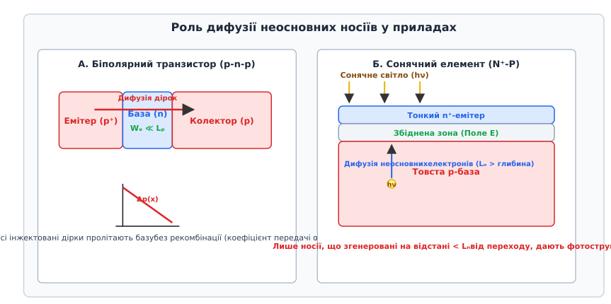
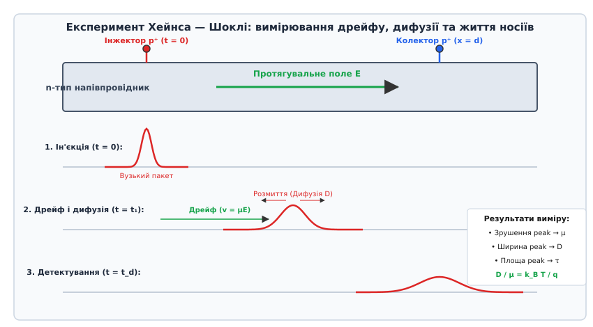
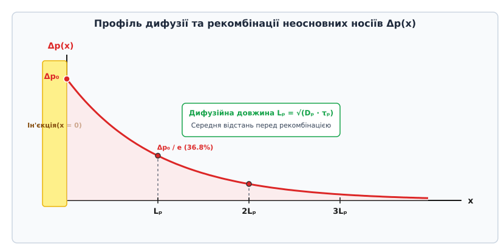
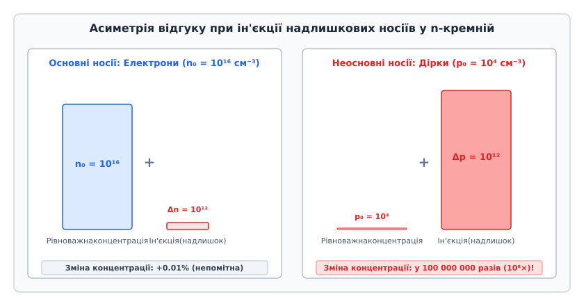

# Дифузія неосновних носіїв

<preknowlist>
- [Напівпровідник](root:ph-condensed/semiconductor) — власна та домішкова провідність, електрон-діркові пари.
- [Легування](root:ph-condensed/doping) — n- і p-тип, основні та неосновні носії.
- [Дрейф електронів](root:ph-condensed/electron-drift) — рух носіїв у полеві.
- [PN-перехід](root:ph-condensed/pn-junction) — збіднена зона, потенціальний бар'єр.
- [Рекомбінація Шокли — Рида — Холла (SRH)](root:ph-condensed/shockley-read-hall-recombination) — час життя неосновних носіїв.
</preknowlist>

У монокристалі кремнію n-типу провідності, легованому атомами фосфору до типової концентрації донорів `N_d = 10¹⁶ см⁻³`, стан термодинамічної рівноваги описується фундаментальним законом дії мас `n₀ · p₀ = n_i²`. За кімнатної температури (`T = 300 K`) власна концентрація носіїв у кремнії становить `n_i ≈ 1.0 × 10¹⁰ см⁻³` (відповідно `n_i² ≈ 10²⁰ см⁻⁶`). Рівноважна концентрація основних носіїв — електронів — майже точно дорівнює концентрації донорної домішки `n₀ ≈ N_d = 10¹⁶ см⁻³`. Водночас теплова генерація здатна підтримувати лише мізерний фоновий рівень неосновних носіїв — дірок:

```
p₀ = n_i² / N_d = 10²⁰ / 10¹⁶ = 10⁴ см⁻³
```

Це означає, що на один кубічний сантиметр напівпровідника серед десяти тисяч трильйонів електронів перебуває лише десять тисяч вільних дірок. На кожну дірку припадає трильйон електронів (`n₀ / p₀ = 10¹²`).

Якщо на окрему локальну ділянку цього кристала спрямувати короткий спалах лазера або інжектувати дірки через прямо-зміщений p-n перехід, у напівпровіднику виникне надлишок електрон-діркових пар `Δn = Δp = 10¹² см⁻³`.

Для основних носіїв (вільних електронів) така добавка збільшує їхню повну концентрацію від `10¹⁶` до `10¹⁶ + 10¹² = 1.0001 × 10¹⁶ см⁻³`. Це абсолютно непомітна зміна всього на `0.01%`, яка губиться в шумах і ніяк не змінює властивостей електронного газу.

Однак для неосновних носіїв (дірок) той самий абсолютний приріст від `10⁴` до `10¹² см⁻³` означає колосальне зростання концентрації у **сто мільйонів разів (`10⁸×`)**.


*Зліва — основні електрони (зміна на 0.01%); справа — неосновні дірки (сплеск у 100 мільйонів разів).*

Саме ця кричуща асиметрія відгуку перетворює неосновні носії заряду на найчутливіший «важіль керування» в фізиці напівпровідникових приладів. Там, де основні носії утворюють нечутливий до збурень колосальний фон, неосновні носії формують просторові градієнти величезної крутизни.

Фізично цей стан виражається у розщепленні єдиного рівноважного рівня Фермі `E_F` на два окремі квазірівні Фермі: для електронів `E_Fn` та для дірок `E_Fp`. Положення квазірівня Фермі електронів майже не відхиляється від рівноважного значення, оскільки відносна зміна `n` мізерна:

```
E_Fn - E_F = k_B · T · ln((n₀ + Δn) / n₀) ≈ k_B · T · (Δn / n₀) ≈ 0.026 · 10⁻⁴ еВ ≈ 2.6 кеВ
```

Натомість квазірівень Фермі для дірок різко зміщується вглиб забороненої зони у напрямку до валентної зони:

```
E_F - E_Fp = k_B · T · ln((p₀ + Δp) / p₀) ≈ k_B · T · ln(10⁸) ≈ 8 · 2.303 · 0.0259 еВ ≈ 0.477 еВ
```

Розкол квазірівнів Фермі майже на пів електронвольта створює колосальний термодинамічний потенціал. Переміщення, згасання та просторове накопичення цих надлишкових носіїв задають роботу сонячних елементів, фотодіодів, світлодіодів, напівпровідникових лазерів, випрямних діодів та біполярних транзисторів. А головним фізичним механізмом переміщення цих надлишкових носіїв у квазінейтральних областях є **дифузія** (*diffusio* — з латинської *розтікання, поширення*).

---

### 1. Мікроскопічна природа дифузії: тепловий хаос, розсіяння та перший закон Фіка

Щоб зрозуміти, як виникає макроскопічний дифузійний струм без жодної зовнішньої напруги чи прикладеного електричного поля, необхідно опуститися на мікроскопічний рівень квантового руху носіїв у кристалічній ґратці.

#### Теплова швидкість та випадкове блукання

Усі вільні носії заряду в напівпровіднику перебувають у стані безупинного хаотичного теплового руху. За теоремою про рівнорозподіл енергії за ступенями вільності, середня кінетична енергія невиродженого газу носіїв пов'язана з абсолютною температурою `T` співвідношенням:

```
(1/2) · m* · v_th² = (3/2) · k_B · T
```

де `m*` — ефективна маса густини станів для відповідного типу носія, `k_B = 1.3806 × 10⁻²³ Дж/К` — стала Больцмана, а `v_th` — середньоквадратична теплова швидкість. Звідси отримуємо фундаментальний вираз для теплової швидкості:

```
v_th = √( (3 · k_B · T) / m* )
```

У кремнії за кімнатної температури (`T = 300 K`) ефективна маса електронів становить `m*_n ≈ 0.26 · m₀`, а дірок — `m*_p ≈ 0.38 · m₀` (де `m₀ = 9.109 × 10⁻³¹ кг` — маса вільного електрона у вакуумі). Підставивши ці значення, знаходимо, що теплова швидкість носіїв має колосальну величину:

```
v_th,n ≈ 2.3 × 10⁷ см/с = 230 км/с
v_th,p ≈ 1.9 × 10⁷ см/с = 190 км/с
```

Носії мчать крізь кристалічну ґратку зі швидкістю сотень кілометрів на секунду. Проте цей рух не є прямолінійним. Перелітаючи від одного вузла ґратки до іншого, частинка безперервно зазнає пружних та непружних зіткнень. Середній час між двома послідовними актами розсіяння називається **часом релаксації імпульсу** `τ_m`, а середня відстань, яку носій пролітає між зіткненнями — **довжиною вільного пробігу** `l_fp`:

```
l_fp = v_th · τ_m
```

Для чистого кремнію час релаксації імпульсу становить `τ_m ≈ 10⁻¹³ с` (0.1 пікосекунди), що дає довжину вільного пробігу близько `l_fp ≈ 20–40 нм`.

Після кожного зіткнення вектор швидкості носія повністю рандомізується: частинка може з однаковою ймовірністю відскочити у будь-якому напрямку тривимірного простору. Траєкторія руху електрона або дірки являє собою класичне тривимірне броунівське блукання (випадкове блукання з нульовим середнім вектором зміщення за відсутності поля).

```
   (Зіткнення) ──→ (Зіткнення) ──→ (Зіткнення)
       ↑                               │
       │     Хаотична траєкторія       ↓
   (Зіткнення) ←── (Зіткнення) ←── (Зіткнення)
```

#### Механізми розсіяння носіїв заряду

Рухливість носіїв `μ` та коефіцієнт дифузії `D` безпосередньо лімітуються мікроскопічними процесами розсіяння в об'ємі напівпровідника. Головними фізичними механізмами розсіяння є:

1. **Розсіяння на акустичних та оптичних фононах (ґраткове розсіяння)**. Теплові коливання атомів кристалічної ґратки модулюють міжатомні відстані, створюючи періодичні деформації потенціалу. Зі зростанням температури амплітуда коливань ґратки та кількість фононів зростають, тому частота зіткнень збільшується. Рухливість, обмежена ґратковим розсіянням, зменшується за степеневим законом:
   ```
   μ_latt ~ T^(-3/2)   (теоретична модель деформаційного потенціалу)
   μ_latt ~ T^(-2.2)   (експериментальне значення для електронів у кремнії)
   ```
   У непрямозонних матеріалах (кремній, германій) додатковий внесок роблять міждолинні фононні переходи (*intervalley scattering*), які перекидають електрони між еквівалентними мінімумами зони провідності вздовж осей `⟨100⟩` або `⟨111⟩`. У полярних напівпровідниках (GaAs, InP, GaN) переважає розсіяння на полярних оптичних фононах через взаємодію заряду з макроскопічною поляризацією кристалічної ґратки.

2. **Розсіяння на іонізованих домішках (кулонівське розсіяння)**. Іонізовані атоми донорів (`N_d⁺`) та акцепторів (`N_a⁻`) створюють локальні кулонівські поля, які відхиляють траєкторії носіїв. Згідно з класичною теорією Брукса — Геррінґа з урахуванням дебаївського екранування заряду вільними носіями (радіус екранування Дебая `L_D = √( (ε · k_B · T) / (q² · n) )`), повільні носії довше перебувають у зоні дії кулонівського центра і відхиляються сильніше. Тому зі зростанням температури носії рухаються швидше, менше відхиляються зарядом домішки, і рухливість зростає:
   ```
   μ_imp ~ T^(+3/2) / N_I
   ```
   де `N_I = N_d⁺ + N_a⁻` — сумарна концентрація іонізованих домішок.

3. **Розсіяння носій-носій (електрон-електронне та електрон-діркове)**. При високих рівнях інжекції або в сильнолегованих областях прямі кулонівські зіткнення між вільними електронами та дірками суттєво обмежують рухливість меншості через взаємне тертя двох зустрічних потоків.

4. **Розсіяння на нейтральних домішках та дислокаціях**. За низьких температур, коли частина домішок не іонізована, взаємодія визначається поляризацією нейтральних атомів. Дислокаційні лінії створюють циліндричні поля деформацій та заряду, що діють як анізотропні центри розсіяння.

Загальна рухливість носіїв `μ` визначається спільним впливом усіх механізмів згідно з **правилом Маттисена**:

```
1 / μ = 1 / μ_latt + 1 / μ_imp + 1 / μ_c-c + 1 / μ_neutral
```

#### Статистичне виведення першого закону Фіка з броунівського блукання

Розглянемо одновимірний градієнт концентрації дірок `p(x)` уздовж осі `x`. Уявімо дві паралельні площини площею `S`, розташовані на координатах `x - l_fp` (площина 1) та `x + l_fp` (площина 2), де `l_fp` — довжина вільного пробігу. Між ними на координаті `x` розташована контрольна площина.

Концентрація дірок у площині 1 дорівнює `p(x - l_fp)`, а у площині 2 — `p(x + l_fp)`.

Оскільки тепловий рух носіїв ізотропний, у тривимірному просторі проекція руху вздовж осі `x` становить одну шосту частину повного потоку (по одній третині на кожну вісь простору і по половині на кожний із двох напрямків уздовж осі). За проміжок часу між зіткненнями `Δt = τ_m = l_fp / v_th` частинки пролітають відстань `l_fp`.

Потік дірок, що перетинають контрольну площину зліва направо:

```
Φ_left->right = (1/6) · p(x - l_fp) · v_th · S
```

Потік дірок, що перетинають контрольну площину справа наліво:

```
Φ_right->left = (1/6) · p(x + l_fp) · v_th · S
```

Результуючий потік частинок через контрольну площину:

```
Φ_net = Φ_left->right - Φ_right->left = (1/6) · v_th · S · [ p(x - l_fp) - p(x + l_fp) ]
```

Розкладемо концентрацію в околі точки `x` в ряд Тейлора:

```
p(x - l_fp) ≈ p(x) - l_fp · (dp / dx)
p(x + l_fp) ≈ p(x) + l_fp · (dp / dx)
p(x - l_fp) - p(x + l_fp) = - 2 · l_fp · (dp / dx)
```

Підставивши цей розклад у вираз для результуючого потоку, отримуємо:

```
Φ_net = (1/6) · v_th · S · [ - 2 · l_fp · (dp / dx) ] = - (1/3) · v_th · l_fp · S · (dp / dx)
```

Густина потоку частинок `F_p = Φ_net / S` набуває вигляду:

```
F_p = - D_p · (dp / dx)
```

де мікроскопічний коефіцієнт дифузії `D_p` визначається добутком теплової швидкості на довжину вільного пробігу:

```
D_p = (1/3) · v_th · l_fp = (1/3) · v_th² · τ_m
```

Помноживши густину потоку частинок на електричний заряд однієї дірки (`+q`), знаходимо вираз для **густини дифузійного струму дірок**:

```
J_diff,p = q · F_p = - q · D_p · (dp / dx)
```

Для електронів потік частинок має такий самий вигляд `F_n = - D_n · (dn / dx)`. Проте електрон несе негативний заряд (`-q`). Тому густина дифузійного струму електронів має протилежний знак:

```
J_diff,n = (-q) · F_n = (-q) · [ - D_n · (dn / dx) ] = + q · D_n · (dn / dx)
```

У тривимірному векторному записі **перший закон Фіка** для носіїв заряду записується через оператор градієнта `∇`:

```
J_diff,p = - q · D_p · ∇p
J_diff,n = + q · D_n · ∇n
```

Знак мінус у формулі для дірок відображає фундаментальний фізичний факт: позитивно заряджені частинки дифундують у напрямку спадання своєї концентрації (`-∇p`), переносячи позитивний заряд у тому ж напрямку. Для електронів градієнт концентрації також спрямовує рух частинок у бік меншої густини, але оскільки заряд електрона негативний, електричний струм (напрямок переносу позитивного заряду) тече у бік зростання концентрації електронів (`+∇n`).

#### Дрейфово-дифузійний перенос: повні рівняння густини струму

Коли до напівпровідника одночасно прикладено зовнішнє електричне поле `E` і в ньому існує просторовий градієнт концентрації носіїв, повний електричний струм складається з двох компонент: дрейфової та дифузійної.

Дрейфовий рух виникає під дією кулонівської сили `F = q · E`, яка додає до хаотичної теплової швидкості `v_th` невеликий напрямлений вектор дрейфової швидкості `v_dr = μ · E`. У звичайних робочих режимах приладів за полів `E ~ 10–1000 В/см` дрейфова швидкість становить `v_dr ~ 10³–10⁵ см/с`, що на два-три порядки менше за швидкість хаотичного теплового руху `v_th ~ 10⁷ см/с`.

Повні векторні рівняння густини струмів для електронів та дірок у **дрейфово-дифузійному наближенні** мають канонічний вигляд:

```
J_p = q · μ_p · p · E - q · D_p · ∇p
J_n = q · μ_n · n · E + q · D_n · ∇n
```

А повний струм крізь зразок є векторною сумою електронної та діркової складових:

```
J_total = J_p + J_n
```

---

### 2. Співвідношення Ейнштейна та термодинамічний баланс

Здавалося б, дрейф і дифузія викликаються абсолютно різними причинами: дрейф спричинений макроскопічною силою електричного поля, тоді як дифузія є результатом чистої статистики та градієнта щільності ймовірностей частинок. Однак обидва процеси розгортаються всередині одного й того самого кристала і гальмуються одними й тими самими мікроскопічними актами розсіяння носіїв на фононах та домішках (з одним і тим самим часом релаксації імпульсу `τ_m`).

#### Рівноважне виведення зв'язку коефіцієнта дифузії та рухливості

Розглянемо ізольований монокристал напівпровідника у стані повної термодинамічної рівноваги за температури `T`. Нехай у кристалі існує неоднорідне легування або внутрішній потенціальний бар'єр, що створює внутрішнє електричне поле `E(x) = - dV/dx = - (1/q) · (dE_i / dx)`, де `E_i(x)` — енергія середини забороненої зони (власний рівень Фермі).

Оскільки система ізольована і струм у зовнішньому колі не тече, сумарний струм дірок у будь-якому перерізі кристала зобов'язаний бути строго нульовим (`J_p(x) = 0`). Це означає, що дрейфовий потік під дією внутрішнього поля точно врівноважується дифузійним потоком за градієнтом концентрації:

```
J_p = q · μ_p · p(x) · E(x) - q · D_p · (dp / dx) = 0
```

Скоротимо на `q` і виразимо електричне поле:

```
E(x) = (D_p / μ_p) · (1 / p(x)) · (dp / dx)
```

З іншого боку, для невиродженого напівпровідника функція розподілу Максвелла — Больцмана задає концентрацію дірок через положення рівня Фермі `E_F`:

```
p(x) = n_i · exp[ (E_i(x) - E_F) / (k_B · T) ]
```

У стані термодинамічної рівноваги рівень Фермі є строго горизонтальною лінією по всьому кристалу (`dE_F / dx = 0`). Обчислимо похідну концентрації дірок за просторовою координатою `x`:

```
dp / dx = n_i · exp[ (E_i(x) - E_F) / (k_B · T) ] · (1 / (k_B · T)) · (dE_i / dx)
```

Враховуючи, що перший множник є самою концентрацією `p(x)`, а нахил енергетичних зон визначає електричне поле `dE_i / dx = q · E(x)`:

```
dp / dx = p(x) · (q · E(x)) / (k_B · T)
```

Підставимо отриману похідну `dp/dx` назад у рівняння балансу струмів:

```
q · μ_p · p(x) · E(x) = q · D_p · [ p(x) · q · E(x) / (k_B · T) ]
```

Скоротивши обидві частини на спільний добуток `q · p(x) · E(x)`, отримуємо фундаментальне **співвідношення Ейнштейна**:

```
D_p / μ_p = (k_B · T) / q = V_T
```

Аналогічно, розглядаючи нульовий струм електронів `J_n = 0`, отримуємо тотожне співвідношення для електронного газу:

```
D_n / μ_n = (k_B · T) / q = V_T
```

Величина `V_T = (k_B · T) / q` називається **тепловим потенціалом** (*thermal voltage*). За кімнатної температури (`T = 300 K`) значення теплового потенціалу становить:

```
V_T = (1.3806 × 10⁻²³ · 300) / (1.6022 × 10⁻¹⁹) ≈ 0.02585 В ≈ 25.9 мВ
```

Співвідношення Ейнштейна демонструє, що теплова енергія `k_B · T` є рушійною силою дифузійного розширення, а рухливість `μ` задає провідність середовища. Їхнє відношення є універсальним масштабом потенціалу для даної температури.

#### Межі невиродженості: узагальнене співвідношення Ейнштейна

Класичне співвідношення Ейнштейна `D/μ = k_B T / q` виведено для невироджених напівпровідників, де носії описуються статистикою Максвелла — Больцмана (тобто коли рівень Фермі віддалений від країв дозволених зон щонайменше на `3 · k_B · T ≈ 75 меВ`).

У сильнолегованих напівпровідниках (наприклад, у вироджених емітерах сонячних елементів або контактах транзисторів, де `N_d > N_c ≈ 2.8 × 10¹⁹ см⁻³` для кремнію), рівень Фермі заходить усередину дозволеної зони провідності або валентної зони. За цих умов діє квантова статистика Фермі — Дірака.

Концентрація електронів у виродженій зоні провідності описується інтегралом Фермі — Дірака порядку 1/2:

```
n = N_c · F_{1/2}(η_F)
```

де `N_c = 2 · (2 π m*_n k_B T / h²)^(3/2)` — ефективна густина станів у зоні провідності, а `η_F = (E_F - E_c) / (k_B · T)` — безрозмірний зведений рівень Фермі.

У цьому випадку диференціювання функції Фермі — Дірака дає **узагальнене співвідношення Ейнштейна**:

```
D_n / μ_n = (1 / q) · (n / (dn / dE_F)) = (k_B · T / q) · [ F_{1/2}(η_F) / F_{-1/2}(η_F) ]
```

де `F_{-1/2}(η_F) = d(F_{1/2})/dη_F` — інтеграл Фермі порядку `-1/2`.

Коли напівпровідник сильно вироджений (`η_F ≫ 0`), через принцип заборони Паулі всі нижні квантові стани щільно заповнені електронами. Носії мають додаткову кінетичну енергію Фермі `E_F - E_c`, яка перевищує класичну теплову енергію `k_B · T`. 

У результаті відношення `D / μ` стає суттєво більшим за `k_B T / q`:

```
D_n / μ_n ≈ (2/3) · ( (E_F - E_c) / q ) > V_T
```

Це означає, що у вироджених областях напівпровідника дифузійний потік носіїв стає набагато інтенсивнішим, ніж передбачає класична больцманівська модель, оскільки частинки розштовхуються квантовим тиском Фермі-газу.

#### Неоднорідні напівпровідники та квазіелектричні поля

У структурах зі змінним складом (наприклад, твердих розчинах `Al_x Ga_{1-x} As` або `Si_{1-x} Ge_x`) ширина забороненої зони `E_g(x)` та спорідненість до електрона `χ(x)` плавно змінюються за координатою.

У таких матеріалах положення країв зон `E_c(x)` та `E_v(x)` нахиляються з різною крутизною. На вільний носій починає діяти не лише звичайне електростатичне поле `E = - dV/dx`, але й так зване **квазіелектричне поле**, викликане градієнтом зонної структури:

```
E_quasi,n = - (1/q) · (dE_c / dx) = E - (1/q) · (dχ / dx)
E_quasi,p = - (1/q) · (dE_v / dx) = E - (1/q) · [ dχ/dx + dE_g/dx ]
```

Ці квазіелектричні поля дозволяють незалежно прискорювати або гальмувати один тип носіїв (наприклад, дірки в базі), абсолютно не впливаючи на інший тип носіїв.

#### Температурна залежність коефіцієнтів дифузії

Оскільки коефіцієнт дифузії зв'язаний із рухливістю через `D(T) = μ(T) · (k_B · T / q)`, його температурна залежність визначається домінуючим механізмом розсіяння:

1. У чистому та помірно легованому матеріалі, де домінує розсіяння на фононах ґратки (`μ ~ T^(-3/2)` або `T^(-2.2)`), температурна залежність коефіцієнта дифузії має спадний характер:
   ```
   D(T) ~ T^(-3/2) · T^(+1) = T^(-1/2)   (за класичною моделлю)
   D(T) ~ T^(-2.2) · T^(+1) = T^(-1.2)   (реальний кремній)
   ```
   Зі зростанням температури від 300 K до 400 K коефіцієнт дифузії в кремнії зменшується приблизно на `30%` через інтенсифікацію розсіяння на фононах.

2. У сильно легованих зразках за низьких температур, де домінує розсіяння на іонізованих домішках (`μ ~ T^(+3/2)`):
   ```
   D(T) ~ T^(+3/2) · T^(+1) = T^(+5/2)
   ```
   Коефіцієнт дифузії швидко зростає з температурою.

---

### 3. Рівняння неперервності та повне дифузійне рівняння другого порядку

Перенесення заряду в напівпровіднику підпорядковується фундаментальному закону збереження кількості частинок. Зміна густини носіїв у будь-якій точці простору є результатом балансу між вхідними та вихідними струмами, процесами зникнення (рекомбінації) та процесами народження (генерації).

#### Баланс частинок у тривимірному просторі

Розглянемо замкнений елементарний об'єм напівпровідника `dV`. Зміна кількості дірок у цьому об'ємі за одиницю часу описується рівнянням неперервності:

```
∂p / ∂t = - (1 / q) · ∇ · J_p - R_p + G_p
```

де `∇ · J_p = div(J_p)` — дивергенція векторного поля густини струму дірок, `R_p` — швидкість об'ємної рекомбінації (число рекомбінуючих дірок в одиниці об'єму за секунду, `см⁻³·с⁻¹`), а `G_p` — швидкість генерації носіїв (теплової `G_th` та зовнішньої `G_ext`, наприклад оптичної).

#### Механізми рекомбінації та час життя носіїв

Сумарна швидкість рекомбінації `R` складається з трьох фундаментальних фізичних каналів:

1. **Рекомбінація Шокли — Рида — Холла (SRH)** крізь глибокі пастки в забороненій зоні:
   ```
   U_SRH = (n · p - n_i²) / [ τ_p0 · (n + n₁) + τ_n0 · (p + p₁) ]
   ```
   де `n₁ = N_c · exp((E_t - E_c)/(k_B T))` та `p₁ = N_v · exp((E_v - E_t)/(k_B T))` — концентрації носіїв, коли рівень Фермі збігається з енергією пастки `E_t`. За низького рівня інжекції в n-матеріалі швидкість рекомбінації лінійна: `U_SRH ≈ Δp / τ_p0`.

2. **Міжзонна радіаційна рекомбінація**:
   Прямий перехід електрона з зони провідності у валентну зону з випромінюванням кванта світла. Швидкість процесу:
   ```
   U_rad = B_rad · (n · p - n_i²)
   ```
   де `B_rad` — коефіцієнт радіаційної рекомбінації. Для непрямозонного кремнію `B_rad ≈ 10⁻¹⁵ см³/с` (процес вимагає участі фонона і є малоймовірним), тоді як для прямозонного GaAs `B_rad ≈ 10⁻¹⁰ см³/с` (швидкий канал, `τ_rad ~ 1–10 нс`).

3. **Оже-рекомбінація (тричастинковий безвипромінювальний процес)**:
   Енергія рекомбінації передається третьому носію (електрону або дірці), який переходить високо у відповідну зону і релаксує з виділенням тепла:
   ```
   U_Auger = (C_n · n + C_p · p) · (n · p - n_i²)
   ```
   де `C_n` та `C_p` — коефіцієнти Оже-рекомбінації (`~ 10⁻³¹ – 10⁻³⁰ см⁶/с` для кремнію). Оже-процес домінує при високих концентраціях носіїв (`n > 10¹⁸ см⁻³`) та високих рівнях інжекції.

Сумарний час життя неосновних носіїв визначається комбінацією всіх каналів:

```
1 / τ_bulk = 1 / τ_SRH + 1 / τ_rad + 1 / τ_Auger
```

#### Одновимірне рівняння переносу для надлишкових носіїв

Підставивши вираз для дрейфово-дифузійного струму `J_p = q · μ_p · p · E - q · D_p · ∇p` у рівняння неперервності, отримуємо загальне диференціальне рівняння переносу.

В однорідному напівпровіднику, де коефіцієнт дифузії `D_p` та рухливість `μ_p` сталі в просторі, і в квазінейтральній області з постійним електричним полем `E = const` (де `∇ · E = 0`), одновимірне рівняння спрощується до канонічного вигляду:

```
∂(Δp) / ∂t = D_p · (∂²(Δp) / ∂x²) - μ_p · E · (∂(Δp) / ∂x) - (Δp / τ_p) + G_ext
```

Це параболічне диференціальне рівняння другого порядку в частинних похідних описує повну просторово-часову кінетику надлишкових неосновних носіїв. Повний математичний вивід та методи інтегрування наведено в [математичному виведенні рівняння дифузії](root:ph-condensed/minority-carrier-diffusion-transport/math-diffusion-equation.md).

#### Стаціонарний розв'язок і дифузійна довжина

Розглянемо стаціонарний стан (`∂(Δp) / ∂t = 0`) в однорідному напівпровіднику без зовнішнього електричного поля (`E = 0`) за межами області генерації (`G_ext = 0`).

Рівняння перетворюється на однорідне лінійне звичайне диференціальне рівняння:

```
D_p · (d²(Δp) / dx²) - (Δp / τ_p) = 0
```

Поділимо обидві частини на `D_p`:

```
d²(Δp) / dx² - Δp / (D_p · τ_p) = 0
```

Введемо фундаментальний просторовий параметр кінетики напівпровідників — **дифузійну довжину неосновних носіїв** `L_p`:

```
L_p = √( D_p · τ_p )
```

Для електронів у p-напівпровіднику аналогічно:

```
L_n = √( D_n · τ_n )
```

Рівняння набуває канонічного вигляду:

```
d²(Δp) / dx² = Δp / L_p²
```

Загальний розв'язок цього рівняння подається сумою двох експонент:

```
Δp(x) = C₁ · exp(- x / L_p) + C₂ · exp(x / L_p)
```

де константи `C₁` та `C₂` однозначно визначаються граничними умовами задачі.

Для напівбезкінечного напівпровідника (`x ≥ 0`), на лівій межі якого підтримується постійна концентрація інжекції `Δp(0)`, а на нескінченності надлишок згасає (`Δp(x → ∞) = 0`), маємо `C₂ = 0` та `C₁ = Δp(0)`. Профіль концентрації описується експоненційним спадом:

```
Δp(x) = Δp(0) · exp(- x / L_p)
```


*Експоненційний профіль спаду надлишкових неосновних носіїв. На відстані x = L_p концентрація падає в e ≈ 2.718 раза (до 36.8%).*

Густина інжектованого дифузійного струму на межі `x = 0`:

```
J_diff,p(0) = - q · D_p · (d(Δp) / dx)|_{x=0} = q · (D_p / L_p) · Δp(0)
```

Фізичний зміст дифузійної довжини `L_p` полягає в тому, що це **середня відстань за прямою лінією**, яку неосновний носій заряду проходить шляхом хаотичного теплового блукання від точки генерації до моменту своєї рекомбінації.

Масштаб величини `L_p` кардинально різниться залежно від матеріалу та його структурної досконалості:
- У бездислокаційному кремнії зонної плавки з часом життя `τ_p ≈ 1–2 мс` дифузійна довжина сягає `L_p = √(12 · 10⁻³) ≈ 0.11 см = 1100 мкм` (перевершує товщину стандартної пластини `300 мкм`).
- У сильнолегованих емітерах з `τ_p ≈ 1 нс` дифузійна довжина стискається до `L_p = √(12 · 10⁻⁹) ≈ 1.1 мкм`.
- У прямозонному арсеніді галію (GaAs), де час міжзонної радіаційної рекомбінації становить `τ_n ≈ 1–10 нс`, дифузійна довжина зазвичай не перевищує `L_n ≈ 2–5 мкм`.

#### Дрейфово-дифузійний транспорт у зовнішньому електричному полі

Якщо до зразка прикладено постійне електричне поле `E`, стаціонарне рівняння набуває вигляду:

```
D_p · (d²(Δp) / dx²) - μ_p · E · (d(Δp) / dx) - (Δp / τ_p) = 0
```

Шукаючи розв'язок у формі `Δp(x) ~ exp(r · x)`, отримуємо характеристичне алгебраїчне рівняння:

```
D_p · r² - μ_p · E · r - (1 / τ_p) = 0
```

Корені цього рівняння:

```
r_{1,2} = (μ_p · E / (2 · D_p)) ± √( (μ_p · E / (2 · D_p))² + 1 / L_p² )
```

Введемо характеристичну довжину дрейфу в полі `L_E = μ_p · |E| · τ_p`. Тоді корені визначають дві різні ефективні просторові довжини:

1. **Ефективна довжина за напрямком поля (Downstream)**:
   ```
   L_down = [ - (μ_p · E / (2 · D_p)) + √( (μ_p · E / (2 · D_p))² + 1 / L_p² ) ]⁻¹
   ```
   У сильному полі (`L_E ≫ L_p`) ця довжина значно зростає: `L_down ≈ μ_p · E · τ_p = v_dr · τ_p`. Поле підхоплює пакет носіїв і розтягує його далеко вперед. При полі `E = 100 В/см` у кремнії з `μ_p = 450 см²/(В·с)` та `τ_p = 100 мкс` маємо `L_down ≈ 450 · 100 · 10⁻⁴ = 4.5 см`, що у 130 разів перевищує дифузійну довжину `L_p ≈ 0.034 см`.

2. **Ефективна довжина проти поля (Upstream)**:
   ```
   L_up = [ (μ_p · E / (2 · D_p)) + √( (μ_p · E / (2 · D_p))² + 1 / L_p² ) ]⁻¹
   ```
   У сильному полі `L_up ≈ D_p / (μ_p · E) = V_T / E`. При полі `E = 100 В/см` довжина проти поля стискається до `L_up ≈ 0.0259 / 100 = 2.59 × 10⁻⁴ см = 2.59 мкм`. Поле практично повністю блокує дифузію носіїв назустріч кулонівській силі.

#### Нестаціонарний імпульсний розв'язок (функція Гріна)

Розглянемо нестаціонарний випадок, коли в момент часу `t = 0` у точці `x = 0` нескінченного бруска за допомогою дельта-імпульсу лазера створено `N₀` надлишкових дірок на одиницю площі поперечного перерізу: `Δp(x, 0) = N₀ · δ(x)`.

Точний аналітичний розв'язок рівняння неперервності (функція Гріна) має вигляд:

```
Δp(x, t) = [ N₀ / √( 4 · π · D_p · t ) ] · exp[ - (x - μ_p · E · t)² / (4 · D_p · t) ] · exp( - t / τ_p )
```

Ця формула описує три незалежні фізичні процеси:
1. **Дрейфовий зсув**: центр гаусового пакета рухається вздовж координати зі швидкістю дрейфу:
   ```
   x_center(t) = μ_p · E · t = v_dr · t
   ```
2. **Дифузійне розмиття**: дисперсія просторового розподілу зростає як `σ²(t) = 2 · D_p · t`. Повна ширина пакета на половині його висоти (FWHM — *Full Width at Half Maximum*) збільшується з часом:
   ```
   Δx_{1/2}(t) = √( 16 · ln(2) · D_p · t ) ≈ 3.33 · √( D_p · t )
   ```
3. **Експоненційна рекомбінація**: повна площа під гаусовим пакетом експоненційно тане з часом через рекомбінацію:
   ```
   N(t) = ∫ Δp(x, t) dx = N₀ · exp( - t / τ_p )
   ```

---

### 4. Квазінейтральність та амбіполярний транспорт

Тут виникає тонке й фундаментальне фізичне питання. Якщо інжектовані дірки `Δp` утворюють хмару позитивного заряду, яка намагається дифундувати вглиб n-кремнію, а електрони мають коефіцієнт дифузії `D_n ≈ 35 см²/с`, що втричі перевищує коефіцієнт дифузії дірок `D_p ≈ 12 см²/с`, то чому швидкі електрони не втікають уперед, залишаючи дірки позаду? І чи не повинен розділений просторовий заряд створити колосальне внутрішнє поле, яке заблокує перенос?

#### Масштаб часу діелектричної релаксації

Відповідь полягає в явищі **квазінейтральності**. 

Якщо в локальній області напівпровідника виникає найменший нескомпенсований об'ємний заряд `ρ = q · (Δp - Δn)`, він створює електричне поле відповідно до рівняння Пуассона `∇ · E = ρ / ε`. Це поле негайно викликає рух основних носіїв, які екранують заряд.

Час, за який вільні носії відновлюють електронейтральність, називається **часом діелектричної релаксації** `τ_d`:

```
τ_d = ε / σ = (ε_r · ε₀) / (q · [ n₀ · μ_n + p₀ · μ_p ])
```

де `ε = ε_r · ε₀` — абсолютна діелектрична проникність матеріалу (`ε_r ≈ 11.7` для кремнію, `ε₀ = 8.854 × 10⁻¹⁴ Ф/см`), а `σ` — питома електропровідність.

Для напівпровідника n-типу з типовим легуванням `N_d = 10¹⁶ см⁻³` провідність становить `σ ≈ q · N_d · μ_n ≈ 1.6 × 10⁻¹⁹ · 10¹⁶ · 1350 ≈ 2.16 (Ом·см)⁻¹`. Підставивши значення, знаходимо:

```
τ_d = (11.7 · 8.854 × 10⁻¹⁴) / 2.16 ≈ 4.8 × 10⁻¹³ с ≈ 0.5 пс
```

Час діелектричної релаксації становить частки пікосекунди! Це на 3–6 порядків менше за типовий час життя неосновних носіїв `τ ~ 10⁻⁹ – 10⁻³ с` і час дифузійного прольоту.

Це означає, що за будь-яких реальних збурень величезне море високорухливих основних носіїв практично миттєво підлаштовується під профіль неосновних носіїв. На макроскопічному рівні виконується умова локальної квазінейтральності:

```
Δn(x, t) ≈ Δp(x, t)
```

#### Внутрішнє амбіполярне електричне поле

Оскільки `D_n > D_p`, електрони намагаються випередити дірки на субнанометрову відстань. Цього мікроскопічного зсуву достатньо, щоб згенерувати внутрішнє **амбіполярне електричне поле** `E_amb`.

Це внутрішнє поле спрямоване так, що воно пригальмовує швидкі електрони і підтягує повільні дірки, примушуючи обидві підсистеми дифундувати разом як єдина зв'язана електрон-діркова плазма.

Знайдемо амбіполярне поле з умови збереження квазінейтральності. Запишемо густини струмів обох типів носіїв:

```
J_n = q · μ_n · n · E + q · D_n · (∂(Δn) / ∂x)
J_p = q · μ_p · p · E - q · D_p · (∂(Δp) / ∂x)
```

Повний струм дорівнює `J_total = J_n + J_p`. Підставивши умову квазінейтральності `∂(Δn)/∂x = ∂(Δp)/∂x` і позначивши повну провідність як `σ = q · (n · μ_n + p · μ_p)`, виразимо електричне поле `E`:

```
E = (J_total / σ) - [ q · (D_n - D_p) / σ ] · (∂(Δp) / ∂x)


*Ілюстрація: Bjt Solar Application.*



*Ілюстрація: Haynes Shockley Setup.*



*Ілюстрація: Diffusion Recombination Profile.*

```

Перший доданок `E_ext = J_total / σ` являє собою омічне падіння напруги від зовнішнього струму, а другий доданок — це шукане внутрішнє **амбіполярне поле**:

```
E_amb = - [ (D_n - D_p) / (n · μ_n + p · μ_p) ] · (∂(Δp) / ∂x)
```

#### Виведення амбіполярного рівняння переносу

Підставимо вираз для повного поля `E` у рівняння неперервності для дірок. Після алгебраїчних перетворень отримуємо канонічне **рівняння амбіполярного транспорту**:

```
∂(Δp) / ∂t = D_a · (∂²(Δp) / ∂x²) - μ_a · E_ext · (∂(Δp) / ∂x) - (Δp / τ) + G_ext
```

де `D_a` — **амбіполярний коефіцієнт дифузії**, а `μ_a` — **амбіполярна рухливість**.

Амбіполярний коефіцієнт дифузії задається співвідношенням:

```
D_a = (n + p) / ( (n / D_p) + (p / D_n) ) = [ D_n · D_p · (n + p) ] / [ n · D_n + p · D_p ]
```

Амбіполярна рухливість виражається як:

```
μ_a = [ μ_n · μ_p · (n - p) ] / [ n · μ_n + p · μ_p ] = (n - p) / [ (n / μ_p) + (p / μ_n) ]
```

#### Граничні режими амбіполярного переносу

Формули амбіполярного транспорту розкривають два фундаментальні режими роботи приладів:

1. **Низький рівень інжекції у напівпровіднику n-типу** (`n₀ ≫ p₀` та `Δp ≪ n₀`):
   Оскільки `n ≈ n₀ ≫ p`:
   ```
   D_a ≈ D_p
   μ_a ≈ μ_p
   ```
   **Швидкість спільного розтікання плазми та її дрейф повністю визначаються параметрами НЕОСНОВНИХ носіїв (дірок)!** Швидкі основні електрони змушені рухатися зі швидкістю повільних дірок, щоб не порушити квазінейтральність.

2. **Низький рівень інжекції у напівпровіднику p-типу** (`p₀ ≫ n₀` та `Δn ≪ p₀`):
   Оскільки `p ≈ p₀ ≫ n`:
   ```
   D_a ≈ D_n
   μ_a ≈ - μ_n
   ```
   Пакет переноситься зі швидкістю та коефіцієнтом дифузії неосновних електронів. Знак мінус у рухливості показує, що пакет електронів дрейфує проти напрямку вектора поля `E`.

3. **Високий рівень інжекції (High-Level Injection, HLI)** (`Δn = Δp ≫ N_d` або власний напівпровідник `n ≈ p`):
   У цьому випадку `n - p ≈ 0`, тому:
   ```
   μ_a → 0
   ```
   Амбіполярний дрейф повністю зникає! Зовнішнє електричне поле більше не здатне рухати пакет надлишкових носіїв у просторі як ціле, оскільки дірки тягнуться за полем, а електрони — проти поля з однаковою силою.
   
   Амбіполярний коефіцієнт дифузії набуває вигляду гармонійного середнього:
   ```
   D_a = (2 · D_n · D_p) / (D_n + D_p)
   ```
   Для кремнію (`D_n = 35 см²/с`, `D_p = 12 см²/с`):
   ```
   D_a = (2 · 35 · 12) / (35 + 12) = 840 / 47 ≈ 17.9 см²/с
   ```

---

### 5. Експеримент Хейнса — Шоклі: пряме спостереження кінетики носіїв

Як фізики вперше довели, що неосновні носії дійсно існують углибі кристала і мандрують за законами дифузії та дрейфу, а не рухаються тонкими поверхневими каналами?

У 1949–1951 роках у Bell Labs Річард Хейнс (*J. Richard Haynes*) та Вільям Шоклі (*William Shockley*) поставили експеримент, який став тріумфом напівпровідникової кінетики.


*Принцип експерименту Хейнса — Шоклі: імпульс неосновних носіїв під дією поля дрейфує вздовж бруска, розмиваючись дифузією і загасаючи через рекомбінацію.*

#### Фізичний устрій та ідея методу

Дослід проводили на тонкому монокристалічному бруску германію n-типу довжиною `L ~ 1–3 см` і перерізом `1 × 1 мм²`. До торців бруска підключали джерело постійної напруги, що створювало поздовжнє протягувальне електричне поле `E = V / L`.

На відстані `d` один від одного до поверхні бруска притискали два точкові контакти з p-n переходами:
1. **Інжекторний контакт (емітер)** у точці `x = 0` — підключений до генератора коротких імпульсів напруги.
2. **Колекторний контакт** у точці `x = d` — зміщений у зворотному напрямку і підключений через навантажувальний резистор до широкосмугового осцилографа.

У момент `t = 0` на інжектор подавався вузький імпульс струму тривалістю `Δt_pulse < 0.5 мкс`, який створював локальний сніп дірок. Під дією поля `E` хмара дірок дрейфувала праворуч до колектора.

Докладний історичний опис суперечки Бардіна і Шоклі та розвитку цього досліду викладено в [історичному екскурсі про експеримент Хейнса — Шоклі](root:ph-condensed/minority-carrier-diffusion-transport/hist-haynes-shockley.md).

#### Методика розрахунку трьох кінетичних параметрів

На екрані осцилографа сигнал колектора мав вигляд плавного колоколоподібного піка. За одним цим сигналом експериментатори визначали три ключові константи матеріалу:

1. **Рухливість `μ_p` (за часом прольоту)**:
   Час прольоту `t_d` відповідає моменту приходу вершини піка на колектор. Швидкість дрейфу та рухливість обчислюються як:
   ```
   v_dr = d / t_d
   μ_p = v_dr / E = d / (E · t_d)
   ```

2. **Коефіцієнт дифузії `D_p` (за розширенням піка)**:
   Поки пакет дрейфував, дифузія розширювала його просторову ширину. Часова ширина піка на осцилографі на рівні `1/e` від максимуму дорівнює `Δt = Δx / v_dr`. Звідси коефіцієнт дифузії виражається формулою:
   ```
   D_p = (v_dr² · Δt²) / (16 · t_d · ln(2)) = (d² · Δt²) / (16 · t_d³ · ln(2))
   ```

3. **Час життя `τ_p` (за загасанням площі піка)**:
   Змінюючи напруженість поля `E`, змінювали час прольоту `t_d`. Площа під сигнальним піком `A(t_d)` пропорційна числу вижилих дірок:
   ```
   ln(A(t_d)) = ln(A₀) - (t_d / τ_p)
   ```
   Нахил прямої на графіку `ln(A)` від `t_d` давав безпосереднє значення часу життя `τ_p`.

Хейнс і Шоклі вперше експериментально підтвердили справедливість співвідношення Ейнштейна для твердого тіла: відношення виміряного `D_p` до `μ_p` дало `25.8 мВ`, що збіглося з теоретичним `k_B T / q` з похибкою менше `1%`.

#### Чому експеримент працює виключно на неосновних носіях

Якщо спробувати провести такий самий експеримент з основними носіями (інжектувати електрони в n-германій), осцилограф не зафіксує жодного дрейфуючого пакета. 

Надлишок основних носіїв розсмоктується за час діелектричної релаксації `τ_d ~ 10⁻¹² с` через перерозподіл зарядів на зовнішніх контактах зі швидкістю світла в середовищі. Пакет носіїв може існувати і повільно дрейфувати крізь кристал лише тоді, коли він складається з **неосновних носіїв**, захищених квазінейтральним електронним екраном і обмежених лише швидкістю рекомбінації.

---

### 6. Граничні умови та швидкість поверхневої рекомбінації

У будь-якому реальному напівпровідниковому приладі кристал обмежений поверхнями. Обрив кристалічної ґратки на поверхні порушує періодичний потенціал і залишає мільярди ненасичених ковалентних зв'язків («бовтаються» зв'язки — *dangling bonds*).

#### Фізична природа поверхневих станів

Незв'язані орбіталі атомів на поверхні, дефекти окиснення та адсорбовані атоми створюють неперервний спектр локалізованих енергетичних рівнів усередині забороненої зони — **поверхневі пастки Тамма — Шоклі** з густиною `N_it` (вимірюється в `см⁻²·еВ⁻¹`).

Ці рівні діють як високоефективні центри рекомбінації Шокли — Рида — Холла. Рекомбінаційний потік на одиницю площі поверхні `U_s` описується формулою:

```
U_s = S · Δp_surf
```

де `Δp_surf` — надлишкова концентрація неосновних носіїв безпосередньо біля поверхні, а `S` — **швидкість поверхневої рекомбінації** (*Surface Recombination Velocity, SRV*), яка має розмірність швидкості (`см/с` або `м/с`).

Мікроскопічно швидкість поверхневої рекомбінації визначається інтегралом за всіма пастками в забороненій зоні:

```
S = v_th · ∫ σ_p(E) · N_it(E) dE
```

де `σ_p` — переріз захоплення дірки поверхневим станом (`~ 10⁻¹⁵ – 10⁻¹⁶ см²`).

#### Гранична умова третього роду (умова Робена)

Потік дифузії носіїв із глибини кристала до поверхні має точно дорівнювати швидкості їхнього зникнення на поверхні.

Для лівої поверхні зразка (`x = 0`) та правої поверхні (`x = W`) граничні умови набувають вигляду:

```
D_p · (d(Δp) / dx)|_{x=0} = + S₀ · Δp(0)
- D_p · (d(Δp) / dx)|_{x=W} = + S_W · Δp(W)
```

Граничні випадки:
1. **Ідеально пасивована поверхня** (`S → 0`): `d(Δp)/dx = 0`. Градієнт концентрації на поверхні зникає, потік через поверхню дорівнює нулю, носії дзеркально відбиваються назад в об'єм.
2. **Повністю непасивована поверхня або омічний контакт** (`S → ∞`): `Δp(поверхня) = 0`. Будь-який носій, торкнувшись поверхні, миттєво рекомбінує. Поверхня діє як нескінченний стік для неосновних носіїв.

#### Ефективний час життя носіїв у пластині скінченної товщини

У пластині товщиною `W` з однаковою швидкістю рекомбінації на обох поверхнях `S` загальний спад концентрації визначається як об'ємною рекомбінацією, так і дифузійним виходом носіїв на поверхні.

Сумарний **ефективний час життя** `τ_eff` виражається співвідношенням:

```
1 / τ_eff = 1 / τ_bulk + 1 / τ_surf
```

Аналітичний розв'язок нестаціонарного рівняння дифузії дає точний трансцендентний зв'язок:

```
tan(α · W / 2) = S / (D_p · α)
1 / τ_surf = D_p · α²
```

Звідси випливають два фундаментальні асимптотичні наближення:

1. **Режим, обмежений швидкістю поверхневої реакції** (мала швидкість `S`, коли `S · W / (2 · D_p) ≪ 1`):
   Носії встигають багато разів продифундувати крізь усю товщину пластини, перш ніж рекомбінують на поверхні. Концентрація по товщині майже однорідна:
   ```
   1 / τ_eff ≈ 1 / τ_bulk + (2 · S) / W
   ```

2. **Режим, обмежений швидкістю дифузії** (нескінченно швидка рекомбінація `S → ∞`):
   Поверхня миттєво знищує носії, і процес лімітується виключно тим, як швидко дифузія доставляє носії з центра пластини до її країв:
   ```
   1 / τ_eff ≈ 1 / τ_bulk + (π² · D_p) / W²
   ```

Для асиметричних поверхонь із різними швидкостями `S_front` та `S_back` (типова конфігурація сонячного елемента або фотодетектора) узагальнена формула для режиму малої рекомбінації набуває вигляду:

```
1 / τ_surf ≈ (S_front + S_back) / W
```

Якщо на поверхні розташовані металізовані смужки контактів із часткою площі покриття `f_met` (де швидкість рекомбінації під металом `S_met ≈ 10⁶–10⁷ см/с`), а решта поверхні пасивована діелектриком зі швидкістю `S_pass ≈ 5–10 см/с`, середня ефективна швидкість рекомбінації визначається площинним зважуванням:

```
S_eff = f_met · S_met + (1 - f_met) · S_pass
```

Наприклад, навіть за `f_met = 1%` (`0.01`) контактний метал дає внесок `0.01 · 10⁶ = 10⁴ см/с`, що повністю нівелює діелектричну пасивацію. Саме тому в сучасних приладах площу прямого контакту металу з напівпровідником мінімізують або використовують тунельні пасивовані контакти.

#### Технології хімічної та польової пасивації поверхонь

Для збереження високого часу життя носіїв у сучасній мікроелектроніці та сонячній енергетиці застосовують два взаємодоповнюючі фізичні механізми пасивації:

1. **Хімічна пасивація (зниження `N_it`)**:
   - Насичення ненасичених зв'язків атомами водню або кисню.
   - Високотемпературне термічне окиснення кремнію (`SiO₂` при 900–1000 °C) зменшує густину пасток до `N_it ≈ 10¹⁰ см⁻²·еВ⁻¹`.
   - Відпал у водневовмісному формувальному газі (`H₂ / N₂` при 400–450 °C) гідрогенізує зв'язки `Si-H`, знижуючи `S` до менше ніж `10 см/с`.

2. **Польова пасивація (Field-Effect Passivation)**:
   Створення вбудованого просторового заряду в діелектричній плівці на поверхні. Цей заряд створює сильний вигин енергетичних зон і відштовхує один із типів носіїв від поверхні. Оскільки швидкість рекомбінації SRH пропорційна добутку концентрацій `U_s ~ n_s · p_s`, зменшення концентрації електронів або дірок біля поверхні до нуля практично повністю блокує поверхневу рекомбінацію:
   - **Плівки оксиду алюмінію (`Al₂O₃`)**, вирощені методом атомно-шарового осадження (ALD), містять високу густину вбудованого негативного заряду `Q_fix ≈ -(1–5) × 10¹² см⁻²`. Цей заряд відштовхує електрони, забезпечуючи рекордні швидкості рекомбінації `S < 1 см/с` на p-кремнії.
   - **Плівки нітриду кремнію (`SiN_x:H`)**, нанесені методом PECVD, містять позитивний фіксований заряд `Q_fix ≈ +(1–3) × 10¹² см⁻²`, що ідеально підходить для n-шарів.

3. **Пасивовані контакти (TOPCon та Heterojunction)**:
   У сучасних сонячних елементах металевий контакт відділяють від кремнію ультратонким шаром діоксиду кремнію `SiO_x` товщиною `1.2–1.5 нм` та шаром легованого полікремнію (технологія TOPCon — *Tunnel Oxide Passivated Contact*). Оксид забезпечує бездоганну хімічну пасивацію поверхні (`S_eff < 2 см/с`), але є достатньо тонким для квантовомеханічного тунелювання основних носіїв, що одночасно усуває рекомбінацію неосновних носіїв і забезпечує мінімальний омічний опір контактів.

---

### 7. Дифузійний транспорт у базах біполярних транзисторів

Робота біполярного транзистора (BJT — *Bipolar Junction Transistor*) базується на інжекції та дифузійному переносі неосновних носіїв крізь надтонку базову область.


*Ліворуч — тонка база біполярного транзистора (W_B << L_p); праворуч — фотогенерація носіїв у сонячному елементі.*

#### Розподіл надлишкових носіїв у базі

Розглянемо p-n-p біполярний транзистор у нормальному активному режимі. Прямо-зміщений емітерний перехід (при напрузі `V_EB > 0`) інжектує надлишкові дірки у квазінейтральну n-базу товщиною `W_B`. Колекторний перехід зміщений у зворотному напрямку (`V_CB < 0`), створюючи потужне електричне поле у збідненому шарі, яке миттєво захоплює всі дірки, що дійшли до правого краю бази, і перекидає їх у колектор.

Граничні умови для стаціонарного рівняння дифузії в базі `d²(Δp)/dx² = Δp / L_p²`:
1. На емітерному краю бази (`x = 0`):
   ```
   Δp(0) = p_n0 · [ exp( (q · V_EB) / (k_B · T) ) - 1 ]
   ```
2. На колекторному краю бази (`x = W_B`):
   ```
   Δp(W_B) = p_n0 · [ exp( (q · V_CB) / (k_B · T) ) - 1 ] ≈ - p_n0 ≈ 0
   ```

Точний аналітичний розв'язок рівняння дифузії:

```
Δp(x) = Δp(0) · [ sinh( (W_B - x) / L_p ) / sinh( W_B / L_p ) ]
```

#### Наближення тонкої бази та лінійний профіль концентрації

Щоб транзистор мав високий коефіцієнт підсилення, технологічну товщину бази проектують набагато меншою за дифузійну довжину неосновних носіїв:

```
W_B ≪ L_p
```

За цієї умови аргумент гіперболічного синуса малий, і ми можемо скористатися розкладом у ряд `sinh(z) ≈ z + z³ / 6`:

```
Δp(x) ≈ Δp(0) · [ ( (W_B - x) / L_p ) / ( W_B / L_p ) ] = Δp(0) · (1 - x / W_B)
```

Розподіл надлишкових неосновних носіїв у тонкій базі стає **строго лінійним**.

Густина дифузійного струму дірок, що доходять до колектора:

```
J_C = - q · D_p · (d(Δp) / dx)|_{x=W_B} = q · D_p · (Δp(0) / W_B)
```

Густина струму дірок, інжектованих емітером у базу:

```
J_E = - q · D_p · (d(Δp) / dx)|_{x=0} = q · D_p · (Δp(0) / L_p) · coth(W_B / L_p)
```

Використовуючи розклад гіперболічного котангенса `coth(z) ≈ (1/z) + (z/3)`:

```
J_E ≈ q · D_p · (Δp(0) / W_B) · [ 1 + (1/3) · (W_B / L_p)² ]
```

Рекомбінаційний струм бази `J_B,rec`, який витрачається на компенсацію дірок, що рекомбінували в базі під час прольоту:

```
J_B,rec = J_E - J_C ≈ q · (D_p · Δp(0) / W_B) · [ (1/2) · (W_B / L_p)² ] = (q · W_B · Δp(0)) / (2 · τ_p)
```

Цей струм дорівнює сумарному заряду надлишкових дірок у трикутному профілі бази `Q_B = (1/2) · q · W_B · Δp(0)`, поділеному на час їхнього життя `τ_p`.

#### Коефіцієнт переносу бази та коефіцієнт підсилення

**Коефіцієнт переносу бази** `α_T` визначає частку інжектованих емітером носіїв, які успішно долають базу і потрапляють у колектор без рекомбінації:

```
α_T = J_C / J_E = 1 / cosh(W_B / L_p) ≈ 1 - (1/2) · (W_B / L_p)²
```

Якщо відношення `W_B / L_p = 0.05`, то `α_T = 1 - 0.5 · (0.05)² = 0.99875` (тобто `99.875%` носіїв доходять до колектора).

Коефіцієнт підсилення струму бази транзистора за схемою зі спільним емітером `β` визначається формулою:

```
β ≈ α_T / (1 - α_T) ≈ 2 · (L_p / W_B)²
```

Для `W_B / L_p = 0.05` отримуємо `β ≈ 2 / (0.0025) = 800`.

#### Час прольоту бази та гранична частота підсилення

Час, необхідний неосновному носію для дифузійного перетину бази товщиною `W_B`, називається **дифузійним часом прольоту бази** `τ_t`:

```
τ_t = W_B² / (2 · D_p)
```

Цей час задає граничну частоту підсилення транзистора за струмом `f_T`:

```
f_T ≈ 1 / (2 · π · τ_t) = D_p / (π · W_B²)
```

Щоб збільшити частоту роботи транзистора від мегагерців до гігагерців, товщину бази `W_B` у сучасних процесах зменшують до `20–50 нм`. 

У гетероструктурних біполярних транзисторах (SiGe HBT) у базу вводять плавний градієнт вмісту германію (від `0%` біля емітера до `20–30%` біля колектора). Це створює нахил дна зони провідності та генерує квазіелектричне поле тягнучого потенціалу `E_built-in = (1/q) · (dE_g / dx) ~ 10–20 кВ/см`, яке додає швидкий дрейф до дифузійного переносу, скорочуючи час прольоту бази у `5–10 разів` і піднімаючи граничні частоти `f_T` понад 500 ГГц.

#### Ефекти Ерлі та Кірка

1. **Ефект Ерлі (модуляція ширини бази)**: Зі зростанням зворотної напруги колектора `V_CB` збіднена зона колекторного переходу розширюється вглиб бази, зменшуючи ефективну товщину квазінейтральної бази `W_B`. За формулою `J_C ~ 1 / W_B` це призводить до зростання колекторного струму та кінцевого вихідного диференціального опору транзистора.
2. **Ефект Кірка (Base Pushout)**: При високих густинах струму колектора концентрація рухомих носіїв у збідненому шарі колектора перевершує концентрацію фонового легування колектора. Просторовий заряд носіїв виштовхує електричне поле вглиб колектора, ефективна ширина бази `W_B` стрибкоподібно зростає, що призводить до різкого спаду коефіцієнта підсилення `β` та частоти `f_T`.

---

### 8. Фотовольтаїка та спектральний квантовий вихід

У сонячних елементах та фотодетекторах дифузія неосновних носіїв є ключовою ланкою збору сонячної енергії.

#### Фотогенерація та дифузійний струм

Коли сонячне світло падає на поверхню напівпровідника, кванти світла з енергією `h·ν ≥ E_g` поглинаються, генеруючи електрон-діркові пари. Згідно із законом Бугера — Ламберта — Бера, швидкість оптичної генерації носіїв на глибині `x` описується експоненційним профілем:

```
G(x, λ) = (1 - R(λ)) · Φ₀(λ) · α(λ) · exp( - α(λ) · x )
```

де `R(λ)` — коефіцієнт відбиття поверхні, `Φ₀(λ)` — потік падаючих фотонів на довжині хвилі `λ`, а `α(λ)` — спектральний коефіцієнт поглинання матеріалу (`см⁻¹`).

Згенеровані в товщі p-бази неосновні електрони повинні додифундувати до p-n переходу, перш ніж вони рекомбінують. Стаціонарне одновимірне рівняння дифузії в p-базі сонячного елемента має вигляд:

```
D_n · (d²(Δn) / dx²) - (Δn / τ_n) + G(x, λ) = 0
```

Розв'язавши це неоднорідне рівняння з граничними умовами на p-n переході (`Δn(0) = 0`) та на тильній поверхні (`D_n · (d(Δn)/dx)|_{x=W} = - S_back · Δn(W)`), знаходять повну густину фотоструму неосновних електронів `J_sc`.

#### Внутрішній (IQE) та зовнішній (EQE) квантовий вихід

Ефективність збору носіїв характеризується двома величинами:
1. **Внутрішній квантовий вихід (IQE — *Internal Quantum Efficiency*)** — відношення числа зібраних електронів у зовнішньому колі до числа поглинених кристалом фотонів:
   ```
   IQE(λ) = J_sc(λ) / [ q · (1 - R(λ)) · Φ₀(λ) ]
   ```
2. **Зовнішній квантовий вихід (EQE — *External Quantum Efficiency*)** — відношення числа зібраних носіїв до повного числа фотонів, що впали на сонячний елемент:
   ```
   EQE(λ) = (1 - R(λ)) · IQE(λ)
   ```

Спектральна чутливість сонячного елемента (Spectral Response, `SR(λ)` в `А/Вт`) пов'язана з квантовим виходом співвідношенням:

```
SR(λ) = [ q · λ / (h · c) ] · EQE(λ) ≈ [ λ(мкм) / 1.24 ] · EQE(λ)
```

Аналітичний вираз для внутрішнього квантового виходу бази має вигляд:

```
IQE_base(λ) = [ α · L_n / (α² · L_n² - 1) ] · [ α · L_n - ( (S_b · L_n / D_n) · (cosh(W/L_n) - exp(-α·W)) + sinh(W/L_n) + α·L_n·exp(-α·W) ) / ( (S_b · L_n / D_n) · sinh(W/L_n) + cosh(W/L_n) ) ]
```

Спектральний профіль квантового виходу поділяється на три характерні діапазони:
- **Ультрафіолетова та синя область (`λ < 450 нм`)**: Коефіцієнт поглинання кремнію колосальний (`α > 10⁵ см⁻¹`), світло поглинається у приповерхневому шарі товщиною менше `0.1 мкм`. Квантовий вихід визначається виключно дифузією дірок в емітері та швидкістю фронтальної поверхневої рекомбінації `S_front`.
- **Зелена та червона область (`λ = 500–800 нм`)**: Світло проникає на глибину `1–10 мкм` безпосередньо в область збіднення та прилеглу базу. Збір носіїв близький до ідеального (`IQE ≈ 95–99%`).
- **Ближня інфрачервона область (`λ = 900–1100 нм`)**: Кремній є непрямозонним напівпровідником, тому коефіцієнт поглинання падає до `α ~ 10–100 см⁻¹`. Фотони поглинаються глибоко в товщі пластини (`x ~ 100–300 мкм`). Збір носіїв лімітується об'ємною дифузійною довжиною електронів `L_n` та швидкістю рекомбінації на задній грані `S_back`. Якщо `L_n < W_wafer`, довгохвильовий квантовий вихід різко спадає.

#### Ефект заднього потенціального бар'єра (Back Surface Field, BSF)

Щоб запобігти рекомбінації неосновних електронів на металевому тильному контакті (де `S_back ~ 10⁶–10⁷ см/с`), біля задньої поверхні p-бази створюють високолегований шар `p⁺` (шляхом вплавлення алюмінію або дифузії бору).

Стрибок концентрації від `p` до `p⁺` створює вбудований потенціальний бар'єр:

```
ΔV_BSF = (k_B · T / q) · ln(N_a⁺ / N_a)
```

Цей бар'єр створює електричне поле, яке діє як електростатичне дзеркало: воно відштовхує неосновні електрони назад у товщу p-бази в напрямку до p-n переходу, знижуючи ефективну швидкість тильної рекомбінації до `S_eff < 100 см/с` і кардинально піднімаючи ККД сонячного елемента.

---

### 9. Матриці зображення та просторові перехресні завади (Crosstalk)

У сучасних сенсорах цифрових камер (CMOS Image Sensors — CIS) розмір одиничного пікселя зменшився до `0.7–1.4 мкм`.

#### Механізм бічної дифузії в кремнієвій підкладці

Коли кванти червоного (`λ = 650 нм`) або ближнього інфрачервоного світла (`λ = 850–940 нм`) проникають у товщу кремнієвої підкладки під фотодіодом на глибину `5–15 мкм`, вони генерують неосновні електрони далеко під межами збідненої області пікселя.

Ці електрони починають тривимірну хаотичну дифузію:

```
∇²(Δn) = Δn / L_n²
```

Частина електронів дифундує не вертикально вгору до свого пікселя, а зміщується вбік і захоплюється потенційною ямою сусіднього пікселя. Це явище називається **електричними перехресними завадами** (*electrical crosstalk*).

Наслідки бічної дифузії:
- Змішування кольорів між субпікселями Байєра (червоний піксель реєструється сусіднім зеленим).
- Деградація просторової роздільної здатності та спад функції передачі модуляції (MTF — *Modulation Transfer Function*).
- Поява шуму на дрібних контрастних деталях зображення.

#### Технології придушення бічної дифузії

1. **Глибока ізоляція траншеями (Deep Trench Isolation, DTI)**: Між пікселями методом плазмового травлення прорізають вертикальні кремнієві щілини глибиною `3–6 мкм` і шириною `100–200 нм`, які заповнюють діелектриком (`SiO₂`) або металом з оксидною ізоляцією. Траншеї створюють фізичний бар'єр, який блокує шлях бічної дифузії.
2. **Тильне освітлення (Backside Illumination, BSI)**: Кремнієву пластину шліфують до товщини всього `2–3 мкм` і освітлюють зі зворотного боку. Фотони поглинаються в безпосередній близькості до збідненої зони, скорочуючи дифузійний шлях до часток мікрона, що майже повністю усуває бічне розмиття сигналу.
3. **Градієнтне поле підкладки**: Створення вбудованого градієнта легування акцепторами `N_a(z)` у глибині підкладки створює тягнуче електричне поле `E_drift = (k_B · T / q) · (1 / N_a) · (dN_a / dz)`, яке штовхає згенеровані електрони вертикально вгору до фотодіода, не даючи їм розтікатися вбік.

---

### 10. Інженерія часу життя в силових напівпровідниках

У силовій електроніці (силових PiN-діодах, тиристорах та біполярних транзисторах з ізольованим затвором — IGBT) керування дифузійною довжиною та часом життя неосновних носіїв є ключем до балансу втрат енергії.

#### Проблема накопиченого заряду плазми при високому рівні інжекції

У відкритому стані крізь товсту слабколеговану n⁻-базу силового приладу (товщиною `W = 50–500 мкм`, розраховану на блокування напруги `600–6500 В`) протікає прямий струм великої густини (`J ~ 100–300 А/см²`).

Внаслідок високого рівня інжекції вся n⁻-база затоплюється електрон-дірковою плазмою з концентрацією `Δn = Δp ~ 10¹⁶–10¹⁷ см⁻³`, що на 3–4 порядки перевищує фонове легування. Опір бази падає в тисячі разів (явище **модуляції провідності**), забезпечуючи мале пряме падіння напруги `V_F ≈ 1.2–2.0 В`.

Однак у товщі приладу накопичується колосальний надлишковий заряд неосновних носіїв:

```
Q_F = q · A · ∫ Δp(x) dx
```

Коли прилад вимикають, цей заряд не може зникнути миттєво. Процес вимикання складається з двох фаз:
1. **Фаза розсмоктування надлишкового заряду (Storage Phase)**: Зовнішнє коло змінює полярність напруги, і струм спадає з фіксованою швидкістю `dI/dt`, обумовленою індуктивністю кола. Зворотний струм досягає пікового значення `I_rrm`.
2. **Фаза відновлення зворотної напруги (Fall Phase / Tail Current)**: Збіднена зона починає розширюватися від p-n переходу, а залишковий заряд плазми в товщі бази повільно рекомбінує з характерним часом життя `τ_HLI`.

Якщо спад струму відбувається надто різко («жорстке відновлення» — *snappy recovery*), паразитна індуктивність монтажу `L_σ` генерує колосальний сплеск перенапруги `V_peak = L_σ · (dI/dt)`, здатний пробити напівпровідникову структуру.

Тривалість процесу зворотного відновлення `t_rr` досягає кількох мікросекунд, а добуток високої зворотної напруги на зворотний струм викликає колосальні динамічні втрати енергії перемикання:

```
E_off = ∫ V_R(t) · I_R(t) dt
```

#### Технології контролю часу життя (Lifetime Engineering)

Щоб прискорити розсмоктування надлишкового заряду і зменшити `E_off`, час життя неосновних носіїв штучно скорочують за допомогою спеціальних технологій:

1. **Дифузія важких металів (Au, Pt)**:
   Введення атомів золота або платини при температурах `800–900 °C`. Золото створює глибокий акцепторний рівень на глибині `E_c - 0.54 еВ` (майже точно посередині забороненої зони кремнію), що створює ідеальний рекомбінаційний місток SRH. Час життя носіїв падає від `50 мкс` до `10–100 нс`.
2. **Опромінення швидкими електронами (енергія 1–10 МеВ)**:
   Створює в кристалічній ґратці точкові радіаційні дефекти (вакансії та дивакансії `V₂`, A-центри `V-O`, E-центри `V-P`). Метод забезпечує рівномірне регулювання часу життя по всьому об'єму пластини.
3. **Локальне протонне або гелієве опромінення**:
   Іони водню (протони) або гелію розганяють на циклотроні та імплантують у кристал. Завдяки ефекту піка Бреґґа дефекти створюються не по всій товщині, а у вузькій смужці на точно заданій глибині (наприклад, біля анодного переходу). Це дозволяє придушити накопичення плазми лише в критичній зоні, мінімізуючи комутаційні втрати без погіршення провідності решти бази.

#### Компромісна крива (Trade-off Curve)

Інженерія часу життя підпорядковується фундаментальному компромісу:
- Зменшення часу життя `τ` знижує комутаційні втрати `E_off` та заряд `Q_rr`, дозволяючи приладу працювати на високих частотах перемикання (десятки кілогерців).
- Водночас скорочення `τ` зменшує дифузійну довжину `L_a = √(D_a · τ)`, погіршуючи модуляцію провідності, що збільшує статичне падіння напруги у відкритому стані `V_F` та втрати провідності.

Оптимальний вибір точки на компромісній кривій `V_F`–`E_off` визначається робочою частотою силового перетворювача.

---

### 11. Методи експериментального вимірювання та діагностики

Для прецизійного вимірювання дифузійної довжини `L`, коефіцієнта дифузії `D` та часу життя `τ` у сучасній фізиці напівпровідників застосовують комплекс діагностичних методів:

1. **Струм, наведений електронним пучком (EBIC — *Electron Beam Induced Current*)**:
   Сфокусований електронний пучок растрового електронного мікроскопа (SEM) з енергією `5–30 кеВ` генерує точкову хмару носіїв у зрізі напівпровідника на відстані `x` від p-n переходу або бар'єра Шотткі. Наведений струм, зібраний переходом, вимірюється як функція координати пучка:
   ```
   I_EBIC(x) ~ x^(-1/2) · exp( - x / L )
   ```
   Нахил логарифмічного графіка `ln(I_EBIC · x^{1/2})` від `x` дає просторову карту дифузійної довжини з субмікронною роздільною здатністю, дозволяючи візуалізувати окремі дислокації та дефекти.

2. **Безконтактна мікрохвильова фотопровідність (μ-PCD — *Microwave Photoconductance Decay*)**:
   Зразок опромінюють імпульсом лазера, створюючи надлишкові носії, а динаміку релаксації провідності `Δσ(t)` реєструють за зміною коефіцієнта відбиття мікрохвильового випромінювання (на частоті `~ 10 ГГц`). Метод є неруйнівним, не потребує контактів і служить стандартом для контролю якості кремнієвих пластин на фабриках.

3. **Квазістаціонарна фотопровідність (QSSPC — *Quasi-Steady-State Photo-Conductance*)**:
   Пластину освітлюють спалахом лампи з повільним експоненційним затуханням інтенсивності (тривалістю кілька мілісекунд). Одночасно вимірюють миттєву надлишкову провідність `Δσ(t)` безконтактним індуктивним давачем та миттєву інтенсивність генерації `G(t)` каліброваним сонячним елементом. Ефективний час життя обчислюється як:
   ```
   τ_eff(Δn) = Δn(t) / [ G(t) - d(Δn)/dt ]
   ```
   Метод дозволяє за одне вимірювання отримати повну криву залежності часу життя від рівня інжекції `τ(Δn)` від глибокого LLI (`Δn = 10¹² см⁻³`) до HLI (`Δn = 10¹⁶ см⁻³`), точно розділяючи внески пасток SRH та рекомбінації Оже.

4. **Метод поверхневого фотопотенціалу (SPV — *Surface Photovoltage*)**:
   Поверхню напівпровідника освітлюють монохроматичним світлом зі змінною довжиною хвилі `λ`. Вимірюють потік фотонів `Φ(λ)`, необхідний для підтримки постійного фотопотенціалу на поверхні. Графік залежності `Φ(λ)` від зворотної глибини проникнення світла `1 / α(λ)` є строго прямою лінією, екстраполяція якої до перетину з віссю абсцис дає точне значення дифузійної довжини: `L = - (1 / α)|_{Φ=0}`.

5. **Фотолюмінесцентна візуалізація (PLI — *Photoluminescence Imaging*)**:
   Реєстрація спонтанного випромінювання міжзонної рекомбінації за допомогою охолоджуваної InGaAs-матриці. Інтенсивність люмінесценції пропорційна добутку концентрацій `I_PL ~ n · p = n₀ · Δp`. Метод дозволяє за частки секунди отримати двовимірну карту розподілу дифузійної довжини по всій площі 300-мм пластини.

6. **Спектроскопія глибоких рівнів (DLTS — *Deep-Level Transient Spectroscopy*)**:
   Реєстрація перехідних процесів високочастотної ємності або струму збідненого шару після подачі імпульсу інжекції неосновних носіїв за різних температур. Дозволяє визначити точну енергетичну глибину залягання пасток `E_t`, їхній переріз захоплення носіїв `σ` та просторовий профіль концентрації рекомбінаційних центрів `N_t`.

---

### 12. Порівняння матеріалів і крайові режими

Параметри дифузійного транспорту неосновних носіїв визначаються зонною структурою та типом міжатомного зв'язку напівпровідника.

#### Зведена таблиця характеристик для ключових матеріалів (T = 300 K)

| Напівпровідник | Тип зони | Заборонена зона `E_g` (еВ) | Неосновний носій | Рухливість `μ` (см²/(В·с)) | Коефіцієнт дифузії `D` (см²/с) | Час життя `τ` | Дифузійна довжина `L` |
|---|---|---|---|---|---|---|---|
| **Кремній (Si)** | Непряма | 1.12 | Дірки (в n-Si) | 450 | 11.6 | 10 мкс – 2 мс | 100 – 1500 мкм |
| **Кремній (Si)** | Непряма | 1.12 | Електрони (в p-Si) | 1350 | 35.0 | 10 мкс – 2 мс | 200 – 2600 мкм |
| **Германій (Ge)** | Непряма | 0.66 | Дірки (в n-Ge) | 1900 | 49.0 | 100 мкс – 1 мс | 700 – 2200 мкм |
| **Германій (Ge)** | Непряма | 0.66 | Електрони (в p-Ge) | 3900 | 101.0 | 100 мкс – 1 мс | 1000 – 3100 мкм |
| **Арсенід галію (GaAs)** | Пряма | 1.42 | Дірки (в n-GaAs) | 400 | 10.3 | 1 – 20 нс | 1.0 – 4.5 мкм |
| **Арсенід галію (GaAs)** | Пряма | 1.42 | Електрони (в p-GaAs) | 8500 | 220.0 | 1 – 10 нс | 4.7 – 15.0 мкм |
| **Фосфід індію (InP)** | Пряма | 1.34 | Дірки (в n-InP) | 150 | 3.9 | 5 – 50 нс | 1.4 – 4.4 мкм |
| **Фосфід індію (InP)** | Пряма | 1.34 | Електрони (в p-InP) | 5400 | 140.0 | 5 – 50 нс | 8.4 – 26.0 мкм |
| **Нітрид галію (GaN)** | Пряма | 3.40 | Дірки (в n-GaN) | 30 | 0.78 | 1 – 15 нс | 0.28 – 1.1 мкм |
| **Карбід кремнію (4H-SiC)** | Непряма | 3.26 | Дірки (в n-SiC) | 115 | 3.0 | 0.1 – 2 мкс | 5.5 – 24.5 мкм |

#### Балістичний транспорт у наноструктурах

У сучасних транзисторах з довжиною каналу `L_ch < 20 нм` довжина вільного пробігу носіїв `l_fp ≈ 20–40 нм` стає більшою за розмір приладу:

```
L_ch < l_fp
```

У цьому режимі розсіяння всередині каналу повністю зникає. Дифузійне наближення втрачає силу: носії пролітають канал без зіткнень (**балістичний транспорт**), де струм лімітується не коефіцієнтом дифузії `D`, а квантовою провідністю Ландауера та інжекцією носіїв з контакту з тепловою швидкістю `v_th`.

#### Кріогенні температури та замерзання домішок (Carrier Freeze-out)

При охолодженні напівпровідника до кріогенних температур (`T < 50 K` для кремнію, рідкий гелій `T = 4.2 K`):
- Теплова енергія `k_B · T` стає меншою за енергію іонізації домішок (`ΔE_d ≈ 45 меВ` для фосфору). Вільні носії захоплюються назад на домішкові атоми (явище **замерзання носіїв** — *Carrier Freeze-out*).


*Ілюстрація: Carrier Injection.*

- Концентрація основних носіїв експоненційно падає, а час діелектричної релаксації `τ_d` різко зростає. Квазінейтральність порушується, і дифузія неосновних носіїв переходить у режим переносу просторового заряду, обмеженого струмами емісії (Space-Charge-Limited Current, SCLC).

#### Сильне легування та звуження забороненої зони (BGN)

При надвисоких рівнях легування (`N_d, N_a > 10¹⁹ см⁻³`) хвильові функції сусідніх домішкових атомів перекриваються, утворюючи домішкову зону, яка зливається з краєм основної зони. 

Це викликає фізичне **звуження забороненої зони** (BGN — *Bandgap Narrowing*) на величину `ΔE_g ~ 50–150 меВ`. У результаті ефективна власна концентрація `n_{i,eff}² = n_i² · exp(ΔE_g / (k_B · T))` зростає в десятки разів, що призводить до аномального зростання рівноважної концентрації неосновних носіїв та посилення рекомбінації Оже (де час життя падає пропорційно квадрату концентрації `τ_Auger ~ 1 / N²`).

---

### 13. Практика й інженерне управління

> 🔧 **Навіщо це.** Інженери-технологи свідомо керують дифузійною довжиною неосновних носіїв `L = √(D · τ)`, оптимізуючи час життя `τ` під конкретні вимоги кожного класу напівпровідникових приладів.
>
> - **Для сонячних батарей високої ефективності (TOPCon, Heterojunction), чутливих фотоприймачів та силових IGBT** потрібна **максимальна** дифузійна довжина (`L > 500–1500 мкм`). Для цього застосовують надчистий кремній зонної плавки з вихідним часом життя `τ > 2–5 мс`, проводять геттерування важких металів фосфорним склом (PSG gettering) та наносять пасивуючі наноплівки `Al₂O₃`, `SiO₂` та `SiN_x:H` з високим вбудованим польовим зарядом.
> - **Для ультрашвидких імпульсних діодів, логічних мікросхем та швидкодіючих тиристорів** потрібна **мінімальна** дифузійна довжина (`L ~ 1–3 мкм`). Щоб усунути затримку відновлення `t_rr` та миттєво гасити накопичену плазму, у кристал вводять контрольовані рекомбінаційні центри золота чи платини або проводять протонне опромінення, скорочуючи час життя до наносекундного діапазону (`τ ~ 1–10 нс`).

Отже, дифузійний транспорт неосновних носіїв заряду виступає фундаментальним фізичним містком, що сполучає мікроскопічний хаос квантових теплових зіткнень частинок у кристалічній ґратці з роботою всієї сучасної напівпровідникової мікроелектроніки, силової техніки та оптоелектроніки.
