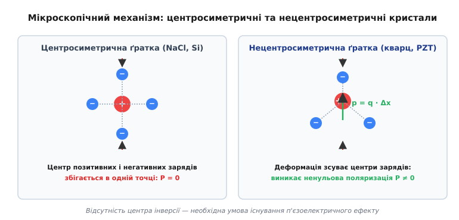
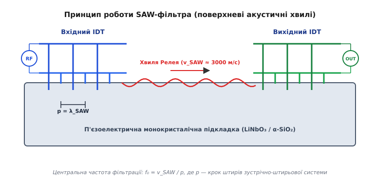
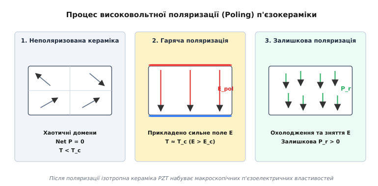
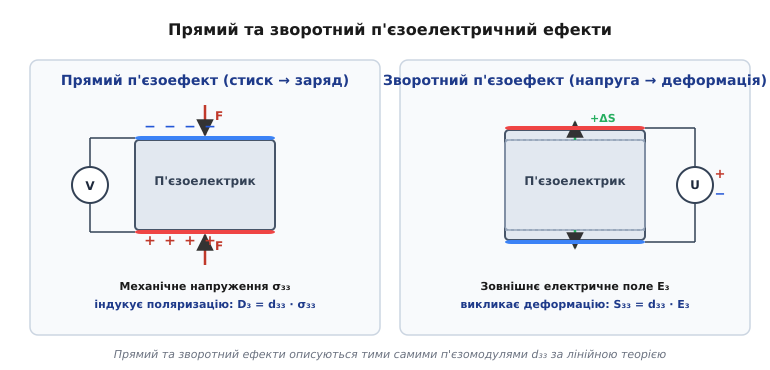

# П'єзоелектрика та зворотний п'єзоефект

<preknowlist>
- [Поляризація діелектрика](root:ph-electromagnetism/electric-polarization) — зв'язані заряди, вектор поляризації P та дипольний момент комірки.
- [Пружна деформація і закон Гука](root:ph-condensed/elastic-deformation) — тензори напружень T, деформацій S та модуль Юнга.
- [Діелектрична проникність](root:ph-electromagnetism/permittivity) — відносна діелектрична проникність ε_r та зв'язок між векторами E й D.
- [Сегнетоелектрики](root:ph-condensed/ferroelectricity) — спонтанна поляризація, доменна структура та точка Кюрі.
</preknowlist>

Інженерна проблема високоточних обчислень, радіозв'язку та прецизійної механіки XIX–XX століть вимагала створення пристроїв, здатних безінерційно перетворювати механічні коливання у високостабільний електричний сигнал і навпаки, оскільки класичні електромагнітні індуктивні реле та механічні маятники виявилися непридатними для мікросекундних систем і нанометрових переміщень. Розв'язанням цієї фундаментальної проблеми стало відкриття п'єзоелектричного ефекту.

Коли до граней монокристала кварцю завтовшки один міліметр прикладають механічну силу стиску всього у 100 ньютонів, на його протилежних поверхнях миттєво виникає електричний заряд, що створює різницю потенціалів понад 15 вольтів. Якщо ж змінити напрямок зусилля зі стиску на розтяг, знак виниклої напруги змінюється на протилежний. Зворотний процес працює з такою ж строгістю: електрична напруга у 100 вольтів змушує той самий кристал змістити свої грані на частки нанометра, розвиваючи механічне зусилля у сотні кілограмів. Цей двобічний зв'язок між механічною деформацією твердого тіла та внутрішнім електричним полем називається **п'єзоелектричним ефектом** (*piezoelectric effect*, від грецького *piezein* — тиснути, стискати). Він є основою стабілізації частоти радіопередавачів, високочастотної фільтрації сигналів у смартфонах, ультразвукової медичної візуалізації, гідроакустичної локації та нанопозиціонування з пікометровою точністю.

На відміну від електромагнітних перетворювачів (котушок індуктивності та магнітів), де добротність контуру обмежена активним опором обмоток та вихровими струмами (`Q ≈ 10 – 100`), п'єзоелектричні монокристалічні резонатори досягають механічної добротності `Q > 10⁵ – 10⁶`. Крім того, на гігагерцових частотах електромагнітна довжина хвилі становить десятки сантиметрів, тоді як швидкість звуку в твердому тілі у `10⁵` разів менша за швидкість світла, що дозволяє створювати мікрохвильові акустичні фільтри розміром у частки міліметра.

---

## 1. Фізична природа та кристалографічні вимоги симетрії

П'єзоелектричні властивості не є загальною рисою всіх речовин. Вони виникають виключно у кристалах із відповідною внутрішньою геометрією та асиметрією розподілу електричних зарядів у елементарній комірці.

У недеформованому стані будь-якого кристала позитивно заряджені катіони та негативно заряджені аніони утворюють періодичну ґратку. Якщо кристал має високу симетрію, центр ваги позитивних зарядів повністю збігається з центром ваги негативних зарядів, тому результуючий дипольний момент елементарного об'єму дорівнює нулю.


*Мікроскопічний механізм поляризації: у центросиметричних кристалах деформація не порушує збіг центрів зарядів (P = 0), тоді як у нецентросиметричних ґратках асиметричний зсув іонів генерує макроскопічний дипольний момент p.*

### Центросиметричні проти нецентросиметричних кристалів

Здатність матеріалу до п'єзоелектричного перетворення повністю визначається наявністю або відсутністю **центра інверсії (центра симетрії)**:

1. **Центросиметричні кристали:** 
   У кристалографічних точкових групах із центром інверсії (наприклад, кубічна ґратка кухонної солі `NaCl` або кремнію `Si`) кожному іону в точці `(x, y, z)` відповідає симетричний іон того самого знака в точці `(-x, -y, -z)`. При прикладанні однорідного механічного напруження (стиску чи розтягу) іони зсуваються строго симетрично. Відстані між усіма різнойменними зарядами змінюються однаково, через що центр позитивних зарядів і центр негативних зарядів залишаються в одній точці. Сумарний дипольний момент елементарної комірки дорівнює нулю (`p = 0`), і макроскопічна поляризація не виникає.

2. **Нецентросиметричні кристали:**
   У ґратках без центра інверсії (наприклад, тригональний кварц `α-SiO₂` або перовськіт `BaTiO₃`) елементарна комірка побудована з асиметричних іонних груп (тетраедрів `SiO₄` або октаедрів `TiO₆`). При механічному напруженні жорсткість хімічних зв'язків у різних напрямках виявляється неоднаковою. Позитивні катіони (`Si⁴⁺`, `Ti⁴⁺`) та негативні аніони (`O²⁻`) зміщуються на різні відстані.

Цей асиметричний зсув підґраток приводить до розриву компенсації зарядів:
- Центр ваги позитивних зарядів зміщується відносно негативних на вектор `Δx`.
- Елементарна комірка набуває індукованого дипольного моменту `p = q · Δx`.
- Сумування векторів `p` по всьому об'єму кристала `V` дає макроскопічний вектор **електричної поляризації** `P`:

```
P = (1 / V) · ∑ p[k] = ΔQ / A
```

На протилежних гранях кристала з'являються некомпенсовані поверхневі зв'язані заряди з густиною `σ_e = P_n`, що створюють вимірювану різницю потенціалів між електродами.

### Принцип Неймана та 20 п'єзоелектричних точкових груп

Фундаментальний кристалофізичний **принцип Неймана** стверджує: *група симетрії будь-якої фізичної властивості кристала повинна включати в себе точкову групу симетрії самого кристала*. Оскільки механічне напруження описується центросиметричним тензором другого рангу `T[jk]`, а електрична поляризація — полярним вектором першого рангу `P[i]`, лінійний п'єзоелектричний ефект описується полярним тензором третього рангу `d[ijk]`:

```
P[i] = d[ijk] · T[jk]
```

При операції просторової інверсії координат `x'[i] = -x[i]` координати змінюють знак на протилежний:
- Компоненти полярного вектора поляризації змінюють знак: `P'[i] = -P[i]`.
- Компоненти тензора напружень (як добуток двох координат) знака не змінюють: `T'[jk] = (-1) · (-1) · T[jk] = T[jk]`.
- Якщо кристалічна ґратка має центр інверсії, матеріал зобов'язаний переходити сам у себе при інверсії, тобто `d'[ijk] = d[ijk]`.
- Проте з трансформаційного закону для тензора третього рангу випливає `d'[ijk] = (-1)³ · d[ijk] = -d[ijk]`.
- Рівність `d[ijk] = -d[ijk]` можлива лише за умови `d[ijk] = 0`.

Отже, **наявність центра інверсії суворо забороняє п'єзоелектричний ефект**.

З усіх 32 кристалографічних точкових груп (класів симетрії) 11 класів є центросиметричними (`-1, 2/m, mmm, 4/m, 4/mmm, -3, -3m, 6/m, 6/mmm, m-3, m-3m`), і в них п'єзоефект фундаментально неможливий.

Серед решти 21 нецентросиметричного класу є один винятковий випадок — кубічний клас `432` (точковий клас симетрії октаедра без дзеркальних площин). Хоча він не має центра інверсії, наявність трьох осей симетрії четвертого порядку, чотирьох осей третього порядку та шести осей другого порядку накладає настільки суворі вимоги до тензора `d[ijk]`, що всі 27 його компонент тотожно обнуляються.

Таким чином, **п'єзоелектричний ефект спостерігається строго у 20 нецентросиметричних кристалографічних класах**.

```
                           32 Точкові кристалографічні групи
                                         │
                ┌────────────────────────┴────────────────────────┐
                ▼                                                 ▼
     11 Центросиметричних класів                        21 Нецентросиметричний клас
        (d[ijk] = 0 строго)                                       │
                                               ┌──────────────────┴──────────────────┐
                                               ▼                                     ▼
                                    Клас 432 (d[ijk] = 0)                  20 П'єзоелектричних класів
                                                                                     │
                                                                    ┌────────────────┴────────────────┐
                                                                    ▼                                 ▼
                                                         10 Полярних класів                10 Неполярних класів
                                                         (Піроелектрики &                  (Лише індукований
                                                          Сегнетоелектрики)                 п'єзоефект: Кварц)
```

### Полярні проти неполярних п'єзоелектриків

20 п'єзоелектричних класів поділяються на дві фундаментальні категорії:

1. **10 полярних класів (`1, 2, m, mm2, 3, 3m, 4, 4mm, 6, 6mm`):**
   Ці кристали мають єдину виділену полярну вісь, вздовж якої навіть за повної відсутності зовнішніх напружень та електричних полів існує постійний дипольний момент — **спонтанна поляризація** `P_sp`. Зміна температури змінює відстані між іонами вздовж полярної осі, викликаючи зміну поляризації — **піроелектричний ефект**. Усі піроелектрики є п'єзоелектриками. Якщо напрямок спонтанної поляризації можна перемикати зовнішнім електричним полем, матеріал називається **сегнетоелектриком** (титанат барію `BaTiO₃`, PZT).

2. **10 неполярних п'єзоелектричних класів (`222, -4, 422, -42m, 32, -6, 622, -6m2, -43m, 23`):**
   У стані спокою спонтанна поляризація відсутня (`P_sp = 0`), оскільки дипольні моменти окремих зв'язків взаємно компенсуються через наявність поворотних осей вищих порядків. Проте механічна деформація (зокрема зсувна або анізотропний одновісний стиск) порушує взаємну компенсацію та індукує макроскопічний заряд. Найвідомішим представником цієї групи є монокристалічний кварц `α-SiO₂` (клас `32`), який володіє високою п'єзоелектричною стабільністю, але не має спонтанної поляризації і не є піроелектриком чи сегнетоелектриком.

---

## 2. Прямий та зворотний п'єзоелектричний ефекти: Термодинамічна взаємність

П'єзоелектрика є принципово симетричним (оборотним) електромеханічним процесом, який описується однаковими коефіцієнтами зв'язку в обох напрямках. Ця взаємність описується термодинамічними співвідношеннями Максвелла для вільної енергії Гіббса.


*Принципова схема прямого (генерація заряду під дією тиску) та зворотного (механічна деформація під дією напруги) п'єзоелектричних ефектів.*

### 1. Прямий п'єзоелектричний ефект
Прямий п'єзоефект полягає у виникненні електричної поляризації `P` або вектора електричного зміщення `D` під дією прикладеного механічного напруження `T`.

У найпростішому одновимірному випадку поздовжньої деформації пластини площею `A` та товщиною `d₀`:

```
D = d · T     =>     Q = d · F
```

Де:
- `Q` — накопичений поверхневий заряд (кулони, C).
- `F` — прикладена механічна сила (ньютони, N).
- `d` — п'єзоелектричний модуль заряду (кулони на ньютон, C/N, або метри на вольт, m/V).

Заряд `Q` генерується миттєво при прикладанні сили. Залежно від режиму підключення вимірювального кола розрізняють два граничні стани:

- **Режим короткого замикання (зарядовий режим):** Електроди з'єднані через коло з низьким вхідним опором (наприклад, інтегруючий зарядовий підсилювач на операційному підсилювачі з ємнісним зворотним зв'язком `C_f`). При зміні прикладеної сили у колі протікає струм `I = dQ/dt`, а вихідна напруга підсилювача дорівнює `V_out = -Q / C_f = -(d · F) / C_f`. Перевага цього режиму полягає в тому, що вихідний сигнал абсолютно не залежить від паразитної ємності з'єднувальних кабелів.

- **Режим холостого ходу (напруговий режим):** Електроди розімкнені, а вхідний опір вольтметра прямує до нескінченності. Кристал діє як власний плоский конденсатор ємністю `C₀ = (ε_r · ε₀ · A) / d₀`. На його обкладках виникає напруга холостого ходу:

```
V_oc = Q / C₀ = (d · F · d₀) / (ε_r · ε₀ · A) = (d / (ε_r · ε₀)) · T · d₀ = g · T · d₀
```

Де `g = d / (ε_r · ε₀)` — **п'єзоелектрична стала напруги** (вольт-метри на ньютон, `V·m/N`), яка показує, яку напруженість електричного поля `E = V_oc / d₀` генерує матеріал на одиницю механічного напруження `T`.

### 2. Зворотний п'єзоелектричний ефект
Зворотний п'єзоефект полягає у виникненні механічної деформації `S` (відносного видовження `ΔL / L₀`) під дією зовнішнього електричного поля `E`.

```
S = ΔL / L₀ = d · E     =>     ΔL = d · V
```

Зворотний п'єзоефект є строго лінійним за полем (`S ∝ E`): зміна полярності поданої напруги `V` миттєво змінює розширення кристала на стиск. Якщо пластину затиснути між жорсткими опорами так, щоб деформація була неможлива (`S = 0`), подача електричного поля викличе внутрішнє механічне напруження блокування:

```
T_block = -Y^E · S_piezo = -Y^E · d · E
```

де `Y^E` — модуль Юнга матеріалу при постійному електричному полі. Максимальне зусилля блокування (*blocking force*) на площі `A` сягає `F_block = A · Y^E · d · E`. Для керамічного стека площею `1 cm²` це зусилля перевищує `3000 – 5000 N`, що робить п'єзоактуатори унікальними за питомим розвиваним тиском.

### Термодинамічні потенціали та співвідношення взаємності Максвелла

Строге математичне обґрунтування того, що коефіцієнт прямого п'єзоефекту (C/N) чисельно та фізично тотожний коефіцієнту зворотного ефекту (m/V), випливає з законів термодинаміки оборотних процесів.

Стан п'єзоелектричного континууму визначається чотирма основними термодинамічними змінними: двома механічними (напруження `T_mech`, деформація `S`) та двома електричними (електричне поле `E`, електричне зміщення `D`). Залежно від вибору незалежних змінних формулюють чотири термодинамічні потенціали:

1. **Внутрішня енергія `U(S, D)`:**
   ```
   dU = T_mech · dS + E · dD
   ```
2. **Електрична ентальпія `H(S, E) = U - E · D`:**
   ```
   dH = T_mech · dS - D · dE
   ```
3. **Пружна вільна енергія Гельмгольца `F(T_mech, D) = U - T_mech · S`:**
   ```
   dF = -S · dT_mech + E · dD
   ```
4. **Термодинамічний потенціал Гіббса `G(T_mech, E) = U - T_mech · S - E · D`:**
   ```
   dG = -S · dT_mech - D · dE
   ```

Для ізотермічного процесу диференціал вільної енергії Гіббса `G(T_mech, E)` є повним диференціалом:

```
S = -(∂G / ∂T_mech)_E
D = -(∂G / ∂E)_T_mech
```

Беручи другі мішані частинні похідні, в силу теореми Шварца про незалежність мішаних похідних від порядку диференціювання, отримуємо фундаментальне співвідношення взаємності Максвелла:

```
(∂S / ∂E)_T_mech = - ∂²G / (∂E ∂T_mech) = - ∂²G / (∂T_mech ∂E) = (∂D / ∂T_mech)_E = d
```

Це доводить, що:
- Відношення виниклого електричного зміщення `D` до механічного напруження `T_mech` при постійному полі `E` (прямий ефект).
- Відношення виниклої деформації `S` до електричного поля `E` при постійному напруженні `T_mech` (зворотний ефект).

описуються одним і тим самим коефіцієнтом `d`.

### Відмінність від електрострикції та флексоелектричного ефекту

П'єзоелектричний ефект необхідно чітко розмежовувати з іншими електромеханічними феноменами твердого тіла:

1. **Електрострикція (*Electrostriction*):**
   - Механічна деформація пропорційна квадрату електричного поля або поляризації: `S = Q · P² = M · E²`.
   - Електрострикція є універсальним явищем і присутня абсолютно в усіх діелектриках (у кристалах із будь-якою симетрією, включаючи центросиметричні, а також в аморфних стеклах, полімерах та рідинах).
   - Електрострикційна деформація не змінює знака при зміні полярності поля (завжди тільки розширення або тільки стиск уздовж осі поля). У звичайних матеріалах електрострикція надзвичайно слабка, проте в релаксорних сегнетоелектриках поблизу фазового переходу вона може генерувати гігантські безгістерезисні деформації до `0.1%`.

2. **Флексоелектричний ефект (*Flexoelectric effect*):**
   - Поляризація індукується не однорідною деформацією `S`, а **градієнтом деформації** `∂S / ∂x` (наприклад, при неоднорідному згині тонкої консолі): `P = μ · (∂S / ∂x)`.
   - Флексоефект також дозволений у центросиметричних кристалах, оскільки градієнт деформації сам по собі локально руйнує просторову інверсійну симетрію. Флексоелектрика відіграє визначальну роль у наномасштабних структурах (товщиною менше 10 нм), де навіть мікроскопічні згини створюють велетенські градієнти деформації `10⁶ – 10⁷ m⁻¹`.

Детальний огляд хронології експериментальних робіт братів Кюрі, термодинамічного передбачення Ліппмана та створення першого ультразвукового сонара Ланжевена наведено у вставці [📜 Історія відкриття п'єзоелектрики: від братів Кюрі до ультразвукових сонарів та SAW-фільтрів](root:ph-condensed/piezoelectric-tensor-and-materials/hist-curie-lippmann.md).

---

## 3. Математичний формалізм та нотація Фойгта

Оскільки механічний стан тривимірного тіла описується симетричними тензорами 2-го рангу напружень `T[ij]` та деформацій `S[ij]` (де `i, j ∈ {1, 2, 3}`), а електричний стан — векторами `E[k]` та `D[i]`, п'єзоелектричні модулі утворюють **тензор 3-го рангу** `d[ijk]`.

У повній тензорній формі конститутивні рівняння стану мають вигляд:

```
D[i] = ε[ij]^T · E[j] + d[ijk] · T[jk]        [прямий п'єзоефект]
S[ij] = d[kij] · E[k] + s[ijkl]^E · T[kl]      [зворотний п'єзоефект]
```

де:
- `ε[ij]^T` — тензор діелектричної проникності при вільному механічному стані (`T = 0`), тензор 2-го рангу (9 компонент, з яких 6 незалежних).
- `s[ijkl]^E` — тензор пружної податливості при постійному електричному полі (`E = 0`), тензор 4-го рангу (81 компонента, з яких 21 незалежна).
- `d[ijk]` — тензор п'єзомодулів 3-го рангу (27 компонент).

Оскільки тензор напружень є симетричним (`T[jk] = T[kj]`), внутрішній індекс п'єзомодуля також володіє симетрією: `d[ijk] = d[ikj]`. Це скорочує кількість незалежних компонент з 27 до 18.

### Скорочена матрична нотація Фойгта (Voigt Notation)

Для практичних інженерних розрахунків подвійні симетричні індекси `(j, k)` згортають в один матричний індекс `p ∈ {1, 2, 3, 4, 5, 6}` за наступним правилом:

```
(1, 1) → 1  (стиск/розтяг по осі X)         (2, 3) = (3, 2) → 4  (зсув навколо осі X у площині YZ)
(2, 2) → 2  (стиск/розтяг по осі Y)         (1, 3) = (3, 1) → 5  (зсув навколо осі Y у площині XZ)
(3, 3) → 3  (стиск/розтяг по осі Z)         (1, 2) = (2, 1) → 6  (зсув навколо осі Z у площині XY)
```

При переході до нотації Фойгта компоненти напружень та деформацій записуються як 6-елементні вектори-стовпці:

```
T[p] = [ T₁₁,  T₂₂,  T₃₃,  T₂₃,  T₁₃,  T₁₂ ]^t
S[q] = [ S₁₁,  S₂₂,  S₃₃,  2·S₂₃, 2·S₁₃, 2·S₁₂ ]^t
```

> ⚠️ **Важлива інженерна особливість:**
> Зсувні компоненти деформацій `S₄, S₅, S₆` у матричній нотації обов'язково множаться на коефіцієнт `2` (`S₄ = 2·S₂₃ = γ_yz`). Цей множник є математичною необхідністю для того, щоб скалярний добуток `∑ T[p] · S[p]` точно дорівнював повній густині механічної пружної енергії деформації `W = 1/2 · ∑∑ T[ij] · S[ij]`.

Завдяки симетрії тензор 3-го рангу `d[ijk]` перетворюється на прямокутну матрицю **`d[i,p]` розміром 3 × 6** (3 електричні рядки, 6 механічних стовпчиків):

```
          [ d₁₁  d₁₂  d₁₃  d₁₄  d₁₅  d₁₆ ]
d[i,p] =  [ d₂₁  d₂₂  d₂₃  d₂₄  d₂₅  d₂₆ ]
          [ d₃₁  d₃₂  d₃₃  d₃₄  d₃₅  d₃₆ ]
```

Транспонована матриця `d[p,i]^t = d[i,p]` розміром **6 × 3** описує зворотний п'єзоефект.

### Чотири еквівалентні форми конститутивних рівнянь IEEE 176

Залежно від того, які дві фізичні змінні обрано як вхідні (незалежні), а які дві — як вихідний відгук середовища, міжнародний стандарт **IEEE Standard 176 on Piezoelectricity** встановлює 4 форми лінійних рівнянь:

1. **d-форма (Strain-Charge form: незалежні T та E):**
   ```
   S[q] = ∑ s[qp]^E · T[p] + ∑ d[i,q]^t · E[i]       (q = 1..6)
   D[i] = ∑ d[i,p] · T[p] + ∑ ε[ij]^T · E[j]         (i = 1..3)
   ```
   Застосовується для аналізу вільних актуаторів та датчиків зусилля.

2. **e-форма (Stress-Charge form: незалежні S та E):**
   ```
   T[p] = ∑ c[pq]^E · S[q] - ∑ e[i,p]^t · E[i]
   D[i] = ∑ e[i,q] · S[q] + ∑ ε[ij]^S · E[j]
   ```
   де `c^E = (s^E)⁻¹` — матриця модулів пружності (жорсткості), `e = d · c^E` — п'єзомодуль напруження (C/m²), а `ε^S = ε^T · (1 - k²)` — «затиснута» діелектрична проникність. Ця форма є базовою для чисельного розрахунку акустичних випромінювачів методом скінченних елементів (FEM).

3. **g-форма (Strain-Voltage form: незалежні T та D):**
   ```
   S[q] = ∑ s[qp]^D · T[p] + ∑ g[i,q]^t · D[i]
   E[i] = -∑ g[i,p] · T[p] + ∑ β[ij]^T · D[j]
   ```
   де `g = d / ε^T` — напруговий п'єзомодуль (`V·m/N`), а `β^T = (ε^T)⁻¹` — діелектрична непроникність. Використовується для розрахунку високочутливих акустичних приймачів (гідрофонів).

4. **h-форма (Stress-Voltage form: незалежні S та D):**
   ```
   T[p] = ∑ c[pq]^D · S[q] - ∑ h[i,p]^t · D[i]
   E[i] = -∑ h[i,q] · S[q] + ∑ β[ij]^S · D[j]
   ```
   де `h = e / ε^S` — модуль жорсткості за зарядом (`V/m` або `N/C`). Застосовується для аналізу швидкоплинних ударних та імпульсних навантажень.

### Матрична структура для головних класів симетрії

Внутрішня кристалографічна симетрія матеріалу обнуляє більшість із 18 компонент матриці `d[i,p]`:

- **Клас 32 (Монокристалічний кварц `α-SiO₂`):** Кристал має лише 2 незалежні компоненти (`d₁₁` та `d₁₄`):
  ```
            [  d₁₁  -d₁₁    0    d₁₄    0      0   ]
  d[i,p] =  [   0     0     0     0   -d₁₄  -2·d₁₁ ]
            [   0     0     0     0     0      0   ]
  ```
  Зверніть увагу: рядок 3 повністю нульовий (`d₃₁ = d₃₂ = d₃₃ = 0`). Електричне поле вздовж оптичної осі Z взагалі не викликає деформацій.

- **Клас 6mm (Поляризована кераміка PZT, BaTiO₃, плівки AlN, ZnO):** Осі X та Y еквівалентні в площині поляризації. Матриця містить лише 3 незалежні компоненти (`d₃₁ = d₃₂`, `d₃₃`, `d₁₅ = d₂₄`):
  ```
            [   0     0     0     0    d₁₅     0   ]
  d[i,p] =  [   0     0     0    d₁₅    0      0   ]
            [  d₃₁   d₃₁   d₃₃    0     0      0   ]
  ```

- **Клас 3m (Ніобат літію `LiNbO₃`):** 4 незалежні компоненти (`d₁₅`, `d₂₂`, `d₃₁`, `d₃₃`):
  ```
            [   0      0      0      0    d₁₅  -2·d₂₂ ]
  d[i,p] =  [ -d₂₂    d₂₂     0     d₁₅    0      0    ]
            [  d₃₁    d₃₁    d₃₃     0     0      0    ]
  ```

Математичний вивід усіх чотирьох форм та розрахунок матриць для різних класів симетрії наведено у вставці [🧮 Математичний апарат п'єзоелектрики: тензорний формалізм, скорочення Фойгта та коефіцієнти зв'язку](root:ph-condensed/piezoelectric-tensor-and-materials/math-piezo-tensor.md).

---

## 4. Порівняльний аналіз п'єзоелектричних матеріалів



*Ілюстрація: Crystal Symmetry Polarization.*



*Ілюстрація: Saw Filter Structure.*

У сучасній фізиці конденсованого стану та техніці використовується широка номенклатура п'єзоматеріалів, оптимізованих під конкретні завдання (від еталонів частоти до силових ультразвукових гармат).

### 1. П'єзоелектричні монокристали (Кварц α-SiO₂, LiNbO₃, LiTaO₃, Лангасит)

- **Кварц (`α-SiO₂`):** Тригональний монокристал (клас `32`). Має помірний п'єзомодуль (`d₁₁ ≈ 2.31 pC/N`), але вирізняється надзвичайно низькими внутрішніми втратами енергії (механічна добротність `Q_m > 10⁵ – 10⁶`) та хімічною інертністю. При температурі `T = 573 °C` зазнає фазового переходу в центросиметричний `β-кварц` (клас `622`) з повною втратою п'єзовластивостей та утворенням двійників (дофінейських та бразильських).
- **Ніобат літію (`LiNbO₃`) та Танталат літію (`LiTaO₃`):** Сегнетоелектричні монокристали (клас `3m`) із високою температурою Кюрі (`T_c ≈ 1140 °C` для `LiNbO₃`) та сильним електромеханічним зв'язком (`k₁₅ ≈ 0.60`). Є ключовими підкладками для акустоелектроніки (SAW-фільтрів) та інтегральної фотоніки (модуляторів Маха — Цендера).
- **Лангасит (`La₃Ga₅SiO₁₄`, LGS):** Не має фазових переходів аж до точки плавлення (`1470 °C`), що робить його незамінним матеріалом для високотемпературних п'єзодатчиків тиску та детонації в авіаційних двигунах і газових турбінах.

### 2. Сегнетоелектрична перовськітна кераміка (PZT, BaTiO₃, PMN-PT)

Основним промисловим матеріалом силової п'єзотехніки є тверді розчини **цирконату-титанату свинцю (`Pb[Zr_x Ti_{1-x}]O₃`, або PZT)** зі структурою перовськіту `ABO₃`.


*Три етапи поляризації PZT-кераміки: 1) неполяризований стан з хаотичними доменами (P = 0); 2) нагрівання до T ≈ Tc та прикладання поля E > Ec; 3) поляризований стан із залишковою поляризацією Pr після охолодження.*

#### Морфотропна фазова межа (MPB) та поворот вектора поляризації
П'єзоелектричний відгук PZT досягає колосальних значень поблизу **морфотропної фазової межі (Morphotropic Phase Boundary, MPB)** при молярному співвідношенні `Zr / Ti ≈ 52 / 48` (`x ≈ 0.52`).

На фазовій діаграмі MPB розділяє дві різні кристалографічні сегнетоелектричні фази:
- **Тетрагональну фазу `FE_T`** (збагачену Ti, зі спонтанною поляризацією вздовж 6 еквівалентних напрямків `⟨001⟩`).
- **Ромбоедричну фазу `FE_R`** (збагачену Zr, зі спонтанною поляризацією вздовж 8 еквівалентних напрямків `⟨111⟩`).

На самій межі MPB виникає проміжна **моноклінна фаза (`M_A / M_B`)**, яка діє як кристалографічний міст між тетрагональним та ромбоедричним станами. Термодинамічний потенціал Гіббса стає надзвичайно пологим («пласким») відносно напрямку вектора поляризації. Це дозволяє вектору спонтанної поляризації `P_sp` практично без енергетичного бар'єра безперервно повертатися в просторі під дією навіть слабкого зовнішнього електричного поля чи механічного напруження (**механізм повороту поляризації, *polarization rotation***). Завдяки цьому п'єзомодулі `d₃₃` зростають до `300 – 650 pC/N`, а діелектрична проникність `ε_r` досягає `1500 – 3500`.

#### Високовольтна поляризація (Poling) та доменна динаміка
Відразу після спікання при `1200 °C` кераміка PZT складається з мікроскопічних зерен із хаотично орієнтованими доменами. Векторна сума спонтанної поляризації по всьому об'єму дорівнює нулю (`P = 0`), тому макроскопічний п'єзоефект відсутній.

Для активації п'єзоефекту проводять процес **поляризації (*poling*)**:


*Ілюстрація: Pzt Domain Poling.*

1. Кераміку занурюють у діелектричне силіконове масло і нагрівають до `T = 120 – 180 °C`. При нагріванні коерцитивне поле матеріалу `E_c` суттєво зменшується.
2. Прикладають сильне постійне електричне поле `E_pol ≈ 2.5 – 4.0 kV/mm` (перевищує `E_c`). Під дією поля відбувається переорієнтація як 180°-вих (суто електричних), так і 90°-вих (сегнетопружних) доменів уздовж напрямку поля.
3. Зберігаючи поле увімкненим, кераміку повільно охолоджують до кімнатної температури. Доменна структура «заморожується», створюючи високу макроскопічну **залишкову поляризацію** `P_r ≈ 30 – 40 μC/cm²`. Після цього матеріал набуває макроскопічної симетрії `6mm`.

У кімнатних умовах до 60–70% величини п'єзоелектричного модуля PZT забезпечується **екстрінсік-механізмом (рухом доменних стінок)** під дією змінних полів, тоді як власна деформація кристалічної ґратки (інтрінсік-внесок) становить лише 30–40%.

#### Жорсткі проти м'яких п'єзокерамік (Doping Engineering)
Шляхом прецизійного легування ґратки перовськіту властивості PZT цілеспрямовано модифікують:

- **М'які кераміки (Soft PZT, наприклад PZT-5A, PZT-5H):** Легуються донорними іонами (`Nb⁵⁺, Ta⁵⁺` на позиції `Ti⁴⁺/Zr⁴⁺` або `La³⁺` на позиції `Pb²⁺`). Донорне легування створює катіонні вакансії в підґратці свинцю, що знімає внутрішні механічні напруження і робить доменні стінки надзвичайно рухливими.
  *Характеристики:* Велетенські п'єзомодулі (`d₃₃ ≈ 400 – 650 pC/N`), висока діелектрична проникність (`ε_r ≈ 3400`), але високі діелектричні втрати (`tan δ ≈ 2%`) та низька механічна добротність (`Q_m ≈ 65 – 80`). Ідеальні для високочутливих приймачів, медичного ультразвуку та наноактуаторів.
- **Жорсткі кераміки (Hard PZT, наприклад PZT-4, PZT-8):** Легуються акцепторними іонами (`Fe³⁺, Mn²⁺, Sc³⁺` замість `Ti⁴⁺`). Для компенсації заряду утворюються кисневі вакансії `V_O••`, які утворюють дефектні диполі `(Fe_Ti' - V_O••)•`, орієнтовані вздовж спонтанної поляризації. Ці диполі міцно «пінінгують» (блокують) рух доменних стінок.
  *Характеристики:* Помірні п'єзомодулі (`d₃₃ ≈ 220 – 300 pC/N`), але надзвичайно низькі втрати (`tan δ < 0.4%`) та рекордно висока механічна добротність (`Q_m ≈ 500 – 1500`). Вони не перегріваються при роботі на резонансі і є незамінними для потужного силового ультразвуку (зварювання, сонари, кавітаційне очищення).

- **Релаксорні монокристали (PMN-PT, PZN-PT):** Тверді розчини ніобату магнію-свинцю та титанату свинцю `Pb(Mg_{1/3}Nb_{2/3})O₃ - PbTiO₃`, вирощені у вигляді монокристалів вздовж кристалографічного напрямку `[001]`, демонструють гігантський п'єзомодуль `d₃₃ > 2000 – 2500 pC/N` та коефіцієнт електромеханічного зв'язку `k₃₃ > 0.90 – 0.92`, що зробило революцію в медичних ультразвукових кардіологічних датчиках високої роздільної здатності.

### 3. Безсвинцеві альтернативи (KNN, BNT, BCZT)

Через високу токсичність оксиду свинцю директиви Європейського Союзу (RoHS) вимагають розробки екологічно безпечних безсвинцевих п'єзоматеріалів:

- **Ніобат калію-натрію (`(K,Na)NbO₃`, KNN):** За рахунок легування літієм, танталом та сурмою утворюються поліморфні фазові межі (PPB), де п'єзомодуль досягає `d₃₃ ≈ 300 – 450 pC/N` при температурі Кюрі `T_c ≈ 200 – 300 °C`. Головна технологічна проблема — висока леткість лужних металів (`K, Na`) при спіканні.
- **Титанат вісмуту-натрію (`(Bi_{0.5}Na_{0.5})TiO₃`, BNT):** Демонструє гігантську індуковану полем деформацію (`S > 0.4 – 0.7%`) за рахунок переходу з релаксорного неполярного стану в сегнетоелектричний під дією поля, що є перспективним для актуаторів.
- **Титанат-цирконат барію-кальцію (`(Ba,Ca)(Zr,Ti)O₃`, BCZT):** Демонструє гігантський п'єзомодуль `d₃₃ > 500 – 600 pC/N` завдяки наявності трикритичної точки, проте має відносно низьку температуру Кюрі (`T_c ≈ 90 °C`), що обмежує його застосування вузьким температурним діапазоном.

### 4. П'єзонапівпровідники, тонкі плівки та п'єзотроніка (AlN, ScAlN, ZnO, GaN, MoS₂)

- **Нітрид алюмінію (AlN) та скандієвий нітрид алюмінію (ScAlN):** Мають гексагональну структуру вюрциту (клас `6mm`). Тонкі плівки товщиною від 200 нм до 2 мкм наносять реактивним магнетронним напиленням на кремній. Чистий AlN має `d₃₃ ≈ 5.5 pC/N`, проте легування скандієм (`Sc_x Al_{1-x}N` при `x ≈ 0.3 – 0.4`) збільшує `d₃₃` до `25 – 30 pC/N` (зростання на 400–500%) через пом'якшення кристалічної ґратки. Мають рекордну швидкість звуку (`v_s ≈ 11300 m/s`), стійкість до температур понад 1000 °C та повну сумісність із CMOS-технологією мікросхем.
- **П'єзотроніка (Piezotronics):** У нецентросиметричних напівпровідниках (`ZnO, GaN, CdS`, а також моношарах `MoS₂, WS₂`) механічна деформація генерує внутрішні нескомпенсовані поляризаційні заряди на границях поділу (на контактах метал–напівпровідник або в p-n переходах). Цей п'єзоелектричний потенціал (**п'єзопотенціал**) модулює висоту бар'єра Шотткі та профіль зонної структури, дозволяючи керувати транспортом носіїв струму механічним зусиллям без використання класичного третього затвора. На цьому принципі створено п'єзоелектричні польові транзистори (piezo-FET) та механосенсорні матриці штучної шкіри.

### 5. П'єзополімери (PVDF) та 1-3 п'єзокомпозити

- **Полівініліденфторид (PVDF) `(-CH₂-CF₂-)_n`:** Напівкристалічний полімер. У вихідному стані перебуває в неполярній `α-фазі` (конфігурація ланцюга *trans-gauche* `TGTG'`). Для надання п'єзовластивостей плівку піддають механічному одновісному або двовісному витягуванню в 4–5 разів при температурі 80 °C, що переводить полімер у полярну `β-фазу` (конфігурація *all-trans* `TTTT`), де всі атоми фтору орієнтовані по один бік ланцюга. Потім прикладають поле `E > 100 MV/m`. PVDF має високу гнучкість, низький акустичний імпеданс (`Z ≈ 2.7 MRayl`, що ідеально узгоджується з водою `1.5 MRayl` та тканинами тіла) і величезну напругову сталу `g₃₃ ≈ 330 mV·m/N`.
- **1-3 П'єзокомпозити:** Складаються з тисяч паралельних тонких стовпчиків PZT-кераміки, впресованих у матрицю з епоксидної смоли (перша цифра 1 означає одновимірну неперервність кераміки, друга 3 — тривимірну неперервність полімеру). Така структура знімає поперечні паразитні механічні моди, зменшує акустичний імпеданс до `8 – 15 MRayl` та підвищує товщинний коефіцієнт зв'язку `k_t` практично до значення `k₃₃ ≈ 0.70`, забезпечуючи надшироку смугу пропускання медичних УЗД-датчиків.

Детальний порівняльний аналіз сталих матеріалів, зведену таблицю та аналіз режимів розполяризації (depoling) наведено у вставці [🔌 Класифікація та порівняльний аналіз п'єзоелектричних матеріалів: від монокристалів до плівок і полімерів](root:ph-condensed/piezoelectric-tensor-and-materials/comp-piezo-materials.md).

---

## 5. Динаміка, механічний резонанс та коефіцієнт електромеханічного зв'язку k²

При збудженні п'єзоелемента змінним електричним полем `E(t) = E₀ sin(ω t)` у твердому тілі поширюються пружні акустичні хвилі.

### Хвильове рівняння та п'єзоелектричне підсилення жорсткості (Piezoelectric Stiffening)

Розглянемо одновимірне поширення поздовжньої хвилі вздовж осі поляризації `Z (3)` у п'єзосередовищі з густиною `ρ`. Рівняння динамічного руху суцільного середовища має вигляд:



*Ілюстрація: Piezo Direct Inverse.*

```
ρ · ∂²u₃/∂t² = ∂T₃/∂z
```

Оскільки матеріал є діелектриком без вільних об'ємних зарядів, з рівняння Максвелла `∇ · D = 0` випливає, що за відсутності вільних носіїв похідна індукції за координатою дорівнює нулю: `∂D₃/∂z = 0`.

Виразимо електричне поле з h-форми рівнянь стану: `E₃ = -h₃₃ · (∂u₃/∂z) + β₃₃^S · D₃`. Підставивши це в рівняння для механічного напруження `T₃ = c₃₃^D · (∂u₃/∂z) - h₃₃ · D₃`, отримаємо, що ефективний модуль пружної жорсткості п'єзоелектрика за наявності зв'язку стає вищим, ніж чисто механічний модуль:

```
c₃₃^D = c₃₃^E · (1 + k₃₃² / (1 - k₃₃²)) = c₃₃^E / (1 - k₃₃²)
```

Це явище називається **п'єзоелектричним підсиленням жорсткості** (*piezoelectric stiffening*). Швидкість звуку в п'єзоелектрику також зростає: `v_acoustic = √(c^D / ρ)`.

### Механічний резонанс та антирезонанс

Повний електричний імпеданс `Z(ω)` або провідність (адмітанс) `Y(ω) = 1 / Z(ω)` вільної п'єзопластини площею `A` та товщиною `d₀` виводиться з розв'язку хвильового рівняння з крайовими умовами відсутності механічних напружень на торцях:

```
Y(ω) = j · ω · C₀ · [ 1 + (k_t² / (1 - k_t²)) · (tan(ω d₀ / (2 v)) / (ω d₀ / (2 v))) ]
```

Аналіз цієї функції показує наявність двох характерних особливих частот:

```
       |Z| (Імпеданс)
        ^
        |           /| (Паралельний антирезонанс f_p: Z = Z_max, Y = 0)
        |          / |
        |         /  |
        |  ______/   |
        | /          |
        |/ (f_s)     \
        +-------------+------------------------> f (Частота)
          Послідовний резонанс: Z = Z_min, Y = Y_max
```

1. **Послідовний механічний резонанс (`f_s`):**
   Знаменник функції тангенса наближається до нуля (`ω d₀ / (2 v) = π / 2`), провідність `Y(f)` прямує до максимуму, а електричний імпеданс падає до мінімального активного значення опору втрат `Z → R_m`. На цій частоті амплітуда механічних коливань пластини досягає максимуму, оскільки на товщині вкладається рівно половина акустичної довжини хвилі (`d₀ = λ / 2`).

2. **Паралельний антирезонанс (`f_p`):**
   Повна провідність `Y(f)` обнуляється за рахунок компенсації струму динамічної гілки струмом статичної ємності `C₀`. Електричний імпеданс досягає гострого піка `Z = Z_max`.

### Коефіцієнт електромеханічного зв'язку k²

Безрозмірний **коефіцієнт електромеханічного зв'язку k** визначає частку підведеної енергії, яка перетворюється на інший вид (із механічної в електричну або навпаки) за один квазістатичний цикл:

```
k² = (Накопичена перетворена енергія) / (Повна підведена енергія)
```

Для різних геометричних мод деформації коефіцієнт `k` розраховується через відповідні матричні компоненти:
- **Поздовжня мода стрижня (мода 33):** `k₃₃ = d₃₃ / √(s₃₃^E · ε₃₃^T)`
- **Поперечна мода балки (мода 31):** `k₃₁ = d₃₁ / √(s₁₁^E · ε₃₃^T)`
- **Товщинна мода пластини (мода t):** `k_t = e₃₃ / √(c₃₃^D · ε₃₃^S)`
- **Зсувна мода (мода 15):** `k₁₅ = d₁₅ / √(s₅₅^E · ε₁₁^T)`
- **Планарна радіальна мода диска (мода p):** `k_p = k₃₁ · √(2 / (1 - ν))`, де `ν` — коефіцієнт Пуассона.

За виміряними значеннями частот резонансу `f_s` та антирезонансу `f_p` стандарт IEEE 176 задає строгу формулу розрахунку коефіцієнта зв'язку:

```
k_t² = (π / 2) · (f_s / f_p) · tan[(π / 2) · ((f_p - f_s) / f_p)]
```

### Еквівалентна електрична схема Баттерворта — Ван-Дайка (BVD)

Поблизу окремої моди резонансу складна електромеханічна система замінюється еквівалентною чотириелементною схемою **Баттерворта — Ван-Дайка (BVD)**:

```
           ┌───────[ L_m ]───────[ C_m ]───────[ R_m ]───────┐
 ─( Вхід )──┤                                                 ├──( Вихід )─
           └─────────────────────[ C_0 ]─────────────────────┘
```

1. **Паралельна статична ємність `C₀`:** Геометрична ємність затиснутого діелектрика між електродами: `C₀ = (ε₃₃^S · A) / d₀`.
2. **Динамічна індуктивність `L_m`:** Еквівалент інерційної коливної маси кристала: `L_m = (ρ · d₀³ · A) / (8 · d₃₃² · Y² · A²)`.
3. **Динамічна ємність `C_m`:** Еквівалент пружної механічної податливості: `C_m = (8 / π²) · k² · C₀`.
4. **Динамічний опір втрат `R_m`:** Еквівалент внутрішнього тертя та акустичного випромінювання: `R_m = (2π · f_s · L_m) / Q_m`.

Механічна добротність резонатора розраховується як `Q_m = 1 / (2π · f_s · C_m · R_m)`. У модифікованій схемі **mBVD** послідовно зі статичною ємністю додають опір діелектричних втрат `R_0 = tan δ / (ω C_0)` та опір омічних контактів електродів `R_s`.

Повні рівняння еквівалентної електричної схеми Баттерворта — Ван-Дайка (BVD), розрахунок статичної `C₀` та динамічних `L_m, C_m, R_m` компонент, а також стандартизовані параметри IEEE 176 зведено у вставці [📋 Довідник фізико-механічних та електричних параметрів п'єзоматеріалів та матриць симетрії](root:ph-condensed/piezoelectric-tensor-and-materials/api-piezo-parameters.md).

---

## 6. Кристалографічні зрізи, температурна компенсація та кварцові мікроваги (QCM)

Для забезпечення безпрецедентної стабільності частоти генераторів властивості монокристалів оптимізують шляхом вибору просторової орієнтації площини розпилу монокристала відносно його кристалографічних осей — вибору **кристалографічного зрізу**.

У монокристалі кварцу головними осями є:
- **Вісь Z (`X₃`):** Оптична вісь тригональної симетрії 3-го порядку.
- **Вісь X (`X₁`):** Електрична вісь 2-го порядку (вздовж якої `d₁₁ ≠ 0`).
- **Вісь Y (`X₂`):** Механічна вісь, ортогональна до осей X та Z.

### Орієнтовані зрізи кварцу (AT, BT, SC)

```
        Z (Оптична вісь)
        ^
        |     / AT-cut (θ ≈ +35°15')
        |    /
        |   /
        |  /
        | /
        +-----------------------> Y (Механічна вісь)
       / 
      /   BT-cut (θ ≈ -49°)
     /
    v X (Електрична вісь)
```

1. **AT-зріз (AT-cut):**
   Пластина зрізається під кутом `θ ≈ +35°15'` до осі Z навколо осі X. У такій пластині електричне поле `E_y'` збуджує моду чистих товщинних зсувних коливань (*thickness shear mode*).
   
   Головна перевага AT-зрізу — **нульовий температурний коефіцієнт частоти (Zero TCF)** при кімнатній температурі (`T₀ = 25 °C`). Залежність зміни частоти від температури описується кубічним поліномом:

   ```
   Δf / f₀ = a · (T - T₀) + b · (T - T₀)² + c · (T - T₀)³
   ```

   При куті зрізу `θ = 35°15'` лінійний коефіцієнт `a = 0`, а квадратичний `b = 0`. Залишається лише слабкий кубічний член із `c ≈ 10⁻¹⁰ °C⁻³`. Це забезпечує стабільність частоти на рівні `±5 ppm` (п'ять частин на мільйон) у величезному діапазоні температур від -40 °C до +85 °C без використання активного термостатування.

2. **BT-зріз (BT-cut):**
   Зріз під кутом `θ ≈ -49°`. Має вищу швидкість зсувної хвилі, що дозволяє виготовляти товстіші пластини для тієї ж частоти, проте температурна крива є параболічною (`b ≠ 0`), що звужує діапазон термостабільності.

3. **SC-зріз (Stress-Compensated cut):**
   Зріз із подвійним поворотом: перший поворот навколо осі Z на кут `φ ≈ 21.9°`, другий — навколо нової осі X' на кут `θ ≈ 34.1°`.
   SC-зріз повністю нейтралізує вплив внутрішніх механічних напружень, викликаних кріпленням пластини або термічними градієнтами під час швидкого нагрівання. Він має у 10 разів меншу чутливість до механічних вібрацій та прискорень (*low g-sensitivity* `< 10⁻¹⁰ / g`) і застосовується у прецизійних термостатованих опорних генераторах (OCXO) для супутникової навігації GPS/Galileo та радарів.

### Кварцові мікроваги (QCM) та рівняння Зауербрея

Здатність високодобротного резонатора AT-зрізу змінювати резонансну частоту при найменшій зміні маси на поверхні електроду лежить в основі **кварцових мікроваг (Quartz Crystal Microbalance, QCM)**.

Коли на поверхню електрода резонатора з базовою резонансною частотою `f₀` (зазвичай 5–10 МГц) рівномірно осаджується тонка плівка сторонньої речовини масою `Δm`, вона діє як механічне подовження товщини коливного кристала.

Німецький фізик Гюнтер Зауербрей у 1959 році вивів класичне **рівняння Зауербрея**:

```
Δf = - (2 · f₀²) / (A · √(ρ_q · μ_q)) · Δm = - C_f · (Δm / A)
```

Де:
- `Δf` — вимірюваний зсув резонансної частоти (Гц).
- `f₀` — власна частота ненавантаженого кварцового резонатора (Гц).
- `Δm` — маса осадженої речовини (г або нг).
- `A` — активна площа електродів (`cm²`).
- `ρ_q` — густина монокристалічного кварцю (`2.648 g/cm³`).
- `μ_q` — модуль зсуву кварцю AT-зрізу (`2.947 · 10¹¹ dyn/cm²` або `29.47 GPa`).
- `C_f` — коефіцієнт масової чутливості кварцу (для `f₀ = 5 MHz` він становить `C_f ≈ 56.6 Hz · μg⁻¹ · cm²`).

Роздільна здатність QCM сягає часток нанограма (`< 0.1 ng/cm²`), що дозволяє фіксувати утворення мономолекулярних шарів білків, ДНК, товщину напилених металевих плівок у вакуумних камерах та адсорбцію окремих молекул газу.

#### Робота в рідинах: Рівняння Канадзави — Гордона
При роботі датчика QCM у рідині (наприклад, у біохімічних дослідженнях крові) в'язке тертя рідини створює додаткове згасання зсувної хвилі, яка проникає в рідину на глибину скін-шару `δ = √(η_L / (π · f₀ · ρ_L))`. Зсув частоти за рахунок в'язкості `η_L` та густини рідини `ρ_L` описується **рівнянням Канадзави — Гордона**:

```
Δf_liquid = - f₀^(3/2) · √((ρ_L · η_L) / (π · ρ_q · μ_q))
```

Сучасні прилади **QCM-D** одночасно вимірюють як зміну частоти `Δf`, так і зміну коефіцієнта дисипації енергії `ΔD = 1 / Q_m`, що дозволяє розрізняти жорсткі шари молекул від м'яких драглеподібних гідратованих полімерних матриць.

---

## 7. Практичні застосування п'єзотехніки

Завдяки здатності до прямого та зворотного перетворення енергії п'єзоелектричні пристрої розділяються на чотири великі інженерні галузі:

### 1. Акустоелектроніка: SAW-фільтри та FBAR/BAW-резонатори для 5G
У сучасній радіочастотній техніці (смартфонах, станціях 4G/5G, Wi-Fi 6E/7 та GPS-приймачах) п'єзоелектричний ефект єдиний дозволяє створити мікрогабаритні високоселективні смугові фільтри.


*Конструкція SAW-фільтра: вхідний зустрічно-штирьовий перетворювач (IDT) перетворює радіочастотний електричний сигнал на поверхневу акустичну хвилю Релея, яка проходить через п'єзопідкладку і конвертується назад у вихідний електричний сигнал.*

- **Фільтри на поверхневих акустичних хвилях (SAW, Surface Acoustic Wave):**
  На поліровану поверхню п'єзопідкладки (`LiNbO₃` або `LiTaO₃`) напилюють зустрічно-штирьовий перетворювач (IDT) у формі зустрічних гребінчастих алюмінієвих електродів із періодом `p = λ_s`.
  Вхідний сигнал збуджує поверхневу хвилю Релея, яка поширюється вздовж поверхні зі швидкістю `v_s ≈ 3000 – 4000 m/s`.
  Центральна частота смуги пропускання фільтра строго задається відстанню між електродами: `f₀ = v_s / p`.
  Оскільки швидкість звуку в `10⁵` разів менша за швидкість світла, розмір фільтра на частоту 1.8 ГГц становить усього `1 × 1 мм`. Для пригнічення температурного дрейфу використовують технологію **TC-SAW** (нанесення діелектричного шару `SiO₂` з позитивним TCF, що компенсує негативний TCF підкладки).

- **Об'ємні акустичні резонатори (BAW та FBAR) для 5G:**
  На частотах понад 2.5–3.5 ГГц виготовлення субмікронних електродів SAW стає технологічно складним через дифракційні літографічні межі та акустичні втрати на поверхні.
  У смартфонах 5G застосовують **обернені об'ємні акустичні резонатори (FBAR, Film Bulk Acoustic Resonator)** та **BAW-SMR (Solidly Mounted Resonators)** на основі тонких орієнтованих плівок `AlN` або `ScAlN`.
  У резонаторах FBAR п'єзоплівка зависає над витравленою у кремнії повітряною порожниною (*air cavity*), що забезпечує 100% відбиття акустичної хвилі на границях плівки. У BAW-SMR кристал розміщують над акустичним Бреггівським дзеркалом (чергуванням шарів із високим і низьким імпедансом `W/SiO₂` товщиною `λ/4`). Резонатори FBAR працюють на частотах до 6–10 ГГц, витримують потужність понад `+30 dBm` (1 Вт) і формують дуплексери мобільних телефонів.

### 2. П'єзоактуатори позиціонування та п'єзодвигуни

- **Багатошарові п'єзостеки (Multilayer Actuators):**
  Напилення сотень тонких шарів кераміки PZT товщиною 50–100 мкм, з'єднаних електрично паралельно, дозволяє при низькій безпечній напрузі 100 В генерувати зусилля блокування у кілька кілоньютонів при переміщенні 10–50 мкм. Використовуються для нанопозиціонування голки скануючих тунельних мікроскопів (STM) та дзеркал лазерних інтерферометрів гравітаційних хвиль LIGO.
- **П'єзоелектричні двигуни (Piezomotors):**
  - *Хвильові ультразвукові двигуни (USM):* Сегментований п'єзокерамічний диск збуджує біжучу хвилю деформації у статорі зі зсувом фаз 90°. Точки поверхні рухаються по мікроскопічних еліптичних траєкторіях, обертаючи притиснутий ротор за рахунок сил тертя з високим моментом сили без редуктора (застосовуються в автофокусах фотооб'єктивів Canon USM / Nikon SWM).
  - *Інерційні двигуни (Stick-Slip):* П'єзоелемент повільно розширюється, захоплюючи шток за рахунок тертя спокою (*stick*), а потім надшвидко стискається, прослизаючи завдяки силі інерції (*slip*), забезпечуючи нескінченний хід із кроком від 1 нанометра.

### 3. Силовий ультразвук, медичні трансд'юсери та гідроакустика

- **Перетворювачі Ланжевена:** Пакет дисків жорсткої PZT-кераміки, затиснутий титановими або сталевими болтами між масивними металевими накладками. Працюють на резонансних частотах 20–40 кГц, генеруючи акустичну потужність до кількох кіловат для ультразвукового зварювання пластмас та кавітаційного миття деталей.
- **Медичні УЗД-фазовані решітки:** Матриці з 128–256 мініатюрних елементів із 1-3 п'єзокомпозиту. Керуючи фазовою затримкою імпульсів збудження на кожному елементі, виконують електронне сканування, фокусування та візуалізацію внутрішніх органів та кровотоку в режимі реального часу.
- **Фокусований ультразвук високої інтенсивності (HIFU):** Сферичні увігнуті п'єзокерамічні випромінювачі фокусують ультразвукові промені у глибині тіла, нагріваючи пухлинні клітини до 60–80 °C та здійснюючи неінвазивну хірургічну абляцію без пошкодження навколишніх тканин.

### 4. П'єзоелектричний збір енергії (Energy Harvesting)

П'єзоелектричні генератори перетворюють паразитні механічні вібрації машин, мостів, автодоріг та рухів людини в електричну енергію для живлення автономних бездротових сенсорів IoT (Internet of Things). Консольні балки з PZT або PVDF із прикріпленою на кінці масою налаштовуються на домінуючу частоту вібрацій (наприклад, 50–100 Гц промислового обладнання), генеруючи потужність від десятків мікроват до міліват, усуваючи необхідність періодичної заміни хімічних батарейок.

> 🔧 **Навіщо це інженеру.**
> П'єзоелектричний стек має високу власну ємність (до кількох мікрофарад). При високочастотному керуванні напругою `V(t)` джерело живлення мусить віддавати значні реактивні струми `I = C₀ · dV/dt`. Для усунення гістерезису позиціонування (10–15%) п'єзоактуатором слід керувати не джерелом напруги, а **джерелом струму (заряду Q)**, що робить залежність зсуву `x(Q)` майже строго лінійною.

Алгоритм чисельного моделювання динаміки п'єзоактуатора під навантаженням, розрахунок нелінійного гістерезису Бука — Вена та порівняння режимів керування напругою й зарядом мовами C та C++ наведено у вставці [⚙️ Проєкт чисельного моделювання динаміки п'єзоактуатора та електромеханічного гістерезису](root:ph-condensed/piezoelectric-tensor-and-materials/proj-piezo-actuator-sim.md).

---

## 8. Обмеження, нелінійні ефекти та методи компенсації

При проєктуванні та експлуатації п'єзоелектричних систем інженер повинен враховувати сукупність фундаментальних фізичних обмежень та нелінійностей:

1. **Термічна, електрична та механічна розполяризація (Depoling):**
   - *Температурна межа:* Нагрівання кераміки вище точки Кюрі `T_c` безповоротно знищує сегнетоелектричне впорядкування. Робоча температура не повинна перевищувати `0.5 · T_c`.
   - *Електрична межа:* Подача протилежно спрямованого поля амплітудою понад коерцитивне поле `E_c ≈ 1 – 2 kV/mm` переполяризовує матеріал і руйнує його цілісність.
   - *Механічна межа:* Сильні стискаючі напруження понад `80 – 120 MPa` викликають механічну переорієнтацію 90°-вих доменів і втрату п'єзоефекту.

2. **Гістерезис зміщення та керування за зарядом:**
   При керуванні напругою пересування доменних стінок має нелінійний непружний характер, що спричиняє гістерезис позиціонування шириною до 10–15% від амплітуди переміщення. Для подолання цієї нелінійності використовують:
   - *Зарядний режим керування:* Подача фіксованого заряду `Q = ∫ I dt` робить залежність `x(Q)` лінійною (гістерезис падає до `< 1%`), оскільки деформація строго пропорційна сумарній діелектричній поляризації.
   - *Цифрові компенсаційні моделі:* Інверсні моделі Прандтля — Ішлінського або Бука — Вена у цифрових сигнальних процесорах контролера.

3. **Повзучість (Creep):**
   Після стрибкоподібної зміни напруги та швидкого позиціонування п'єзоелемент продовжує повільно деформуватися у тому самому напрямку протягом секунд і годин через повільну релаксацію заблокованих доменів. Закон повзучості описується логарифмічною залежністю:

   ```
   x(t) = x₀ · [ 1 + γ · ln(t / t₀) ]
   ```

   де `γ ≈ 0.01 – 0.05` — коефіцієнт повзучості. Усувається застосуванням замкнених контурів керування (PID-регуляторів) із ємнісними чи оптичними датчиками зворотного зв'язку за положенням.

4. **Діелектричні та механічні втрати й самонагрівання:**
   При роботі на високих частотах у сильних полях розсіювання потужності за рахунок тангенса діелектричних втрат `tan δ` та в'язкого тертя `1 / Q_m` викликає виділення тепла `P_diss ≈ 2π · f · C₀ · V² · tan δ`. Якщо тепловідведення недостатнє, температура актуатора може перевищити межу безпеки, викликавши тепловий пробій та деполяризацію.

5. **Старіння матеріалу (Aging):**
   З плином часу внутрішні дефекти ґратки та кисневі вакансії мігрують до доменних меж, блокуючи їх коливання. Це приводить до поступового логарифмічного зниження п'єзомодулів та діелектричної проникності:

   ```
   d(t) = d₀ · [ 1 - β · log₁₀(t / t₀) ]
   ```

   Швидкість старіння `β` становить 1–3% за декаду часу (декада — це зміна часу в 10 разів: 1 доба, 10 діб, 100 діб тощо). Після повторної термообробки або циклу поляризації старіння починається спочатку.

