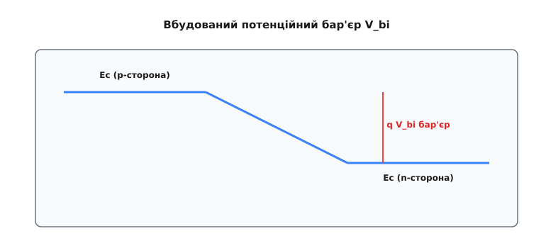
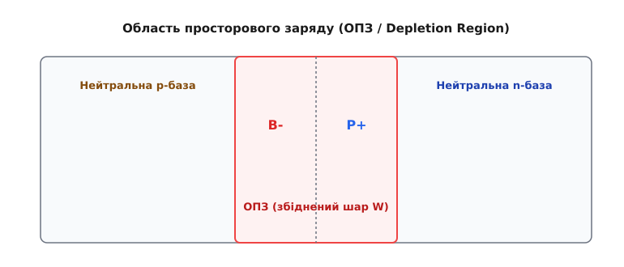
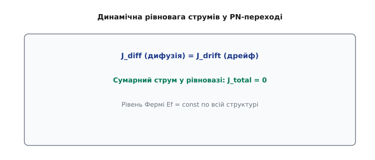
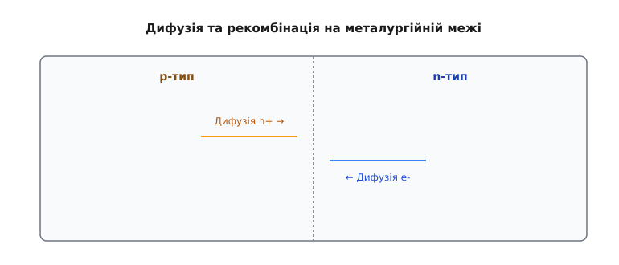

# PN-перехід: бар'єр і збіднена область

<preknowlist>
- [Напівпровідник](root:ph-condensed/semiconductor) — власна провідність, енергетична щілина, густина станів та носії заряду.
- [Легування](root:ph-condensed/doping) — донорні й акцепторні домішки, генерація електронів і дірок.
- [Рівень Фермі](root:ph-condensed/fermi-level) — електрохімічний потенціал та квантово-статистичний розподіл Фермі — Дірака.
- [Електричне поле](root:ph-electromagnetism/electric-field) — напруженість, потенціал та закон Кулона.
- [Рівняння Пуассона](root:ph-electromagnetism/poisson-laplace-eq) — зв'язок між об'ємною густиною заряду та другою похідною електростатичного потенціалу.
</preknowlist>

[Легування](root:ph-condensed/doping) дає два різновиди кремнію: **n-тип** із надлишком вільних електронів і **p-тип** із надлишком дірок — кожен сам по собі нейтральний. Тепер — вирішальний крок. З'єднаймо їх в **одному** кристалі: n з одного боку, p — з іншого. Ця межа й зветься **PN-переходом** (*PN junction*). І найдивовижніше: щойно n і p опиняються поряд, на межі — **без жодної батареї** — само собою постає бар'єр, який і робить кристал клапаном. Розберімо, як він виникає; зрозуміти це — означає зрозуміти діод.

Одразу домовмося про одне: «з'єднати» тут не значить притиснути два шматки один до одного (такий стик дав би лише поганий контакт). PN-перехід **вирощують** в одному суцільному кристалі, легуючи його так, щоб одна частина стала n, а сусідня — p. Межа виходить безшовна, на рівні самої ґратки.

### Зустріч: величезний перепад концентрацій

Погляньмо на саму межу в перший уявний момент. Ліворуч, у n-області, аж кишить вільними електронами. Праворуч, у p-області, повно дірок. А посеред — тонюсінька межа, по різні боки якої концентрації носіїв відрізняються в мільярди разів. Природа таких перепадів не терпить.

Чому не терпить? Бо носії невпинно й хаотично рухаються через теплове тремтіння — снують на всі боки без жодної мети. А там, де чогось багато, випадкові блукання частіше виносять його назовні, ніж заносять назад. Тож сам **безлад** поступово вирівнює концентрації — без жодної сили, що «штовхала б» носії, лише гола статистика.

Та сама причина, чому запах із відкритого флакона за хвилину заповнює всю кімнату, а не лишається в кутку: молекули нікуди «не прагнуть», вони просто хаотично блукають — а блукаючи, неминуче розходяться рівномірно. Носії в кристалі поводяться так само, лише замість повітря довкола них ґратка кремнію.


*Уявний перший момент: ліворуч n-область, повна вільних електронів (−), праворуч p-область, повна дірок (+). На межі — величезний перепад концентрацій носіїв. Нерухомі іони домішок (бліді) поки що рівномірно «прикриті» своїми носіями, тож обидва боки нейтральні.*

### Дифузія й рекомбінація

Що роблять частинки, коли їх десь густо, а поряд порожньо? **Дифундують** — розпливаються з тісноти в простір. Так крапля чорнила розходиться у воді, а запах — кімнатою. Носії в кристалі поводяться так само: вільні електрони з n-боку линуть туди, де їх мало (у p), а дірки з p-боку — туди, де їх мало (у n). Це **дифузія** (лат. *diffundere* — розливати, розтікатися) носіїв через межу. Підкреслимо: дифузію не «вмикає» якась сила — це чистий наслідок хаотичного руху й теорії ймовірностей. Біля межі з густого n-боку приходить більше електронів, ніж повертається з рідкого p-боку, — і виходить чистий потік у p. З дірками — дзеркально. Ніхто нікого не штовхає; просто з тісноти статистично легше вийти, ніж зайти.

Але щойно електрон із n-боку забреде в p-область, повну дірок, його чекає швидкий кінець: він «провалюється» в дірку, добудовуючи розірваний зв'язок. Електрон і дірка **зникають як носії** — це **рекомбінація** (*recombination*), точна протилежність народженню [електрон-діркової пари в напівпровіднику](root:ph-condensed/semiconductor). Так само й дірка, що зайшла в n-область, ловить там вільний електрон. Виходить, що поблизу межі носії, які перейшли кордон, дружно винищують одне одного.

Триватиме це не вічно: рекомбінація йде лише у вузькій смужці біля самої межі й гасне, щойно носії звідти зникнуть. Енергія, що вивільняється при рекомбінації, у кремнії здебільшого йде в тепло (а от у деяких інших матеріалах — у світло; саме на цьому стоїть [світлодіод](root:hw-sensing/led-photodiode)). Поки що нам важливий лише результат: смужка обабіч межі лишається без рухливих носіїв.


*Електрони дифундують з n у p, дірки — з p у n (стрілки). Зустрічаючись біля межі, електрон і дірка рекомбінують — обидва зникають як носії. Тонкий шар обабіч межі поступово порожніє.*

### Збіднена область і відкриті іони

Носії пішли й порекомбінували — і обабіч межі утворюється тонкий шар, **позбавлений рухливих носіїв**. Його так і звуть — **збіднена область** (*depletion region*). Здавалося б, дрібниця. Та згляньмося на самі домішки: коли електрон покидає n-бік, там лишається його [донор](root:ph-condensed/doping) — **нерухомий позитивний іон**; коли дірку в p-боці заповнено, там лишається [акцептор](root:ph-condensed/doping) — **нерухомий негативний іон**, теж намертво вбудований у ґратку. Доти ці іони були акуратно «прикриті» своїми рухливими носіями, і кожен бік був нейтральний. А тепер носії пішли — і іони **оголилися**.


*У збідненій області рухливих носіїв немає — лишилися самі нерухомі іони: позитивні (донори) з n-боку, негативні (акцептори) з p-боку. Поза збідненою областю носії ще є, і там нейтрально.*

Отже, у збідненій області з'являється подвійний шар **зв'язаного** заряду: смужка позитивних іонів з n-боку межі й смужка негативних — з p-боку. Кристал як ціле досі нейтральний, але **локально**, на самій межі, заряди розійшлися.

Наскільки широка ця область? Дуже тонка — зазвичай частки мікрона, тонша за тисячну людської волосини; і що сильніше легований кремній (більше домішок), то вужча вона, бо потрібну кількість іонів «набирають» на коротшій відстані. Та хоч яка тонка, саме вона визначає поведінку діода. Без вільних носіїв збіднена область проводить кепсько — поводиться майже як **ізолятор**: тонкий прошарок «порожнечі» посеред провідного кристала.

Зверніть увагу й на красу балансу: сумарний відкритий «+» заряд з n-боку точно дорівнює сумарному «−» з p-боку — адже кожен електрон, що пішов, лишив по собі один іон, і кожна заповнена дірка теж. Тому перехід і назовні лишається нейтральним, попри розділені всередині заряди.

### Вбудоване поле: гальмо для дифузії

А розділені заряди — це завжди [електричне поле](root:ph-electromagnetism/electric-field). Смужка «+» з n-боку й смужка «−» з p-боку створюють у збідненій області **вбудоване електричне поле** (*built-in field*), напрямлене від плюса до мінуса — тобто з n у p. І ось ключ: це поле **протидіє** дальшій дифузії. Електрон (заряд −), що намагається перейти з n у p, поле штовхає назад у n; дірку (+), що рветься з p у n, — назад у p. Поле працює як гальмо для тих самих носіїв, що його породили.


*Оголені іони створюють вбудоване поле (з n у p). Воно відштовхує електрони назад у n, а дірки — назад у p, тобто **протидіє** дифузії, що його ж і породила. Що більше носіїв перейшло — то ширша збіднена зона й сильніше поле.*

Тут криється саморегуляція. Що більше носіїв продифундувало, то більше іонів оголилося, то ширша збіднена область і сильніше гальмівне поле. Дифузія сама себе пригальмовує — аж поки поле не стане досить сильним, щоб **зупинити** дальший перехід.

І хоч уся різниця потенціалів тут невелика (менш як вольт), вона зосереджена в надтонкій збідненій смужці — а отже, поле в ній виходить навдивовижу **сильне** (десятки й сотні тисяч вольтів на сантиметр). Саме тому таке скромне на вигляд гальмо здатне спинити потужний дифузійний потік.

### Рівновага й потенціальний бар'єр

Так настає **рівновага**: прагнення носіїв розпливтися (дифузія) точно врівноважене вбудованим полем, що жене їх назад. Рівновага ця **динамічна**, а не мертва: найенергійніші окремі носії все одно зрідка перестрибують бар'єр в обидва боки, але зустрічні потоки точно рівні, тож сумарного струму немає. Це радше жвавий базар, де скільки людей заходить, стільки й виходить, аніж замкнені двері. Через збіднену область установлюється стала різниця потенціалів — **потенціальний бар'єр** (*built-in potential*). Його зручно уявляти як **пагорб**, на який носій мусить вибратися, щоб перейти межу: більшості «снаги» не вистачає, і перехід майже припиняється.

Можна уявити це й інакше — як двоє зустрічних натовпів, що ринули в спільні двері. Перші проходять легко, але дуже швидко в дверях утворюється тиснява зі «застряглих» (це наші оголені іони), і вона дедалі дужче відпихає тих, хто напирає ззаду. Урешті тиснява стає така, що нікого більше не пропускає, — і рух завмирає сам собою, без жодного вахтера. Бар'єр виник не тому, що хтось його поставив, а тому, що носії самі собі заступили шлях.


*Через збіднену область установлюється потенціальний бар'єр — «пагорб» висотою ≈0.7 В для кремнію (≈0.3 В для германію). У рівновазі він якраз такий, щоб зрівноважити дифузію: носії з обох боків здебільшого не можуть його подолати.*

Наскільки високий цей пагорб? Для кремнію — приблизно **0.6–0.7 вольта**, для германію — близько **0.3 В**. Звідки саме така висота? Її задає матеріал — передусім [енергетична щілина напівпровідника](root:ph-condensed/semiconductor): ширша щілина в кремнію дає вищий бар'єр (≈0.7 В), вужча в германію — нижчий (≈0.3 В). Тому й «поріг відкривання» в кремнієвого та германієвого діодів різний, і та сама висота бар'єра пізніше проступить як «падіння напруги на діоді». І найважливіше — усе це сталося **само собою**, без жодного зовнішнього джерела: сам факт сусідства n і p породжує і збіднену область, і поле, і бар'єр.

І тут варто застерегти від спокуси: чи не можна під'єднати дротики до переходу й живитися з цих ≈0.7 В, як від крихітної батарейки? Ні. Щойно ви чіпляєте контакти, на з'єднаннях метал–напівпровідник виникають **свої** контактні бар'єри, що в сумі точно компенсують вбудований, — і повним колом напруга не йде. Це **рівноважний** бар'єр, а не запас енергії: він існує всередині, але сам по собі струму не жене. Щоб щось сталося, потрібне зовнішнє джерело. (Виняток — коли енергію в перехід вкидає світло: саме так працює сонячний елемент, що його Расселл Ол і відкрив, наткнувшись на PN-перехід у кремнії.)


*Перетягування каната в рівновазі: дифузія штовхає носії через межу, вбудоване поле жене їх назад — рівно настільки, щоб сумарний перехід припинився. Збіднена область стабілізується, бар'єр застигає на ≈0.7 В.*

> 🔧 **Навіщо це.** Збіднена область і потенціальний бар'єр — це і є «механіка» діода. Збіднена зона без рухливих носіїв поводиться майже як ізолятор — ось чому перехід у спокої струму не пропускає. А висота бар'єра (≈0.7 В) задає, скільки напруги треба «докласти», щоб [діод відкрився й пропустив струм](root:hw-components/diode-iv-curve). Усе подальше — пряме й зворотне зміщення, випрямлення, навіть світлодіод — це різні способи **керувати** цим бар'єром.

Зберімо картину докупи. На межі n і p — **самі собою**, без жодної батареї — виникли: (1) **збіднена область** без рухливих носіїв; (2) подвійний шар нерухомих іонів (+ з n-боку, − з p-боку); (3) **вбудоване поле** через цю область; (4) **потенціальний бар'єр** ≈0.7 В, що зрівноважує дифузію. Усе це — рівноважний стан спокою: жодного струму, жодної зовнішньої напруги. Перехід просто «сидить» зі своїм бар'єром і чекає, що ми з ним зробимо.

Цей бар'єр — не мертвий рубіж, а саме те, на чому стоїть діод. Уся хитрість у тому, що він **по-різному** відповідає на зовнішню напругу залежно від її напрямку. Прикласти її «в один бік» — і носії наваляться на бар'єр, зіб'ють його, збіднена область звузиться й відкриє дорогу струму; прикласти «в інший» — і напруга відтягне носії геть, бар'єр зросте, збіднена область поширшає, а перехід замкнеться ще міцніше. Саме ця однобічна відповідь бар'єра на [пряме й зворотне зміщення](root:hw-components/diode-bias) і робить безшовний стик n і p клапаном для струму — тією самою однобічністю, яку Карл Фердинанд Браун ще 1874 року вперше помітив у кристалі мінералу, навіть не знаючи її причини.

### Термодинамічна рівновага та точний розрахунок вбудованого потенціалу

У термодинамічній рівновазі за відсутності зовнішньої напруги, стороннього освітлення чи градієнта температур будь-яка замкнена фізична система характеризується єдиним хімічним потенціалом електронів. В електронній теорії твердого тіла хімічний потенціал називають [рівнем Фермі](root:ph-condensed/fermi-level) `E_F`. Умова рівноваги вимагає абсолютної сталості рівня Фермі в усьому кристалі від краю до краю:

```
dE_F / dx = 0
E_F(x) = const
```

Позаяк рівень Фермі горизонтальний, енергетичні зони — дно зони провідності `E_c(x)` та стеля валентної зони `E_v(x)` — змушені вигинатися на межі контакту. Положення рівня Фермі відносно середини забороненої зони (власного рівня Фермі `E_i`) задається концентрацією введених легуючих домішок.

У квазінейтральній глибині n-області, де концентрація донорів становить `N_d` (і при повному тепловому збудженні домішок рівноважна концентрація електронів дорівнює `n_n0 ≈ N_d`), віддаль рівня Фермі від власного рівня `E_i` визначається больцманівською статистикою:

```
n_n0 = n_i · exp((E_F - E_i,n) / (k_B · T))
E_F - E_i,n = k_B · T · ln(N_d / n_i)
```

Тут `n_i` — власна концентрація носіїв у нелегованому напівпровіднику при абсолютній температурі `T` (для чистого кремнію при кімнатній температурі `T = 300 K` величина `n_i ≈ 1.5 · 10¹⁰ см⁻³`), а `k_B = 1.3806 · 10⁻²³ Дж/К` — стала Больцмана.

Дзеркально, у квазінейтральній глибині p-області з концентрацією акцепторів `N_a` (рівноважна концентрація дірок `p_p0 ≈ N_a`), власний рівень лежить вище за рівень Фермі:

```
p_p0 = n_i · exp((E_i,p - E_F) / (k_B · T))
E_i,p - E_F = k_B · T · ln(N_a / n_i)
```

Повний енергетичний вигин зон `q · V_bi` (де `q = 1.6022 · 10⁻¹⁹ Кл` — елементарний заряд) дорівнює різниці положень власного рівня `E_i` між двома нейтральними берегами кристала:

```
q · V_bi
= E_i,p - E_i,n                       [різниця власних рівнів у p- та n-областях]
= (E_i,p - E_F) + (E_F - E_i,n)       [додали й відняли рівноважний рівень Фермі]
= k_B·T·ln(N_a/n_i) + k_B·T·ln(N_d/n_i) [підставили співвідношення для p та n]
= k_B · T · ln((N_a · N_d) / n_i²)    [сума логарифмів дорівнює логарифму добутку]
```

Поділивши на елементарний заряд `q`, дістаємо фундаментальну формулу для **вбудованого контактного потенціалу** (*built-in potential*) `V_bi`:

```
V_bi = (k_B · T / q) · ln((N_a · N_d) / n_i²) = V_t · ln((N_a · N_d) / n_i²)
```

Величину `V_t = k_B · T / q` називають **тепловим потенціалом** (*thermal voltage*). При температурі `T = 300 K` (близько 27 °C) тепловий потенціал набуває стандартного значення:

```
V_t = (1.3806 · 10⁻²³ · 300) / (1.6022 · 10⁻¹⁹) ≈ 0.02586 В ≈ 25.86 мВ
```

**Worked-приклад: розрахунок вбудованого потенціалу кремнієвого PN-переходу.**
Розрахуємо висоту бар'єра `V_bi` для типового кремнієвого переходу з концентрацією акцепторів `N_a = 10¹⁶ см⁻³` та донорів `N_d = 10¹⁷ см⁻³` при кімнатній температурі `T = 300 K` (`n_i = 1.5 · 10¹⁰ см⁻³`):

```
V_bi
= 0.02586 · ln((10¹⁶ · 10¹⁷) / (1.5 · 10¹⁰)²)  [підстановка параметрів легування]
= 0.02586 · ln(10³³ / (2.25 · 10²⁰))           [піднесення n_i до квадрата]
= 0.02586 · ln(4.444 · 10¹²)                   [ділення значень концентрацій]
= 0.02586 · 29.122                              [обчислення натурального логарифма]
≈ 0.753 В                                      [підсумковий потенціал бар'єра]
```

Висота бар'єра вийшла рівною `0.753 В`. Чим вища концентрація домішок, тим ближче рівні Фермі підходять до країв дозволених зон, і тим вищим стає контактний потенціал. Проте `V_bi` не може перевищити ширину забороненої зони напівпровідника `E_g / q` (для кремнію `E_g ≈ 1.12 еВ`, тому `V_bi < 1.12 В` навіть за граничного виродженого легування).

Порівняймо це з іншими напівпровідниковими матеріалами:
1. **Германій (Ge):** заборонена зона значно вужча (`E_g ≈ 0.66 еВ`), а власна концентрація носіїв суттєво вища (`n_i ≈ 2.4 · 10¹³ см⁻³` при 300 K). Підставляючи ті самі рівні легування `10¹⁶` та `10¹⁷ см⁻³`, отримуємо `V_bi ≈ 0.02586 · ln(10³³ / 5.76·10²⁶) ≈ 0.02586 · 14.36 ≈ 0.371 В`.
2. **Арсенід галію (GaAs):** широкозонний матеріал (`E_g ≈ 1.42 еВ`) із мізерною власною концентрацією носіїв (`n_i ≈ 2.1 · 10⁶ см⁻³`). За аналогічного легування `V_bi ≈ 0.02586 · ln(10³³ / 4.41·10¹²) ≈ 0.02586 · 46.87 ≈ 1.212 В`.

Температурна поведінка `V_bi` визначається передусім стрімким експоненційним зростанням власної концентрації носіїв `n_i(T)`:

```
n_i²(T) = N_c(T) · N_v(T) · exp(-E_g / (k_B · T)) ∝ T³ · exp(-E_g / (k_B · T))
```

Підставивши цей вираз у формулу `V_bi`, побачимо, що зі зростанням температури вбудований потенціал лінійно спадає:

```
V_bi(T) = (E_g / q) - (k_B · T / q) · ln((N_c · N_v) / (N_a · N_d))
```

Для кремнію температурний коефіцієнт вбудованого потенціалу становить `dV_bi / dT ≈ -1.5 ... -2.0 мВ/K`. При нагріванні кристал генерує величезну кількість власних теплових пар, межа між n- та p-областями поступово «розмивається», і за критичних температур (понад 200–250 °C для кремнію) перехід деградує та втрачає випрямні властивості.

### Зонна діаграма та зв'язок струму з квазірівнями Фермі

Зонна діаграма наочно відображає розподіл енергії носіїв заряду вздовж координати переходу `x`. Введемо електростатичний потенціал `ψ(x)`, відрахований від власного рівня Фермі `E_i(x)`:

```
ψ(x) = - (E_i(x) - E_F) / q
```

Краї зон `E_c(x)` та `E_v(x)` повторюють профіль власного рівня `E_i(x)`, оскільки ширина забороненої зони `E_g = E_c(x) - E_v(x)` залишається сталою в усьому об'ємі однорідного кристала.

Коли до структури прикладається зовнішнє зміщення чи стороннє збудження, рівноважний опис єдиним рівнем Фермі стає непридатним. Густини струмів електронів `J_n` та дірок `J_p` у загальному випадку складаються з дрейфової та дифузійної компонент:

```
J_n = q · n · μ_n · E + q · D_n · (dn / dx)
J_p = q · p · μ_p · E - q · D_p · (dp / dx)
```

Використовуючи співвідношення Ейнштейна `D_n / μ_n = k_B · T / q` та виражаючи нерівноважні концентрації через квазірівні Фермі `F_n(x)` і `F_p(x)`:

```
n(x) = n_i · exp((F_n(x) - E_i(x)) / (k_B · T))
p(x) = n_i · exp((E_i(x) - F_p(x)) / (k_B · T))
```

Продиференціюємо концентрацію електронів `n(x)` за координатою `x`:

```
dn / dx
= (n / (k_B · T)) · (dF_n / dx - dE_i / dx)   [диференціювання експоненти]
= (n / (k_B · T)) · (dF_n / dx + q · E)        [врахування зв'язку поля E = (1/q) dE_i/dx]
```

Підставивши похідну `dn/dx` у вираз для повної густини електронного струму `J_n`:

```
J_n
= q · n · μ_n · E + q · (k_B · T · μ_n / q) · [ (n / (k_B · T)) · (dF_n / dx + q · E) ]  [підстановка похідної]
= q · n · μ_n · E + n · μ_n · dF_n / dx - q · n · μ_n · E                                  [розкриття дужок]
= n · μ_n · (dF_n / dx)                                                                  [взаємне скорочення дрейфових доданків]
```

Аналогічно для діркового струму:

```
J_p = p · μ_p · (dF_p / dx)
```

Це фундаментальний результат фізики напівпровідників: **струм носіїв заряду протікає тоді й тільки тоді, коли відповідний квазірівень Фермі має просторовий нахил** (`dF/dx ≠ 0`). Якщо квазірівень горизонтальний, результуючий струм носіїв строго дорівнює нулю, навіть якщо в цій точці існує колосальне електричне поле та величезний градієнт концентрації (оскільки дрейфовий і дифузійний струми точно врівноважують один одного).

Усередині збідненої області переходу квазірівні `F_n` та `F_p` залишаються майже плоскими, оскільки для підтримки помірного струму за наявності великої концентрації носіїв потрібен мінімальний нахил. Квазірівень `F_n` різко спадає лише в нейтральній p-базі, де концентрація інжектованих електронів швидко затухає через дифузію та рекомбінацію. Дзеркально, квазірівень `F_p` спадає в глибині нейтральної n-бази.

### Електростатика збідненого шару: розв'язок рівняння Пуассона

Щоб точно знайти просторовий розподіл електричного поля `E(x)`, потенціалу `V(x)` та геометричну товщину збідненої області `W`, використовують **наближення збідненого шару** (деплекційне наближення, *depletion approximation*), сформульоване Вільямом Шоклі.

Суть наближення полягає у двох фізичних припущеннях:
1. Збіднена область має чіткі межі: вона простягається від `-x_p` углиб p-області до `+x_n` углиб n-області. Металургійна межа переходу лежить у точці `x = 0`.
2. Усередині збідненої області (`-x_p ≤ x ≤ x_n`) концентрацією вільних електронів і дірок нехтують порівняно з концентрацією нерухомих іонізованих домішок: `n(x) ≪ N_d`, `p(x) ≪ N_a`. Поза цими межами (`x < -x_p` та `x > x_n`) матеріал вважається строго квазінейтральним (`ρ = 0`), а все прикладене електричне поле зосереджене виключно всередині інтервалу `[-x_p, x_n]`.

Таким чином, функція об'ємної густини заряду `ρ(x)` записується у вигляді кусково-сталого розподілу:

```
ρ(x) = -q · N_a,   при -x_p ≤ x < 0   (шар оголених негативних акцепторів)
ρ(x) = +q · N_d,   при  0 < x ≤ x_n   (шар оголених позитивних донорів)
ρ(x) = 0,          при x < -x_p та x > x_n
```

З умови глобальної електронейтральності кристала випливає, що повний негативний заряд на одиницю площі p-боку мусить точно врівноважувати повний позитивний заряд n-боку:

```
q · N_a · x_p = q · N_d · x_n   ⇒   N_a · x_p = N_d · x_n
```

Це співвідношення показує: глибина проникнення збідненого шару в кожну з областей обернено пропорційна рівню її легування. Сильнолегований бік виставляє тонкий шар заряду, а слаболегований — глибокий і широкий.

Електростатичний потенціал `V(x)` та напруженість поля `E(x) = -dV/dx` підпорядковуються [одновимірному рівнянню Пуассона](root:ph-electromagnetism/poisson-laplace-eq):

```
d²V / dx² = -dE / dx = -ρ(x) / ε_s
```

де `ε_s = ε_r · ε_0` — абсолютна діелектрична проникність напівпровідника (для кремнію відносна проникність `ε_r = 11.7`, `ε_0 = 8.854 · 10⁻¹⁴ Ф/см`, отже `ε_s ≈ 1.036 · 10⁻¹² Ф/см`).

Проінтегруємо рівняння Пуассона окремо для обох областей, використовуючи граничні умови: на краях збідненої області електричне поле повністю спадає до нуля, тобто `E(-x_p) = 0` та `E(x_n) = 0`.

**1. Інтегрування в p-області (`-x_p ≤ x ≤ 0`):**

```
dE / dx = ρ(x) / ε_s = - (q · N_a) / ε_s
E(x) = ∫ [- (q · N_a) / ε_s] dx = - (q · N_a / ε_s) · x + C_1
```

Використовуючи граничну умову `E(-x_p) = 0`:

```
0 = - (q · N_a / ε_s) · (-x_p) + C_1  ⇒  C_1 = - (q · N_a / ε_s) · x_p
E(x) = - (q · N_a / ε_s) · (x + x_p)
```

Поле в p-області лінійно спадає від нуля при `x = -x_p` до максимального за модулем від'ємного значення на металургійній межі `x = 0`.

**2. Інтегрування в n-області (`0 ≤ x ≤ x_n`):**

```
dE / dx = + (q · N_d) / ε_s
E(x) = (q · N_d / ε_s) · x + C_2
```

З граничної умови `E(x_n) = 0`:

```
0 = (q · N_d / ε_s) · x_n + C_2  ⇒  C_2 = - (q · N_d / ε_s) · x_n
E(x) = (q · N_d / ε_s) · (x - x_n) = - (q · N_d / ε_s) · (x_n - x)
```

Поле в n-області лінійно зростає від пікового від'ємного значення на межі `x = 0` до нуля при `x = x_n`.

**Максимальне електричне поле `E_max` на межі `x = 0`:**
Підставивши `x = 0` у будь-який із двох виразів, отримуємо однаковий пік поля (завдяки рівності `N_a · x_p = N_d · x_n`):

```
|E_max| = (q · N_a · x_p) / ε_s = (q · N_d · x_n) / ε_s
```

Вектор електричного поля всюди напрямлений вздовж осі `-x` (тобто від позитивно зарядженої n-області до негативно зарядженої p-області), утворюючи бар'єрний трикутник напруженості.

Тепер проінтегруємо поле `E(x) = -dV/dx` для знаходження розподілу потенціалу `V(x)`. Приймемо потенціал на нейтральному p-краї за нуль: `V(-x_p) = 0`.

В p-області (`-x_p ≤ x ≤ 0`):

```
V(x) = - ∫ E(x) dx = ∫ (q · N_a / ε_s) · (x + x_p) dx = (q · N_a / (2 · ε_s)) · (x + x_p)²
```

Потенціал зростає за параболічним законом від `0` до значення на межі `V(0) = (q · N_a / (2 · ε_s)) · x_p²`.

В n-області (`0 ≤ x ≤ x_n`):

```
V(x) = V(0) + ∫ [ (q · N_d / ε_s) · (x_n - x) ] dx = V_total - (q · N_d / (2 · ε_s)) · (x_n - x)²
```

Повна різниця потенціалів між нейтральними берегами дорівнює площі трикутника під графіком напруженості поля `|E(x)|`:

```
V_total = (1 / 2) · |E_max| · (x_p + x_n) = (1 / 2) · |E_max| · W
```

Якщо до переходу прикладено зовнішню напругу `V` (де `V > 0` відповідає прямому зміщенню, а `V < 0` — зворотному зміщенню `-V_R`), повний перепад потенціалу на збідненому шарі становить:

```
V_total = V_bi - V
```

Звідси випливає фундаментальний зв'язок між піковим полем, бар'єром та шириною збідненого шару:

```
|E_max| = (2 · (V_bi - V)) / W
```

### Ширина збідненої області та асиметричні переходи

Використовуючи умову балансу зарядів `x_p = x_n · (N_d / N_a)` та підставляючи її у вираз для повної різниці потенціалів `V_bi - V = (q / (2 · ε_s)) · [N_a · x_p² + N_d · x_n²]`, виведемо глибину проникнення ОПЗ у кожен із напівпровідникових шарів:

```
V_bi - V
= (q / (2 · ε_s)) · [ N_a · (x_n · N_d / N_a)² + N_d · x_n² ]  [підстановка x_p через x_n]
= (q · N_d / (2 · ε_s)) · [ N_d / N_a + 1 ] · x_n²             [винесення спільного множника]
= (q / (2 · ε_s)) · [ (N_d · (N_a + N_d)) / N_a ] · x_n²       [зведення дробів до спільного знаменника]
```

Звідси отримуємо аналітичні вирази для глибин проникнення `x_n` та `x_p`:

```
x_n = √[ (2 · ε_s / q) · (N_a / (N_d · (N_a + N_d))) · (V_bi - V) ]
x_p = √[ (2 · ε_s / q) · (N_d / (N_a · (N_a + N_d))) · (V_bi - V) ]
```

Сума `W = x_n + x_p` дає остаточну формулу для **повної ширини області просторового заряду** (*depletion layer width*):

```
W = √[ (2 · ε_s / q) · (1/N_a + 1/N_d) · (V_bi - V) ]
```

З отриманої формули чітко видно ключові закономірності поведінки переходу:
1. **Зворотне зміщення (`V = -V_R < 0`):** підкореневий вираз стає рівним `(V_bi + V_R)`. Зі зростанням зворотної напруги збіднена область розширюється пропорційно кореню квадратному з напруги: `W ∝ √(V_bi + V_R)`. Електричне поле виштовхує вільні носії далі від межі, оголюючи додаткові іони, а опір структури зростає.
2. **Пряме зміщення (`V > 0`):** результуючий бар'єр `(V_bi - V)` зменшується, збіднена зона різко звужується, поле слабшає, відкриваючи можливість для дифузійного потоку носіїв.

**Асиметричні різкі переходи (`p⁺-n` та `n⁺-p`):**
У практичній мікроелектроніці та силових напівпровідникових приладах переходи майже ніколи не роблять симетричними (`N_a = N_d`). Навпаки, одну з областей легують на декілька порядків сильніше за іншу. Розглянемо односторонній різкий **`p⁺-n` перехід**, у якому `N_a ≫ N_d` (наприклад, `N_a = 10¹⁹ см⁻³`, а `N_d = 10¹⁵ см⁻³`).

Оскільки `1/N_a ≪ 1/N_d`, у виразах для товщини та поля доданком `1/N_a` можна повністю знехтувати:

```
W ≈ x_n ≈ √[ (2 · ε_s · (V_bi - V)) / (q · N_d) ]
x_p ≈ 0
|E_max| ≈ √[ (2 · q · N_d · (V_bi - V)) / ε_s ]
```

Це найважливіший інженерний висновок: **в односторонньому переході вся збіднена область, усе падіння напруги і все пікове електричне поле зосереджені в слаболегованій базі**. Сильнолегований емітерний шар `p⁺` практично не містить збіднення (його товщина `x_p` вимірюється нанометрами). Саме концентрація домішок у слаболегованій області `N_d` задає робочу напругу, бар'єрну ємність та напругу пробою діода.

**Worked-приклад: розрахунок параметрів ОПЗ для `p⁺-n` діода.**
Нехай кремнієвий `p⁺-n` діод має площу переходу `A = 1 мм² = 10⁻² см²`, концентрацію в базі `N_d = 10¹⁵ см⁻³`, `V_bi = 0.7 В`. Розрахуємо ширину збідненого шару `W` та пікове поле `E_max` у стані спокою (`V = 0 В`) та при зворотному зміщенні `V_R = 10 В` (`V = -10 В`):

**Крок 1: стан рівноваги (`V = 0 В`):**

```
W_0
= √[ (2 · 1.036·10⁻¹² · 0.7) / (1.6022·10⁻¹⁹ · 10¹⁵) ]
= √[ (1.4504·10⁻¹²) / (1.6022·10⁻⁴) ]
= √[ 9.0525·10⁻⁹ см² ]
≈ 0.951 · 10⁻⁴ см = 0.951 мкм

|E_max,0|
= (2 · 0.7) / (0.951 · 10⁻⁴)
≈ 14 720 В/см = 1.472 кВ/мм
```

**Крок 2: зворотне зміщення (`V = -10 В`):**

```
V_total = 0.7 - (-10) = 10.7 В
W_10
= √[ (2 · 1.036·10⁻¹² · 10.7) / (1.6022·10⁻¹⁹ · 10¹⁵) ]
= √[ (2.217·10⁻¹¹) / (1.6022·10⁻⁴) ]
= √[ 1.3837·10⁻⁷ см² ]
≈ 3.72 · 10⁻⁴ см = 3.72 мкм

|E_max,10|
= (2 · 10.7) / (3.72 · 10⁻⁴)
≈ 57 530 В/см = 5.753 кВ/мм
```

При збільшенні зворотної напруги від 0 до 10 В збіднена область розширилася майже в 4 рази (з 0.95 до 3.72 мкм), а пікове внутрішнє поле на металургійній межі зросло майже до 60 кВ/см.

### Лінійно-градієнтний перехід: параболічне поле та кубічна залежність

У реальних технологічних процесах виготовлення діодів методом дифузії домішок з газової фази або іонної імплантації з наступним відпалом концентрація домішок на межі розділу не змінюється східчасто. Біля металургійної межі `x = 0` результуючий профіль легування добре апроксимується лінійною функцією:

```
N_d(x) - N_a(x) = a · x
```

де `a = d(N_d - N_a)/dx` — градієнт концентрації домішок (вимірюється в `см⁻⁴`). Такий перехід називають **лінійно-градієнтним** (*linearly graded junction*).

Об'ємна густина заряду всередині збідненої зони товщиною `W` (від `-W/2` до `+W/2`) лінійно змінюється з координатою:

```
ρ(x) = q · a · x,   при -W/2 ≤ x ≤ W/2
```

Підставимо цей розподіл заряду в одновимірне рівняння Пуассона:

```
d²V / dx² = -dE / dx = - (q · a · x) / ε_s
```

Проінтегруємо для знаходження напруженості електричного поля `E(x)` з граничними умовами `E(-W/2) = 0` та `E(W/2) = 0`:

```
E(x)
= - (q · a / (2 · ε_s)) · x² + C_1                           [первісна від x]
= - (q · a / (2 · ε_s)) · x² + (q · a / (2 · ε_s)) · (W / 2)² [визначення константи з граничної умови]
= - (q · a / (2 · ε_s)) · [ (W / 2)² - x² ]                   [винесення спільного множника]
```

На відміну від різкого переходу з трикутним полем, у лінійно-градієнтному переході напруженість поля має **параболічний розподіл**.

Максимальне електричне поле досягається в центрі переходу при `x = 0`:

```
|E_max| = (q · a · W²) / (8 · ε_s)
```

Знайдемо повну різницю потенціалів `V_total = V_bi - V`, проінтегрувавши поле `E(x)` по всій збідненій області:

```
V_bi - V
= ∫_{-W/2}^{+W/2} |E(x)| dx
= (q · a / (2 · ε_s)) · ∫_{-W/2}^{+W/2} [ (W/2)² - x² ] dx   [інтеграл параболічного поля]
= (q · a / (2 · ε_s)) · [ (W²/4) · W - (W³/12) ]            [обчислення первісної на границях]
= (q · a · W³) / (12 · ε_s)                                  [спрощення коефіцієнтів]
```

Звідси випливає зв'язок між піковим полем та падінням напруги:

```
|E_max| = (3 / 2) · ( (V_bi - V) / W ) = 1.5 · ( (V_bi - V) / W )
```

Виразимо товщину збідненої області `W` для лінійно-градієнтного переходу:

```
W = [ (12 · ε_s · (V_bi - V)) / (q · a) ]^(1/3)
```

Зверніть увагу на показник степеня: у різкому переході товщина залежить від напруги за законом квадратного кореня `W ∝ (V_bi - V)^(1/2)`, тоді як у лінійно-градієнтному — за законом **кубічного кореня** `W ∝ (V_bi - V)^(1/3)`.

Бар'єрна ємність лінійно-градієнтного переходу становить:

```
C_dep = (ε_s · A) / W = A · [ (q · a · ε_s²) / (12 · (V_bi - V)) ]^(1/3)
```

Відповідно, для аналізу профілю лінійно-градієнтних переходів будують графік залежності величини `1 / C_dep³` від прикладеної зворотної напруги `V_R`:

```
1 / C_dep³ = [ 12 / (q · a · ε_s² · A³) ] · (V_bi + V_R)
```

Нахил прямої `d(1/C³)/dV_R` дозволяє точно виміряти градієнт легування `a`, а точка перетину з віссю напруг дає величину вбудованого потенціалу `V_bi`.

### Бар'єрна ємність та C-V профілювання легування

Оскільки в збідненій області розділені нерухомі просторові заряди `+Q` та `-Q`, а ширина шару `W` змінюється зі зміною прикладеної напруги, перехід поводиться подібно до електричного конденсатора.

Зміна величини зв'язаного заряду іонізованих домішок `dQ` при нескінченно малій зміні прикладеної напруги `dV` визначає **бар'єрну (деплекційну) ємність** (*depletion capacitance*) `C_dep`:

```
C_dep = |dQ / dV|
```

Заряд на одиницю площі для n-боку дорівнює `Q' = q · N_d · x_n`. Продиференціюємо цей заряд за напругою, підставивши вираз для `x_n(V)`:

```
C_dep / A
= d(q · N_d · x_n) / dV
= d [ √[ 2 · q · ε_s · (N_a · N_d / (N_a + N_d)) · (V_bi - V) ] ] / dV  [підстановка виразу для заряду]
= (1 / 2) · [ 2 · q · ε_s · (N_a · N_d / (N_a + N_d)) / (V_bi - V) ]^(1/2) [диференціювання кореня]
= ε_s / W                                                              [вираження через ширину ОПЗ]
```

Повна бар'єрна ємність діода з площею переходу `A` набуває вигляду формули класичного плоскопаралельного конденсатора з діелектричною проникністю напівпровідника `ε_s` та відстанню між обкладками `W`:

```
C_dep = (ε_s · A) / W = A · √[ (q · ε_s / 2) · ( (N_a · N_d) / (N_a + N_d) ) · (1 / (V_bi - V)) ]
```

Для одностороннього `p⁺-n` переходу вираз спрощується:

```
C_dep = A · √[ (q · ε_s · N_d) / (2 · (V_bi + V_R)) ]
```

Бар'єрна ємність має суворо нелінійний характер: при збільшенні зворотної напруги `V_R` збіднений шар `W` зростає, а ємність `C_dep` падає як `1 / √(V_bi + V_R)`.

**Метод вольт-фарадних характеристик (C-V метод):**
Піднесемо обернену питому ємність `(A / C_dep)` до квадрата:

```
1 / C_dep² = [ 2 / (q · ε_s · A² · N_d) ] · (V_bi + V_R)
```

Якщо побудувати експериментальний графік залежності величини `1 / C_dep²` від зворотної напруги `V_R`, ми отримаємо ідеальну пряму лінію:

```
1/C_dep²
   ^
   |           /  нахил d(1/C²)/dV_R = 2 / (q · ε_s · A² · N_d)
   |          /
   |         /
   |        /
   |       /
---|------/------------------> V_R
 -V_bi   0
```

Цей графік дає два фундаментальні параметри приладу:
1. **Концентрація домішок у базі `N_d`:** визначається безпосередньо з тангенса кута нахилу прямої:
   ```
   N_d = 2 / [ q · ε_s · A² · (d(1 / C_dep²) / dV_R) ]
   ```
2. **Вбудований потенціал `V_bi`:** знаходиться екстраполяцією експериментальної прямої до перетину з віссю напруг (де `1 / C_dep² = 0`), що дає точку `V_R = -V_bi`.

Якщо легування бази нерівномірне (`N_d = N_d(x)`), нахил кривої `1 / C²` змінюватиметься на кожній глибині. Це дозволяє здійснювати **диференційне C-V профілювання** — пошарово вимірювати концентрацію домішок усередині напівпровідника без його руйнування:

```
N(W) = 2 / [ q · ε_s · A² · |d(1 / C_dep²) / dV| ]
W = (ε_s · A) / C_dep
```

Змінюючи зворотну напругу `V_R`, ми керуємо глибиною зондування `W`, а вимірювання диференційної ємності на малій змінній напрузі дає точний локальний профіль концентрації `N(W)`.

### Пряме зміщення: квазірівні Фермі та граничні умови Шоклі

Коли до PN-переходу прикладають зовнішню пряму напругу `V > 0` (плюс джерела під'єднано до p-області, а мінус — до n-області), ця напруга майже повністю падає на високоомному збідненому шарі. Зовнішнє поле спрямоване назустріч внутрішньому вбудованому полю, знижуючи результуючий бар'єр від `V_bi` до `(V_bi - V)`.

При протіканні струму стан термодинамічної рівноваги руйнується. Єдиний рівень Фермі розщеплюється на два роздільні **квазірівні Фермі** (*quasi-Fermi levels*): квазірівень електронів `F_n(x)` та квазірівень дірок `F_p(x)`.

Усередині збідненої області квазірівні залишаються практично горизонтальними, а відстань між ними в енергетичній шкалі строго дорівнює прикладеній зовнішній напрузі:

```
F_n - F_p = q · V
```

Концентрація носіїв тепер описується через положення відповідного квазірівня:

```
n(x) = n_i · exp((F_n(x) - E_i(x)) / (k_B · T))
p(x) = n_i · exp((E_i(x) - F_p(x)) / (k_B · T))
```

Перемноживши ці концентрації всередині збідненої зони, дістаємо узагальнений закон діючих мас для нерівноважного стану:

```
n(x) · p(x)
= [n_i · exp((F_n - E_i)/k_B T)] · [n_i · exp((E_i - F_p)/k_B T)]  [перемноження нерівноважних концентрацій]
= n_i² · exp((F_n - F_p) / (k_B · T))                             [скорочення E_i у показнику степеня]
= n_i² · exp(q · V / (k_B · T))                                   [підстановка умови розщеплення F_n - F_p = q·V]
```

Зниження бар'єра дозволяє величезній кількості основних носіїв подолати збіднену область і вийти на протилежний бік. Цей процес вкидання носіїв у чужу область називають **інжекцією неосновних носіїв** (*minority carrier injection*).

Знайдемо концентрацію інжектованих електронів на межі p-області `x = -x_p` та інжектованих дірок на межі n-області `x = x_n`.

На межі p-області `x = -x_p` концентрація дірок залишається практично незмінною й рівною концентрації акцепторів `p(-x_p) ≈ p_p0 = N_a`. Підставивши це в добуток `n · p`:

```
n_p(-x_p) · N_a = n_i² · exp(q · V / (k_B · T))
n_p(-x_p) = (n_i² / N_a) · exp(q · V / (k_B · T))
```

Оскільки рівноважна концентрація неосновних електронів у p-області дорівнює `n_p0 = n_i² / N_a`, маємо **граничну умову Шоклі для електронів**:

```
n_p(-x_p) = n_p0 · exp(q · V / (k_B · T))
```

Аналогічно для дірок на межі n-області `x = x_n` (де рівноважна концентрація неосновних дірок `p_n0 = n_i² / N_d`):

```
p_n(x_n) = p_n0 · exp(q · V / (k_B · T))
```

Віднявши рівноважні концентрації, отримуємо надлишкові концентрації неосновних носіїв `Δn_p` та `Δp_n` на краях збідненого шару:

```
Δn_p(-x_p) = n_p(-x_p) - n_p0 = n_p0 · [exp(q · V / (k_B · T)) - 1]
Δp_n(x_n)  = p_n(x_n)  - p_n0 = p_n0 · [exp(q · V / (k_B · T)) - 1]
```

Граничні умови Шоклі демонструють: пряме зміщення експоненційно збільшує концентрацію неосновних носіїв на межах ОПЗ. Наприклад, при прямій напрузі `V = 0.6 В` фактор `exp(qV / k_B T) = exp(0.6 / 0.02586) ≈ exp(23.2) ≈ 1.2 · 10¹⁰`. Густина неосновних носіїв на межі зростає на десять порядків!

### Дифузійні рівняння переносу носіїв у квазінейтральних базах

Потрапивши за межі збідненої області, інжектовані неосновні носії опиняються у квазінейтральному матеріалі, де електричне поле практично відсутнє (`E ≈ 0`). Їхній подальший рух визначається виключно процесами **дифузії** та одночасної **рекомбінації** з основними носіями.

Стаціонарне одновимірне рівняння неперервності для надлишкових дірок `Δp_n(x)` у нейтральній n-базі має вигляд:

```
D_p · (d²Δp_n / dx²) - Δp_n / τ_p = 0
```

де `D_p` — коефіцієнт дифузії дірок (пов'язаний із [рухливістю](root:ph-condensed/carrier-mobility) співвідношенням Ейнштейна `D_p = μ_p · V_t`), а `τ_p` — час життя неосновних дірок до рекомбінації.

Введемо фундаментальний масштаб довжини — **дифузійну довжину дірок** `L_p`:

```
L_p = √(D_p · τ_p)
```

Дифузійна довжина — це середня відстань, яку встигає пройти неосновний носій від точки інжекції до моменту рекомбінації. Рівняння дифузії набуває стандартного вигляду:

```
d²Δp_n / dx² = Δp_n / L_p²
```

Загальний розв'язок цього лінійного диференціального рівняння другого порядку є сумою двох експонент:

```
Δp_n(x) = C_1 · exp(-(x - x_n) / L_p) + C_2 · exp((x - x_n) / L_p)
```

Розглянемо два класичні випадки геометрії діода:

**1. Довга база (`W_base ≫ L_p`):**
Якщо нейтральна n-область набагато довша за дифузійну довжину, на великій відстані від переходу (`x → ∞`) усі надлишкові дірки гарантовано рекомбінують: `Δp_n(∞) = 0`. Це вимагає `C_2 = 0`. З граничної умови Шоклі при `x = x_n` маємо `C_1 = Δp_n(x_n)`.

Розподіл інжектованих дірок у довгій n-базі є спадною експонентою:

```
Δp_n(x) = Δp_n(x_n) · exp(-(x - x_n) / L_p) = p_n0 · [exp(q · V / (k_B · T)) - 1] · exp(-(x - x_n) / L_p)
```

Аналогічно, для надлишкових електронів у нейтральній p-базі (при `x < -x_p`, де `L_n = √(D_n · τ_n)`):

```
Δn_p(x) = Δn_p(-x_p) · exp((x + x_p) / L_n) = n_p0 · [exp(q · V / (k_B · T)) - 1] · exp((x + x_p) / L_n)
```

**2. Коротка база (`W_base ≪ L_p`):**
Якщо товщина нейтрального шару `W_n` значно менша за дифузійну довжину, а на краю кристала `x = x_n + W_n` розташовано омічний контакт із нескінченною швидкістю поверхневої рекомбінації (`Δp_n(x_n + W_n) = 0`), експоненту можна розкласти в ряд Тейлора. Розподіл концентрації стає строго лінійним:

```
Δp_n(x) ≈ Δp_n(x_n) · [ 1 - (x - x_n) / W_n ]
```

У короткій базі носії не встигають рекомбінувати в об'ємі й практично без втрат пролітають до омічного контакту. Саме цей механізм лежить в основі роботи біполярного транзистора, де товщину бази роблять значно меншою за `L_p`.

### Виведення ідеального рівняння діода Шоклі

Струм через PN-перехід переноситься як електронами, так і дірками. Згідно з першим законом Фіка, густина дифузійного струму прямо пропорційна градієнту концентрації носіїв:

```
J_p(x) = -q · D_p · (dp / dx) = -q · D_p · (dΔp_n / dx)
J_n(x) = +q · D_n · (dn / dx) = +q · D_n · (dΔn_p / dx)
```

Обчислимо густину діркового струму на вході в n-базу (`x = x_n`), продиференціювавши експоненційний профіль для довгої бази:

```
dΔp_n / dx |_{x = x_n} = - (Δp_n(x_n) / L_p)

J_p(x_n)
= -q · D_p · [ - (Δp_n(x_n) / L_p) ]                      [перший закон Фіка]
= (q · D_p / L_p) · p_n0 · [exp(q · V / (k_B · T)) - 1]   [підстановка граничної умови Шоклі]
= (q · D_p · n_i² / (L_p · N_d)) · [exp(q · V / (k_B · T)) - 1] [вираження p_n0 через n_i²/N_d]
```

Дзеркально обчислимо густину електронного струму на вході в p-базу (`x = -x_p`):

```
dΔn_p / dx |_{x = -x_p} = + (Δn_p(-x_p) / L_n)

J_n(-x_p)
= +q · D_n · [ + (Δn_p(-x_p) / L_n) ]                     [перший закон Фіка]


*Ілюстрація: Barrier.*



*Ілюстрація: Depletion Region.*



*Ілюстрація: Equilibrium.*


*Ілюстрація: Meet.*



*Ілюстрація: Diffuse Recombine.*


*Ілюстрація: Builtin Field.*

= (q · D_n / L_n) · n_p0 · [exp(q · V / (k_B · T)) - 1]   [підстановка граничної умови Шоклі]
= (q · D_n · n_i² / (L_n · N_a)) · [exp(q · V / (k_B · T)) - 1] [вираження n_p0 через n_i²/N_a]
```

Якщо знехтувати процесами генерації та рекомбінації носіїв безпосередньо всередині тонкої збідненої області (це припущення ідеальної теорії Шоклі), електронний і дірковий струми проходять крізь ОПЗ без змін. Тоді повна густина струму `J` є простою сумою електронної та діркової компонент на краях ОПЗ:

```
J = J_p(x_n) + J_n(-x_p)
```

Помноживши на площу поперечного перерізу переходу `A`, отримуємо класичне **ідеальне рівняння діода Шоклі**:

```
I = I_0 · [ exp(q · V / (k_B · T)) - 1 ] = I_0 · [ exp(V / V_t) - 1 ]
```

де `I_0` — **зворотний струм насичення** (*reverse saturation current*):

```
I_0 = q · A · [ (D_p · p_n0 / L_p) + (D_n · n_p0 / L_n) ] = q · A · n_i² · [ (D_p / (L_p · N_d)) + (D_n / (L_n · N_a)) ]
```

**Фізичний зміст зворотного струму насичення `I_0`:**
Зверніть увагу на фізичне походження струму `I_0`. При прикладанні зворотної напруги (`V < 0`, `|V| ≫ V_t`) експонента прямує до нуля: `exp(-V_R / V_t) → 0`, і струм стає рівним `I = -I_0`.

Звідки береться цей струм? Він утворюється за рахунок **теплової генерації** неосновних носіїв у нейтральних шарах кристала на відстані однієї дифузійної довжини (`L_p` та `L_n`) від країв збідненої області. Неосновні дірки, які тепловим рухом народилися в n-базі поруч із межею `x_n`, дифундують до ОПЗ, підхоплюються сильним вбудованим електричним полем і перекидаються в p-область. Аналогічно електрони з p-бази перекидаються в n-область.

Оскільки кількість неосновних носіїв обмежена лише швидкістю їх теплової генерації ґраткою, цей струм не залежить від величини зворотної напруги (струм «насичується»).

Температурна залежність `I_0` надзвичайно сильна, оскільки вона визначається квадратом власної концентрації `n_i² ∝ T³ · exp(-E_g / (k_B · T))`:

```
I_0(T) ∝ T³ · exp(-E_g / (k_B · T))
```

Для кремнієвих діодів величина `I_0` подвоюється приблизно кожні 8–10 °C підвищення температури.

**Worked-приклад: розрахунок струму діода Шоклі.**
Нехай для кремнієвого діода площею `A = 10⁻² см²` задано: `N_a = 10¹⁸ см⁻³`, `N_d = 10¹⁶ см⁻³`, `D_n = 25 см²/с`, `D_p = 10 см²/с`, `τ_n = 10⁻⁷ с`, `τ_p = 10⁻⁷ с`, `T = 300 K` (`n_i = 1.5 · 10¹⁰ см⁻³`).

**Крок 1: обчислення дифузійних довжин:**

```
L_n = √(D_n · τ_n) = √(25 · 10⁻⁷) = √(2.5 · 10⁻⁶) ≈ 1.581 · 10⁻³ см = 15.81 мкм
L_p = √(D_p · τ_p) = √(10 · 10⁻⁷) = √(1.0 · 10⁻⁶) = 1.000 · 10⁻³ см = 10.00 мкм
```

**Крок 2: розрахунок зворотного струму насичення `I_0`:**

```
n_p0 = n_i² / N_a = (2.25 · 10²⁰) / 10¹⁸ = 225 см⁻³
p_n0 = n_i² / N_d = (2.25 · 10²⁰) / 10¹⁶ = 22 500 см⁻³

I_0
= 1.6022·10⁻¹⁹ · 10⁻² · [ (10 · 22500 / 10⁻³) + (25 · 225 / (1.581·10⁻³)) ]
= 1.6022·10⁻²¹ · [ 2.25·10⁸ + 3.558·10⁶ ]
≈ 1.6022·10⁻²¹ · 2.2856·10⁸
≈ 3.66 · 10⁻¹³ А = 0.366 пА
```

**Крок 3: розрахунок прямого струму при різних напругах (`V_t = 0.02586 В`):**

```
При V = 0.50 В: I = 3.66·10⁻¹³ · exp(0.50 / 0.02586) = 3.66·10⁻¹³ · 2.47·10⁸ ≈ 0.090 мА
При V = 0.60 В: I = 3.66·10⁻¹³ · exp(0.60 / 0.02586) = 3.66·10⁻¹³ · 1.18·10¹⁰ ≈ 4.32 мА
При V = 0.70 В: I = 3.66·10⁻¹³ · exp(0.70 / 0.02586) = 3.66·10⁻¹³ · 5.63·10¹¹ ≈ 206 мА
```

Збільшення прямої напруги всього на `0.1 В` збільшує прямий струм у `exp(0.1 / 0.02586) ≈ 47.8` разів (майже на два порядки).

### Реальна вольт-амперна характеристика: фактор ідеальності та генерація в ОПЗ

В реальних напівпровідникових діодах вольт-амперна характеристика відхиляється від простої моделі Шоклі. Для врахування цих відхилень рівняння записують з **фактором неідеальності** (ідеальним фактором, *ideality factor*) `η`:

```
I = I_0 · [ exp(q · V / (η · k_B · T)) - 1 ]
```

На реальній прямій ВАХ кремнієвого діода (побудованій у напівлогарифмічному масштабі `ln(I)` від `V`) виділяють чотири чіткі області:

```
ln(I)
  ^
  |                     / (4) Серійний опір R_s (струм обмежується омічно)
  |                    /
  |                   / (3) Високий рівень інжекції (η = 2)
  |                  /
  |                 / (2) Дифузійний струм Шоклі (η = 1)
  |                /
  |               / (1) Рекомбінація в ОПЗ за SRH (η = 2)
  |              /
  |_____________/____________________> V
```

1. **Область малих прямих напруг (`V < 0.35 В` для Si, `η ≈ 2`):**
   При малих напругах струм інжекції незначний, і головним стає процес рекомбінації електронів і дірок безпосередньо всередині збідненого шару через глибокі домішкові рівні-пастки за механізмом [Шокли — Рида — Холла](root:ph-condensed/shockley-read-hall-recombination) (SRH).
   Густина цього рекомбінаційного струму в ОПЗ виводиться інтегруванням швидкості рекомбінації вздовж шару товщиною `W`:
   ```
   I_rec = (q · A · n_i · W / (2 · τ_0)) · exp(q · V / (2 · k_B · T))
   ```
   Поява двійки в показнику експоненти (`η = 2`) зумовлена тим, що максимальна швидкість рекомбінації досягається посередині ОПЗ, де концентрації електронів і дірок зрівнюються: `n = p = n_i · exp(qV / 2k_B T)`.

2. **Область середніх струмів (`0.35 В < V < 0.7 В` для Si, `η ≈ 1`):**
   Дифузійний струм Шоклі зростає пропорційно `exp(qV / k_B T)`, що значно швидше за рекомбінаційний струм `exp(qV / 2k_B T)`. Дифузія починає абсолютно домінувати, і фактор неідеальності стає рівним `η = 1.00 ... 1.05`.

3. **Область високого рівня інжекції (*High-Level Injection*, `η ≈ 2`):**
   Коли прямий струм настільки великий, що концентрація інжектованих неосновних носіїв наближається до концентрації основних носіїв у базі (`Δp_n ≈ N_d`), умова квазінейтральності змушує основні носії підтягуватися для екранування заряду. З'являється внутрішнє омічне поле, що гальмує дифузію, і нахил характеристики знову переходить до `η = 2`.

4. **Область впливу серійного омічного опору (`V > 0.8 В`):**
   При дуже великих струмах починає даватися взнаки паразитний омічний опір нейтрального об'єму напівпровідника та контактів `R_s`. Напруга на самому PN-переході стає меншою за прикладену зовнішню напругу: `V_j = V - I · R_s`. Експоненційне зростання струму припиняється, і залежність переходить у лінійний закон Ома: `I ≈ (V - V_on) / R_s`.

**Зворотний струм реального кремнієвого діода:**
У класичній теорії Шоклі зворотний струм виникає від генерації носіїв у нейтральних базах (`I_0 ∝ n_i²`). Для кремнію при кімнатній температурі `n_i` мізерно мала (~`10¹⁰ см⁻³`), тому дифузійний `I_0` становить частки пікоампера (`10⁻¹² А`).

Проте в реальному кремнієвому діоді зворотний струм зазвичай на кілька порядків вищий (наноампери, `10⁻⁹ А`). Він створюється **тепловою генерацією електрон-діркових пар безпосередньо всередині збідненої області** за механізмом SRH:

```
I_gen = (q · A · n_i · W) / (2 · τ_0)
```

Оскільки ширина збідненої зони зростає з напругою `W ∝ √(V_bi + V_R)`, зворотний струм кремнієвого діода при кімнатній температурі **не насичується**, а повільно зростає пропорційно квадратному кореню зі зворотної напруги:

```
I_rev(V_R) ≈ I_gen ∝ √(V_bi + V_R)
```

Тільки при високих температурах (понад 100–120 °C), коли `n_i²` різко зростає, дифузійний струм Шоклі починає переважати генераційний струм в ОПЗ.

### Рекомбінація за моделлю Шокли — Рида — Холла (SRH)

У непрямозонних напівпровідниках, таких як кремній та германій, пряма міжзонна рекомбінація електрона й дірки є вкрай малоймовірною, оскільки вимагає одночасної участі третьої частинки — кванту коливань ґратки ([фонона](root:ph-condensed/phonon)) для збереження квазіімпульсу.

Тому домінуючим каналом є ступінчаста рекомбінація через локалізовані енергетичні рівні в забороненій зоні (домішкові пастки, дефекти ґратки), описана Вільямом Шоклі, Вільямом Рідом та Робертом Холлом (теорія SRH).

Швидкість рекомбінації `U_SRH` (кількість актів рекомбінації в одиниці об'єму за секунду) задається рівнянням:

```
U_SRH = (n · p - n_i²) / [ τ_p0 · (n + n_1) + τ_n0 · (p + p_1) ]
```

де:
- `τ_n0 = 1 / (N_t · σ_n · v_th)` — час життя електронів у сильно легованому p-матеріалі (`N_t` — концентрація пасток, `σ_n` — переріз захоплення електрона, `v_th ≈ 10⁷ см/с` — теплова швидкість носіїв).
- `τ_p0 = 1 / (N_t · σ_p · v_th)` — час життя дірок у сильно легованому n-матеріалі.
- `n_1` та `p_1` — розрахункові концентрації носіїв у зонах, якби рівень Фермі точно збігався з енергетичним рівнем пастки `E_t`:
  ```
  n_1 = n_i · exp((E_t - E_i) / (k_B · T))
  p_1 = n_i · exp((E_i - E_t) / (k_B · T))
  ```

**Аналіз рекомбінації та генерації за моделлю SRH:**

1. **Енергетичне положення пастки:** Знаменник виразу `U_SRH` набуває мінімального значення, коли величини `n_1` та `p_1` мінімальні. Це відбувається тоді, коли рівень пастки розташований строго посередині забороненої зони (`E_t ≈ E_i`, отже `n_1 ≈ p_1 ≈ n_i`). Глибокі рівні (такі як атоми золота `Au` або платини `Pt` у кремнії) є найпотужнішими «вбивцями часу життя» (*lifetime killers*), тоді як мілкі донорні чи акцепторні рівні біля країв зон практично не беруть участі в рекомбінації.

2. **Зворотне зміщення ОПЗ (теплова генерація):** У збідненій області концентрації вільних носіїв виметені сильним полем (`n ≪ n_i`, `p ≪ n_i`, отже `n · p ≪ n_i²`). Чисельник стає від'ємним, що означає переважання **теплової генерації** над рекомбінацією:
   ```
   G = -U_SRH ≈ n_i² / [ τ_p0 · n_1 + τ_n0 · p_1 ]
   ```
   Для глибоких центрів посередині зони (`n_1 = p_1 = n_i`) та при `τ_n0 ≈ τ_p0 = τ_0`:
   ```
   G = n_i / (2 · τ_0)
   ```
   Інтегруючи цю швидкість генерації вздовж усієї товщини збідненого шару `W`, дістаємо генераційний струм зворотного зміщення `I_gen = q · A · G · W = (q · A · n_i · W) / (2 · τ_0)`.

3. **Пряме зміщення ОПЗ (рекомбінаційний струм):** При прямому зміщенні всередині ОПЗ добуток `n · p = n_i² · exp(qV / k_B T)` на багато порядків перевищує рівноважний. Максимум рекомбінації досягається в площині, де `n ≈ p ≈ n_i · exp(qV / 2k_B T)`:
   ```
   U_max ≈ (n_i² · exp(qV / k_B T)) / [ 2 · τ_0 · n_i · exp(qV / 2k_B T) ] = (n_i / (2 · τ_0)) · exp(q · V / (2 · k_B · T))
   ```
   Інтегрування цього розподілу дає прямий рекомбінаційний струм ОПЗ із фактором неідеальності `η = 2`.

### Дифузійна ємність та динаміка накопиченого заряду

Коли через PN-перехід протікає прямий струм, у квазінейтральних базах накопичується великий надлишковий заряд інжектованих неосновних носіїв.

Знайдемо сумарний заряд інжектованих дірок `Q_p`, накопичений у нейтральній n-базі довгого діода:

```
Q_p
= q · A · ∫₀^∞ Δp_n(x) dx
= q · A · Δp_n(x_n) · ∫₀^∞ exp(-(x - x_n) / L_p) dx
= q · A · L_p · Δp_n(x_n)
= q · A · L_p · p_n0 · [exp(q · V / (k_B · T)) - 1]
```

Порівняємо цей вираз із формулою діркового струму `I_p = (q · A · D_p · p_n0 / L_p) · [exp(qV / k_B T) - 1]`:

```
Q_p = (L_p² / D_p) · I_p = τ_p · I_p
```

Накопичений заряд неосновних носіїв строго пропорційний прямому струму діода та часу їх життя `τ_p`.

Зміна накопиченого заряду при зміні прямої напруги визначає **дифузійну ємність** (*diffusion capacitance*) `C_diff`:

```
C_diff = dQ_p / dV = d(τ_p · I_p) / dV = τ_p · (dI_p / dV)
```

Диференційна провідність діода дорівнює `g_d = dI / dV = I / V_t`. Звідси отримуємо формулу дифузійної ємності:

```
C_diff = (τ_p / V_t) · I = (q · τ_p / (k_B · T)) · I
```

Порівняємо дві ємності PN-переходу:
1. **Бар'єрна ємність `C_dep`:** пов'язана з нерухомими іонізованими домішками в ОПЗ. Вона домінує при **зворотному зміщенні**, має величину порядку одиниць-десятків пікофарад (пФ) і слабко спадає зі зростанням зворотної напруги (`1 / √V`).
2. **Дифузійна ємність `C_diff`:** пов'язана з рухливими інжектованими носіями в квазінейтральній базі. Вона домінує при **прямому зміщенні**, прямо пропорційна прямому струму `I` і при робочих струмах у десятки міліамперів досягає величезних значень — мікрофарад (мкФ).

Саме дифузійна ємність і час розсмоктування накопиченого заряду `Q = τ · I` накладають фундаментальне обмеження на швидкодію діодів у високочастотних та імпульсних схемах.

### Механізми електричного пробою: лавинний та зенерівський

При збільшенні зворотної напруги до критичного значення `BV` (*breakdown voltage*) опір переходу різко падає, а зворотний струм катастрофічно зростає. Це явище називають **електричним пробоєм** (*electrical breakdown*).

Електричний пробій сам по собі не є руйнівним: якщо струм обмежити зовнішнім резистором, перехід повертається в початковий робочий стан без пошкоджень (руйнування настає лише від перегріву — [теплового пробою](root:ph-condensed/avalanche-breakdown)).

Існують два принципово різні квантово-фізичні механізми електричного пробою:

```
                  ┌───────────────────────────────┐
                  │    ЕЛЕКТРИЧНИЙ ПРОБІЙ ОПЗ     │
                  └──────────────┬────────────────┘
                                 │
         ┌───────────────────────┴───────────────────────┐
         ▼                                               ▼
┌─────────────────────────────────┐   ┌─────────────────────────────────┐
│     ЗЕНЕРІВСЬКИЙ ПРОБІЙ         │   │       ЛАВИННИЙ ПРОБІЙ           │
├─────────────────────────────────┤   ├─────────────────────────────────┤
│ • Квантове міжзонне тунелювання │   │ • Ударна іонізація носіїв       │
│ • Сильне легування (N > 10¹⁸)   │   │ • Помірне/слабке легування      │
│ • Тонка ОПЗ (W < 10 нм)         │   │ • Широка ОПЗ (W > 100 нм)       │
│ • Напруга пробою BV < 5.1 В     │   │ • Напруга пробою BV > 5.6 В     │
│ • Температурний коефіцієнт < 0  │   │ • Температурний коефіцієнт > 0  │
└─────────────────────────────────┘   └─────────────────────────────────┘
```

#### 1. Зенерівський (тунельний) пробій

Зенерівський пробій відкрив Кларенс Зенер у 1934 році. Він виникає у **сильнолегованих з обох боків переходах** (`p⁺-n⁺` або вироджених напівпровідниках з концентраціями `N_a, N_d > 10¹⁸ см⁻³`).

У таких переходах збіднена область надзвичайно тонка (`W < 10 нм = 100 Å`), а електричне поле досягає колосальних значень `E_crit > 10⁶ В/см` (понад 100 кВ/мм).

При прикладанні зворотної напруги енергетичні зони вигинаються настільки сильно, що дно зони провідності n-області опускається нижче за стелю валентної зони p-області. Заповнені електронні стани валентної зони p-боку опиняються строго навпроти порожніх дозволених станів зони провідності n-боку, розділені бар'єром шириною лише кілька нанометрів.

Електрони здійснюють квантовомеханічне тунелювання крізь заборонену зону безпосередньо з валентної зони в зону провідності.

Ймовірність тунелювання розраховується у квазікласичному наближенні ВКБ (Вентцеля — Крамерса — Бріллюена):

```
T_tunnel ∝ exp [ - (4 · √(2 · m*) · E_g^(3/2)) / (3 · q · ℏ · |E|) ]
```

де `m*` — ефективна маса електрона, а `ℏ = 1.0546 · 10⁻³⁴ Дж·с` — зведена стала Планка.

**Температурний коефіцієнт зенерівського пробою — ВІД'ЄМНИЙ (`dBV / dT < 0`):**
При нагріванні напівпровідника ширина його забороненої зони зменшується (`dE_g / dT < 0` через температурне розширення ґратки та взаємодію з фононами за співвідношенням Варшні). Звуження `E_g` знижує висоту й ширину бар'єра тунелювання, ймовірність тунелювання стрімко зростає, і тунельний пробій настає при **меншій** зворотній напрузі.

#### 2. Лавинний пробій (ударна іонізація)

Лавинний пробій є домінуючим механізмом у помірно та слаболегованих переходах (`N < 10¹⁷ см⁻³`), де збіднена область є досить широкою (`W > 0.1 ... 10 мкм`).

Нечисленні неосновні носії зворотного струму, потрапляючи в ОПЗ, розганяються сильним електричним полем. На довжині вільного пробігу носій накопичує кінетичну енергію:

```
E_kin = q · ∫ E(x) dx
```

Коли кінетична енергія перевищує порогову енергію іонізації `E_th ≈ 1.5 · E_g`, електрон при зіткненні з атомом кристалічної ґратки вибиває електрон із ковалентного зв'язку у зону провідності — народжується нова вторинна електрон-діркова пара. Це явище називають **ударною іонізацією** (*impact ionization*).

Новоутворені вторинні носії також розганяються полем у протилежних напрямках і самі іонізують наступні атоми ґратки. Процес наростає лавиноподібно (*avalanche multiplication*).

Інтенсивність ударної іонізації характеризується коефіцієнтами іонізації електронів `α_n` та дірок `α_p` (кількість пар, породжених носієм на одному сантиметрі шляху). Їх залежність від поля описується емпіричним законом Чіноветта:

```
α(E) = a · exp(-b / |E|)
```

Коефіцієнт лавинного множення струму `M` визначається інтегралом іонізації вздовж усієї ширини ОПЗ:

```
1 - 1/M = ∫₀^W α(x) dx
```

Умова лавинного пробою відповідає нескінченному зростанню множення (`M → ∞`), тобто:

```
∫₀^W α(x) dx = 1
```

Емпірична формула Міллера зв'язує коефіцієнт множення зі зворотною напругою:

```
M = 1 / [ 1 - (V_R / BV)^m ]
```

де `m ≈ 3 ... 6` для кремнію.

**Температурний коефіцієнт лавинного пробою — ДОДАТНИЙ (`dBV / dT > 0`):**
При підвищенні температури амплітуда теплових коливань ґратки (фононів) зростає. Носії значно частіше розсіюються на оптичних фононах, їхня середня довжина вільного пробігу `λ_ph` зменшується, і вони втрачають накопичену енергію на нагрів ґратки, не встигаючи розігнатися до порогової енергії `E_th`. Щоб за таких умов викликати ударну іонізацію, до переходу необхідно прикласти **вищу** напругу.

**Точка термостабільності (5.1–5.6 В):**
У кремнієвих діодах:
- При напругах `BV < 5.1 В` переважає зенерівський механізм (`dBV/dT < 0`).
- При напругах `BV > 5.6 В` абсолютно домінує лавинний пробій (`dBV/dT > 0`).
- В інтервалі `5.1 В ≤ BV ≤ 5.6 В` обидва механізми діють одночасно, а їхні температурні коефіцієнти взаємно компенсуються. На цьому явищі базуються прецизійні термостабільні [джерела опорної напруги](root:hw-analog/voltage-reference-sources).

### Спеціалізовані напівпровідникові прилади на основі PN-переходу

Керуючи профілем легування, геометрією та шириною зон, на основі PN-переходу створюють широкий клас приладів:

```
                        ┌──────────────────────────────┐
                        │    ПРИЛАДИ НА PN-ПЕРЕХОДІ    │
                        └──────────────┬───────────────┘
         ┌──────────────────┬──────────┴───────────┬──────────────────┐
         ▼                  ▼                      ▼                  ▼
┌─────────────────┐┌─────────────────┐   ┌─────────────────┐┌─────────────────┐
│   СТАБІЛІТРОН   ││    ВАРИКАП      │   │ ТУНЕЛЬНИЙ ДІОД  ││    PIN-ДІОД     │
├─────────────────┤├─────────────────┤   ├─────────────────┤├─────────────────┤
│ Робота в режимі ││ Керована напру- │   │ Вироджений пере-││ Товстий i-шар;  │
│ зворотного про- ││ гою бар'єрна    │   │ хід; ділянка    ││ RF-перемикач,   │
│ бою (U_z = const││ ємність C(V_R); │   │ негативного опо-││ атенюатор, ви-  │
│ при зміні I)    ││ VCO, ТХ-контури │   │ ру (NDR); СВЧ   ││ соковольтний    │
└─────────────────┘└─────────────────┘   └─────────────────┘└─────────────────┘
```

#### 1. Стабілітрони (діоди Зенера)

Стабілітрони спеціально проектують для тривалої роботи в режимі контрольованого зворотного лавинного або зенерівського пробою. Їхня диференційна характеристика на ділянці пробою має надзвичайно низький динамічний опір:

```
r_z = dV_z / dI_z ≈ 1 ... 20 Ом
```

Завдяки малому `r_z`, при зміні струму через прилад у десятки разів напруга на стабілітроні залишається практично незмінною, що використовується для стабілізації напруги та захисту від перенапруг (TVS-діоди).

#### 2. Варикапи (варікапи)

Варикап використовує залежність бар'єрної ємності `C_dep` від зворотної напруги `V_R` для створення електрично керованого конденсатора.

Залежність ємності від напруги записується узагальненою формулою:

```
C(V_R) = C_0 / (1 + V_R / V_bi)^γ
```

де `γ` — коефіцієнт нелінійності профілю:
- `γ = 1/2` для різкого переходу зі сталим легуванням.
- `γ = 1/3` для лінійно-градієнтного переходу.
- `γ = 1 ... 2` для спеціальних **гіперрізких (ретроградних)** переходів.

Гіперрізкі варикапи дозволяють змінювати ємність у 4–10 разів при зміні напруги всього на кілька вольтів. Їх використовують для електронного переналаштування частоти в гетеродинах, синтезаторах частоти та генераторах, керованих напругою (VCO).

#### 3. Тунельні діоди (діоди Есакі)

Створені Лео Есакі у 1957 році на основі ультравироджених напівпровідників (`p⁺⁺-n⁺⁺`, легування домішками понад `10¹⁹ ... 10²⁰ см⁻³`). Рівні Фермі в таких матеріалах лежать усередині дозволених зон: `E_F` у валентній зоні на p-боці та в зоні провідності на n-боці.

При малій прямій напрузі електрони тунелюють крізь надтонкий бар'єр безпосередньо з зони провідності n-боку у вільні стани валентної зони p-боку — виникає великий **тунельний піковий струм** `I_p`.

При подальшому збільшенні прямої напруги зони зміщуються, перекриття між дозволеними станами зменшується, і струм падає до мінімального значення — **струму западини** `I_v`.

На вольт-амперній характеристиці виникає унікальна ділянка **негативного диференційного опору** (*Negative Differential Resistance*, NDR):

```
R_diff = dV / dI < 0
```

Завдяки квантовій природі тунелювання, що не обмежене повільними процесами дифузії чи рекомбінації, тунельні діоди здатні генерувати та підсилювати сигнали на частотах у сотні гігагерців (до терагерцового діапазону).

#### 4. PIN-діоди

PIN-діод складається з трьох шарів: сильнолегованого `p⁺`, нелегованого власного (або високоомного слаболегованого) **i-шару** (*intrinsic*) великої товщини (від одиниць до сотень мікронів) та сильнолегованого `n⁺`.

**Особливості роботи PIN-діода:**
1. **При зворотному зміщенні:** i-шар повністю збіднений навіть при нульовій напрузі. Завдяки великій товщині `W_i` бар'єрна ємність мізерна (`C = ε_s · A / W_i < 0.1 пФ`), а напруга лавинного пробою досягає тисяч вольтів. Прилад працює як майже ідеальний розрив кола для високочастотних сигналів.
2. **При прямому зміщенні:** у товстий i-шар з обох боків одночасно інжектуються електрони та дірки, затоплюючи його електронно-дірковою плазмою високої густини. Завдяки великому часу життя носіїв i-шар набуває високої провідності.

На високих частотах (де період коливань набагато менший за час життя носіїв `1/f ≪ τ`) PIN-діод не встигає випрямляти сигнал і поводиться як чистий лінійний активний резистор, опір якого плавно регулюється величиною постійного струму зміщення `I_DC`:

```
R_RF ≈ (W_i²) / ((μ_n + μ_p) · τ · I_DC)
```

Це робить PIN-діоди незамінними елементами у НВЧ-техніці: перемикачах приймання-передавання (антенних комутаторах), атенюаторах та модуляторах високої потужності.

### Оптоелектронні явища: фотодіодний та світлодіодний режими

PN-перехід є базовою структурою для взаємного перетворення оптичної та електричної енергії.

#### 1. Фотодіодний режим та фотоелектричний ефект

Коли на збіднену область переходу або прилеглі до неї нейтральні шари падає світловий потік із квантами енергії `h·ν ≥ E_g`, фотони поглинаються напівпровідником, переводячи електрони з валентної зони в зону провідності. Генеруються нерівноважні електрон-діркові пари.

Вбудоване електричне поле ОПЗ миттєво розділяє фотогенеровані носії: електрони перекидаються в n-область, а дірки — в p-область. Утворюється **фотострум** `I_ph`:

```
I_ph = q · η_opt · Φ
```

де `Φ` — потік падаючих фотонів (квантів/с), а `η_opt` — квантовий вихід внутрішнього фотоефекту.

Повна вольт-амперна характеристика освітленого PN-переходу записується рівнянням:

```
I = I_0 · [ exp(q · V / (k_B · T)) - 1 ] - I_ph
```

Ця характеристика зміщується вниз уздовж осі струмів на величину `I_ph`. Залежно від підключення розрізняють два режими роботи:

1. **Фотогенераторний режим (сонячний елемент, PV-режим):** Перехід замкнений на зовнішній опір навантаження без джерела живлення.
   - **Струм короткого замикання (`V = 0`):** `I_sc = -I_ph`.
   - **Напруга холостого ходу (`I = 0`):** прирівнявши струм до нуля, отримуємо фото-ЕРС:
     ```
     V_oc = (k_B · T / q) · ln ( 1 + I_ph / I_0 )
     ```
   Елемент генерує корисну електричну потужність у четвертому квадранті ВАХ (`V > 0`, `I < 0`).
2. **Фотодіодний режим (під зворотним зміщенням `V = -V_R < 0`):** Зовнішнє зворотне поле розширює збіднену область `W` та зменшує бар'єрну ємність `C_dep`. Фотострум `I ≈ - (I_0 + I_ph)` має строгу лінійну залежність від освітленості в динамічному діапазоні до 6–8 порядків, а малий час прольоту носіїв через ОПЗ забезпечує смугу пропускання до десятків гігагерців.

#### 2. Світлодіодний режим (електролюмінесценція)

При протіканні прямого струму відбувається масивна інжекція електронів у p-область і дірок у n-область. Інжектовані носії рекомбінують із основними носіями кристала.

Якщо матеріал є **прямозонним напівпровідником** (GaAs, InP, GaN, де мінімум зони провідності та максимум валентної зони розташовані при однаковому квазіімпульсі `k = 0`), рекомбінація відбувається переважно з випромінюванням фотона (радіаційна міжзонна рекомбінація). Довжина хвилі випромінюваного світла визначається шириною забороненої зони:

```
λ = (h · c) / E_g ≈ 1.24 / E_g [мкм, якщо E_g в еВ]
```

У непрямозонному кремнії (`E_g ≈ 1.12 еВ`) радіаційна рекомбінація пригнічена на багато порядків: майже вся енергія рекомбінації перетворюється на теплові коливання ґратки (фонони) через SRH-центри або оже-рекомбінацію. Тому кремнієві PN-переходи не застосовуються як джерела світла, проте широко використовуються як високочутливі фотоприймачі.

### Імпульсні перехідні процеси та точний аналіз зворотного відновлення

При миттєвому перемиканні діода з прямого стану у зворотний прилад не може закритися миттєво. Перш ніж діод набуде високого зворотного опору, необхідно повністю видалити накопичений у квазінейтральних базах заряд неосновних носіїв `Q = τ · I_F`.

Процес вимикання складається з двох послідовних фаз:

```
Струм i(t)
   ^
I_F|───────────┐ Прямий струм
   |           │
 0 ┼───────────┼────────────────────┬───────────> Час t
   |           │                    │  /  Спад струму (t_f)
   |           │                    │ /
   |           │                    │/
-I_R           └────────────────────┘
               <─────── t_s ───────><── t_f ──>
               <────────────── t_rr ───────────>
```

Динаміка зміни накопиченого заряду `Q(t)` описується фундаментальним диференціальним рівнянням зарядового балансу:

```
dQ(t) / dt = i(t) - Q(t) / τ_p
```

Розв'яжемо це рівняння для перехідного процесу комутації:

**1. Стаціонарний прямий стан (`t < 0`):**
Струм `i(t) = I_F = const`. Похідна `dQ/dt = 0`.
Початковий накопичений заряд дорівнює `Q(0) = I_F · τ_p`.

**2. Фаза розсмоктування надлишкового заряду (час затримки, storage time `t_s`):**
При зміні полярності генератора в момент `t = 0` діод залишається відкритим, оскільки концентрація надлишкових носіїв на межах ОПЗ ще значно перевищує нуль. Напруга на переході тримається на рівні прямого падіння (`≈ 0.7 В`).
Зовнішнє коло формує фіксований зворотний струм `i(t) = -I_R = - (V_rev - 0.7) / R_ext`.

Підставимо `i(t) = -I_R` у диференціальне рівняння:

```
dQ / dt + Q / τ_p = -I_R
```

Загальний розв'язок цього лінійного неоднорідного рівняння з початковою умовою `Q(0) = I_F · τ_p`:

```
Q(t)
= -I_R · τ_p + C · exp(-t / τ_p)                     [загальний розв'язок]
= -I_R · τ_p + (I_F + I_R) · τ_p · exp(-t / τ_p)     [визначення C з умови Q(0) = I_F · τ_p]
```

Фаза розсмоктування завершується в момент `t = t_s`, коли концентрація неосновних носіїв на металургійній межі падає до нуля (`Δp_n(x_n) = 0`), що відповідає вичерпанню активного заряду `Q(t_s) = 0`:

```
0 = -I_R · τ_p + (I_F + I_R) · τ_p · exp(-t_s / τ_p) [умова завершення розсмоктування]
I_R = (I_F + I_R) · exp(-t_s / τ_p)                  [перенесення I_R]
exp(t_s / τ_p) = (I_F + I_R) / I_R = 1 + I_F / I_R   [знаходження експоненти]
```

Логарифмуючи обидві частини, дістаємо точну аналітичну формулу для **часу розсмоктування** `t_s`:

```
t_s = τ_p · ln ( 1 + I_F / I_R )
```

**Аналіз граничних режимів:**
- При форсованому вимиканні сильним зворотним струмом (`I_R ≫ I_F`): використовуючи розклад логарифма `ln(1 + x) ≈ x`, отримуємо `t_s ≈ τ_p · (I_F / I_R) ≪ τ_p`. Заряд виводиться значно швидше за час рекомбінації.
- При повільному вимиканні малим струмом (`I_R ≪ I_F`): час розсмоктування перевищує час життя `t_s ≈ τ_p · ln(I_F / I_R) > τ_p`, і головну роль відіграє внутрішня рекомбінація в об'ємі.

**3. Фаза спаду зворотного струму (fall time `t_f`):**
Після вичерпання носіїв біля межі починає відновлюватися збіднена область та наростати зворотний потенціальний бар'єр. Зворотний струм експоненційно спадає від `-I_R` до величини стаціонарного струму витоку `I_0`, а напруга на діоді стає зворотною.

**Повний час зворотного відновлення (*reverse recovery time*) `t_rr`:**

```
t_rr = t_s + t_f
```

Сумарний заряд, який витікає у зворотному напрямку за час комутації, називають **зарядом відновлення** `Q_rr`:

```
Q_rr = ∫₀^(t_rr) |i_R(t)| dt ≈ (1 / 2) · I_R · t_rr
```

**Інженерні методи прискорення перемикання:**
Для зменшення `t_rr` у швидкодіючих імпульсних діодах (Ultra-Fast Recovery) застосовують технологію «вбивства часу життя» (*lifetime killing*):
1. **Легування глибокими рекомбінаційними домішками:** введення атомів золота (Au) або платини (Pt), які створюють ефективні центри рекомбінації посередині забороненої зони кремнію, знижуючи `τ` з мікросекунд до часток наносекунди (`t_rr < 10 ... 50 нс`).
2. **Радіаційне опромінення:** опромінення кристалів швидкими електронами чи протонами високих енергій, що створює стабільні точкові радіаційні дефекти ґратки.
3. **Перехід до [діодів Шотткі](root:ph-condensed/schottky-barrier):** у переходах метал–напівпровідник струм переноситься виключно основними носіями, інжекція неосновних носіїв відсутня, тому накопичення заряду немає (`Q_diff = 0`), а час вимикання визначається лише перезаряджанням бар'єрної ємності (`t_rr < 100 пс`).

### Крайові та двовимірні ефекти у планарних структурах

В інтегральних мікросхемах та дискретних напівпровідникових приладах переходи створюються планарною технологією — селективною дифузією або іонною імплантацією домішок крізь вікна в захисній масці оксиду кремнію `SiO₂`.

При цьому домішка дифундує не лише вглиб кристала (по осі `y`), але й у бічних напрямках під край маски (по осі `x`). В результаті плоский одновимірний перехід формується лише в центральній частині вікна, а по краях утворюються **циліндричні ділянки** з радіусом кривизни `r_j` (глибина залягання переходу), та **сферичні ділянки** по кутах вікна.

**Ефект концентрації електричного поля на вигинах:**
Згідно з законами електростатики, на поверхнях із малою кривизною густина силових ліній електричного поля різко зростає. Розв'язок двовимірного рівняння Пуассона для циліндричного переходу радіусом `r_j` показує, що пікове поле на вигині значно перевищує пікове поле в плоскій частині:

```
E_cyl(r_j) = E_plane · √[ 1 + 2 · W / r_j ]
```

Це явище призводить до локального раннього електричного пробою на краях переходу при напругах, що становлять лише 30–60% від теоретичної напруги пробою одновимірного переходу `BV_plane`.

**Методи крайового профілювання в напівпровідниковій інженерії:**
1. **Охоронні кільця (*Guard Rings*):** формування слаболегованого глибокого `p⁻`-кільця великого радіуса кривизни по периметру основного сильнолегованого `p⁺`-переходу для розширення ліній поля.
2. **Польові пластини (*Field Plates*):** виведення металевого контакту анода поверх оксиду за межі металургійного переходу. Метал працює як додатковий електрод, витягуючи силові лінії поля в діелектрик і розвантажуючи крайову область напівпровідника.
3. **Східчасті фаски та меза-структури (*Beveled Mesa Etching*):** механічне чи хімічне скошування країв кристала під кутом 5–15° у високовольтних силових тиристорах та діодах для зниження тангенціального градієнта поля на поверхні.

### Діагностика, вимірювання параметрів та температурні обмеження

Для експериментального аналізу якості виготовленого PN-переходу застосовують комплекс вимірювальних методик:

1. **Екстракція параметрів із напівлогарифмічної ВАХ:**
   Знявши залежність струму `I` від напруги `V`, будують криву `ln(I)` від `V`. На лінійній ділянці середніх струмів визначають:
   - Фактор неідеальності `η = q / (k_B · T · (d ln(I) / dV))`.
   - Зворотний струм насичення `I_0` як точку перетину екстраполяції лінійної ділянки з віссю ординат при `V = 0`.
   - Серійний опір `R_s` за відхиленням реальної кривої від прямої лінії при великих струмах: `R_s = (V_real - V_ideal) / I`.

2. **Імпедансна спектроскопія (LCR-вимірювання):**
   Подаючи на діод постійне зміщення `V_DC` та високочастотний малий змінний сигнал `v_ac` (типово 1 МГц, 10 мВ), розділяють ємнісну та активну складові провідності:
   - При `V_DC < 0` вимірюють залежність бар'єрної ємності `C_dep(V_R)` для відновлення профілю легування `N(W)`.
   - При `V_DC > 0` на низьких частотах вимірюють дифузійну ємність `C_diff`, що дозволяє розрахувати час життя неосновних носіїв `τ = C_diff · V_t / I`.

3. **Тепловий саморозігрів та тепловий пробій:**
   При протіканні як прямого, так і зворотного струму в переході виділяється потужність `P = I · V`, яка розсіюється у вигляді тепла. Температура переходу `T_j` зростає відповідно до теплового опору корпусу `R_th,ja`:

   ```
   T_j = T_amb + P · R_th,ja
   ```

   При зворотному зміщенні виникає небезпека **теплового пробою**: зростання температури `T_j` експоненційно збільшує струм витоку `I_rev(T) ∝ exp(-E_g / k_B T)`, що викликає ще більше виділення тепла `P = I_rev · V_R`.
   Якщо тепловідвід недостатній, виникає нестійкий додатний зворотний зв'язок: `температура ↑ → струм ↑ → потужність ↑ → температура ↑`, кристал лавиноподібно розігрівається, плавиться і безповоротно виходить з ладу.

### Гетеропереходи та інженерія зонної структури

Усі попередні розділи розглядали **гомопереходи** (*homojunctions*), в яких p- та n-області сформовані на основі одного й того самого напівпровідникового матеріалу (наприклад, кремній–кремній або арсенід галію–арсенід галію) з однаковою шириною забороненої зони `E_g1 = E_g2` та однаковою спорідненістю до електрона `χ_1 = χ_2`.

Якщо ж контакт формується між двома **різними** напівпровідниками з відмінними фундаментальними параметрами кристалічної ґратки та зонної структури, виникає **гетероперехід** (*heterojunction*). Типовими прикладами є системи `Al_x Ga_{1-x} As / GaAs`, `Si_{1-x} Ge_x / Si`, `InGaAs / InP` та `AlGaN / GaN`.

**Правило спорідненості до електрона Андерсона:**
Для побудови рівноважної зонної діаграми ідеального гетеропереходу (без поверхневих станів на межі розділу) використовують модель Р. Андерсона (1960).

Спорідненість до електрона `χ` визначає енергетичну відстань від дна зони провідності `E_c` до рівня вакууму `E_0`:

```
χ = (E_0 - E_c) / q
```

З неперервності рівня вакууму випливає, що розрив зони провідності `ΔE_c` на гетеростику дорівнює різниці електронних спорідненостей двох матеріалів:

```
ΔE_c = q · (χ_1 - χ_2)
```

Розрив валентної зони `ΔE_v` знаходиться з умови збереження повної різниці заборонених зон `ΔE_g = E_g1 - E_g2`:

```
ΔE_v = ΔE_g - ΔE_c = (E_g1 - E_g2) - q · (χ_1 - χ_2)
```

За взаємним розташуванням зон розрізняють три типи гетеропереходів:
1. **Тип I (вкладений, *straddling gap*):** заборонена зона вузькозонного матеріалу повністю лежить усередині забороненої зони широкозонного матеріалу (наприклад, `AlGaAs / GaAs`). Обидва розриви `ΔE_c > 0` та `ΔE_v > 0` створюють потенціальні бар'єри одночасно для електронів і дірок.
2. **Тип II (східчастий, *staggered gap*):** зони зміщені одна відносно іншої східчасто (наприклад, `InAs / GaSb`). Дно зони провідності та стеля валентної зони одного матеріалу лежать нижче за відповідні рівні іншого.
3. **Тип III (розірваний, *broken gap*):** валентна зона одного напівпровідника енергетично перекривається із зоною провідності іншого (наприклад, `InAs / GaSb` при певному складі).

**Фізичні переваги гетероструктур:**
1. **Одностороння надвисока інжекція:** У широкозонному емітері гетеробіполярного транзистора (HBT) бар'єр для дірок зворотного витоку з бази збільшується на величину `ΔE_v`. Це дозволяє збільшити коефіцієнт інжекції практично до одиниці навіть при надвисокому легуванні бази, усуваючи конфлікт між коефіцієнтом підсилення за струмом `β` та базовим опором.
2. **Формування двовимірного електронного газу (2DEG):** На стику нелегованого `GaAs` та легованого `n-AlGaAs` електрони з донорів переходять у квантову яму на боці `GaAs`. Просторове розділення електронів та їхніх іонізованих батьківських домішок усуває домішкове розсіювання, що призводить до гігантської рухливості електронів (понад `10⁶ см²/(В·с)` при кріогенних температурах). На цьому принципі працюють транзистори високої рухливості електронів (HEMT / MODFET).
3. **Подвійні гетероструктури для лазерів та світлодіодів:** Тонкий шар вузькозонного прямозонного напівпровідника (активна область), затиснутий між двома широкозонними обкладками, одночасно забезпечує **електронне обмеження** (носії не можуть вийти з квантової ями, де їхня густина досягає порогу інверсної заселеності) та **оптичне обмеження** (завдяки вищому показнику заломлення світло концентрується в активній зоні як у хвилеводі). За відкриття гетероструктур Жорес Алфьоров та Герберт Кремер отримали Нобелівську премію з фізики 2000 року.

### Флуктуаційні та шумові процеси в PN-структурах

Флуктуації струму та напруги на виводах PN-переходу встановлюють фундаментальну фізичну межу для чутливості підсилювачів, радіоприймачів, фотодетекторів та давачів слабких сигналів.

У PN-структурах виникають чотири фізично незалежні джерела шумів:

#### 1. Дробовий шум (Шотткі-шум, *shot noise*)

Дробовий шум виникає через дискретну корпускулярну природу електричного заряду. Проходження кожного окремого електрона чи дірки крізь потенціальний бар'єр збідненої області є повністю випадковою пуассонівською подією у часі.

Спектральна густина флуктуацій струму дробового шуму описується класичною формулою Вальтера Шотткі:

```
S_i,shot(f) = 2 · q · I_DC
```

де `I_DC` — постійний струм через перехід, а `f` — частота спостереження.

Оскільки струм через діод складається з двох зустрічних незалежних потоків носіїв — прямого струму інжекції `I_F` та зворотного струму теплової генерації `I_0` (причому `I_DC = I_F - I_0`), флуктуації обох потоків додаються за дисперсією:

```
S_i,shot(f) = 2 · q · (I_F + I_0) = 2 · q · (I_DC + 2 · I_0)
```

При нульовому струмі спокою (`I_DC = 0`) дробовий шум не зникає: він становить `S_i = 4 · q · I_0 = 4 · k_B · T · g_d0` і плавно переходить у тепловий шум рівноважного діода.

Дробовий шум є чисто «білим» шумом: його спектральна густина строго стала в усьому радіочастотному діапазоні аж до частот, зворотних до часу прольоту носіїв через ОПЗ (`f_max ≈ 1 / (2 · π · t_transit) > 100 ГГц`).

#### 2. Тепловий шум Джонсона — Найквіста (*thermal noise*)

Тепловий шум генерується хаотичним броунівським рухом вільних носіїв заряду у квазінейтральних омічних областях та металевих контактах приладу з серійним опором `R_s`.

Спектральна густина напруги теплового шуму описується теоремою Найквіста:

```
S_v,thermal(f) = 4 · k_B · T · R_s
```

#### 3. Низькочастотний флікер-шум (шум `1/f`, *flicker noise*)

Флікер-шум домінує на низьких звукових та інфразвукових частотах. Його спектральна густина обернено пропорційна частоті `f`:

```
S_i,flicker(f) = K_f · (I_DC^α / f^γ)
```

де `α ≈ 1 ... 2`, а `γ ≈ 0.8 ... 1.2`.

Основним фізичним механізмом флікер-шуму в планарних кремнієвих діодах є випадкове захоплення та вивільнення носіїв пастками на поверхневій межі розділу напівпровідник–діелектрик `Si / SiO₂` (теорія Маквортера) та флуктуації рухливості носіїв при розсіюванні на фононах (теорія Хуге).

Точка перетину графіків флікер-шуму та дробового шуму визначає **кутову частоту шуму** (*noise corner frequency*) `f_c`, нижче якої точність приладу різко деградує.

#### 4. Лавинний шум (*avalanche noise*)

Виникає при роботі переходу в режимі лавинного пробою або в лавинних фотодіодах (APD). Процес ударної іонізації носить статистичний характер: одиничний носій може породити як малу лавину, так і гігантський каскад вторинних носіїв.

Нерівномірність коефіцієнта множення призводить до появи потужного надлишкового лавинного шуму (*excess noise factor* `F_n`):

```
S_i,avalanche(f) = 2 · q · I_prim · M² · F_n(M)
```

Лавинний шум використовують як джерело широкосмугового випадкового сигналу в апаратних генераторах істинно випадкових чисел (TRNG) та вимірювальних шумових генераторах СВЧ.

### Радіаційні ефекти та довготривала надійність

В умовах космічного простору, ядерних установок та прискорювачів частинок PN-переходи піддаються дії іонізуючого випромінювання (гамма-кванти, нейтрони, високоенергетичні протони та важкі іони).

**Механізми радіаційної деградації:**

1. **Зміщення атомів кристалічної ґратки (*Displacement Damage*):**
   Швидкі нейтрони та протони вибивають атоми кремнію з вузлів ґратки, утворюючи первинні дефекти Френкеля (пари вакансія–міжвузловий атом). Дефекти мігрують і утворюють стабільні вторинні комплекси:
   - **А-центри:** комплекс вакансія–кисень (`V-O`), створює рівень `E_c - 0.17 еВ`.
   - **Е-центри:** комплекс вакансія–домішка фосфору (`V-P`), створює глибокий рівень `E_c - 0.44 еВ`.
   - **Дивакансії (`V-V`):** створюють ефективні рівні генерації-рекомбінації поблизу середини зони.

2. **Зниження часу життя неосновних носіїв:**
   Поява глибоких радіаційних центрів SRH-рекомбінації описується співвідношенням Мессенджера:
   ```
   1 / τ = 1 / τ_0 + K_τ · Φ_rad
   ```
   де `Φ_rad` — інтегральний флюенс радіаційного опромінення (частинок/см²), а `K_τ` — коефіцієнт радіаційного пошкодження.
   Зниження часу життя `τ` зменшує дифузійну довжину `L = √(D·τ)`, що катастрофічно знижує ККД сонячних батарей у космосі та зменшує коефіцієнт підсилення біполярних приладів.

3. **Стрибок зворотного генераційного струму витоку:**
   Зростання концентрації глибоких пасток у збідненому шарі викликає різке збільшення струму теплової генерації `I_gen = (q · A · n_i · W) / (2 · τ)`, що збільшує струм витоку та енергоспоживання інтегральних схем.

4. **Іонізаційні ефекти в діелектрику (*Total Ionizing Dose*, TID):**
   Гамма-випромінювання генерує електрон-діркові пари в захисному оксиді `SiO₂`. Рухливі електрони швидко витікають, а дірки захоплюються глибокими пастками на межі `Si / SiO₂`, утворюючи фіксований позитивний заряд. Це призводить до утворення паразитних інверсійних каналів уздовж країв PN-переходу та катастрофічного зростання крайових поверхневих витоків.
